# Linear Algebra — Complete Video Study Guide

> A complete conversion of the **10 lecture videos** (Sections **1.1 – 2.3**) into a single study guide.
>
> **What's inside:** Every slide from every video (shown as an image, plus its content transcribed), followed by the **full voice-over narration** spoken while that slide was on screen. Where the slides/narration are brief, short explanatory notes have been added to make the ideas clearer.
>
> **Source videos:**
> | Section | Video | Slides |
> |---|---|---|
> | 1.1 | Vectors — Addition to Scalar Multiplication | 9 |
> | 1.2 | Parallel to Coordinate System | 9 |
> | 1.3 | Vectors in nD space | 11 |
> | 1.4 | Norm to Distance in ℝⁿ | 9 |
> | 1.5 | Dot Product to Geometry in ℝⁿ | 19 |
> | 1.6 | Orthogonality to Point Normal Equation | 5 |
> | 1.7 | Vector and Parametric Equation | 7 |
> | 2.1 | Matrix Notation and Terminology | 17 |
> | 2.2 | Operation on Matrices | 11 |
> | 2.3 | Matrix multiplication and Inverse | 28 |
>
> Slide images live in the `Linear_Algebra_Study_Guide_assets/slides/` folder next to this file.

---

## Table of Contents

**Chapter 1 — Vectors**

1. [1.1 Vectors: Addition to Scalar Multiplication](#11-vectors--addition-to-scalar-multiplication)
2. [1.2 Parallel to Coordinate System](#12-parallel-to-coordinate-system)
3. [1.3 Vectors in nD space](#13-vectors-in-nd-space)
4. [1.4 Norm to Distance in ℝⁿ](#14-norm-to-distance-in-ℝ)
5. [1.5 Dot Product to Geometry in ℝⁿ](#15-dot-product-to-geometry-in-ℝ)
6. [1.6 Orthogonality to Point Normal Equation](#16-orthogonality-to-point-normal-equation)
7. [1.7 Vector and Parametric Equation](#17-vector-and-parametric-equation)

**Chapter 2 — Matrices**

8. [2.1 Matrix Notation and Terminology](#21-matrix-notation-and-terminology)
9. [2.2 Operation on Matrices](#22-operation-on-matrices)
10. [2.3 Matrix multiplication and Inverse](#23-matrix-multiplication-and-inverse)

---

# Chapter 1 — Vectors

## 1.1 Vectors: Addition to Scalar Multiplication

### 🎬 Slide 1 — Title: *Vectors*

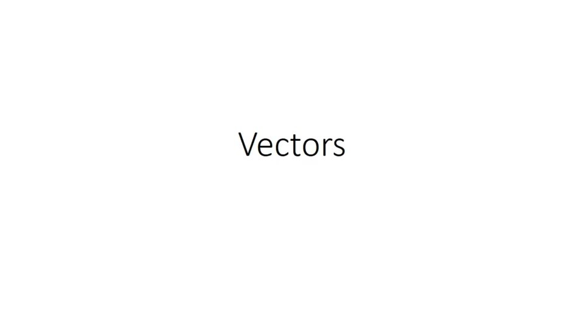

**Content:** Title card — *Vectors* (Chapter 1).

> 🎙️ **Narration:** *"Hello and welcome to part one of the course on linear algebra for computing. We start with the first chapter on vectors."*

---

### 🎬 Slide 2 — Overview and Learning Outcomes (Part 1 of 2)

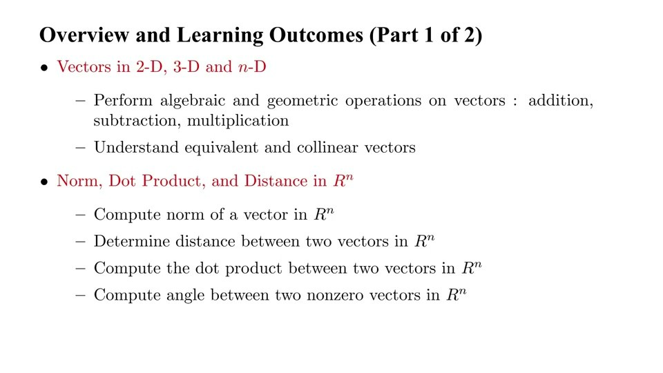

**Content:**

- **Vectors in 2-D, 3-D and n-D**
  - Perform algebraic and geometric operations on vectors: **addition, subtraction, multiplication**
  - Understand **equivalent and collinear** vectors
- **Norm, Dot Product, and Distance in ℝⁿ**
  - Compute the **norm** of a vector in ℝⁿ
  - Determine the **distance** between two vectors in ℝⁿ
  - Compute the **dot product** between two vectors in ℝⁿ
  - Compute the **angle** between two nonzero vectors in ℝⁿ

> 🎙️ **Narration:** *"The overview and learning outcomes include study of vectors in 2D, 3D and n-D, where we will perform algebraic and geometric operations on vectors, understand equivalent and collinear vectors. The next topic would be finding the norm, dot product and distance between vectors in n-dimensional space. Determining whether two vectors are orthogonal, because orthogonality is an important topic in vectors. Find equations for lines or planes using a normal vector and a point on the plane. Vector and parametric equations, where we express equations of lines using vector or parametric notations, as well as equations of planes."*

---

### 🎬 Slide 3 — Scalars vs. Vectors + Notation

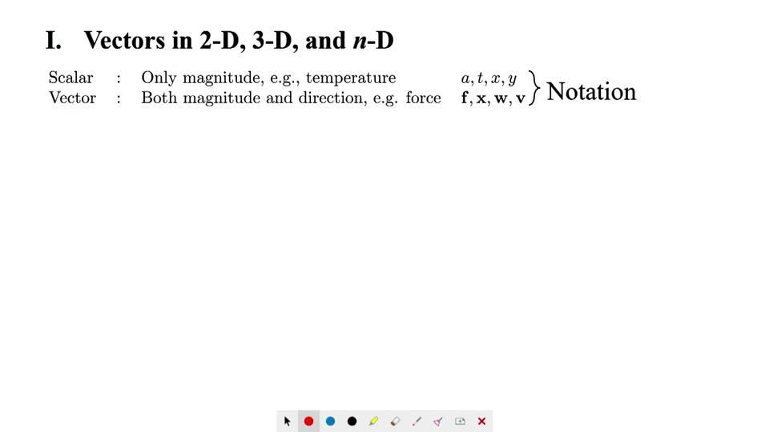

**Content:**

- **Scalar:** only *magnitude*, e.g., temperature. Often written as a plain/italic letter: $a, t, x, y, \dots$
- **Vector:** both *magnitude* and *direction*, e.g., force. Often written as a bold letter: $\mathbf{f}, \mathbf{x}, \mathbf{w}, \mathbf{v}$
- **Notation:** in print we use bold letters ($\mathbf v$); when writing by hand we write an arrow over the letter ($\vec v$).

> 🎙️ **Narration:** *"We know that a scalar has only magnitude. So an example of a scalar quantity is temperature, whereas a vector quantity has both magnitude and direction. An example of a vector quantity is force — we say that a force of 5 newtons is applied in a particular direction. As far as notation is concerned, we will represent vectors using bold letters as shown here. However, when we write on paper, you can represent a vector with an arrowhead on the top."*

---

### 🎬 Slide 4 — Initial/Terminal Points, Equal Vectors, Zero Vector

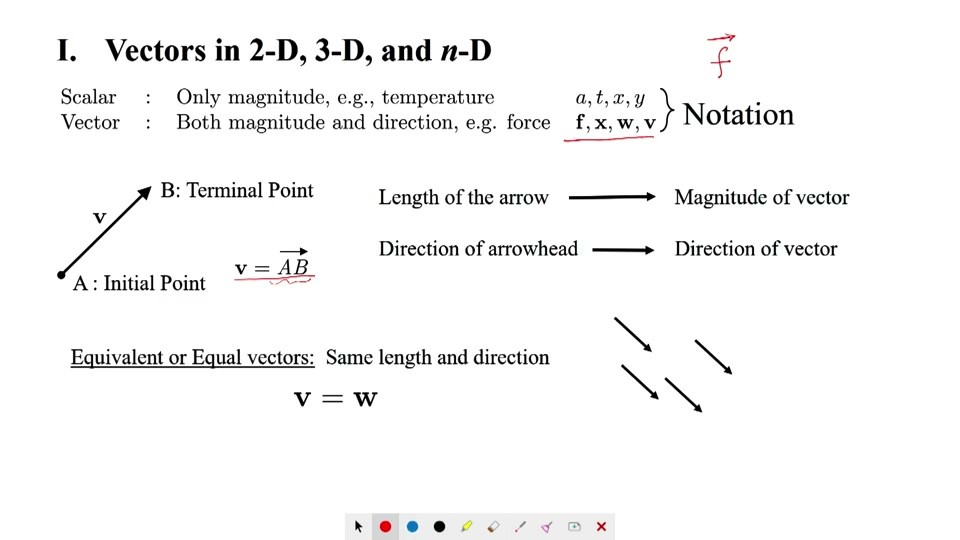

**Content:**

- A vector $\vec v$ has two points:
  - **A: initial point** (where the vector starts)
  - **B: terminal point** (where the vector ends)
- The **length of the arrow** → **magnitude** of the vector.
- The **direction of the arrowhead** → **direction** of the vector.
- **Equivalent / Equal vectors:** same length *and* same direction → $\mathbf v = \mathbf w$.

> 🎙️ **Narration:** *"So a vector has two points: one is the initial point from where the vector starts, and B is the terminal point where the vector ends. We write a vector with initial point at A and terminal point at B as AB with an arrow overhead. By looking at this vector, we know that A is the initial point and B is the terminal point. The length of the arrow indicates the magnitude of the vector, whereas the direction of the arrowhead denotes the direction of the vector. What are equal or equivalent vectors? They are vectors of the same length and direction, and we can simply write two equal vectors as V equal to W. So this group of vectors here are all equal because they have the same length and direction. Note that we do not have any reference frame in describing these vectors. There is also the zero vector where the initial and terminal points coincide — in other words, the length is zero. Yet it is a vector, and it is denoted by zero. When you would write it, you should write it as zero with an arrowhead on the top."*

---

### 🎬 Slide 5 — Vector Addition (Part 1 of 2): Parallelogram Rule

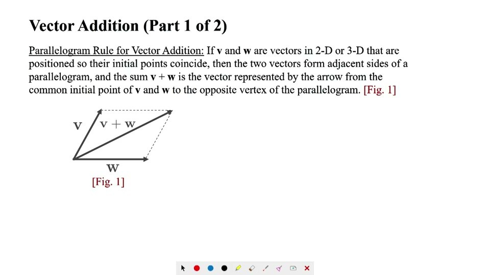

**Content:**

**Parallelogram Rule for Vector Addition:** If $\mathbf v$ and $\mathbf w$ are vectors in 2-D or 3-D positioned so their **initial points coincide**, then the two vectors form adjacent sides of a parallelogram, and the sum $\mathbf v + \mathbf w$ is the vector represented by the arrow from the **common initial point** of $\mathbf v$ and $\mathbf w$ to the **opposite vertex** of the parallelogram.

![Fig. 1 — Parallelogram rule]

> 🎙️ **Narration:** *"We can also add vectors according to the parallelogram rule for vector addition. If V and W are vectors in two-dimensional or three-dimensional space that are positioned so that their initial points coincide — so we have a vector V and a vector W whose initial points coincide — then the two vectors form adjacent sides of a parallelogram. So we complete that parallelogram, and the sum V plus W is the vector represented by the arrow from the common initial point of V and W to the opposite vertex of the parallelogram. So we have V plus W is the sum of the vectors V and W."*

---

### 🎬 Slide 6 — Vector Addition (Part 2 of 2): Triangle Rule & Commutativity

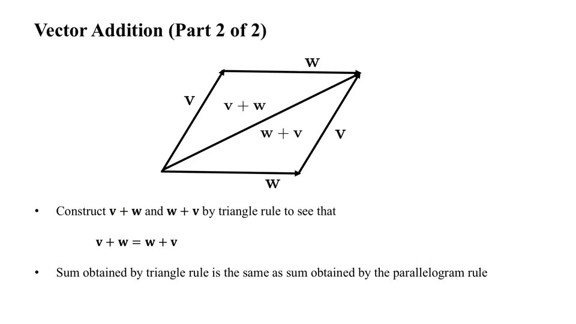

**Content:**

- **Triangle Rule:** position $\mathbf v$ and $\mathbf w$ so that the initial point of $\mathbf w$ is at the terminal point of $\mathbf v$. Then $\mathbf v + \mathbf w$ is the arrow from the initial point of $\mathbf v$ to the terminal point of $\mathbf w$.
- Construct $\mathbf v + \mathbf w$ and $\mathbf w + \mathbf v$ by the triangle rule to see that

$$\mathbf v + \mathbf w = \mathbf w + \mathbf v \quad \text{(commutative)}$$

- The sum obtained by the **triangle rule** is the **same** as the sum obtained by the **parallelogram rule**.

> 🎙️ **Narration:** *"There is another way to find the addition of two vectors, and that is the triangle rule for vector addition — where if V and W are vectors positioned so that the initial point of W is at the terminal point of V, then the sum V plus W is the vector represented by the arrow from the initial point of V to the terminal point of W. So whether you do a parallelogram law to get V plus W or a triangle law to get V plus W, you see that both are the same. We can construct V plus W and W plus V by triangle rule to see that V plus W is equal to W plus V. So we have V here and W there; V plus W is this vector according to triangle law. But what about W plus V? So W is there and V has to be such that its initial point coincides with the terminal point of W, and so W plus V is that vector. So we see that V plus W as well as W plus V are the same. The sum obtained by triangle rule is the same as the sum obtained by parallelogram rule. So for the parallelogram, we said this was W, that was V; we complete the parallelogram and the vector from the common initial point to the opposite vertex is the sum V plus W. So by parallelogram law as well as by triangle rule we get the same answer for the sum of two vectors."*

---

### 🎬 Slide 7 — Vector Subtraction

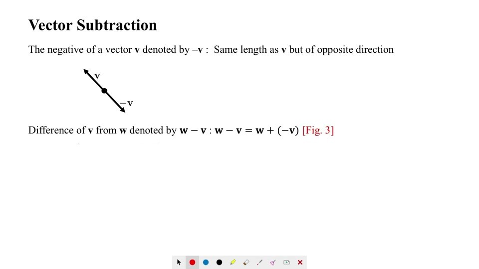

**Content:**

- The **negative** of a vector $\mathbf v$, denoted $-\mathbf v$: **same length** as $\mathbf v$ but of **opposite direction**.
- The **difference** of $\mathbf v$ from $\mathbf w$, denoted $\mathbf w - \mathbf v$:

$$\mathbf w - \mathbf v = \mathbf w + (-\mathbf v)$$

- *Alternative construction:* position $\mathbf v$ and $\mathbf w$ with the same initial point; draw the vector from the terminal point of $\mathbf v$ to the terminal point of $\mathbf w$.

> 🎙️ **Narration:** *"You could also subtract a vector. So first we need to know what is the negative of a vector. A negative of a vector has the same length as V but is of opposite direction. So if V is the vector, the negative of V points in the opposite direction; however the length is the same as that of V. And therefore now we can write the difference of V from W, denoted by W minus V, as the sum of W and the negative of V. So we have V here and W. We now want to add W and the negative of V — negative of V is the same length as V but in the opposite direction — and now we need to add W and minus V. So we use the parallelogram law of addition, and that is the vector W minus V. You could position V and W so that their initial points coincide and draw a vector from the terminal point of V to the terminal point of W; that is the other way of finding W minus V. So that is the vector W minus V, which is the same as the vector W minus V that we obtained by inverting V and applying the parallelogram law of addition."*

---

### 🎬 Slide 8 — Scalar Multiplication

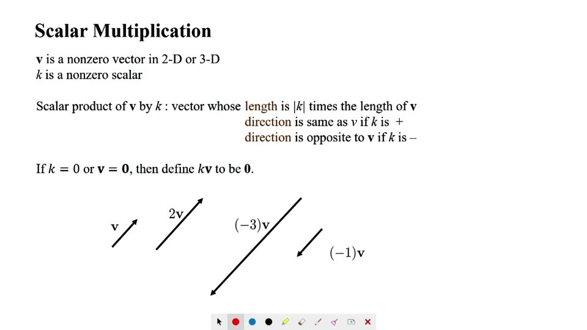

**Content:**

- $\mathbf v$ is a nonzero vector in 2-D or 3-D; $k$ is a nonzero scalar.
- **Scalar product of $\mathbf v$ by $k$:** a vector whose **length is $|k|$ times** the length of $\mathbf v$, and whose
  - **direction is the same** as $\mathbf v$ if $k$ is **positive**;
  - **direction is opposite** to $\mathbf v$ if $k$ is **negative**.
- If $k = 0$ or $\mathbf v = \mathbf 0$, then define $k\mathbf v = \mathbf 0$.
- Examples on slide: $2\mathbf v$, $(-3)\mathbf v$, $(-1)\mathbf v = -\mathbf v$.

> 🎙️ **Narration:** *"A vector can be multiplied by a scalar. So if V is a nonzero vector in 2D or 3D and K is a nonzero scalar, then we can multiply the vector V by the scalar K. The result is another vector. When we multiply a vector by a scalar, the result is a vector whose length is |K| times the length of V, and the direction is the same as V if K is positive, and the direction is opposite to V if K is negative. If K is equal to zero or V is the zero vector, then we define K times V to be zero. So let's look at some examples of scalar multiplication. So here we have the vector V, and when we multiply it with the scalar 2, the vector is in the same direction as V but its length is doubled. However, when we multiply with a scalar minus 3, then the direction of the vector is in the opposite direction of V and its length is 3 times the length of V. We have already seen that negative 1 times V is simply the negative of that vector V."*

---

### 🎬 Slide 9 — Key Points (End of Section 1)

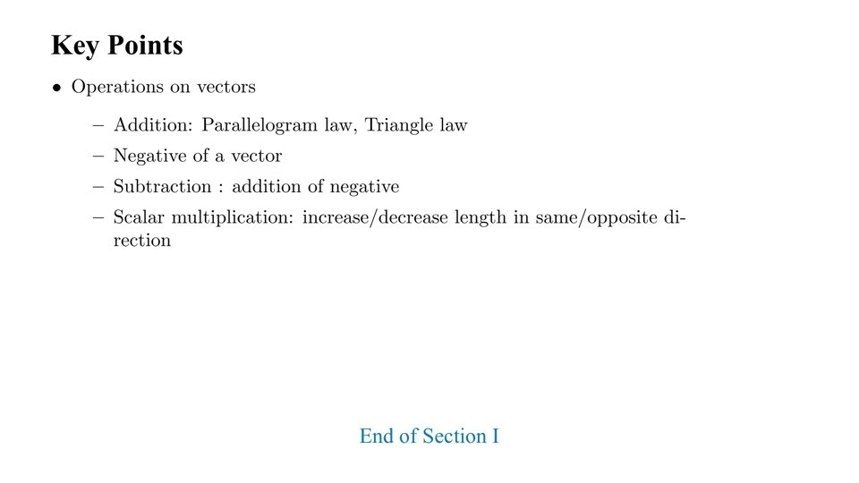

**Content — Key Points:**

- **Operations on vectors**
  - **Addition:** Parallelogram law, Triangle law
  - **Negative** of a vector
  - **Subtraction:** addition of the negative
  - **Scalar multiplication:** increase/decrease length in same/opposite direction

*End of Section 1.*

> 🎙️ **Narration:** *"So the key points in this topic were operations on vectors. We looked at the addition of two vectors using the parallelogram law and the triangle law. We saw that the negative of a vector is the same as multiplying a vector with minus 1 — the direction is opposite to the original vector. We also saw subtraction of vectors, which can be considered as addition of the negative of a vector, and then we saw that scalar multiplication of a vector by a scalar increases or decreases the length in the same or opposite direction of the original vector. And that is the end of Section 1."*

---

## 1.2 Parallel to Coordinate System

### 🎬 Slide 1 — Overview and Learning Outcomes

**Content:**

- **Vectors in 2-D, 3-D and n-D**
  - Perform algebraic and geometric operations on vectors: addition, subtraction, multiplication
  - Understand **equivalent and collinear** vectors

> 🎙️ **Narration:** *"Although we have seen the addition, subtraction and multiplication of vectors in the previous topic, we will look at some additional properties of addition, subtraction and multiplication of vectors in this topic, and also understand equivalent and collinear vectors."*

---

### 🎬 Slide 2 — Parallel and Collinear Vectors

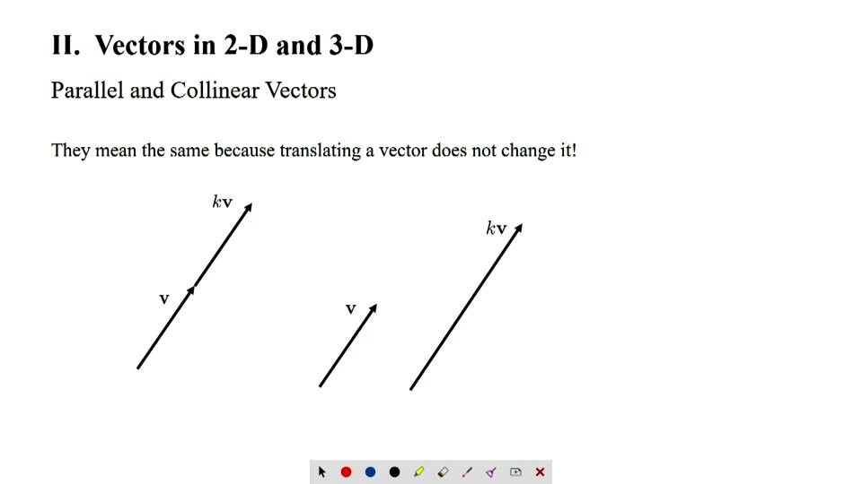

**Content:**

- **Parallel** and **collinear** vectors mean the **same** thing — because translating a vector does not change it!
- $k\mathbf v$ and $\mathbf v$ are parallel/collinear: both are scalar multiples of each other.
- No coordinate system / reference frame is being referred to here.

> 🎙️ **Narration:** *"So, parallel and collinear vectors mean the same because translating a vector does not change it. Note once again that we are not referring to any coordinate system in which the vectors are represented. So, if we have a vector v such as this, then k times v can be represented as this vector or this vector — both of them are the same. Although here kv is collinear with v (that means kv and v are along the same line), whereas here kv and v are not on the same line, yet both of them are parallel."*

---

### 🎬 Slide 3 — Associative Law for Addition

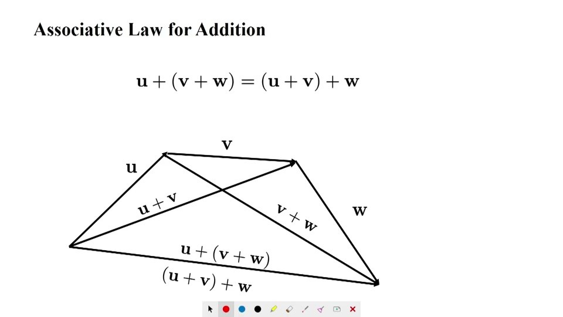

**Content:**

$$\mathbf u + (\mathbf v + \mathbf w) = (\mathbf u + \mathbf v) + \mathbf w$$

Vector addition is **associative**: adding $\mathbf u$ to the sum $\mathbf v+\mathbf w$ gives the same result as adding the sum $\mathbf u+\mathbf v$ to $\mathbf w$.

> 🎙️ **Narration:** *"Addition of vectors follows the associative law for addition, which basically says that if you add two vectors and add the resultant to a third vector, it is the same as adding the first two vectors and adding the result to the third vector w. So, in the figure you can see that u plus v gives u plus v here, and when we add w to u plus v, we get u plus v plus w. On the other hand, when we add v plus w first, we get v plus w here, and this vector is added to u to get u plus v plus w. So, this shows that both of the sums are the same, and therefore vector addition follows the associative law."*

---

### 🎬 Slide 4 — Vectors in Coordinate Systems

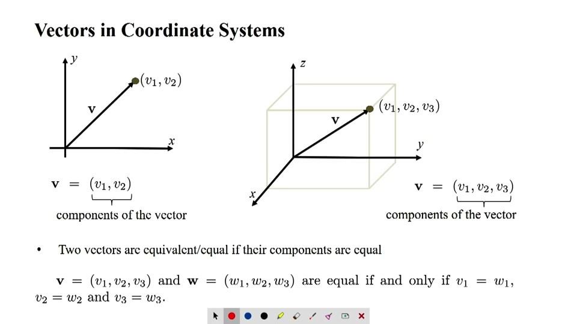

**Content:**

- So far vectors have been in "free space"; now we anchor vectors to a **coordinate system**.
- **2-D:** $\mathbf v = (v_1, v_2)$ — two components along the $x$ and $y$ axes.
- **3-D:** $\mathbf v = (v_1, v_2, v_3)$ — three components. Generally an $n$-D vector has $n$ components $v_1, v_2, \dots, v_n$.
- **Two vectors are equivalent/equal if their components are equal:** $\mathbf v = (v_1, v_2, v_3)$ and $\mathbf w = (w_1, w_2, w_3)$ are equal **iff** $v_1 = w_1$, $v_2 = w_2$ and $v_3 = w_3$.

> 🎙️ **Narration:** *"So far we have seen vectors which are in free space, so to say, but now we are going to discuss vectors that are anchored to a coordinate system. This is a 2D coordinate system and it has two axes x and y; the vector which is represented in this two-dimensional space has two components v1, v2, and the two components can be plotted on the coordinate space. So we go v1 in this direction and v2 in the other direction, and therefore the vector v whose components are v1, v2 is denoted by this arrow. On the right-hand side we have a vector v which is in three-dimensional space; it has three components v1, v2, v3. We can extend this idea and say that for an n-dimensional space the vector would have n such components v1, v2, and so on up to vn. Two vectors are equivalent or equal if their components are equal. So here we have a vector v which is v1, v2, v3, and another vector w whose components are w1, w2, w3. These two vectors are equal if and only if v1 = w1, v2 = w2, and v3 = w3."*

---

### 🎬 Slide 5 — Vectors with Initial Point NOT at Origin

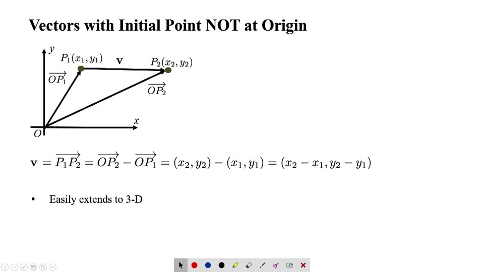

**Content:**

For a vector $\mathbf v$ whose **initial point is $P_1(x_1, y_1)$** and **terminal point is $P_2(x_2, y_2)$**:

$$\mathbf v = \overrightarrow{P_1P_2} = \overrightarrow{OP_2} - \overrightarrow{OP_1} = (x_2, y_2) - (x_1, y_1) = (x_2 - x_1,\; y_2 - y_1)$$

- Easily extends to 3-D: $\mathbf v = (x_2-x_1,\; y_2-y_1,\; z_2-z_1)$.

> 🎙️ **Narration:** *"How about vectors whose initial point is not at the origin? If we go to the previous slide, we find that the initial point of this vector is at the origin, and the initial point of this vector is also at the origin of the coordinate system. Now, here we have a vector v whose initial point is at (x1, y1) and the terminal point is at (x2, y2). So such a vector is represented as P1P2, which is OP2 minus OP1, which is (x2, y2) minus (x1, y1), and when we subtract these two vectors we are basically subtracting individual components — so x2 minus x1 and y2 minus y1. So if you have a vector whose initial point is at (x1, y1) and the terminal point is at (x2, y2), then that vector v can be represented as (x2 − x1, y2 − y1). Clearly this can be easily extended to the three-dimensional case."*

---

### 🎬 Slide 6 — Vectors with Initial Point NOT at Origin (contd.)

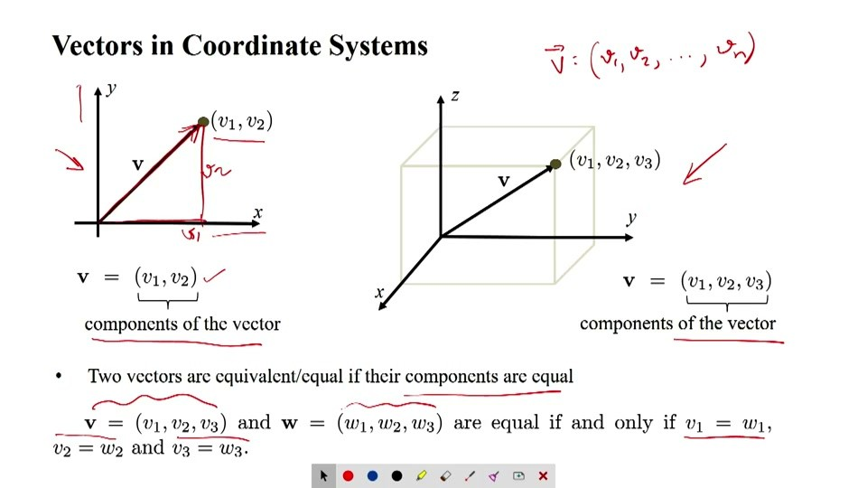

**Content:** *(continuation of the previous slide — the diagram is progressively revealed.)*

- The initial point of a vector at the origin: $\mathbf v = (v_1, v_2)$ directly equals its coordinates.
- The same subtraction-of-position-vectors idea applies for any initial point.

> 🎙️ **Narration:** *"If we go to the previous slide, we find that the initial point of this vector is at the origin, and the initial point of this vector is also at the origin of the coordinate system."*

---

### 🎬 Slide 7 — Vectors with Initial Point NOT at Origin (complete)

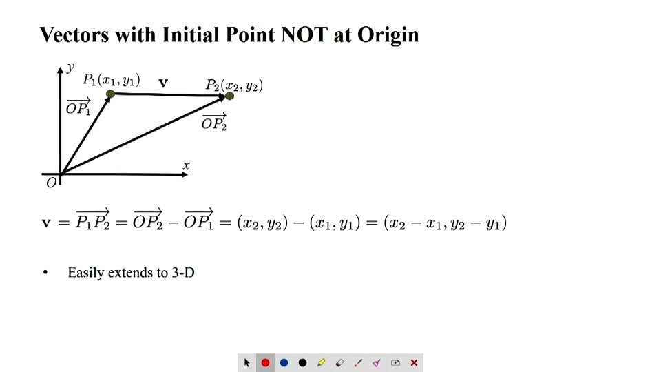

**Content:**

$$\mathbf v = \overrightarrow{P_1P_2} = \overrightarrow{OP_2} - \overrightarrow{OP_1} = (x_2, y_2) - (x_1, y_1) = (x_2 - x_1,\; y_2 - y_1)$$

- **Easily extends to 3-D.**

> 🎙️ **Narration:** *"Now, here we have a vector v whose initial point is at (x1, y1) and the terminal point is at (x2, y2). So such a vector is represented as P1P2 = OP2 − OP1 = (x2, y2) − (x1, y1), and when we subtract these two vectors we are basically subtracting individual components, so x2 − x1 and y2 − y1. Clearly this can be easily extended to the three-dimensional case."*

---

### 🎬 Slide 8 — Worked Example

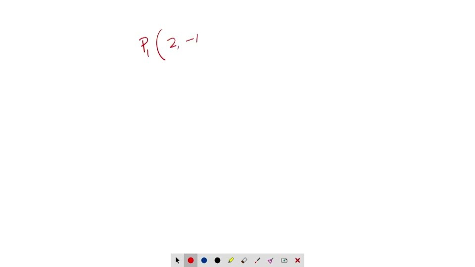

**Content (worked example):**

Find the vector $\mathbf v$ with initial point $P_1$ and terminal point $P_2$ where

$$P_1 = (2,\,-1,\,4),\qquad P_2 = (7,\,5,\,-8)$$

$$\mathbf v = P_1P_2 = (7-2,\; 5-(-1),\; -8-4) = (5,\; 6,\; -12)$$

> 🎙️ **Narration:** *"Let us look at an example. If we have a vector v with initial point P1 located at (2, −1, 4) and the terminal point P2 located at (7, 5, −8), then we can see that the components of that vector v with these initial and terminal points is (7 − 2, 5 − (−1), −8 − 4), which is equal to (5, 6, −12)."*

---

### 🎬 Slide 9 — Key Points (End of Section 2)

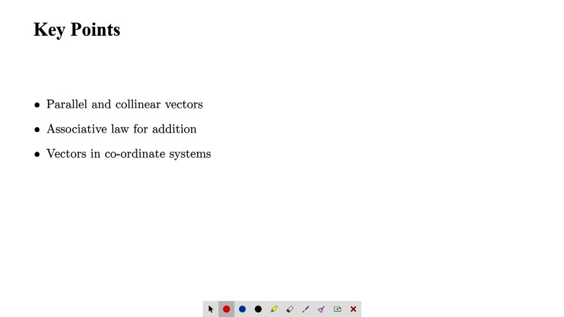

**Content — Key Points:**

- **Parallel and collinear** vectors
- **Associative law** for addition
- Vectors in **coordinate systems**

*End of Section 2 of Topic 1.*

> 🎙️ **Narration:** *"So the key points that we have seen in this section is that you can have parallel and collinear vectors, which are the same if we do not have a reference frame in which those vectors are specified. Then we also saw the associative law for addition, and then we saw how vectors can be represented when we have a reference coordinate system associated with it. That is the end of section 2 of topic 1."*

---

## 1.3 Vectors in nD space

### 🎬 Slide 1 — Overview and Learning Outcomes

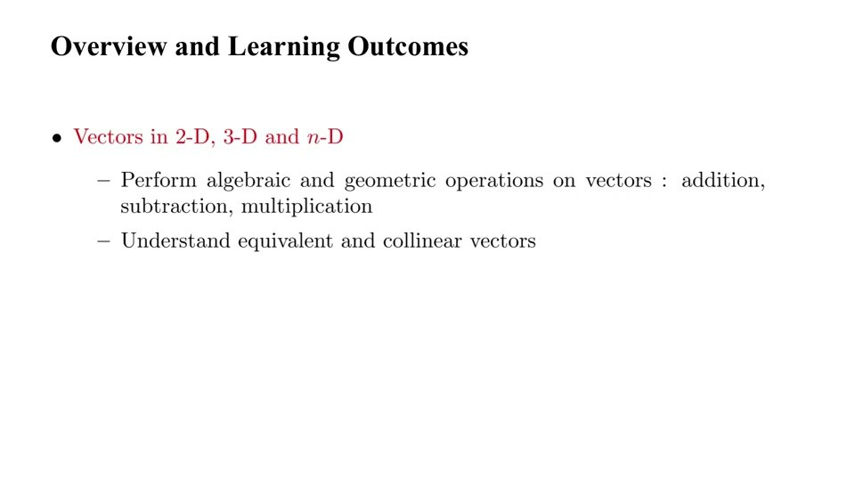

**Content:**

- **Vectors in 2-D, 3-D and n-D** — perform algebraic and geometric operations on vectors: addition, subtraction, multiplication; understand equivalent and collinear vectors.

> 🎙️ **Narration:** *"We will still look at how to perform algebraic and geometric operations on vectors — addition, subtraction and multiplication — but in this topic we are focusing on n-dimensional space, and we will look at some theorems associated with these algebraic operations."*

---

### 🎬 Slide 2 — Vectors in n-D space (Part 1 of 4): ℝⁿ

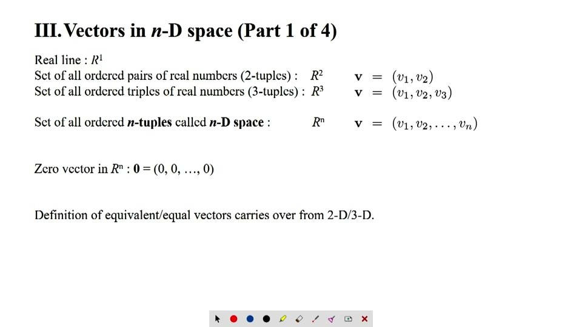

**Content:**

- **Real line:** $\mathbb{R}^1$ — the set of all real numbers.
- **Set of all ordered pairs of real numbers (2-tuples):** $\mathbb{R}^2$; $\mathbf v = (v_1, v_2)$
- **Set of all ordered triples of real numbers (3-tuples):** $\mathbb{R}^3$; $\mathbf v = (v_1, v_2, v_3)$
- **Set of all ordered $n$-tuples, called n-D space:** $\mathbb{R}^n$; $\mathbf v = (v_1, v_2, \dots, v_n)$
- **Zero vector in $\mathbb{R}^n$:** $\mathbf 0 = (0, 0, \dots, 0)$
- The definition of equivalent/equal vectors carries over from 2-D/3-D.

> 🎙️ **Narration:** *"The real line is a one-dimensional space where you have the real numbers marked on it, and it is denoted by ℝ¹, where 1 indicates the dimension. The set of all ordered pairs of real numbers, or two-tuples, is denoted by ℝ² — a two-dimensional space with two components v1, v2. The set of all ordered triples of real numbers, three-tuples, are denoted by ℝ³, where the 3 indicates dimension 3, meaning there are three components to the vector v in ℝ³. We refer to vectors in two-dimensional space as v belonging to ℝ²; in three-dimensional space, v belongs to ℝ³; and this can be extended to n-dimensional space. We have a set of all ordered n-tuples, which means there are n components in a vector belonging to n-dimensional space. The R refers to real numbers, indicating that each of these components is a real number. Just as we talked about zero vectors earlier, we have a zero vector in n-dimensional space also, where the zero vector is said to have n components, each of them equal to zero. The definition of equivalent or equal vectors carries over from 2D or 3D that we have already seen."*

---

### 🎬 Slide 3 — Vectors in n-D space (Part 2 of 4): Operations

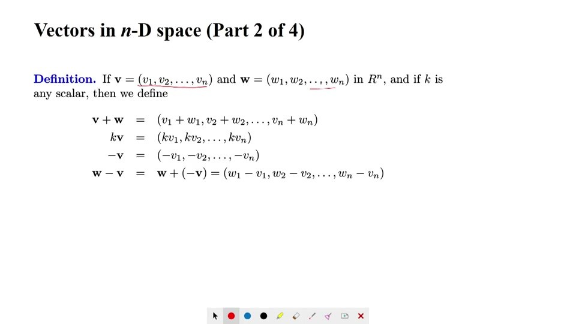

**Content — Definition.** If $\mathbf v = (v_1, v_2, \dots, v_n)$ and $\mathbf w = (w_1, w_2, \dots, w_n)$ are in $\mathbb{R}^n$, and if $k$ is any scalar, then:

$$\mathbf v + \mathbf w = (v_1 + w_1,\; v_2 + w_2,\; \dots,\; v_n + w_n)$$

$$k\mathbf v = (kv_1,\; kv_2,\; \dots,\; kv_n)$$

$$-\mathbf v = (-v_1,\; -v_2,\; \dots,\; -v_n)$$

$$\mathbf w - \mathbf v = \mathbf w + (-\mathbf v) = (w_1 - v_1,\; w_2 - v_2,\; \dots,\; w_n - v_n)$$

All operations are performed **component-wise**.

> 🎙️ **Narration:** *"If v is a vector in n-dimensional space (it has n components) and w is also in n-dimensional space (both vectors are in ℝⁿ), and if k is any scalar, then we define the following arithmetic operations. The sum of two vectors is the sum of the individual components. Multiplying a vector with a scalar means every component is multiplied by that scalar. The negative of a vector means every component of that vector is negated, and the subtraction of two vectors w minus v — which we have already seen — is the addition of minus v, equal to the subtraction of individual components w1 minus v1, w2 minus v2, and so on up to wn minus vn."*

---

### 🎬 Slide 4 — Worked Example of the Operations

**Content (worked example):**

Let $\mathbf v = (1, -3, 2)$ and $\mathbf w = (4, 2, 1)$. Then:

$$\mathbf v + \mathbf w = (1+4,\; -3+2,\; 2+1) = (5,\; -1,\; 3)$$

$$2\mathbf v = (2(1),\; 2(-3),\; 2(2)) = (2,\; -6,\; 4)$$

$$-\mathbf w = (-4,\; -2,\; -1)$$

$$\mathbf v - \mathbf w = \mathbf v + (-\mathbf w) = (1-4,\; -3-2,\; 2-1) = (-3,\; -5,\; 1)$$

> 🎙️ **Narration:** *"Let us look at an example. If v = (1, −3, 2) and w = (4, 2, 1), then v + w is component-wise addition: 1 + 4 = 5, −3 + 2 = −1, 2 + 1 = 3. Similarly, multiplying a vector with the scalar 2, every component is multiplied by 2, so we get (2, −6, 4). The negative of a vector w means each component is negated, so (−4, −2, −1). And finally, when we subtract two vectors, v − w which is the same as v plus minus w, we get (1 − 4, −3 − 2, 2 − 1) = (−3, −5, 1)."*

---

### 🎬 Slide 5 — Introduction to the Algebraic Properties (transition)

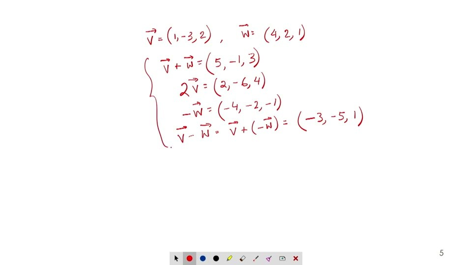

**Content:** *(transition to the theorem on algebraic properties of vectors in ℝⁿ.)*

> 🎙️ **Narration:** *"So this is an example of the different operations that can be done on vectors. Now let us look at a theorem related to vectors in ℝⁿ. If u, v and w are vectors in ℝⁿ, and if k and m are scalars, then these properties are applicable."*

---

### 🎬 Slide 6 — Vectors in n-D space (Part 3 of 4): The Theorem

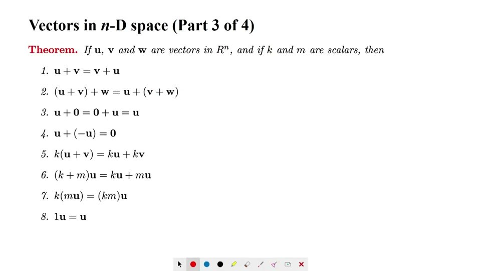

**Content — Theorem.** If $\mathbf u$, $\mathbf v$ and $\mathbf w$ are vectors in $\mathbb{R}^n$, and if $k$ and $m$ are scalars, then:

1. $\mathbf u + \mathbf v = \mathbf v + \mathbf u$ (commutativity)
2. $(\mathbf u + \mathbf v) + \mathbf w = \mathbf u + (\mathbf v + \mathbf w)$ (associativity)
3. $\mathbf u + \mathbf 0 = \mathbf 0 + \mathbf u = \mathbf u$ (identity)
4. $\mathbf u + (-\mathbf u) = \mathbf 0$ (inverse)
5. $k(\mathbf u + \mathbf v) = k\mathbf u + k\mathbf v$ (distributivity over vectors)
6. $(k+m)\mathbf u = k\mathbf u + m\mathbf u$ (distributivity over scalars)
7. $k(m\mathbf u) = (km)\mathbf u$ (associativity of scalar multiplication)
8. $1\mathbf u = \mathbf u$

> 🎙️ **Narration:** *"So u + v = v + u; (u + v) + w = u + (v + w) — this was the associative law we saw. u plus the zero vector is the same as the zero vector plus u, which is equal to u. u plus its negative results in the zero vector. k(u + v) = ku + kv. (k + m)u = ku + mu. When you multiply a vector with a scalar and multiply the resulting vector with a second scalar, it is the same as multiplying the two scalars together and then multiplying the vector u. And finally, 1 times the vector u is that vector itself. So as with all theorems, we ought to prove these properties, because they are all part of a theorem. Every theorem can be proved. So what we will do is take one of these properties and prove it, and then I will leave the rest of the properties for you to prove following a very similar way as I will show next."*

---

### 🎬 Slide 7 — Proof of the Associative Law (left-hand side)

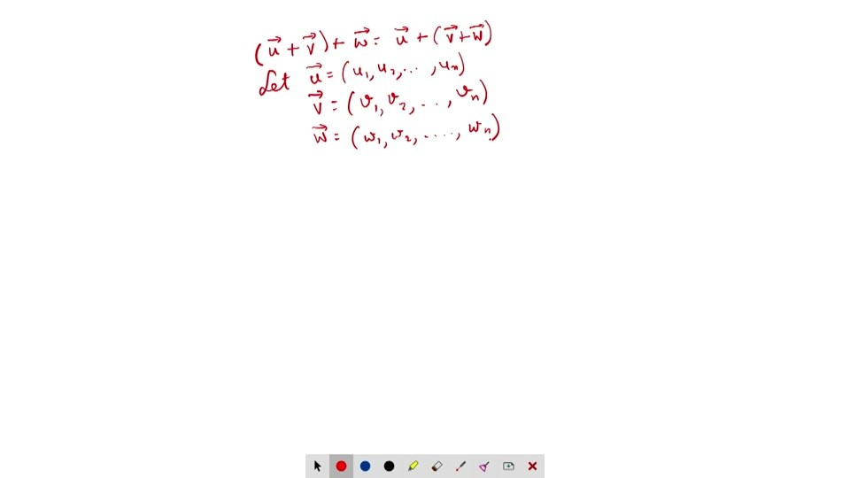

**Content — Proof outline:**

We want to prove $(\mathbf u + \mathbf v) + \mathbf w = \mathbf u + (\mathbf v + \mathbf w)$.

Let $\mathbf u = (u_1,\dots,u_n)$, $\mathbf v = (v_1,\dots,v_n)$, $\mathbf w = (w_1,\dots,w_n)$. Starting from the LHS:

$$(\mathbf u + \mathbf v) + \mathbf w = \big((u_1+v_1,\; u_2+v_2,\; \dots)\big) + (w_1,\; w_2,\; \dots, w_n)$$

$$= (u_1+v_1+w_1,\; u_2+v_2+w_2,\; \dots,\; u_n+v_n+w_n)$$

> 🎙️ **Narration:** *"We want to prove this property of the associative law of addition: (u + v) + w is the same as u + (v + w). How do we go about proving it? We start by specifying the vectors u, v and w, because we do not have anything else to start off with. We say let u = (u1, u2, …, un), because u, v and w are in ℝⁿ, so there will be n components. Similarly v = (v1, v2, …, vn), and finally w = (w1, w2, …, wn). Now we start with the left-hand side of the statement that we want to prove: (u + v) + w. Our goal is to reach the right-hand side of the statement. We know u = (u1, …, un) plus v = (v1, …, vn) plus w = (w1, …, wn). We have already seen how to add two vectors — we just add the components. So when we add these two, we get (u1 + v1, u2 + v2, …, un + vn), and we write the remaining part as it is, (w1, w2, …, wn). Now we can add these two vectors, and we get (u1 + v1 + w1, u2 + v2 + w2, …, un + vn + wn)."*

---

### 🎬 Slide 8 — Proof of the Associative Law (conclusion)

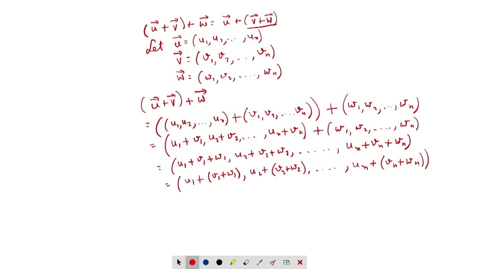

**Content — Proof conclusion:**

Group $v$ and $w$ components together:

$$= \mathbf u + (v_1+w_1,\; v_2+w_2,\; \dots,\; v_n+w_n) = \mathbf u + (\mathbf v + \mathbf w)$$

which is the right-hand side. **∎**

> 🎙️ **Narration:** *"We must always see what our goal is. Our goal is to reach the right-hand side, where v and w appear together. So we can do that here by simply saying u1 + (v1 + w1), u2 + (v2 + w2), and so on — un + (vn + wn). Now we can split this last statement based on the addition of vectors, by saying that this statement is actually the sum of two vectors whose components are (u1, u2, …, un) plus (v1 + w1, v2 + w2, …, vn + wn). And we can easily write (u1, u2, …, un) as the vector u, and we can write (v1 + w1, v2 + w2, …, vn + wn) as the sum of vectors v and w. And thus we have reached the right-hand side of the statement that we set out to prove. So this is a very simple way in which you can prove the associative law of addition of vectors. And you are encouraged to look at the other parts of the theorem in the previous slide to prove — you just need to follow steps that are very similar to what we have done here."*

---

### 🎬 Slide 9 — Vectors in n-D space (Part 4 of 4): More Results + Linear Combination

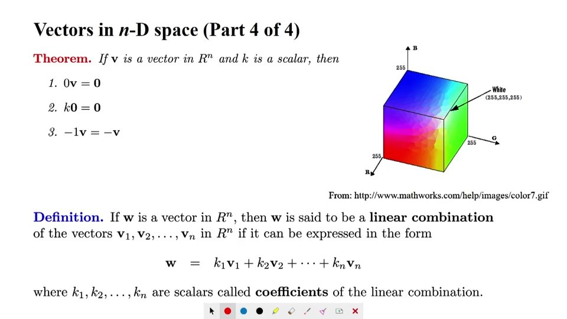

**Content — Theorem.** If $\mathbf v$ is a vector in $\mathbb{R}^n$ and $k$ is a scalar, then:

1. $0\mathbf v = \mathbf 0$
2. $k\mathbf 0 = \mathbf 0$
3. $(-1)\mathbf v = -\mathbf v$

**Definition.** If $\mathbf w$ is a vector in $\mathbb{R}^n$, then $\mathbf w$ is said to be a **linear combination** of the vectors $\mathbf v_1, \mathbf v_2, \dots, \mathbf v_p$ in $\mathbb{R}^n$ if it can be expressed in the form

$$\mathbf w = k_1\mathbf v_1 + k_2\mathbf v_2 + \cdots + k_p\mathbf v_p$$

where $k_1, k_2, \dots, k_p$ are scalars, called the **coefficients** of the linear combination.

> 🎙️ **Narration:** *"Another theorem about vectors in ℝⁿ states that if v is a vector in ℝⁿ and k is a scalar, then 0 times the vector v — multiplying the vector v with the scalar 0 — the result is the zero vector. Similarly, when we multiply a zero vector with the scalar k, we get the zero vector; and (−1) times v is the negative of that vector. This was similar to what we have already seen in two-dimensional and three-dimensional space. Then we go on to a definition of linear combination: if w is a vector in ℝⁿ, then w is said to be a linear combination of the vectors v1, v2, …, vp in ℝⁿ. Note that this n means there are n such vectors... actually p such vectors, and each of these vectors is in n-dimensional space. So w is a linear combination of v1 up to vp if it can be expressed in the form w = k1v1 + k2v2 + ⋯ + kpvp, where k1, k2, …, kp are called the coefficients of the linear combination, and they are the scalars."*

---

### 🎬 Slide 10 — Application of Linear Combination: The Color Cube

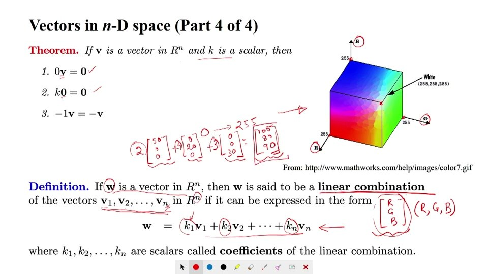

**Content (application):**

- In an image each pixel has a color with three primary components: **R**ed, **G**reen, **B**lue, each intensity from 0 (darkest) to 255 (brightest). These can be plotted as a vector $\mathbf c = (R, G, B)$ in a **color cube**.
- **White** = brightest red + green + blue.
- Example: $2(50,0,0) + 4(0,20,0) + 3(0,0,30) = (100, 80, 90)$ — the resulting pixel color is a **linear combination** of the three primary-color vectors, with coefficients $2, 4, 3$.

> 🎙️ **Narration:** *"We will look at linear combination in more detail later on, but to give you an idea of where linear combination is used, look at this figure, which is that of a color cube. In an image, there are many pixels, and each pixel has a particular color and an intensity. The primary colors are red, green and blue, and the intensity of each color varies from 0 to 255, where 0 is the darkest and 255 is the brightest. So we can plot these colors on the color cube. White is the combination of the brightest of red, green and blue. So we could have a linear combination: if the colors are represented as vectors — for example, if we have R, G and B as components of a vector, a three-dimensional vector whose components are R, G and B — then there can be a linear combination of different R, G and B vectors. For example, if there is a vector (50, 0, 0) plus (0, 20, 0) plus (0, 0, 30), and we multiply each of these vectors by a scalar — let us say we multiply this one by 2, this one by 4, and the third vector by 3 — then we get another vector. So that vector would be, let us say, (100, 80, 90). Then this vector is said to be a linear combination of these three vectors, and these are the coefficients. This could be the color of one particular pixel, with 100 as the intensity of the red component, 80 as the intensity of the green component, and 90 as the intensity of the blue component."*

---

### 🎬 Slide 11 — Key Points (End of Section 3)

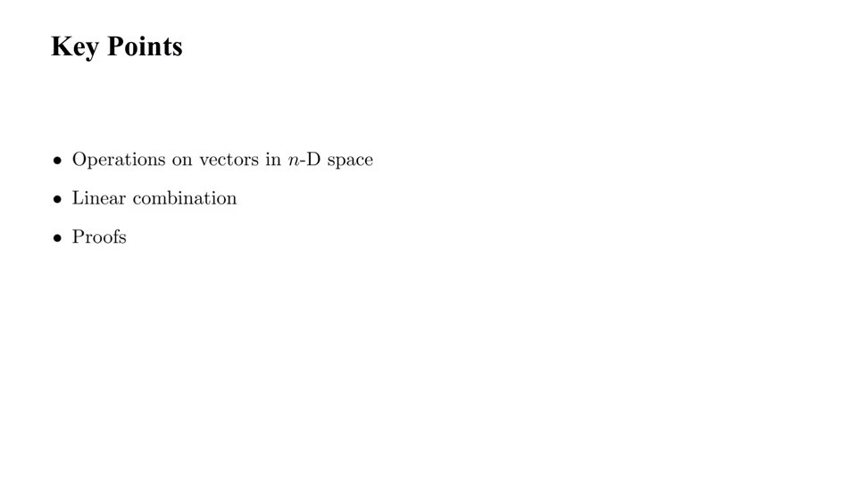

**Content — Key Points:**

- Operations on vectors in n-D space
- Linear combination
- Proofs

*End of Section 3 of this chapter.*

> 🎙️ **Narration:** *"The key points are: operations on vectors in n-dimensional space — we looked at a theorem in which we saw those various operations; we saw how vectors can be linearly combined to get another vector; and then we saw a proof of the associative law of vector addition, and you are encouraged to prove the other parts of that theorem in a similar fashion. That is the end of section 3 of this chapter. Thank you."*

---

## 1.4 Norm to Distance in ℝⁿ

### 🎬 Slide 1 — Overview and Learning Outcomes

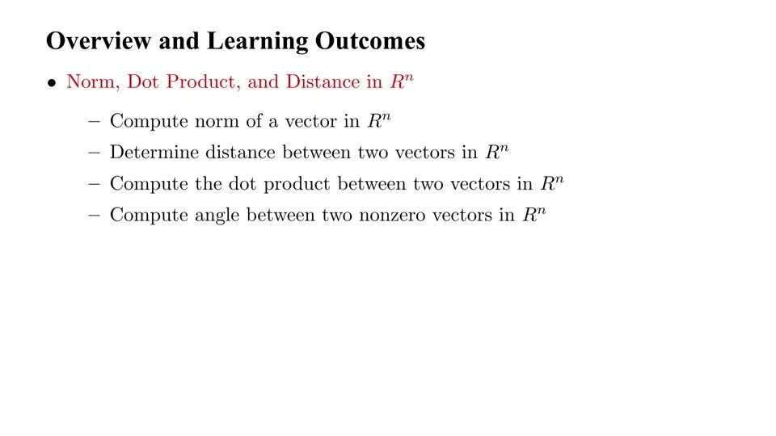

**Content:**

- **Norm, Dot Product, and Distance in ℝⁿ**
  - Compute the **norm** of a vector in ℝⁿ
  - Determine the **distance** between two vectors in ℝⁿ
  - Compute the **dot product** between two vectors in ℝⁿ
  - Compute the **angle** between two nonzero vectors in ℝⁿ

> 🎙️ **Narration:** *"The overview and learning outcomes include computing the norm of a vector in ℝⁿ, determining the distance between two vectors in ℝⁿ, computing the dot product between two vectors in ℝⁿ, and finally computing the angle between two non-zero vectors in ℝⁿ."*

---

### 🎬 Slide 2 — The Norm of a Vector

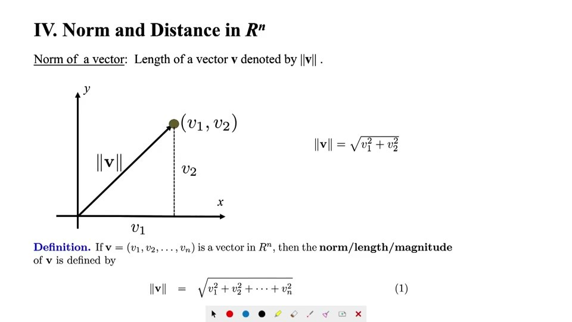

**Content — Norm of a vector: Length of a vector $\mathbf v$, denoted $\|\mathbf v\|$.**

- In 2-D: for $\mathbf v = (v_1, v_2)$, by the Pythagorean theorem

$$\|\mathbf v\| = \sqrt{v_1^2 + v_2^2}$$

**Definition.** If $\mathbf v = (v_1, v_2, \dots, v_n)$ is a vector in $\mathbb{R}^n$, then the **norm/length/magnitude** of $\mathbf v$ is defined by

$$\|\mathbf v\| = \sqrt{v_1^2 + v_2^2 + \cdots + v_n^2}$$

> 🎙️ **Narration:** *"The norm of a vector is just another name for the length of a vector v, and it is denoted by this symbol. In this diagram the vector v is shown with components v1, v2 — we go v1 on the x-axis and v2 on the y-axis — and therefore the length of this vector, which is the norm, is given by the square root of v1² + v2², according to the Pythagorean theorem. This was the case in ℝ², but it can be extended to ℝⁿ in this definition: if v = (v1, v2, …, vn) is a vector in ℝⁿ, then the norm or length or magnitude of v is defined by the square root of v1² + v2² + ⋯ + vn²."*

---

### 🎬 Slide 3 — Example and the Norm Theorem

**Content:**

*Example:* If $\mathbf v = (-3, 2, 1)$, then

$$\|\mathbf v\| = \sqrt{(-3)^2 + 2^2 + 1^2} = \sqrt{9 + 4 + 1} = \sqrt{14}$$

**Theorem.** If $\mathbf v$ is a vector in $\mathbb{R}^n$ and $k$ is a scalar, then:

1. $\|\mathbf v\| \geq 0$
2. $\|\mathbf v\| = 0$ if and only if $\mathbf v = \mathbf 0$
3. $\|k\mathbf v\| = |k|\,\|\mathbf v\|$

> 🎙️ **Narration:** *"Let us look at an example. If the vector v = (−3, 2, 1) — obviously this is a vector in ℝ³ — then we can write the norm of this vector as √((−3)² + 2² + 1²), which turns out to be √14, which you can punch into the calculator and write in decimal form. There is a theorem associated with the norm of a vector which consists of three parts. The theorem says that if v is a vector in ℝⁿ and k is a scalar, then the norm of the vector v is greater than or equal to 0 — you cannot have the norm be negative; this is the non-negative property. The second part says the norm of the vector is 0 if and only if v is the zero vector. And lastly, when a vector v is multiplied by k — scalar multiplication — then the norm of that vector is the same as the norm of the vector v before scalar multiplication times the absolute value of k. These are three important properties of the norm of a vector, and what we will do now is prove the third property; you can follow a similar strategy to prove the first and second parts."*

---

### 🎬 Slide 4 — Proof: $\|k\mathbf v\| = |k|\,\|\mathbf v\|$

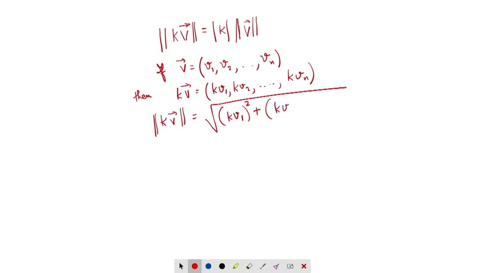

**Content — Proof (part 3 of the theorem):**

Let $\mathbf v = (v_1, v_2, \dots, v_n)$. Then $k\mathbf v = (kv_1, kv_2, \dots, kv_n)$, so

$$\|k\mathbf v\| = \sqrt{(kv_1)^2 + (kv_2)^2 + \cdots + (kv_n)^2} = \sqrt{k^2(v_1^2 + v_2^2 + \cdots + v_n^2)}$$

$$= |k|\sqrt{v_1^2 + v_2^2 + \cdots + v_n^2} = |k|\,\|\mathbf v\| \quad \blacksquare$$

> 🎙️ **Narration:** *"Let us look at the proof of the third part of that theorem. The statement was that if we multiply a vector v by k and then take its norm, it is the same as taking the norm of that vector and multiplying it by |k|. Since v is in ℝⁿ it has n components v1, v2, …, vn; then k times v, as we saw in scalar multiplication, is (kv1, kv2, …, kvn). Now if we take the norm of kv, we get √((kv1)² + (kv2)² + ⋯ + (kvn)²), and the next step is to take k outside: we have √(k²(v1² + v2² + ⋯ + vn²)). You can see the right-hand side emerging now. If we take the k outside the square root sign, we get |k| times √(v1² + v2² + ⋯ + vn²), which we know is the norm of the vector v. Thus we have proved that the norm of k times v is |k| times the norm of v. Note that when we took k² outside of the square root sign, we wrote it as |k| and not ±k, because it will never be the case that this is negative — the norm is always greater than or equal to 0, which is the first part of that theorem. So that is why, when we take k² outside of the square root sign, we impose the condition of absolute value. We have proved this theorem, and you are encouraged to prove the other two parts using a similar strategy."*

---

### 🎬 Slide 5 — Unit Vector & Normalizing a Vector

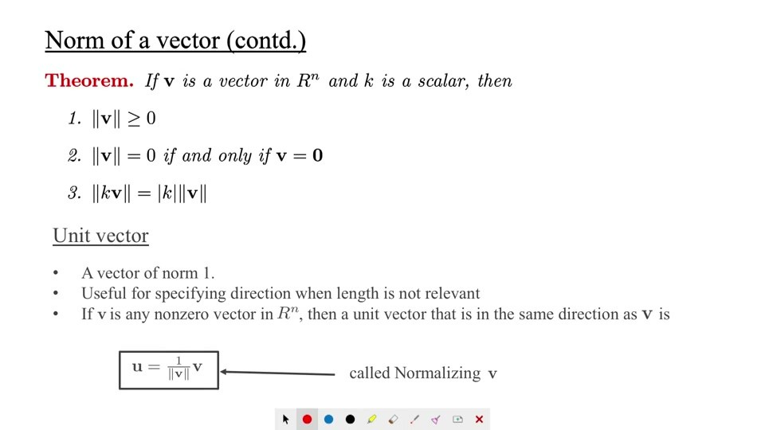

**Content — Norm of a vector (contd.):**

- A **unit vector** is a vector of **norm 1**.
- Useful for specifying **direction** when length is not relevant.
- If $\mathbf v$ is any nonzero vector in $\mathbb{R}^n$, then a unit vector in the **same direction** as $\mathbf v$ is:

$$\hat{\mathbf u} = \frac{1}{\|\mathbf v\|}\,\mathbf v \qquad \text{(this is called Normalizing $\mathbf v$)}$$

*Example:* $\mathbf v = (2, 2, -1)$, $\|\mathbf v\| = \sqrt{4+4+1} = 3$, so $\hat{\mathbf u} = \left(\tfrac{2}{3}, \tfrac{2}{3}, -\tfrac{1}{3}\right)$.

> 🎙️ **Narration:** *"Now let us look at a unit vector. A unit vector is simply a vector whose norm is 1. It is useful for specifying the direction when the length is not relevant — if you just want to say a vector is pointing in a particular direction without worrying about the length, you can use a unit vector. If v is any nonzero vector in ℝⁿ, then a unit vector in the same direction as v is given by this formula: û = (1/‖v‖) v. So this vector û is actually a unit vector — its length is 1 and its direction is the same as the direction of v. Let us look at an example: v = (2, 2, −1). If we want a unit vector in the same direction, all we need to do is multiply this vector by 1/‖v‖. The norm of v is √(2² + 2² + (−1)²) = 3. Therefore the unit vector is (1/3) times the original vector v = (2/3, 2/3, −1/3). You should try to find the norm of this vector — you will find it is equal to 1, and it is in the same direction as v. This step of finding the unit vector is also called normalizing the vector v, because after normalizing it has magnitude 1."*

---

### 🎬 Slide 6 — Standard Unit Vectors + Distance Definition

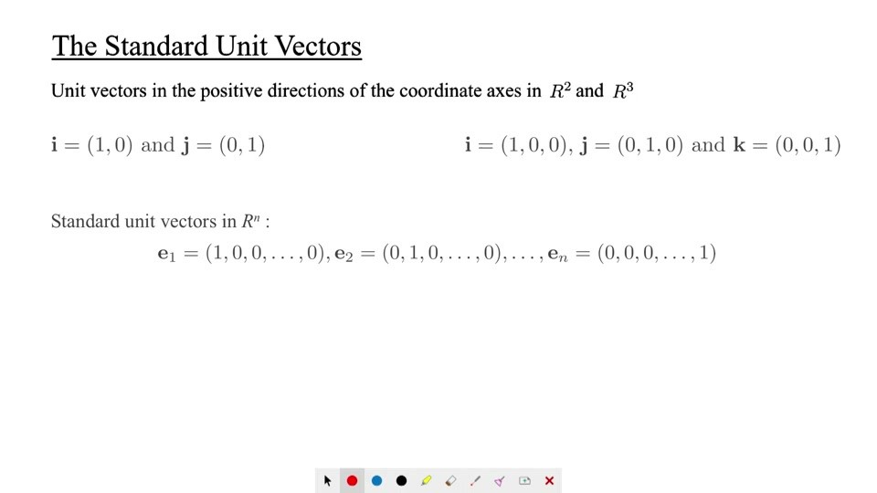

**Content — The Standard Unit Vectors:**

- In $\mathbb{R}^2$: $\mathbf i = (1,0)$ and $\mathbf j = (0,1)$
- In $\mathbb{R}^3$: $\mathbf i = (1,0,0)$, $\mathbf j = (0,1,0)$, $\mathbf k = (0,0,1)$
- Standard unit vectors in $\mathbb{R}^n$: $\mathbf e_1 = (1,0,0,\dots,0)$, $\mathbf e_2 = (0,1,0,\dots,0)$, …, $\mathbf e_n = (0,0,0,\dots,1)$

**Distance in ℝⁿ.** If $\mathbf u = (u_1,\dots,u_n)$ and $\mathbf v = (v_1,\dots,v_n)$ are points in $\mathbb{R}^n$, then

$$d(\mathbf u, \mathbf v) = \|\mathbf u - \mathbf v\| = \sqrt{(u_1-v_1)^2 + (u_2-v_2)^2 + \cdots + (u_n-v_n)^2}$$

> 🎙️ **Narration:** *"There are standard unit vectors which are in the positive directions of the coordinate axes in ℝ² and ℝ³. In ℝ², the vector (1,0) has a standard notation i, and the vector (0,1) has a standard notation j — whenever you come across i and j vectors, remember that i = (1,0) and j = (0,1). Correspondingly in ℝ³ you have three components: i = (1,0,0), j = (0,1,0), k = (0,0,1). By extension, ℝⁿ will have n standard unit vectors, each in one direction: e1, e2, …, en. Unlike in ℝ² and ℝ³ where we use i, j or i, j, k, in ℝⁿ we use e1, e2, …, en. So e1 means a vector whose first component is 1 and all other components are 0; e2 has second component 1 and all others 0. How do we find distances in n-dimensional space? We have the definition of the distance between two vectors u and v: if u = (u1, …, un) and v = (v1, …, vn) are points in ℝⁿ, then the distance between u and v, denoted d(u,v), is defined as the norm of the vector u − v. The vector u − v has components (u1 − v1, u2 − v2, …, un − vn), and the norm is therefore √((u1−v1)² + (u2−v2)² + ⋯ + (un−vn)²). Note that we said u and v are points in ℝⁿ — you can imagine vectors to be points in the high-dimensional space."*

---

### 🎬 Slide 7 — Distance in High Dimensions (Vectors as Points)

**Content:**

- A vector in high-dimensional space reduces to a **single point** (its terminal point).
- The **distance between two vectors** = the distance between their terminal points.

*Example:* $\mathbf u = (1, 3, -2, 7)$ and $\mathbf v = (0, 7, 2, 2)$:

$$d(\mathbf u, \mathbf v) = \sqrt{(1-0)^2 + (3-7)^2 + (-2-2)^2 + (7-2)^2} = \sqrt{1 + 16 + 16 + 25} = \sqrt{58}$$

> 🎙️ **Narration:** *"Let us say this is a vector u and this is some other vector v — probably it has, let us say, 10 dimensions, in which case there would be 10 components u1, u2, …, u10, and similarly v would have 10 components. When we say the distance between these two vectors, what we are essentially saying is the distance between the terminal points of these two vectors. The representation of a vector in a high-dimensional space reduces to a single point — we do not talk about an arrowhead pointing to the point; instead we just specify the terminal point of that vector as the point, and now we ask: what is the distance between these two points? So let us look at an example. If u = (1, 3, −2, 7) and v = (0, 7, 2, 2), then the distance is √((1−0)² + (3−7)² + (−2−2)² + (7−2)²) = √(1 + 16 + 16 + 25) = √58, which you can find from your calculator and write as a decimal number."*

---

### 🎬 Slide 8 — Worked Example: Distance

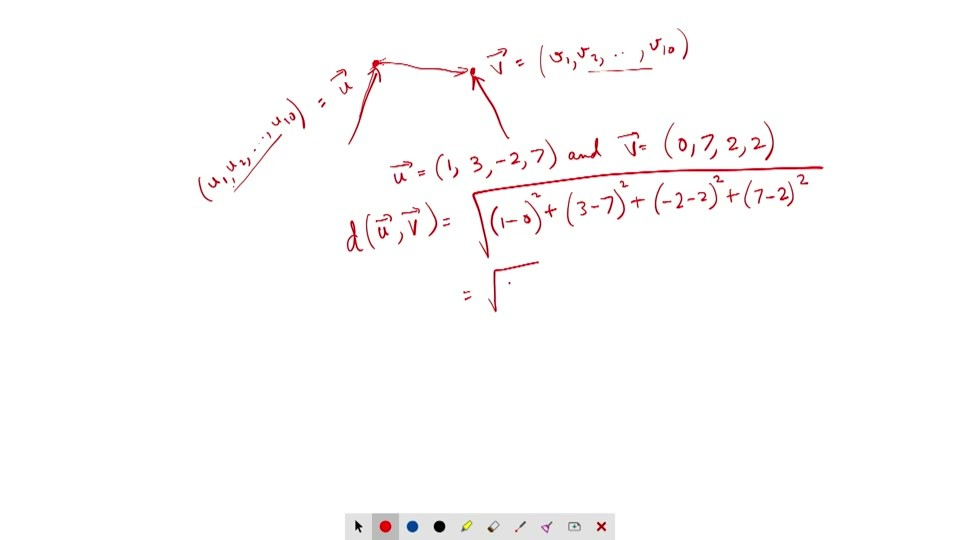

**Content (worked example — continued):**

$$d(\mathbf u, \mathbf v) = \sqrt{1^2 + (-4)^2 + (-4)^2 + 5^2} = \sqrt{1+16+16+25} = \sqrt{58}$$

This is how we find the distance between two vectors.

> 🎙️ **Narration:** *"This turns out to be √58, which you can find from your calculator and write as a decimal number. So this is how we find the distance between two vectors."*

---

### 🎬 Slide 9 — Key Points (End of Section 4)

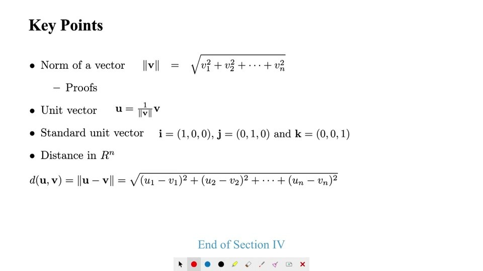

**Content — Key Points:**

- Norm of a vector $\|\mathbf v\| = \sqrt{v_1^2 + v_2^2 + \cdots + v_n^2}$
  - Proofs
- Unit vector $\hat{\mathbf u} = \dfrac{\mathbf v}{\|\mathbf v\|}$
- Standard unit vector $\mathbf i = (1,0,0)$, $\mathbf j = (0,1,0)$, $\mathbf k = (0,0,1)$
- Distance in ℝⁿ: $d(\mathbf u, \mathbf v) = \|\mathbf u - \mathbf v\| = \sqrt{(u_1 - v_1)^2 + (u_2 - v_2)^2 + \cdots + (u_n - v_n)^2}$

*End of Section IV.*

> 🎙️ **Narration:** *"The key points from this topic are: the definition of the norm of a vector; we showed the proof related to a part of the theorem of the norm of a vector; we defined what is a unit vector — a vector of norm 1 in the direction of a particular vector v; we also saw standard unit vectors in ℝ² as well as in ℝ³, and the unit vectors in n-dimensional space ℝⁿ. And finally, we looked at the distance between two points in n-dimensional space — the distance between two vectors u and v is the norm of u − v, given by this formula. That brings us to the end of the discussion on norm, unit vector and distance in ℝⁿ. That is the end of section 4."*

---

## 1.5 Dot Product to Geometry in ℝⁿ

### 🎬 Slide 1 — Overview and Learning Outcomes

**Content:**

- **Norm, Dot Product, and Distance in ℝⁿ**
  - Compute the norm of a vector in ℝⁿ
  - Determine the distance between two vectors in ℝⁿ
  - Compute the **dot product** between two vectors in ℝⁿ
  - Compute the **angle** between two nonzero vectors in ℝⁿ

> 🎙️ **Narration:** *"The dot product is an important topic in vectors. So, we will look at computing the dot product between two vectors and the angle between two non-zero vectors in ℝⁿ."*

---

### 🎬 Slide 2 — The Angle Between Two Vectors

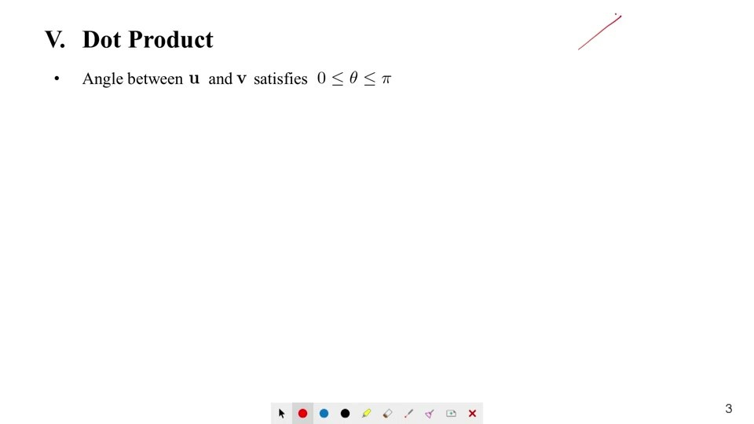

**Content:**

- The angle between $\mathbf u$ and $\mathbf v$ satisfies $\;0 \leq \theta \leq \pi$.
- "The angle between two vectors" always means the **smaller** of the two angles.

> 🎙️ **Narration:** *"The angle between u and v satisfies the condition that theta is between 0 and π. What this means is that if we consider two vectors u and v, we would like to look at the smaller angle between these two vectors — the smaller angle is this one rather than this bigger angle. So, anytime we draw two vectors and we mention the angle between those two vectors, we mean the smaller of the two angles between the two vectors — in this case, this angle and not this angle."*

---

### 🎬 Slide 3 — Definition of the Dot Product

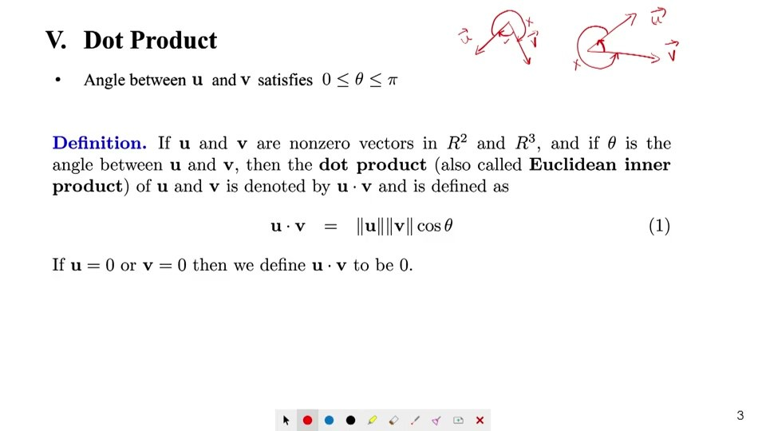

**Content — Definition.** If $\mathbf u$ and $\mathbf v$ are nonzero vectors in $\mathbb{R}^2$ and $\mathbb{R}^3$, and if $\theta$ is the angle between $\mathbf u$ and $\mathbf v$, then the **dot product** (also called the **Euclidean inner product**) of $\mathbf u$ and $\mathbf v$, denoted $\mathbf u \cdot \mathbf v$, is defined as

$$\mathbf u \cdot \mathbf v = \|\mathbf u\|\,\|\mathbf v\|\cos\theta$$

- If $\mathbf u = \mathbf 0$ or $\mathbf v = \mathbf 0$, define $\mathbf u \cdot \mathbf v = 0$.
- Since $\|\mathbf u\|, \|\mathbf v\|, \cos\theta$ are scalars, $\mathbf u \cdot \mathbf v$ is a **scalar** (hence also called the **scalar product**).
- Given $\mathbf u \cdot \mathbf v$ and both norms, the angle can be found from $\cos\theta = \dfrac{\mathbf u \cdot \mathbf v}{\|\mathbf u\|\,\|\mathbf v\|}$.
- If $\mathbf u \cdot \mathbf v > 0$ → angle **acute** ($< 90°$); if $\mathbf u \cdot \mathbf v < 0$ → angle **obtuse** ($> 90°$); if $\theta = \pi/2$ → $\mathbf u \cdot \mathbf v = 0$ (right angle — see orthogonality).

> 🎙️ **Narration:** *"Now let us define the dot product. If u and v are non-zero vectors in ℝ² and ℝ³, and if theta is the angle between u and v, then the dot product, also called the Euclidean inner product, is denoted by u·v and is defined as ‖u‖·‖v‖·cosθ. This is the definition of the dot product. If u is the zero vector or v is the zero vector, then we define u·v to be zero. Note that u·v = ‖u‖‖v‖cosθ — all these three components are scalars, and therefore u·v is a scalar value, also called the scalar product of two vectors. If we know the dot product of two vectors and the norm of those two vectors, then we can find the angle between the two vectors as cosθ = this formula, which can be easily derived from here. If the dot product is greater than zero, then the angle is acute — acute means the angle is less than 90 degrees. If u·v is less than zero, then the angle is obtuse — greater than 90 degrees. What happens when theta = π/2? If we plug θ = π/2 into this formula, we get u·v = 0 because cos(π/2) = 0 — we will have more to say about this specific case in the next topic on orthogonality. θ = π/2 means the two vectors are at right angles to each other, and in that case the dot product is zero."*

---

### 🎬 Slide 4 — Worked Example: Dot Product

**Content (worked example):**

Given $\mathbf u = (0, 2, 2)$ and $\mathbf v = (0, 0, 1)$, with angle $\theta = 45°$:

$$\|\mathbf u\| = \sqrt{0^2 + 2^2 + 2^2} = \sqrt{8} = 2\sqrt{2}, \qquad \|\mathbf v\| = 1 \;\; (\mathbf v \text{ is the standard unit vector } \mathbf k)$$

$$\mathbf u \cdot \mathbf v = 2\sqrt{2} \cdot 1 \cdot \cos 45° = 2\sqrt{2} \cdot \frac{1}{\sqrt{2}} = 2$$

> 🎙️ **Narration:** *"Let us look at an example to compute the dot product. If we have the vector u = (0, 2, 2) and the vector v = (0, 0, 1), then according to the formula, the dot product is ‖u‖·‖v‖·cos of the angle between them. Let the angle between these two vectors be 45 degrees. The norm of u is √(0² + 2² + 2²) = √8 = 2√2, and the norm of v is 1, because you realize this is a standard unit vector in ℝ³ — this is the k vector, a unit vector, so its norm is 1. So u·v can be computed as 2√2 × 1 × cos45° = 2√2 × (1/√2) = 2."*

---

### 🎬 Slide 5 — Component Form of the Dot Product

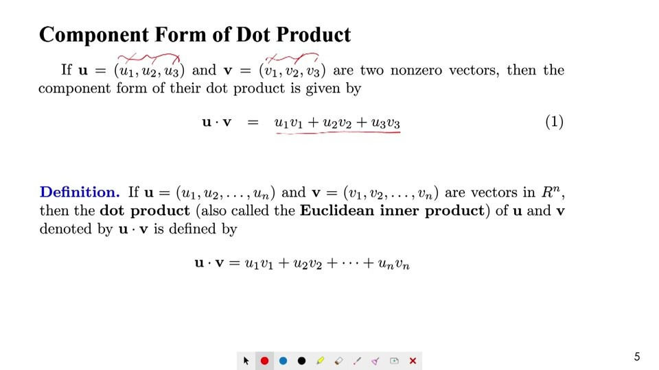

**Content:**

If $\mathbf u = (u_1, u_2, u_3)$ and $\mathbf v = (v_1, v_2, v_3)$ are two nonzero vectors in $\mathbb{R}^3$, the component form of their dot product is

$$\mathbf u \cdot \mathbf v = u_1v_1 + u_2v_2 + u_3v_3$$

**Definition.** If $\mathbf u = (u_1, u_2, \dots, u_n)$ and $\mathbf v = (v_1, v_2, \dots, v_n)$ are vectors in $\mathbb{R}^n$, then

$$\mathbf u \cdot \mathbf v = u_1v_1 + u_2v_2 + \cdots + u_nv_n$$

> 🎙️ **Narration:** *"The dot product of two vectors can also be specified in component form. For example, if u is expressed as (u1, u2, u3) and v as (v1, v2, v3) — u and v are in ℝ³ — then the component form of their dot product is u1v1 + u2v2 + u3v3. All you need to do is multiply the corresponding components and add them up. Clearly this can also be extended to the n-dimensional case, giving the general definition: u·v = u1v1 + u2v2 + ⋯ + unvn."*

---

### 🎬 Slide 6 — Quick Example (Component Form)

**Content (quick example):**

$$\mathbf u = (-1, 3, 5, 7),\qquad \mathbf v = (-3, -4, 1, 0)$$

$$\mathbf u \cdot \mathbf v = (-1)(-3) + (3)(-4) + (5)(1) + (7)(0) = 3 - 12 + 5 + 0 = -4$$

> 🎙️ **Narration:** *"As a quick example, let u = (−1, 3, 5, 7) and v = (−3, −4, 1, 0). Then we can write u·v = (−1)(−3) + (3)(−4) + (5)(1) + (7)(0) = 3 − 12 + 5 + 0 = −4. So this is a simple way of finding the dot product when the vectors are given in component form."*

---

### 🎬 Slide 7 — Algebraic Properties of the Dot Product (Part 1 of 2)

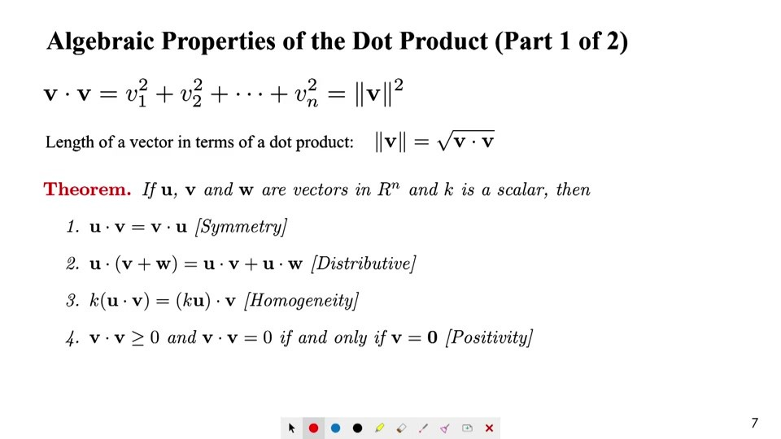

**Content:**

$$\mathbf v \cdot \mathbf v = v_1^2 + v_2^2 + \cdots + v_n^2 = \|\mathbf v\|^2 \qquad\Longrightarrow\qquad \|\mathbf v\| = \sqrt{\mathbf v \cdot \mathbf v}$$

**Theorem.** If $\mathbf u$, $\mathbf v$, $\mathbf w$ are vectors in $\mathbb{R}^n$ and $k$ is a scalar, then:

1. $\mathbf u \cdot \mathbf v = \mathbf v \cdot \mathbf u$ **[Symmetry]**
2. $\mathbf u \cdot (\mathbf v + \mathbf w) = \mathbf u \cdot \mathbf v + \mathbf u \cdot \mathbf w$ **[Distributive]**
3. $k(\mathbf u \cdot \mathbf v) = (k\mathbf u)\cdot \mathbf v$ **[Homogeneity]**
4. $\mathbf v \cdot \mathbf v > 0$ and $\mathbf v \cdot \mathbf v = 0$ iff $\mathbf v = \mathbf 0$ **[Positivity]**

> 🎙️ **Narration:** *"Now let us look at some algebraic properties of the dot product. The first property to note is that if we take the dot product of a vector with itself, we get v1² + v2² + ⋯ + vn², which we recognize as ‖v‖². So we now have a relationship between the norm of a vector and the dot product of the vector with itself: ‖v‖ = √(v·v). If u, v and w are vectors in ℝⁿ and k is a scalar, then there are four parts to this theorem. The first property is symmetry: u·v = v·u. The second is the distributive property: u·(v + w) = u·v + u·w. The third property is homogeneity: k(u·v) = (ku)·v. And the last property is that v·v ≥ 0 — true because √(v·v) is always the norm of a vector, which can never be less than 0 — and v·v = 0 if and only if v is the zero vector; that property is called positivity of the dot product. As with all theorems, you should try to prove the parts of this theorem. What we will do is prove the third part."*

---

### 🎬 Slide 8 — Proof: $k(\mathbf u \cdot \mathbf v) = (k\mathbf u) \cdot \mathbf v$

**Content — Proof (homogeneity):**

Let $\mathbf u = (u_1, \dots, u_n)$ and $\mathbf v = (v_1, \dots, v_n)$. Starting from the LHS:

$$k(\mathbf u \cdot \mathbf v) = k(u_1v_1 + u_2v_2 + \cdots + u_nv_n) = (ku_1)v_1 + (ku_2)v_2 + \cdots + (ku_n)v_n = (k\mathbf u)\cdot \mathbf v \quad \blacksquare$$

**Additional properties (Part 2 of 2).** If $\mathbf u, \mathbf v, \mathbf w \in \mathbb{R}^n$ and $k$ is a scalar:

1. $\mathbf 0 \cdot \mathbf v = \mathbf v \cdot \mathbf 0 = 0$
2. $(\mathbf u + \mathbf v)\cdot \mathbf w = \mathbf u \cdot \mathbf w + \mathbf v \cdot \mathbf w$
3. $\mathbf u \cdot (\mathbf v - \mathbf w) = \mathbf u \cdot \mathbf v - \mathbf u \cdot \mathbf w$
4. $(\mathbf u - \mathbf v)\cdot \mathbf w = \mathbf u \cdot \mathbf w - \mathbf v \cdot \mathbf w$
5. $\mathbf u \cdot (k\mathbf v) = k(\mathbf u \cdot \mathbf v)$

> 🎙️ **Narration:** *"We want to prove that k(u·v) = (ku)·v. As always, the place to start is to let u = (u1, u2, …, un) and v = (v1, v2, …, vn). We start from the left-hand side: k(u·v) = k(u1v1 + u2v2 + ⋯ + unvn). We can open up the brackets and club k and u together: (ku1)v1 + (ku2)v2 + ⋯ + (kun)vn, which is clearly the right-hand side of the statement, (ku)·v. So you should try to prove the other parts of the theorem in a similar fashion. There are some additional properties of the dot product: v·0 = 0; (u+v)·w = u·w + v·w; u·(v−w) = u·v − u·w; (u−v)·w = u·w − v·w; and finally u·(kv) = k(u·v). You could try to prove parts of this theorem just as we did in the previous case."*

---

### 🎬 Slide 9 — Worked Example: Simplifying $(\mathbf u - 2\mathbf v)\cdot(3\mathbf u + 4\mathbf v)$

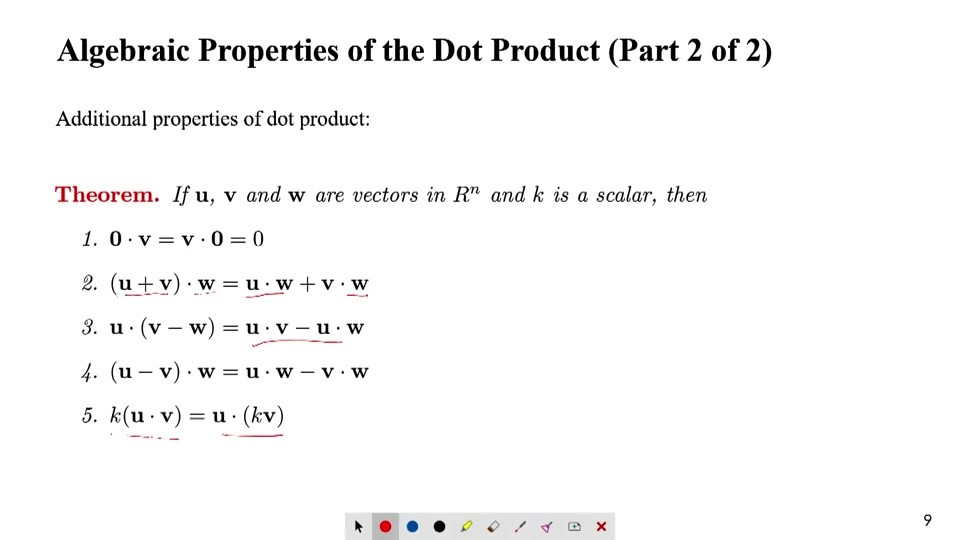

**Content (worked example):**

Simplify $(\mathbf u - 2\mathbf v)\cdot(3\mathbf u + 4\mathbf v)$:

$$= \mathbf u\cdot(3\mathbf u + 4\mathbf v) - 2\mathbf v\cdot(3\mathbf u + 4\mathbf v) = 3(\mathbf u\cdot\mathbf u) + 4(\mathbf u\cdot\mathbf v) - 6(\mathbf v\cdot\mathbf u) - 8(\mathbf v\cdot\mathbf v)$$

$$= 3\|\mathbf u\|^2 + 4(\mathbf u\cdot\mathbf v) - 6(\mathbf u\cdot\mathbf v) - 8\|\mathbf v\|^2 = 3\|\mathbf u\|^2 - 2(\mathbf u\cdot\mathbf v) - 8\|\mathbf v\|^2$$

> 🎙️ **Narration:** *"Let us look at an example that uses some of the parts of the theorems we proved. The question is: we have (u − 2v)·(3u + 4v), and we need to simplify this expression. Using the distributive property, we can write this as u·(3u + 4v) − 2v·(3u + 4v), which can further be written as 3(u·u) + 4(u·v) − 6(v·u) − 8(v·v). This can be expressed as 3‖u‖² — because we saw that u·u gives the norm squared — then we know u·v = v·u, so we can simplify to −2(u·v), and lastly we write v·v as ‖v‖². So the simplification is 3‖u‖² − 2(u·v) − 8‖v‖²."*

---

### 🎬 Slide 10 — Angles in ℝⁿ and the Cosine Formula

**Content:**

$$\cos\theta = \frac{\mathbf u \cdot \mathbf v}{\|\mathbf u\|\,\|\mathbf v\|}$$

- $\theta$ is **not defined** unless its argument satisfies $-1 \leq \dfrac{\mathbf u \cdot \mathbf v}{\|\mathbf u\|\,\|\mathbf v\|} \leq 1$.
- This is guaranteed by the **Cauchy–Schwarz Inequality**.

> 🎙️ **Narration:** *"Now let us look at angles in ℝⁿ. We have already seen that the angle between two vectors can be found using this formula, provided we know the dot product between u and v and we know their norms. Theta is not defined unless its argument satisfies this inequality, because we know cosθ's maximum value is 1 and its minimum value is −1. So this is cosθ = (u·v)/(‖u‖‖v‖). The question is: how do we guarantee that given any two vectors this condition is satisfied? That is done due to the Cauchy–Schwarz inequality."*

---

### 🎬 Slide 11 — Cauchy–Schwarz Inequality

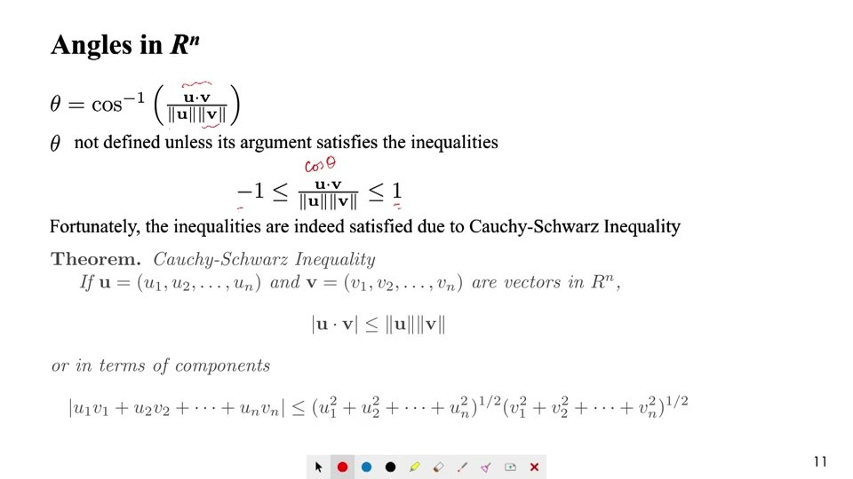

**Content — Theorem (Cauchy–Schwarz Inequality).** If $\mathbf u = (u_1, u_2, \dots, u_n)$ and $\mathbf v = (v_1, v_2, \dots, v_n)$ are vectors in $\mathbb{R}^n$, then

$$|\mathbf u \cdot \mathbf v| \leq \|\mathbf u\|\,\|\mathbf v\|$$

or, in terms of components,

$$|u_1v_1 + u_2v_2 + \cdots + u_nv_n| \leq (u_1^2 + \cdots + u_n^2)^{1/2}(v_1^2 + \cdots + v_n^2)^{1/2}$$

This ensures $\dfrac{\mathbf u \cdot \mathbf v}{\|\mathbf u\|\,\|\mathbf v\|}$ lies between $-1$ and $+1$.

> 🎙️ **Narration:** *"The Cauchy–Schwarz inequality states: if u = (u1, …, un) and v = (v1, …, vn) are vectors in ℝⁿ, then |u·v| ≤ ‖u‖‖v‖. This Cauchy–Schwarz inequality comes to our rescue when we look at the angle between two vectors, because when |u·v| ≤ ‖u‖‖v‖, it is ensured that this value lies between −1 and +1."*

---

### 🎬 Slide 12 — Geometry in ℝⁿ: Triangle Inequalities

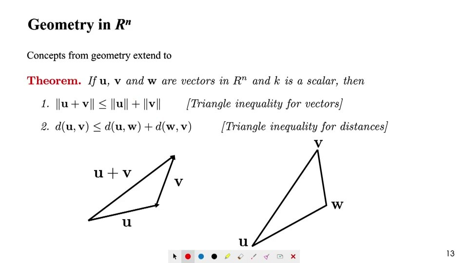

**Content — Theorem.** If $\mathbf u, \mathbf v, \mathbf w$ are vectors in $\mathbb{R}^n$ and $k$ is a scalar, then:

1. $\|\mathbf u + \mathbf v\| \leq \|\mathbf u\| + \|\mathbf v\|$ **[Triangle inequality for vectors]**
2. $d(\mathbf u, \mathbf v) \leq d(\mathbf u, \mathbf w) + d(\mathbf w, \mathbf v)$ **[Triangle inequality for distances]**

> 🎙️ **Narration:** *"Now let us look at the geometry in ℝⁿ — the concepts from geometry extend to ℝⁿ. If u, v and w are vectors in ℝⁿ and k is a scalar, then ‖u + v‖ ≤ ‖u‖ + ‖v‖ — this is called the triangle inequality for vectors. The second part deals with the distance between vectors: d(u,v) ≤ d(u,w) + d(w,v), the triangle inequality for distances. If you recall, the triangle inequality basically says that the length of the third side is always less than or equal to the sum of the lengths of the other two sides. Let us prove this theorem: we want to prove that ‖u + v‖ ≤ ‖u‖ + ‖v‖."*

---

### 🎬 Slide 13 — Proof of the Triangle Inequality (start)

**Content — Proof (part 1):**

$$\|\mathbf u + \mathbf v\|^2 = (\mathbf u + \mathbf v)\cdot(\mathbf u + \mathbf v) = \mathbf u\cdot\mathbf u + \mathbf v\cdot\mathbf u + \mathbf u\cdot\mathbf v + \mathbf v\cdot\mathbf v$$

$$= \|\mathbf u\|^2 + 2(\mathbf u\cdot\mathbf v) + \|\mathbf v\|^2 \;\leq\; \|\mathbf u\|^2 + 2|\mathbf u\cdot\mathbf v| + \|\mathbf v\|^2 \quad\text{(since } a \leq |a|)$$

> 🎙️ **Narration:** *"Let us start by looking at ‖u + v‖². Norm squared is actually the dot product of a vector with itself — so here we have the vector u + v, and we take the dot product with itself, which is ‖u + v‖². If we open up the brackets, we get u·u + v·u + u·v + v·v. Just as in our previous example, we can write u·u as ‖u‖², plus 2(u·v) because v·u = u·v, plus ‖v‖². Now, if we just write these two terms as they are, but replace the dot product u·v with the absolute value |u·v| — what will be the change? The absolute value of a number is always greater than or equal to that number. So we replace this equals with a less-than-or-equal-to sign."*

---

### 🎬 Slide 14 — Proof of the Triangle Inequality (finish)

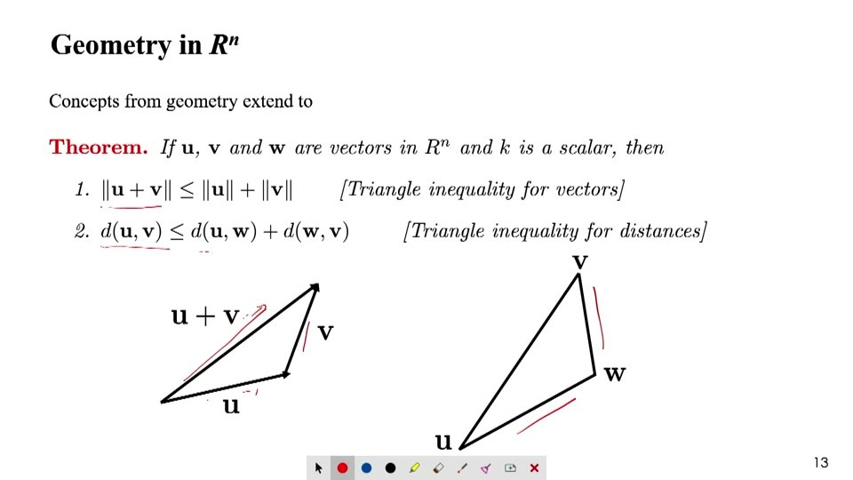

**Content — Proof (part 2):**

By Cauchy–Schwarz, $|\mathbf u \cdot \mathbf v| \leq \|\mathbf u\|\,\|\mathbf v\|$, hence

$$\|\mathbf u + \mathbf v\|^2 \leq \|\mathbf u\|^2 + 2\|\mathbf u\|\,\|\mathbf v\| + \|\mathbf v\|^2 = \big(\|\mathbf u\| + \|\mathbf v\|\big)^2$$

Taking square roots of both sides:

$$\|\mathbf u + \mathbf v\| \leq \|\mathbf u\| + \|\mathbf v\| \quad \blacksquare$$

> 🎙️ **Narration:** *"From the Cauchy–Schwarz inequality we saw just now, we can write |u·v| ≤ ‖u‖‖v‖. There is no change here, and now we can see that this term is actually ‖u‖ + ‖v‖ all squared. Now, taking the square root of both sides, you end up with ‖u + v‖ ≤ ‖u‖ + ‖v‖. That is how we prove this theorem."*

---

### 🎬 Slide 15 — Triangle Inequality (diagram)

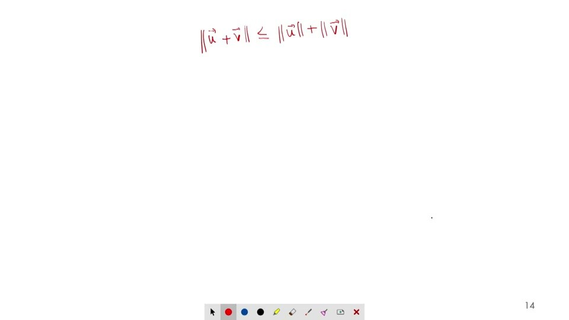

**Content:** *(figure illustrating the triangle inequality — the sum $\mathbf u + \mathbf v$ and its length relative to $\|\mathbf u\| + \|\mathbf v\|$.)*

---

### 🎬 Slide 16 — Key Points (recap)

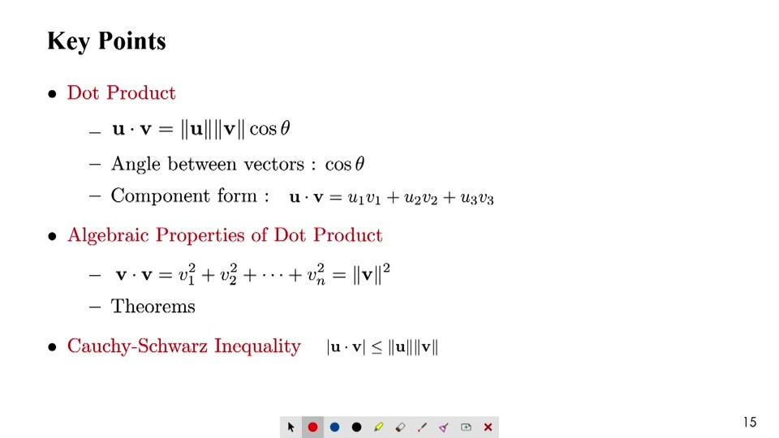

**Content — Key Points:**

- **Dot Product**
  - $\mathbf u \cdot \mathbf v = \|\mathbf u\|\,\|\mathbf v\|\cos\theta$
  - Angle between vectors: $\cos\theta = \dfrac{\mathbf u \cdot \mathbf v}{\|\mathbf u\|\,\|\mathbf v\|}$
  - Component form: $\mathbf u \cdot \mathbf v = u_1v_1 + u_2v_2 + \cdots + u_nv_n$
- **Algebraic Properties of Dot Product**
  - $\mathbf v \cdot \mathbf v = v_1^2 + v_2^2 + \cdots + v_n^2 = \|\mathbf v\|^2$
  - Theorems
- **Cauchy–Schwarz Inequality** — $|\mathbf u \cdot \mathbf v| \leq \|\mathbf u\|\,\|\mathbf v\|$

---

### 🎬 Slide 17 — Triangle Inequality (diagram, continued)

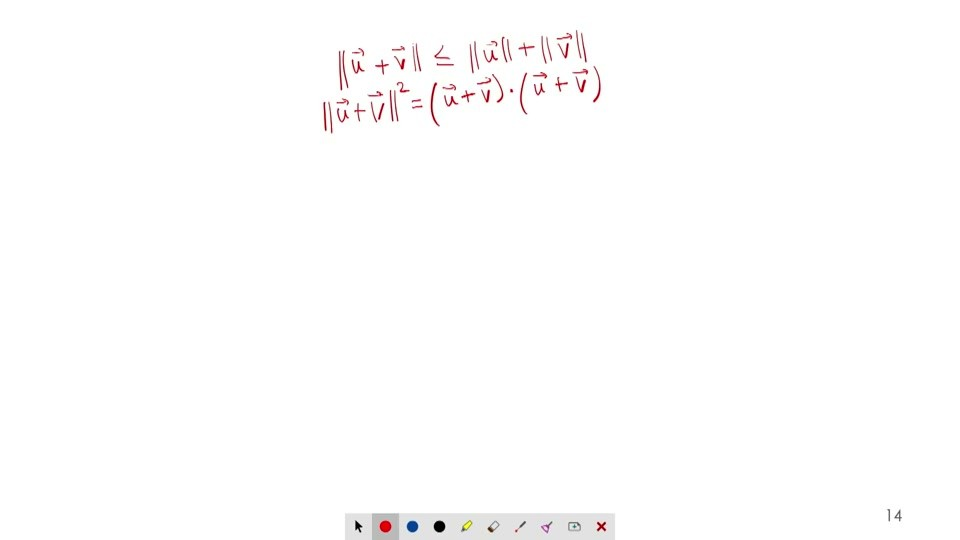

**Content:** *(additional figure for the geometry of the triangle inequality.)*

---

### 🎬 Slide 18 — Geometry figure

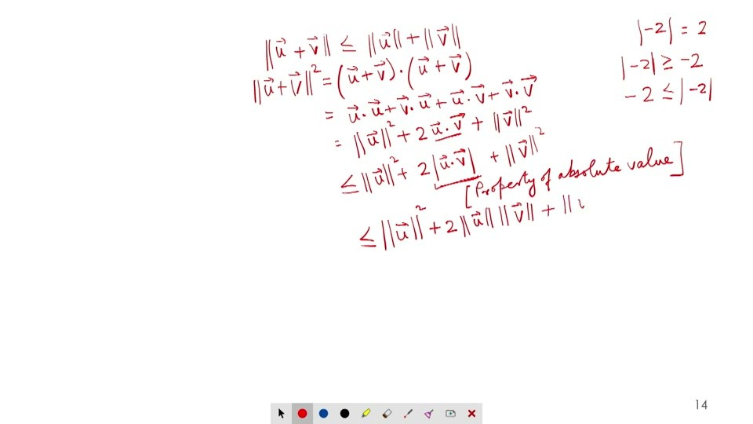

**Content:** *(figure illustrating the triangle inequality for distances, $d(\mathbf u,\mathbf v) \leq d(\mathbf u,\mathbf w) + d(\mathbf w,\mathbf v)$.)*

---

### 🎬 Slide 19 — Key Points (End of Section 5)

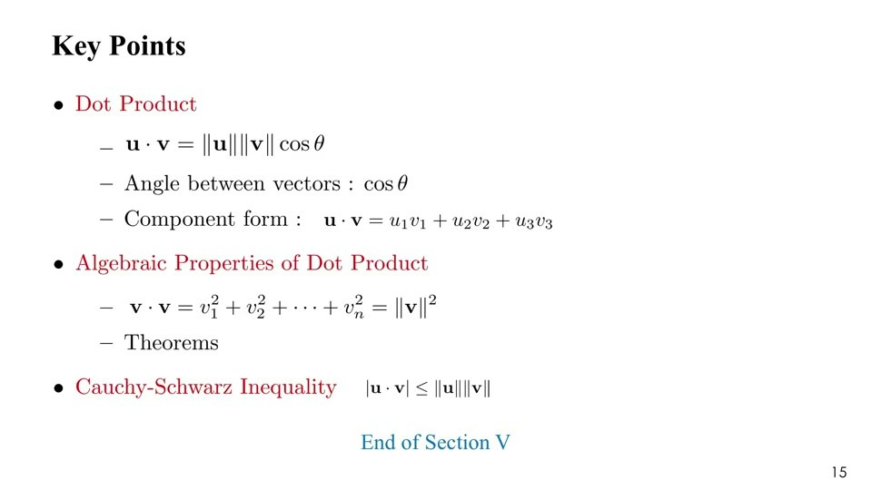

**Content — Key Points:**

- **Dot Product:** $\mathbf u \cdot \mathbf v = \|\mathbf u\|\,\|\mathbf v\|\cos\theta$
  - Angle between vectors: $\cos\theta = \dfrac{\mathbf u \cdot \mathbf v}{\|\mathbf u\|\,\|\mathbf v\|}$
  - Component form: $\mathbf u \cdot \mathbf v = u_1v_1 + u_2v_2 + \cdots + u_nv_n$
- **Algebraic Properties of Dot Product**
  - $\mathbf v \cdot \mathbf v = v_1^2 + v_2^2 + \cdots + v_n^2 = \|\mathbf v\|^2$
  - Theorems
- **Cauchy–Schwarz Inequality** — $|\mathbf u \cdot \mathbf v| \leq \|\mathbf u\|\,\|\mathbf v\|$

*End of Section V.*

> 🎙️ **Narration:** *"So the key points in this topic were: defining the dot product as u·v = ‖u‖‖v‖cosθ; the angle between the vectors can be found from cosθ = (u·v)/(‖u‖‖v‖); in component form, u·v is simply multiplying the corresponding components and adding them up. The properties we saw: the dot product of a vector with itself is the square norm of that vector. And then we looked at a couple of theorems, including the Cauchy–Schwarz inequality, which said that the absolute value of the dot product between two vectors is less than or equal to the product of their norms. With that, we come to the end of section 5."*

---

## 1.6 Orthogonality to Point Normal Equation

### 🎬 Slide 1 — Overview and Learning Outcomes

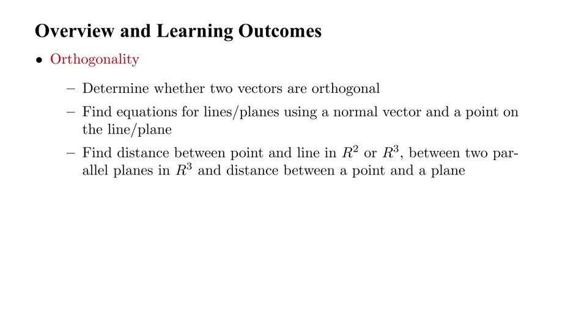

**Content:**

- **Orthogonality**
  - Determine whether two vectors are **orthogonal**
  - Find **equations for lines/planes** using a **normal vector** and a **point** on the line/plane
  - Find **distance between point and line** in ℝ² or ℝ³, between two parallel planes in ℝ³, and distance between a point and a plane

> 🎙️ **Narration:** *"The overview and learning outcomes of this topic include determining whether two vectors are orthogonal and finding the equations for lines or planes using a normal vector and a point on the line or plane."*

---

### 🎬 Slide 2 — Orthogonal Vectors

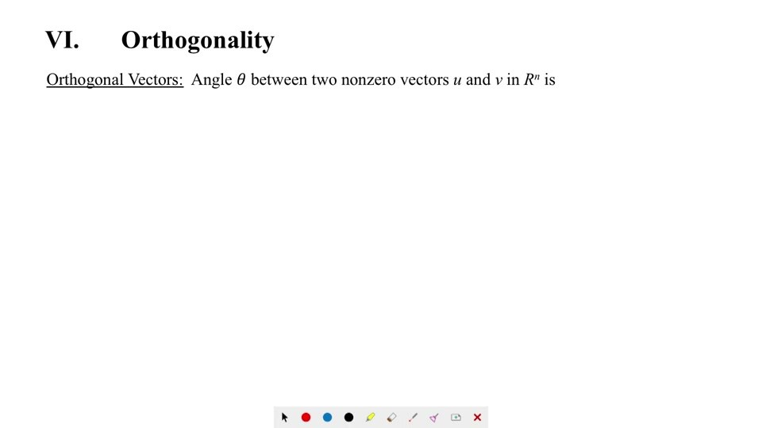

**Content — VI. Orthogonality:**

**Orthogonal Vectors:** the angle $\theta$ between two nonzero vectors $\mathbf u$ and $\mathbf v$ in $\mathbb{R}^n$ is **$\pi/2$ (90°)**.

We know $\cos\theta = \dfrac{\mathbf u \cdot \mathbf v}{\|\mathbf u\|\,\|\mathbf v\|}$; if $\theta = 90°$ then $\mathbf u \cdot \mathbf v = 0$.

> 🎙️ **Narration:** *"Orthogonality is something we have seen earlier. We know that the angle between two vectors can be found using this formula, and we saw that if the angle between two vectors is 90 degrees, then u·v = 0. If the angle is 90 degrees, or π/2 — this is actually the definition of orthogonal vectors."*

---

### 🎬 Slide 3 — Definition of Orthogonal Vectors & Orthogonal Set

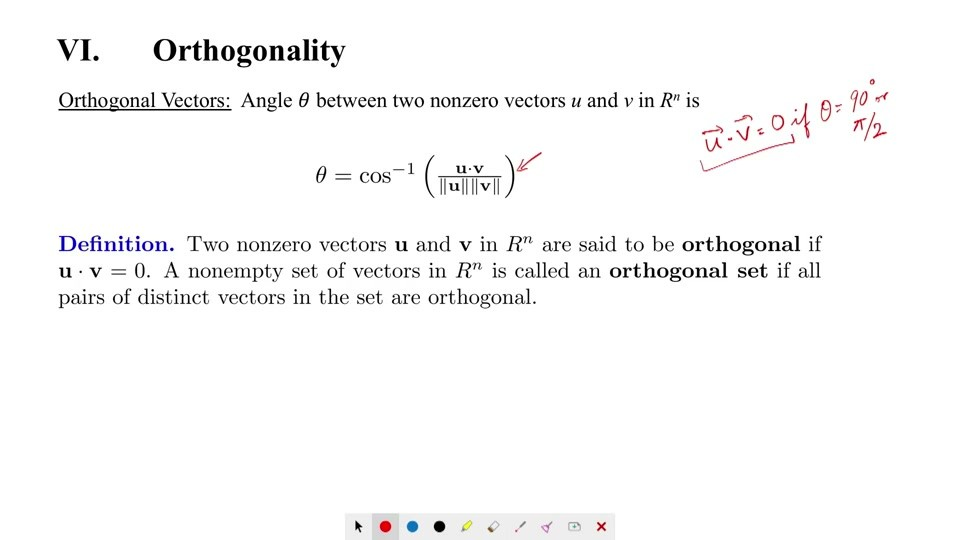

**Content — Definition.** Two nonzero vectors $\mathbf u$ and $\mathbf v$ in $\mathbb{R}^n$ are said to be **orthogonal** if

$$\mathbf u \cdot \mathbf v = 0$$

A nonempty set of vectors in $\mathbb{R}^n$ is called an **orthogonal set** if **all pairs of distinct vectors** in the set are orthogonal.

> 🎙️ **Narration:** *"Two non-zero vectors u and v are said to be orthogonal if the dot product is equal to 0. So whenever you see a dot product between two vectors equal to 0, you know those two vectors are orthogonal to each other. Another word for orthogonal is perpendicular, which means they are at 90 degrees to each other. A non-empty set of vectors in ℝⁿ is called an orthogonal set if all pairs of distinct vectors in the set are orthogonal — so if we have five vectors in a set and each vector is orthogonal to all the other vectors, then that set is called an orthogonal set."*

---

### 🎬 Slide 4 — Lines and Planes Determined by Points and Normals

**Content:**

- A **line in ℝ²** is determined uniquely by its **slope** and **one of its points**.
- A **plane in ℝ³** is determined uniquely by its **"inclination"** and **one of its points**.
- Use a nonzero vector $\mathbf n$, called a **normal**, that is orthogonal to the line or plane, to specify the slope/inclination.

> 🎙️ **Narration:** *"Where can we use this notion of orthogonality? We can use it to write the equation of a line or a plane. The line in ℝ² is determined uniquely by its slope and one of its points — if we know a point on the line and the slope, we can write the equation y = mx + c. Similarly, a plane in ℝ³ is determined uniquely by its inclination and one of its points — if we know a point (x, y, z) on the plane and the inclination, we can write the equation of that plane. How to specify this inclination? We use a nonzero vector n, called a normal, that is orthogonal to the line or plane, to specify the slope or inclination. As a figure: this is a line, we have a point (x0, y0) on the line, and we have a normal to that line whose terminal point is (a, b). We can use the normal vector and the point on the line to write the equation of the line."*

---

### 🎬 Slide 5 — Point-Normal Equation of a Line and a Plane

**Content:**

- Let $\mathbf p = (x, y)$ be a variable point on the line, $\mathbf p_0 = (x_0, y_0)$ a known point on the line, and $\mathbf n = (a, b)$ a normal.
- $\mathbf n \perp \overrightarrow{P_0P}$, so $\mathbf n \cdot \overrightarrow{P_0P} = 0$. Since $\overrightarrow{P_0P} = (x - x_0,\; y - y_0)$:

$$\boxed{\;a(x - x_0) + b(y - y_0) = 0\;} \qquad \text{Point-normal equation of the line}$$

- **Point-normal equation of the plane** (with $\mathbf n = (a,b,c)$ and point $(x_0,y_0,z_0)$):

$$\boxed{\;a(x - x_0) + b(y - y_0) + c(z - z_0) = 0\;}$$

> 🎙️ **Narration:** *"P is the variable (x, y) — just some point on the line — but (x0, y0) is a known point on the line. We know a normal to the line is perpendicular to it, and therefore the normal is perpendicular to any vector on the line. Since we know the point (x0, y0) and P is the variable (x, y), we have the vector P0P. The normal is orthogonal to the vector P0P, and because it is orthogonal, their dot product is 0. What is P0P? Remember we started off this chapter by saying a vector like this can be represented as (x − x0, y − y0). The normal is the vector (a, b), and if we take the dot product of these two vectors in component form, we multiply the corresponding components: a(x − x0) + b(y − y0) = 0, because the two vectors are orthogonal. So here you have the equation of the line, and this is called the point-normal equation of the line, because we use a point on the line and the normal to the line. What about a plane? Consider this plane, and let (x0, y0, z0) be a point on the plane; just as we had the variable (x, y) for the line, we have the variable (x, y, z) as a point on the plane, and the inclination is given by the normal to the plane. This normal, whose components are (a, b, c), is orthogonal to the vector whose components are (x − x0, y − y0, z − z0). So we can now write the point-normal equation of the plane, and you can see how simple it is — you should be able to write the point-normal equation of the plane."*

---

## 1.7 Vector and Parametric Equation

### 🎬 Slide 1 — Overview and Learning Outcomes

**Content:**

- **Vector and Parametric equations**
  - Express equations of **lines** in ℝ² and ℝ³ using either **vector** or **parametric** equations
  - Express equations of **planes** in ℝⁿ using either **vector** or **parametric** equations

> 🎙️ **Narration:** *"The learning outcomes are to be able to express equations of lines in ℝ² and ℝ³ using either vector or parametric equations, and similarly for equations of planes in ℝⁿ. Previously we looked at equations of lines and planes expressed in point-normal form — we wrote the equation as A(x − x0) + B(y − y0) = 0. Here we look at other ways of specifying lines and planes."*

---

### 🎬 Slide 2 — Vector Equation of a Line

**Content — VII. Vector and Parametric Equations of Lines in ℝ² and ℝ³:**

To write the vector equation of a line we need: a **point** on the line $\mathbf x_0$, and a **vector $\mathbf v$ parallel to the line**.

For any point $\mathbf x$ on the line $L$ in ℝ² or ℝ³, the **vector form** is:

$$\mathbf x - \mathbf x_0 = t\mathbf v \qquad\text{or}\qquad \mathbf x = \mathbf x_0 + t\mathbf v$$

- If $\mathbf x_0 = \mathbf 0$, the line passes through the origin.
- $t$ is called a **parameter**; as $t$ varies from $-\infty$ to $+\infty$, $\mathbf x$ traces out the line $L$.
- Extends to ℝⁿ.

> 🎙️ **Narration:** *"We start off with a line. In order to write a vector equation for a line, we need two things: a point on the line and a vector parallel to that line. So consider this line L — x0 is a point on the line and v is the vector parallel to that line, and x is the variable, just as in the point-normal form. Now we have three quantities x, x0 and v, and we are ready to write the vector equation of a line. For any point x on the line in ℝ² or ℝ³, the vector form of the line is x − x0 = tv. What this equation says is that the vector x − x0 here is parallel to the vector v here — and this is how we specified parallel vectors: if u and v are parallel, then one is a scalar multiple of the other. So x − x0 can be expressed as a scalar multiple of v, namely tv. Moving x0 to the other side, we get the final vector form: x = x0 + tv, where t is a constant called the parameter. If x0 = 0, then the line passes through the origin. What happens as the variable t changes? When t changes from −∞ to +∞, x traces out the line L. If t = 0, then x = x0, so these two points coincide. As t increases in the positive direction, this part of the line is traced out; when t is negative, this part is traced out. This idea extends to the n-dimensional case."*

---

### 🎬 Slide 3 — Worked Example: Vector Equation of a Line in ℝ²

**Content (worked example):**

Write the vector equation of the line in ℝ² passing through $P(0, 7)$ and $Q(5, 0)$.

Choose $\mathbf x_0 = (0, 7)$ and direction $\mathbf v = \overrightarrow{PQ} = Q - P = (5, 0) - (0, 7) = (5, -7)$:

$$\mathbf x = (x, y) = (0, 7) + t(5, -7)$$

> 🎙️ **Narration:** *"Let us write the vector and parametric equations for the line in ℝ² that passes through the points P = (0, 7) and Q = (5, 0). The vector equation would be x = x0 + tv. If we choose x0 = (0, 7), and x1, another point, as (5, 0), then x1 − x0 = (5, −7). Now we can write the vector equation: x = (x, y) = a point on the line plus t times a vector parallel to the line. Note that it so happens in this example that the vector parallel to the line is actually on the line itself. So this is the vector form of the equation of a line."*

---

### 🎬 Slide 4 — Vector and Parametric Equations of Planes in ℝ³

**Content:**

To write the vector equation of a plane we need a **point $\mathbf x_0$ on the plane** and **two non-collinear vectors $\mathbf v_1, \mathbf v_2$** in the plane.

**Vector form of a plane:**

$$\mathbf x - \mathbf x_0 = t_1\mathbf v_1 + t_2\mathbf v_2 \qquad\text{or}\qquad \mathbf x = \mathbf x_0 + t_1\mathbf v_1 + t_2\mathbf v_2$$

- If $\mathbf x_0 = \mathbf 0$, the plane passes through the origin.
- $t_1$ and $t_2$ are called **parameters**; as they are varied independently from $-\infty$ to $+\infty$, $\mathbf x$ traces out the plane $W$.
- Extends to ℝⁿ.
- **Parametric equations** are formed when the vectors are expressed in terms of their components.

> 🎙️ **Narration:** *"The vector form of the equation of a plane can be written if we know three things: a point x0 on the plane and two other vectors v1 and v2 which are non-collinear. In this figure, we have a point x0 on the plane, a vector v1 on the plane, and another vector v2 on the plane. These two vectors are not collinear — they are not on the same line; if they were on the same line, you would not be able to write the equation of the plane. x = (x, y, z) is the variable vector. Using the parallelogram law of vector addition, we can write this vector x − x0 as the sum t1v1 + t2v2. So x − x0 = t1v1 + t2v2, and moving x0 to the other side, x = x0 + t1v1 + t2v2. If x0 = 0, the plane passes through the origin. Just as the vector equation of a line had one variable t, here we have two variables t1 and t2; as t1 and t2 are varied independently, the point x traces out the complete plane. As t1 changes, the plane elongates in one direction; as t2 changes, the plane elongates in the other direction. Clearly this notion also extends to ℝⁿ."*

---

### 🎬 Slide 5 — Vector Equation of a Plane (diagram)

**Content:** *(figure illustrating the plane spanned by the non-collinear vectors $\mathbf v_1$ and $\mathbf v_2$ from the point $\mathbf x_0$.)*

---

### 🎬 Slide 6 — Parametric Form: Worked Example

**Content (worked example):**

From the line $\mathbf x = (x, y) = (0, 7) + t(5, -7)$, the **parametric form** is

$$x = 5t, \qquad y = 7 - 7t$$

Eliminating $t$: from $x = 5t$ we get $t = x/5$, so $y = 7 - 7(x/5) \;\Rightarrow\; 7x + 5y = 35$ — the familiar **rectangular-coordinate equation** of the line.

> 🎙️ **Narration:** *"If we look at the previous example, where the vector equation of the line was (x, y) = (0, 7) + t(5, −7), then the parametric form of the equation is simply writing x and y independently: x = 5t and y = 7 − 7t. We could eliminate t from the above two equations, and when we do that, we get 7x + 5y = 35, which is the familiar equation of the line in rectangular coordinates. So we have seen three ways of writing the equation of a line: rectangular coordinates, the vector form, and finally the parametric form."*

---

### 🎬 Slide 7 — Key Points (End of Section 7 / Chapter 1)

**Content — Key Points:**

- **Vector equation of a line:** $\mathbf x = \mathbf x_0 + t\mathbf v$
- **Vector equation of a plane:** $\mathbf x = \mathbf x_0 + t_1\mathbf v_1 + t_2\mathbf v_2$
- **Parametric form:** vectors expressed in terms of their components

*End of Section 7 — end of the chapter on vectors.*

> 🎙️ **Narration:** *"The key points are very simple here. For the vector equation of a line, in order to write it, we need a point on the line and a vector v parallel to that line, and the equation is x = x0 + tv. In order to write the vector equation of a plane, we need a point on the plane and two vectors on the plane that are non-collinear, and then we can write x = x0 + t1v1 + t2v2. The parametric form is simply expressing the vectors in terms of their individual components. That is the end of section 7, and with that we end this chapter on vectors."*

---

---

# Chapter 2 — Matrices

## 2.1 Matrix Notation and Terminology

### 🎬 Slide 1 — Title: *Matrices*

**Content:** Title card — *Matrices* (Chapter 2).

> 🎙️ **Narration:** *"Welcome to the second chapter in this course on matrices. In this chapter we will start with matrix notations and terminology, and then move on to operations on matrices such as addition, subtraction, scalar multiplication and matrix multiplication. We will see a couple of methods on how we can multiply two matrices. Then we will study how to compute the transpose as well as the trace of a matrix, and finally we will look at how to compute the inverse of a square matrix."*

---

### 🎬 Slide 2 — Overview and Learning Outcomes (1 of 2)

**Content:**

- **Matrix Notations and Terminology**
  - Determine the **size** of a given matrix
  - Identify the **row vectors** and **column vectors** of a given matrix
- **Operations on Matrices**
  - Perform matrix **addition, subtraction, scalar multiplication** and **matrix multiplication**
- **Matrix Multiplication by Columns and by Rows**
  - Compute matrix products using the **column method** and the **row method**
  - Express the product of a matrix and a column vector as a **linear combination** of the columns of a matrix

---

### 🎬 Slide 3 — Overview and Learning Outcomes (2 of 2)

**Content:**

- **Transpose and Trace of a Matrix**
  - Compute the **transpose** of a matrix
  - Compute the **trace** of a square matrix
- **Inverse of a Square Matrix**

---

### 🎬 Slide 4 — Matrix Notation and Terminology (Part 1 of 3)

**Content — An $m \times n$ matrix** is a rectangular array of numbers with **$m$ rows** and **$n$ columns**, written as

$$A = \begin{bmatrix} a_{11} & a_{12} & \cdots & a_{1n} \\ a_{21} & a_{22} & \cdots & a_{2n} \\ \vdots & \vdots & \ddots & \vdots \\ a_{m1} & a_{m2} & \cdots & a_{mn} \end{bmatrix}$$

- $a_{11}, a_{12}, \dots, a_{mn}$ are the **elements/entries** of the matrix; $a_{ij}$ is the element at the $i$-th **row** and $j$-th **column**.
- In simplified notation, an $m \times n$ matrix is written as $[a_{ij}]$.
- A matrix with only **one column (row)** is called a **column (row) vector**.
- A matrix with $n$ rows and $n$ columns is a **square matrix of order $n$**; the elements $a_{11}, a_{22}, \dots, a_{nn}$ are on the **main/leading diagonal**.

> 🎙️ **Narration:** *"What is a matrix? An m by n matrix is a rectangular array of numbers with m rows and n columns. So this is an example of a matrix, where a11, a12, …, amn are called the elements of the matrix. aij is the element of the i-th row and the j-th column. So a22 means it is the element in the second row and the second column. In simplified notation, an m by n matrix is written as [aij]. A matrix with only one column is called a column vector, and one with only one row is called a row vector. So you could have a matrix like (1, 2, 3) in which case it is a column vector, and you could also have a matrix in the row form, which is a row vector. An m by n matrix has m rows and n columns, so a column vector with three rows and one column is written as 3 × 1; a row vector with one row and three columns is written as 1 × 3. A matrix with n rows and n columns — the number of rows equals the number of columns — is called a square matrix of order n. The elements a11, a22, …, ann are said to be the main or leading diagonal of the matrix. So if we have a square matrix with two columns and two rows, the elements a11 and a22 are on the main or leading diagonal."*

---

### 🎬 Slide 5 — Matrix Notation (Part 1 of 3, continued)

**Content:** *(continuation of the matrix notation slide — size, row/column vectors, square matrix, main diagonal.)*

---

### 🎬 Slide 6 — Matrix Notation and Terminology (Part 2 of 3)

**Content:**

- The **sum of the elements of the leading diagonal** is called the **trace** of the square matrix $A$:

$$\operatorname{trace}(A) = a_{11} + a_{22} + \cdots + a_{nn}$$

- A **diagonal matrix** is a square matrix whose only non-zero elements are along the leading diagonal.
- A **unit matrix** or **identity matrix** is a diagonal matrix for which $a_{11} = a_{22} = \cdots = a_{nn} = 1$.

> 🎙️ **Narration:** *"The sum of the elements of the leading diagonal is called the trace of the square matrix. So if we had a square matrix such as [2 4; 2 3], then the trace is the sum of the leading elements — in this case 5. A diagonal matrix is a square matrix that has its only nonzero elements along the leading diagonal. For example, a 3 × 3 matrix such as [3 0 0; 0 5 0; 0 0 2] — only the leading diagonal has nonzero elements while all the other elements are 0; this is a diagonal matrix. A unit matrix or identity matrix is a diagonal matrix for which all the diagonal elements are equal to 1 — for example, a 3 × 3 matrix with 1's on the diagonal and 0's elsewhere is a 3 × 3 unit matrix, an identity matrix, because all the diagonal elements are 1."*

---

### 🎬 Slide 7 — Diagonal Matrix Example

**Content (example):**

A diagonal matrix (e.g., $\begin{bmatrix} 3 & 0 & 0 \\ 0 & 5 & 0 \\ 0 & 0 & 2 \end{bmatrix}$) has non-zero entries only on the leading diagonal.

---

### 🎬 Slide 8 — Identity Matrix (Part 2 of 3, continued)

**Content:** *(identity matrix $I$: diagonal matrix with all diagonal elements equal to 1.)*

---

### 🎬 Slide 9 — Identity Matrix Example

**Content (example):**

The $3\times 3$ identity matrix $\begin{bmatrix} 1 & 0 & 0 \\ 0 & 1 & 0 \\ 0 & 0 & 1 \end{bmatrix}$.

---

### 🎬 Slide 10 — Matrix Notation and Terminology (Part 3 of 3): Transpose

**Content:**

- The **transpose** of an $m \times n$ matrix $A$, denoted $A^T$, is the $n \times m$ matrix that results by **interchanging rows and columns** of $A$:

$$A^T = \begin{bmatrix} a_{11} & a_{21} & \cdots & a_{m1} \\ a_{12} & a_{22} & \cdots & a_{m2} \\ \vdots & \vdots & \ddots & \vdots \\ a_{1n} & a_{2n} & \cdots & a_{mn} \end{bmatrix}$$

- Note that $(A^T)^T = A$.
- If a square matrix $A$ satisfies $A^T = A$ (so $a_{ij} = a_{ji}$), it is called a **symmetric matrix**.
- If $A^T = -A$ (so $a_{ij} = -a_{ji}$), it is called a **skew-symmetric** matrix.

> 🎙️ **Narration:** *"The transpose of an m by n matrix A, denoted Aᵀ, is the n by m matrix that results by interchanging the rows and columns of A. So if we had the original matrix A with rows (a11, a12, …, a1n), (a21, a22, …, a2n), …, (am1, am2, …, amn), then taking the transpose means interchanging the rows and columns. We note that the first column becomes the first row, and the first row becomes the first column. If we take the transpose of the transpose, we get back the original matrix A. Let us look at an example: if A = [2 9 5; 3 2 6; 4 0 1], a 3 × 3 square matrix, then taking the transpose, the first column becomes the first row, the second column becomes the second row, and the third column becomes the third row. Taking the transpose again, you get back the original matrix A. If a square matrix A is such that Aᵀ = A, then aij = aji — such a matrix is called a symmetric matrix. If Aᵀ = −A, so that aij = −aji, then the matrix is called skew-symmetric. For example, if B = [2 4; 4 5], then taking the transpose the first column becomes the first row and the second column becomes the second row — but there is no change; B = Bᵀ, which means B is a symmetric matrix."*

---

### 🎬 Slide 11 — Transpose Example (step 1)

**Content (example):** $A = \begin{bmatrix} 2 & 9 & 5 \\ 3 & 2 & 6 \\ 4 & 0 & 1 \end{bmatrix}$ — interchange rows and columns to get $A^T$.

---

### 🎬 Slide 12 — Transpose Example (step 2)

**Content (example):** $A^T = \begin{bmatrix} 2 & 3 & 4 \\ 9 & 2 & 0 \\ 5 & 6 & 1 \end{bmatrix}$, and $(A^T)^T = A$.

---

### 🎬 Slide 13 — Symmetric / Skew-Symmetric (Part 3 of 3, continued)

**Content:** If $A^T = A$ → **symmetric**; if $A^T = -A$ → **skew-symmetric**.

---

### 🎬 Slide 14 — Symmetric Matrix Example

**Content (example):** $B = \begin{bmatrix} 2 & 4 \\ 4 & 5 \end{bmatrix}$ — $B^T = B$, so $B$ is **symmetric**.

---

### 🎬 Slide 15 — Transpose (figure)

**Content:** *(figure illustrating row-column interchange for the transpose.)*

---

### 🎬 Slide 16 — Transpose (figure, continued)

**Content:** *(figure illustrating symmetric matrix $A = A^T$.)*

---

### 🎬 Slide 17 — Key Points (End of Section 1)

**Content — Key Points:**

- $m \times n$ matrix: $m$ rows and $n$ columns
- Square matrix: $m = n$
- Trace: sum of elements in the leading diagonal
- Unit or Identity matrix: diagonal matrix with 1's
- Transpose of an $m \times n$ matrix is $n \times m$
- Symmetric matrix: $A = A^T$

> 🎙️ **Narration:** *"The key points from this topic: we define the size of a matrix as m × n, where m is the number of rows and n the number of columns. If m = n we get a square matrix. The sum of elements in the leading diagonal of a square matrix is called the trace. If the diagonal elements in a diagonal matrix are all 1's, it is called a unit or identity matrix. If we take the transpose of an m × n matrix, we get another matrix of size n × m — in the example, a 3 × 3 transpose is still 3 × 3, but if the original size were 3 × 5, the transpose would be 5 × 3. And finally, if A = Aᵀ, such a matrix is called a symmetric matrix. With that we come to the end of the first topic on this chapter on matrices."*

---

## 2.2 Operation on Matrices

### 🎬 Slide 1 — Overview and Learning Outcomes

**Content:**

- **Operations on Matrices**
  - Perform matrix **addition**, **subtraction**, **scalar multiplication**

> 🎙️ **Narration:** *"After this topic, you should be able to perform matrix addition, subtraction and scalar multiplication."*

---

### 🎬 Slide 2 — Operations on Matrices (Part 1 of 2)

**Content — Let $A = [a_{ij}]$, $B = [b_{ij}]$, $C = [c_{ij}]$ be $m \times n$ matrices.**

- **Equality ($A = B$):** two matrices are equal if they have the **same size** and their corresponding elements are equal, i.e., $a_{ij} = b_{ij}$ for $1 \le i \le m$, $1 \le j \le n$.
- **Addition and Subtraction ($C = A + B$, $C = A - B$):** $c_{ij} = a_{ij} \pm b_{ij}$ (add/subtract corresponding entries).
- **Multiplication by scalar ($C = sA$):** each entry of $A$ is multiplied by $s$; if $s = -1$, then $(-1)B$ is denoted $-B$.

> 🎙️ **Narration:** *"Let A, B and C be m by n matrices. The first operation is equality: A = B means the two matrices have the same size and their corresponding elements are equal — aij = bij for all i from 1 to m and all j from 1 to n. So if we have a column vector (2, 4) and another column vector (2, A), these two are equal only if A = 4. Next, addition and subtraction: the sum A + B is obtained by adding the entries of B to the corresponding entries of A — the ij-th element of A plus the ij-th element of B gives the ij-th element of C; for subtraction the plus becomes a minus. You could also multiply a matrix by a scalar: if S is any scalar, the product SA is the matrix obtained by multiplying each entry of A by S. If S = −1, then (−1)B is the negative of B."*

---

### 🎬 Slide 3 — Worked Example: $3A^T - 2B$

**Content (worked example):**

Let $A = \begin{bmatrix} 1 & 2 & 1 \\ 1 & 1 & 2 \\ 1 & 1 & 1 \end{bmatrix}$ and $B = \begin{bmatrix} 0 & 1 & 1 \\ 0 & 0 & 1 \\ 1 & 0 & 0 \end{bmatrix}$. Find $3A^T - 2B$.

$$A^T = \begin{bmatrix} 1 & 1 & 1 \\ 2 & 1 & 1 \\ 1 & 2 & 1 \end{bmatrix} \Rightarrow 3A^T = \begin{bmatrix} 3 & 3 & 3 \\ 6 & 3 & 3 \\ 3 & 6 & 3 \end{bmatrix}, \qquad 2B = \begin{bmatrix} 0 & 2 & 2 \\ 0 & 0 & 2 \\ 2 & 0 & 0 \end{bmatrix}$$

$$3A^T - 2B = \begin{bmatrix} 3 & 1 & 1 \\ 6 & 3 & 1 \\ 1 & 6 & 3 \end{bmatrix}$$

> 🎙️ **Narration:** *"Let us look at an example. Let A = [1 2 1; 1 1 2; 1 1 1] and B = [0 1 1; 0 0 1; 1 0 0]. Both are 3 × 3. What is the value of 3Aᵀ − 2B? Aᵀ is obtained by interchanging rows and columns. 3Aᵀ means scalar multiplication — multiply every element by 3, giving [3 3 3; 6 3 3; 3 6 3]. The next term is 2B: multiply every element of B by 2, giving [0 2 2; 0 0 2; 2 0 0]. Now we solve 3Aᵀ − 2B by element-by-element subtraction: 3 − 0 = 3, 3 − 2 = 1, 3 − 2 = 1; 6 − 0 = 6, 3 − 0 = 3, 3 − 2 = 1; and the last row is 1, 6, 3. So the answer is [3 1 1; 6 3 1; 1 6 3]. This example shows how to find the transpose, what happens when we multiply a matrix by a scalar, and how to find the difference of two matrices."*

---

### 🎬 Slide 4 — Worked Example (step: computing $3A^T$)

**Content:** *(computation of $3A^T$ shown step by step.)*

---

### 🎬 Slide 5 — Worked Example (step: computing $2B$ and subtracting)

**Content:** *(computation of $2B$ and the element-wise subtraction $3A^T - 2B$.)*

---

### 🎬 Slide 6 — Operations on Matrices (Part 2 of 2): Properties

**Content — Let $A, B, C$ be $m \times n$ matrices and $s, q$ be scalars. The following properties can be proved from the basic definitions:**

- $A + B = B + A$ (commutativity)
- $A + (B + C) = (A + B) + C = A + B + C$ (associativity)
- $(s + q)A = sA + qA$
- $s(qA) = (sq)A$
- $s(A + B) = sA + sB$
- $(A + B)^T = A^T + B^T$ and $(sA)^T = sA^T$

> 🎙️ **Narration:** *"There are a few properties that can be proved from the basic definitions. Let A, B and C be m × n matrices and s, q be scalar values. The first property: addition is commutative — A + B = B + A. The second property: associativity — adding B and C first and then A is the same as adding A + B first and then adding C. The third property: if two scalars are added and then multiplied with a matrix, it is the same as multiplying the matrix with the scalars separately and then adding them up. Similarly, there are simple properties like (s + q)A = sA + qA, s(qA) = (sq)A, s(A + B) = sA + sB. The last property is one of the important properties: (A + B)ᵀ = Aᵀ + Bᵀ — if you add two matrices and then take the transpose, it is the same as taking the transpose of the individual matrices first and then adding them up. And (sA)ᵀ = sAᵀ."*

---

### 🎬 Slide 7 — Worked Example: $\operatorname{tr}\big((A+B)^T\big) = \operatorname{tr}(A^T) + \operatorname{tr}(B^T)$

**Content (worked example):**

Let $A = \begin{bmatrix} 1 & 2 & -3 \\ 5 & 0 & 2 \\ 1 & -1 & 1 \end{bmatrix}$ and $B = \begin{bmatrix} 3 & -1 & 2 \\ 4 & 2 & 5 \\ 2 & 0 & 5 \end{bmatrix}$. Check whether $\operatorname{tr}\big((A+B)^T\big) = \operatorname{tr}(A^T) + \operatorname{tr}(B^T)$.

$$A + B = \begin{bmatrix} 4 & 1 & -1 \\ 9 & 2 & 7 \\ 3 & -1 & 6 \end{bmatrix} \Rightarrow (A+B)^T = \begin{bmatrix} 4 & 9 & 3 \\ 1 & 2 & -1 \\ -1 & 7 & 6 \end{bmatrix} \Rightarrow \operatorname{tr}\big((A+B)^T\big) = 4 + 2 + 6 = 12$$

$$A^T = \begin{bmatrix} 1 & 5 & 1 \\ 2 & 0 & -1 \\ -3 & 2 & 1 \end{bmatrix} \Rightarrow \operatorname{tr}(A^T) = 1 + 0 + 1 = 2; \qquad B^T = \begin{bmatrix} 3 & 4 & 2 \\ -1 & 2 & 0 \\ 2 & 5 & 5 \end{bmatrix} \Rightarrow \operatorname{tr}(B^T) = 3 + 2 + 5 = 10$$

$$2 + 10 = 12 = \operatorname{tr}\big((A+B)^T\big) \quad \checkmark$$

> 🎙️ **Narration:** *"Let us look at another example. If A = [1 2 −3; 5 0 2; 1 −1 1] and B = [3 −1 2; 4 2 5; 2 0 5], the question is: is the trace of (A + B)ᵀ equal to the trace of Aᵀ plus the trace of Bᵀ? A + B = [4 1 −1; 9 2 7; 3 −1 6], and the transpose (A + B)ᵀ = [4 9 3; 1 2 −1; −1 7 6]. The trace of (A + B)ᵀ is the sum of the diagonal elements: 4 + 2 + 6 = 12. On the right-hand side, Aᵀ = [1 5 1; 2 0 −1; −3 2 1], from which the trace of Aᵀ is 2. And Bᵀ = [3 4 2; −1 2 0; 2 5 5], from which the trace of Bᵀ is 10. Adding, we get 2 + 10 = 12. So we have seen that the trace of (A + B)ᵀ is the same as the trace of Aᵀ plus the trace of Bᵀ."*

---

### 🎬 Slide 8 — Worked Example (step: $A+B$)

**Content:** *(computation of $A + B$ and its transpose.)*

---

### 🎬 Slide 9 — Worked Example (step: traces of $A^T$ and $B^T$)

**Content:** *(computation of $A^T$, $B^T$ and their traces.)*

---

### 🎬 Slide 10 — Worked Example (conclusion)

**Content:** *(verification that $12 = 12$.)*

---

### 🎬 Slide 11 — Key Points (End of Section 2)

**Content — Key Points:**

- **Equality**
- **Addition and Subtraction**
- **Multiplication by scalar**
- **Properties** (including $(A+B)^T = A^T + B^T$)

> 🎙️ **Narration:** *"The key points we have seen in this topic are: determining equality of two matrices, how to add and subtract two matrices, multiplying a matrix by a scalar, and then a few properties related to these operations — one of the important ones being that the transpose of the sum of two matrices is the sum of their transposes: (A + B)ᵀ = Aᵀ + Bᵀ. That is the end of this topic."*

---

## 2.3 Matrix multiplication and Inverse

### 🎬 Slide 1 — Overview and Learning Outcomes

**Content:**

- **Matrix Multiplication**
  - Compute matrix product **as a dot product**
  - Compute matrix products using the **column method** and the **row method**
  - Express the product of a matrix and a column vector as a **linear combination** of the columns of a matrix

> 🎙️ **Narration:** *"Here, we will study three different ways by which you could compute the product of two matrices. Matrix multiplication is a dot product of two vectors."*

---

### 🎬 Slide 2 — Matrix Multiplication (Definition)

**Content — Matrix Multiplication ($C = AB$):** Let $A = [a_{ij}]$ be an $m \times r$ matrix and $B = [b_{ij}]$ be an $r \times n$ matrix. Then the product $C = AB$ is the $m \times n$ matrix with elements

$$c_{ij} = \sum_{k=1}^{r} a_{ik}b_{kj} = a_{i1}b_{1j} + a_{i2}b_{2j} + \cdots + a_{ir}b_{rj} \quad \text{for } i=1,\dots,m,\; j=1,\dots,n$$

- **Dimension rule:** $A$ ($m \times r$) times $B$ ($r \times n$) requires **#columns of A = #rows of B**; the product is $m \times n$.
- Each entry $c_{ij}$ is the **dot product** of the $i$-th row of $A$ with the $j$-th column of $B$.

> 🎙️ **Narration:** *"Let A be an m by r matrix and B an r by n matrix. Then the product C = AB is the m by n matrix whose elements are given in this form. The first thing to note when you want to multiply two matrices is to make sure it is possible to multiply them — not any random two matrices can be multiplied. The rule: the number of columns in the first matrix should be equal to the number of rows in the second matrix. If this condition is not satisfied, the two matrices cannot be multiplied. The answer will be a matrix of size m × n. What is an element of the product? The ij-th element will be the dot product of the i-th row with the j-th column of the second matrix."*

---

### 🎬 Slide 3 — Worked Example: $AB$ as a Dot Product

**Content (worked example):**

$$\begin{bmatrix} 2 & 5 \\ 3 & 1 \end{bmatrix}\begin{bmatrix} 3 & 2 \\ 1 & 0 \end{bmatrix} = \begin{bmatrix} 2(3)+5(2) & 2(1)+5(0) \\ 3(3)+1(2) & 3(1)+1(0) \end{bmatrix} = \begin{bmatrix} 16 & 2 \\ 11 & 3 \end{bmatrix}$$

> 🎙️ **Narration:** *"If we have a matrix [2 5; 3 1] multiplied by [3 2; 1 0], both are 2 × 2, so the number of columns of the first equals the number of rows of the second, and the product is 2 × 2. The first element is the dot product of the first row (2, 5) and the first column (3, 2): 2·3 + 5·2 = 6 + 10 = 16. The (1,2) element is the dot product of the first row and the second column: 2·1 + 5·0 = 2. The (2,1) element: second row (3, 1) with first column (3, 2): 3·3 + 1·2 = 11. And the (2,2) element: 3·1 + 1·0 = 3. So the product is [16 2; 11 3]. This is the first method of matrix multiplication — the dot product of a particular row from the first matrix and a particular column from the second matrix."*

---

### 🎬 Slide 4 — Worked Example (dot products)

**Content:** *(step-by-step computation of the dot products in the example above.)*

---

### 🎬 Slide 5 — Worked Example: $C^T A^T B$

**Content (worked example):**

Let $A = \begin{bmatrix} 1 & 1 & 0 \\ 2 & 0 & 1 \end{bmatrix}$, $B = \begin{bmatrix} -1 \\ 2 \end{bmatrix}$, $C = (1, 1, -1)$. Find $C^T A^T B$.

$$A^T B = \begin{bmatrix} 1 & 2 \\ 1 & 0 \\ 0 & 1 \end{bmatrix}\begin{bmatrix} -1 \\ 2 \end{bmatrix} = \begin{bmatrix} 1(-1)+2(2) \\ 1(-1)+0(2) \\ 0(-1)+1(2) \end{bmatrix} = \begin{bmatrix} 3 \\ -1 \\ 2 \end{bmatrix}$$

$$C^T (A^T B) = \begin{bmatrix} 1 & 1 & -1 \end{bmatrix}\begin{bmatrix} 3 \\ -1 \\ 2 \end{bmatrix} = 3 - 1 - 2 = 0$$

> 🎙️ **Narration:** *"Let A = [1 1 0; 2 0 1], B = [−1; 2] (a column vector), C = (1, 1, −1). Find CᵀAᵀB. AᵀB = [1 2; 1 0; 0 1] times [−1; 2]. The order of Aᵀ is 3 × 2 and B is 2 × 1 — these match, so we can multiply, and the answer is 3 × 1. The first element is the dot product of the first row with the column: 1(−1) + 2(2) = 3; the second is 1(−1) + 0(2) = −1; and lastly 0(−1) + 1(2) = 2. So AᵀB = [3; −1; 2]. Now Cᵀ = [1 1 −1] is 1 × 3 and the result is 3 × 1, so we multiply to get a 1 × 1 matrix, a scalar: 1·3 + 1·(−1) + (−1)·2 = 3 − 1 − 2 = 0. What we have seen is how to take transposes and multiply matrices even if they are not square — the only thing to keep in mind is that the number of columns of the first matrix equals the number of rows of the second."*

---

### 🎬 Slide 6 — Worked Example (step: $A^T B$)

**Content:** *(computation of $A^T B$.)*

---

### 🎬 Slide 7 — Worked Example (step: $C^T A^T B = 0$)

**Content:** *(final scalar result $0$.)*

---

### 🎬 Slide 8 — Properties of Matrix Multiplication

**Content — Properties:**

- **$AB \neq BA$ in general** (matrix multiplication is **not commutative**).
- $AB = 0$ does **not** imply $A = 0$ or $B = 0$.
- $(kA)B = k(AB) = A(kB)$
- $A(BC) = (AB)C$ (associativity)
- $(A + B)C = AC + BC$ (distributive)
- $A(B + C) = AB + AC$ (distributive)
- $I_m A = A I_n = A$ (identity)
- $(AB)^T = B^T A^T$

> 🎙️ **Narration:** *"Let us look at some properties of matrix multiplication. Here we multiply two matrices and get [0 1; 0 0]; however, if we swap the positions of these two matrices, the answer we get is [0 0; 1 0]. That is an important property — matrix multiplication is not commutative: AB ≠ BA in general. Also, here we have a matrix multiplication between two matrices whose product is the all-zero matrix — so even if the product AB = 0, it does not mean A is all zeros or B is all zeros in general. The other properties are similar to addition: A(B + C) = AB + AC, etc. The last two are the most interesting: multiplying the identity matrix with A gives A, whether you pre-multiply or post-multiply. And the last property: the transpose of a product reverses the order — (AB)ᵀ = BᵀAᵀ. In addition we had (A + B)ᵀ = Aᵀ + Bᵀ, but for multiplication we must ensure (AB)ᵀ = BᵀAᵀ."*

---

### 🎬 Slide 9 — Matrix Multiplication by Columns and by Rows

**Content:**

- **Column by column:** $AB = A\,[\,\mathbf b_1\ \ \mathbf b_2\ \ \cdots\ \ \mathbf b_n\,] = [\,A\mathbf b_1\ \ A\mathbf b_2\ \ \cdots\ \ A\mathbf b_n\,]$, where $\mathbf b_j$ is the $j$-th column vector of $B$.
- **Row by row:** $AB = \begin{bmatrix} \mathbf a_1 \\ \mathbf a_2 \\ \vdots \\ \mathbf a_m \end{bmatrix}B = \begin{bmatrix} \mathbf a_1 B \\ \mathbf a_2 B \\ \vdots \\ \mathbf a_m B \end{bmatrix}$, where $\mathbf a_i$ is the $i$-th row vector of $A$.

*Useful when you only need a specific column or a specific row of the product.*

> 🎙️ **Narration:** *"The second method of matrix multiplication is by columns and by rows. We use this method when we are not interested in finding all the elements of the product. If we are interested only in a specific column or a specific row, we can use this method. To compute the product column by column: AB = A[b1 b2 … bn] = [Ab1 Ab2 … Abn], where b1, …, bn are the columns of B, and Ab1, …, Abn are the columns of the product. Similarly, to compute row by row, we split A into individual rows and multiply each row with B."*

---

### 🎬 Slide 10 — Column Method (figure)

**Content:** *(illustration of column-by-column multiplication.)*

---

### 🎬 Slide 11 — Row Method (figure)

**Content:** *(illustration of row-by-row multiplication.)*

---

### 🎬 Slide 12 — Worked Example Setup (Columns/Rows)

**Content (worked example):**

$$A = \begin{bmatrix} 1 & 2 & 4 \\ 2 & 6 & 0 \end{bmatrix}\ (2\times 3), \qquad B = \begin{bmatrix} 4 & 1 & 4 & 3 \\ 0 & -1 & 3 & 1 \\ 2 & 7 & 5 & 2 \end{bmatrix}\ (3\times 4)$$

$A$ is $2\times3$, $B$ is $3\times4$, so $AB$ is $2\times4$; $BA$ is **not** possible.

> 🎙️ **Narration:** *"Let us look at an example. A = [1 2 4; 2 6 0] (2 × 3) and B = [4 1 4 3; 0 −1 3 1; 2 7 5 2] (3 × 4). We can multiply A times B and the answer is 2 × 4. Note that B times A is not possible."*

---

### 🎬 Slide 13 — Worked Example: Second Column and First Row of $AB$

**Content (worked example):**

- **Second column of $AB$:** $A \cdot \text{col}_2(B) = \begin{bmatrix} 1 & 2 & 4 \\ 2 & 6 & 0 \end{bmatrix}\begin{bmatrix} 1 \\ -1 \\ 7 \end{bmatrix} = \begin{bmatrix} 1-2+28 \\ 2-6+0 \end{bmatrix} = \begin{bmatrix} 27 \\ -4 \end{bmatrix}$
- **First row of $AB$:** $\text{row}_1(A)\cdot B = \begin{bmatrix} 1 & 2 & 4 \end{bmatrix}\begin{bmatrix} 4 & 1 & 4 & 3 \\ 0 & -1 & 3 & 1 \\ 2 & 7 & 5 & 2 \end{bmatrix} = \begin{bmatrix} 12 & 27 & 30 & 13 \end{bmatrix}$

> 🎙️ **Narration:** *"Suppose we are interested only in the second column of AB. Using the column-by-column method, we break the second matrix into columns b1, b2, b3, b4, and we are interested in the second column (1, −1, 7). Multiply it with A: [1 2 4; 2 6 0] times [1; −1; 7] = [27; −4]. On the other hand, if we are interested in the first row of AB, we look at the first row of A (1, 2, 4) and multiply it with the whole matrix B: a 1 × 3 times 3 × 4, giving a 1 × 4 row vector [12, 27, 30, 13]. So this example shows how to find a specific column or a specific row of the product without multiplying A and B completely."*

---

### 🎬 Slide 14 — Worked Example (computation)

**Content:** *(arithmetic for the second column and first row.)*

---

### 🎬 Slide 15 — Matrix Products as Linear Combinations

**Content:**

If $A = \begin{bmatrix} \mathbf c_1 & \mathbf c_2 & \cdots & \mathbf c_n \end{bmatrix}$ (columns) and $\mathbf x = \begin{bmatrix} x_1 \\ x_2 \\ \vdots \\ x_n \end{bmatrix}$, then

$$A\mathbf x = x_1\mathbf c_1 + x_2\mathbf c_2 + \cdots + x_n\mathbf c_n$$

**Theorem.** If $A$ is an $m \times n$ matrix and $\mathbf x$ is an $n \times 1$ column vector, then the product $A\mathbf x$ can be expressed as a **linear combination of the column vectors of $A$**, with the elements of $\mathbf x$ as coefficients.

> 🎙️ **Narration:** *"The third way to find the product of two matrices is through linear combinations of the columns of the first matrix. Let A be an m × n matrix and x a column vector with n rows and 1 column. When we multiply Ax, we can get the product by the dot-product formula, row by row. However, we can also consider the linear combination of the columns of A: x1 times the first column plus x2 times the second column, and so on, plus xn times the nth column — another way to compute the product. If you simplify this, you should get back the Ax matrix. There is a theorem: if A is an m × n matrix and x is an n × 1 column vector, then the product Ax can be expressed as a linear combination of the column vectors of A, in which the coefficients are the elements of x."*

---

### 🎬 Slide 16 — Worked Example: Product as Linear Combination

**Content (worked example):**

$$A = \begin{bmatrix} -1 & 3 & 2 \\ 1 & 2 & -3 \\ 2 & 1 & -2 \end{bmatrix},\qquad \mathbf x = \begin{bmatrix} 2 \\ -1 \\ 3 \end{bmatrix}$$

$$A\mathbf x = 2\begin{bmatrix} -1 \\ 1 \\ 2 \end{bmatrix} - 1\begin{bmatrix} 3 \\ 2 \\ 1 \end{bmatrix} + 3\begin{bmatrix} 2 \\ -3 \\ -2 \end{bmatrix} = \begin{bmatrix} -2-3+6 \\ 2-2-9 \\ 4-1-6 \end{bmatrix} = \begin{bmatrix} 1 \\ -9 \\ -3 \end{bmatrix}$$

> 🎙️ **Narration:** *"Let us look at an example of finding the product as a linear combination. We have the matrix [−1 3 2; 1 2 −3; 2 1 −2] multiplied by (2, −1, 3). We combine the columns of A: the first column (−1, 1, 2) multiplied by the first value from x (2), plus the second column (3, 2, 1) multiplied by the second value (−1), plus the third column (2, −3, −2) multiplied by the third value (3). So a linear combination of the columns of A leads to the product Ax. The answer is (1, −9, −3)."*

---

### 🎬 Slide 17 — Inverse of a Matrix (title)

**Content:** Title — *Inverse of a Matrix.*

> 🎙️ **Narration:** *"Next, we see how to find the inverse of a matrix."*

---

### 🎬 Slide 18 — Inverse of a Matrix (Definition & 2×2 Formula)

**Content — Definition.** If $A$ is a square matrix, and if a matrix $B$ can be constructed such that $AB = BA = I$, then $A$ is said to be **invertible** and $B$ is called the **inverse** of $A$. If no such matrix can be found, $A$ is **not invertible** and is said to be **singular**.

- The inverse of $A$ is denoted $A^{-1}$, so $AA^{-1} = A^{-1}A = I$.
- The matrix $\begin{bmatrix} a & b \\ c & d \end{bmatrix}$ is invertible **iff** $ad - bc \neq 0$, in which case

$$A^{-1} = \frac{1}{ad-bc}\begin{bmatrix} d & -b \\ -c & a \end{bmatrix}$$

- The quantity $ad - bc$ is the **determinant** of the $2\times2$ matrix, denoted $|A|$ or $\det(A)$.

**Theorem.** If $A$ and $B$ are invertible matrices of the same size, then $AB$ is invertible and $(AB)^{-1} = B^{-1}A^{-1}$.

**Theorem.** If $A$ is an invertible matrix, then $A^T$ is also invertible and $(A^T)^{-1} = (A^{-1})^T$.

> 🎙️ **Narration:** *"If A is a square matrix and a matrix B can be constructed such that AB = BA = I, then A is said to be invertible and B is called the inverse of A. If no such matrix can be found, then A is not invertible and is said to be singular. As far as notation goes, the inverse is denoted by A⁻¹, so AA⁻¹ = A⁻¹A = I. The 2 × 2 matrix is invertible if and only if ad − bc ≠ 0, in which case the inverse is given by this formula. The way to find it: the positions of d and a are swapped, and the signs of b and c are flipped — if b was positive it becomes −b, if c was positive it becomes −c — and this matrix is multiplied by 1/(ad − bc)."*

---

### 🎬 Slide 19 — Inverse (definition, continued)

**Content:** *(continuation of the inverse definition and 2×2 formula.)*

---

### 🎬 Slide 20 — Inverse (definition, continued)

**Content:** *(continuation — the invertibility condition $ad - bc \neq 0$.)*

---

### 🎬 Slide 21 — Inverse (figure)

**Content:** *(figure for the 2×2 inverse formula.)*

---

### 🎬 Slide 22 — Inverse (figure, continued)

**Content:** *(figure for the inverse notation $AA^{-1} = A^{-1}A = I$.)*

---

### 🎬 Slide 23 — Inverse (theorems)

**Content:** *(theorems: $(AB)^{-1} = B^{-1}A^{-1}$ and $(A^T)^{-1} = (A^{-1})^T$.)*

---

### 🎬 Slide 24 — Worked Example: Inverse of a 2×2 Matrix

**Content (worked example):**

$$A = \begin{bmatrix} 6 & 1 \\ 5 & 2 \end{bmatrix}, \qquad ad - bc = 6(2) - 1(5) = 12 - 5 = 7$$

$$A^{-1} = \frac{1}{7}\begin{bmatrix} 2 & -1 \\ -5 & 6 \end{bmatrix} = \begin{bmatrix} \frac{2}{7} & -\frac{1}{7} \\[2pt] -\frac{5}{7} & \frac{6}{7} \end{bmatrix}$$

> 🎙️ **Narration:** *"If A = [6 1; 5 2], first we calculate ad − bc = 6·2 − 1·5 = 12 − 5 = 7. Then it is very easy to write the inverse: 1/(ad − bc) = 1/7, and we swapped the positions of 6 and 2 (so 2 comes here, 6 goes there) and flipped the signs of 1 and 5 (1 was positive so now it is negative; 5 was positive so now it is negative). So the answer is [2/7, −1/7; −5/7, 6/7]. This is the inverse of the matrix. As an exercise, you can multiply A⁻¹ with A to ensure you get the identity matrix. There is a special name for ad − bc: it is called the determinant of the 2 × 2 matrix, denoted |A| or det(A)."*

---

### 🎬 Slide 25 — Worked Example (determinant)

**Content:** *(computation $ad - bc = 12 - 5 = 7$.)*

---

### 🎬 Slide 26 — Verification: $AA^{-1} = I$

**Content:** *(verify by multiplying $A$ and $A^{-1}$ to obtain the identity matrix $I$.)*

---

### 🎬 Slide 27 — Proof: $(AB)^{-1} = B^{-1}A^{-1}$

**Content — Proof:**

To show $AB$ is invertible, let $X = B^{-1}A^{-1}$ and check $ABX = XAB = I$:

$$AB(B^{-1}A^{-1}) = A(BB^{-1})A^{-1} = AIA^{-1} = AA^{-1} = I$$

$$(B^{-1}A^{-1})(AB) = B^{-1}(A^{-1}A)B = B^{-1}IB = B^{-1}B = I$$

Hence $AB$ is invertible and $(AB)^{-1} = B^{-1}A^{-1}$. $\blacksquare$

> 🎙️ **Narration:** *"Let us prove the theorem (AB)⁻¹ = B⁻¹A⁻¹. We want to know if AB is invertible. We said if we can find a matrix X such that AB·X = X·AB = I, then AB is invertible. Here is the trick: let X = B⁻¹A⁻¹. If such an X satisfies this property, then X is the inverse of AB. Substituting: AB·(B⁻¹A⁻¹) = A(BB⁻¹)A⁻¹ — we can group the matrices as long as we do not change the order of multiplication. BB⁻¹ = I, so this is AIA⁻¹; AI = A, so this is AA⁻¹ = I. So with this X, AB·X = I. Similarly, you can show X·AB = (B⁻¹A⁻¹)(AB) = I. Once you have shown AB·X = X·AB = I, then AB is invertible, and X = B⁻¹A⁻¹ is the inverse of AB. This is similar to what we saw with transpose: (AB)ᵀ = BᵀAᵀ; likewise (AB)⁻¹ = B⁻¹A⁻¹."*

---

### 🎬 Slide 28 — Key Points (End of Section 3 / Chapter 2)

**Content — Key Points:**

- Matrix multiplication as a **dot product**: the $(i,j)$-th entry of $AB$ is the dot product of the $i$-th row of $A$ and the $j$-th column of $B$
- **Properties** of matrix multiplication (incl. $AB \neq BA$; $(AB)^T = B^TA^T$)
- Matrix multiplication **by columns and by rows**
- Matrix multiplication $AB$ as a **linear combination** of the columns of $A$
- **Inverse of a matrix:** $A^{-1}$
- **Singular:** non-invertible; determinant is 0
- $(AB)^{-1} = B^{-1}A^{-1}$

*End of Section 3 — end of the chapter on matrices.*

> 🎙️ **Narration:** *"The key points from this chapter on matrix multiplication: first, we found a method to multiply two matrices as the dot product of the rows and columns. The second method was if you are interested only in a specific column or a specific row. And the third method was a linear combination of the columns of A. These were the three methods. We also looked at some properties of matrix multiplication — one of the important ones being (AB)ᵀ = BᵀAᵀ. Note that AB ≠ BA in general, so you cannot change the order of multiplication. We also looked at the inverse of a matrix — we determined the inverse of a 2 × 2 matrix, and we said if the determinant is 0 then such a matrix cannot be inverted; such matrices are called singular matrices. And finally, we looked at a theorem related to the inverse: (AB)⁻¹ = B⁻¹A⁻¹. With that we come to the end of section three on matrix multiplication."*

---

---

# 📋 Formula Sheet / Quick Reference

## Vectors

| Concept | Formula |
|---|---|
| Vector in ℝⁿ | $\mathbf v = (v_1, v_2, \dots, v_n)$ |
| Vector from $P_1(x_1,y_1)$ to $P_2(x_2,y_2)$ | $\overrightarrow{P_1P_2} = (x_2 - x_1,\ y_2 - y_1)$ (extends to 3-D/ℝⁿ) |
| Addition | $\mathbf u + \mathbf v = (u_1+v_1, \dots, u_n+v_n)$ |
| Scalar multiplication | $k\mathbf v = (kv_1, \dots, kv_n)$ |
| Subtraction | $\mathbf w - \mathbf v = \mathbf w + (-\mathbf v) = (w_1 - v_1, \dots, w_n - v_n)$ |
| Norm (length) | $\|\mathbf v\| = \sqrt{v_1^2 + v_2^2 + \cdots + v_n^2}$ |
| $\|k\mathbf v\|$ | $\|k\mathbf v\| = \|k\|\,\|\mathbf v\|$ |
| Unit vector (normalizing $\mathbf v$) | $\hat{\mathbf u} = \dfrac{\mathbf v}{\|\mathbf v\|}$ |
| Standard unit vectors | $\mathbf i=(1,0,0),\ \mathbf j=(0,1,0),\ \mathbf k=(0,0,1)$; in ℝⁿ: $\mathbf e_1,\dots,\mathbf e_n$ |
| Distance | $d(\mathbf u,\mathbf v) = \|\mathbf u - \mathbf v\| = \sqrt{(u_1-v_1)^2 + \cdots + (u_n-v_n)^2}$ |
| Dot product (definition) | $\mathbf u \cdot \mathbf v = \|\mathbf u\|\,\|\mathbf v\|\cos\theta$ |
| Dot product (component form) | $\mathbf u \cdot \mathbf v = u_1v_1 + u_2v_2 + \cdots + u_nv_n$ |
| $\mathbf v \cdot \mathbf v$ | $\mathbf v \cdot \mathbf v = \|\mathbf v\|^2$ |
| Angle between vectors | $\cos\theta = \dfrac{\mathbf u \cdot \mathbf v}{\|\mathbf u\|\,\|\mathbf v\|}$ |
| Orthogonality | $\mathbf u \perp \mathbf v \iff \mathbf u \cdot \mathbf v = 0$ |
| Cauchy–Schwarz | $\|\mathbf u \cdot \mathbf v\| \leq \|\mathbf u\|\,\|\mathbf v\|$ |
| Triangle inequality | $\|\mathbf u + \mathbf v\| \leq \|\mathbf u\| + \|\mathbf v\|$ |
| Linear combination | $\mathbf w = k_1\mathbf v_1 + k_2\mathbf v_2 + \cdots + k_p\mathbf v_p$ |
| Point-normal equation of a line (ℝ²) | $a(x - x_0) + b(y - y_0) = 0$ |
| Point-normal equation of a plane (ℝ³) | $a(x - x_0) + b(y - y_0) + c(z - z_0) = 0$ |
| Vector equation of a line | $\mathbf x = \mathbf x_0 + t\mathbf v$ |
| Vector equation of a plane | $\mathbf x = \mathbf x_0 + t_1\mathbf v_1 + t_2\mathbf v_2$ |

## Matrices

| Concept | Formula |
|---|---|
| Size | $m \times n$ = $m$ rows, $n$ columns |
| Element | $a_{ij}$ = element in row $i$, column $j$ |
| Trace | $\operatorname{tr}(A) = a_{11} + a_{22} + \cdots + a_{nn}$ |
| Transpose | $(A^T)_{ij} = a_{ji}$; $(A^T)^T = A$ |
| Symmetric / Skew-symmetric | $A^T = A$ / $A^T = -A$ |
| Equality | $A = B$ iff same size and $a_{ij} = b_{ij}$ |
| Addition / Subtraction | $(A \pm B)_{ij} = a_{ij} \pm b_{ij}$ |
| Scalar multiplication | $(sA)_{ij} = s\,a_{ij}$ |
| Matrix product | $(AB)_{ij} = \sum_{k=1}^{r} a_{ik}b_{kj}$; $A_{m\times r}\,B_{r\times n} = C_{m\times n}$ |
| Identity | $IA = AI = A$ |
| Transpose of product | $(AB)^T = B^T A^T$ |
| $(A+B)^T$ | $(A+B)^T = A^T + B^T$ |
| Product by columns | $AB = [A\mathbf b_1 \ A\mathbf b_2 \ \cdots \ A\mathbf b_n]$ |
| Product by rows | $AB = [\mathbf a_1 B;\ \mathbf a_2 B;\ \cdots;\ \mathbf a_m B]$ |
| Product as linear combination | $A\mathbf x = x_1\mathbf c_1 + x_2\mathbf c_2 + \cdots + x_n\mathbf c_n$ |
| Inverse (2×2) | $A^{-1} = \dfrac{1}{ad-bc}\begin{bmatrix} d & -b \\ -c & a \end{bmatrix}$, provided $ad - bc \neq 0$ |
| Determinant (2×2) | $\det\begin{bmatrix} a & b \\ c & d \end{bmatrix} = ad - bc$ |
| Inverse of product | $(AB)^{-1} = B^{-1}A^{-1}$ |
| Transpose of inverse | $(A^T)^{-1} = (A^{-1})^T$ |
| Singular | not invertible; $\det(A) = 0$ |

---

# ✅ Appendix: How This Guide Was Built

This guide is a **complete conversion of all 10 lecture videos** into Markdown:

- **Slides (priority):** every slide from every video is embedded as an image (in `Linear_Algebra_Study_Guide_assets/slides/`) **and** transcribed into text with the mathematics reconstructed in proper notation. Even slides containing only figures or animation stages are preserved as images so nothing is lost.
- **Voice-over:** the full spoken narration is included under each slide (marked 🎙️), aligned to the slide that was on screen while it was spoken.
- **Extras:** where the slides/narration were brief, short explanations and reconstructed formulas were added to make the content clearer.

Source videos (10): `1.1 Vectors - Addition to Scalar Multiplication` → `2.3 Matrix multiplication and Inverse`.

*End of guide.*
