# Linear Algebra — C1 Complete Video Study Guide

> A complete conversion of the **13 lecture videos** of **Chapter 1: Systems of Linear Equations** (Sections 1.1 – 1.12) into a single study guide.
>
> **What's inside:** Every slide from every video (shown as an image, plus its content transcribed), followed by the **full voice-over narration** spoken while that slide was on screen. Where the slides/narration are brief, short explanatory notes have been added to make the ideas clearer.
>
> **Course:** Linear Algebra (by Deepu Rajan) — Chapter 1.
>
> **Source videos (C1):**
> | Video | Section(s) | Slides |
> |---|---|---|
> | V-1.1 1.2 | 1.1 Linear Equations + 1.2 Homogeneous Linear Systems | 11 |
> | V-1.3 | 1.3 Two Fundamental Questions about a Linear System | 8 |
> | V-1.4 | 1.4 Solutions of Linear Systems | 6 |
> | V-1.5 | 1.5 Linear Combination of Vectors | 4 |
> | V-1.6 | 1.6 Span | 4 |
> | V-1.7 | 1.7 The Matrix Equation Ax = b | 7 |
> | V-1.8a | 1.8 Solution Sets of Linear Systems — Homogeneous | 4 |
> | V-1.8b | 1.8 Solution Sets of Linear Systems — Nonhomogeneous | 4 |
> | V-1.9a | 1.9 Linear Independence | 4 |
> | V-1.9b | 1.9 Linear Independence — Characterization | 4 |
> | V-1.10 | 1.10 Introduction to Linear Transformations | 7 |
> | V-1.11 | 1.11 Linear Transformations | 4 |
> | V-1.12 | 1.12 The Matrix of a Linear Transformation | 8 |
>
> Slide images live in the `Linear_Algebra_C1_Study_Guide_assets/slides/` folder next to this file.

---

## Table of Contents

1. [V-1.1 1.2 — 1.1 Linear Equations & 1.2 Homogeneous Linear Systems](#v-11-12--11-linear-equations--12-homogeneous-linear-systems)
2. [V-1.3 — 1.3 Two Fundamental Questions about a Linear System](#v-13--13-two-fundamental-questions-about-a-linear-system)
3. [V-1.4 — 1.4 Solutions of Linear Systems](#v-14--14-solutions-of-linear-systems)
4. [V-1.5 — 1.5 Linear Combination of Vectors](#v-15--15-linear-combination-of-vectors)
5. [V-1.6 — 1.6 Span](#v-16--16-span)
6. [V-1.7 — 1.7 The Matrix Equation Ax = b](#v-17--17-the-matrix-equation-ax--b)
7. [V-1.8a — 1.8 Solution Sets (Homogeneous)](#v-18a--18-solution-sets-homogeneous)
8. [V-1.8b — 1.8 Solution Sets (Nonhomogeneous)](#v-18b--18-solution-sets-nonhomogeneous)
9. [V-1.9a — 1.9 Linear Independence](#v-19a--19-linear-independence)
10. [V-1.9b — 1.9 Linear Independence (Characterization)](#v-19b--19-linear-independence-characterization)
11. [V-1.10 — 1.10 Introduction to Linear Transformations](#v-110--110-introduction-to-linear-transformations)
12. [V-1.11 — 1.11 Linear Transformations](#v-111--111-linear-transformations)
13. [V-1.12 — 1.12 The Matrix of a Linear Transformation](#v-112--112-the-matrix-of-a-linear-transformation)
14. [Formula Sheet / Quick Reference](#-formula-sheet--quick-reference)

---

## V-1.1 1.2 — 1.1 Linear Equations & 1.2 Homogeneous Linear Systems

### 🎬 Slide 1 — Title: *System of Linear Equations*

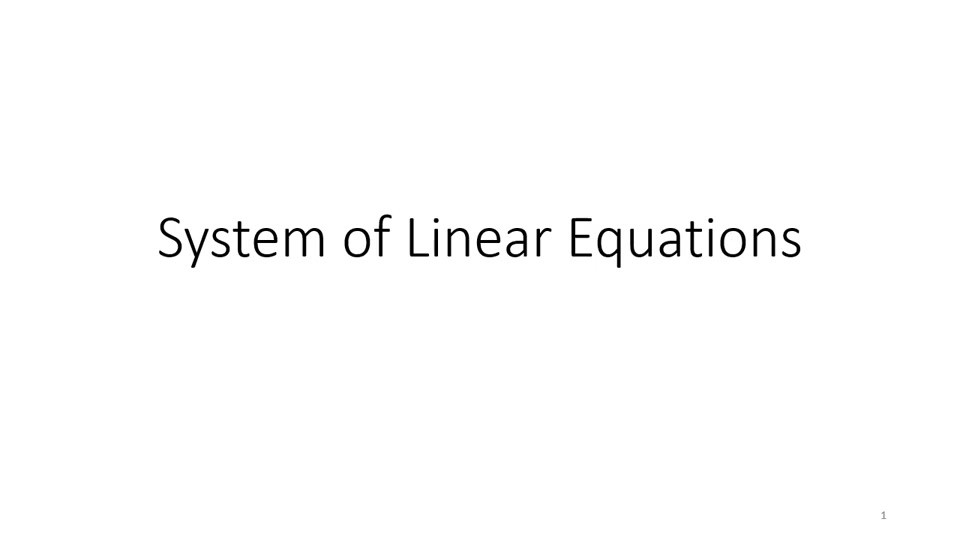

**Content:** Title card — *System of Linear Equations* (Chapter 1).

> 🎙️ **Narration:** *"Hello and welcome to the first chapter of linear algebra, and this is on system of linear equations. All the applications that we saw in the introduction video involve some kind of solving of linear equations. So you might ask, what is so difficult about solving linear equations, something that you would have already done in your school or in your JC? Well, the problem is, what would one do if there are thousands of linear equations that have to be solved simultaneously? So here we are talking about scale. Then it could be that the set of linear equations does not have any solution — what do we do then? Is it possible to approximate the solution of those linear equations? In other words, can we get to a solution which is as close as possible to a solution which could have been there, by modifying some of the equations."*

---

### 🎬 Slide 2 — Overview and Learning Outcomes (1 of 2)

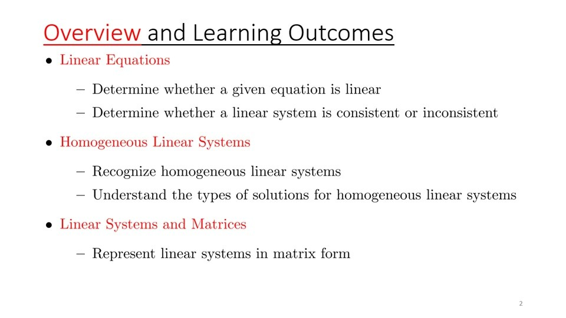

**Content:**

- **Linear Equations**
  - Determine whether a given equation is **linear**
  - Determine whether a linear system is **consistent or inconsistent**
- **Homogeneous Linear Systems**
  - Recognize homogeneous linear systems
  - Understand the types of solutions for homogeneous linear systems
- **Linear Systems and Matrices**
  - Represent linear systems in **matrix form**

> 🎙️ **Narration:** *"Every chapter will start off with some overview and learning outcomes, and the purpose of this set of slides is for you to ensure that you are able to perform all the tasks that are listed here. For example, under linear equations, determine whether a given equation is linear — are you able to do that once we finish this chapter? Determine whether a linear system is consistent or inconsistent. Each of these learning outcomes is for you to ensure that you have achieved these outcomes. So it would be advisable for you to come back to these learning outcomes once the chapter is finished, or once each of these sections are finished. So for example, once we finish with linear equations, you can test yourself whether you know how to determine whether a given equation is linear or not. And similarly for the other sections shown here. I'll not spend a lot of time on these slides because as I said, they are more for you to ensure that you have achieved the learning outcomes that are mentioned here."*

---

### 🎬 Slide 3 — Overview and Learning Outcomes (2 of 2)

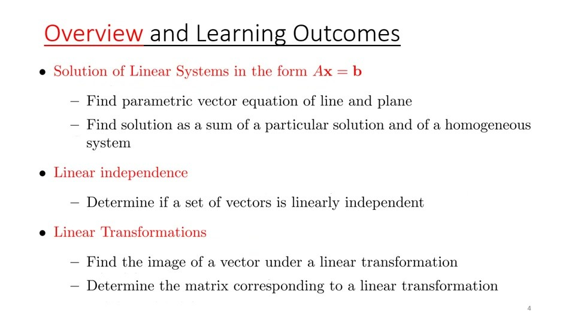

**Content:**

- **Solution of Linear Systems in the form $Ax = b$**
  - Find parametric vector equation of line and plane
  - Find solution as a sum of a **particular solution** and a solution of a **homogeneous** system
- **Linear independence**
  - Determine if a set of vectors is linearly independent
- **Linear Transformations**
  - Find the image of a vector under a linear transformation
  - Determine the matrix corresponding to a linear transformation

> 🎙️ **Narration:** *(This slide continues the overview — the topics that the rest of the chapter will cover: solving $Ax = b$, linear independence, and linear transformations.)*

---

### 🎬 Slide 4 — 1.1 Linear Equations: Definition

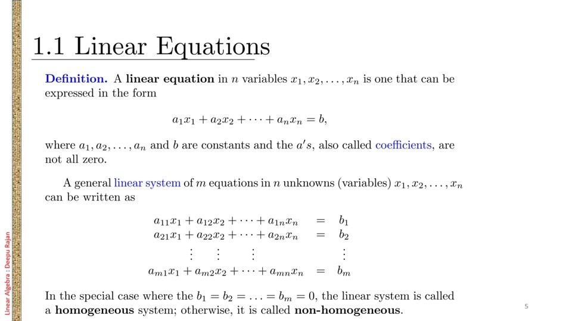

**Content — Definition.** A **linear equation** in $n$ variables $x_1, x_2, \dots, x_n$ is one that can be expressed in the form

$$a_1x_1 + a_2x_2 + \cdots + a_nx_n = b$$

where $a_1, a_2, \dots, a_n$ and $b$ are constants, and the $a$'s (called **coefficients**) are **not all zero**.

A general **linear system** of $m$ equations in $n$ unknowns (variables) $x_1, x_2, \dots, x_n$ can be written as

$$\begin{aligned} a_{11}x_1 + a_{12}x_2 + \cdots + a_{1n}x_n &= b_1 \\ a_{21}x_1 + a_{22}x_2 + \cdots + a_{2n}x_n &= b_2 \\ &\vdots \\ a_{m1}x_1 + a_{m2}x_2 + \cdots + a_{mn}x_n &= b_m \end{aligned}$$

- If $b_1 = b_2 = \cdots = b_m = 0$, the linear system is called a **homogeneous** system; otherwise, it is called **non-homogeneous**.

> 🎙️ **Narration:** *"So let's begin with the first section on linear equations by defining what a linear equation is. A linear equation in n variables x1, x2, …, xn is one that can be expressed in this form: a1x1 + a2x2 + ⋯ + anxn = b, where the a's and b are all constants. The a's are called the coefficients, and some of them may be zero, but all of them cannot be zero. So this is how a linear equation looks like. But as I said earlier, the big problem in linear algebra is solving a set of linear equations. A set we generally call a linear system of equations. So a general linear system of m equations in n unknowns, or variables, is written like that — each of them, of course, is a linear equation, and you have m such linear equations, and each equation has n unknowns. There can be a special case where the constants on the right-hand side, namely b1, b2, …, are all zero. In this case, the linear system is called a homogeneous system; otherwise, it's called a non-homogeneous system. For a linear system to be homogeneous, all of these b's should be equal to zero. Even if one b is not zero, then that system becomes non-homogeneous."*

---

### 🎬 Slide 5 — 1.1 Example, Solution, Consistent/Inconsistent

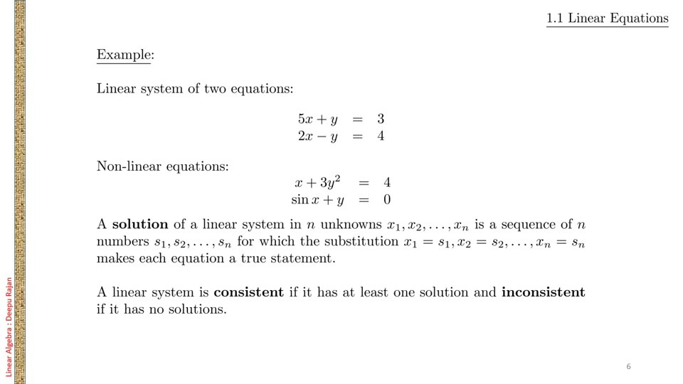

**Content:**

*Example — Linear system of two equations:*

$$5x + y = 3 \qquad\qquad 2x - y = 4$$

*Non-linear equations:* $x + 3y^2 = 4$, $\sin x + y = 0$.

A **solution** of a linear system in $n$ unknowns $x_1, \dots, x_n$ is a sequence of $n$ numbers $s_1, s_2, \dots, s_n$ for which the substitution $x_1 = s_1, x_2 = s_2, \dots, x_n = s_n$ makes each equation a true statement.

A linear system is **consistent** if it has **at least one solution** and **inconsistent** if it has **no solutions**.

> 🎙️ **Narration:** *"Let's look at an example of a linear system: 5x + y = 3 and 2x − y = 4. We want to differentiate between a linear system and a non-linear system of equations, and you can see clearly that because of the square here and because of the sine here, these equations are non-linear. So as long as an equation has a coefficient times the variable plus another coefficient times the variable and so on, up to an·xn, the number of variables is n, and that's equal to a constant — then this kind of an equation is said to be a linear equation. Now what do we do with these linear equations? We want to solve for these linear systems, and this is just a definition of what a solution is. If we substitute s1 for x1, s2 for x2, and so on, and if the left-hand side of the statement becomes equal to the right-hand side, then (s1, s2, …, sn) is called a solution of that linear system. What's more important, though, is this term consistent: a linear system is consistent if it has at least one solution, and inconsistent if it has no solutions. Remember I said there might be thousands of equations, but there might not be a solution for that linear system — in that case that system is said to be inconsistent; but if there is at least one solution, then it is said to be consistent. For example, if we take this linear equation, we can see that the solution of that linear system is x = 1, y = 2, and therefore this system is actually consistent."*

---

### 🎬 Slide 6 — Number of Solutions of a Linear System

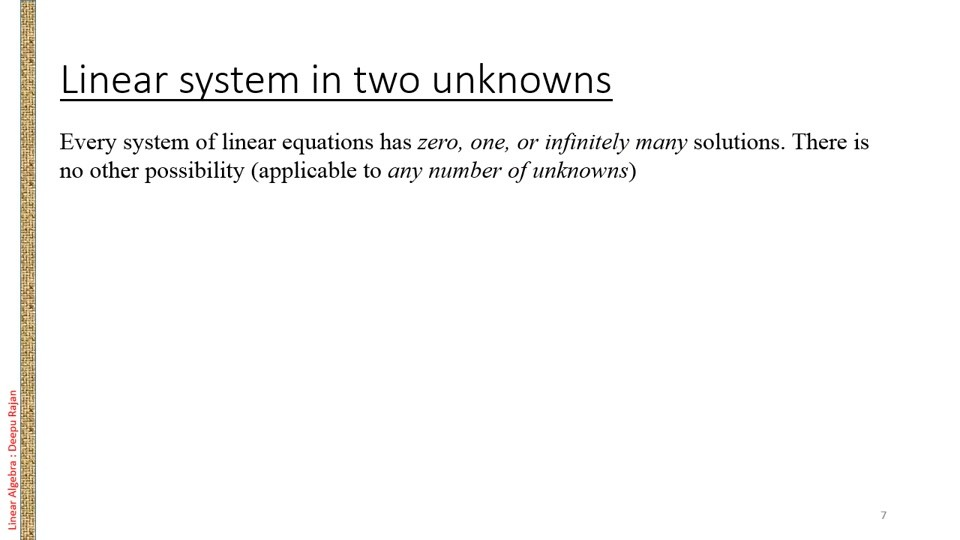

**Content — Linear system in two unknowns:**

> Every system of linear equations has **zero, one, or infinitely many solutions**. There is **no other possibility** (applicable to any number of unknowns).

> 🎙️ **Narration:** *"Now let's specifically look at the number of solutions in a linear system. Every system of linear equations has 0, 1 or infinitely many solutions — there is no other possibility, and this is of course applicable to any number of unknowns or variables in that linear system. So what this tells us is that you cannot have a linear system of equations that has 2 solutions or 3 solutions or 25 solutions. There can be only 3 possibilities as far as the number of solutions go: either there is no solution, or there is only one solution, or there could be infinitely many solutions, and this we can see from the following figures."*

---

### 🎬 Slide 7 — 0, 1, or ∞ Solutions (geometric view)

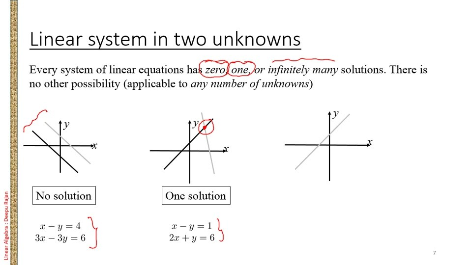

**Content — Linear system in two unknowns (each equation is a line):**

- **No solution:** the two lines are **parallel** (never meet), e.g. $x - y = 4$ and $3x - 3y = 6$.
- **One solution:** the two lines intersect in exactly **one point**, e.g. $x - y = 1$ and $2x + y = 6$.
- **Infinitely many solutions:** the two lines are **coincident** (overlap), e.g. $4x - 2y = 1$ and $16x - 8y = 4$ (second = first × 4).

> 🎙️ **Narration:** *"Let's say we have two equations, and each equation is represented by a straight line — one equation by the dark line and the other by the gray line. We say there is no solution for a linear system represented by the two equations. For example, x − y = 4 and 3x − 3y = 6: there is no value of x and y which will satisfy both equations. Visually, there is no point of intersection between the two lines — the two lines are parallel so they never meet, and therefore there is no solution. That takes care of the zero solutions case. Here is a case where there is exactly one solution, because there is one point of intersection between the two straight lines — an example is x − y = 1 and 2x + y = 6. And when do we have infinitely many solutions? Here you can see the gray line which represents one equation, but what happened to the dark line? Both of them are overlapping, so the dark line is underneath the gray line. In how many points are these two lines intersecting where one line is overlapping the other? Clearly there are an infinite number of points, and therefore infinitely many solutions, because the two lines are coincident. An example: 4x − 2y = 1 and 16x − 8y = 4 — the second equation is simply the first multiplied by 4, so these two lines are not two different lines; they are the same line, with the same slope and the same intercept, and hence they intersect at an infinite number of points. So a linear system can have either 0, 1 or infinitely many solutions — no other possibility."*

---

### 🎬 Slide 8 — 1.2 Homogeneous Linear Systems: Definition

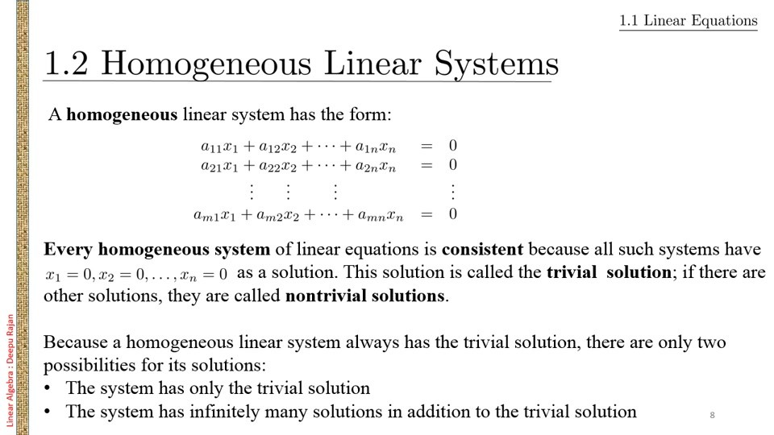

**Content:**

A **homogeneous linear system** has the form

$$\begin{aligned} a_{11}x_1 + a_{12}x_2 + \cdots + a_{1n}x_n &= 0 \\ a_{21}x_1 + a_{22}x_2 + \cdots + a_{2n}x_n &= 0 \\ &\vdots \\ a_{m1}x_1 + a_{m2}x_2 + \cdots + a_{mn}x_n &= 0 \end{aligned}$$

- Every homogeneous system is **consistent**, because $x_1 = 0, x_2 = 0, \dots, x_n = 0$ is always a solution — the **trivial solution**. Other solutions, if any, are **nontrivial**.
- Because the trivial solution always exists, there are only **two possibilities**:
  - The system has **only the trivial solution**, or
  - The system has **infinitely many solutions** in addition to the trivial solution.

> 🎙️ **Narration:** *"Now let's look at homogeneous linear systems in a similar light as we just now looked at non-homogeneous systems. Remember we've already said that a homogeneous linear system will have 0s on the right-hand side of all the equations. If you just look at this set of equations you can immediately say that this linear system has one solution for sure — when all of the values x1, x2, …, xn are all 0. So there is at least one solution for a homogeneous linear system, and as we said, if there is at least one solution then the system is said to be consistent. Putting these two together, every homogeneous system of linear equations is consistent, because all such systems will have x1 = 0, x2 = 0, and so on as a solution. But that's not very interesting, actually — it's called a trivial solution. The more interesting question is: are there other solutions? And if there are other solutions, then those solutions are called non-trivial. Because a homogeneous linear system always has the trivial solution, there are only two possibilities for its solutions: either the system has only the trivial solution, or the system has infinitely many solutions in addition to the trivial solution."*

---

### 🎬 Slide 9 — 1.2 Homogeneous System in Two Unknowns (figure)

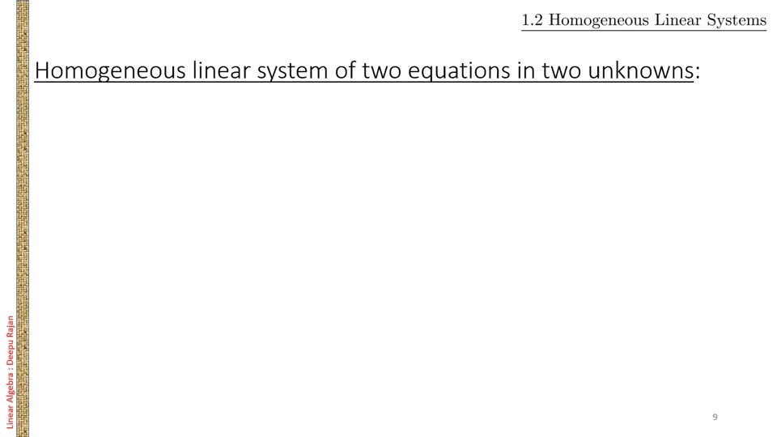

**Content — Homogeneous linear system of two equations in two unknowns:**

$$a_1x + b_1y = 0 \quad (a_1, b_1 \text{ not both zero}), \qquad a_2x + b_2y = 0 \quad (a_2, b_2 \text{ not both zero})$$

> 🎙️ **Narration:** *"Here we have a linear system a1x + b1y = 0, a2x + b2y = 0. Because these are zero we know that it is a homogeneous linear system. If you were to plot this, you would find one of the equations represented by the dark line and the other equation represented by the gray line. But what you find interesting is that both of these lines pass through the origin — the (0, 0) line — and they are intersecting. That means they have a solution: they are intersecting at (0, 0), which means that (0, 0) is one of the solutions, but as we said earlier, it is a trivial solution."*

---

### 🎬 Slide 10 — 1.2 Only Trivial / Infinitely Many Solutions

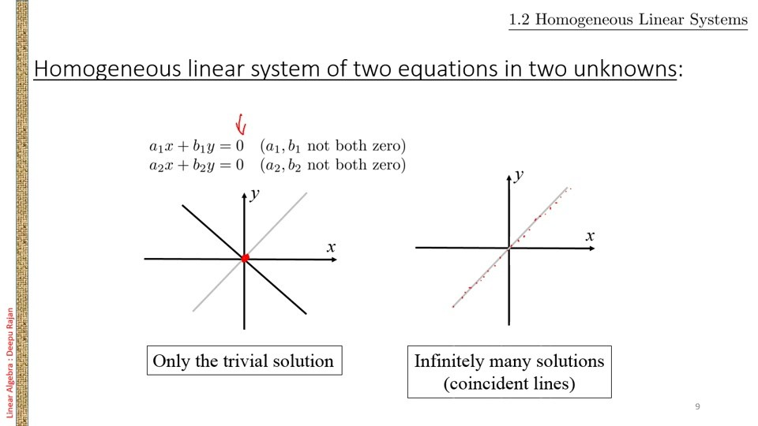

**Content — Homogeneous linear system of two equations in two unknowns:**

- **Only the trivial solution:** the two lines intersect only at the origin.
- **Infinitely many solutions (coincident lines):** both lines are the same line through the origin.

> 🎙️ **Narration:** *"So here we have only the trivial solution. Just now we said we could also have infinitely many solutions for a homogeneous linear system. How is that possible? Well, this is almost similar to the previous case for non-homogeneous linear systems, in that both the lines are coincident. The only difference being that both the lines are passing through the origin in the case of homogeneous linear systems. But then again, since the two lines are coincident, at how many points are they intersecting? They are intersecting at infinitely many points, and therefore there are infinitely many solutions, because the two lines representing the two equations are coincident."*

---

### 🎬 Slide 11 — 1.2 Matrix Notation: Coefficient & Augmented Matrices

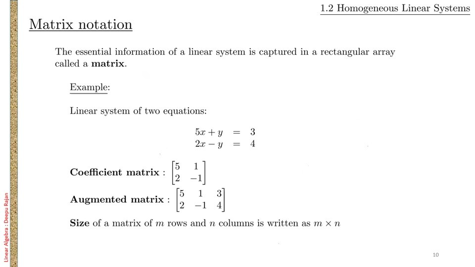

**Content:**

The essential information of a linear system is captured in a rectangular array called a **matrix**.

*Example — Linear system of two equations:* $5x + y = 3$, $2x - y = 4$

$$\text{Coefficient matrix: } \begin{bmatrix} 5 & 1 \\ 2 & -1 \end{bmatrix} \qquad \text{Augmented matrix: } \left[\begin{array}{cc|c} 5 & 1 & 3 \\ 2 & -1 & 4 \end{array}\right]$$

- Size of a matrix of $m$ rows and $n$ columns is written as $m \times n$.

> 🎙️ **Narration:** *"Before we wrap up this video, let's look at how we can collect all the information that is available in a linear system into a matrix. You already know that a matrix is a rectangular array of numbers, and our purpose here is to capture the essential information in a linear system into this matrix. Let's look at this example of a linear system of two equations. If we pick the coefficients of these equations and put them in a matrix, then this matrix is called a coefficient matrix. From the first equation we have the coefficient 5 and the coefficient of y, which is 1; and from the second equation we have the coefficient 2 and the coefficient −1 in the second row of the matrix. That becomes the coefficient matrix corresponding to this linear system. Another kind of matrix that captures the information in this linear system is the augmented matrix, where all that is done is that the right-hand side is augmented, or attached, to the coefficient matrix. So this part is the coefficient matrix, but when we add the right-hand side of the linear system we get the augmented matrix corresponding to this linear system. And as you already know, when we refer to the size of a matrix, we are actually specifying the number of rows and the number of columns in that matrix, and the size is written as m × n. And with that we come to the end of this video. See you next time. Thank you."*

---

## V-1.3 — 1.3 Two Fundamental Questions about a Linear System

### 🎬 Slide 1 — Two Fundamental Questions + Elementary Row Operations

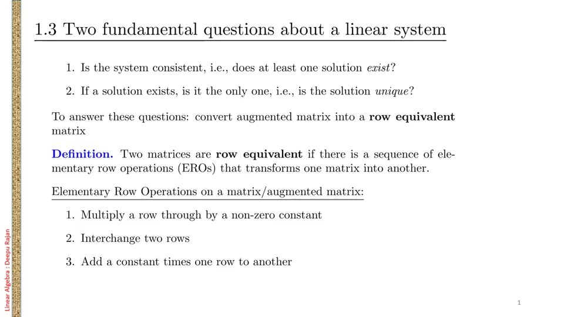

**Content:**

1. **Is the system consistent?** — i.e., does at least one solution exist?
2. **If a solution exists, is it the only one?** — i.e., is the solution unique?

To answer these questions: convert the **augmented matrix** into a **row equivalent** matrix.

**Definition.** Two matrices are **row equivalent** if there is a sequence of **elementary row operations (EROs)** that transforms one matrix into another.

**Elementary Row Operations** on a matrix/augmented matrix:
1. Multiply a row through by a **non-zero constant**
2. **Interchange** two rows
3. **Add a constant times one row to another**

> 🎙️ **Narration:** *"Hello and welcome to section 1.3, where we are going to ask some very important questions about solving a linear system of equations — two fundamental questions. The first is whether a linear system of equations is consistent or not, i.e., does it have at least one solution? The second question is, if such a solution exists, is it the only one, i.e., is the solution unique? As we saw in the previous videos, a linear system can have either zero, one, or infinitely many solutions. To answer these questions, we convert the augmented matrix into a row equivalent matrix. Two matrices are row equivalent if there is a sequence of elementary row operations, called EROs, that transforms one matrix into another. The elementary row operations allowed are: multiply a row throughout by a non-zero constant; interchange two rows; or add a constant times one row to another. So for a matrix like [1 2 1; 1 3 4], I can multiply the first row by a constant to get [2 4 2; 1 3 4] — those two matrices are row equivalent. I could also interchange two rows. Or, leaving the first row untouched, I multiply the first row by 2 and add it to the second row: 2·1 + 1 = 3, 2·2 + 3 = 7, 2·1 + 4 = 6 — so [1 2 1; 3 7 6] is row equivalent to the original. Those are the three elementary row operations."*

---

### 🎬 Slide 2 — Row Echelon Form and Reduced Row Echelon Form

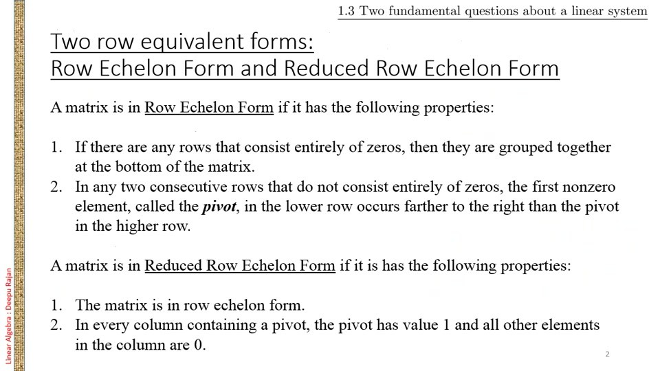

**Content — Two row equivalent forms: Row Echelon Form and Reduced Row Echelon Form.**

A matrix is in **Row Echelon Form (REF)** if:
1. Any rows consisting entirely of zeros are **grouped together at the bottom**.
2. In any two consecutive nonzero rows, the **first nonzero element** (the **pivot**) in the lower row occurs **farther to the right** than the pivot in the higher row.

A matrix is in **Reduced Row Echelon Form (RREF)** if:
1. The matrix is in row echelon form.
2. In **every column containing a pivot**, the pivot has value **1** and **all other elements** in the column are **0**.

> 🎙️ **Narration:** *"Now there are two types of row equivalent forms: row echelon form and reduced row echelon form. A matrix is in row echelon form if it has the following two properties. Number one: if there are any rows that consist entirely of zeros, then they are grouped together at the bottom of the matrix. Number two: in any two consecutive rows that do not consist entirely of zeros, the first nonzero element — called the pivot — in the lower row occurs farther to the right than the pivot in the higher row. The pivot is the first nonzero element in a row: in the row [0 1 2], the pivot is the 1; in the row [1 2 3], the pivot is the 1 at the start. The second property says the pivot in the lower row should be to the right of the pivot above it. If both conditions are satisfied, the matrix is in row echelon form. For reduced row echelon form, the matrix must first be in row echelon form, and in addition, in every column containing a pivot, the pivot has value 1 and all other elements in that column are 0. For example, in a matrix where the first column has pivot 1 and zeros elsewhere, but the second column has pivot 1 with a 2 above/below it, that column is not all zeros other than the pivot, so it is not reduced row echelon form."*

---

### 🎬 Slide 3 — Examples of REF and RREF

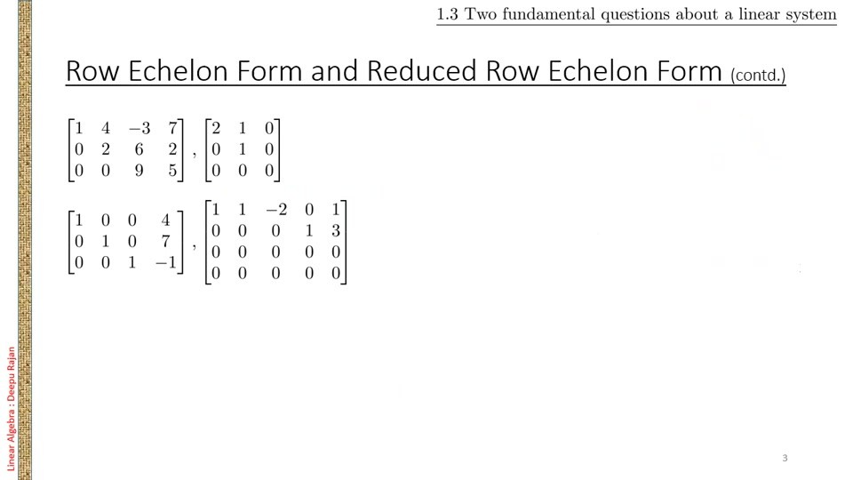

**Content — Examples:**

Row Echelon Form:

$$\begin{bmatrix} 1 & 4 & -3 & 7 \\ 0 & 2 & 6 & 2 \\ 0 & 0 & 9 & 5 \end{bmatrix} \qquad \begin{bmatrix} 1 & 0 & 0 & 4 \\ 0 & 0 & 1 & 3 \\ 0 & 0 & 0 & 0 \end{bmatrix} \qquad \begin{bmatrix} 2 & 1 & 2 & 0 \\ 0 & 0 & 1 & 1 \\ 0 & 0 & 0 & 0 \end{bmatrix}$$

Reduced Row Echelon Form:

$$\begin{bmatrix} 1 & 0 & 0 \\ 0 & 1 & 0 \\ 0 & 0 & 1 \end{bmatrix} \qquad \begin{bmatrix} 1 & 0 & 2 & 0 & 2 & 1 \\ 0 & 1 & 0 & 0 & 2 & 3 \\ 0 & 0 & 0 & 1 & 1 & 0 \end{bmatrix}$$

> 🎙️ **Narration:** *"These are some more examples of row echelon and reduced row echelon form. We first identify the pivots in the first, second and third rows, and we can see that the pivot in a lower row is to the right of the pivot above it — you can get some kind of staircase pattern. If we were to draw a line keeping the zeros below the staircase, the nonzero elements are above the staircase. The all-zero rows are at the bottom, and the pivot in one row is to the right of the pivot above it — so this is a row echelon form. In another example, the pivots are arranged so that it is a row echelon form, but the pivot values are 1, and in the pivot columns all elements are zero except the pivot — so it is reduced row echelon form. Similarly for other matrices: all-zero rows grouped at the bottom, pivots to the right, and in pivot columns everything is zero except the pivot — reduced row echelon form."*

---

### 🎬 Slide 4 — REF/RREF (contd.): Gaussian & Gauss-Jordan Elimination

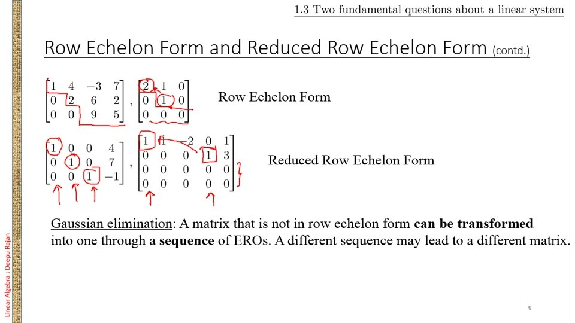

**Content:**

- **Gaussian elimination:** a matrix that is not in row echelon form can be transformed into one through a sequence of EROs. A different sequence may lead to a **different** matrix (REF is **not unique**).
- **Gauss–Jordan elimination:** transforming to **reduced** row echelon form is **unique**.
  - *Forward phase:* introduce zeros **below** the pivots.
  - *Backward phase:* introduce zeros **above** the pivots and make pivots 1.

> 🎙️ **Narration:** *"What we'll see later is Gaussian elimination, where a matrix that is not in row echelon form can be transformed into one through a sequence of EROs. A different sequence may lead to a different matrix — the row echelon form for a particular matrix is not unique. Converting a matrix to reduced row echelon form through a sequence of EROs is called Gauss–Jordan elimination, and this is going to be unique. Gauss–Jordan elimination consists of two parts: a forward phase in which zeros are introduced below the pivots, and a backward phase in which zeros are introduced above the pivots and the pivots are transformed to one. If only the forward phase is used, the procedure produces a row echelon form only, and that's called Gaussian elimination."*

---

### 🎬 Slide 5 — Exercise: Gaussian Elimination (to REF)

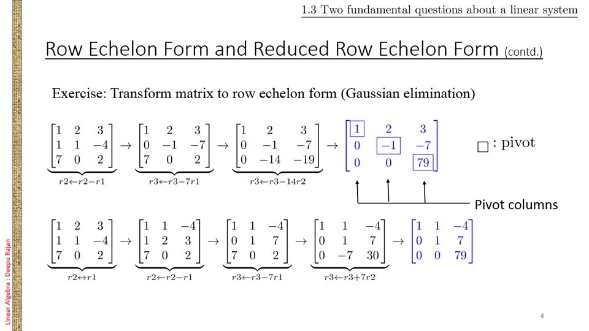

**Content — Exercise: Transform matrix to row echelon form (Gaussian elimination):**

$$\begin{bmatrix} 1 & 2 & 3 \\ 1 & 1 & -4 \\ 7 & 0 & 2 \end{bmatrix} \xrightarrow{r_2 \leftarrow r_2 - r_1} \begin{bmatrix} 1 & 2 & 3 \\ 0 & -1 & -7 \\ 7 & 0 & 2 \end{bmatrix} \xrightarrow{r_3 \leftarrow r_3 - 7r_1} \begin{bmatrix} 1 & 2 & 3 \\ 0 & -1 & -7 \\ 0 & -14 & -19 \end{bmatrix} \xrightarrow{r_3 \leftarrow r_3 - 14r_2} \begin{bmatrix} 1 & 2 & 3 \\ 0 & -1 & -7 \\ 0 & 0 & 79 \end{bmatrix}$$

Pivot columns highlighted; the pivots form a staircase pattern. *(A different sequence of EROs could lead to a different REF.)*

> 🎙️ **Narration:** *"Here we show an example of transforming a matrix to row echelon form through a sequence of operations. We start with this matrix and apply elementary row operations. Row 2 is replaced by row 2 minus row 1 — an example of the third ERO — so 1 − 1 = 0, 1 − 2 = −1, −4 − 3 = −7. Then row 3 is replaced by row 3 minus 7 times row 1. The guideline: first make sure the first element is nonzero, and we want to make the elements below it in the first column zero. Next we replace row 3 with row 3 minus 14 times row 2, so that this element becomes zero and the element above becomes a pivot. We finally get this row echelon form, and the squares indicate the pivots — each pivot is to the right of the pivot above it, giving the staircase pattern. Starting from the same matrix with a different sequence of EROs, we can get a different row echelon form — that is what we said earlier: in Gaussian elimination the row echelon form is not unique."*

---

### 🎬 Slide 6 — Exercise: Gauss–Jordan Elimination (to RREF)

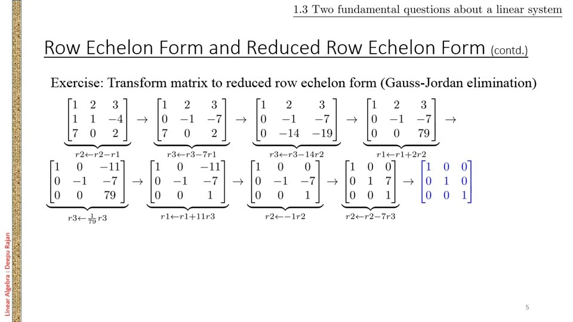

**Content — Exercise: Transform matrix to reduced row echelon form (Gauss–Jordan elimination):**

Continuing from the REF above, the backward phase makes the pivots 1 and zeros above the pivots:

$$\begin{bmatrix} 1 & 2 & 3 \\ 0 & -1 & -7 \\ 0 & 0 & 79 \end{bmatrix} \longrightarrow \begin{bmatrix} 1 & 0 & 0 \\ 0 & 1 & 0 \\ 0 & 0 & 1 \end{bmatrix}$$

> 🎙️ **Narration:** *"Then we look at an example of reduced row echelon form. We start with the same matrix, reach the row echelon form we had, and then continue the elementary row operations. The purpose is to make sure the pivot values become one and the other elements in the pivot columns, except the pivot, become zero. After this sequence of EROs, we check: is this reduced row echelon form? There is a pivot here, a pivot there, and a pivot there — so it is in row echelon form. And if we look at the pivot columns, the value of each pivot is 1, and all other elements except the pivot are zero. So this matrix is the reduced row echelon form."*

---

### 🎬 Slide 7 — Exercise: Is the System Consistent?

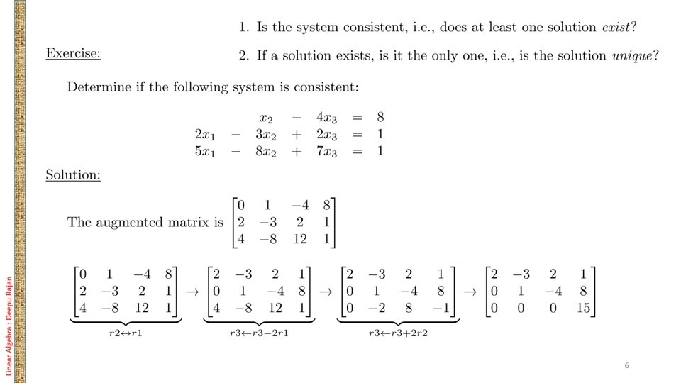

**Content — Exercise: Determine if the following system is consistent:**

$$x_1 - 4x_3 = 8, \qquad 2x_1 - 3x_2 + 2x_3 = 1, \qquad 5x_1 - 8x_2 + 7x_3 = 1$$

**Solution.** The augmented matrix is $\left[\begin{array}{ccc|c} 0 & 1 & -4 & 8 \\ 2 & -3 & 2 & 1 \\ 4 & -8 & 12 & 1 \end{array}\right]$. Row operations give

$$\left[\begin{array}{ccc|c} 2 & -3 & 2 & 1 \\ 0 & 1 & -4 & 8 \\ 0 & 0 & 0 & 15 \end{array}\right]$$

> 🎙️ **Narration:** *"So remember, we are asking two questions here: is the system consistent, i.e., does it have at least one solution? And second, if a solution exists, is it the only one? We said one way is to convert to reduced row echelon form, or even a row echelon form, and then we can answer these questions. In this example, we are asked to determine if this linear system is consistent or not. The first step is to form the augmented matrix — take all the coefficients of the variables x1, x2 and x3, put them in the columns, and also take the right-hand side as the fourth column. Once we have the augmented matrix, we carry out the elementary row operations and get this particular form, which is the row echelon form."*

---

### 🎬 Slide 8 — Corresponding System: 0 = 15 ⇒ Inconsistent

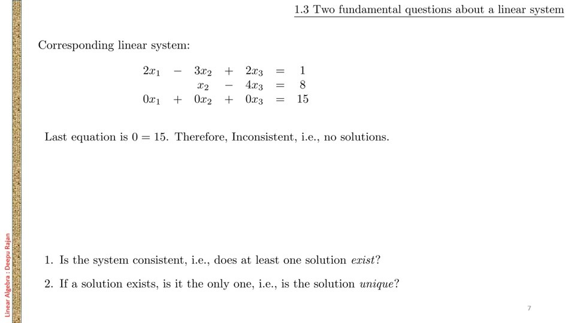

**Content — Corresponding linear system:**

$$\begin{aligned} 2x_1 - 3x_2 + 2x_3 &= 1 \\ x_2 - 4x_3 &= 8 \\ 0x_1 + 0x_2 + 0x_3 &= 15 \end{aligned}$$

The last equation is $0 = 15$. Therefore the system is **inconsistent** — it has **no solutions**.

> 🎙️ **Narration:** *"Given this row echelon form, we can write down the linear system again. This column corresponds to x1, this to x2, this to x3. The first equation is 2x1 − 3x2 + 2x3 = 1; the second row gives 0x1 + 1x2 − 4x3 = 8; and the last row is 0x1 + 0x2 + 0x3 = 15 — in other words, 0 = 15. Is there an x1, x2, x3 such that 0x1 + 0x2 + 0x3 = 15? No way. Therefore the system is inconsistent — there are no solutions. And of course, if there are no solutions, we don't have to answer the second question. So in this video we have seen two types of row equivalent forms — row echelon form and reduced row echelon form. Converting a matrix to row echelon form is called Gaussian elimination; converting to reduced row echelon form is called Gauss–Jordan elimination. And finally, we have seen that reducing the matrix allows us to determine whether the system is consistent."*

---

## V-1.4 — 1.4 Solutions of Linear Systems

### 🎬 Slide 1 — Row Reduction Leads to the Solution Set

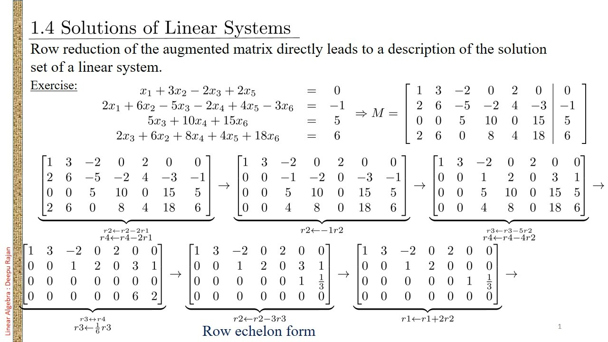

**Content:**

Row reduction of the augmented matrix directly leads to a description of the **solution set** of a linear system.

*Example:* system of equations in variables $x_1, \dots, x_6$ with augmented matrix

$$M = \left[\begin{array}{cccccc|c} 1 & 3 & -2 & 0 & 2 & 0 & 0 \\ 2 & 6 & -5 & -2 & 4 & -3 & -1 \\ 0 & 0 & 5 & 10 & 0 & 15 & 5 \\ 2 & 6 & 0 & 8 & 4 & 18 & 6 \end{array}\right]$$

Row reduction reaches row echelon form. The last row is $0x_1 + 0x_2 + \cdots + 0x_6 = 0$, i.e. $0 = 0$ — satisfied by any values → **infinitely many solutions**.

> 🎙️ **Narration:** *"In the previous video we looked at how we could use the row echelon form to determine if a linear system had a solution or not — whether it was consistent or inconsistent, and the example was inconsistent. In this section, we are looking at a linear system which has an infinite number of solutions. A row reduction of the augmented matrix directly leads to the description of a solution of a linear system. We have this linear system with six variables, written in augmented form in matrix M. The first column is for the first variable, the second for the second, and so on, and the right-hand side is the b vector. We do our row reduction with elementary row operations, and when we reach row echelon form, note the last row: it says 0x1 + 0x2 + … + 0x6 = 0. Any values of x1, …, x6 will satisfy this equation, which means there are infinite number of solutions. So this linear system has infinite number of solutions. But that does not mean you stop at this point — the next step is to find out what those solutions are. This is unlike the inconsistent case, where there is no solution and nothing to do. Here we have to find out what the infinite solutions are, so we proceed to transform the row echelon form into a reduced row echelon form."*

---

### 🎬 Slide 2 — RREF, Leading & Free Variables, General Solution

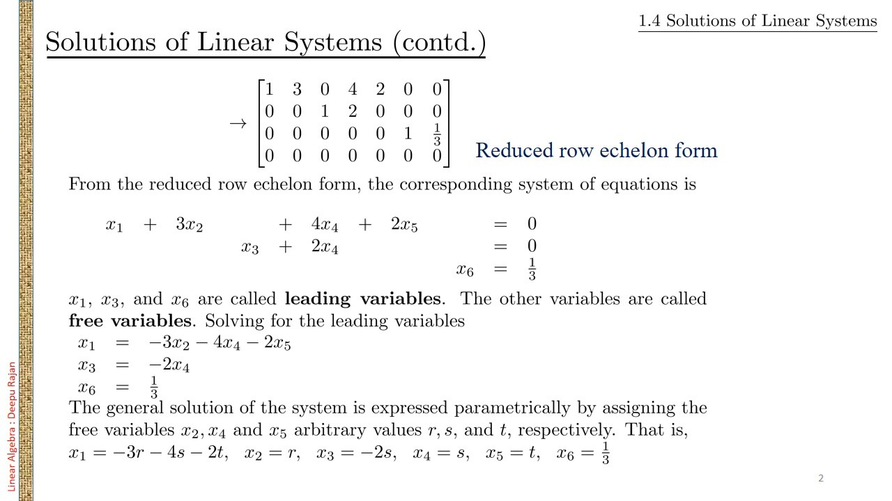

**Content:**

From the reduced row echelon form $\left[\begin{array}{cccccc|c} 1 & 3 & 0 & 4 & 2 & 0 & 0 \\ 0 & 0 & 1 & 2 & 0 & 0 & 0 \\ 0 & 0 & 0 & 0 & 0 & 1 & 1/3 \\ 0 & 0 & 0 & 0 & 0 & 0 & 0 \end{array}\right]$, the corresponding system is

$$\begin{aligned} x_1 + 3x_2 + 4x_4 + 2x_5 &= 0 \\ x_3 + 2x_4 &= 0 \\ x_6 &= \tfrac{1}{3} \end{aligned}$$

- **Leading variables:** $x_1, x_3, x_6$ (the variables corresponding to pivots).
- **Free variables:** $x_2, x_4, x_5$.

Solving for the leading variables and assigning the free variables arbitrary values $r, s, t$:

$$x_1 = -3r - 4s - 2t, \quad x_2 = r, \quad x_3 = -2s, \quad x_4 = s, \quad x_5 = t, \quad x_6 = \tfrac{1}{3}$$

> 🎙️ **Narration:** *"As we do that we get the reduced row echelon form. From it we can write the corresponding system of equations: the first equation is x1 + 3x2 + 4x4 + 2x5 = 0, then the second and third equations, and the last row is simply 0 = 0. Now we note that x1, x3 and x6 are called the leading variables — the variables corresponding to pivots when we rewrite the system. The other variables, x2, x4 and x5, are called the free variables. We solve for the leading variables: leave the leading variable on one side and take all the other variables to the other side. Because x2, x4 and x5 are free variables, we can assign arbitrary values to them — let's call them r, s and t; that is what free variable means, it can take any values. Once we assign r, s, t to x2, x4, x5 respectively, we can write the final solution: x1 = −3r − 4s − 2t, x2 = r, x3 = −2s, x4 = s, x5 = t, and x6 = 1/3. Because r, s and t can be arbitrary, there can be infinite numbers of values for x1, …, x5 — x6 of course is fixed at 1/3 — but there would be infinite solutions depending on the values of r, s and t."*

---

### 🎬 Slide 3 — Procedure: Using Row Reduction to Solve a Linear System

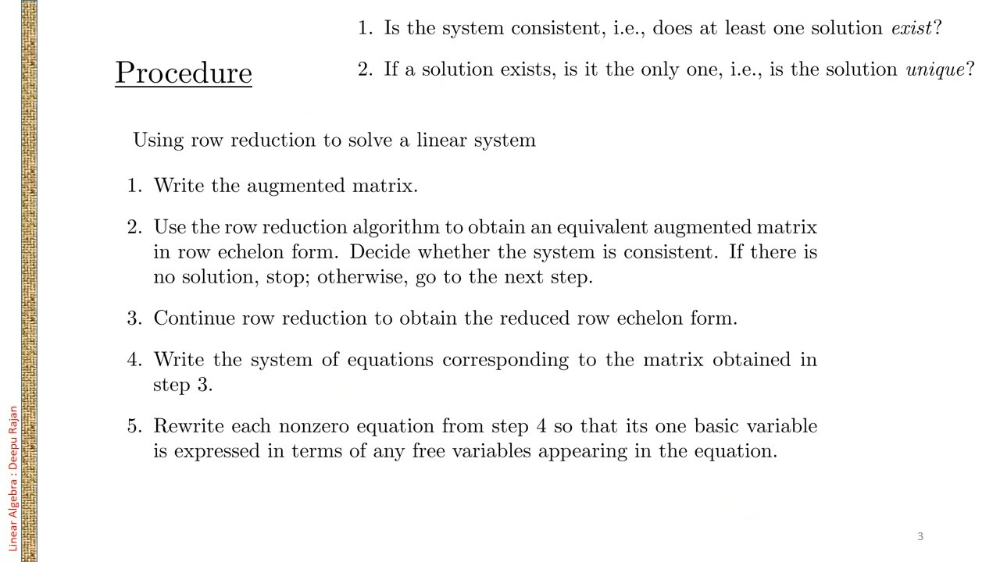

**Content — Procedure:**

1. Write the **augmented matrix**.
2. Use the row reduction algorithm to obtain an equivalent augmented matrix in **row echelon form**. Decide whether the system is **consistent**. If there is no solution, stop; otherwise go to the next step.
3. Continue row reduction to obtain the **reduced row echelon form**.
4. Write the system of equations corresponding to the matrix obtained in step 3.
5. Rewrite each nonzero equation from step 4 so that its one **basic variable** is expressed in terms of any **free variables** appearing in the equation.

> 🎙️ **Narration:** *"We set out to answer two fundamental questions: does at least one solution exist, and if so, is it unique? We saw that we could use the row echelon form of the augmented matrix to determine whether the system is consistent, and we can actually find the solution by transforming the augmented matrix to a reduced row echelon form. This is the procedure: write the augmented matrix; use row reduction to obtain row echelon form and decide consistency (if no solution, stop); continue to reduced row echelon form; write the corresponding system; rewrite each nonzero equation so its one basic variable is expressed in terms of any free variables. Since we have already gone through two examples, I'm not going further into this procedure — you can read it for yourself."*

---

### 🎬 Slide 4 — Gaussian Elimination and Back-Substitution

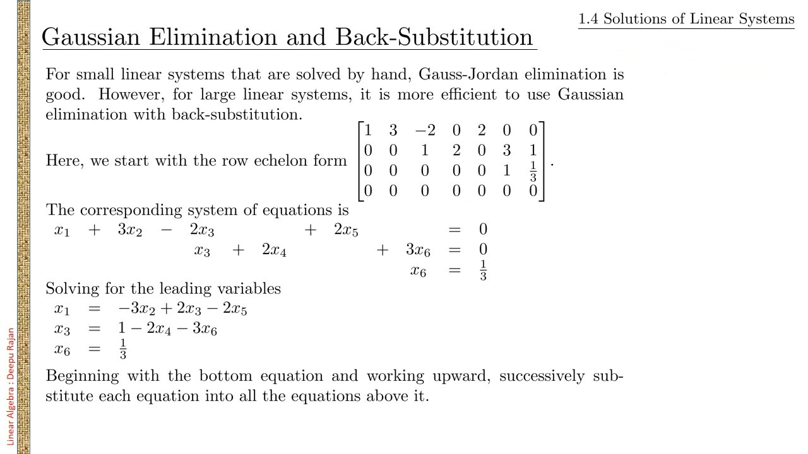

**Content:**

For small linear systems solved by hand, **Gauss–Jordan elimination** is good. For large linear systems, it is more efficient to use **Gaussian elimination with back-substitution**.

Starting from the row echelon form $\left[\begin{array}{cccccc|c} 1 & 3 & -2 & 0 & 2 & 0 & 0 \\ 0 & 0 & 1 & 2 & 0 & 3 & 0 \\ 0 & 0 & 0 & 0 & 0 & 1 & 1/3 \\ 0 & 0 & 0 & 0 & 0 & 0 & 0 \end{array}\right]$, the corresponding system is

$$\begin{aligned} x_1 + 3x_2 - 2x_3 + 2x_5 &= 0 \\ x_3 + 2x_4 + 3x_6 &= 0 \\ x_6 &= \tfrac{1}{3} \end{aligned}$$

Solving for the leading variables, then **back-substituting** from the bottom equation upward.

> 🎙️ **Narration:** *"Next we look at another method for solving systems of linear equations, called Gaussian elimination with back-substitution. What we saw just now was Gauss–Jordan elimination, where we reduced the augmented matrix to reduced row echelon form. In this method we start with the row echelon form of the matrix. Assume you are given AX = B, you form the augmented matrix [A|B], convert it through EROs to a row echelon form, and that's the row echelon form we start from here. We write the corresponding system of equations: x1 + 3x2 − 2x3 + 2x5 = 0, and the second and third equations. We solve for the leading variables x1, x3, x6: x1 = −3x2 + 2x3 − 2x5, x3 = −2x4 − 3x6, and x6 = 1/3. That was the first part. Now the second part of the method is the back-substitution: beginning with the bottom equation, we work upwards, successively substituting each equation into all the equations above it."*

---

### 🎬 Slide 5 — Back-Substitution (diagram)

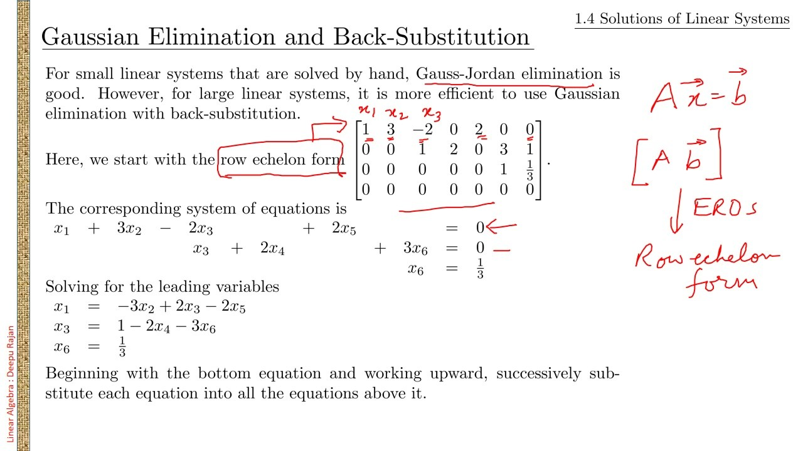

**Content:** *(illustration of the back-substitution process from the bottom equation upward through the EROs.)*

> 🎙️ **Narration:** *"If we go to the next slide, we see this substitution of x6 = 1/3 into the second equation, so x3 = −2x4; and substituting x3 = −2x4 into the first equation, we get x1 = −3x2 − 4x4 − 2x5."*

---

### 🎬 Slide 6 — Back-Substitution (contd.): Final Solution

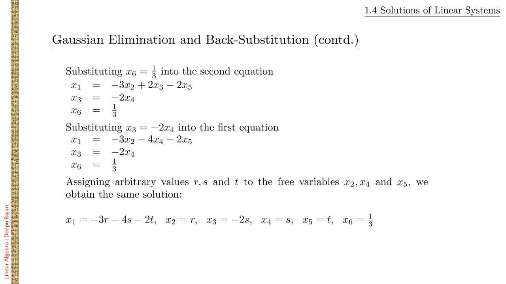

**Content — Back-Substitution (contd.):**

Substituting $x_6 = \tfrac13$ into the second equation: $x_3 = -2x_4$.

Substituting $x_3 = -2x_4$ into the first equation: $x_1 = -3x_2 - 4x_4 - 2x_5$.

Assigning arbitrary values $r, s, t$ to the free variables $x_2, x_4, x_5$, we obtain the **same solution** as Gauss–Jordan:

$$x_1 = -3r - 4s - 2t, \quad x_2 = r, \quad x_3 = -2s, \quad x_4 = s, \quad x_5 = t, \quad x_6 = \tfrac{1}{3}$$

> 🎙️ **Narration:** *"Once we have reached the first equation, there is no back-substitution that can happen, and this is the final set of equations we work with. Remember x2, x4 and x5 are the free variables, so we arbitrarily assign values r, s and t to them, and we obtain the same solution as we got for Gauss–Jordan elimination."*

---

## V-1.5 — 1.5 Linear Combination of Vectors

### 🎬 Slide 1 — Definition + Exercise

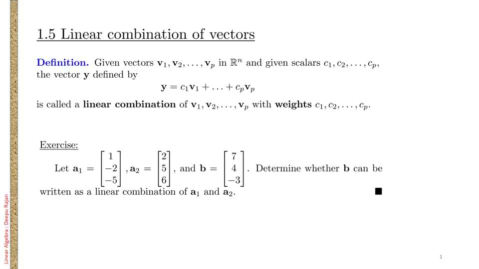

**Content — Definition.** Given vectors $\mathbf v_1, \mathbf v_2, \dots, \mathbf v_p$ in $\mathbb{R}^n$ and given scalars $c_1, c_2, \dots, c_p$, the vector $\mathbf y$ defined by

$$\mathbf y = c_1\mathbf v_1 + c_2\mathbf v_2 + \cdots + c_p\mathbf v_p$$

is called a **linear combination** of $\mathbf v_1, \mathbf v_2, \dots, \mathbf v_p$ with **weights** $c_1, c_2, \dots, c_p$.

**Exercise:** Let $\mathbf a_1 = \begin{bmatrix} 1 \\ -2 \\ -5 \end{bmatrix}$, $\mathbf a_2 = \begin{bmatrix} 2 \\ 5 \\ 6 \end{bmatrix}$, and $\mathbf b = \begin{bmatrix} 7 \\ 4 \\ -3 \end{bmatrix}$. Determine whether $\mathbf b$ can be written as a linear combination of $\mathbf a_1$ and $\mathbf a_2$.

> 🎙️ **Narration:** *"In this section we are going to introduce a new term, the linear combination of vectors. Given vectors v1, v2, …, vp in ℝⁿ, and given scalars c1, c2, …, cp, the vector y defined by y = c1v1 + ⋯ + cpvp is called a linear combination of v1, …, vp with weights c1, …, cp. All that we are doing to determine a linear combination is to multiply each vector with a scalar and add them up. Let's look at an example: we are given vectors a1, a2 and b, and we want to find out whether b is a linear combination of a1 and a2. That means we take scalars, say x1 times a1 plus x2 times a2, and ask whether this linear combination equals b. So the question is: can you find x1 and x2 such that x1a1 + x2a2 = b? If we write it out: x1(1, −2, −5) + x2(2, 5, 6) = (7, 4, −3)."*

---

### 🎬 Slide 2 — Setting up the Linear System

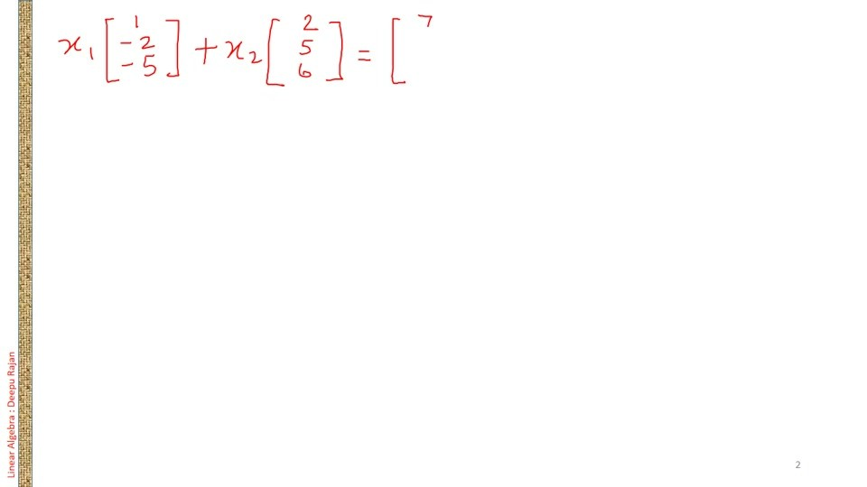

**Content — Setting up the linear system:**

$$x_1(1, -2, -5) + x_2(2, 5, 6) = (7, 4, -3) \iff \begin{aligned} x_1 + 2x_2 &= 7 \\ -2x_1 + 5x_2 &= 4 \\ -5x_1 + 6x_2 &= -3 \end{aligned}$$

Augmented matrix: $\left[\begin{array}{cc|c} 1 & 2 & 7 \\ -2 & 5 & 4 \\ -5 & 6 & -3 \end{array}\right]$

> 🎙️ **Narration:** *"So the question really is: do we have an x1 and x2 that will solve the following linear system of equations? We translate this into a linear system: x1 + 2x2 = 7, −2x1 + 5x2 = 4, −5x1 + 6x2 = −3. To solve this system we need to find the reduced row echelon form — of course we are assuming there is a solution; if there is no solution, we will encounter that at the row echelon form stage. So we write the augmented matrix [1 2 7; −2 5 4; −5 6 −3]. The first transformation: row 2 is replaced by 2·row1 + row2, and row 3 is replaced by 5·row1 − row3, giving [1 2 7; 0 9 18; 0 16 32]. Continuing the EROs, we reach the reduced row echelon form [1 0 3; 0 1 2; 0 0 0]."*

---

### 🎬 Slide 3 — Solving: $x_1 = 3$, $x_2 = 2$

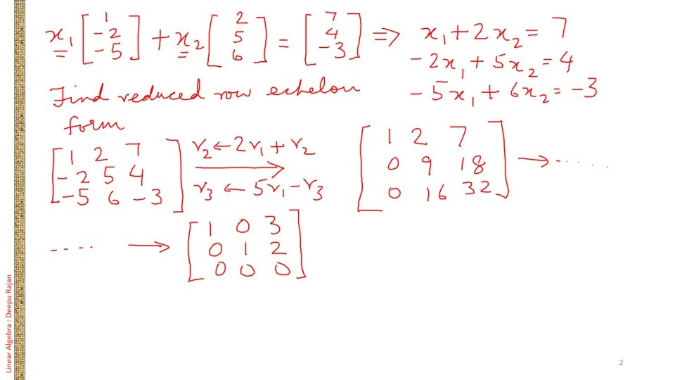

**Content — Solution:**

Reduced row echelon form: $\left[\begin{array}{cc|c} 1 & 0 & 3 \\ 0 & 1 & 2 \\ 0 & 0 & 0 \end{array}\right]$, so $x_1 = 3$ and $x_2 = 2$.

Check: $3(1,-2,-5) + 2(2,5,6) = (3+4,\ -6+10,\ -15+12) = (7,4,-3) = \mathbf b$ ✓

> 🎙️ **Narration:** *"From the reduced row echelon form, the first column represents x1, the second column represents x2, and the right-hand side is the last column, so x1 = 3 and x2 = 2. We can check by substituting: 3(1, −2, −5) + 2(2, 5, 6). 3·1 + 2·2 = 7; 3·(−2) + 2·5 = −6 + 10 = 4; 3·(−5) + 2·6 = −15 + 12 = −3. So with x1 = 3 and x2 = 2, the linear combination gives exactly b = (7, 4, −3)."*

---

### 🎬 Slide 4 — Linear Combination ↔ Linear System

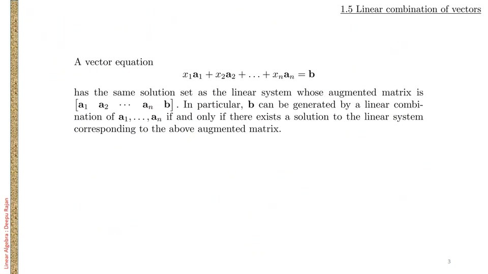

**Content — Key result:**

A vector equation $x_1\mathbf a_1 + x_2\mathbf a_2 + \cdots + x_n\mathbf a_n = \mathbf b$ has the **same solution set** as the linear system whose augmented matrix is

$$\begin{bmatrix} \mathbf a_1 & \mathbf a_2 & \cdots & \mathbf a_n & \mathbf b \end{bmatrix}$$

In particular, $\mathbf b$ can be generated by a linear combination of $\mathbf a_1, \dots, \mathbf a_n$ **if and only if** there exists a solution to the linear system corresponding to the above augmented matrix.

> 🎙️ **Narration:** *"The previous example demonstrates an important result: if you have a vector equation x1a1 + x2a2 + ⋯ + xnan = b, it has the same solution set as the linear system whose augmented matrix is [a1 a2 ⋯ an b]. And that's exactly what we did — we formed the linear system of equations and the augmented matrix. In particular, b can be generated by a linear combination of a1, …, an if and only if there exists a solution to the linear system corresponding to the above augmented matrix. So you can see the connection between the linear combination of vectors and the solution of a linear system, and that is captured in this statement."*

---

## V-1.6 — 1.6 Span

### 🎬 Slide 1 — Definition of Span + Geometric View of Span{v}

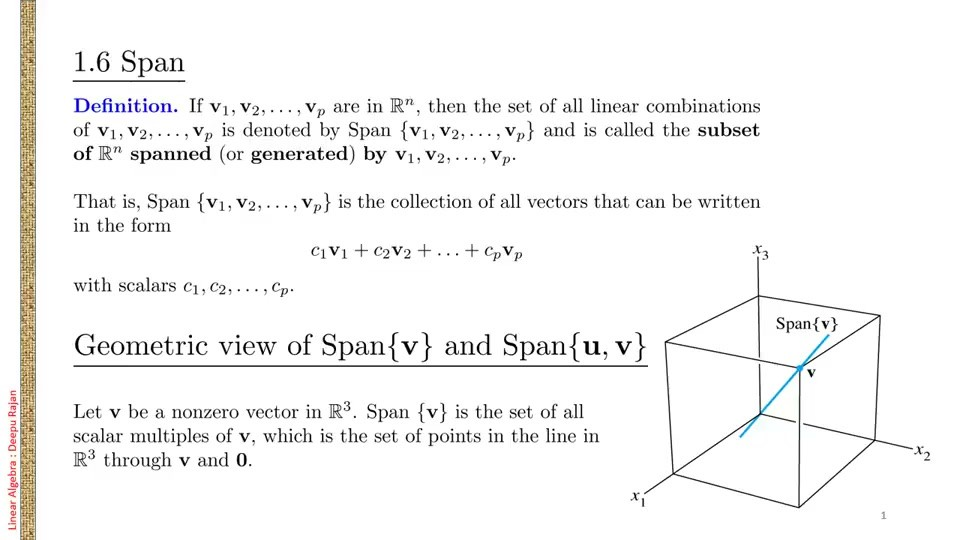

**Content — Definition.** If $\mathbf v_1, \mathbf v_2, \dots, \mathbf v_p$ are in $\mathbb{R}^n$, then the set of all linear combinations of $\mathbf v_1, \mathbf v_2, \dots, \mathbf v_p$ is denoted by $\operatorname{Span}\{\mathbf v_1, \mathbf v_2, \dots, \mathbf v_p\}$ and is called the subset of $\mathbb{R}^n$ **spanned (or generated)** by $\mathbf v_1, \mathbf v_2, \dots, \mathbf v_p$. That is,

$$\operatorname{Span}\{\mathbf v_1, \dots, \mathbf v_p\} = \{c_1\mathbf v_1 + c_2\mathbf v_2 + \cdots + c_p\mathbf v_p : c_1, \dots, c_p \in \mathbb{R}\}$$

**Geometric view of Span{v}:** Let $\mathbf v$ be a nonzero vector in $\mathbb{R}^3$. $\operatorname{Span}\{\mathbf v\}$ is the set of all scalar multiples of $\mathbf v$, which is the set of points on the **line** in $\mathbb{R}^3$ through $\mathbf v$ and $\mathbf 0$.

> 🎙️ **Narration:** *"In this video we are going to introduce another term called the span. If v1, v2, …, vp are vectors in ℝⁿ, then the set of all linear combinations of v1, …, vp is denoted by the span of v1, …, vp, and it's called the subset of ℝⁿ spanned or generated by v1, …, vp. So we have already seen what linear combinations of vectors are, and if we take the set of all possible linear combinations, then we get the span of that set of vectors. We can get a geometric view. Let's start with one vector v, a nonzero vector in three-dimensional space. The span of v is the set of all scalar multiples of v: you can multiply by +2 to get that vector, multiply by −3 to get the vector in the opposite direction, and so on. If you take all scalar multiples together, that is the span of that vector v — the set of points on the line in ℝ³ through v and 0. So this whole line is the span of v."*

---

### 🎬 Slide 2 — Geometric View of Span{u, v}

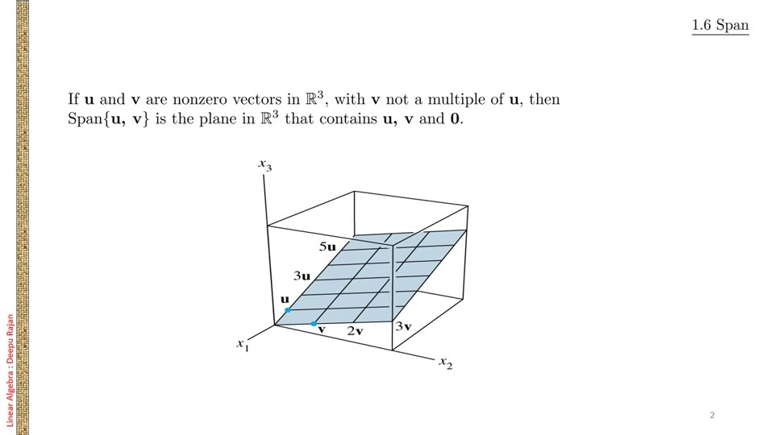

**Content:**

If $\mathbf u$ and $\mathbf v$ are nonzero vectors in $\mathbb{R}^3$, with $\mathbf v$ **not a multiple** of $\mathbf u$, then

$$\operatorname{Span}\{\mathbf u, \mathbf v\}\ \text{is the \textbf{plane} in } \mathbb{R}^3 \text{ that contains } \mathbf u, \mathbf v \text{ and } \mathbf 0.$$

> 🎙️ **Narration:** *"If we look at the case of two vectors, now we have u and v that are nonzero vectors, and v is not a multiple of u — they are not in the same direction. As you can see, u is pointing in this direction and v is pointing in that direction. Then the span of u and v is the plane in ℝ³ that contains u, v and 0. Remember we are talking about linear combinations of u and v — all possible linear combinations collected together is the span of u and v. So here we have u and 3u + v, that could be a combination; 3u + 2v could be another; 5u + 2v could be another, and so on. If you do a linear combination of all these possible values of c1 and c2, this particular plane will be generated. u points in one direction and there are multiples of u; v points in another direction and there are multiples of it, and all possible combinations will generate the plane in the three-dimensional space."*

---

### 🎬 Slide 3 — Exercise: Is b in Span{a1, a2}?

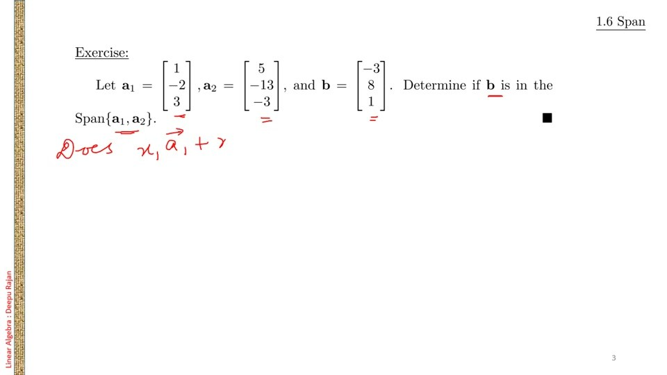

**Content — Exercise:**

Let $\mathbf a_1 = \begin{bmatrix} 1 \\ -2 \\ 3 \end{bmatrix}$, $\mathbf a_2 = \begin{bmatrix} 5 \\ -13 \\ -3 \end{bmatrix}$, and $\mathbf b = \begin{bmatrix} -3 \\ 8 \\ 1 \end{bmatrix}$. Determine if $\mathbf b$ is in $\operatorname{Span}\{\mathbf a_1, \mathbf a_2\}$.

This is asking: does $x_1\mathbf a_1 + x_2\mathbf a_2 = \mathbf b$ have a solution?

> 🎙️ **Narration:** *"Let's look at this exercise. We have a1 = (1, −2, 3), a2 = (5, −13, −3) and b = (−3, 8, 1). The question is: determine if b is in the span of a1 and a2. This might look familiar because we have already seen an example where we determined if b is a linear combination of a1 and a2. When we are asking whether b is in the span of a1 and a2, what we are really asking is: does x1·a1 + x2·a2 = b have a solution? If it has a solution, then b is a linear combination of a1 and a2, and therefore b is in the span of a1 and a2. Because what is the span of a1, a2? All possible combinations of x1 and x2 — and within that set of combinations, there could be one particular combination that gives us b."*

---

### 🎬 Slide 4 — Exercise Solution: No Solution ⇒ b not in Span

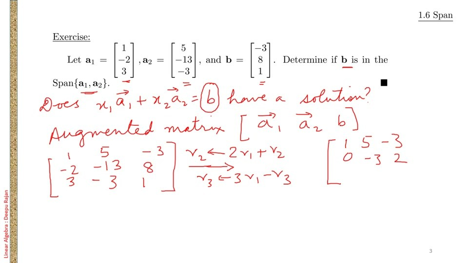

**Content — Solution:**

Augmented matrix: $\left[\begin{array}{cc|c} 1 & 5 & -3 \\ -2 & -13 & 8 \\ 3 & -3 & 1 \end{array}\right]$

Row reduction: $r_2 \leftarrow 2r_1 + r_2$, $r_3 \leftarrow 3r_1 - r_3$, then one more step gives row echelon form $\left[\begin{array}{cc|c} 1 & 5 & -3 \\ 0 & -3 & 2 \\ 0 & 0 & 2 \end{array}\right]$.

The last row, $0x_2 = 2$, can never happen → **no solution** → $\mathbf b$ is **not** in $\operatorname{Span}\{\mathbf a_1, \mathbf a_2\}$.

> 🎙️ **Narration:** *"We follow the same method as we did to find the linear combination. We form the augmented matrix: the first column is the a1 vector, the second column is the a2 vector, and the third column is b: [1 −2 3; 5 −13 −3; −3 8 1]. We reduce to the reduced row echelon form. The first step: the second row is replaced by 2·r1 + r2, and the third row by 3·r1 − r3, giving first row unchanged, second row [0, −3, 2], third row [0, 18, −10]. One more step takes us to the row echelon form: [1 5 −3; 0 −3 2; 0 0 2]. What do we find here? Remember the first column is for the scalar x1 and the second column for the scalar x2. In the last row we have 0·x2 = 2, and that can never happen. Therefore there is no solution to this system, and since there is no solution, we can say that b is not in the span of a1 and a2."*

---

## V-1.7 — 1.7 The Matrix Equation Ax = b

### 🎬 Slide 1 — Writing a Linear System as Ax = b

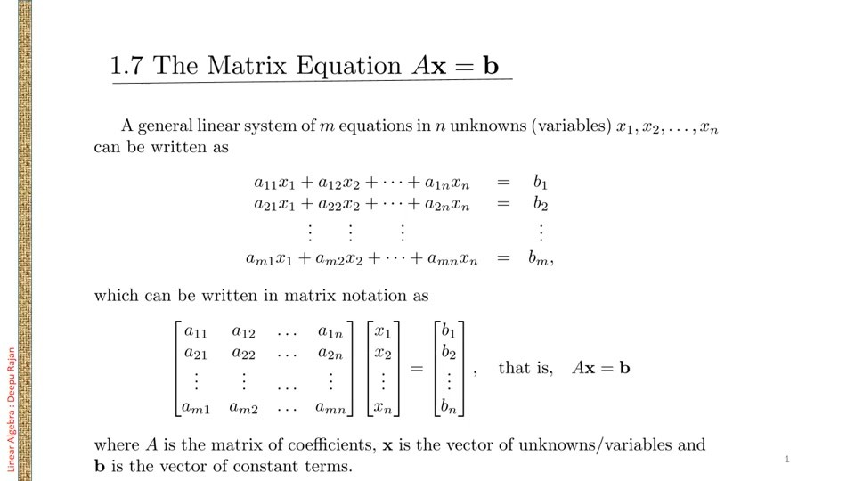

**Content:**

A general linear system of $m$ equations in $n$ unknowns $x_1, x_2, \dots, x_n$:

$$\begin{aligned} a_{11}x_1 + a_{12}x_2 + \cdots + a_{1n}x_n &= b_1 \\ a_{21}x_1 + a_{22}x_2 + \cdots + a_{2n}x_n &= b_2 \\ &\vdots \\ a_{m1}x_1 + a_{m2}x_2 + \cdots + a_{mn}x_n &= b_m \end{aligned}$$

can be written in matrix notation as

$$\begin{bmatrix} a_{11} & a_{12} & \cdots & a_{1n} \\ a_{21} & a_{22} & \cdots & a_{2n} \\ \vdots & \vdots & \ddots & \vdots \\ a_{m1} & a_{m2} & \cdots & a_{mn} \end{bmatrix}\begin{bmatrix} x_1 \\ x_2 \\ \vdots \\ x_n \end{bmatrix} = \begin{bmatrix} b_1 \\ b_2 \\ \vdots \\ b_m \end{bmatrix}, \qquad \text{i.e., } Ax = b$$

where $A$ is the matrix of **coefficients**, $\mathbf x$ is the vector of **unknowns/variables**, and $\mathbf b$ is the vector of **constant terms**.

> 🎙️ **Narration:** *"Hello, in this video we are going to write the linear system of equations in a compact form — a form in which the matrix is multiplied by a vector in order to give another vector b — and we will also look at the interpretation of this matrix equation. We are now very familiar with systems of linear equations, and we have earlier said that the coefficients of the variables can be collected into a matrix: the first row comprises the coefficients of the variables in the first equation, and similarly for the second equation and so on. At the same time we collect all the variables x1, x2, …, xn into another vector, and finally the right-hand side b1, b2, … into another vector. So this matrix multiplied by this vector equal to this vector can be written in a very compact form as Ax = b, where A is the matrix of coefficients, x is the vector of unknowns and variables, and b is the vector of constant terms. From now on, when you see an expression like Ax = b, what should immediately come to your mind is that it is a system of linear equations."*

---

### 🎬 Slide 2 — Definition of Ax + Theorem 1.1

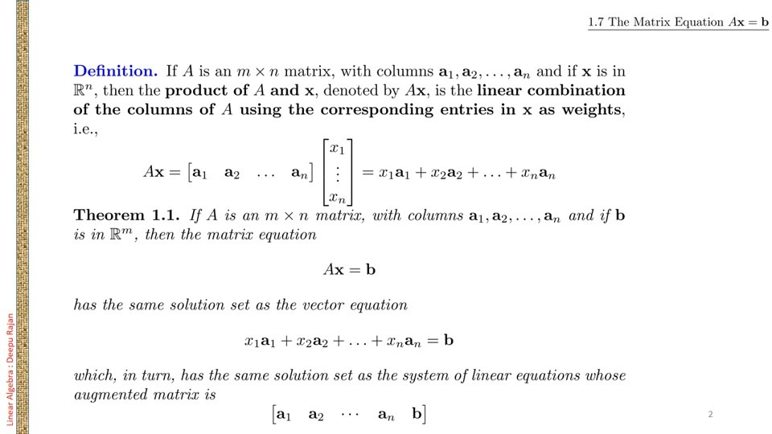

**Content — Definition.** If $A$ is an $m \times n$ matrix, with columns $\mathbf a_1, \mathbf a_2, \dots, \mathbf a_n$, and if $\mathbf x$ is in $\mathbb{R}^n$, then the product of $A$ and $\mathbf x$, denoted $A\mathbf x$, is the **linear combination of the columns of $A$** using the corresponding entries in $\mathbf x$ as weights:

$$A\mathbf x = \begin{bmatrix} \mathbf a_1 & \mathbf a_2 & \cdots & \mathbf a_n \end{bmatrix}\begin{bmatrix} x_1 \\ x_2 \\ \vdots \\ x_n \end{bmatrix} = x_1\mathbf a_1 + x_2\mathbf a_2 + \cdots + x_n\mathbf a_n$$

**Theorem 1.1.** If $A$ is an $m \times n$ matrix, with columns $\mathbf a_1, \dots, \mathbf a_n$, and $\mathbf b$ is in $\mathbb{R}^m$, then the matrix equation $A\mathbf x = \mathbf b$ has the **same solution set** as the vector equation $x_1\mathbf a_1 + x_2\mathbf a_2 + \cdots + x_n\mathbf a_n = \mathbf b$, which in turn has the same solution set as the system of linear equations whose augmented matrix is

$$\begin{bmatrix} \mathbf a_1 & \mathbf a_2 & \cdots & \mathbf a_n & \mathbf b \end{bmatrix}$$

> 🎙️ **Narration:** *"The equation Ax = b can be seen as a product of the matrix A and the vector x. We are defining the product here as the linear combination of the columns of A, and by now you know that linear combination implies each vector has to be multiplied by some scalar — and what is that scalar? It is the corresponding entries in x with which it is multiplied. So the columns of the A matrix are multiplied by the x vector, and we can write this product as a linear combination of the columns of A. Now we want to put all of this together into a theorem — this is the first theorem we are encountering now in this course, and there will be many more. For some theorems we will skip the proof, and for others we will discuss the proofs in the live lectures. Theorem 1.1 says: if A is an m × n matrix with columns a1, a2, …, an, and b is in ℝᵐ, then the matrix equation Ax = b has the same solution set as the vector equation x1a1 + x2a2 + ⋯ + xnan = b, which in turn has the same solution set as the system of linear equations whose augmented matrix is [a1 a2 ⋯ an b]. So this theorem connects the matrix-vector product definition to the linear combination, and connects that to the augmented matrix."*

---

### 🎬 Slide 3 — Existence of Solutions + Exercise

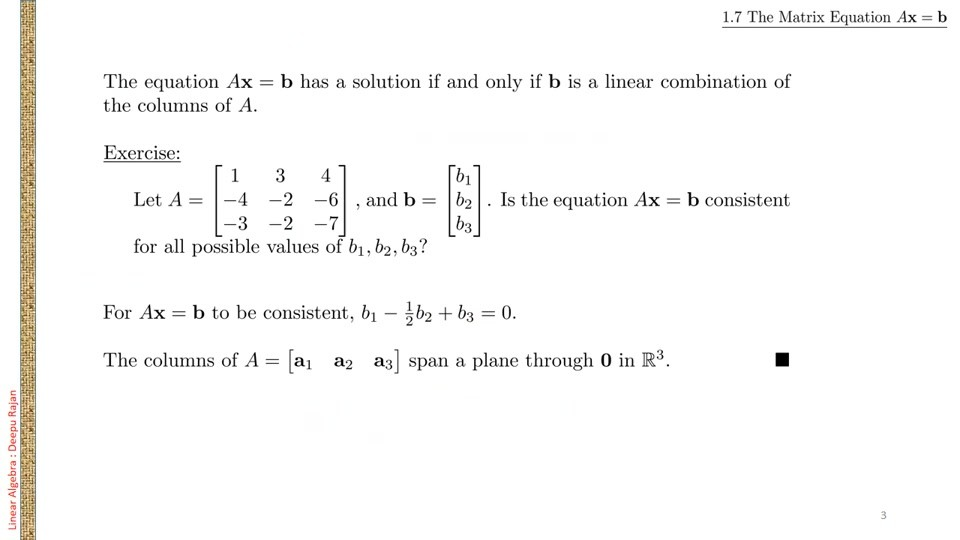

**Content:**

The equation $A\mathbf x = \mathbf b$ has a solution **if and only if** $\mathbf b$ is a **linear combination** of the columns of $A$.

**Exercise:** Let $A = \begin{bmatrix} 1 & 3 & 4 \\ -4 & 2 & -6 \\ -3 & -2 & -7 \end{bmatrix}$ and $\mathbf b = \begin{bmatrix} b_1 \\ b_2 \\ b_3 \end{bmatrix}$. Is the equation $A\mathbf x = \mathbf b$ consistent for **all** possible values of $b_1, b_2, b_3$?

**Solution (sketch):** Form the augmented matrix $[A\ \mathbf b]$, row reduce to row echelon form. The coefficient part has a zero row, so consistency requires the last entry to be 0:

$$-2b_1 + b_2 - 2b_3 = 0 \qquad \text{(i.e., } 2b_1 - b_2 + 2b_3 = 0)$$

So $A\mathbf x = \mathbf b$ is **not** consistent for all $\mathbf b$; the columns of $A = \{\mathbf a_1, \mathbf a_2, \mathbf a_3\}$ **span a plane through $\mathbf 0$** in $\mathbb{R}^3$.

> 🎙️ **Narration:** *"This statement says that the equation Ax = b has a solution if and only if b is a linear combination of the columns of A. If Ax = b needs to have a solution, there should be values of x1, x2, …, xn, and then b should be a linear combination of the columns of A. Let's look at an example. Given this A matrix and this b vector (b1, b2, b3), the question is whether Ax = b is consistent for all possible values of b1, b2, b3. We write this as x1a1 + x2a2 + x3a3 = b and form the augmented matrix: first row 1 3 4 with b1; then −4, −2, −6 with b2; and −3, −2, −7 with b3. We transform this by elementary row operations to a row echelon form, which we get as: first row [1 3 4 b1], second row [0 14 10 4b1 + b2], and finally [0 0 0 −2b1 + b2 − 2b3]. To check consistency, look at the last row: 0·x1 + 0·x2 + 0·x3 = −2b1 + b2 − 2b3. The left-hand side is 0, so the right-hand side should also be 0: −2b1 + b2 − 2b3 = 0. So it is not true that Ax = b is consistent for all values of b — it is consistent for those b that satisfy this condition among its elements. We can also see that the columns of A actually span a plane through 0 in ℝ³ — the set of all linear combinations of these three column vectors spans a plane that passes through the origin."*

---

### 🎬 Slide 4 — Spans of ℝᵐ (i and j example)

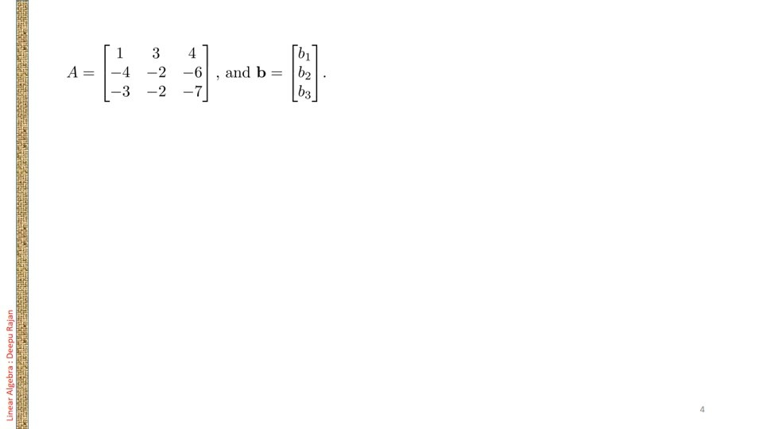

**Content:**

A set of vectors $\{\mathbf v_1, \dots, \mathbf v_p\}$ in $\mathbb{R}^m$ **spans (or generates) $\mathbb{R}^m$** if every vector in $\mathbb{R}^m$ is a linear combination of $\mathbf v_1, \dots, \mathbf v_p$, i.e., if $\operatorname{Span}\{\mathbf v_1, \dots, \mathbf v_p\} = \mathbb{R}^m$.

*Example ($m = 2$):* the standard unit vectors $\mathbf i = (1,0)$ and $\mathbf j = (0,1)$ span the entire two-dimensional space $\mathbb{R}^2$, because every vector in $\mathbb{R}^2$ can be written as a linear combination of $\mathbf i$ and $\mathbf j$.

> 🎙️ **Narration:** *"This statement basically says that a set of vectors in ℝᵐ spans or generates the entire ℝᵐ if every vector in ℝᵐ is a linear combination of v1, …, vp, i.e., if Span{v1, …, vp} = ℝᵐ. Let's look at a simpler example with m = 2. Let the two vectors be the unit vectors i and j — the unit vectors in the x and y directions. Do i and j span the entire two-dimensional space? That is, can every vector in ℝ² be written as a linear combination of i and j? The answer is yes — any vector in the two-dimensional space can be written as a linear combination of i and j, and therefore i and j span, or generate, the two-dimensional space."*

---

### 🎬 Slide 5 — Theorem 1.2: Four Equivalent Statements

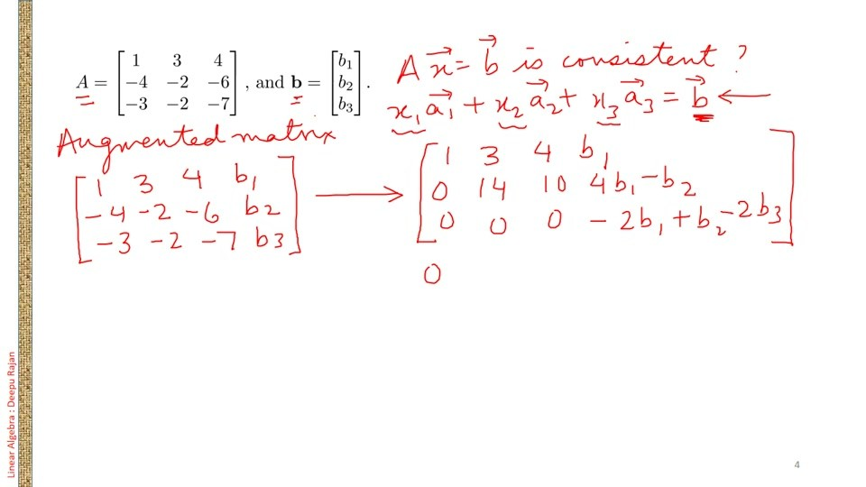

**Content — Theorem 1.2.** Let $A$ be an $m \times n$ matrix. Then the following statements are **logically equivalent** (for a particular $A$, either they are all true or all false):

- **a.** For each $\mathbf b$ in $\mathbb{R}^m$, the equation $A\mathbf x = \mathbf b$ has a solution.
- **b.** Each $\mathbf b$ in $\mathbb{R}^m$ is a linear combination of the columns of $A$.
- **c.** The columns of $A$ span $\mathbb{R}^m$.
- **d.** $A$ has a **pivot position in every row**.

> 🎙️ **Narration:** *"All the important points that we have covered in the last few videos come together in this theorem. Let A be an m × n matrix; then the following statements are logically equivalent — meaning, for a particular matrix A, either all of these statements are true or all of them are false. Statement (a): for each b in ℝᵐ, the equation Ax = b has a solution. If that's a true statement, then it is also true that each b in ℝᵐ is a linear combination of the columns of A (statement b), the columns of A span ℝᵐ (statement c), and A has a pivot position in every row (statement d). For example, if we have a 3 × 3 matrix, there's going to be a pivot here, a pivot there, and a pivot here if Ax = b has a solution for all b."*

---

### 🎬 Slide 6 — Theorem 1.3: Linearity of Matrix-Vector Product

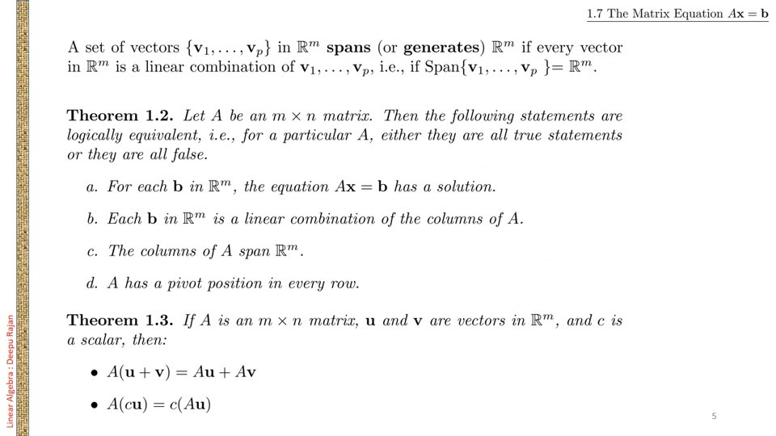

**Content — Theorem 1.3.** If $A$ is an $m \times n$ matrix, $\mathbf u$ and $\mathbf v$ are vectors in $\mathbb{R}^n$, and $c$ is a scalar, then:

- $A(\mathbf u + \mathbf v) = A\mathbf u + A\mathbf v$
- $A(c\mathbf u) = c(A\mathbf u)$

> 🎙️ **Narration:** *"The next theorem says that if A is an m × n matrix and u and v are vectors in ℝⁿ and c is some scalar, then this kind of distributive property applies: A(u + v) = Au + Av, and A(cu) = c(Au). We will look at the proofs of these two theorems in the live lectures."*

---

### 🎬 Slide 7 — Proof of Theorem 1.2 (sketch)

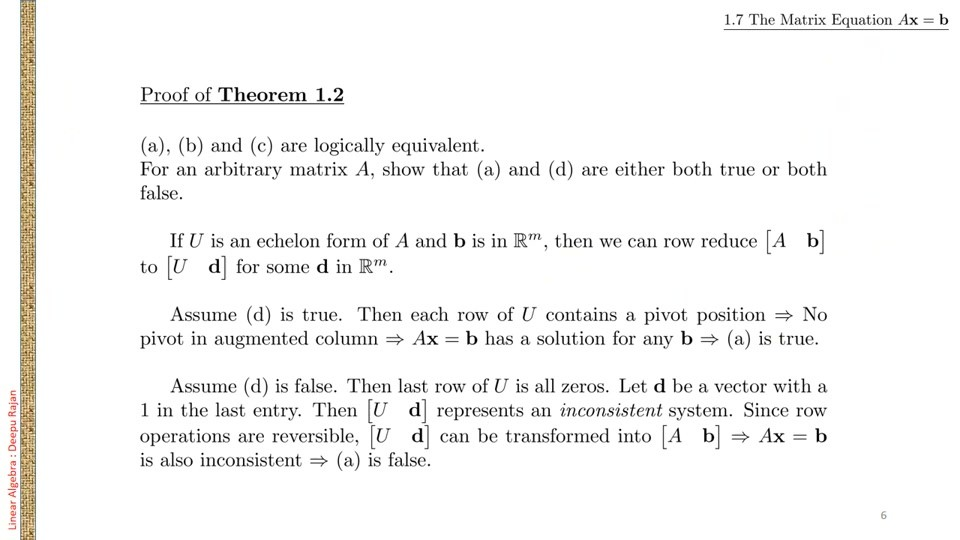

**Content — Proof of Theorem 1.2:**

- (a), (b) and (c) are logically equivalent.
- For an arbitrary matrix $A$, show (a) and (d) are either both true or both false.
- If $U$ is an echelon form of $A$ and $\mathbf b$ is in $\mathbb{R}^m$, we can row reduce $[A\ \mathbf b]$ to $[U\ \mathbf d]$ for some $\mathbf d$ in $\mathbb{R}^m$.
- Assume (d) true: each row of $U$ contains a pivot position → no pivot in the augmented column → $A\mathbf x = \mathbf b$ has a solution for any $\mathbf b$ → (a) is true.
- Assume (d) false: the last row of $U$ is all zeros. Let $\mathbf d$ have a 1 in the last entry; then $[U\ \mathbf d]$ represents an inconsistent system. Since row operations are reversible, $[U\ \mathbf d]$ can be transformed into $[A\ \mathbf b]$ → $A\mathbf x = \mathbf b$ is also inconsistent → (a) is false.

> 🎙️ **Narration:** *(This slide gives the structure of the proof of Theorem 1.2, which will be discussed in the live lectures: (a), (b) and (c) are logically equivalent; and for an arbitrary matrix A, (a) and (d) are either both true or both false — if U is an echelon form of A, then assuming (d) true means every row of U has a pivot, so Ax = b has a solution for any b; assuming (d) false means the last row of U is all zeros, and a suitable d makes [U d] inconsistent, which by reversibility makes Ax = b inconsistent.)*

---

## V-1.8a — 1.8 Solution Sets (Homogeneous)

### 🎬 Slide 1 — Solutions of Homogeneous Systems

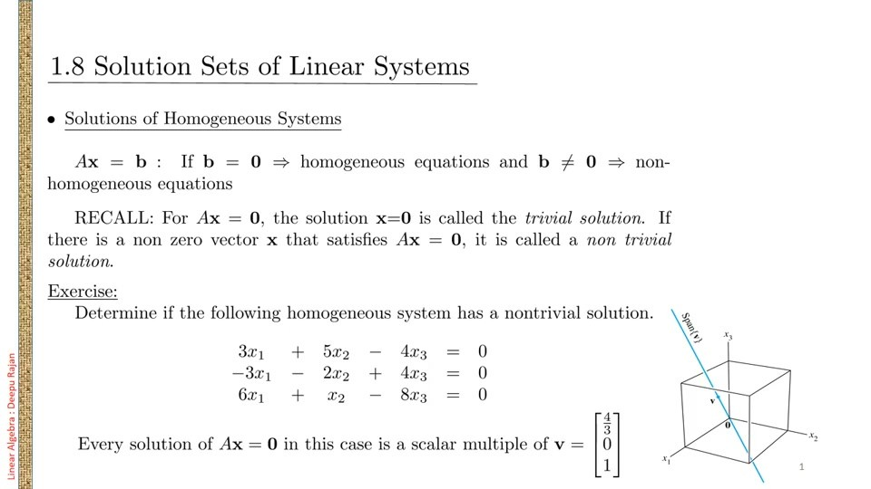

**Content:**

- $A\mathbf x = \mathbf b$: if $\mathbf b = \mathbf 0$ → **homogeneous** equations; if $\mathbf b \neq \mathbf 0$ → **non-homogeneous** equations.
- **Recall:** for $A\mathbf x = \mathbf 0$, the solution $\mathbf x = \mathbf 0$ is called the **trivial solution**. If there is a nonzero vector $\mathbf x$ satisfying $A\mathbf x = \mathbf 0$, it is called a **nontrivial** solution.

**Exercise:** Determine if the following homogeneous system has a nontrivial solution:

$$\begin{aligned} 3x_1 + 5x_2 - 4x_3 &= 0 \\ -3x_1 - 2x_2 + 4x_3 &= 0 \\ 6x_1 + x_2 - 8x_3 &= 0 \end{aligned}$$

> 🎙️ **Narration:** *"Hello. In this section, we continue to look at solutions of linear systems of equations. But in addition to solving the linear equations, we are also going to visualize the solutions — we are trying to give some sort of geometric interpretation to the solutions. Let's start with homogeneous systems. If we have the linear system Ax = b and b is the 0 vector, then we call such a system a system of homogeneous equations. And you will recall that for a system of homogeneous equations, the solution x = 0 is called the trivial solution, and if there are nonzero solutions, then those are called non-trivial solutions. So let's look at an example: determine if the following homogeneous system has a non-trivial solution. First we need to solve this system of equations, then decide whether the solution is trivial or non-trivial. The first step is to write the augmented matrix: [3 5 −4 0; −3 −2 4 0; 6 1 −8 0]."*

---

### 🎬 Slide 2 — Row Reduction → x₃ Free → Nontrivial Solution

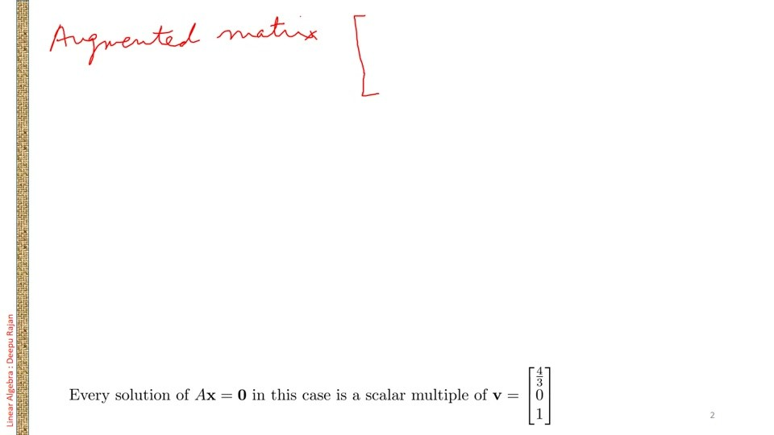

**Content — Solution (row reduction):**

Row echelon form: $\left[\begin{array}{ccc|c} 3 & 5 & -4 & 0 \\ 0 & 3 & 0 & 0 \\ 0 & 0 & 0 & 0 \end{array}\right]$

Reduced row echelon form: $\left[\begin{array}{ccc|c} 1 & 0 & -4/3 & 0 \\ 0 & 1 & 0 & 0 \\ 0 & 0 & 0 & 0 \end{array}\right]$

- $x_1 - \tfrac43 x_3 = 0$ and $x_2 = 0$; $x_3$ is a **free variable** → $A\mathbf x = \mathbf 0$ has a **nontrivial solution**.

> 🎙️ **Narration:** *"We do the elementary row operations and get the row echelon form: [3 5 −4 0; 0 3 0 0; and the last row all zeros]. What we see here is that x3 is a free variable, because we have a pivot here and a pivot here but no pivot in the third column. And therefore Ax = 0 has a non-trivial solution — for every choice of x3, because x3 can be anything, you can have a solution. The question is now what is the solution? To get to the solution, we go to the reduced row echelon form, which turns out to be [1 0 −4/3 0; 0 1 0 0; 0 0 0 0]. Writing the corresponding linear equations: the first row is x1 − (4/3)x3 = 0, and the second row is x2 = 0."*

---

### 🎬 Slide 3 — Solution as a Scalar Multiple of v

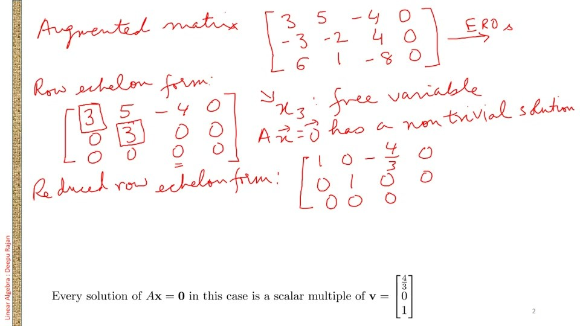

**Content — Solution:**

$$\mathbf x = \begin{bmatrix} x_1 \\ x_2 \\ x_3 \end{bmatrix} = \begin{bmatrix} \tfrac43 x_3 \\ 0 \\ x_3 \end{bmatrix} = x_3 \begin{bmatrix} \tfrac43 \\ 0 \\ 1 \end{bmatrix} = x_3\mathbf v, \qquad \mathbf v = \begin{bmatrix} 4/3 \\ 0 \\ 1 \end{bmatrix}$$

Every solution of $A\mathbf x = \mathbf 0$ is a **scalar multiple** of $\mathbf v$. Geometrically, as $x_3$ varies over all reals, this is the **line** through $\mathbf 0$ and $\mathbf v$ — the span of $\mathbf v$.

> 🎙️ **Narration:** *"The solution vector consists of x1, x2 and x3. We know x1 = (4/3)x3, x2 = 0, and x3 we just write as x3. We can simplify by taking x3 out: x = x3 times the vector (4/3, 0, 1). So every solution of Ax = 0 is a scalar multiple of v, where v is this particular vector (4/3, 0, 1). How does this look geometrically? The solution x is x3 times v, a scalar multiplied by this vector v. If you have a vector v and multiply it by a scalar, the effect is an elongation of this vector in the same direction or in the opposite direction (or a reduction if the scalar is less than 1). Since x3 can be anything from −∞ to +∞, varying x3 generates this straight line, and from the definition of span, this straight line becomes the span of the vector v. So we have geometrically interpreted the solution as a straight line in this three-dimensional space."*

---

### 🎬 Slide 4 — Geometric Interpretation (line through origin)

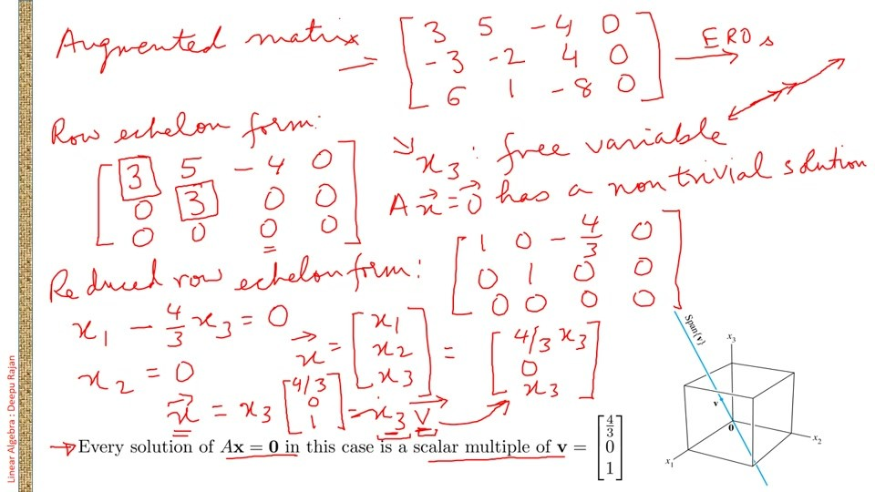

**Content:** *(diagram showing the solution set of $A\mathbf x = \mathbf 0$ as a line through the origin spanned by $\mathbf v$.)*

> 🎙️ **Narration:** *(The figure illustrates that the solution set of the homogeneous system is the line through the origin in the direction of $\mathbf v$.)*

---

## V-1.8b — 1.8 Solution Sets (Nonhomogeneous)

### 🎬 Slide 1 — Exercise: Solutions of Ax = b

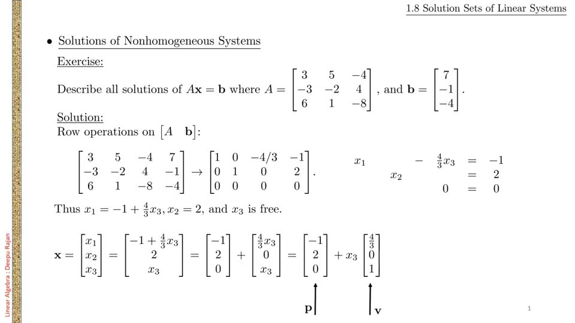

**Content — Solutions of Nonhomogeneous Systems:**

**Exercise:** Describe all solutions of $A\mathbf x = \mathbf b$ where

$$A = \begin{bmatrix} 3 & 5 & -4 \\ -3 & -2 & 4 \\ 6 & 1 & -8 \end{bmatrix}, \qquad \mathbf b = \begin{bmatrix} -1 \\ 2 \\ 1 \end{bmatrix}$$

**Solution.** Row operations on $[A\ \mathbf b]$ give the reduced row echelon form $\left[\begin{array}{ccc|c} 1 & 0 & -4/3 & -1 \\ 0 & 1 & 0 & 2 \\ 0 & 0 & 0 & 0 \end{array}\right]$.

Thus $x_1 = -1 + \tfrac43 x_3$, $x_2 = 2$, and $x_3$ is **free**.

> 🎙️ **Narration:** *"Now let's look at the case of non-homogeneous systems. We can start by looking at this example: describe all solutions of AX = B, where A is given and B is given — we want to have some kind of a visual representation of the solutions. As always, start with the augmented matrix. We do the row operations and get to the reduced row echelon form, from which we can write the corresponding equations as x1 − (4/3)x3 = −1, x2 = 2, and of course the last equation says that x3 is a free variable. So the solution X = (x1, x2, x3) with x1 = −1 + (4/3)x3, x2 = 2, and x3 free."*

---

### 🎬 Slide 2 — Parametric Vector Form: x = p + tv

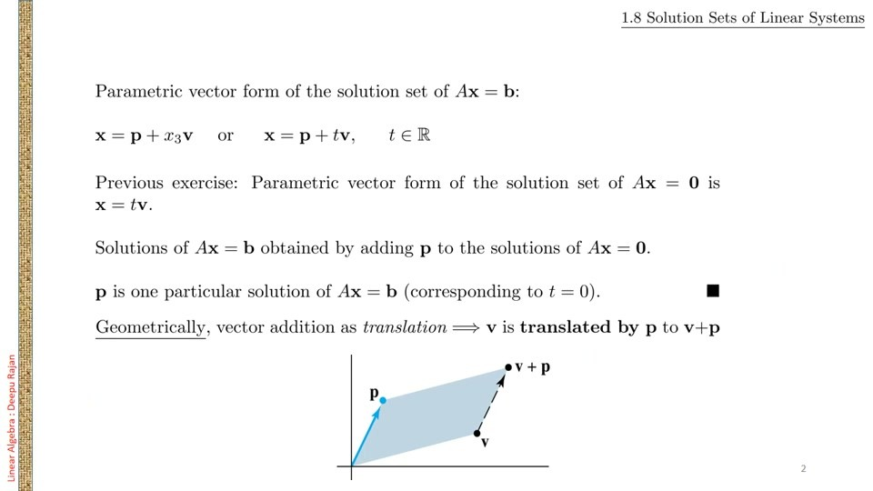

**Content — Parametric vector form of the solution set of $A\mathbf x = \mathbf b$:**

$$\mathbf x = \mathbf p + x_3\mathbf v \qquad \text{or} \qquad \mathbf x = \mathbf p + t\mathbf v, \quad t \in \mathbb{R}$$

From the previous exercise: $\mathbf x = \begin{bmatrix} -1 \\ 2 \\ 0 \end{bmatrix} + x_3 \begin{bmatrix} 4/3 \\ 0 \\ 1 \end{bmatrix}$

- Solutions of $A\mathbf x = \mathbf b$ are obtained by **adding $\mathbf p$** to the solutions of $A\mathbf x = \mathbf 0$.
- $\mathbf p$ is **one particular solution** of $A\mathbf x = \mathbf b$ (corresponding to $t = 0$).
- Geometrically, vector addition can be viewed as **translation**: $\mathbf v$ is translated by $\mathbf p$ to $\mathbf v + \mathbf p$.

> 🎙️ **Narration:** *"We can split this vector into two vectors: the first part (−1, 2, 0) plus the second part (4/3)x3, 0, x3, which we can write as x3 times (4/3, 0, 1). You will recognize this part from the previous example — the A matrix here is the same as the A matrix for the homogeneous case, and that gives us an indication as to why this particular vector has reappeared. We call (−1, 2, 0) the P vector and (4/3, 0, 1) the V vector. So the solution for AX = b can be written as X = P + X3V, or more generally X = P + tV where t is a real number. Connecting it to the previous exercise, the solution of AX = 0 was simply X = tV — the difference between the solutions for AX = b and AX = 0 seems to be just this P vector. So the solutions of AX = b are obtained by adding P to the solutions of AX = 0. P is called a particular solution of AX = b, and that particular solution corresponds to the case when t = 0. Geometrically, we can interpret vector addition as a translation: the vector V is translated by P to V + P."*

---

### 🎬 Slide 3 — Geometric View: Line Through p Parallel to the Homogeneous Line

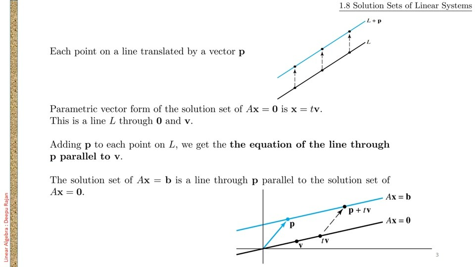

**Content — Geometry:**

- Parametric vector form of the solution set of $A\mathbf x = \mathbf 0$: $\mathbf x = t\mathbf v$ — a line $L$ through $\mathbf 0$ and $\mathbf v$.
- Adding $\mathbf p$ to each point on $L$ gives the equation of the line **through $\mathbf p$ parallel to $\mathbf v$**.
- The solution set of $A\mathbf x = \mathbf b$ is a **line through $\mathbf p$ parallel to the solution set of $A\mathbf x = \mathbf 0$**.

> 🎙️ **Narration:** *"Each point on a line is translated by a vector P. The parametric vector form of the solution set of AX = 0 is X = tV — this is just a line through 0 and V. Now adding P to this — adding P to each point on L — we get the equation of the line through P parallel to V. So here we have AX = 0, whose solution set is X = tV, a line L through the origin 0 and V, shown as the dark line. If we add P to each point on L, we get a new line which is parallel to the old line, and that gives you the solution set of AX = b. So the solution set of AX = b is a line through P, and that line is parallel to the solution set of AX = 0. This is a geometrical interpretation of the solution of a non-homogeneous system."*

---

### 🎬 Slide 4 — Theorem 1.4

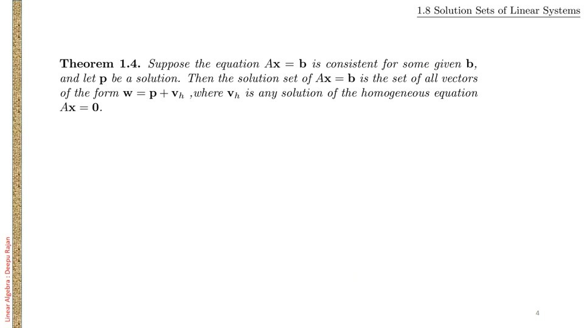

**Content — Theorem 1.4.** Suppose the equation $A\mathbf x = \mathbf b$ is **consistent** for some given $\mathbf b$, and let $\mathbf p$ be a solution. Then the solution set of $A\mathbf x = \mathbf b$ is the set of all vectors of the form

$$\mathbf w = \mathbf p + \mathbf v_h$$

where $\mathbf v_h$ is **any solution** of the homogeneous equation $A\mathbf x = \mathbf 0$.

> 🎙️ **Narration:** *"This point has been brought together in this theorem: if AX = b is consistent for some given b, and let p be a solution, then the solution set of AX = b is the set of all vectors of the form w = p + vh, where vh is any solution of the homogeneous equation AX = 0. We are not saying anything new here — we are just putting it in the form of a theorem. All that we are saying is: if vh is the solution of the homogeneous system, then we can have a vector w which is p + vh, and that is the solution to AX = b. So we have another line parallel to AX = 0, and this is AX = b — the same points we said in the previous slides, except now we are formalizing it into a particular theorem."*

---

## V-1.9a — 1.9 Linear Independence

### 🎬 Slide 1 — Definition + Exercise

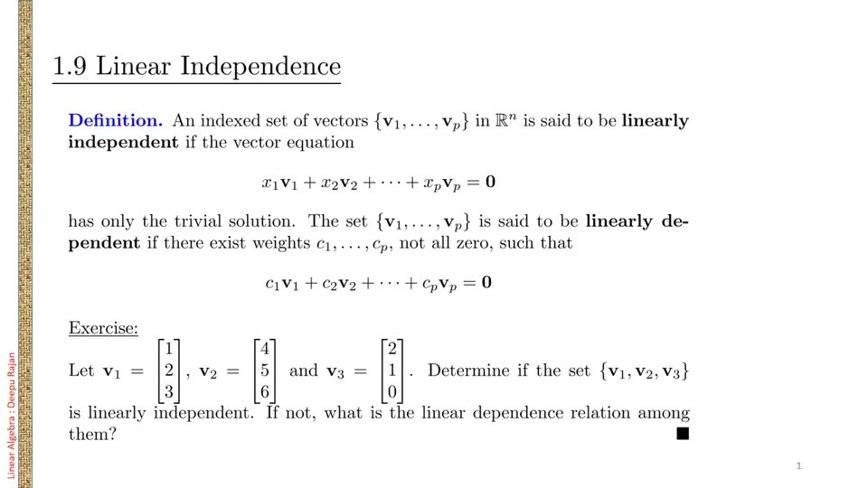

**Content — Definition.** An indexed set of vectors $\{\mathbf v_1, \dots, \mathbf v_p\}$ in $\mathbb{R}^n$ is said to be **linearly independent** if the vector equation

$$c_1\mathbf v_1 + c_2\mathbf v_2 + \cdots + c_p\mathbf v_p = \mathbf 0$$

has **only the trivial solution** ($c_1 = c_2 = \cdots = c_p = 0$). The set is said to be **linearly dependent** if there exist weights $c_1, \dots, c_p$, **not all zero**, such that $c_1\mathbf v_1 + \cdots + c_p\mathbf v_p = \mathbf 0$.

**Exercise:** Let $\mathbf v_1 = \begin{bmatrix} 1 \\ 2 \\ 3 \end{bmatrix}$, $\mathbf v_2 = \begin{bmatrix} 4 \\ 5 \\ 6 \end{bmatrix}$, $\mathbf v_3 = \begin{bmatrix} 2 \\ 1 \\ 0 \end{bmatrix}$. Determine if $\{\mathbf v_1, \mathbf v_2, \mathbf v_3\}$ is linearly independent. If not, what is the linear dependence relation among them?

> 🎙️ **Narration:** *"In this section we will try to understand the meaning of linear independence of a set of vectors. An indexed set of vectors v1, …, vp in ℝⁿ is said to be linearly independent if the vector equation c1v1 + ⋯ + cpvp = 0 has only the trivial solution — valid only if x1 = x2 = ⋯ = 0. The set is said to be linearly dependent if there exist weights c1, …, cp, not all zero, such that this equation is valid. For example, if we had something like 3v1 + 2v2 = 0, then we can say v1 and v2 are linearly dependent. Let's try to solve this exercise: we have v1 = (1, 2, 3), v2 = (4, 5, 6), v3 = (2, 1, 0), and we want to determine if this set is linearly independent, and if not, what is the linear dependence relation among them."*

---

### 🎬 Slide 2 — Row Reduction: x₃ Free ⇒ Dependent

**Content — Solution (row reduction):**

Augmented matrix $\left[\begin{array}{ccc|c} 1 & 4 & 2 & 0 \\ 2 & 5 & 1 & 0 \\ 3 & 6 & 0 & 0 \end{array}\right]$. Row echelon form:

$$\left[\begin{array}{ccc|c} 1 & 4 & 2 & 0 \\ 0 & -3 & -3 & 0 \\ 0 & 0 & 0 & 0 \end{array}\right]$$

$x_3$ is a **free variable** → infinitely many (nontrivial) solutions → $\{\mathbf v_1, \mathbf v_2, \mathbf v_3\}$ is **linearly dependent**.

> 🎙️ **Narration:** *"What we are really asking is to check if the homogeneous equation Ax = 0 has only the trivial solution — that's one way of determining whether the set of vectors is linearly dependent or independent. We write the augmented matrix [1 4 2 0; 2 5 1 0; 3 6 0 0], and after the elementary row operations we get the row echelon form [1 4 2 0; 0 −3 −3 0; 0 0 0 0] — the all-zero row. Writing the corresponding equations: x1 + 4x2 + 2x3 = 0 and −3x2 − 3x3 = 0. From the last row we can see that x3 is a free variable, which means there are infinite solutions — and therefore non-trivial solutions. That means the vectors v1, v2, v3 are linearly dependent: if they were independent, then Ax = 0 would have only the trivial solution."*

---

### 🎬 Slide 3 — Linear Dependence Relation

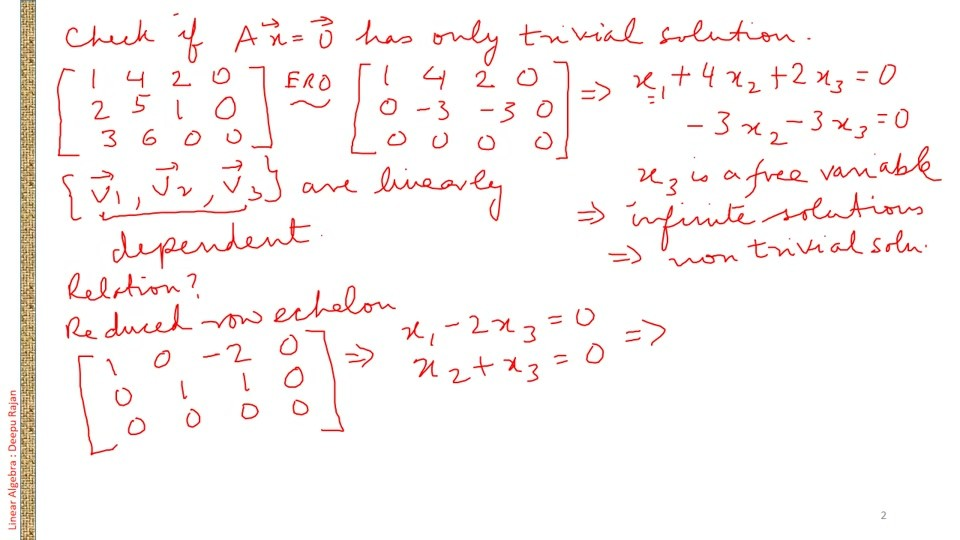

**Content — Linear dependence relation:**

Reduced row echelon form: $\left[\begin{array}{ccc|c} 1 & 0 & -2 & 0 \\ 0 & 1 & 1 & 0 \\ 0 & 0 & 0 & 0 \end{array}\right]$, so $x_1 - 2x_3 = 0$ and $x_2 + x_3 = 0$, i.e., $x_1 = 2x_3$, $x_2 = -x_3$.

Choosing $x_3 = 5$: $\ 10\mathbf v_1 - 5\mathbf v_2 + 5\mathbf v_3 = \mathbf 0$ (one of infinitely many relations).

> 🎙️ **Narration:** *"The next part of the question was: what is the relation between these three vectors? Since they are dependent, there must be some kind of relation between v1, v2 and v3. To find it, we continue to the reduced row echelon form, which turns out to be [1 0 −2 0; 0 1 1 0; 0 0 0 0]. The corresponding equations are x1 − 2x3 = 0 and x2 + x3 = 0, so x1 = 2x3 and x2 = −x3. We already know x3 is a free variable, so we can choose any value — let's say x3 = 5. Then x1 = 2·5 = 10 and x2 = −5. Recalling that we have x1v1 + x2v2 + x3v3 = 0, we get 10v1 − 5v2 + 5v3 = 0. This is one of the infinitely many relationships between v1, v2 and v3."*

---

### 🎬 Slide 4 — Columns Independent ⇔ Trivial Solution; Simple Cases

**Content:**

The **columns of a matrix $A$** are linearly independent **if and only if** the equation $A\mathbf x = \mathbf 0$ has **only the trivial solution**.

*By inspection for simple cases:*

- $\mathbf v_1 = \begin{bmatrix} 3 \\ 1 \end{bmatrix}$, $\mathbf v_2 = \begin{bmatrix} 6 \\ 2 \end{bmatrix}$: since $2\mathbf v_1 - \mathbf v_2 = \mathbf 0$ (i.e. $x_1 = 2$, $x_2 = -1$), they are **linearly dependent**.
- $\mathbf v_1 = \begin{bmatrix} 3 \\ 2 \end{bmatrix}$, $\mathbf v_2 = \begin{bmatrix} 6 \\ 2 \end{bmatrix}$: only $x_1 = x_2 = 0$ works → **linearly independent**.

> 🎙️ **Narration:** *"Repeating what we said earlier: the columns of a matrix A are linearly independent if and only if the equation Ax = 0 has only the trivial solution — and that is what we showed in the exercise. We can also just look at the vectors for simple cases. Here we have v1 = (3, 1) and v2 = (6, 2). We can write the relationship 2v1 − v2 = 0; comparing with x1v1 + x2v2 = 0, x1 = 2 and x2 = −1, so there is a relationship and these two vectors are linearly dependent. However, for v1 = (3, 2) and v2 = (6, 2), there is no way to write x1v1 + x2v2 = 0 other than x1 = 0 and x2 = 0 — in that case the vectors are linearly independent."*

---

## V-1.9b — 1.9 Linear Independence (Characterization)

### 🎬 Slide 1 — Characterization of Linearly Dependent Sets

**Content — Characterization.** An indexed set $S = \{\mathbf v_1, \dots, \mathbf v_p\}$ of **two or more** vectors is linearly dependent **if and only if at least one of the vectors in $S$ is a linear combination of the others**. In fact, if $S$ is linearly dependent and $\mathbf v_1 \neq \mathbf 0$, then some $\mathbf v_j$ (with $j > 1$) is a linear combination of the **preceding** vectors $\mathbf v_1, \dots, \mathbf v_{j-1}$.

- With $\mathbf u = \begin{bmatrix} 3 \\ 1 \\ 0 \end{bmatrix}$, $\mathbf v = \begin{bmatrix} 1 \\ 6 \\ 0 \end{bmatrix}$: $\mathbf w$ is in $\operatorname{Span}\{\mathbf u, \mathbf v\}$ **if and only if** $\{\mathbf u, \mathbf v, \mathbf w\}$ is **linearly dependent**.

> 🎙️ **Narration:** *"Here we look a little more into the characteristics of linearly dependent sets. If we have a set S of two or more vectors, and they are said to be linearly dependent, then at least one of the vectors in S is a linear combination of the others. If we have three vectors v1, v2, v3 that are linearly dependent, we can write one of the vectors as a linear combination of the other vectors — and the converse is also true. The second sentence says: if v1 is not the zero vector, then some vj is a linear combination of the preceding vectors v1 to vj−1. For example with j = 3, we are saying v3 is a linear combination of v1 and v2. Now let's link linear dependence/independence with the span. Consider the two vectors u = (3, 1, 0) and v = (1, 6, 0) — in the three-dimensional space these two vectors lie on the x1x2 plane, because the third dimension is zero. Now consider a third vector w. If w also lies on this plane, then we can write w as some linear combination of u and v, which means u, v and w are linearly dependent — because if one vector can be written as a linear combination of two other vectors, then those three vectors together are linearly dependent. Connecting with the notion of span: since w can be written as a linear combination of u and v, w is in the span of u and v. But if you consider another w which is not in the plane on which u and v are living — pointing in a different direction — then clearly we cannot write w as a linear combination of u and v, and w is not in the span of u and v. So the point is that linear dependence and the span are closely related: w is in the span of u and v if and only if the set {u, v, w} is linearly dependent."*

---

### 🎬 Slide 2 — Theorem 1.5 (p > n ⇒ Dependent) + Proof

**Content — Theorem 1.5.** If a set contains **more vectors than there are entries in each vector**, then the set is linearly dependent. That is, any set $\{\mathbf v_1, \dots, \mathbf v_p\}$ in $\mathbb{R}^n$ is linearly dependent if $p > n$.

**Proof.** Let $A = [\mathbf v_1 \cdots \mathbf v_p]$, an $n \times p$ matrix. $A\mathbf x = \mathbf 0$ corresponds to $n$ equations in $p$ unknowns. Since $p > n$ (more variables than equations), there must be a **free variable** → $A\mathbf x = \mathbf 0$ has a nontrivial solution → the columns of $A$ are linearly dependent.

> 🎙️ **Narration:** *"This brings us to a theorem which connects the notion of linear independence to the solution of a homogeneous equation. If a set contains more vectors than there are entries in each vector — for example, only two entries a1, b1, and three such vectors a2, b2 and a3, b3 — then the set is linearly dependent. What's the proof? Let A be this set of vectors. If each vector has n entries and there are p such vectors, then A is an n × p matrix, and Ax = 0 is the matrix equation corresponding to n equations in p unknowns — a homogeneous system. Since p > n, there are more variables than equations, which means there must be a free variable. How many pivots can this matrix have? These are the maximum number of pivots that can appear, which means these variables are free variables. When there is a free variable, Ax = 0 has a non-trivial solution, and we have already seen that a non-trivial solution for Ax = 0 means the columns of A are linearly dependent. So if you have a matrix of this shape, n × p with p > n, the columns are linearly dependent — you don't even have to check, just by looking at the size of the matrix A one can determine if the columns are linearly dependent or not."*

---

### 🎬 Slide 3 — Example + Theorem 1.6 (Zero Vector ⇒ Dependent)

**Content:**

*Example:* The vectors $\begin{bmatrix} 2 \\ 4 \end{bmatrix}$, $\begin{bmatrix} -2 \\ 1 \end{bmatrix}$, $\begin{bmatrix} -2 \\ -3 \end{bmatrix}$ are linearly dependent (here $p = 3 > n = 2$). Note: **none** of the vectors is a multiple of one of the other vectors.

**Theorem 1.6.** If a set $S = \{\mathbf v_1, \dots, \mathbf v_p\}$ in $\mathbb{R}^n$ contains the **zero vector**, then the set is linearly dependent.

**Proof.** By renumbering the vectors, we may suppose $\mathbf v_1 = \mathbf 0$. Then the equation $1\mathbf v_1 + 0\mathbf v_2 + \cdots + 0\mathbf v_p = \mathbf 0$ shows that $S$ is linearly dependent.

> 🎙️ **Narration:** *"This is an example where we have three vectors, so p = 3, and each vector has two entries, so n = 2. These three vectors are linearly dependent because p > n. What we note here is that none of the vectors is a multiple of one of the other vectors — if you recall, if one vector is a multiple of another, then those two vectors are linearly dependent. But in this set of three vectors, none of the vectors is a multiple of one of the other vectors; even though they are not multiples of one of the other vectors, they are still linearly dependent by virtue of the fact that the number of vectors is more than the number of entries in each vector. Then we come to this theorem, which states: given a set of p vectors each with n entries, if one of these vectors is the zero vector, then this set is linearly dependent. For example, if we had a set consisting of the zero vector, v1 and v2, just by looking at this set we can say it is linearly dependent. The reason is given in the proof: we can always reorder the vectors and say let the first vector be the zero vector. Now if we write a linear combination of the vectors v1 to vp, but the coefficient for the first vector v1 is non-zero and the coefficients for all the other vectors are zero, then this linear combination is going to be the zero vector — because v1 is the zero vector. This expression tells us that S is linearly dependent: recall the definition — a linear combination x1v1 + x2v2 + x3v3 = 0 is zero only if x1 = x2 = x3 = 0 for independence; but here one of the xᵢ's, x1, is not equal to zero, and therefore the set of vectors is linearly dependent."*

---

### 🎬 Slide 4 — Theorem 1.6 (repeated view)

**Content:** *(same content as the previous slide — the example of three vectors in $\mathbb{R}^2$ and Theorem 1.6 with its proof.)*

---

## V-1.10 — 1.10 Introduction to Linear Transformations

### 🎬 Slide 1 — Matrices as Transformations: Domain, Codomain, Image, Range

**Content:**

Think of $A\mathbf x = \mathbf b$ as: the matrix $A$ is an **object that "acts" on a vector $\mathbf x$ by multiplication** to produce a new vector called $A\mathbf x$.

A **transformation** $T$ from $\mathbb{R}^n$ to $\mathbb{R}^m$ (denoted $T: \mathbb{R}^n \to \mathbb{R}^m$) is a rule that assigns to each vector $\mathbf x$ in $\mathbb{R}^n$ a vector $T(\mathbf x)$ in $\mathbb{R}^m$.

- $\mathbb{R}^n$ — **domain** of $T$ ($\mathbf x$ lives here)
- $\mathbb{R}^m$ — **codomain** of $T$
- $T(\mathbf x)$ — **image** of $\mathbf x$
- Set of all images $T(\mathbf x)$ — **range** of $T$

> 🎙️ **Narration:** *"Hello, in this section we are going to look at matrices in a totally different way. All this time we were saying that matrices might just be an array of numbers, but from this section on, we will see that these numbers actually have some meaning — we are going to look at a matrix as a linear transformation. If you think of AX = B, where A multiplies the vector X to produce the vector B, you can think of the matrix A as an object that acts on a vector X — by multiplying A by X to produce a new vector called AX. So we can think about A transforming X to A times X, which equals B. We denote the transformation by the letter T. A transformation T from ℝⁿ to ℝᵐ is a rule that assigns to each vector X in ℝⁿ another vector called T(X) in ℝᵐ. There are some terminologies associated here: the space in which the vector X resides is called the domain of the transformation; the whole space onto which the transformation maps X, namely ℝᵐ, is called the codomain; T(X) is called the image of the vector X; and if we take the set of all images T(X), then that is known as the range of T."*

---

### 🎬 Slide 2 — Domain, Codomain, Range (figure)

**Content:** *(diagram of the transformation $T: \mathbb{R}^n \to \mathbb{R}^m$ showing domain, codomain, image and range.)*

> 🎙️ **Narration:** *(The figure illustrates the domain $\mathbb{R}^n$, the codomain $\mathbb{R}^m$, the image $T(\mathbf x)$ of a vector, and the range — the set of all images.)*

---

### 🎬 Slide 3 — Exercise: $T(\mathbf u)$ and Solving $T(\mathbf x) = \mathbf b$

**Content — Exercise:**

Let $A = \begin{bmatrix} 1 & -3 \\ 3 & 5 \\ -1 & 7 \end{bmatrix}$, $\mathbf u = \begin{bmatrix} 2 \\ -1 \end{bmatrix}$, $\mathbf b = \begin{bmatrix} 3 \\ 2 \\ -5 \end{bmatrix}$, $\mathbf c = \begin{bmatrix} 3 \\ 2 \\ 5 \end{bmatrix}$, and define a transformation $T: \mathbb{R}^2 \to \mathbb{R}^3$ by $T(\mathbf x) = A\mathbf x$.

- **a. Find $T(\mathbf u)$.**  $T(\mathbf u) = A\mathbf u = \begin{bmatrix} 1 & -3 \\ 3 & 5 \\ -1 & 7 \end{bmatrix}\begin{bmatrix} 2 \\ -1 \end{bmatrix} = \begin{bmatrix} 2+3 \\ 6-5 \\ -2-7 \end{bmatrix} = \begin{bmatrix} 5 \\ 1 \\ -9 \end{bmatrix}$
- **b. Find an $\mathbf x$ in $\mathbb{R}^2$ whose image under $T$ is $\mathbf b$.** Solve $A\mathbf x = \mathbf b$: $[A\ \mathbf b] = \left[\begin{array}{cc|c} 1 & -3 & 3 \\ 3 & 5 & 2 \\ -1 & 7 & -5 \end{array}\right] \to \left[\begin{array}{cc|c} 1 & 0 & -1.5 \\ 0 & 1 & -0.5 \\ 0 & 0 & 0 \end{array}\right]$, so $\mathbf x = \begin{bmatrix} -1.5 \\ -0.5 \end{bmatrix}$.

> 🎙️ **Narration:** *"With that information we are able to solve the following exercise. We have a matrix A — a 3 × 2 matrix where each column is a vector with three entries — and vectors u, b and c. The transformation is defined as going from ℝ² to ℝ³, so X has two entries and AX has three entries. The first question: what is T(u)? T(X) is defined as A multiplied by X, so T(u) = Au. This turns out to be the matrix [1 −3; 3 5; −1 7] multiplied by the vector (2, −1), giving (5, 1, −9) — an example that took a vector with two entries and transformed it to a vector with three entries. The next question: find an X in ℝ² whose image under T is B — in other words, if AX = B, what is X? We start off with the augmented matrix [1 −3 3; 3 5 2; −1 7 −5], do the elementary row operations to get the reduced row echelon form [1 0 −1.5; 0 1 −0.5; 0 0 0]. From this we see X1 = −1.5 and X2 = −0.5, so the vector X that is transformed by A to the vector B is (−1.5, −0.5)."*

---

### 🎬 Slide 4 — Uniqueness of the Solution

**Content — c. Is there more than one $\mathbf x$ whose image under $T$ is $\mathbf b$?**

$A\mathbf x = \mathbf b$ has a **unique solution** ($\mathbf x = (-1.5, -0.5)$), so there is **exactly one** such $\mathbf x$.

> 🎙️ **Narration:** *"The third part: is there more than one X whose image under T is B? We have just seen that AX = B has a unique solution — we found that solution — so there is exactly one X whose image is B, because there is no other solution for AX = B."*

---

### 🎬 Slide 5 — Is c in the Range of T?

**Content — d. Determine if $\mathbf c$ is in the range of $T$.**

This is the same as asking whether $A\mathbf x = \mathbf c$ is **consistent**. Augmented matrix $\left[\begin{array}{cc|c} 1 & -3 & 3 \\ 3 & 5 & 2 \\ -1 & 7 & 5 \end{array}\right]$ row reduces to $\left[\begin{array}{cc|c} 1 & -3 & 3 \\ 0 & 1 & 2 \\ 0 & 0 & -35 \end{array}\right]$.

The last equation is $0 = -35$, which is **inconsistent** → $\mathbf c$ is **not** in the range of $T$.

> 🎙️ **Narration:** *"And the last part: determine if C is in the range of T. The range is the set of all images, so the question is whether C is the transformation of some X — the same as asking whether AX = C is consistent or not. Note that the term 'consistent' that we used in relation to the solution of linear systems is now appearing in something that looks totally different — linear transformations. To find whether AX = C is consistent, once again we have the augmented matrix [1 −3 3; 3 5 2; 1 7 5] (the A matrix and the C vector combined). Doing the elementary row operations, you can verify you should get [1 −3 3; 0 1 2; 0 0 −35]. If you look at the last equation, it says 0 times something is equal to −35, i.e., 0 = −35, which is inconsistent. Therefore C is not in the range of T."*

---

### 🎬 Slide 6 — Worked Solution (range check)

**Content:** *(worked row-reduction for the range check showing $0 = -35$.)*

> 🎙️ **Narration:** *"If you look back at what we were discussing when we were talking about the solutions of linear systems — uniqueness and existence — the question 'is there more than one X whose image under T is B?' addresses the uniqueness of the solution, and 'determine if C is in the range of T' addresses the existence of a solution of a linear system."*

---

### 🎬 Slide 7 — Examples: Projection and Shear

**Content — Examples:**

- Let $A = \begin{bmatrix} 1 & 0 & 0 \\ 0 & 1 & 0 \\ 0 & 0 & 0 \end{bmatrix}$. What is this transformation?
  - E.g. $\begin{bmatrix} 1 & 0 & 0 \\ 0 & 1 & 0 \\ 0 & 0 & 0 \end{bmatrix}\begin{bmatrix} 1 \\ 2 \\ 3 \end{bmatrix} = \begin{bmatrix} 1 \\ 2 \\ 0 \end{bmatrix}$ — **projection** onto the $x_1x_2$ (xy) plane.
- Let $A = \begin{bmatrix} 1 & 3 \\ 0 & 1 \end{bmatrix}$. What is this transformation?
  - E.g. $\begin{bmatrix} 1 & 3 \\ 0 & 1 \end{bmatrix}\begin{bmatrix} 2 \\ 2 \end{bmatrix} = \begin{bmatrix} 8 \\ 2 \end{bmatrix}$ — **shear** transformation (a square becomes a parallelogram).

> 🎙️ **Narration:** *"Here we are looking at two examples of matrices that represent some kind of transformation. The first matrix is [1 0 0; 0 1 0; 0 0 0]. Suppose I take a vector x with three entries, say (1, 2, 3) — in three-dimensional space the x-coordinate is 1, the y-coordinate 2, and the z-coordinate 3. Multiplying by this matrix, the first element is 1, the second is 2, and the third is 0. So this transformation took (1, 2, 3) and mapped it to (1, 2, 0) — this is a projection onto a plane, the x1x2 (xy) plane, because the third coordinate is 0. It projected a three-dimensional vector onto a two-dimensional plane. Now look at the second matrix [1 3; 0 1]. Multiplying by the vector (2, 2): 2 + 6 = 8, and the second element is 2, so it maps (2, 2) onto (8, 2). The whole shape, which is a square, is now distorted into a parallelogram, because every point on this rectangle is mapped to some point here. This transformation has a name — the shear transformation."*

---

## V-1.11 — 1.11 Linear Transformations

### 🎬 Slide 1 — Definition of a Linear Transformation

**Content — Definition.** A transformation $T$ is **linear** if:

1. $T(\mathbf u + \mathbf v) = T(\mathbf u) + T(\mathbf v)$ for all $\mathbf u, \mathbf v$ in the domain of $T$;
2. $T(c\mathbf u) = cT(\mathbf u)$ for all scalars $c$.

**Generalization:**

$$T(c_1\mathbf v_1 + \cdots + c_p\mathbf v_p) = c_1T(\mathbf v_1) + \cdots + c_pT(\mathbf v_p)$$

**Examples:**

- $T(\mathbf x) = r\mathbf x$, $T: \mathbb{R}^2 \to \mathbb{R}^2$: a **contraction** when $0 < r < 1$ and a **dilation** when $r > 1$.
- Show that $\begin{bmatrix} 0 & -1 \\ 1 & 0 \end{bmatrix}$ represents a linear transformation by finding the images of $\mathbf u = \begin{bmatrix} 4 \\ 1 \end{bmatrix}$ and $\mathbf v = \begin{bmatrix} 2 \\ 3 \end{bmatrix}$.

> 🎙️ **Narration:** *"In this section, we will formally define what is a linear transformation. A transformation T is linear if it satisfies these two conditions. First: if we add two vectors and take its transformation, it is the same as adding the transformations of the two vectors, where those two vectors should be in the domain of the transformation. Second: if a vector is multiplied by a scalar and then the transformation is taken, it is the same as first taking the transformation and then multiplying by the scalar. These two conditions together make a transformation linear. We can generalize this by considering p vectors: multiply each vector by different scalars c1, c2, …, cp, take the transformation T, and it should be the same as taking the transformations of the individual vectors and then multiplying each transformed vector by the corresponding scalar. If these two sides are the same, the transformation is linear. So the generalization combines the first and second conditions into one. Let's look at examples. Suppose T(x) = rx, where r is some scalar between 0 and 1 — it takes the vector x and multiplies it by the scalar r. This transformation is called a contraction when r is between 0 and 1: for example, the vector (2, 1) multiplied by 0.5 becomes (1, 0.5) — there is a contraction, or reduction, of the length of the vector. However, if r is greater than 1, then that transformation becomes a dilation: multiplying (2, 1) by 2 gives (4, 2) — a dilation or elongation of the vector."*

---

### 🎬 Slide 2 — Worked Verification (annotated)

**Content — Verifying that $T(\mathbf x) = \begin{bmatrix} 0 & -1 \\ 1 & 0 \end{bmatrix}\mathbf x$ is linear:**

- $T(\mathbf u) = \begin{bmatrix} 0 & -1 \\ 1 & 0 \end{bmatrix}\begin{bmatrix} 4 \\ 1 \end{bmatrix} = \begin{bmatrix} -1 \\ 4 \end{bmatrix}$, and $T(\mathbf v) = \begin{bmatrix} 0 & -1 \\ 1 & 0 \end{bmatrix}\begin{bmatrix} 2 \\ 3 \end{bmatrix} = \begin{bmatrix} -3 \\ 2 \end{bmatrix}$
- **Condition 1:** $T(\mathbf u) + T(\mathbf v) = (-1,4) + (-3,2) = (-4,6)$; and $T(\mathbf u + \mathbf v) = T(6,4) = \begin{bmatrix} 0 & -1 \\ 1 & 0 \end{bmatrix}\begin{bmatrix} 6 \\ 4 \end{bmatrix} = \begin{bmatrix} -4 \\ 6 \end{bmatrix}$ ✓
- **Condition 2:** $T(c\mathbf u) = T(4c, c) = \begin{bmatrix} -c \\ 4c \end{bmatrix} = cT(\mathbf u)$ ✓

> 🎙️ **Narration:** *"Let's look at the second example. We have a transformation given by this matrix, and we have to show that it represents a linear transformation by finding the images of u and v — that is, we have to ensure these two conditions are satisfied. The transformation T(u) is the multiplication of the matrix [0 −1; 1 0] and the u vector (4, 1), which results in (−1, 4). Similarly, for the v vector, you can verify that it turns out to be (−3, 2). If you add these two, T(u) + T(v), we get (−4, 6). Now we have to check the first condition: u + v is (6, 4), and applying the transformation to the sum u + v means multiplying the matrix by (6, 4), giving (−4, 6). So we note that T(u + v) is the same as T(u) + T(v) — that satisfies the first condition. What about the second condition? We have the vector u multiplied by a scalar c, giving (4c, c). Now take the transformation of this vector, multiply again by this matrix, and the answer is (−c, 4c). Then check what happens when we multiply c with the transformed u: the transformed u is (−1, 4), so c times that is (−c, 4c). We see that these two are the same, so T(cu) = cT(u) — that is the second condition. Since both conditions are satisfied, the transformation T is linear."*

---

### 🎬 Slide 3 — Contraction/Dilation (figure)

**Content:** *(figure illustrating contraction ($0 < r < 1$) and dilation ($r > 1$) of a vector under $T(\mathbf x) = r\mathbf x$.)*

---

### 🎬 Slide 4 — Verification (figure)

**Content:** *(figure showing the verification steps for the matrix transformation.)*

---

## V-1.12 — 1.12 The Matrix of a Linear Transformation

### 🎬 Slide 1 — Key Observation

**Content:**

Given the description of a linear transformation **"in words"**, how do we obtain the corresponding matrix?

**Key observation:** $T$ is **completely determined by what it does to the columns of the $n \times n$ identity matrix $I_n$**.

- If $T(\mathbf e_1)$ and $T(\mathbf e_2)$ are known (where $\mathbf e_1, \mathbf e_2$ are the standard unit vectors, the columns of $I_2$), then the matrix is $A = [\,T(\mathbf e_1)\ \ T(\mathbf e_2)\,]$.

> 🎙️ **Narration:** *"This is the last section of this chapter, and we are sticking with matrices and linear transformations, but we are asking a different question: given the description of a linear transformation in words, how do we obtain the corresponding matrix? For example, we have seen examples of transformations like projection, shear, dilation, contraction, and so on. The question is: if we have words like this, how do we arrive at the corresponding matrix that represents these transformations? The key observation is that T is completely determined by what it does to the columns of the n × n identity matrix In. Let's say we have the identity matrix I2, a 2 × 2 matrix, and each of these columns undergoes some kind of transformation by T — this one is called e1 and this one e2, the standard unit vectors (also represented by i and j). If we know the transformation of e1 by T and the transformation of e2 by T, this knowledge is sufficient to write the matrix that corresponds to any of the transformations described in words. Why? Because the transformation matrix T consists of the columns: T(e1) would be the first column and T(e2) would be the second column. All we need is to look at what the transformation does to the (1,0) vector and the (0,1) vector. If the transformation is in three dimensions, we would look at what it does to (1,0,0), (0,1,0), (0,0,1), and then the first column would be T(e1), the second T(e2), the third T(e3)."*

---

### 🎬 Slide 2 — Projection (figure)

**Content:** *(illustration showing how a transformation is determined by its action on the standard basis vectors.)*

---

### 🎬 Slide 3 — Exercise: Finding the Formula for T(x)

**Content — Exercise:**

Let $I_2 = \begin{bmatrix} 1 & 0 \\ 0 & 1 \end{bmatrix}$, and $\mathbf e_1 = \begin{bmatrix} 1 \\ 0 \end{bmatrix}$, $\mathbf e_2 = \begin{bmatrix} 0 \\ 1 \end{bmatrix}$. Suppose $T$ is a linear transformation from $\mathbb{R}^2$ to $\mathbb{R}^3$ such that

$$T(\mathbf e_1) = \begin{bmatrix} 5 \\ -7 \\ 2 \end{bmatrix} \quad \text{and} \quad T(\mathbf e_2) = \begin{bmatrix} -3 \\ 8 \\ 0 \end{bmatrix}.$$

Find the formula for the image of an arbitrary $\mathbf x$ in $\mathbb{R}^2$.

**Solution:** Write $\mathbf x = x_1\mathbf e_1 + x_2\mathbf e_2$. Since $T$ is linear,

$$T(\mathbf x) = x_1T(\mathbf e_1) + x_2T(\mathbf e_2) = x_1\begin{bmatrix} 5 \\ -7 \\ 2 \end{bmatrix} + x_2\begin{bmatrix} -3 \\ 8 \\ 0 \end{bmatrix} = \begin{bmatrix} 5x_1 - 3x_2 \\ -7x_1 + 8x_2 \\ 2x_1 \end{bmatrix}$$

> 🎙️ **Narration:** *"With that we are ready to solve this exercise. We have the identity matrix I2 = [1 0; 0 1], e1 is the first column (1, 0), and e2 is the second column (0, 1). Suppose T is a linear transformation that takes an arbitrary vector x (with two entries) into a vector with three entries, and it takes e1 to (5, −7, 2) and e2 to (−3, 8, 0). Find the formula for the image of an arbitrary x in ℝ². The first thing to realize: any arbitrary x = (x1, x2) can be written in terms of e1 and e2: multiply (1, 0) by x1 and (0, 1) by x2 and add them up. Now apply the transformation: T(x) = T(x1e1 + x2e2). Since this is a linear transformation, we can write this as x1·T(e1) + x2·T(e2). We already know T(e1) = (5, −7, 2) and T(e2) = (−3, 8, 0). Adding them: 5x1 − 3x2, then −7x1 + 8x2, and the last element is 2x1. So this is the image of an arbitrary x under this transformation."*

---

### 🎬 Slide 4 — Standard Matrix (from the exercise)

**Content:**

$$A = [\,T(\mathbf e_1)\ \ T(\mathbf e_2)\,] = \begin{bmatrix} 5 & -3 \\ -7 & 8 \\ 2 & 0 \end{bmatrix}, \qquad T(\mathbf x) = A(x_1, x_2)^T$$

> 🎙️ **Narration:** *"If we go back to the previous slide, we said that to have the matrix representation of the transformation, all we need is that the columns should be the image of e1 under the transformation and the image of e2 under the transformation. We are already given that in the question: T(e1) = (5, −7, 2) and T(e2) = (−3, 8, 0). That defines the matrix represented by this linear transformation T."*

---

### 🎬 Slide 5 — Theorem 1.7: The Standard Matrix

**Content — Theorem 1.7.** Let $T: \mathbb{R}^n \to \mathbb{R}^m$ be a linear transformation. Then there exists a **unique** matrix $A$ such that

$$T(\mathbf x) = A\mathbf x \quad \text{for all } \mathbf x \text{ in } \mathbb{R}^n.$$

In fact, $A$ is the $m \times n$ matrix whose $j$-th column is the vector $T(\mathbf e_j)$, where $\mathbf e_j$ is the $j$-th column of the identity matrix in $\mathbb{R}^n$:

$$A = [\,T(\mathbf e_1) \ \cdots \ T(\mathbf e_n)\,]$$

$A$ is called the **standard matrix** for the linear transformation $T$.

> 🎙️ **Narration:** *"In order to write a transformation, all that we require is how that transformation transformed the standard vectors e1, e2, and e3 if there are more, and then just write those transformed e's as the columns of the matrix — and you have the matrix that represents the transformation. That fact is written in this theorem: let T be a transformation that transforms a vector with n entries to a vector with m entries, and let that transformation be a linear transformation. Then there exists a unique matrix A that represents this transformation, such that T(x) = Ax for all x in ℝⁿ. In fact, A is the m × n matrix whose j-th column is the vector T(ej), where ej is the j-th column of the identity matrix in ℝⁿ. We could have an n × n identity matrix, look at the transformation of each of these columns, giving T(e1), T(e2), …, T(en), and if we place all these transformed vectors into the columns of a matrix, we get the matrix A that represents the transformation. This A has a name: it is called the standard matrix for the linear transformation T."*

---

### 🎬 Slide 6 — Theorem 1.7 (figure)

**Content:** *(diagram showing the columns of $A$ being the images of the standard basis vectors.)*

---

### 🎬 Slide 7 — Exercise: Rotation — Find the Standard Matrix

**Content — Exercise:**

Let $T: \mathbb{R}^2 \to \mathbb{R}^2$ be the transformation that **rotates each point in $\mathbb{R}^2$ about the origin through an angle $\phi$**, with counterclockwise rotation for a positive angle. Find the standard matrix $A$ for this transformation.

> 🎙️ **Narration:** *"This exercise addresses the crux of this section: if I have a transformation described in words, can I get the corresponding matrix? Let's look at this example where T is a transformation that takes a vector with two entries and maps it to a vector with two entries, and it rotates each point in ℝ² about the origin through an angle φ, with counterclockwise rotation for a positive angle. Find the standard matrix A for this transformation. Remember the standard matrix A was: what did this transformation do to the first vector and the second vector? e1 = (1, 0) and e2 = (0, 1)."*

---

### 🎬 Slide 8 — Solution: The Rotation Matrix (End of Chapter)

**Content — Solution:**

- $T(\mathbf e_1)$: rotating $(1,0)$ counterclockwise by $\phi$ gives $\begin{bmatrix} \cos\phi \\ \sin\phi \end{bmatrix}$.
- $T(\mathbf e_2)$: rotating $(0,1)$ counterclockwise by $\phi$ gives $\begin{bmatrix} -\sin\phi \\ \cos\phi \end{bmatrix}$.

$$\boxed{\;A = [\,T(\mathbf e_1)\ \ T(\mathbf e_2)\,] = \begin{bmatrix} \cos\phi & -\sin\phi \\ \sin\phi & \cos\phi \end{bmatrix}\;}$$

Any point $(x,y)$ maps to $A\begin{bmatrix} x \\ y \end{bmatrix}$.

*** END OF CHAPTER ***

> 🎙️ **Narration:** *"Under this transformation, where does the vector (1, 0) land? If you apply your trigonometry, you will find that the coordinates of this point are actually (cos φ, sin φ). So the transformation described by rotation counterclockwise about the origin through an angle φ takes the (1, 0) vector to (cos φ, sin φ) — that is what happens to e1. What about e2? The vector (0, 1) also gets rotated by φ degrees, and the coordinate of that point, applying trigonometry again, is (−sin φ, cos φ). So T(e1) = (cos φ, sin φ) and T(e2) = (−sin φ, cos φ). The standard matrix A that represents this transformation is simply those vectors placed as columns: A = [cos φ −sin φ; sin φ cos φ]. If you have any point (x, y) on this two-dimensional plane and you want to know where it goes under this transformation T, all you have to do is multiply A by the vector (x, y) — you will get the image (x′, y′). And that is how you represent a matrix as a linear transformation. That brings us to the end of this chapter — I would like to remind you to go back to the first few slides of this chapter where we indicated the learning outcomes, in order to ensure that you are familiar with the terms there and able to solve the problems indicated there. Thank you."*

---

# 📋 Formula Sheet / Quick Reference (Chapter 1 — Systems of Linear Equations)

## Linear Systems & Row Reduction

| Concept | Result |
|---|---|
| Linear equation | $a_1x_1 + a_2x_2 + \cdots + a_nx_n = b$ (not all $a_i$ zero) |
| Linear system | $m$ equations, $n$ unknowns; matrix form $A\mathbf x = \mathbf b$ |
| Homogeneous / Non-homogeneous | $A\mathbf x = \mathbf 0$ / $A\mathbf x = \mathbf b\ (\mathbf b \neq \mathbf 0)$ |
| Number of solutions | 0, 1, or infinitely many (no other possibility) |
| Consistent / Inconsistent | has ≥ 1 solution / no solution |
| Elementary Row Operations | ① multiply a row by nonzero constant; ② interchange rows; ③ add constant × row to another |
| Row Echelon Form (REF) | zero rows at bottom; pivot in each lower row to the right of the pivot above |
| Reduced Row Echelon Form (RREF) | REF + pivots are 1 with all other entries in pivot columns equal to 0 |
| Gaussian elimination | to REF (not unique) |
| Gauss–Jordan elimination | to RREF (unique) |
| Leading / Free variables | pivot variables / remaining variables (assign arbitrary parameters) |

## Matrix Equation $A\mathbf x = \mathbf b$

| Concept | Result |
|---|---|
| $A\mathbf x$ definition | $A\mathbf x = x_1\mathbf a_1 + x_2\mathbf a_2 + \cdots + x_n\mathbf a_n$ (linear combination of columns) |
| Existence | $A\mathbf x = \mathbf b$ has a solution iff $\mathbf b$ is a linear combination of the columns of $A$ |
| Consistency condition | last row $0 = 0$ (infinite solutions) or $0 = c \neq 0$ (inconsistent) |
| Span | $\operatorname{Span}\{\mathbf v_1, \dots, \mathbf v_p\} = \{c_1\mathbf v_1 + \cdots + c_p\mathbf v_p\}$ |
| Theorem 1.2 | For $m \times n$ $A$, these are equivalent: (a) $A\mathbf x = \mathbf b$ solvable for every $\mathbf b$; (b) each $\mathbf b$ is a combination of columns; (c) columns span $\mathbb{R}^m$; (d) $A$ has a pivot in every row |
| Theorem 1.3 | $A(\mathbf u + \mathbf v) = A\mathbf u + A\mathbf v$; $\ A(c\mathbf u) = c(A\mathbf u)$ |

## Solution Sets

| Concept | Result |
|---|---|
| Homogeneous $A\mathbf x = \mathbf 0$ | always consistent; $\mathbf x = \mathbf 0$ trivial; other solutions are nontrivial |
| Parametric solution (homogeneous) | $\mathbf x = t\mathbf v$ (a line through origin) |
| Nonhomogeneous $A\mathbf x = \mathbf b$ | $\mathbf x = \mathbf p + t\mathbf v$ (line through $\mathbf p$ parallel to homogeneous solution line) |
| Theorem 1.4 | solution set of $A\mathbf x = \mathbf b$ = $\{\mathbf p + \mathbf v_h : \mathbf v_h \text{ solves } A\mathbf x = \mathbf 0\}$ |

## Linear Independence

| Concept | Result |
|---|---|
| Independent | $c_1\mathbf v_1 + \cdots + c_p\mathbf v_p = \mathbf 0$ only for $c_1 = \cdots = c_p = 0$ |
| Dependent | some $c_i \neq 0$ exists; equivalently, at least one vector is a combination of the others |
| Columns of $A$ independent | iff $A\mathbf x = \mathbf 0$ has only the trivial solution |
| Theorem 1.5 | $p > n \Rightarrow \{\mathbf v_1, \dots, \mathbf v_p\} \subset \mathbb{R}^n$ is dependent |
| Theorem 1.6 | a set containing the zero vector is dependent |

## Linear Transformations

| Concept | Result |
|---|---|
| Linear transformation | $T(\mathbf u + \mathbf v) = T(\mathbf u) + T(\mathbf v)$ and $T(c\mathbf u) = cT(\mathbf u)$ |
| Generalization | $T(c_1\mathbf v_1 + \cdots + c_p\mathbf v_p) = c_1T(\mathbf v_1) + \cdots + c_pT(\mathbf v_p)$ |
| Domain / Codomain / Image / Range | $\mathbb{R}^n$ / $\mathbb{R}^m$ / $T(\mathbf x)$ / all images |
| Standard matrix | $A = [\,T(\mathbf e_1)\ \cdots\ T(\mathbf e_n)\,]$, with $T(\mathbf x) = A\mathbf x$ (Theorem 1.7) |
| Contraction / Dilation | $T(\mathbf x) = r\mathbf x$, $0 < r < 1$ / $r > 1$ |
| Projection (onto $x_1x_2$-plane) | $A = \begin{bmatrix} 1 & 0 & 0 \\ 0 & 1 & 0 \\ 0 & 0 & 0 \end{bmatrix}$ |
| Shear | $A = \begin{bmatrix} 1 & k \\ 0 & 1 \end{bmatrix}$ |
| Rotation (CCW by $\phi$) | $A = \begin{bmatrix} \cos\phi & -\sin\phi \\ \sin\phi & \cos\phi \end{bmatrix}$ |

---

# ✅ Appendix: How This Guide Was Built

This guide is a **complete conversion of all 13 lecture videos** (Chapter 1, Sections 1.1 – 1.12) into Markdown:

- **Slides (priority):** every slide from every video is embedded as an image (in `Linear_Algebra_C1_Study_Guide_assets/slides/`) **and** transcribed into text with the mathematics reconstructed in proper notation. Figure/animation slides are preserved as images so nothing is lost.
- **Voice-over:** the full spoken narration is included under each slide (marked 🎙️), aligned to the slide that was on screen while it was spoken.
- **Extras:** where the slides/narration were brief, short explanations and reconstructed formulas were added to make the content clearer.

Source videos (13): `V-1.1 1.2` → `V-1.12` (Sections 1.1 – 1.12 of Linear Algebra, by Deepu Rajan).

*End of guide.*
