# Linear Algebra — C2 Complete Study Guide (Chapter 2: Matrix Algebra)

> A complete conversion of the **6 lecture videos** of **Chapter 2: Matrix Algebra** (Sections 2.1 – 2.3) into a single study guide.
>
> **What's inside:** Every slide from every video (shown as an image, plus its content transcribed), followed by the **full voice-over narration** spoken while that slide was on screen. Where the slides/narration are brief, short explanatory notes have been added to make the ideas clearer.
>
> **Course:** Linear Algebra (by Deepu Rajan) — Chapter 2.
>
> **Source videos (C2):**
> | Video | Section(s) | Slides |
> |---|---|---|
> | V-2.1 | 2.1 Matrix Multiplication (composition of transformations) | 6 |
> | V-2.2a | 2.2 Inverse of a Matrix — Theorems 2.1 & 2.2 | 2 |
> | V-2.2b | 2.2 Inverse of a Matrix — Elementary Matrices & Theorem 2.3 | 5 |
> | V-2.2c | 2.2 Inverse of a Matrix — Theorem 2.4 (Invertible Matrix Theorem) | 3 |
> | V-2.3a | 2.3 Matrix Factorizations — LU factorization | 4 |
> | V-2.3b | 2.3 Matrix Factorizations — LU procedure & exercises | 5 |
>
> Slide images live in the `Linear_Algebra_C2_Study_Guide_assets/slides/` folder next to this file.

---

## Table of Contents

1. [V-2.1 — 2.1 Matrix Multiplication (Composition of Transformations)](#v-21--21-matrix-multiplication-composition-of-transformations)
2. [V-2.2a — 2.2 Inverse of a Matrix: Theorems 2.1 & 2.2](#v-22a--22-inverse-of-a-matrix-theorems-21--22)
3. [V-2.2b — 2.2 Inverse of a Matrix: Elementary Matrices & Theorem 2.3](#v-22b--22-inverse-of-a-matrix-elementary-matrices--theorem-23)
4. [V-2.2c — 2.2 Inverse of a Matrix: Theorem 2.4 (Invertible Matrix Theorem)](#v-22c--22-inverse-of-a-matrix-theorem-24-invertible-matrix-theorem)
5. [V-2.3a — 2.3 Matrix Factorizations: LU Factorization](#v-23a--23-matrix-factorizations-lu-factorization)
6. [V-2.3b — 2.3 Matrix Factorizations: LU Procedure & Exercises](#v-23b--23-matrix-factorizations-lu-procedure--exercises)
7. [Formula Sheet / Quick Reference](#-formula-sheet--quick-reference)

---

## V-2.1 — 2.1 Matrix Multiplication (Composition of Transformations)

### 🎬 Slide 1 — Title: *Matrix Algebra*

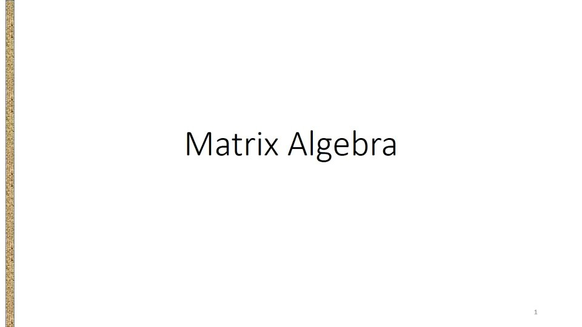

**Content:** Title card — *Matrix Algebra* (Chapter 2).

> 🎙️ **Narration:** *"Hello and welcome to the second chapter of this course. This chapter is called Matrix Algebra."*

---

### 🎬 Slide 2 — Pre-requisites from MH1810

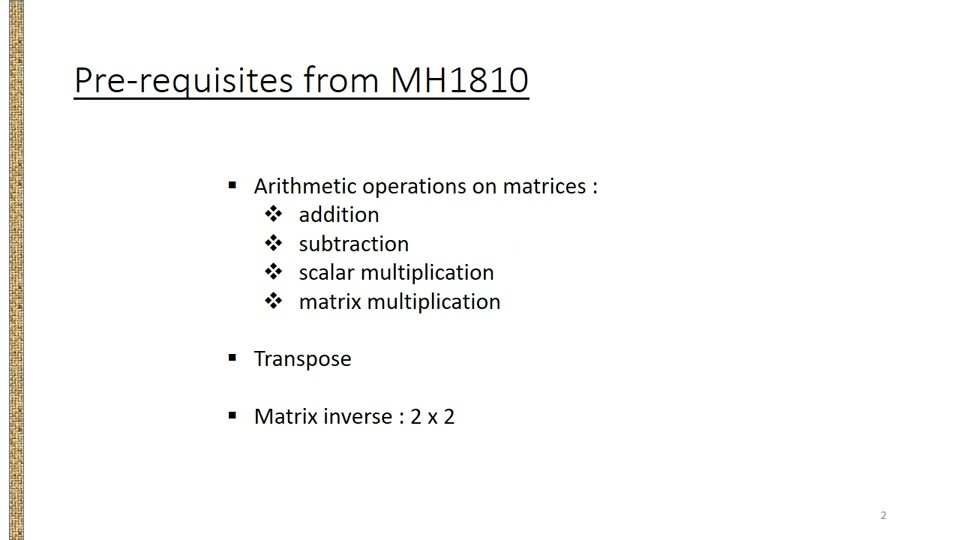

**Content — Pre-requisites:**

- **Arithmetic operations on matrices:** addition, subtraction, scalar multiplication, matrix multiplication
- **Transpose** (interchanging rows and columns)
- **Matrix inverse: 2×2**

> 🎙️ **Narration:** *"There are some prerequisites to understanding this chapter. Those prerequisites involve arithmetic operations on matrices, namely addition, subtraction, scalar multiplication, and matrix multiplication — you should be familiar with these operations. You should also know what is the meaning of a transpose of a matrix — transpose is just interchanging the rows and columns. And you should also be familiar with the process of taking the inverse of a 2 × 2 matrix."*

---

### 🎬 Slide 3 — Overview and Learning Outcomes

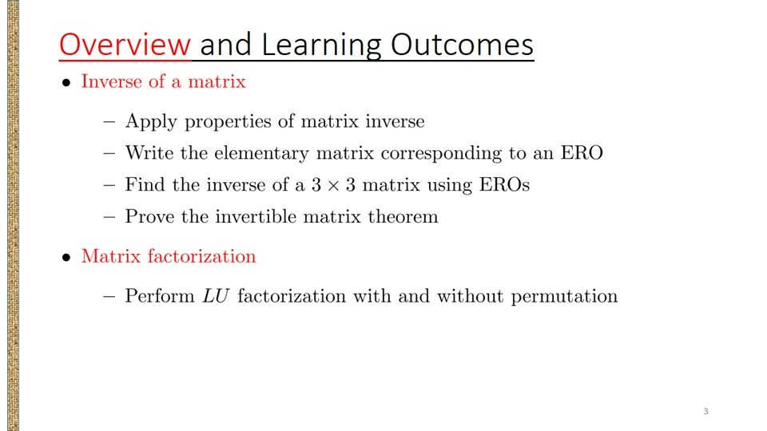

**Content:**

- **Inverse of a matrix**
  - Apply properties of matrix inverse
  - Write the **elementary matrix** corresponding to an ERO
  - Find the inverse of a **3 × 3 matrix** using EROs
  - Prove the **invertible matrix theorem**
- **Matrix factorization**
  - Perform **LU factorization** with and without permutation

> 🎙️ **Narration:** *(This slide lists the chapter's learning outcomes: properties of the matrix inverse, elementary matrices, finding 3×3 inverses via EROs, the invertible matrix theorem, and LU factorization.)*

---

### 🎬 Slide 4 — 2.1 Matrix Multiplication: Composition of Transformations

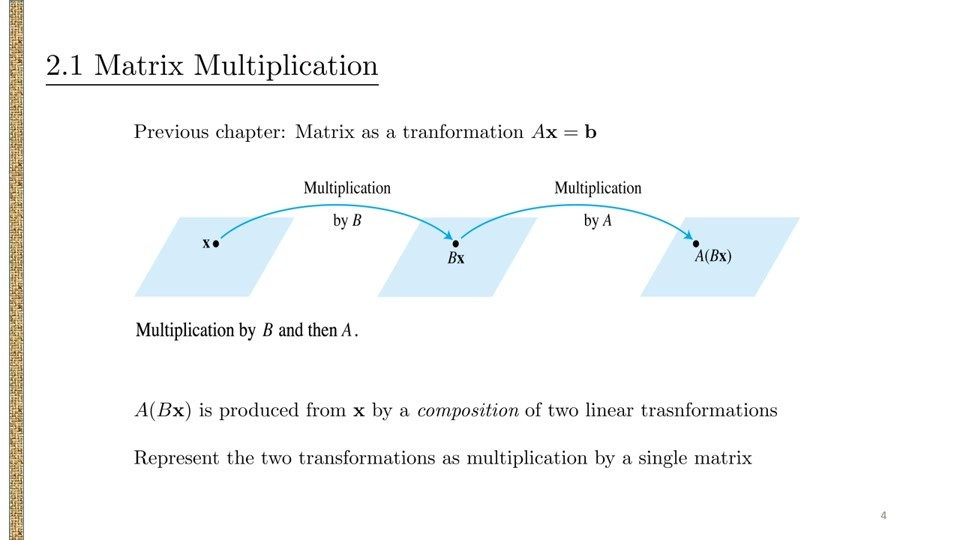

**Content:**

- Previous chapter: matrix as a transformation $A\mathbf x = \mathbf b$.
- Multiplication by $B$ then by $A$: $\mathbf x \to B\mathbf x \to A(B\mathbf x)$.
- $A(B\mathbf x)$ is produced from $\mathbf x$ by a **composition of two linear transformations**.
- Question: represent the two transformations as multiplication by a **single matrix**?

> 🎙️ **Narration:** *"In the previous chapter, we saw how a matrix actually represents a transformation. We had the transformation T, which takes a vector x to some other vector y, and this transformation can be represented by a matrix A, so y becomes equal to A times x. From a visual point of view, we have the x vector, and you multiply by B — here B is the matrix that represents the transformation, so it produces Bx. Now there can be another transformation applied on Bx itself, denoted by the matrix A. So when A operates on Bx, it is the same thing as the multiplication of A by Bx. So the final transformation is from x to A·B·x — produced from x by a composition of two linear transformations. This process of applying one transformation followed by another is called the composition of two linear transformations. Can these two linear transformations be represented by a single matrix? That's the question we are asking."*

---

### 🎬 Slide 5 — Composition (diagram)

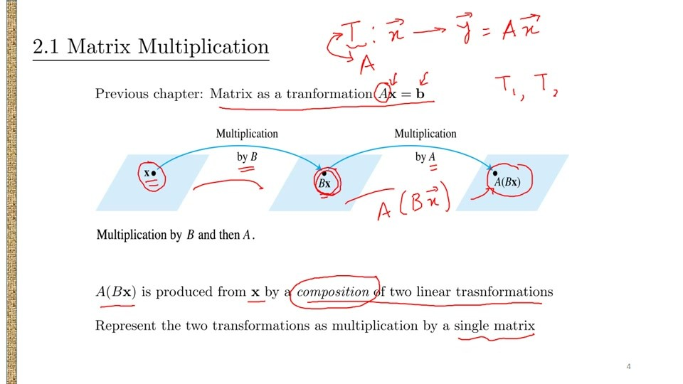

**Content:** *(figure showing the two-step transformation $\mathbf x \xrightarrow{B} B\mathbf x \xrightarrow{A} A(B\mathbf x)$.)*

---

### 🎬 Slide 6 — $A(B\mathbf x) = (AB)\mathbf x$

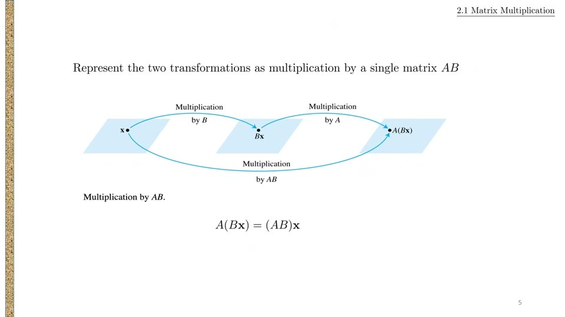

**Content — Multiplication by AB:**

$$A(B\mathbf x) = (AB)\mathbf x$$

The composition of the two transformations is represented by the **single matrix $AB$** — multiply $\mathbf x$ by $AB$. Note the **order**: $AB$ means apply $B$ first, then $A$.

> 🎙️ **Narration:** *"The answer is quite obvious from this figure: we started off with x and we got ABx. But ABx is also equal to AB times x. Therefore this composition of two transformations has been represented by one transformation, which is the multiplication of x by AB. You can see that AB is not the same as BA, generally speaking — when we say AB, B is the transformation that is applied first, and then the A transformation. However, if it was BA, the operation would be in the inverse, or the reverse, way."*

---

## V-2.2a — 2.2 Inverse of a Matrix: Theorems 2.1 & 2.2

### 🎬 Slide 1 — Theorem 2.1: Unique Solution $x = A^{-1}b$

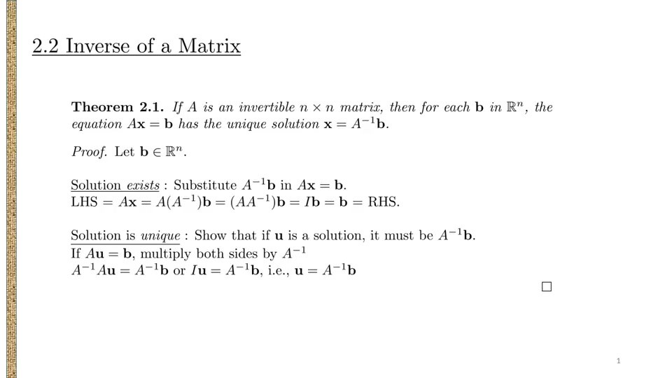

**Content — Theorem 2.1.** If $A$ is an invertible $n \times n$ matrix, then for each $\mathbf b$ in $\mathbb{R}^n$, the equation $A\mathbf x = \mathbf b$ has the **unique** solution

$$\mathbf x = A^{-1}\mathbf b$$

**Proof.** Let $\mathbf b \in \mathbb{R}^n$.

- *Solution exists:* substitute $A^{-1}\mathbf b$ in $A\mathbf x = \mathbf b$: LHS $= A(A^{-1}\mathbf b) = (AA^{-1})\mathbf b = I\mathbf b = \mathbf b$ = RHS. ✓
- *Solution is unique:* show that if $\mathbf u$ is a solution, it must be $A^{-1}\mathbf b$. If $A\mathbf u = \mathbf b$, multiply both sides by $A^{-1}$: $A^{-1}A\mathbf u = A^{-1}\mathbf b$, i.e., $I\mathbf u = A^{-1}\mathbf b$, so $\mathbf u = A^{-1}\mathbf b$. ✓

> 🎙️ **Narration:** *"In this section, we will look at some properties of the inverse of a matrix, see how to compute the inverse of a matrix, and wrap up with an important theorem called the invertible matrix theorem. We start off with this theorem, which says that if A is an n × n invertible matrix, then for each b in ℝⁿ the equation Ax = b has the unique solution given by x = A⁻¹b. This theorem addresses two issues we saw in the first chapter: whether a solution exists, and whether it is unique. The proof: to show the solution exists, substitute A⁻¹b into x. The left-hand side Ax becomes A(A⁻¹b) = (AA⁻¹)b = Ib = b, which is the right-hand side. So A⁻¹b is a solution. Is it unique? Show that if u is a solution, it must be A⁻¹b. If Au = b, multiply both sides by A⁻¹: A⁻¹Au = A⁻¹b, i.e., Iu = A⁻¹b, so u = A⁻¹b. So the solution is unique."*

---

### 🎬 Slide 2 — Theorem 2.2: Properties of Invertible Matrices (+ Proofs)

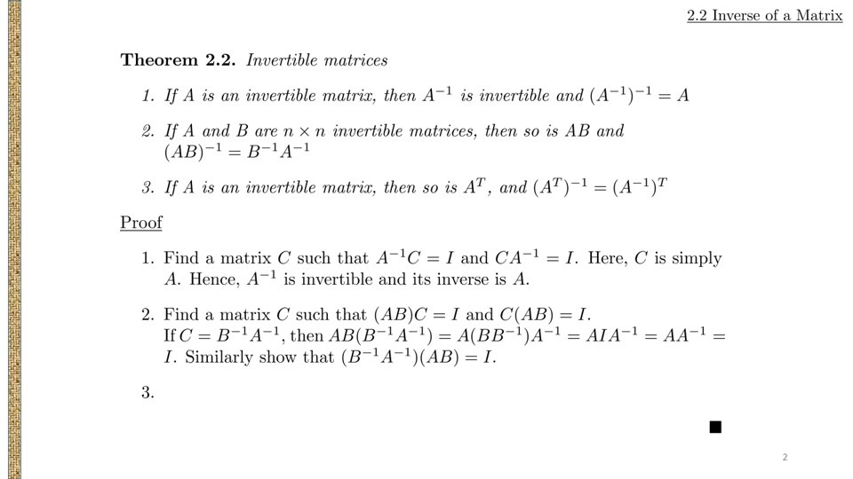

**Content — Theorem 2.2 (Invertible matrices):**

1. If $A$ is an invertible matrix, then $A^{-1}$ is invertible and $(A^{-1})^{-1} = A$.
2. If $A$ and $B$ are $n \times n$ invertible matrices, then so is $AB$, and $(AB)^{-1} = B^{-1}A^{-1}$.
3. If $A$ is an invertible matrix, then so is $A^T$, and $(A^T)^{-1} = (A^{-1})^T$.

**Proof sketch:**

1. Find a matrix $C$ such that $A^{-1}C = I$ and $CA^{-1} = I$. Here $C = A$ works. Hence $A^{-1}$ is invertible with inverse $A$.
2. Find a matrix $C$ such that $(AB)C = I$ and $C(AB) = I$. Take $C = B^{-1}A^{-1}$: $AB(B^{-1}A^{-1}) = A(BB^{-1})A^{-1} = AIA^{-1} = AA^{-1} = I$; similarly $(B^{-1}A^{-1})(AB) = I$.
3. *(Analogous — left as an exercise.)*

> 🎙️ **Narration:** *"Here is another theorem about the properties of invertible matrices. If A is an invertible matrix, then A⁻¹ is also invertible, and the inverse of the inverse is the original matrix — that's the first part. The second part says if A and B are invertible matrices, then so is AB, and the inverse of AB is B⁻¹A⁻¹ — you might recall that the transpose of a product also reverses the order: (AB)ᵀ = BᵀAᵀ; the inverse follows a similar property. The third part says if A is invertible, then so is Aᵀ, and the inverse of Aᵀ is the transpose of A⁻¹ — it doesn't matter whether you take the transpose first and then the inverse, or the inverse first and then the transpose. Let's look at the proof. To show a matrix X is invertible, you need to show there exists a matrix Y such that XY = I and YX = I. For the first part, we want to show A⁻¹ is invertible — we look for a matrix C such that A⁻¹C = I and CA⁻¹ = I. Clearly C is just A: A⁻¹A = I and AA⁻¹ = I. Therefore A⁻¹ is invertible, and its inverse is A. For the second part, we want to show AB is invertible — look for a matrix C such that AB·C = I and C·AB = I. Take C = B⁻¹A⁻¹: AB(B⁻¹A⁻¹) = A(BB⁻¹)A⁻¹ = AIA⁻¹ = AA⁻¹ = I; and similarly C·AB = I. So AB is invertible and its inverse is B⁻¹A⁻¹. You can follow the same argument to prove the third part — I'll leave it to you."*

---

## V-2.2b — 2.2 Inverse of a Matrix: Elementary Matrices & Theorem 2.3

### 🎬 Slide 1 — Elementary Matrices + Exercise 2.2.1

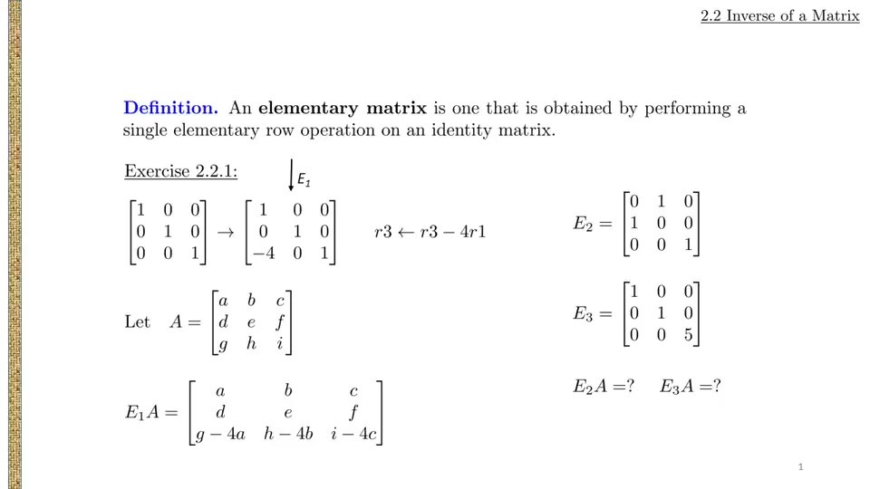

**Content — Definition.** An **elementary matrix** is one that is obtained by performing a **single elementary row operation** on an identity matrix.

*Examples* (from the identity $I_3$):
- $E_1$: $r_3 \leftarrow r_3 - 4r_1$ gives $\begin{bmatrix} 1 & 0 & 0 \\ 0 & 1 & 0 \\ -4 & 0 & 1 \end{bmatrix}$
- $E_2$: swap $r_1 \leftrightarrow r_2$ gives $\begin{bmatrix} 0 & 1 & 0 \\ 1 & 0 & 0 \\ 0 & 0 & 1 \end{bmatrix}$
- $E_3$: $r_3 \leftarrow 5r_3$ gives $\begin{bmatrix} 1 & 0 & 0 \\ 0 & 1 & 0 \\ 0 & 0 & 5 \end{bmatrix}$

**Key fact:** multiplying $A = \begin{bmatrix} a & b & c \\ d & e & f \\ g & h & i \end{bmatrix}$ on the left by an elementary matrix performs the same row operation on $A$: e.g. $E_1A$ has $r_3 - 4r_1$ applied; $E_2A$ has rows 1 and 2 swapped; $E_3A$ has row 3 multiplied by 5.

> 🎙️ **Narration:** *"In this video, we will see how to compute the inverse of a matrix through elementary row operations. We start off by defining an elementary matrix: it is one that is obtained by performing a single elementary row operation on an identity matrix. For example, here we have the identity matrix, and if we do a single elementary row operation — in this case, row 3 is replaced with row 3 minus 4·R1 — the resultant matrix is an elementary matrix: 0 minus 4·1 is −4, and the rest remain the same. As an exercise, we have another elementary matrix E2 — what row operation produced it? Clearly, R1 and R2 are interchanged. And another elementary matrix where row 3 is replaced by 5·row 3. Now suppose we have this matrix A. When you take an elementary matrix and multiply it by A, whatever row operations produced that elementary matrix are the same row operations that happen when E is multiplied by A. So E1A is the matrix obtained by doing the row operation (r3 − 4r1) on A itself. Similarly, E2A = [d e f; a b c; g h i] (rows 1 and 2 swapped), and E3A has the last row multiplied by 5: [a b c; d e f; 5g 5h 5i]."*

---

### 🎬 Slide 2 — Inverse of Elementary Matrices + Exercise 2.2.2

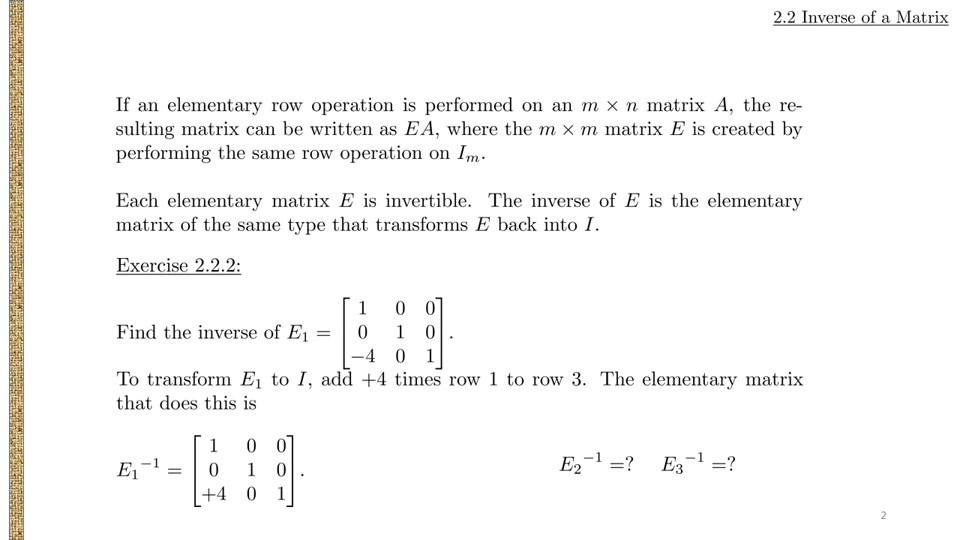

**Content:**

- If an elementary row operation is performed on an $m \times n$ matrix $A$, the resulting matrix can be written as $EA$, where the $m \times m$ matrix $E$ is created by performing the **same row operation on $I_m$**.
- **Each elementary matrix $E$ is invertible.** The inverse of $E$ is the elementary matrix of the **same type** that transforms $E$ back into $I$.

*Examples:*
- If $E_1$ came from $r_3 \leftarrow r_3 - 4r_1$, then $E_1^{-1}$ comes from $r_3 \leftarrow r_3 + 4r_1$: $E_1^{-1} = \begin{bmatrix} 1 & 0 & 0 \\ 0 & 1 & 0 \\ 4 & 0 & 1 \end{bmatrix}$.
- $E_2$ (row swap) is its own inverse: $E_2^{-1} = E_2$.
- $E_3$ ($r_3 \leftarrow 5r_3$) has inverse $E_3^{-1}$ from $r_3 \leftarrow \tfrac15 r_3$.

> 🎙️ **Narration:** *"We are restating: if an elementary row operation is performed on an m × n matrix A, the resulting matrix can be written as EA, where E is the m × m elementary matrix created by performing the same row operation on the identity matrix. Now each elementary matrix E is invertible, and the inverse of E is the elementary matrix of the same type that transforms E back into I. For example, the elementary matrix from r3 ← r3 − 4r1: to transform it back to I we add 4 times row 1 to row 3 (r3 ← r3 + 4r1); the elementary matrix that does this is the inverse. So we are simply inverting the operations. Using this, you can find the inverse of E2 and E3: E2 (the swap) is its own inverse — you can verify that — and the inverse of E3 (multiply row 3 by 5) is obtained from the operation r3 ← (1/5)r3."*

---

### 🎬 Slide 3 — Theorem 2.3: Invertible ⇔ Row Equivalent to I

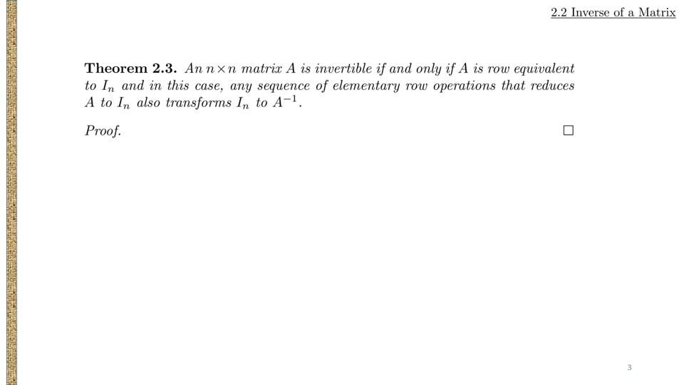

**Content — Theorem 2.3.** An $n \times n$ matrix $A$ is invertible **if and only if** $A$ is row equivalent to $I_n$. In this case, any sequence of elementary row operations that reduces $A$ to $I_n$ also transforms $I_n$ to $A^{-1}$.

> 🎙️ **Narration:** *"Now we come to the theorem that lets us find the inverse of a matrix through elementary row operations. We will discuss the proof in the live lectures, but in the next slide we will use this theorem to solve for the inverse of a particular matrix. What does this theorem say? We have an n × n matrix A, and it is invertible if and only if A is row equivalent to Iₙ — that is, only if there are elementary row operations that transform A to Iₙ. And in this case, any sequence of elementary row operations that reduces A to Iₙ also transforms Iₙ to A⁻¹. So if there is a set of elementary row operations that transforms A to Iₙ, the same set of operations transforms Iₙ to A⁻¹. This gives us a hint on how we can calculate the inverse of a matrix."*

---

### 🎬 Slide 4 — Exercise 2.2.3: Inverse of a 3×3 via EROs

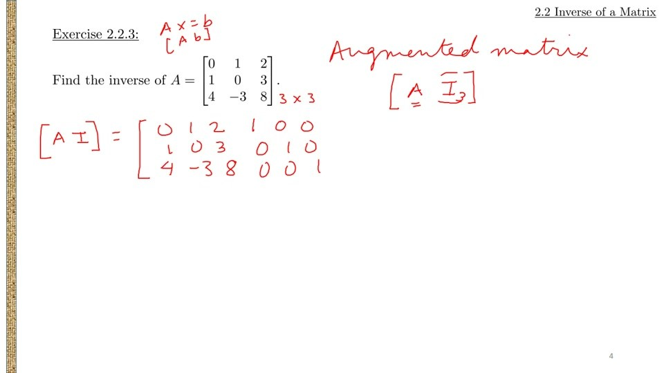

**Content — Exercise 2.2.3:** Find the inverse of $A = \begin{bmatrix} 0 & 1 & 2 \\ 1 & 0 & 3 \\ 4 & -3 & 8 \end{bmatrix}$.

**Method:** form the augmented matrix $[A \mid I_3]$, row-reduce until the left side is $I_3$; the right side becomes $A^{-1}$.

$$\left[\begin{array}{ccc|ccc} 0 & 1 & 2 & 1 & 0 & 0 \\ 1 & 0 & 3 & 0 & 1 & 0 \\ 4 & -3 & 8 & 0 & 0 & 1 \end{array}\right] \longrightarrow \left[\begin{array}{ccc|ccc} 1 & 0 & 0 & -9/2 & 7 & -3/2 \\ 0 & 1 & 0 & -2 & 4 & -1 \\ 0 & 0 & 1 & 3/2 & -2 & 1/2 \end{array}\right]$$

$$A^{-1} = \begin{bmatrix} -9/2 & 7 & -3/2 \\ -2 & 4 & -1 \\ 3/2 & -2 & 1/2 \end{bmatrix}$$

> 🎙️ **Narration:** *"We need to find the inverse of this matrix A using the theorem in the previous slide. The first step is to form an augmented matrix — but here the augmented matrix is different from what we saw earlier in Ax = b. There we had [A | b]; here our augmented matrix is [A | I]. We concatenate the identity matrix with the A matrix. So A is [0 1 2; 1 0 3; 4 −3 8], and we attach the 3 × 3 identity matrix. Our target is to transform this A into the identity matrix; in doing so, the identity matrix will get transformed to A⁻¹. Let's start: swap the first and second rows; continue with row operations (on the entire rows) until the left side becomes the identity. The final step gives the identity on the left and on the right: [−9/2 7 −3/2; −2 4 −1; 3/2 −2 1/2]. So this is the inverse of the original matrix A. You can fill in the intermediate matrices and figure out what the elementary row operations are in order to reach the identity matrix."*

---

### 🎬 Slide 5 — Exercise 2.2.3 (worked steps)

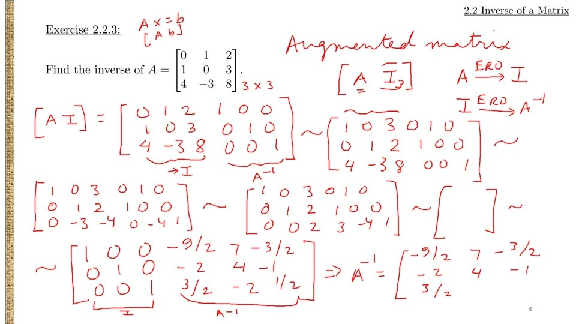

**Content:** *(the step-by-step row reduction of $[A \mid I]$ to $[I \mid A^{-1}]$.)*

---

## V-2.2c — 2.2 Inverse of a Matrix: Theorem 2.4 (Invertible Matrix Theorem)

### 🎬 Slide 1 — Theorem 2.4: The Invertible Matrix Theorem

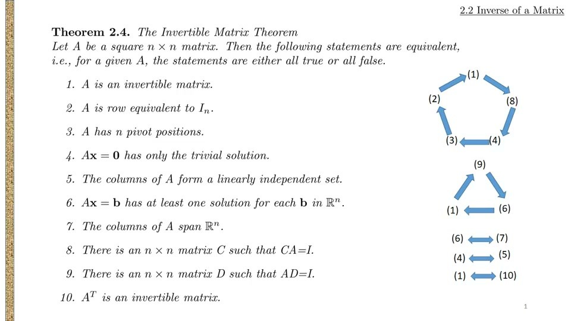

**Content — Theorem 2.4 (The Invertible Matrix Theorem).** Let $A$ be a square $n \times n$ matrix. Then the following statements are **equivalent** — for a given $A$, they are either **all true or all false**:

1. $A$ is an **invertible** matrix.
2. $A$ is row equivalent to $I_n$.
3. $A$ has $n$ **pivot positions**.
4. $A\mathbf x = \mathbf 0$ has only the **trivial** solution.
5. The columns of $A$ form a **linearly independent** set.
6. $A\mathbf x = \mathbf b$ has **at least one solution** for each $\mathbf b$ in $\mathbb{R}^n$.
7. The columns of $A$ **span** $\mathbb{R}^n$.
8. There is an $n \times n$ matrix $C$ such that $CA = I$.
9. There is an $n \times n$ matrix $D$ such that $AD = I$.
10. $A^T$ is an invertible matrix.

> 🎙️ **Narration:** *"In this video we discuss the invertible matrix theorem. The interesting thing about this theorem is how it brings together seemingly disparate notions that we have studied earlier. We are talking about an invertible matrix, but this is related to the pivot positions in A; related to whether the homogeneous equation Ax = 0 has only the trivial solution; connected to the linear independence of the columns of A; connected to the solution of the non-homogeneous equation Ax = b; connected to the span of ℝⁿ; and to the transpose of the matrix. So the things like linearly independent, span, trivial solution, unique solution or at least one solution, and pivot positions — all of these are interconnected with each other as well as connected to the invertibility of a matrix. So let A be a square n × n matrix; the following statements are equivalent — for a given matrix A, they are either all true or all false. Statement 1: A is an invertible matrix. If that is true, then everything else is also true: A is row equivalent to Iₙ; A has n pivot positions; Ax = 0 has only the trivial solution; the columns of A form a linearly independent set; Ax = b has at least one solution for each b in ℝⁿ; the columns of A span ℝⁿ; there is a matrix C such that CA = I; there is a matrix D such that AD = I; and finally Aᵀ is invertible. We will do the proof of this theorem in the live lectures. Some parts are easy — for example statements 6 and 7 are equivalent in some sense, because 'Ax = b has at least one solution' means the columns of A span ℝⁿ."*

---

### 🎬 Slide 2 — Proof Aid: Recall Theorem 1.2

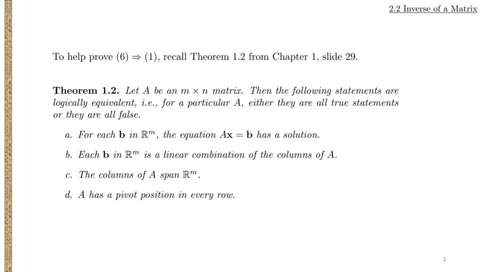

**Content — To help prove (6) ⇔ (1), recall Theorem 1.2 from Chapter 1:**

Let $A$ be an $m \times n$ matrix. The following statements are logically equivalent:

- **a.** For each $\mathbf b$ in $\mathbb{R}^m$, the equation $A\mathbf x = \mathbf b$ has a solution.
- **b.** Each $\mathbf b$ in $\mathbb{R}^m$ is a linear combination of the columns of $A$.
- **c.** The columns of $A$ span $\mathbb{R}^m$.
- **d.** $A$ has a pivot position in every row.

> 🎙️ **Narration:** *"This slide is actually related to the proof of the theorem, and we will discuss that during the live lectures. To help prove (6) ⇔ (1), we recall Theorem 1.2 from Chapter 1: for an m × n matrix A, the statements 'for each b in ℝᵐ, Ax = b has a solution', 'each b in ℝᵐ is a linear combination of the columns of A', 'the columns of A span ℝᵐ', and 'A has a pivot position in every row' are all logically equivalent."*

---

### 🎬 Slide 3 — Invertible Linear Transformations

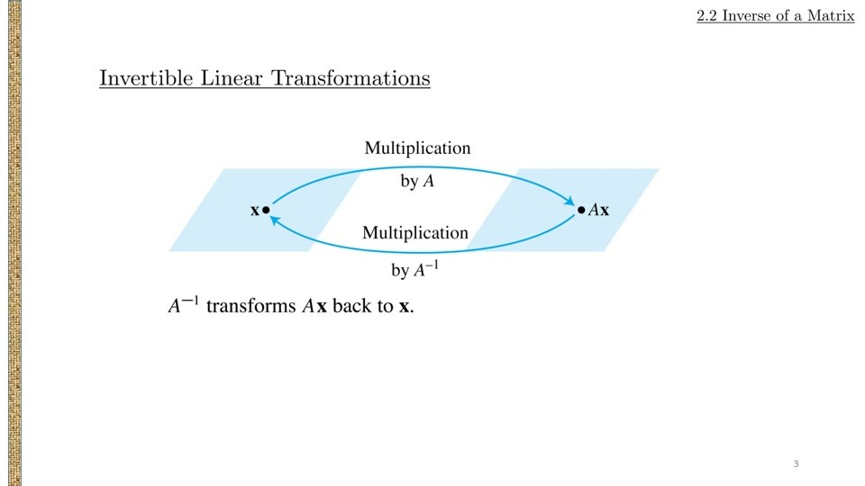

**Content — Invertible Linear Transformations:**

If $A$ represents the transformation $\mathbf x \to A\mathbf x$, then $A^{-1}$ represents the transformation that takes $A\mathbf x$ **back** to $\mathbf x$:

$$A^{-1}(A\mathbf x) = (A^{-1}A)\mathbf x = I\mathbf x = \mathbf x$$

> 🎙️ **Narration:** *"Coming back to linear transformations for a bit: we saw that if A is viewed as a linear transformation that acts on x to produce b, then since we are talking about A⁻¹, that also must represent some kind of transformation. And indeed it does: if you want to transform Ax back to x, you just multiply by A⁻¹, because A⁻¹(Ax) = Ix = x. So A⁻¹ also represents a transformation that takes Ax to x. This slide just wants to emphasize that if you are talking about the transformation A that takes x to b, you should also remember that A⁻¹ can be considered as a transformation that takes Ax back to x."*

---

## V-2.3a — 2.3 Matrix Factorizations: LU Factorization

### 🎬 Slide 1 — Matrix Factorization: Synthesis vs Analysis

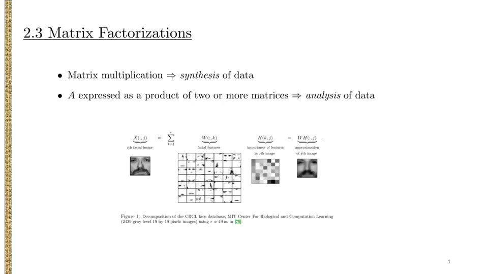

**Content:**

- **Matrix multiplication = synthesis of data** — $A \times B$ creates the data $C$.
- **Factorization = analysis of data** — $A$ expressed as a product of two or more matrices.
- Example: a face image (a matrix) can be factorized into a "features" matrix and an "importance" matrix; multiplying them (approximately) reconstructs the image.

> 🎙️ **Narration:** *"Hello. In this section, we are going to look at matrix factorizations. We can look at matrix multiplication as synthesis of data — you are creating some kind of data; A times B results in the matrix C. The inverse process, where you start off from a matrix C and factorize it into two matrices A times B, leads to the analysis of data. When a matrix A is expressed as a product of two or more matrices, that process is known as matrix factorization. This figure shows an example where matrix factorization could be useful: we have a face image, which can be thought of as a matrix, and that matrix can be factorized into two matrices — one that indicates the facial features present in any face (eyes, nose, lips, and so on), and another that represents the importance of those features in the original face image. If you multiply the importance matrix by the facial features, you would get back (an approximation of) the original image. So matrix factorization is used in identifying which features in a particular face image have more importance and which have less."*

---

### 🎬 Slide 2 — 2.3.1 The LU Factorization (Why)

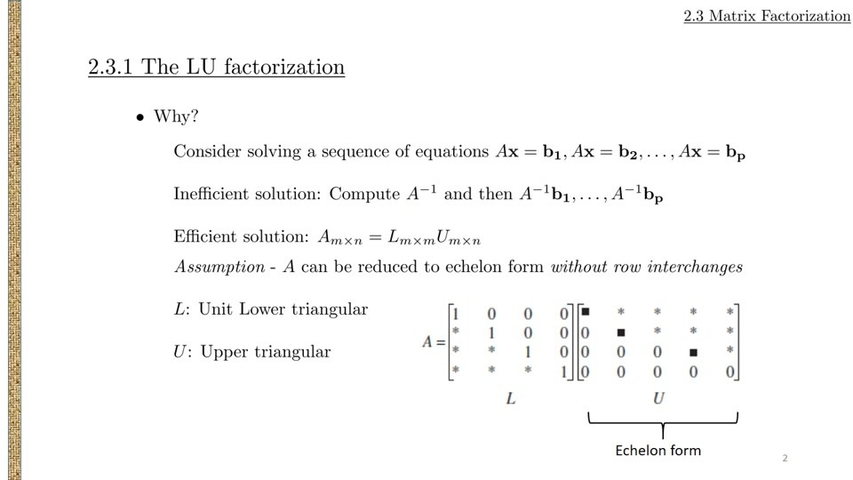

**Content — 2.3.1 The LU factorization. Why?**

Consider solving a sequence of equations $A\mathbf x = \mathbf b_1, A\mathbf x = \mathbf b_2, \dots, A\mathbf x = \mathbf b_p$.
- **Inefficient solution:** compute $A^{-1}$ and then $A^{-1}\mathbf b_1, \dots, A^{-1}\mathbf b_p$.
- **Efficient solution:** $A_{m\times n} = L_{m\times m}\,U_{m\times n}$, where $L$ is **unit lower triangular** and $U$ is **upper triangular** (in echelon form).
- **Assumption:** $A$ can be reduced to echelon form **without row interchanges** (removed later).

Given $A = LU$, solving $A\mathbf x = \mathbf b$ becomes $LU\mathbf x = \mathbf b$: let $\mathbf y = U\mathbf x$; solve $L\mathbf y = \mathbf b$ (**forward substitution**), then solve $U\mathbf x = \mathbf y$ (**backward substitution**). Easy because $L$ and $U$ are triangular.

> 🎙️ **Narration:** *"The type of factorization we'll see in this course is called LU factorization. The motivation is a situation where you want to solve a sequence of equations Ax = b1, Ax = b2, …, Ax = bp. One way is to compute A⁻¹ and then solve for X through A⁻¹b1, A⁻¹b2, and so on — but that is an inefficient solution. An efficient solution would be to factorize the matrix A into two matrices. If A is originally m × n, we break it into a matrix L which is m × m and a matrix U which is m × n. In this discussion, we assume that A can be reduced to a row echelon form without row interchanges — we will remove this assumption later. L stands for the unit lower triangular matrix: anything above the main diagonal is 0 and the values below the main diagonal are nonzero. U stands for an upper triangular matrix, which is also in echelon form. So Ax = b, when we factorize A into L times U, gives LUX = b. Let Y = UX, so we can write the original equation as Ly = b and solve for Y — this is called forward substitution. Once you have the solution for Y, you use it to solve for X from UX = Y — this process is known as backward substitution. It's easy to solve these two equations because L and U are triangular. From a transformation point of view: X is multiplied by U to get Y, then Y is multiplied by L to get B."*

---

### 🎬 Slide 3 — Exercise 2.3.1: Solving $A\mathbf x = \mathbf b$ via LU

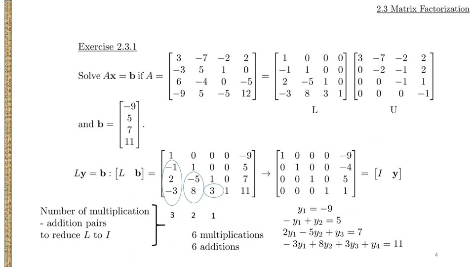

**Content — Exercise 2.3.1:** Solve $A\mathbf x = \mathbf b$, given

$$A = \begin{bmatrix} 3 & -7 & -2 & 2 \\ -3 & 5 & 1 & 0 \\ 6 & -4 & 0 & -5 \\ -9 & 5 & -5 & 12 \end{bmatrix} = LU, \qquad L = \begin{bmatrix} 1 & 0 & 0 & 0 \\ -1 & 1 & 0 & 0 \\ 2 & -5 & 1 & 0 \\ -3 & 5 & 3 & 1 \end{bmatrix},\ U = \begin{bmatrix} 3 & -7 & -2 & 2 \\ 0 & -2 & -1 & 2 \\ 0 & 0 & -1 & 1 \\ 0 & 0 & 0 & -1 \end{bmatrix},\ \mathbf b = \begin{bmatrix} -9 \\ -4 \\ 5 \\ 7 \end{bmatrix}$$

**Step 1 — Forward substitution ($L\mathbf y = \mathbf b$):** row-reduce $[L \mid \mathbf b]$ to obtain $\mathbf y$.

**Step 2 — Backward substitution ($U\mathbf x = \mathbf y$):** row-reduce $[U \mid \mathbf y]$ to obtain $\mathbf x$.

> 🎙️ **Narration:** *"Let's see this exercise. We need to solve Ax = b for X; A is given, and the L and U factorizations are also given. Note that L is the lower triangular matrix — anything below the main diagonal is nonzero and above is zero — and it's the opposite for U. The first step is to solve Ly = b: we form the augmented matrix [L | b], and through elementary row operations we get the reduced row echelon form, from which we are able to write the equations for the components of y. If you note the number of multiplication–addition pairs needed to reduce L to I: three multiply–add pairs for the first column, two for the second, one for the third — in all, six multiplications and six additions. Now that we know y and we know U, we can solve for X from UX = y. Once again form the augmented matrix, transform it with elementary row operations to a reduced row echelon form, and write the corresponding equations."*

---

### 🎬 Slide 4 — Exercise 2.3.1 (contd.): Flop Count

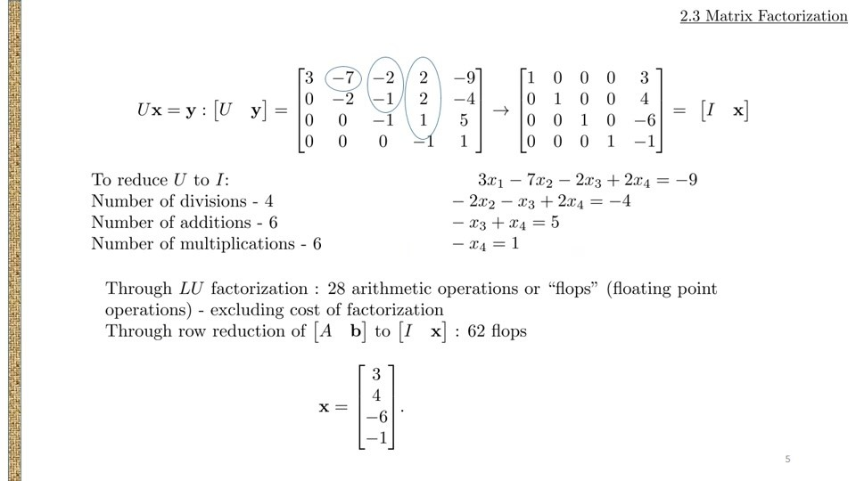

**Content — Flop comparison:**

- To reduce $U$ to $I$: **4 divisions, 6 additions, 6 multiplications**.
- **Through LU factorization:** $6 + 6 + 4 + 6 + 6 = \mathbf{28}$ arithmetic operations (flops) — *excluding the cost of factorization* (L and U were given).
- **Through row reduction of $[A \mid \mathbf b]$ to $[I \mid \mathbf x]$:** $\mathbf{62}$ flops.

> 🎙️ **Narration:** *"If you notice here, the number of divisions, additions and multiplications in order to reduce this U to the identity matrix is given: there are four divisions, six additions and six multiplications. If you add this to the previous multiplications and additions that we did to calculate the y vector, you have a total of 28 arithmetic operations, or floating point operations. This excludes the cost of factorization, because we were already given L and U. However, if you were to solve Ax = b by the usual way — form the augmented matrix [A | b] and convert it into a reduced row echelon form — that requires 62 flops. From this linear system you can try to get the final solution X for Ax = b."*

---

## V-2.3b — 2.3 Matrix Factorizations: LU Procedure & Exercises

### 🎬 Slide 1 — 2.3.2 LU Factorization Procedure

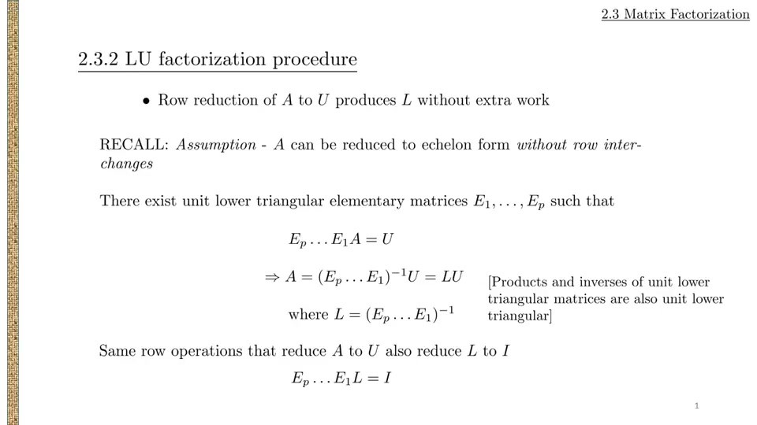

**Content — 2.3.2 LU factorization procedure:**

- **Row reduction of $A$ to $U$ produces $L$ without extra work.**
- Recall assumption: $A$ can be reduced to echelon form without row interchanges.
- There exist unit lower triangular elementary matrices $E_1, \dots, E_p$ such that $E_p \cdots E_1 A = U$.
- Hence $A = (E_p \cdots E_1)^{-1}U = LU$, where $L = (E_p \cdots E_1)^{-1}$.
- Products and inverses of unit lower triangular matrices are also unit lower triangular, so $L$ is unit lower triangular.
- **Key point:** the same row operations that reduce $A$ to $U$ also reduce $L$ to $I$ (i.e., $E_p \cdots E_1 L = I$).

> 🎙️ **Narration:** *"In this section, we will look at the procedure by which we can carry out the LU factorization. The point to note is that the row reduction of A to U produces L without extra work — when you want to factorize A into LU, all you need to do is row reduce A to the upper triangular matrix, or a row echelon form, and L naturally comes out as a byproduct. Recall the assumption that A can be reduced to echelon form without row interchanges. So there exist unit lower triangular elementary matrices E1, …, Ep such that Ep⋯E1·A = U. We have already seen what an elementary matrix does: it is derived from the identity matrix by performing one elementary row operation, and multiplying E by A has the same effect as carrying out that row operation on A. Here, in addition, these elementary matrices are unit lower triangular. From Ep⋯E1·A = U we can write A = (Ep⋯E1)⁻¹·U, and that product of inverses we call L. Is L lower triangular? Yes — it can be shown that the products and inverses of unit lower triangular matrices are also unit lower triangular. So L is a unit lower triangular matrix. Note that Ep⋯E1·L = I — the same row operations that reduce A to U also reduce L to I, because we are using the same elementary matrices."*

---

### 🎬 Slide 2 — Exercise 2.3.2: LU Factorization of a 3×3

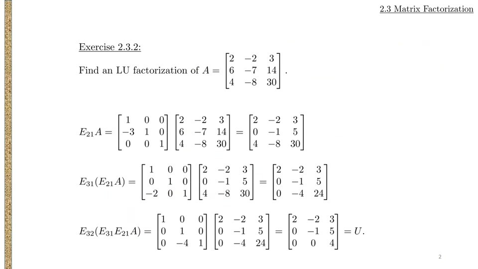

**Content — Exercise 2.3.2:** Find an LU factorization of

$$A = \begin{bmatrix} 2 & -2 & 3 \\ 6 & -7 & 14 \\ 4 & -8 & 30 \end{bmatrix}$$

**Step 1 — Find $U$ (row reduce $A$ to echelon form using unit-lower-triangular elementary matrices):**

$$E_{21}A = \begin{bmatrix} 1 & 0 & 0 \\ -3 & 1 & 0 \\ 0 & 0 & 1 \end{bmatrix}\begin{bmatrix} 2 & -2 & 3 \\ 6 & -7 & 14 \\ 4 & -8 & 30 \end{bmatrix} = \begin{bmatrix} 2 & -2 & 3 \\ 0 & -1 & 5 \\ 4 & -8 & 30 \end{bmatrix} \qquad (r_2 \leftarrow r_2 - 3r_1)$$

Continuing with $E_{31}$ ($r_3 \leftarrow r_3 - 2r_1$) and $E_{32}$ ($r_3 \leftarrow r_3 - 4r_2$):

$$U = \begin{bmatrix} 2 & -2 & 3 \\ 0 & -1 & 5 \\ 0 & 0 & 4 \end{bmatrix}$$

> 🎙️ **Narration:** *"Let's look at an example of LU factorization. This is the original matrix A, and we need to find an LU factorization. We'll first find the U matrix, which means transforming A to upper triangular — similar to the row echelon form. The first step is to make this element a zero; to do that we multiply A by the elementary matrix E21 — the −3 comes from the row operation that transforms the 6 to 0: row 2 is replaced by row 2 minus 3 times row 1. That's why we call it E21 (making the (2,1) entry zero). Next we make this element (the (3,1) entry) zero using E31. And the last step is to make this (the (3,2) entry) zero using E32. Multiplying these out gives the final upper triangular (row echelon) matrix."*

---

### 🎬 Slide 3 — Exercise 2.3.2 (contd.): Elementary matrices to U

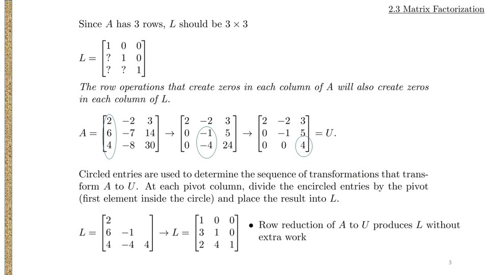

**Content:** *(the sequence $E_{32}(E_{31}(E_{21}A)) = U$ with each elementary matrix shown.)*

---

### 🎬 Slide 4 — Exercise 2.3.2 (contd.): L by Inspection

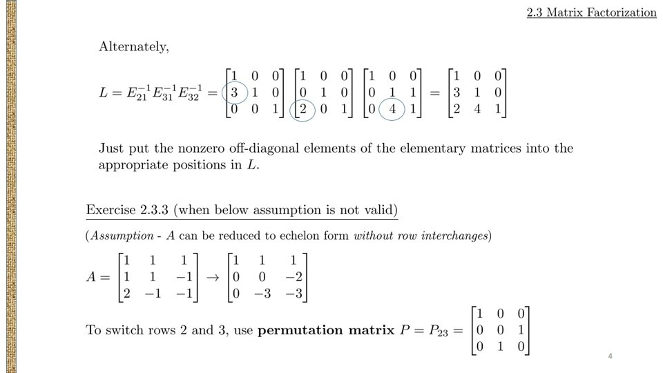

**Content — Step 2 — Find $L$ by inspection:**

$L$ is $3\times3$ unit lower triangular (1's on the diagonal, 0's above). The multipliers are read off from the **pivot columns** of the reduction (divide each pivot column by its top entry):

$$L = \begin{bmatrix} 1 & 0 & 0 \\ 3 & 1 & 0 \\ 2 & 4 & 1 \end{bmatrix}$$

*(The entries $3, 2, 4$ are exactly the multipliers used to create zeros: $r_2 - 3r_1$, $r_3 - 2r_1$, $r_3 - 4r_2$.)*

Check: $LU = \begin{bmatrix} 1 & 0 & 0 \\ 3 & 1 & 0 \\ 2 & 4 & 1 \end{bmatrix}\begin{bmatrix} 2 & -2 & 3 \\ 0 & -1 & 5 \\ 0 & 0 & 4 \end{bmatrix} = \begin{bmatrix} 2 & -2 & 3 \\ 6 & -7 & 14 \\ 4 & -8 & 30 \end{bmatrix} = A$. ✓

> 🎙️ **Narration:** *"Now what about the L matrix? Because A has 3 rows, L should be a 3 × 3 matrix, and because it is unit lower triangular, the diagonal elements are 1 and the upper part is 0. What remains is the lower part — and it turns out that if you observe the steps that take you from A to U, you can write the L matrix just by inspection. These circles are used to determine the sequence of transformations; all you need to do is divide each of these pivot columns by the first entry in each column. So take this pivot column (2, 6, 4) and divide by 2, you get (1, 3, 2). The second pivot column divided by its first element (−1) gives (1, 4). And the third pivot column's entry divided by 4 gives 1. This is the L matrix. So the row reduction of A to U produces L without extra work. There is another way too: remember Ep⋯E1·L = I, so we can get L by taking the inverse of Ep⋯E1. Taking the inverse — recall (AB)⁻¹ = B⁻¹A⁻¹, so the order is reversed — and multiplying the inverses gives the same L matrix. Interestingly, all you need to do is put the nonzero off-diagonal elements of the elementary matrices into the appropriate positions: the main diagonal is 1 and above it is 0; the question was only about these three values (3, 2 and 4), which are already there — you just place them in the appropriate positions."*

---

### 🎬 Slide 5 — Permutation Matrices & Efficiency

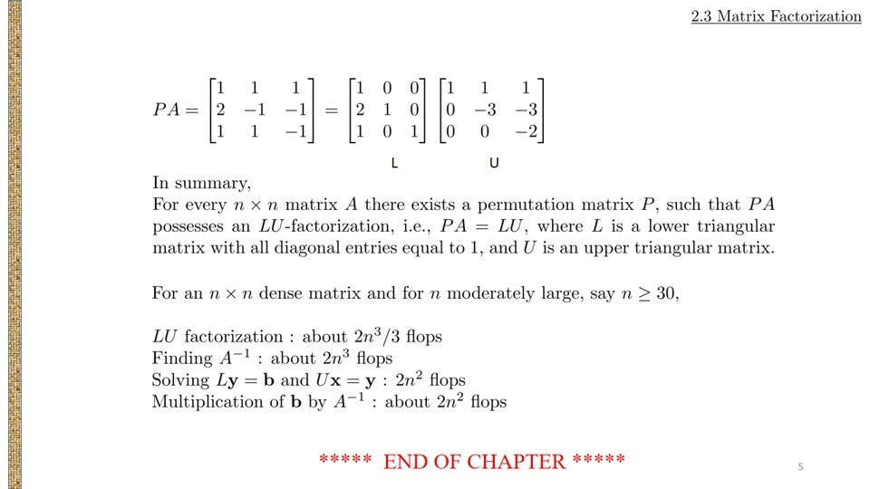

**Content — Removing the no-interchange assumption (permutation matrices):**

- If a row interchange is needed, multiply by a **permutation matrix** $P$ (the identity with the corresponding rows interchanged).
- **Result:** for every $n \times n$ matrix $A$, there exists a permutation matrix $P$ such that $PA$ possesses an LU factorization: $PA = LU$.

**Computational parameters** (dense $n \times n$, $n \ge 30$):
- LU factorization: $\approx \frac{2n^3}{3}$ flops
- Finding $A^{-1}$: $\approx 2n^3$ flops

→ LU gives roughly a **one-third saving**.

> 🎙️ **Narration:** *"Now we want to remove the assumption that A can be reduced to echelon form without row interchanges — now we consider row interchanges also. Here we have a matrix A which has been transformed by row operations, but the next step to get a row echelon form is to swap two rows. To switch rows 2 and 3 we use what's known as a permutation matrix: the permutation matrix P(2,3) is the identity matrix with rows 2 and 3 switched. Multiply that permutation matrix by A to get PA; once you have that, you can obtain U by the swapping, and then use the procedure for LU factorization to determine L — because we have already seen it's easy to get L once you get U. In summary, for every n × n matrix A there exists a permutation matrix P such that PA possesses an LU factorization. The last part of this slide shows some computational parameters: if you have a dense n × n matrix with n ≥ 30, the LU factorization takes about 2n³/3 flops, but finding the inverse takes about 2n³ flops — so you can see a one-third flop saving. That is the end of this chapter on matrix factorization."*

---

# 📋 Formula Sheet / Quick Reference (Chapter 2 — Matrix Algebra)

## Matrix Multiplication & Composition

| Concept | Result |
|---|---|
| Composition of transformations | $A(B\mathbf x) = (AB)\mathbf x$ — apply $B$ first, then $A$ |
| Order matters | $AB \neq BA$ in general |

## Inverse of a Matrix

| Concept | Result |
|---|---|
| Unique solution (Thm 2.1) | If $A$ invertible: $A\mathbf x = \mathbf b$ has unique solution $\mathbf x = A^{-1}\mathbf b$ |
| Inverse of inverse (Thm 2.2) | $(A^{-1})^{-1} = A$ |
| Inverse of product (Thm 2.2) | $(AB)^{-1} = B^{-1}A^{-1}$ |
| Inverse of transpose (Thm 2.2) | $(A^T)^{-1} = (A^{-1})^T$ |
| Elementary matrix | obtained by one ERO on $I$; multiplying $EA$ applies that ERO to $A$; every elementary matrix is invertible |
| Invertible ⇔ row equiv. to $I$ (Thm 2.3) | EROs reducing $A$ to $I$ also transform $I$ to $A^{-1}$ |
| Finding $A^{-1}$ | row-reduce $[A \mid I]$ to $[I \mid A^{-1}]$ |
| Invertible Matrix Theorem (Thm 2.4) | $A$ invertible ⇔ row equiv. to $I$ ⇔ $n$ pivots ⇔ $A\mathbf x=\mathbf 0$ only trivial ⇔ columns independent ⇔ $A\mathbf x=\mathbf b$ solvable $\forall \mathbf b$ ⇔ columns span ℝⁿ ⇔ $\exists C: CA=I$ ⇔ $\exists D: AD=I$ ⇔ $A^T$ invertible |
| Invertible transformation | $A^{-1}$ sends $A\mathbf x$ back to $\mathbf x$ |

## LU Factorization

| Concept | Result |
|---|---|
| Factorization | $A = LU$ ($L$ unit lower triangular, $U$ upper triangular/echelon form) |
| Assumption | $A$ reducible to echelon form without row interchanges |
| How to get $L$ | row reduce $A$ to $U$; $L$'s off-diagonal entries are the multipliers (read off pivot columns) |
| Solving $A\mathbf x=\mathbf b$ | $L\mathbf y = \mathbf b$ (forward substitution), then $U\mathbf x = \mathbf y$ (backward substitution) |
| With permutation | for every $A$ there is a permutation matrix $P$ with $PA = LU$ |
| Efficiency | LU ≈ $\tfrac{2n^3}{3}$ flops vs inverse ≈ $2n^3$ flops (dense, $n \ge 30$) — about ⅓ saving |

---

# ✅ Appendix: How This Guide Was Built

This guide is a **complete conversion of all 6 lecture videos** (Chapter 2, Sections 2.1 – 2.3) into Markdown:

- **Slides (priority):** every slide from every video is embedded as an image (in `Linear_Algebra_C2_Study_Guide_assets/slides/`) **and** transcribed into text with the mathematics reconstructed in proper notation. Figure/animation slides are preserved as images so nothing is lost.
- **Voice-over:** the full spoken narration is included under each slide (marked 🎙️), aligned to the slide that was on screen while it was spoken.
- **Extras:** where the slides/narration were brief, short explanations and reconstructed formulas were added to make the content clearer.

Source videos (6): `V-2.1` → `V-2.3b` (Sections 2.1 – 2.3 of Linear Algebra, by Deepu Rajan).

*End of guide.*
