# Linear Algebra — C3 Complete Study Guide (Chapter 3: Determinants)

> A complete conversion of the **3 lecture videos** of **Chapter 3: Determinants** (Sections 3.1 – 3.3) into a single study guide.
>
> **What's inside:** Every slide from every video (shown as an image, plus its content transcribed), followed by the **full voice-over narration** spoken while that slide was on screen. Where the slides/narration are brief, short explanatory notes have been added to make the ideas clearer.
>
> **Course:** Linear Algebra (by Deepu Rajan) — Chapter 3.
>
> **Source videos (C3):**
> | Video | Section(s) | Slides |
> |---|---|---|
> | V-3.1 | 3.1 Properties of Determinants (the 9 rules) | 10 |
> | V-3.2 | 3.2 Determinants as Area or Volume (Theorem 3.1) | 6 |
> | V-3.3 | 3.3 Linear Transformations (Theorem 3.2) | 5 |
>
> Slide images live in the `Linear_Algebra_C3_Study_Guide_assets/slides/` folder next to this file.

---

## Table of Contents

1. [V-3.1 — 3.1 Properties of Determinants](#v-31--31-properties-of-determinants)
2. [V-3.2 — 3.2 Determinants as Area or Volume](#v-32--32-determinants-as-area-or-volume)
3. [V-3.3 — 3.3 Linear Transformations](#v-33--33-linear-transformations)
4. [Formula Sheet / Quick Reference](#-formula-sheet--quick-reference)

---

## V-3.1 — 3.1 Properties of Determinants

### 🎬 Slide 1 — Title: *Determinants*

**Content:** Title card — *Determinants* (Chapter 3).

> 🎙️ **Narration:** *"Hello and welcome to the third chapter in this course on linear algebra — this is a chapter on determinants. It's assumed that you already know what a determinant is and are able to find the determinant of a matrix using cofactors and the adjugate (adjoint) of the matrix, and that you know the inverse of a matrix can be obtained by multiplying the adjoint by one divided by the determinant of A."*

---

### 🎬 Slide 2 — Overview and Learning Outcomes

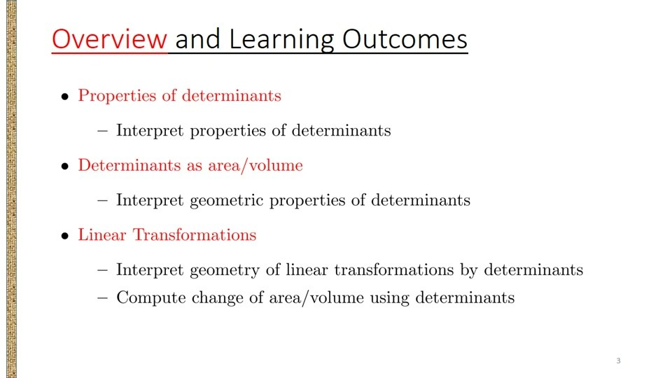

**Content — Learning outcomes:**

- **Properties of determinants** — interpret the properties of determinants
- **Determinants as area/volume** — interpret the geometric properties of determinants
- **Linear transformations** — interpret the geometry of linear transformations by determinants; compute change of area/volume using determinants

> 🎙️ **Narration:** *"These are the overviews and learning outcomes for this chapter — come back at the end of the chapter to make sure you are able to do these tasks. This chapter is not going to focus on how you compute the determinant of a particular matrix. Instead we are more interested in the properties of the determinants and what the determinants actually do."*

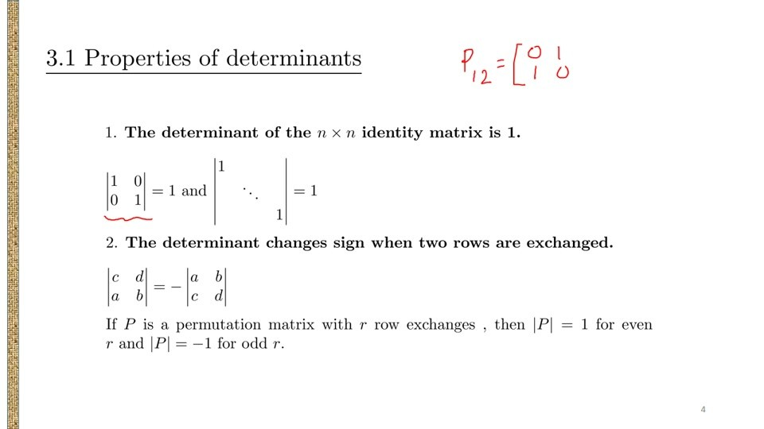

**Content — 3.1 Properties of determinants:**

1. **The determinant of the $n \times n$ identity matrix is 1.**
   $$\det(I_n) = 1$$

2. **The determinant changes sign when two rows are exchanged.**
   $$\begin{vmatrix} a & b \\ c & d \end{vmatrix} = -\begin{vmatrix} c & d \\ a & b \end{vmatrix}$$

   If $P$ is a permutation matrix with $r$ row exchanges, then $|P| = 1$ for even $r$ and $|P| = -1$ for odd $r$.

> 🎙️ **Narration:** *"Let's start with the first property: the determinant of the n × n identity matrix is one. We are not computing the determinant — these are facts or axioms that we will use later on. The second fact: the determinant changes sign when two rows are exchanged. If the original matrix was a b, c d and the rows are swapped, the determinant changes sign. We saw in the last chapter that P is a permutation matrix — swapping rows 1 and 2 of the identity gives the matrix 0 1, 1 0. If a permutation matrix involves r row exchanges, then |P| = 1 for an even number of exchanges and |P| = −1 for an odd number. Again, this is a fact we are going to use later on."*

---

### 🎬 Slide 4 — Rule 3 & Rule 4

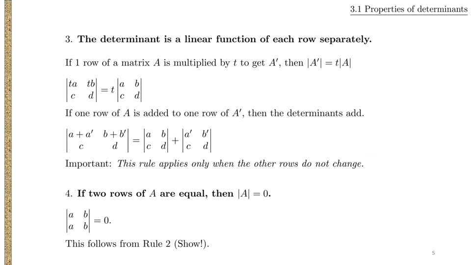

**Content — 3.1 Properties of determinants:**

3. **The determinant is a linear function of each row separately.**
   - If **one** row of a matrix $A$ is multiplied by $c$ to get $A'$, then $|A'| = c|A|$:
     $$\begin{vmatrix} ca & cb \\ c & d \end{vmatrix} = c\begin{vmatrix} a & b \\ c & d \end{vmatrix}$$
   - If **one** row of $A$ is added to the corresponding row of $A'$ (other rows unchanged), then the determinants add:
     $$\begin{vmatrix} a + a' & b + b' \\ c & d \end{vmatrix} = \begin{vmatrix} a & b \\ c & d \end{vmatrix} + \begin{vmatrix} a' & b' \\ c & d \end{vmatrix}$$

   > ⚠️ **Important:** This rule applies only when the **other rows do not change**.

4. **If two rows of $A$ are equal, then $|A| = 0$.**
   $$\begin{vmatrix} a & b \\ a & b \end{vmatrix} = 0$$

   *This follows from Rule 2 (show!).*

> 🎙️ **Narration:** *"The third property: the determinant is a linear function of each row separately. If one row of A is multiplied by t to get A', then |A'| = t|A|. Similarly, if one row of A is added to one row of A', the determinants add — if the first row decomposes as (a + a', b + b'), then the determinant equals det[a b; c d] plus det[a' b'; c d]. We have to be very careful: this rule applies only when the other rows do not change, and that's exactly what 'each row separately' means. These three facts are what we'll use to deduce the other properties and finally reach a formula for the determinant — so far we are not assuming any formula you already know. Fourth property: if two rows of A are equal, then |A| = 0. Can you show this from rule 2?"*

---

### 🎬 Slide 5 — Rule 5 & Rule 6

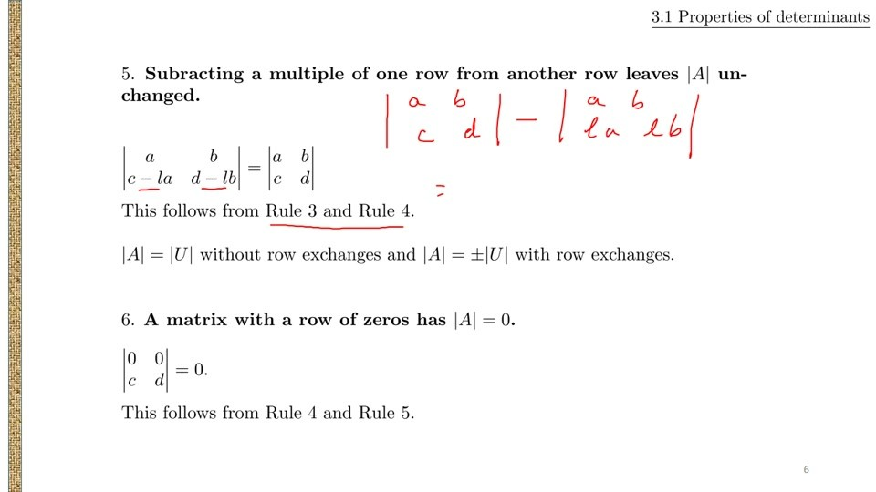

**Content — 3.1 Properties of determinants:**

5. **Subtracting a multiple of one row from another row leaves $|A|$ unchanged.**
   $$\begin{vmatrix} a & b \\ c - \ell a & d - \ell b \end{vmatrix} = \begin{vmatrix} a & b \\ c & d \end{vmatrix}$$

   *This follows from Rule 3 and Rule 4.*

   $$|A| = |U| \text{ without row exchanges}, \qquad |A| = \pm|U| \text{ with row exchanges}.$$

6. **A matrix with a row of zeros has $|A| = 0$.**
   $$\begin{vmatrix} 0 & 0 \\ c & d \end{vmatrix} = 0$$

   *This follows from Rule 4 and Rule 5.*

> 🎙️ **Narration:** *"The fifth property: subtracting a multiple of one row from another row leaves the determinant unchanged. If we have [a b; c d] and subtract ℓ times the first row from the second, we get [a b; c − ℓa, d − ℓb], with the same determinant. This follows from rules 3 and 4: from rule 3, det[a b; c d] can be split into det[a b; c d] minus det[a b; ℓa ℓb]; and by rule 4, det[a b; ℓa ℓb] = 0. So |A| = |U| without row exchanges, and |A| = ±|U| with row exchanges, where U is the upper triangular matrix. Number six: a matrix with a row of zeros has determinant zero. If you add a row to the zero row — say R1 is replaced with R1 + R2 — you get [c d; c d], whose determinant is zero by rule 4; and because this is an elementary row operation, rule 5 says the determinant does not change."*

---

### 🎬 Slide 6 — Rule 5 & Rule 6 (worked / animation)

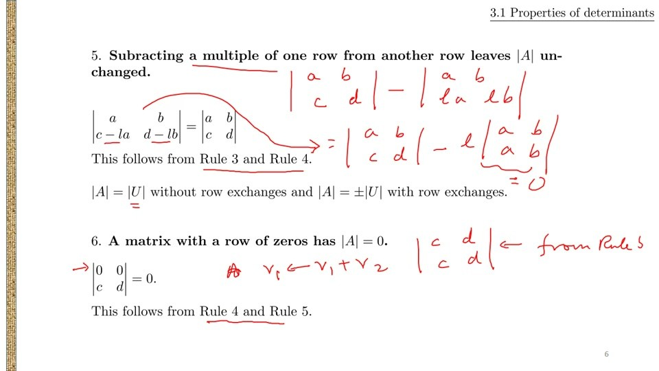

**Content:** Re-states Rules 5 and 6 with the geometric intuition (a figure showing the row operation preserving the parallelogram area).

- Subtracting a multiple of one row from another leaves $|A|$ unchanged; $|A| = |U|$ (no row exchanges) or $|A| = \pm|U|$ (with row exchanges).
- A matrix with a row of zeros has $|A| = 0$.

> 🎙️ **Narration:** *"Continuing rule 6: the determinant of [0 0; c d] equals the determinant of [c d; c d], which is zero by rule 4. Note that we are not using any formulas for determinants — we are just going by the properties. Now the seventh property: if A is triangular, then the determinant of A is the product of the diagonal entries. Consider a diagonal matrix: factor a₁₁ out of the first row (rule 3), then a₂₂ out of the second, and so on, until you reach the identity matrix — whose determinant is 1 by rule 1. So the determinant of a diagonal matrix is just the product of its diagonal elements."*

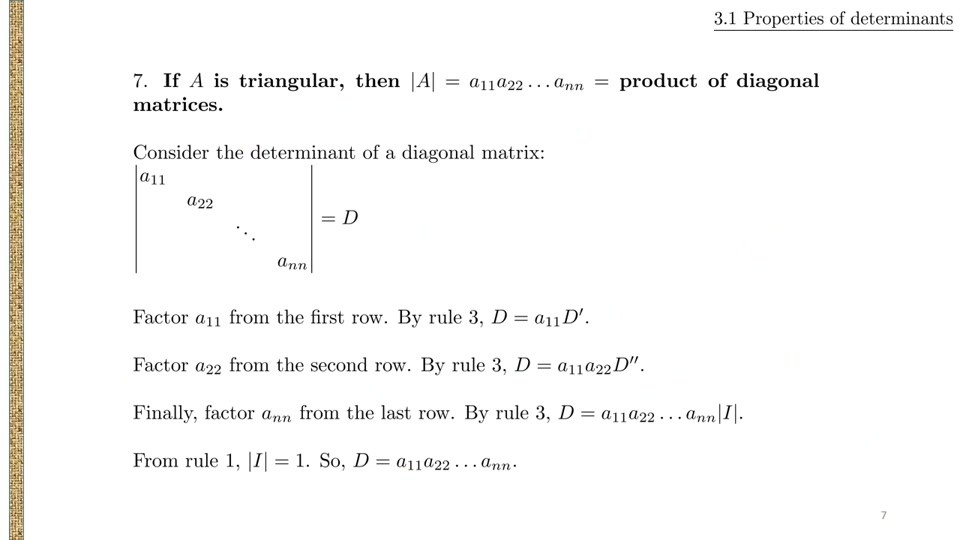

**Content — 3.1 Properties of determinants:**

7. **If $A$ is triangular, then $|A| = a_{11}a_{22}\cdots a_{nn}$ — the product of the diagonal entries.**

   *Proof for a diagonal matrix:*

   $$D = \begin{bmatrix} a_{11} & & \\ & a_{22} & \\ & & a_{nn} \end{bmatrix}$$

   - Factor $a_{11}$ out of the first row (Rule 3): $D = a_{11}D'$.
   - Factor $a_{22}$ out of the second row: $D = a_{11}a_{22}D''$.
   - Finally factor $a_{nn}$ out of the last row: $D = a_{11}a_{22}\cdots a_{nn}|I|$.
   - From Rule 1, $|I| = 1$. So $D = a_{11}a_{22}\cdots a_{nn}$.

> 🎙️ **Narration:** *"Although this is a diagonal matrix, you can also consider it to be a triangular matrix — the diagonal elements are non-zero and all other elements are zero. Factor a₁₁ from the first row and by rule 3 the determinant is a₁₁·D'. Factor a₂₂ from the second row to get a₁₁a₂₂·D'', and keep going until you factor out the last diagonal element. Once everything is factored out, the remaining matrix is the identity matrix, and by rule 1 its determinant is 1. Therefore the determinant of a diagonal matrix is the product of its diagonal elements."*

---

### 🎬 Slide 8 — Rule 7 continued: Triangular Examples & Singularity

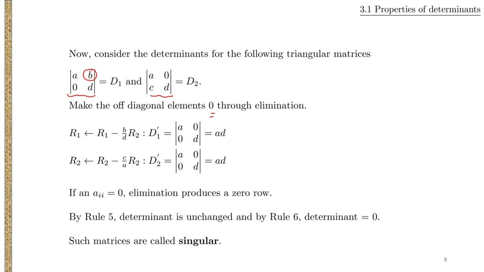

**Content — 3.1 Properties of determinants:**

Now consider the determinants of triangular matrices such as

$$D_1 = \begin{vmatrix} a & b \\ 0 & d \end{vmatrix} \quad \text{and} \quad D_2 = \begin{vmatrix} a & 0 \\ c & d \end{vmatrix}.$$

Make the off-diagonal element zero through elimination:

- $D_1$: (already upper triangular) $= ad$.
- $D_2$: use $r_2 \leftarrow r_2 - \tfrac{c}{a} r_1$: $D_2 = \begin{vmatrix} a & 0 \\ 0 & d \end{vmatrix} = ad$.

**Singular matrices:** if $a_{ii} = 0$, elimination produces a **zero row**. By Rule 5 the determinant is unchanged, and by Rule 6 the determinant is 0. Such matrices are called **singular**.

> 🎙️ **Narration:** *"Now look at the determinants of [a b; 0 d] and [a 0; c d]. Make the off-diagonal elements zero through elimination: we get diagonal matrices, whose determinants are the products of the diagonal entries. But if during elimination any diagonal element aᵢᵢ becomes zero, you get an all-zero row. By elimination (rule 5) the determinant does not change, but an all-zero row gives determinant zero. Such matrices — whose determinant is zero — are called singular matrices."*

---

### 🎬 Slide 9 — Rule 8: Singular ⇔ $|A| = 0$ (+ the 2×2 formula)

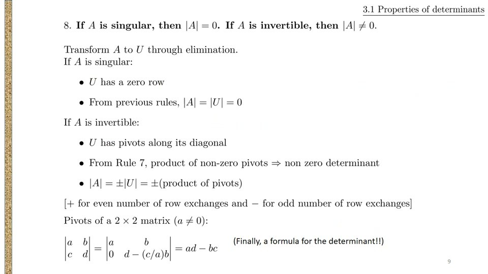

**Content — 3.1 Properties of determinants:**

8. **If $A$ is singular, then $|A| = 0$. If $A$ is invertible, then $|A| \neq 0$.**

   Transform $A$ to $U$ through elimination:
   - If $A$ is **singular**: $U$ has a zero row ⇒ from the previous rules, $|A| = |U| = 0$.
   - If $A$ is **invertible**: $U$ has pivots along its diagonal ⇒ from Rule 7, product of non-zero pivots gives a non-zero determinant:
     $$|A| = \pm|U| = \pm(\text{product of pivots})$$
     ($+$ for an even number of row exchanges, $-$ for an odd number.)

   **Pivots of a $2 \times 2$ matrix** (with $a \neq 0$):
   $$A = \begin{bmatrix} a & b \\ c & d \end{bmatrix} \xrightarrow{r_2 \leftarrow r_2 - \frac{c}{a}r_1} \begin{bmatrix} a & b \\ 0 & d - \frac{c}{a}b \end{bmatrix}$$

   Finally, a formula for the determinant!:
   $$\det\begin{bmatrix} a & b \\ c & d \end{bmatrix} = ad - bc$$

> 🎙️ **Narration:** *"Property number 8: if A is singular, then |A| = 0; if A is invertible, then |A| ≠ 0. Transform A to U through elementary row operations. If A is singular, U has a zero row and |A| = |U| = 0. If A is invertible, U has pivots along its diagonal; being triangular, |U| is the product of the non-zero pivots, so |A| = ±|U| = ±(product of pivots), where the sign depends on whether there was an even or odd number of row exchanges. For a 2 × 2 matrix with a ≠ 0, replace row 2 by row 2 − (c/a)·row 1 to get an upper triangular matrix; the product of the pivots then gives ad − bc. And this is finally the formula for the determinant! All this while we never used a formula — we derived it from the properties and the first three axioms."*

---

### 🎬 Slide 10 — Rule 9: $|AB| = |A||B|$

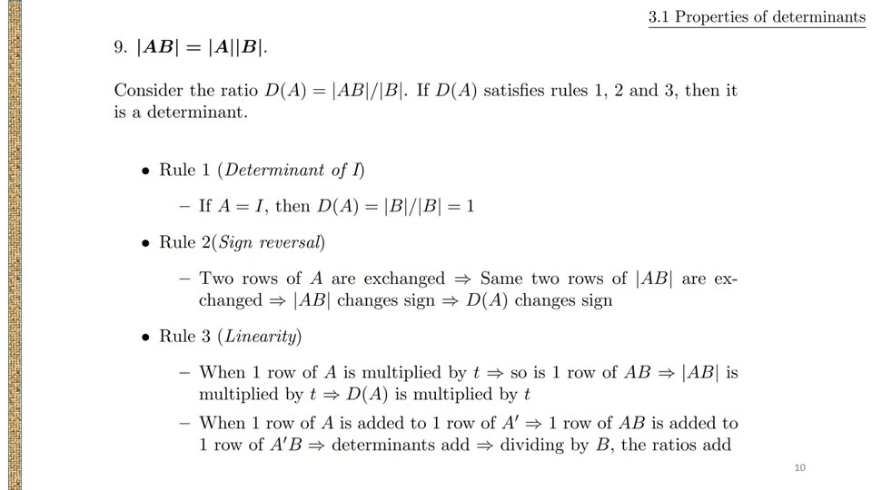

**Content — 3.1 Properties of determinants:**

9. **$|AB| = |A||B|$.**

   Consider the ratio $D(A) = |AB|/|B|$. If $D(A)$ satisfies Rules 1, 2 and 3, then it **is** a determinant.

   - **Rule 1 (det of $I$):** If $A = I$, then $D(A) = |B|/|B| = 1$. ✓
   - **Rule 2 (sign reversal):** Two rows of $A$ exchanged = the same two rows of $AB$ are exchanged ⇒ $|AB|$ changes sign ⇒ $D(A)$ changes sign. ✓
   - **Rule 3 (linearity):**
     - When 1 row of $A$ is multiplied by $t$, so is 1 row of $AB$ ⇒ $|AB|$ is multiplied by $t$ ⇒ $D(A)$ is multiplied by $t$. ✓
     - When 1 row of $A$ is added to 1 row of $A'$, 1 row of $AB$ is added to 1 row of $A'B$ ⇒ determinants add ⇒ dividing by $B$, the ratios add. ✓

   Since $D(A)$ satisfies the defining rules of a determinant, $D(A) = |A|$, i.e.
   $$|AB| = |A||B|.$$

> 🎙️ **Narration:** *"This property states that the determinant of a product of two matrices equals the product of their determinants — |AB| = |A||B|; the proof will be discussed during the live lectures. The last property is about the transpose: |Aᵀ| = |A|. For [a b; c d], the transpose is [a c; b d], and using the 2 × 2 formula both determinants are equal. Finally, all the above properties that we stated for rows also apply to columns — a good exercise is to go back and see how each property can be used for columns instead of rows."*

---

## V-3.2 — 3.2 Determinants as Area or Volume

### 🎬 Slide 1 — Theorem 3.1: Area/Volume = $|A|$

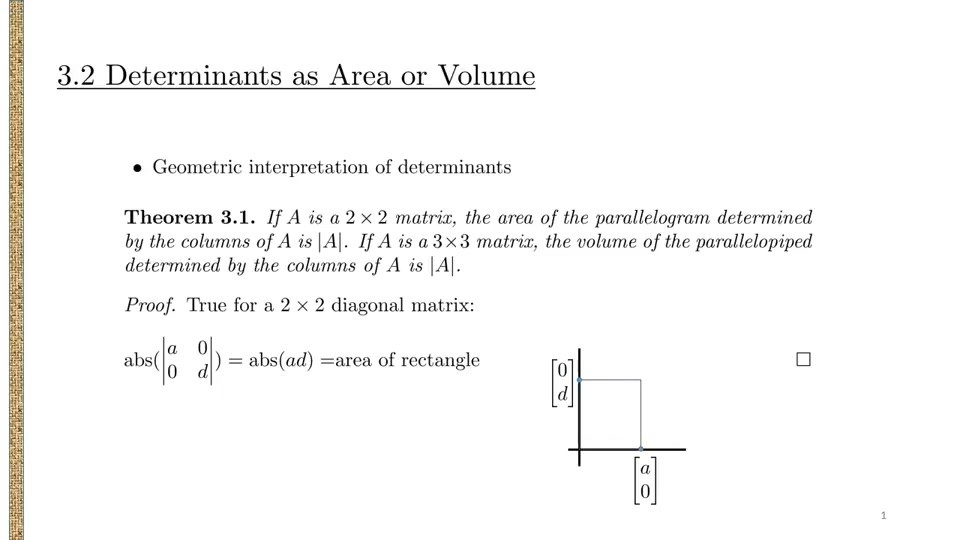

**Content — 3.2 Determinants as Area or Volume (geometric interpretation):**

**Theorem 3.1.** If $A$ is a $2 \times 2$ matrix, the **area of the parallelogram determined by the columns of $A$** is $|A|$. If $A$ is a $3 \times 3$ matrix, the **volume of the parallelepiped determined by the columns of $A$** is $|A|$.

**Proof.** True for a $2 \times 2$ diagonal matrix:
$$\text{area} = |a_{11}a_{22}| = |\det(\text{diag}(a_{11},a_{22}))|$$

> 🎙️ **Narration:** *"In this section we see how determinants are used to compute the area or volume of a surface — giving a geometric interpretation of determinants. The theorem: if A is a 2 × 2 matrix, the area of the parallelogram determined by the columns of A is |A|. For example, the parallelogram here corresponds to the matrix a 0, 0 d — column 1 is (a, 0) and column 2 is (0, d) — and only these two vectors are sufficient to draw the parallelogram, which is why we say it is determined by the columns. The area of that parallelogram is the determinant of A. If A is a 3 × 3 matrix, the volume of the parallelepiped determined by the columns of A is |A|. We'll cover the 3 × 3 case in the live lectures. For the 2 × 2 case: take the diagonal matrix a 0, 0 d. Its columns (a, 0) and (0, d) form a rectangle, and the area is |a·d| — we take the absolute value because the determinant can be negative."*

---

### 🎬 Slide 2 — Transforming to a Diagonal Matrix (2×2)

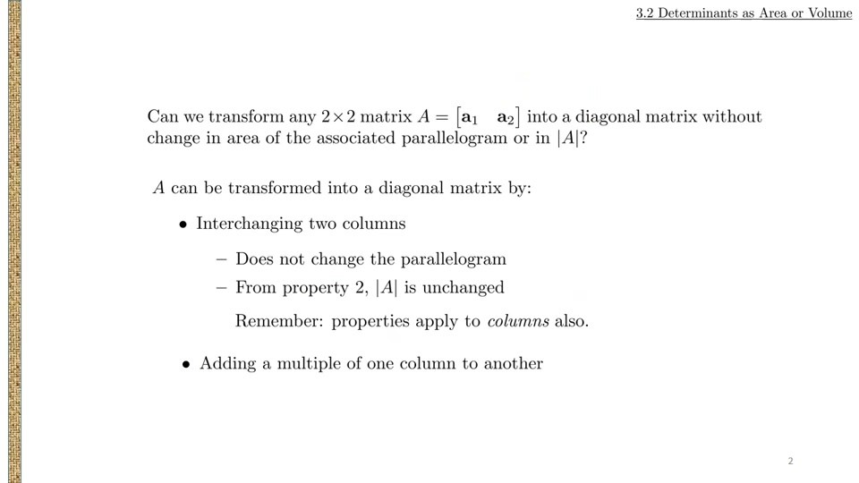

**Content — 3.2 Determinants as Area or Volume:**

**Question:** Can we transform any $2 \times 2$ matrix $A = [\mathbf a_1 \ \mathbf a_2]$ into a diagonal matrix without changing the area of the associated parallelogram, or $|A|$?

$A$ can be transformed into a diagonal matrix by:

- **Interchanging two columns** — does not change the parallelogram; from **Property 2**, $|A|$ is unchanged.
- **Adding a multiple of one column to another** — (see next slide).

> 💡 **Remember:** the properties apply to **columns** as well as rows.

> 🎙️ **Narration:** *"Now take a more general matrix A with columns a₁ and a₂. The question: can we transform this 2 × 2 matrix A into a diagonal matrix without changing the area of the associated parallelogram, or |A|? Because for a diagonal matrix we know the area equals the determinant, but for a non-diagonal matrix, can we transform it to diagonal and compute the determinant without changing the area? A can be transformed into a diagonal matrix in two ways. One is by interchanging the two columns — this may result in a diagonal matrix. By simply interchanging the columns there is no change in the parallelogram (it's the same parallelogram), and from property 2 the determinant is unchanged (up to sign; using the absolute value it's unchanged). Remember, property 2 was stated for rows, but as we said at the end of the previous video, all those properties apply to columns also."*

---

### 🎬 Slide 3 — Geometric Observation (base × height)

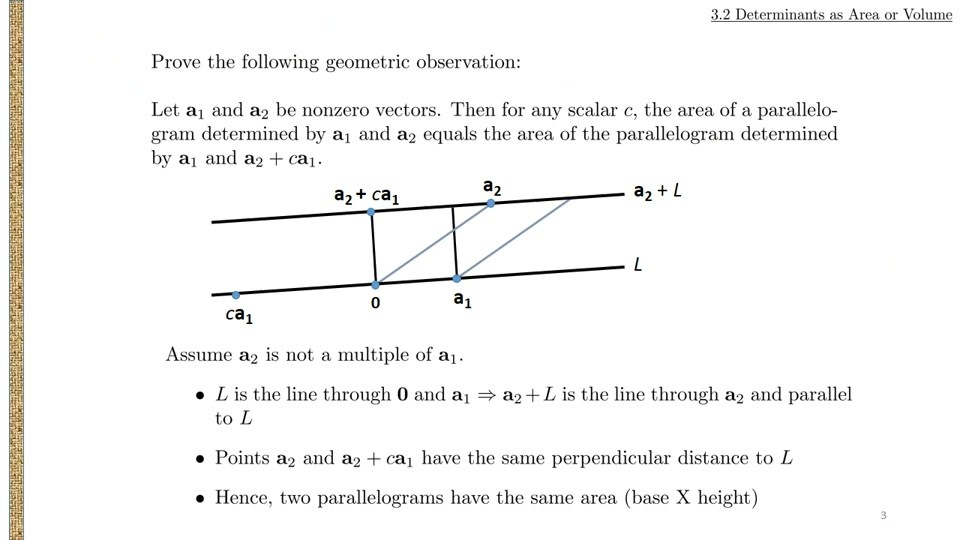

**Content — 3.2 Determinants as Area or Volume:**

Prove the following geometric observation:

> Let $\mathbf a_1$ and $\mathbf a_2$ be nonzero vectors. Then for any scalar $c$, the area of the parallelogram determined by $\mathbf a_1$ and $\mathbf a_2$ equals the area of the parallelogram determined by $\mathbf a_1$ and $\mathbf a_2 + c\mathbf a_1$.

Assume $\mathbf a_2$ is **not** a multiple of $\mathbf a_1$:

- $L$ is the line through $\mathbf 0$ and $\mathbf a_1$ ⇒ $\mathbf a_2 + L$ is the line through $\mathbf a_2$ parallel to $L$.
- Points $\mathbf a_2$ and $\mathbf a_2 + c\mathbf a_1$ have the **same perpendicular distance** to $L$.
- Hence the two parallelograms have the same area **(base × height)**.

> 🎙️ **Narration:** *"The other way to transform A into a diagonal matrix is by adding a multiple of one column to another — the question is whether this changes the area of the parallelogram. Let's look at it geometrically. Let a₁ and a₂ be non-zero vectors and c a scalar; the area of the parallelogram determined by a₁ and a₂ equals the area of the parallelogram determined by a₁ and a₂ + ca₁. Assume a₂ is not a multiple of a₁ — otherwise the parallelogram degenerates (you know what happens to the determinant then). Let L be the line through the origin and a₁. Then a₂ + L is the line through a₂ parallel to L. Now ca₁ lies on L (scalar multiples are collinear), so a₂ + ca₁ lies on the line a₂ + L — which means the points a₂ and a₂ + ca₁ have the same perpendicular distance to L. Both parallelograms therefore have the same base and the same height, so they have the same area (base × height)."*

---

### 🎬 Slide 4 — Proof for ℝ³ (3×3)

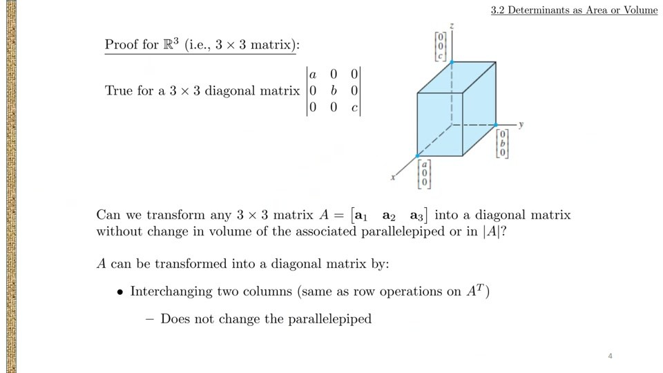

**Content — 3.2 Determinants as Area or Volume (proof for ℝ³):**

True for a $3 \times 3$ diagonal matrix:
$$\text{volume} = |a_{11}a_{22}a_{33}|$$

**Question:** Can we transform any $3 \times 3$ matrix $A = [\mathbf a_1 \ \mathbf a_2 \ \mathbf a_3]$ into a diagonal matrix without changing the volume of the associated parallelepiped, or $|A|$?

$A$ can be transformed into a diagonal matrix by:

- **Interchanging two columns** (same as row operations on $A^T$) — does not change the parallelepiped.
- **Adding a multiple of one column to another** — (see next slide).

> 🎙️ **Narration:** *"For the 3 × 3 case, the result is true for a diagonal matrix, and we again transform A to a diagonal matrix by interchanging two columns (which does not change the parallelepiped) and by adding a multiple of one column to another."*

---

### 🎬 Slide 5 — Volume preserved under column operation

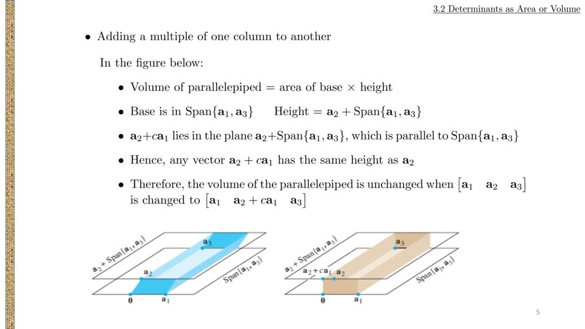

**Content — 3.2 Determinants as Area or Volume:**

Adding a multiple of one column to another (volume argument):

- Volume of parallelepiped = **area of base × height**.
- Base is in $\text{Span}\{\mathbf a_1, \mathbf a_3\}$; height is measured along $\mathbf a_2 + \text{Span}\{\mathbf a_1, \mathbf a_3\}$.
- $\mathbf a_2 + c\mathbf a_1$ lies in the plane $\mathbf a_2 + \text{Span}\{\mathbf a_1, \mathbf a_3\}$, which is **parallel** to $\text{Span}\{\mathbf a_1, \mathbf a_3\}$.
- Hence any vector $\mathbf a_2 + c\mathbf a_1$ has the **same height** as $\mathbf a_2$.
- Therefore the volume of the parallelepiped is unchanged when $[\mathbf a_1 \ \mathbf a_2 \ \mathbf a_3]$ is changed to $[\mathbf a_1 \ \mathbf a_2 + c\mathbf a_1 \ \mathbf a_3]$.

> 🎙️ **Narration:** *"For the volume argument: the volume of a parallelepiped is area of base × height. The base lies in Span{a₁, a₃}, and the height is measured in the direction a₂ + Span{a₁, a₃}. The vector a₂ + ca₁ lies in the plane a₂ + Span{a₁, a₃}, which is parallel to Span{a₁, a₃} — so any vector a₂ + ca₁ has the same height as a₂. Hence the volume is unchanged when a₂ is replaced by a₂ + ca₁."*

---

### 🎬 Slide 6 — Worked Example (area = 28)

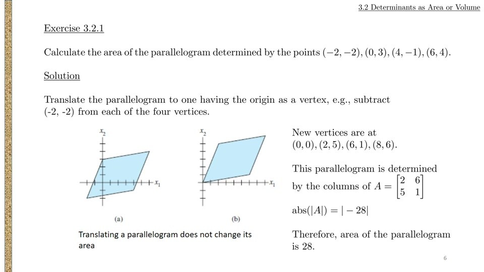

**Content — Worked example:**

> Calculate the area of the parallelogram determined by the points $(-2,-2)$, $(0,3)$, $(4,-1)$, $(6,4)$.

**Solution.**

1. Translate the parallelogram so the origin is a vertex, e.g. subtract $(-2,-2)$ from each vertex.
2. New vertices: $(0,0)$, $(2,5)$, $(6,1)$, $(8,6)$.
3. This parallelogram is determined by the columns of
   $$A = \begin{bmatrix} 2 & 6 \\ 5 & 1 \end{bmatrix}$$
4. $\text{abs}(|A|) = |2 \cdot 1 - 6 \cdot 5| = |2 - 30| = 28$.
5. Translating a parallelogram does not change its area, so the **area is 28**.

> 🎙️ **Narration:** *"Let's look at the exercise: calculate the area of the parallelogram determined by the points (−2,−2), (0,3), (4,−1), (6,4). First translate the parallelogram so that one vertex is at the origin — add 2 to all the coordinates. The new vertices are (0,0), (2,5), (6,1), (8,6). These two vectors (2,5) and (6,1) completely determine the parallelogram, so they form the columns of the matrix A. The area is then the absolute value of the determinant: 2·1 − 6·5 = 2 − 30 = −28. We take the absolute value because the area cannot be negative — so the area of the parallelogram is 28."*

---

## V-3.3 — 3.3 Linear Transformations

### 🎬 Slide 1 — Theorem 3.2: Area scales by $|A|$

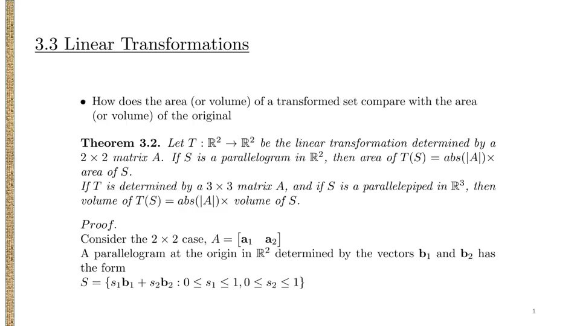

**Content — 3.3 Linear Transformations:**

**Question:** How does the area (or volume) of a transformed set compare with the area (or volume) of the original?

**Theorem 3.2.** Let $T : \mathbb{R}^2 \to \mathbb{R}^2$ be the linear transformation determined by a $2 \times 2$ matrix $A$. If $S$ is a parallelogram in $\mathbb{R}^2$, then
$$\text{area of } T(S) = \text{abs}(|A|) \times \text{area of } S.$$

If $T$ is determined by a $3 \times 3$ matrix $A$, and $S$ is a parallelepiped in $\mathbb{R}^3$, then
$$\text{volume of } T(S) = \text{abs}(|A|) \times \text{volume of } S.$$

**Proof (2×2 case).** $A = [\mathbf a_1 \ \mathbf a_2]$. A parallelogram at the origin determined by vectors $\mathbf b_1, \mathbf b_2$ has the form
$$S = \{s_1\mathbf b_1 + s_2\mathbf b_2 : 0 \le s_1 \le 1,\ 0 \le s_2 \le 1\}$$

> 🎙️ **Narration:** *"This is the last section of this chapter on determinants, where we connect determinants with linear transformations. The question: how does the area of a transformed set compare with the area of the original? Because the determinant is related to area, if an area undergoes some transformation, how does it relate to the determinant? The theorem: if T : ℝ² → ℝ² is the linear transformation determined by a 2 × 2 matrix A, and S is a parallelogram in ℝ², then the area of T(S) equals the absolute value of the determinant of A times the area of S — where A represents the transformation. This extends to 3 × 3: the volume of the transformed parallelepiped equals |det A| times the volume of the original. Let's prove the 2 × 2 case. A parallelogram at the origin determined by vectors b₁ and b₂ has the form S = {s₁b₁ + s₂b₂ : 0 ≤ s₁ ≤ 1, 0 ≤ s₂ ≤ 1} — the set of all points that make up the parallelogram."*

---

### 🎬 Slide 2 — Proof: $T(S)$ is the parallelogram of $AB$

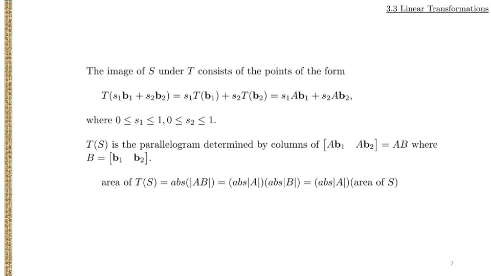

**Content — 3.3 Linear Transformations:**

The image of $S$ under $T$ consists of the points of the form
$$T(s_1\mathbf b_1 + s_2\mathbf b_2) = s_1T(\mathbf b_1) + s_2T(\mathbf b_2) = s_1A\mathbf b_1 + s_2A\mathbf b_2, \qquad 0 \le s_1 \le 1,\ 0 \le s_2 \le 1.$$

$T(S)$ is the parallelogram determined by the columns of $[A\mathbf b_1 \ A\mathbf b_2] = AB$ where $B = [\mathbf b_1 \ \mathbf b_2]$.

So, by Theorem 3.1 and Rule 9 ($|AB| = |A||B|$):
$$\text{area of } T(S) = \text{abs}(|AB|) = (\text{abs}|A|)(\text{abs}|B|) = (\text{abs}|A|)(\text{area of } S)$$

> 🎙️ **Narration:** *"What is the image of S under T? Since T is linear, T(s₁b₁ + s₂b₂) = s₁T(b₁) + s₂T(b₂). And T(b₁) = Ab₁, T(b₂) = Ab₂, because A is the matrix representing the transformation. So T(S) is the parallelogram determined by the transformed columns Ab₁ and Ab₂ — that is, the parallelogram determined by the columns of the product AB, where B = [b₁ b₂]."*

---

### 🎬 Slide 3 — Proof figure (animation)

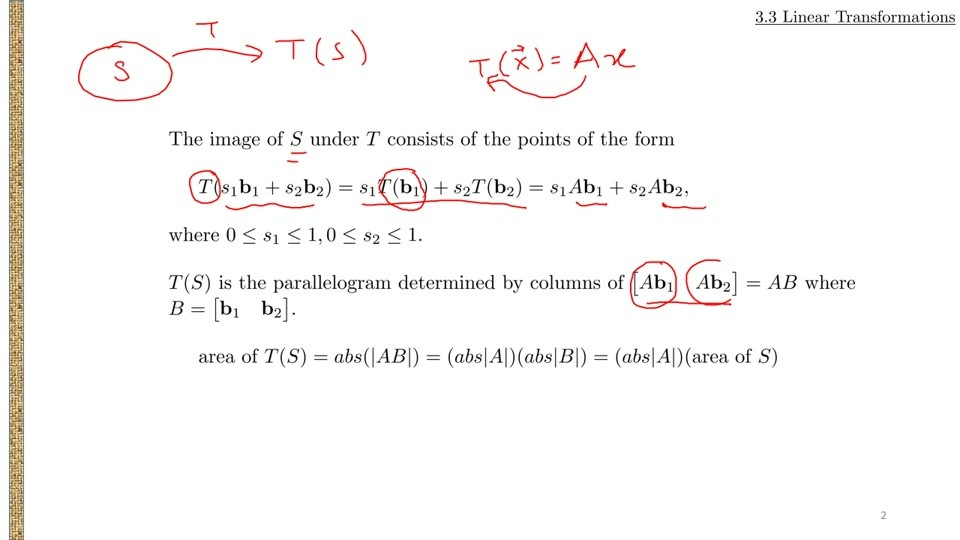

**Content:** *(figure showing $S$ mapping to $T(S)$ — the parallelogram $S$ determined by $\mathbf b_1, \mathbf b_2$ being sent to the parallelogram $T(S)$ determined by $A\mathbf b_1, A\mathbf b_2$, with the image scaling by $\text{abs}(|A|)$.)*

Same argument: $T(S)$ is the parallelogram determined by the columns of $AB$ where $B = [\mathbf b_1 \ \mathbf b_2]$, and area of $T(S) = \text{abs}(|AB|) = (\text{abs}|A|)(\text{area of } S)$.

> 🎙️ **Narration:** *"The final transformed area is determined by the columns Ab₁, Ab₂, which form the matrix product AB where B = [b₁ b₂]. So the area of T(S) is the absolute value of det(AB). But |AB| = |A||B|, so we can split it into |det A| · |det B|. And we already know that |det B| is the area of S. Hence the area of T(S) = |det A| × area of S."*

---

### 🎬 Slide 4 — General Case: Arbitrary Parallelogram $p + S$

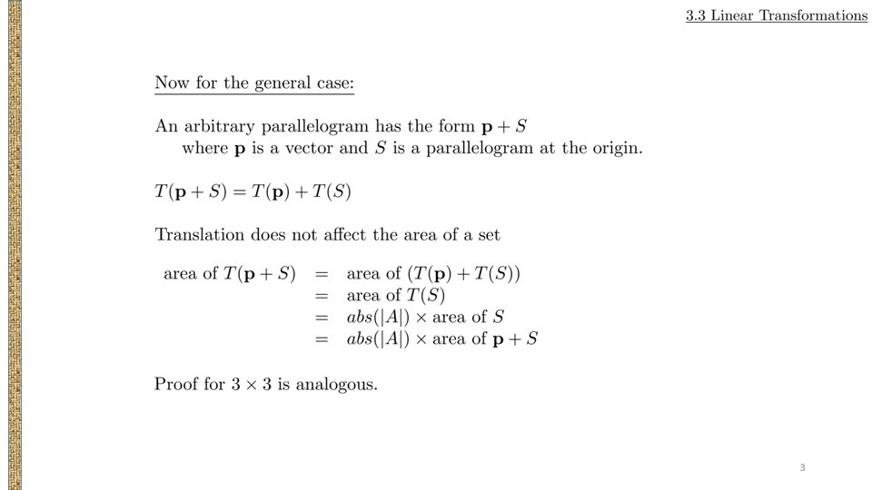

**Content — 3.3 Linear Transformations (general case):**

An arbitrary parallelogram has the form $p + S$, where $p$ is a vector and $S$ is a parallelogram at the origin.

$$T(p + S) = T(p) + T(S)$$

Translation does not affect the area of a set:
$$\text{area of } T(p+S) = \text{area of } (T(p) + T(S)) = \text{area of } T(S) = \text{abs}(|A|) \times \text{area of } S = \text{abs}(|A|) \times \text{area of } p+S$$

The proof for the $3 \times 3$ case is analogous.

> 🎙️ **Narration:** *"Now for the general case: an arbitrary parallelogram need not have a vertex anchored at the origin. Write it as p + S, where p is a vector and S is a parallelogram at the origin — adding p just translates S so it can sit anywhere in the plane. Because T is linear, T(p + S) = T(p) + T(S). Translation does not affect the area of a set, so the area of T(p + S) equals the area of T(S) = |det A| × area of S; and area of S = area of p + S for the same translation reason. So the area of T(p + S) = |det A| × area of (p + S). The 3 × 3 (parallelepiped) proof is analogous."*

---

### 🎬 Slide 5 — Example: Ellipse + END OF CHAPTER

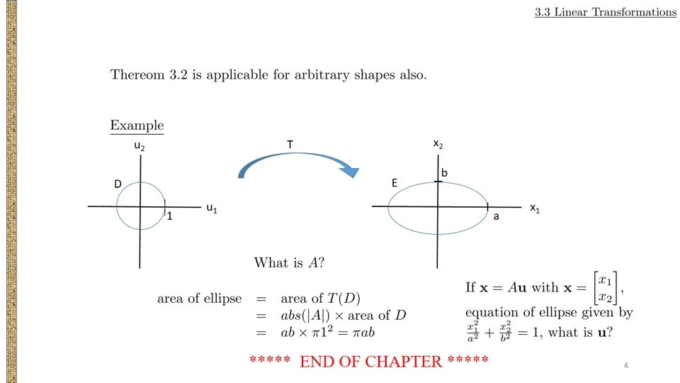

**Content — 3.3 Linear Transformations:**

> **Theorem 3.2 is applicable to arbitrary shapes.**

**Example.** $x = Au$ with $x = \binom{x_1}{x_2}$; the equation of the ellipse is $\frac{x_1^2}{a^2} + \frac{x_2^2}{b^2} = 1$; what is $u$?

- Let $D$ be the unit disk. The ellipse is $T(D)$, the image of the unit disk under $A$.
- **What is $A$?** A diagonal matrix that stretches the axes: $A = \begin{bmatrix} a & 0 \\ 0 & b \end{bmatrix}$; the unit circle $\binom{u_1}{u_2}$ maps to $\binom{a u_1}{b u_2}$.
- $\text{area of ellipse} = \text{area of } T(D) = \text{abs}(|A|) \times \text{area of } D = ab \times \pi = \pi ab$. ✓

> ***✦ END OF CHAPTER ✦***

> 🎙️ **Narration:** *"Although the theorem mentions parallelograms, it applies to arbitrary shapes — S is just a set of points, so the shape of that set doesn't matter. Example: a unit circle D of radius 1 undergoes a linear transformation T into an ellipse E with major axis ending at a and minor axis ending at b. I'll leave it to you to find the matrix A (as in the previous chapter: see where the standard basis vectors land — once you have that you can write A). The area of the ellipse equals the area of T(D) = |det A| × area of D. The determinant of A turns out to be a·b, and the area of D is π(1)² = π — so the area of the ellipse is π·a·b. We end the chapter with a small exercise: if x = Au with x = (x₁, x₂) and the equation of the ellipse is given, find u — you just need to know A and then write u in terms of x₁ and x₂. With that, we come to the end of this chapter."*

---

# 📋 Formula Sheet / Quick Reference (Chapter 3 — Determinants)

## The 9 Properties of Determinants

| # | Property | Formula |
|---|---|---|
| 1 | Determinant of identity | $\|I_n\| = 1$ |
| 2 | Row exchange flips sign | $\|A'\| = -\|A\|$; permutation matrix: $\|P\| = (-1)^r$ |
| 3 | Linear in each row | multiply one row by $c$: $\|A'\| = c\|A\|$; add one row: determinants add |
| 4 | Two equal rows | $\|A\| = 0$ |
| 5 | Row replacement | subtract a multiple of one row from another leaves $\|A\|$ unchanged |
| 6 | Zero row | $\|A\| = 0$ |
| 7 | Triangular | $\|A\| = a_{11}a_{22}\cdots a_{nn}$ (product of diagonal) |
| 8 | Singular vs invertible | singular ⇒ $\|A\| = 0$; invertible ⇒ $\|A\| \neq 0$ ($\|A\| = \pm$ product of pivots) |
| 9 | Product rule | $\|AB\| = \|A\|\|B\|$ |

## Geometry of Determinants

| Concept | Result |
|---|---|
| 2×2 area (Thm 3.1) | area of parallelogram determined by columns of $A$ = $\|A\|$ |
| 3×3 volume (Thm 3.1) | volume of parallelepiped determined by columns of $A$ = $\|A\|$ |
| 2×2 formula | $\det\begin{bmatrix} a & b \\ c & d \end{bmatrix} = ad - bc$ |
| Column operations | interchanging columns: area/volume unchanged, $\|A\|$ sign flips; adding a multiple of one column to another: unchanged |
| Linear transformation (Thm 3.2) | area/volume of $T(S)$ = $\text{abs}(\|A\|) \times$ area/volume of $S$ (works for arbitrary shapes) |
| General position | area/volume invariant under translation ($p + S$) |

## Standard Results

| Concept | Result |
|---|---|
| $\|AB\| = \|A\|\|B\|$ | also $\|A^{-1}\| = 1/\|A\|$ (when invertible) |
| Ellipse area | $\pi ab$ for $\frac{x_1^2}{a^2} + \frac{x_2^2}{b^2} = 1$ — unit disk stretched by $\text{diag}(a, b)$ |

---

# ✅ Appendix: How This Guide Was Built

This guide is a **complete conversion of all 3 lecture videos** (Chapter 3, Sections 3.1 – 3.3) into Markdown:

- **Slides (priority):** every slide from every video is embedded as an image (in `Linear_Algebra_C3_Study_Guide_assets/slides/`) **and** transcribed into text with the mathematics reconstructed in proper notation. Figure/animation slides are preserved as images so nothing is lost.
- **Voice-over:** the full spoken narration is included under each slide (marked 🎙️), aligned to the slide that was on screen while it was spoken.
- **Extras:** where the slides/narration were brief, short explanations and reconstructed formulas were added to make the content clearer.

Source videos (3): `V-3.1` → `V-3.3` (Sections 3.1 – 3.3 of Linear Algebra, by Deepu Rajan).

*End of guide.*
