# Linear Algebra — C4 Complete Study Guide (Chapter 4: Vector Spaces)

> A complete conversion of the **entire Chapter 4: Vector Spaces** video series — all 19 lecture videos (Sections 4.1 – 4.15) — into a single study guide.
>
> **What's inside:** Every slide from every video (shown as an image, plus its content transcribed), followed by the **full voice-over narration** spoken while that slide was on screen. Where the slides/narration are brief, short explanatory notes have been added to make the ideas clearer.
>
> **Course:** Linear Algebra (by Deepu Rajan) — Chapter 4 (the final chapter).
>
> **Source videos (C4):**
> | Video | Section(s) | Slides |
> |---|---|---|
> | V-4.1 | 4.1 Vector Spaces | 11 |
> | V-4.2 | 4.2 Subspaces | 5 |
> | V-4.3 | 4.3 Subspace Spanned by a Set | 5 |
> | V-4.4 | 4.4 The Null Space of a Matrix N(A) | 8 |
> | V-4.5a | 4.5 The Column Space of a Matrix C(A) | 2 |
> | V-4.5b | 4.5 Exercises | 6 |
> | V-4.6 | 4.6 Kernel and Range of a Linear Transformation | 3 |
> | V-4.7a | 4.7 Bases — Linear Dependence | 5 |
> | V-4.7b | 4.7 Bases — Definition & Exercises | 7 |
> | V-4.8 | 4.8 The Spanning Set Theorem | 4 |
> | V-4.9a | 4.9 Bases for N(A) and C(A) | 3 |
> | V-4.9b | 4.9 Bases for N(A) and C(A) (contd.) | 5 |
> | V-4.10 | 4.10 Coordinate Systems | 6 |
> | V-4.11 | 4.11 Dimension of a Vector Space | 5 |
> | V-4.12 | 4.12 Dimensions of C(A) and N(A) | 2 |
> | V-4.13 | 4.13 The Row Space | 5 |
> | V-4.14a | 4.14 Rank | 3 |
> | V-4.14b | 4.14 Rank — Rank Theorem & IMT | 6 |
> | V-4.15 | 4.15 Change of Basis | 3 |
>
> Slide images live in the `Linear_Algebra_C4_Study_Guide_assets/slides/` folder next to this file.

---

## Table of Contents

1. [V-4.1 — 4.1 Vector Spaces](#v-41--41-vector-spaces)
2. [V-4.2 — 4.2 Subspaces](#v-42--42-subspaces)
3. [V-4.3 — 4.3 Subspace Spanned by a Set](#v-43--43-subspace-spanned-by-a-set)
4. [V-4.4 — 4.4 The Null Space of a Matrix N(A)](#v-44--44-the-null-space-of-a-matrix-na)
5. [V-4.5 — 4.5 The Column Space of a Matrix C(A)](#v-45--45-the-column-space-of-a-matrix-ca)
6. [V-4.6 — 4.6 Kernel and Range of a Linear Transformation](#v-46--46-kernel-and-range-of-a-linear-transformation)
7. [V-4.7 — 4.7 Bases](#v-47--47-bases)
8. [V-4.8 — 4.8 The Spanning Set Theorem](#v-48--48-the-spanning-set-theorem)
9. [V-4.9 — 4.9 Bases for N(A) and C(A)](#v-49--49-bases-for-na-and-ca)
10. [V-4.10 — 4.10 Coordinate Systems](#v-410--410-coordinate-systems)
11. [V-4.11 — 4.11 Dimension of a Vector Space](#v-411--411-dimension-of-a-vector-space)
12. [V-4.12 — 4.12 Dimensions of C(A) and N(A)](#v-412--412-dimensions-of-ca-and-na)
13. [V-4.13 — 4.13 The Row Space](#v-413--413-the-row-space)
14. [V-4.14 — 4.14 Rank](#v-414--414-rank)
15. [V-4.15 — 4.15 Change of Basis](#v-415--415-change-of-basis)
16. [Formula Sheet / Quick Reference](#-formula-sheet--quick-reference)

---

## V-4.1 — 4.1 Vector Spaces

### 🎬 Slide 1 — Title: *Vector Spaces*

**Content:** Title card — *Vector Spaces* (Chapter 4).

> 🎙️ **Narration:** *"Hello and welcome to the last chapter of this course. This chapter is called Vector Spaces. You already know what vectors are, but in this chapter we are going to expand the definition of vectors and the spaces in which they live."*

---

### 🎬 Slide 2 — Expanding the Definition of Vectors & Their Spaces

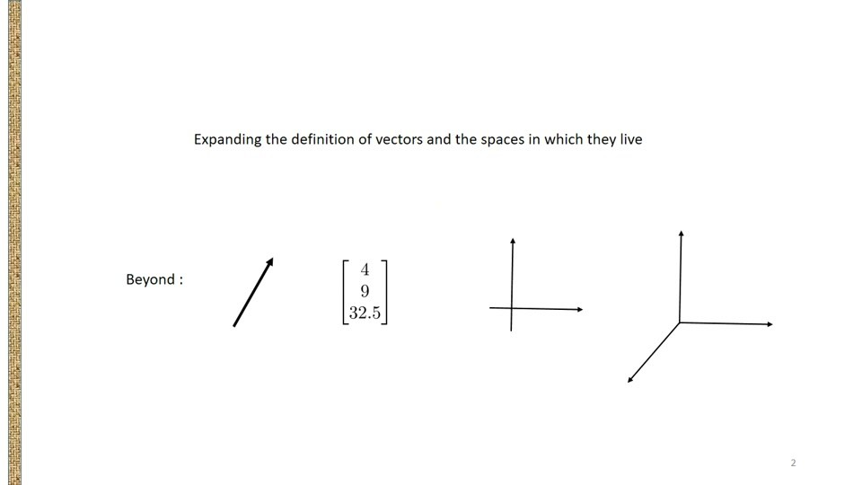

**Content — Beyond the arrow:**

- So far a vector is drawn as an **arrow**, or written as a column matrix with entries.
- A vector with 2 entries lives in 2-D space; a vector with 3 entries lives in 3-D space.
- **Generalize:** a vector with $n$ entries lives in $n$-dimensional space $\mathbb{R}^n$ (real numbers).

> 🎙️ **Narration:** *"We want to go beyond the notion of an arrow as a vector. You would also know by now that a vector is represented as a column matrix with just one column and some entries. You would also know that the space in which an arrow lives might be just a two-dimensional space; similarly a vector with three entries, x, y and z, lives in three-dimensional space. But we are going to generalize this idea to think of n dimensions. Just as a vector with three entries lives in three-dimensional space, a vector with n entries lives in n-dimensional space — the ℝ indicates real numbers."*

---

### 🎬 Slide 3 — Overview and Learning Outcomes

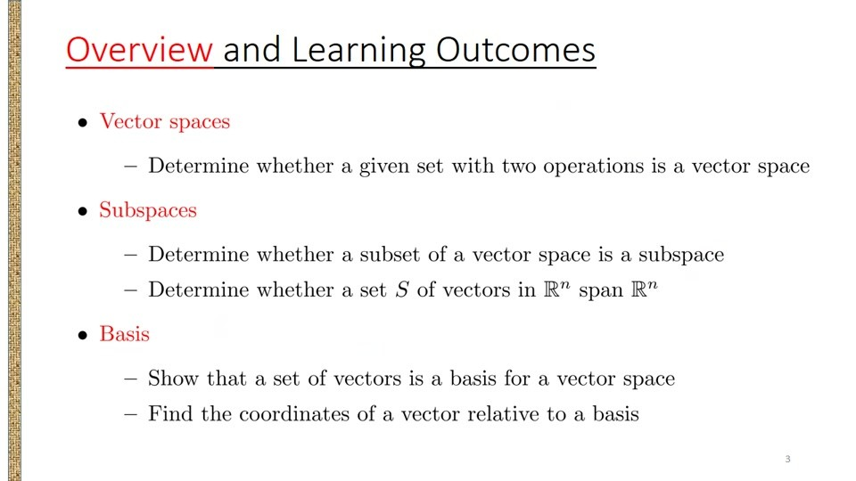

**Content — Learning outcomes:**

- **Vector spaces** — determine whether a given set with two operations is a vector space
- **Subspaces** — determine whether a subset of a vector space is a subspace; determine whether a set $S$ of vectors in $\mathbb{R}^n$ spans $\mathbb{R}^n$
- **Basis** — show that a set of vectors is a basis for a vector space; find the coordinates of a vector relative to a basis

> 🎙️ **Narration:** *"This is just the overview and learning outcomes slide. We start with the definition of a vector space."*

---

### 🎬 Slide 4 — Definition of a Vector Space (Axioms 1–5)

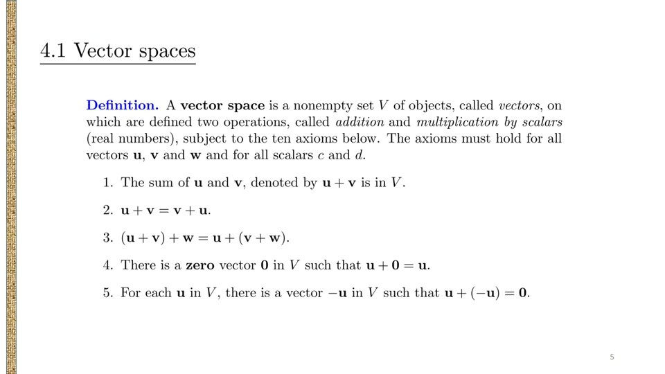

**Content — Definition.** A **vector space** is a nonempty set $V$ of objects, called **vectors**, on which are defined two operations, called **addition** and **multiplication by scalars** (real numbers), subject to the ten axioms below. The axioms must hold for all vectors $\mathbf u, \mathbf v, \mathbf w$ and all scalars $c, d$:

1. $\mathbf u + \mathbf v$ is in $V$.
2. $\mathbf u + \mathbf v = \mathbf v + \mathbf u$.
3. $(\mathbf u + \mathbf v) + \mathbf w = \mathbf u + (\mathbf v + \mathbf w)$.
4. There is a zero vector $\mathbf 0$ in $V$ such that $\mathbf u + \mathbf 0 = \mathbf u$.
5. For each $\mathbf u$ in $V$, there is a vector $-\mathbf u$ in $V$ such that $\mathbf u + (-\mathbf u) = \mathbf 0$.

> 🎙️ **Narration:** *"A vector space is a nonempty set V of objects called vectors, on which are defined two operations — addition and multiplication by scalars. There are 10 axioms that have to be satisfied for a space to be a vector space; here are five of them, five on the next slide. The axioms are quite simple: (1) if u and v are in V then u + v is in V; (2) addition is commutative, u + v = v + u; (3) associative, (u + v) + w = u + (v + w); (4) there is a zero vector 0 in V such that u + 0 = u — you cannot have a vector space without a zero vector; (5) for each u there is a −u such that u + (−u) = 0."*

---

### 🎬 Slide 5 — Axioms 6–10 & Simple Consequences

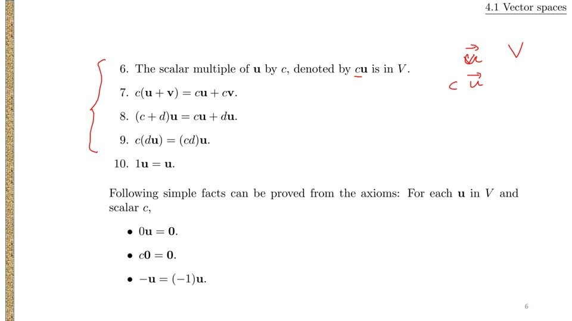

**Content — the remaining five axioms:**

6. $c\mathbf u$ is in $V$.
7. $c(\mathbf u + \mathbf v) = c\mathbf u + c\mathbf v$.
8. $(c + d)\mathbf u = c\mathbf u + d\mathbf u$.
9. $c(d\mathbf u) = (cd)\mathbf u$.
10. $1\mathbf u = \mathbf u$.

**Simple facts provable from the axioms** (for each $\mathbf u$ in $V$ and scalar $c$):
- $0\mathbf u = \mathbf 0$.
- $c\mathbf 0 = \mathbf 0$.
- $-\mathbf u = (-1)\mathbf u$.

> 🎙️ **Narration:** *"Here are the remaining five conditions: (6) the scalar multiple cu is in V; (7) distributive property c(u + v) = cu + cv; (8) (c + d)u = cu + du; (9) c(du) = (cd)u; (10) 1·u = u. If these conditions are satisfied, the space is called a vector space. And these are the other simple facts derived from the axioms: 0·u = 0, c·0 = 0, and the negative of a vector is (−1)·u."*

---

### 🎬 Slide 6 — Examples: $\mathbb{R}^n$ and Doubly-Infinite Sequences

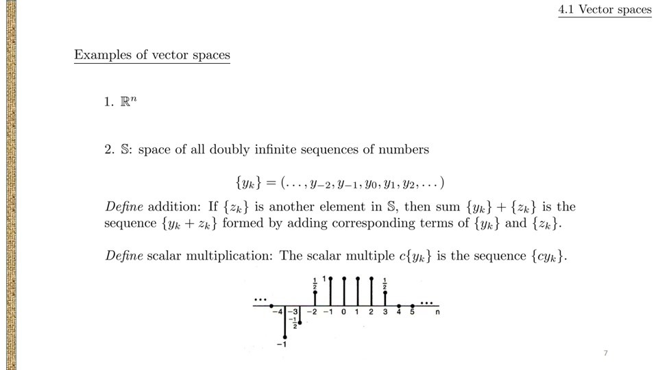

**Content — Examples of vector spaces:**

1. **$\mathbb{R}^n$** — vectors with $n$ real entries.
2. **$S$** — the space of all **doubly infinite sequences** of numbers:
   $$\{y_k\} = (\dots, y_{-2}, y_{-1}, y_0, y_1, y_2, \dots)$$
   - **Addition:** if $\{z_k\}$ is another element, the sum $\{y_k\} + \{z_k\}$ is the sequence $\{y_k + z_k\}$ (add corresponding terms).
   - **Scalar multiplication:** $c\{y_k\}$ is the sequence $\{cy_k\}$.

> 🎙️ **Narration:** *"Next we look at examples of vector spaces. We are familiar with ℝⁿ — a vector space containing vectors with n entries, each entry a real number. We can also have a vector space S of all doubly infinite sequences of numbers — from negative to plus infinity, denoted {yₖ}. Imagine a set of many such sequences: is that set a vector space, treating each sequence as a vector? We must define addition and scalar multiplication: if {zₖ} is another element, the sum is the sequence {yₖ + zₖ} formed by adding corresponding terms."*

---

### 🎬 Slide 7 — Sequences example (addition diagram)

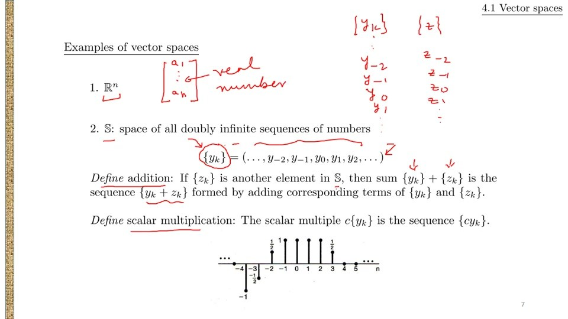

**Content:** *(figure showing the sequence space: adding $\{y_k\}$ and $\{z_k\}$ term-by-term, and scalar-multiplying a sequence.)*

> 🎙️ **Narration:** *"So we can define the sum of two sequences as the sum of corresponding terms. And we can also define scalar multiplication: c times the sequence {yₖ} is the sequence obtained by multiplying every element by c. You should go back and check whether the 10 axioms are satisfied by these sequences under these two operations."*

---

### 🎬 Slide 8 — Example: Polynomials $P_n$

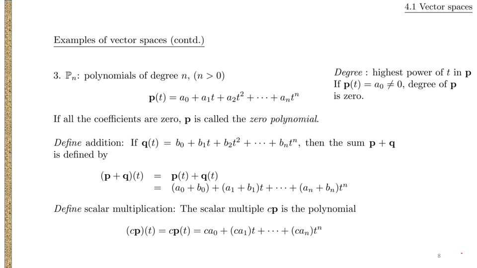

**Content — Example 3: $P_n$**, polynomials of degree $\le n$ ($n \ge 0$):

$$p(t) = a_0 + a_1 t + a_2 t^2 + \cdots + a_n t^n$$

- **Degree** = highest power of $t$ in $p$. If $p(t) = a_0 \neq 0$, the degree is zero. If all coefficients are zero, $p$ is the **zero polynomial**.
- **Addition:** if $q(t) = b_0 + b_1 t + \cdots + b_n t^n$, then $(p+q)(t) = p(t) + q(t) = (a_0+b_0) + (a_1+b_1)t + \cdots + (a_n+b_n)t^n$.
- **Scalar multiplication:** $(cp)(t) = cp(t) = ca_0 + (ca_1)t + \cdots + (ca_n)t^n$.

> 🎙️ **Narration:** *"Another example: Pₙ, the polynomials of degree n (n ≥ 0). I want to emphasize that 'vector space' does not only mean the column-matrix vectors you have seen — polynomials can also be vectors. The degree is the highest power of t in the polynomial. If all coefficients are zero, p is the zero polynomial — which matters because a vector space needs a zero vector. We define addition of polynomials and scalar multiplication (multiply every coefficient by c), and then test whether the axioms hold."*

---

### 🎬 Slide 9 — $P_n$ satisfies the axioms; nonlinear curve fitting

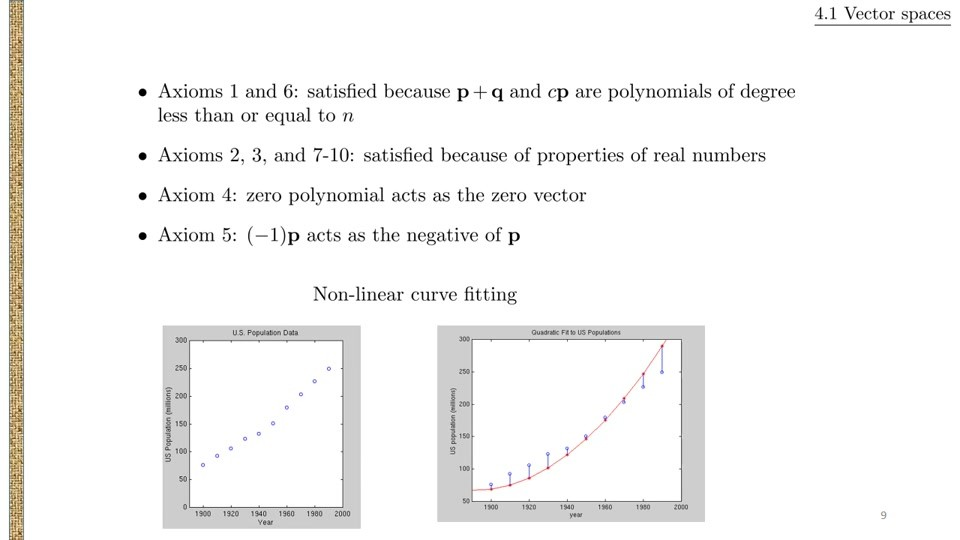

**Content — $P_n$ is a vector space:**

- **Axioms 1 and 6** — satisfied because $p + q$ and $cp$ are polynomials of degree $\le n$.
- **Axioms 2, 3 and 7–10** — satisfied because of properties of real numbers.
- **Axiom 4** — the zero polynomial acts as the zero vector.
- **Axiom 5** — $(-1)p$ acts as the negative of $p$.

*(Example of use: nonlinear curve fitting — fit a polynomial through known (year, population) points and read off unknown values.)*

> 🎙️ **Narration:** *"We test whether the axioms are true. Axioms 1 and 6 are satisfied because p + q and cp are polynomials of degree ≤ n. Axioms 2, 3 and 7–10 are satisfied because of the properties of real numbers — e.g. axiom 7, c(u + v) = cu + cv, holds because the result of multiplying a sum by c is the same as multiplying each term by c and adding. Axiom 4 is satisfied because the zero polynomial serves as the zero vector. Axiom 5 — multiplying by −1 gives the negative. Polynomials are used for nonlinear curve fitting: given year (x-axis) and population (y-axis), fit a polynomial curve and read off unknown values."*

---

### 🎬 Slide 10 — Example: Real-Valued Functions on a Set $D$

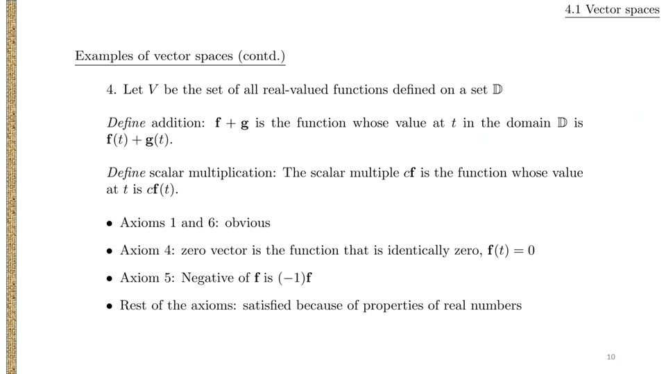

**Content — Example 4:** Let $V$ be the set of all real-valued functions defined on a set $D$:

- **Addition:** $f + g$ is the function whose value at $t$ in $D$ is $f(t) + g(t)$.
- **Scalar multiplication:** $cf$ is the function whose value at $t$ is $cf(t)$.

Axioms:
- **Axioms 1 and 6** — obvious.
- **Axiom 4** — zero vector is the function identically zero, $f(t) = 0$.
- **Axiom 5** — the negative of $f$ is $(-1)f$.
- **Rest of the axioms** — satisfied by properties of real numbers.

> 🎙️ **Narration:** *"Another example: even the space of real-valued functions defined on a set D is a vector space. Do not think of vectors only as arrows — we have seen sequences form a vector space, polynomials form a vector space, and now functions too. Define addition as f + g with value f(t) + g(t), and scalar multiplication cf(t). Axiom 6 is obvious (multiplying keeps the result in D); the zero vector is the function identically zero; the rest follow from properties of real numbers."*

---

### 🎬 Slide 11 — Thinking of vectors as points in a space

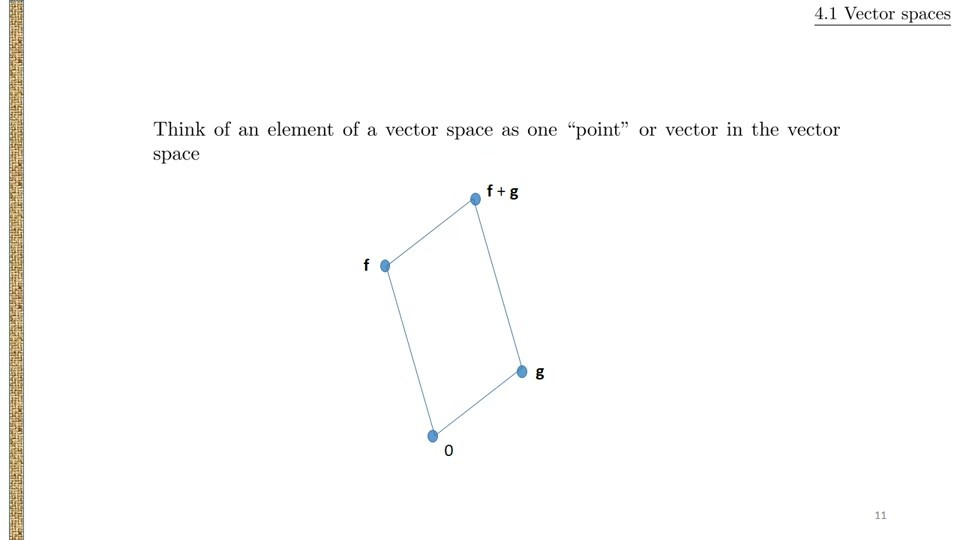

**Content — Think of an element of a vector space as one "point" or vector in the vector space.**

- A vector $\binom{x_1}{x_2}$ is a point in 2-D; $\begin{pmatrix} x_1 \\ x_2 \\ x_3 \end{pmatrix}$ a point in 3-D; and so on to $n$ entries (an $n$-dimensional space).
- In a vector space, the zero vector and vectors $f, g$ are points; $f + g$ is also in the space. We view $f$ and $g$ as points in a high-dimensional space.

> 🎙️ **Narration:** *"You should not think of a vector as only a matrix — there can be vectors in the form of functions, polynomials, sequences, and so on. But if you are looking at vectors as column matrices, you can think of a vector as one point in the vector space: (x₁, x₂) is a point in 2-D, (x₁, x₂, x₃) a point in 3-D, up to n entries in n-dimensional space. We just view f and g as points in a high-dimensional space — and because it is a vector space, f + g is also in the space."*

---

## V-4.2 — 4.2 Subspaces

### 🎬 Slide 1 — Definition of a Subspace

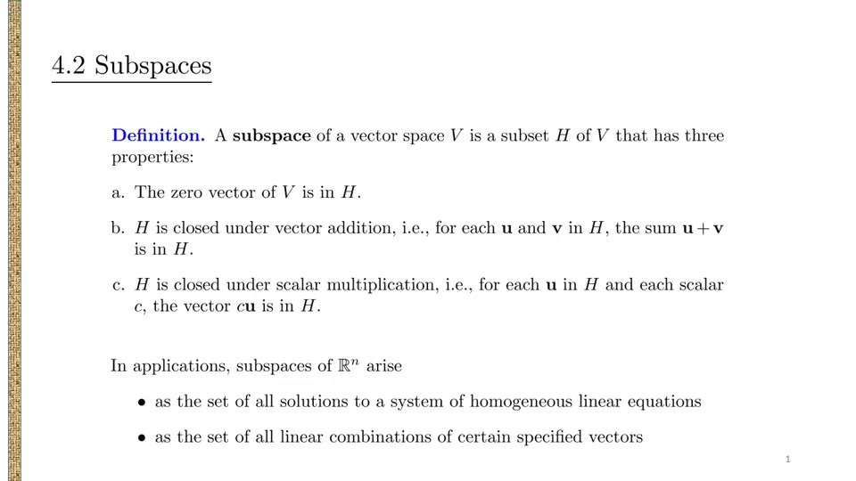

**Content — Definition.** A **subspace** of a vector space $V$ is a subset $H$ of $V$ that has three properties:

- **(a)** The **zero vector of $V$ is in $H$.**
- **(b)** $H$ is **closed under vector addition**: for each $\mathbf u, \mathbf v$ in $H$, the sum $\mathbf u + \mathbf v$ is in $H$.
- **(c)** $H$ is **closed under scalar multiplication**: for each $\mathbf u$ in $H$ and each scalar $c$, the vector $c\mathbf u$ is in $H$.

In applications, subspaces of $\mathbb{R}^n$ arise:
- as the set of all solutions to a system of **homogeneous** linear equations;
- as the set of all **linear combinations** of certain specified vectors.

> 🎙️ **Narration:** *"In the previous section we defined vector spaces; now we consider subspaces. A subspace of a vector space V is a subset H of V with three properties. (a) The zero vector of V is in H — since V is a vector space it contains a zero vector, and for a subspace that zero element must also be in H. (b) H is closed under vector addition: for each u and v in H, u + v is in H. (c) H is closed under scalar multiplication: for each u in H and scalar c, cu is in H. These are called 'closed under addition' and 'closed under scalar multiplication'."*

---

### 🎬 Slide 2 — A Subspace is Itself a Vector Space

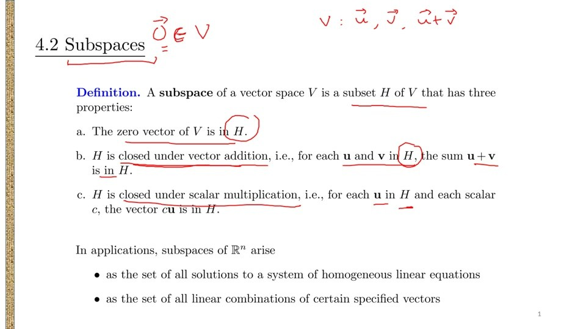

**Content —** A subspace $H$ of $V$ is **itself a vector space** under the operations already defined in $V$:

- **Axioms 1, 4 and 6** — the same as properties (a), (b) and (c).
- **Axioms 2, 3 and 7–10** — automatically true in $H$ because they apply to all elements of $V$, including those in $H$.
- **Axiom 5** — if $\mathbf u$ is in $H$, then $(-1)\mathbf u$ is in $H$ [by property (c) and $(-1)\mathbf u = -\mathbf u$].

> 🎙️ **Narration:** *"So the subspace H of V itself is going to be a vector space. Axioms 1, 4 and 6 are the same as conditions (a), (b) and (c); axioms 2, 3 and 7–10 are automatically true because they apply to all elements of V, including those in H. Finally, axiom 5: if u is in H, then (−1)u is in H (by property (c), since −u = (−1)u)."*

---

### 🎬 Slide 3 — Example: The Zero Subspace $\{\mathbf 0\}$

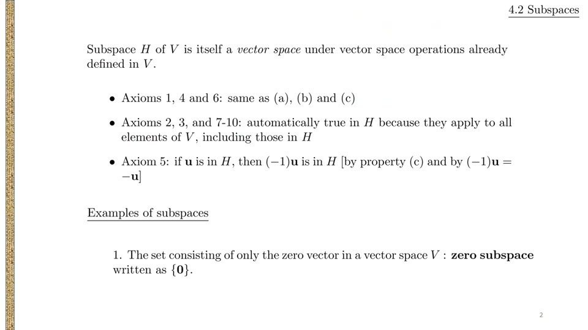

**Content — Examples of subspaces:**

1. The set consisting of only the **zero vector** in a vector space $V$ — the **zero subspace**, written $\{\mathbf 0\}$.

> 🎙️ **Narration:** *"Let's look at examples of subspaces. The set consisting only of the zero vector in V is called the zero subspace, written {0}. Any vector space must contain the zero vector. If you take a subset that does not contain the zero vector, it is not a subspace; but a subset that contains the zero vector is a subspace, because it contains the zero vector and satisfies the three conditions."*

---

### 🎬 Slide 4 — Examples: $P_n$ subspace of $P$; is $\mathbb{R}^2$ a subspace of $\mathbb{R}^3$?

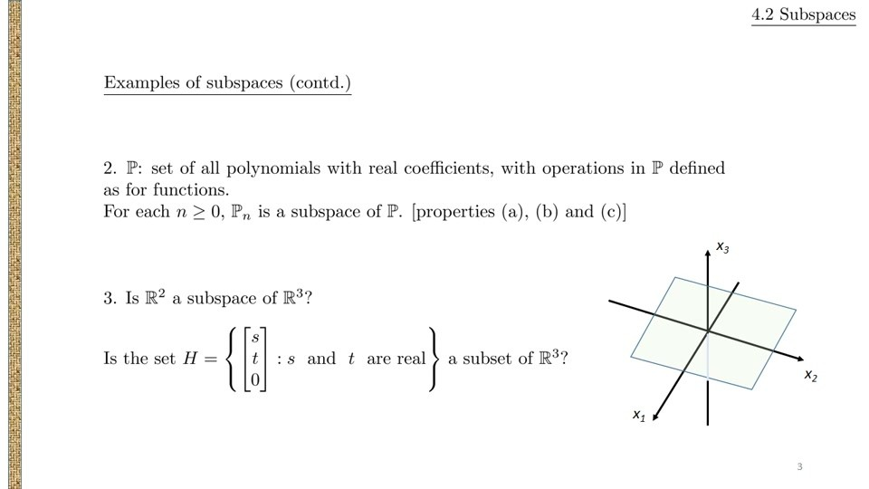

**Content — Examples of subspaces (contd.):**

2. **$P$** — set of all polynomials with real coefficients, with operations defined as for functions. For each $n \ge 0$, **$P_n$ is a subspace of $P$** [properties (a), (b), (c) hold].

3. **Is $\mathbb{R}^2$ a subspace of $\mathbb{R}^3$?** Is the set $H = \left\{ \begin{pmatrix} s \\ t \\ 0 \end{pmatrix} : s, t \text{ real} \right\}$ a subset of $\mathbb{R}^3$?

> 🎙️ **Narration:** *"When we looked at vector spaces we mentioned Pₙ, the polynomials of degree ≤ n. Consider P, the set of all polynomials with real coefficients, operations defined like functions. Then Pₙ is a subset of P that forms a subspace, because it satisfies all three conditions: add two polynomials in Pₙ and the result stays in Pₙ, multiply and it stays in Pₙ, and Pₙ contains the zero vector. Now a question: is ℝ² a subspace of ℝ³? An element of ℝ² is (x₁, x₂) while an element of ℝ³ is (x₁, x₂, x₃) — these are totally different things, so ℝ² is not even a subset of ℝ³, and obviously cannot be a subspace."*

---

### 🎬 Slide 5 — Subsets that live in $\mathbb{R}^3$

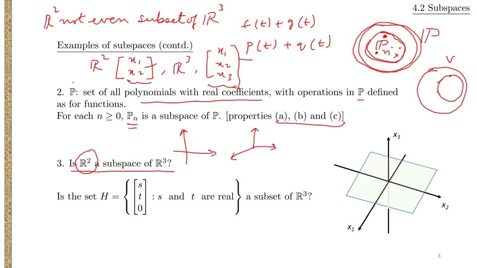

**Content — Examples of subspaces (contd.):**

- Since $\mathbb{R}^2$ is not even a subset of $\mathbb{R}^3$, the question of whether it is a subspace of $\mathbb{R}^3$ does not arise.
- But the set $H = \left\{ \begin{pmatrix} s \\ t \\ 0 \end{pmatrix} \right\}$ (all vectors with third coordinate 0) **is a subset of $\mathbb{R}^3$** — these vectors lie in a plane, but they have 3 entries, so they belong to $\mathbb{R}^3$, not $\mathbb{R}^2$. ($H$ is actually a subspace of $\mathbb{R}^3$ — verify the three conditions.)

> 🎙️ **Narration:** *"ℝ² is not even a subset of ℝ³, so the question of whether it is a subspace does not arise. Curiously, consider the set of vectors (s, t, 0) where s and t are real — these all lie in a plane (the z-coordinate is 0), but it is not ℝ²: you cannot say these belong to ℝ², they belong to ℝ³ because they have three entries. Yes, this set is a subset of ℝ³, and you can try to show that H is actually a subspace of ℝ³. So the answer here (ℝ² ⊆ ℝ³) is no, and the answer here is yes."*

---

## V-4.3 — 4.3 Subspace Spanned by a Set

### 🎬 Slide 1 — Recall Span + Exercise 4.3.1

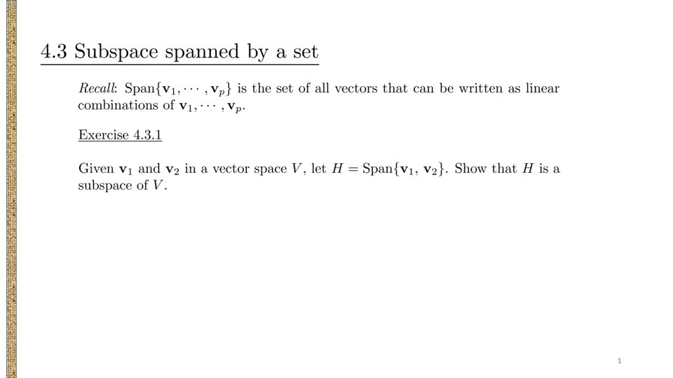

**Content — 4.3 Subspace spanned by a set:**

**Recall:** $\operatorname{Span}\{\mathbf v_1, \dots, \mathbf v_p\}$ is the set of all vectors that can be written as linear combinations of $\mathbf v_1, \dots, \mathbf v_p$.

**Exercise 4.3.1.** Given $\mathbf v_1$ and $\mathbf v_2$ in a vector space $V$, let $H = \operatorname{Span}\{\mathbf v_1, \mathbf v_2\}$. Show that $H$ is a subspace of $V$.

> 🎙️ **Narration:** *"In this section we introduce a term called 'subspace spanned by a set'. The span of a set of vectors is the set of all vectors that can be written as linear combinations of v₁ to vₚ. In the exercise: given v₁ and v₂ in V, let H = Span{v₁, v₂}. Taking all possible values of the weights a₁, a₂ and forming a₁v₁ + a₂v₂ generates the spanning set. The question is to show that this span is actually a subspace of V — recall the three conditions for a subspace: is the zero vector in it, is it closed under addition, is it closed under scalar multiplication."*

---

### 🎬 Slide 2 — Exercise 4.3.1: Proof (zero vector & closure under addition)

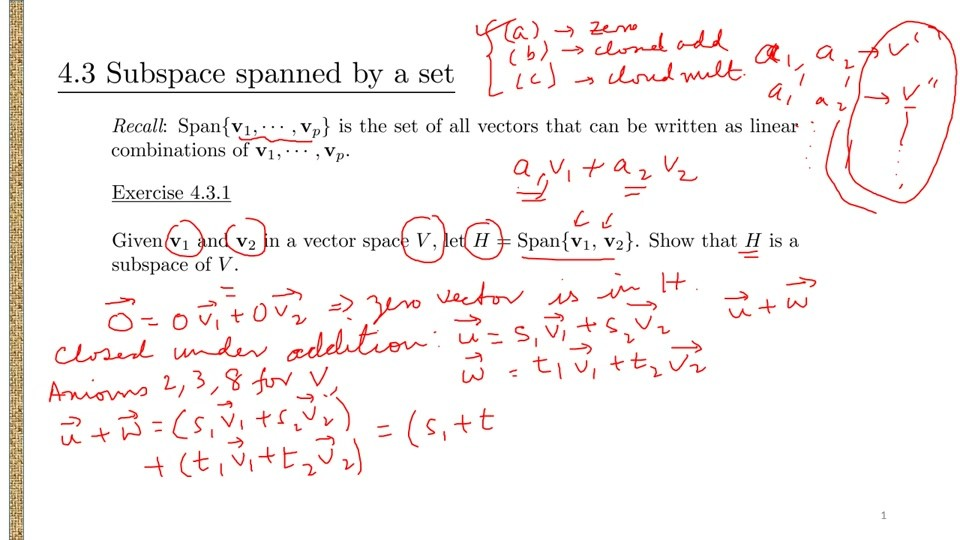

**Content — Checking the three subspace conditions for $H = \operatorname{Span}\{\mathbf v_1, \mathbf v_2\}$:**

- **Zero vector:** $\mathbf 0 = 0\mathbf v_1 + 0\mathbf v_2 \in H$. ✓
- **Closed under addition:** take $\mathbf u = s_1\mathbf v_1 + s_2\mathbf v_2$ and $\mathbf w = t_1\mathbf v_1 + t_2\mathbf v_2$ in $H$. Then
  $$\mathbf u + \mathbf w = (s_1 + t_1)\mathbf v_1 + (s_2 + t_2)\mathbf v_2 \in H.$$
- **Closed under scalar multiplication:** (next slide)

> 🎙️ **Narration:** *"First condition — the zero vector: can 0 be written as a linear combination of v₁ and v₂? Obviously yes: 0 = 0·v₁ + 0·v₂, so the zero vector is in H. Second condition — closure under addition: take two vectors in H, u = s₁v₁ + s₂v₂ and w = t₁v₁ + t₂v₂. Is u + w also a linear combination of v₁ and v₂? Using the vector-space axioms, u + w = (s₁v₁ + s₂v₂) + (t₁v₁ + t₂v₂) = (s₁ + t₁)v₁ + (s₂ + t₂)v₂ — a linear combination of v₁ and v₂, so u + w is in H."*

---

### 🎬 Slide 3 — Exercise 4.3.1: Closure under scalar multiplication + Theorem 4.1

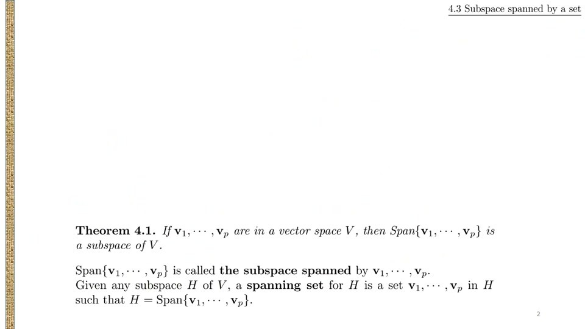

**Content —**

- **Closed under scalar multiplication:** for any scalar $c$,
  $$c\mathbf u = c(s_1\mathbf v_1 + s_2\mathbf v_2) = (cs_1)\mathbf v_1 + (cs_2)\mathbf v_2 \in H.$$
- All three conditions are satisfied ⇒ **$H$ is a subspace of $V$.**

**Theorem 4.1.** If $\mathbf v_1, \dots, \mathbf v_p$ are in a vector space $V$, then $\operatorname{Span}\{\mathbf v_1, \dots, \mathbf v_p\}$ is a **subspace** of $V$.

> 🎙️ **Narration:** *"Third condition — closure under scalar multiplication: multiply u by a scalar c. Using axioms 7 and 9, cu = c(s₁v₁ + s₂v₂) = cs₁v₁ + cs₂v₂ — again a linear combination of v₁ and v₂, so cu is in H. All three conditions are satisfied, so H is a subspace of V. What we have just said is written into the theorem: if v₁ … vₚ are in a vector space V, then Span{v₁ … vₚ} is a subspace of V."*

---

### 🎬 Slide 4 — Spanning Set Terminology

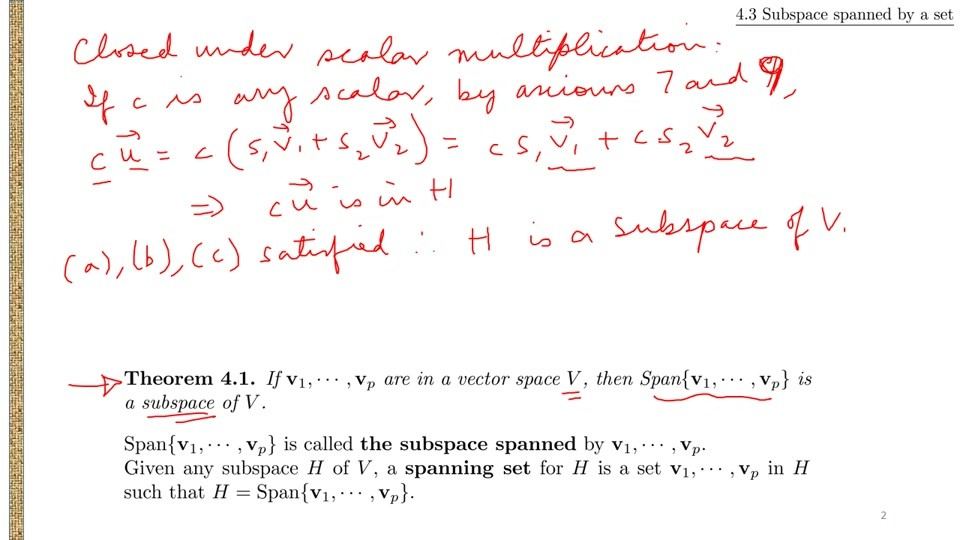

**Content — Terminology:**

- $\operatorname{Span}\{\mathbf v_1, \dots, \mathbf v_p\}$ is called the **subspace spanned by** $\mathbf v_1, \dots, \mathbf v_p$.
- Given any subspace $H$ of $V$, a **spanning set** for $H$ is a set $\{\mathbf v_1, \dots, \mathbf v_p\}$ in $H$ such that $H = \operatorname{Span}\{\mathbf v_1, \dots, \mathbf v_p\}$.

> 🎙️ **Narration:** *"A span of v₁ … vₚ is called the subspace spanned by v₁ … vₚ. Now given any subspace H of V, a spanning set for H is a set v₁ … vₚ in H such that H = Span{v₁ … vₚ}. We're not saying anything new — the idea is still the same."*

---

### 🎬 Slide 5 — Exercise 4.3.2

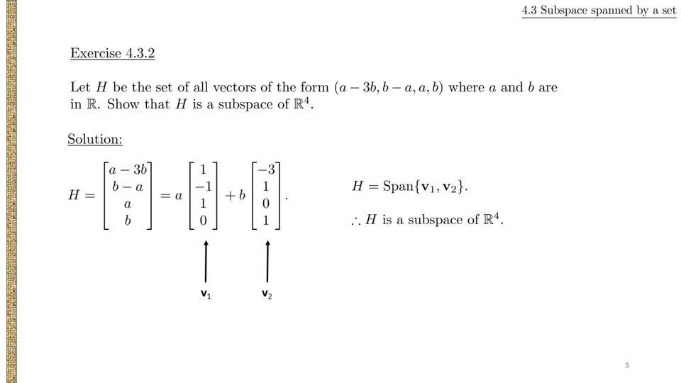

**Content — Exercise 4.3.2.** Let $H$ be the set of all vectors of the form $(a - 3b,\ b - a,\ a,\ b)$ where $a, b$ are in $\mathbb{R}$. Show that $H$ is a subspace of $\mathbb{R}^4$.

**Solution:**
$$H = \left\{ a\begin{pmatrix} 1 \\ -1 \\ 1 \\ 0 \end{pmatrix} + b\begin{pmatrix} -3 \\ 1 \\ 0 \\ 1 \end{pmatrix} : a, b \in \mathbb{R} \right\} = \operatorname{Span}\{\mathbf v_1, \mathbf v_2\}$$

Since $H$ is a span of two vectors, by Theorem 4.1, **$H$ is a subspace of $\mathbb{R}^4$**.

> 🎙️ **Narration:** *"We end the section with an exercise. Let H be the set of all vectors of the form (a − 3b, b − a, a, b), where a and b are real numbers. Show that H is a subspace of ℝ⁴. We can split the vector up: a(1, −1, 1, 0) + b(−3, 1, 0, 1) — call these v₁ and v₂. Then H is the set of all linear combinations of v₁ and v₂, i.e. H = Span{v₁, v₂}, which is a subspace of ℝ⁴ by the theorem."*

---

## V-4.4 — 4.4 The Null Space of a Matrix N(A)

### 🎬 Slide 1 — Homogeneous systems and the definition of N(A)

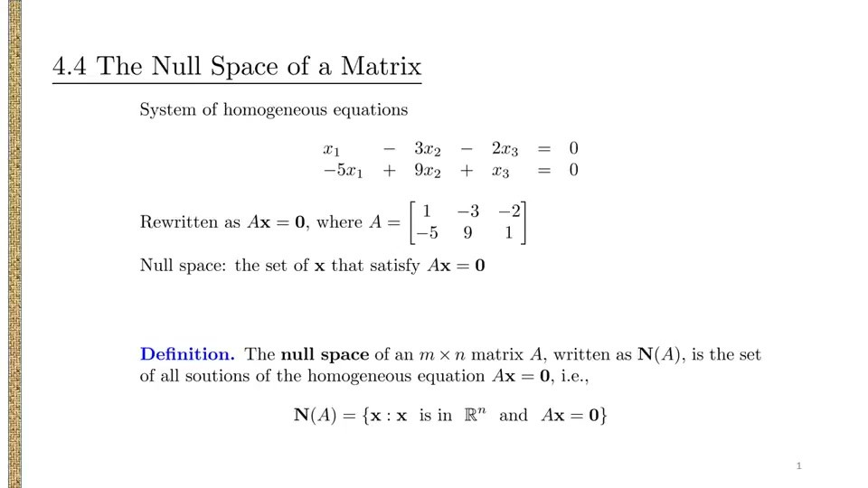

**Content — 4.4 The Null Space of a Matrix:**

System of homogeneous equations (e.g. $x_1 - 3x_2 - 2x_3 = 0,\ 5x_1 + 9x_2 + x_3 = 0$), rewritten as $A\mathbf x = \mathbf 0$.

**Definition.** The **null space** of an $m \times n$ matrix $A$, written $N(A)$, is the set of all solutions of the homogeneous equation $A\mathbf x = \mathbf 0$, i.e.
$$N(A) = \{\mathbf x : \mathbf x \text{ is in } \mathbb{R}^n \text{ and } A\mathbf x = \mathbf 0\}$$

> 🎙️ **Narration:** *"We have seen ℝⁿ many times. Now we look at subspaces of ℝⁿ — three specific subspaces that are closely related to the solutions of a system of homogeneous equations. Subspaces arise in two forms: as the set of all solutions to a system of homogeneous linear equations, and as the set of all linear combinations of certain vectors. The first subspace is the null space of a matrix. We start with a system of homogeneous equations, written as Ax = 0 where A is the coefficient matrix; the null space is the set of x satisfying Ax = 0 — formally, N(A) = {x in ℝⁿ : Ax = 0}."*

---

### 🎬 Slide 2 — Definition (contd.)

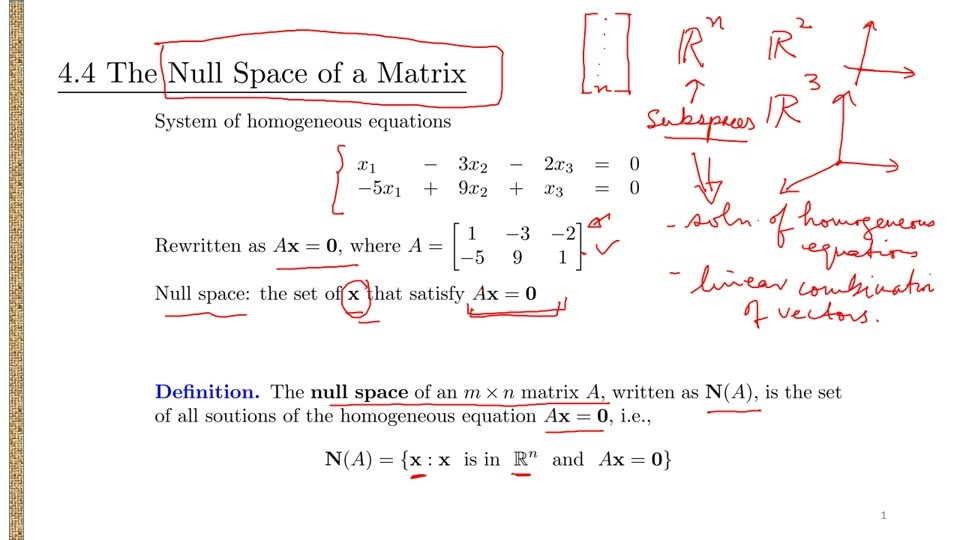

**Content:** Restates the definition — $N(A) = \{\mathbf x \in \mathbb{R}^n : A\mathbf x = \mathbf 0\}$, the set of all solutions of the homogeneous equation.

> 🎙️ **Narration:** *(The definition is restated on this slide.)*

---

### 🎬 Slide 3 — Mapping picture + Exercise 4.4.1

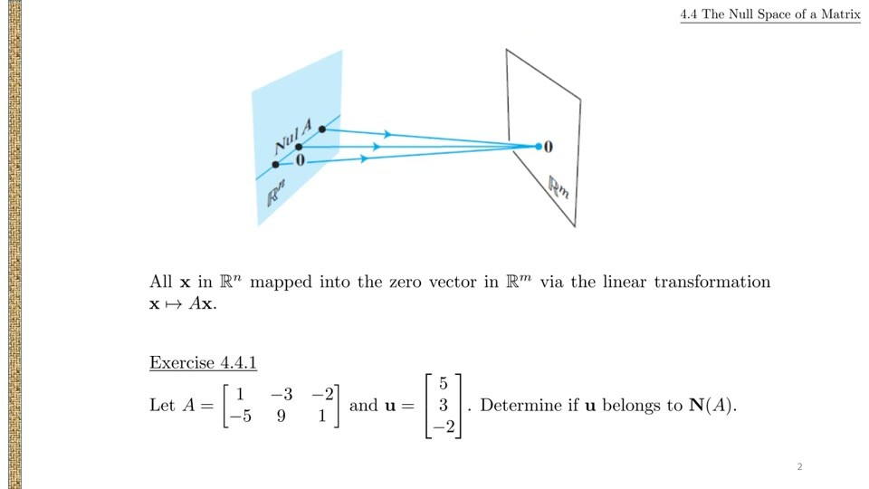

**Content —**

- **Picture:** all $\mathbf x$ in $\mathbb{R}^n$ are mapped into the zero vector in $\mathbb{R}^m$ via the linear transformation $\mathbf x \mapsto A\mathbf x$; the null space is the set of all such $\mathbf x$.

**Exercise 4.4.1.** Let $A = \begin{bmatrix} 1 & -3 \\ 3 & 9 \\ 5 & -1 \end{bmatrix}$ and $\mathbf u = \begin{pmatrix} 5 \\ 3 \\ -2 \end{pmatrix}$ *(as in the lecture)*. Determine whether $\mathbf u$ belongs to $N(A)$ — i.e. check whether $A\mathbf u = \mathbf 0$.

> 🎙️ **Narration:** *"This figure is similar to one from the first chapter — the domain and the codomain of the transformation. The null space of A is the set of all x that map to 0 in the codomain, i.e. all x in ℝⁿ mapped to the zero vector via x ↦ Ax. Short exercise: given the matrix A and a vector u, determine whether u belongs to N(A). Recall: if x is in the null space, then Ax = 0. So we multiply A by u; if the result is the zero vector, then u belongs to the null space of A. Computing it, you find the result is the zero vector, so u is in N(A)."*

---

### 🎬 Slide 4 — Exercise 4.4.2: describing a null space

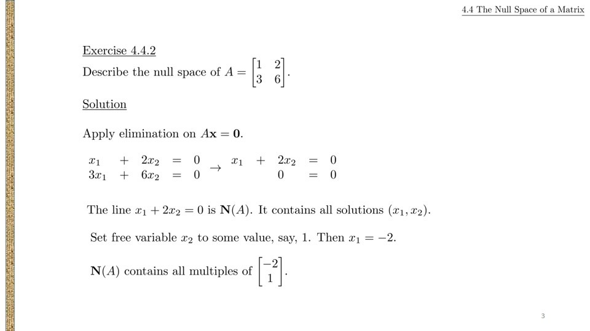

**Content — Exercise 4.4.2.** Describe the null space of $A = \begin{bmatrix} 1 & 2 \\ 3 & 6 \end{bmatrix}$.

**Solution.** Apply elimination on $A\mathbf x = \mathbf 0$: $x_1 + 2x_2 = 0$ and $0 = 0$. The line $x_1 + 2x_2 = 0$ is $N(A)$ — it contains all solutions $(x_1, x_2)$. Set the free variable $x_2 = 1$; then $x_1 = -2$. So $N(A)$ contains all multiples of $\begin{pmatrix} -2 \\ 1 \end{pmatrix}$.

*(Theorem — see below: the null space of an $m\times n$ matrix $A$ is a subspace of $\mathbb{R}^n$.)*

> 🎙️ **Narration:** *"Recall null spaces arise as solution sets of homogeneous systems, but also as linear combinations of vectors. In this exercise we describe the null space of A. Seeing 'null space', we know it is about Ax = 0, so we solve for x. Applying elimination gives x₁ + 2x₂ = 0 (and 0 = 0). The line x₁ + 2x₂ = 0 is the null space of A — it contains all solutions (x₁, x₂). Write the leading variable in terms of the free variable: x₁ = −2x₂. Set the free variable x₂ = 1; then x₁ = −2. So N(A) contains all multiples of (−2, 1). The previous results are collected into the theorem: the null space of an m × n matrix A is a subspace of ℝⁿ (equivalently, the set of all solutions of the system Ax = 0 of m homogeneous equations in n unknowns is a subspace of ℝⁿ). It will be proved in the live lectures."*

---

### 🎬 Slide 5 — Exercise 4.4.3: spanning set for N(A)

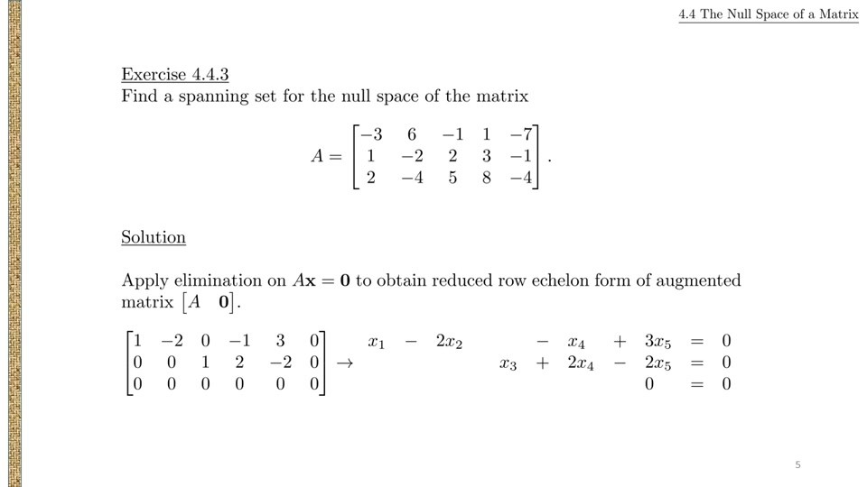

**Content — Exercise 4.4.3.** Find a spanning set for the null space of
$$A = \begin{bmatrix} -3 & 6 & -1 & 1 & -7 \\ 1 & -2 & 2 & 3 & 8 \\ 2 & -4 & 5 & 4 & 1 \end{bmatrix}$$

**Solution.** Apply elimination on $A\mathbf x = \mathbf 0$ to obtain the reduced row echelon form of the augmented matrix $[A \mid \mathbf 0]$:
$$\begin{bmatrix} 1 & -2 & 0 & -1 & 3 & 0 \\ 0 & 0 & 1 & 2 & -2 & 0 \\ 0 & 0 & 0 & 0 & 0 & 0 \end{bmatrix} \Rightarrow \begin{cases} x_1 - 2x_2 - x_4 + 3x_5 = 0 \\ x_3 + 2x_4 - 2x_5 = 0 \end{cases}$$

> 🎙️ **Narration:** *"Next: find the spanning set for the null space of the matrix. First we must find the null space, then write its spanning set. As before, apply elimination on Ax = 0 to get the reduced row echelon form of the augmented matrix [A 0], then write the corresponding system of equations."*

---

### 🎬 Slide 6 — Exercise 4.4.3 (steps)

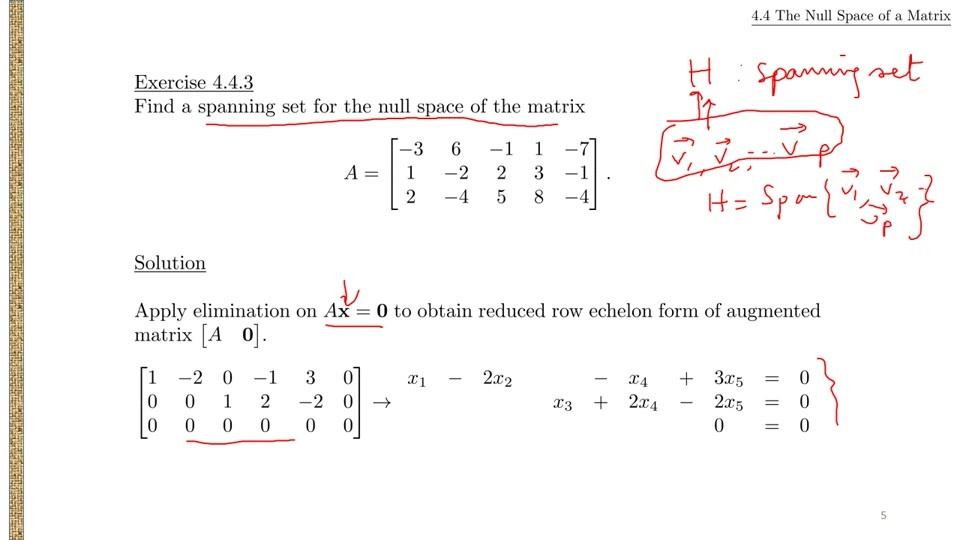

**Content:** *(the elimination steps: row-reducing $[A \mid \mathbf 0]$ to RREF; then write the leading variables in terms of the free variables.)*

> 🎙️ **Narration:** *"Once we have the reduced row echelon form, we write the corresponding system of equations, and the next step is to write the leading variables in terms of the free variables."*

---

### 🎬 Slide 7 — General solution

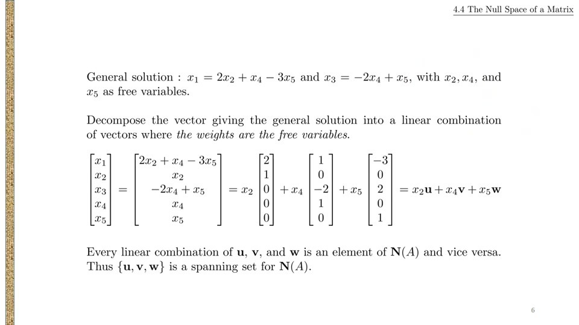

**Content:** Writing the leading variables in terms of the free variables gives the general solution, with $x_2, x_4, x_5$ free:
$$x_1 = 2x_2 + x_4 - 3x_5, \qquad x_3 = -2x_4 + 2x_5, \qquad x_2, x_4, x_5 \text{ free}$$

The general solution vector $\mathbf x = (x_1, x_2, x_3, x_4, x_5)$ lies in $N(A)$.

> 🎙️ **Narration:** *"Writing the leading variables in terms of the free variables gives the general solution: x₁ = 2x₂ + x₄ − 3x₅ and x₃ = −2x₄ + 2x₅, where x₂, x₄, x₅ are free. This x is in the null space of A. To get the spanning set we decompose the general solution vector into a linear combination of vectors."*

---

### 🎬 Slide 8 — Spanning set: decomposing into u, v, w

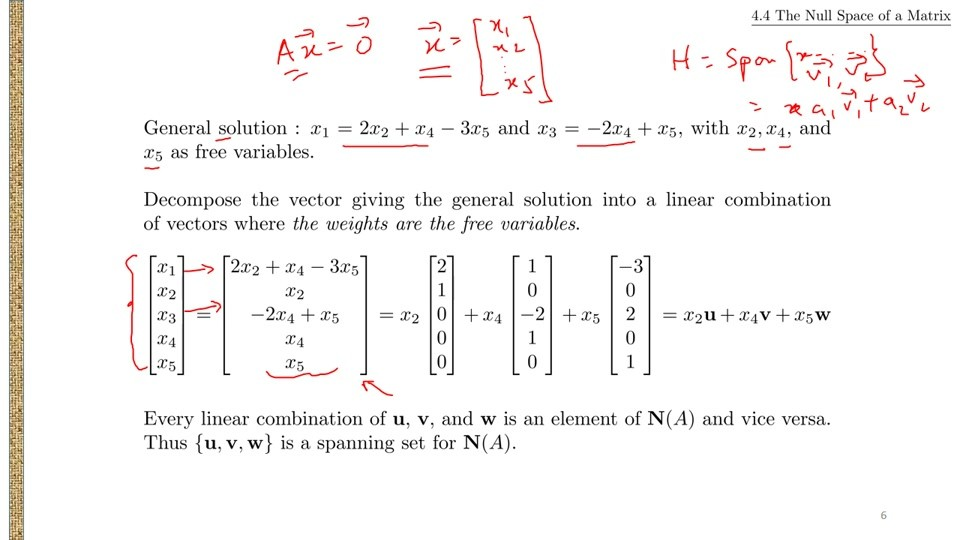

**Content — Spanning set for N(A):**

Write $\mathbf x$ as a linear combination of vectors with $x_2, x_4, x_5$ as weights:
$$\mathbf x = \begin{pmatrix} 2x_2 + x_4 - 3x_5 \\ x_2 \\ -2x_4 + 2x_5 \\ x_4 \\ x_5 \end{pmatrix} = x_2 \begin{pmatrix} 2 \\ 1 \\ 0 \\ 0 \\ 0 \end{pmatrix} + x_4 \begin{pmatrix} 1 \\ 0 \\ -2 \\ 1 \\ 0 \end{pmatrix} + x_5 \begin{pmatrix} -3 \\ 0 \\ 2 \\ 0 \\ 1 \end{pmatrix} = x_2\mathbf u + x_4\mathbf v + x_5\mathbf w$$

Every linear combination of $\mathbf u, \mathbf v, \mathbf w$ is in $N(A)$, so $\{\mathbf u, \mathbf v, \mathbf w\}$ is a **spanning set** for $N(A)$.

> 🎙️ **Narration:** *"We decompose the general solution vector into three vectors by pulling out x₂, x₄, x₅ as weights. So the vector becomes x₂·u + x₄·v + x₅·w. Every linear combination of u, v, w is an element of the null space of A, and therefore {u, v, w} is a spanning set for the null space of A."*

---

## V-4.5 — 4.5 The Column Space of a Matrix C(A)

### 🎬 Slide 1 — Column Space: Definition & Theorem 4.3 (V-4.5a)

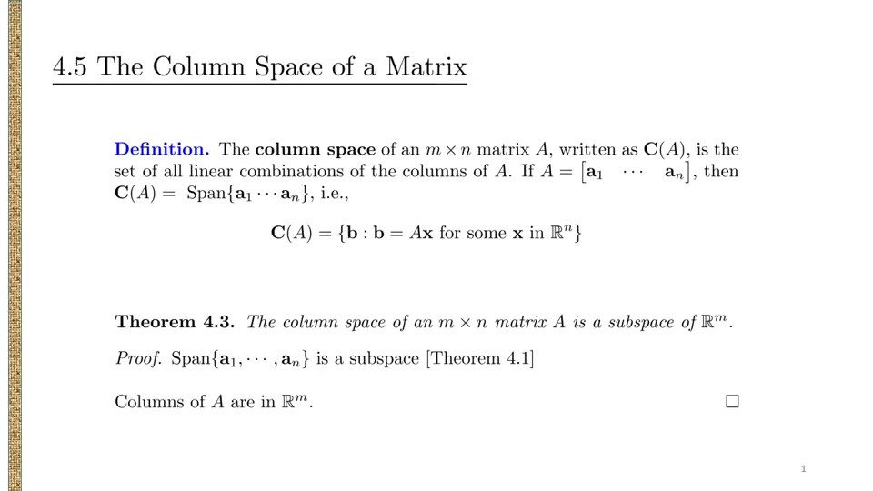

**Content — 4.5 The Column Space of a Matrix:**

**Definition.** The **column space** of an $m \times n$ matrix $A$, written $C(A)$, is the set of all linear combinations of the columns of $A$. If $A = [\mathbf a_1 \ \dots \ \mathbf a_n]$, then $C(A) = \operatorname{Span}\{\mathbf a_1, \dots, \mathbf a_n\}$.

**Theorem 4.3.** The column space of an $m \times n$ matrix $A$ is a **subspace of $\mathbb{R}^m$**.

**Proof.** $\operatorname{Span}\{\mathbf a_1, \dots, \mathbf a_n\}$ is a subspace [by Theorem 4.1].

> 🎙️ **Narration:** *"In this section we look at the second type of subspace of ℝⁿ — the column space of a matrix. Definition: the column space of an m × n matrix A, written C(A), is the set of all linear combinations of the columns of A. If A = [a₁ a₂ … aₙ], then the column space consists of all linear combinations of these columns — which is just their span. Equivalently, C(A) = {b : b = Ax for some x in ℝⁿ}, since Ax = x₁a₁ + x₂a₂ + ⋯ is exactly a linear combination of the columns. This connects the linear system Ax = b to the column space. The theorem: the column space of an m × n matrix A is a subspace of ℝᵐ. By Theorem 4.1, the span of vectors forms a subspace; and the columns of A are vectors in ℝᵐ (m entries each). Together these prove the theorem."*

---

### 🎬 Slide 2 — C(A) = ℝᵐ ⇔ Ax = b solvable; example (V-4.5a)

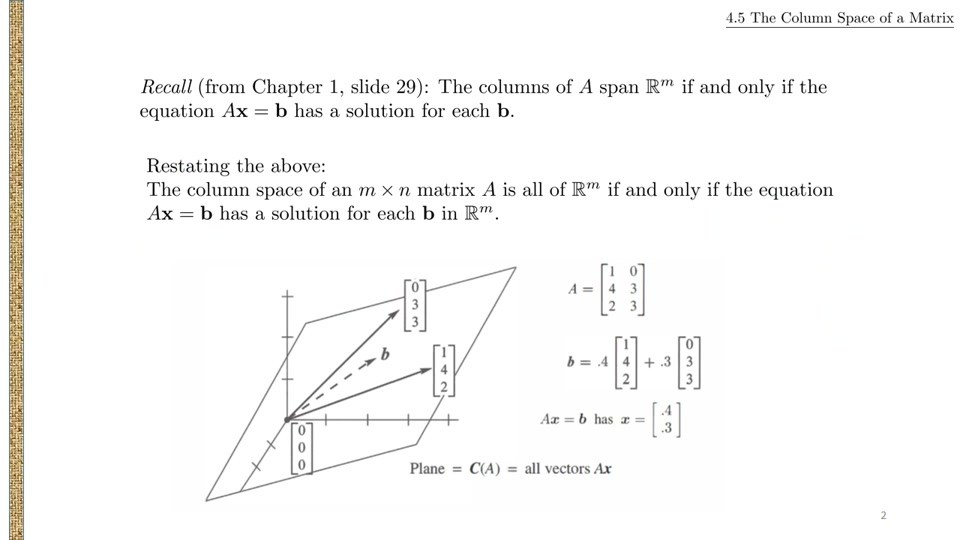

**Content —**

**Restatement:** the column space of an $m \times n$ matrix $A$ is **all of $\mathbb{R}^m$** if and only if the equation $A\mathbf x = \mathbf b$ has a solution for **each** $\mathbf b$ in $\mathbb{R}^m$ (recall the Chapter-1 theorem: columns of $A$ span $\mathbb{R}^m$ ⇔ $A\mathbf x = \mathbf b$ is consistent for every $\mathbf b$).

**Example.** $A = \begin{bmatrix} 1 & 0 \\ 4 & 3 \\ 2 & 3 \end{bmatrix}$ is $3 \times 2$ ($m=3, n=2$). Columns $\mathbf a_1 = (1,4,2)$, $\mathbf a_2 = (0,3,3)$. The column space is the set of all $A\mathbf x = x_1\mathbf a_1 + x_2\mathbf a_2$ — every such linear combination lies in the **plane** spanned by $\mathbf a_1$ and $\mathbf a_2$. So $C(A)$ is that plane in $\mathbb{R}^3$ (not all of $\mathbb{R}^3$).

> 🎙️ **Narration:** *"Recall from Chapter 1: the columns of A span ℝᵐ if and only if Ax = b has a solution for each b. Restated: C(A) = all of ℝᵐ if and only if Ax = b has a solution for every b in ℝᵐ. To be clear, consider a 3 × 2 example — A with columns (1, 4, 2) and (0, 3, 3). Here m = 3, n = 2, so C(A) is a subspace of ℝ³. Any linear combination of the two columns lies on the plane spanned by them, so the column space C(A) is that plane — the set of all vectors Ax."*

---

### 🎬 Slide 3 — Exercise 4.5.1: N(A) vs C(A) for a 3×4 matrix (V-4.5b)

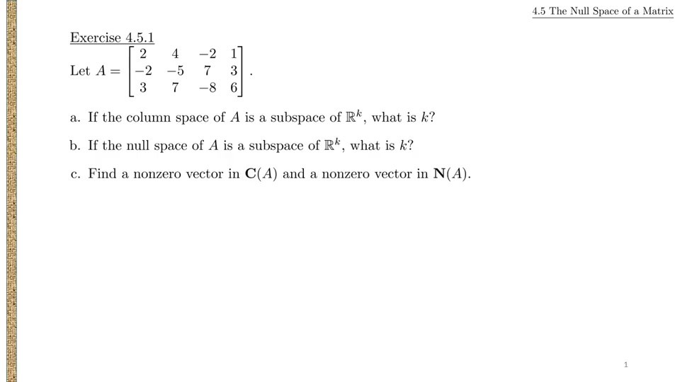

**Content — Exercise 4.5.1.** Let $A$ be a $3 \times 4$ matrix ($m=3$, $n=4$).

- **(a)** If $C(A)$ is a subspace of $\mathbb{R}^k$, what is $k$? → **$k = 3$** (each column has 3 entries, so linear combinations of columns are in $\mathbb{R}^3$).
- **(b)** If $N(A)$ is a subspace of $\mathbb{R}^k$, what is $k$? → **$k = 4$** (the solution $\mathbf x$ of $A\mathbf x = \mathbf 0$ has 4 entries, so $N(A) \subseteq \mathbb{R}^4$).

> 🎙️ **Narration:** *"An exercise relating the column space and null space. A has three rows and four columns, so m = 3 and n = 4. (a) If C(A) is a subspace of ℝᵏ, what is k? The column space is the set of all linear combinations of the columns. Each column has only three entries, so any linear combination is a 3 × 1 vector — in ℝ³. Hence k = 3. (b) If N(A) is a subspace of ℝᵏ, what is k? The null space is the set of x such that Ax = 0. A is 3 × 4, so x must be 4 × 1 — x is in ℝ⁴, so k = 4."*

---

### 🎬 Slide 4 — Exercise 4.5.1 (contd.): a nonzero vector in C(A)

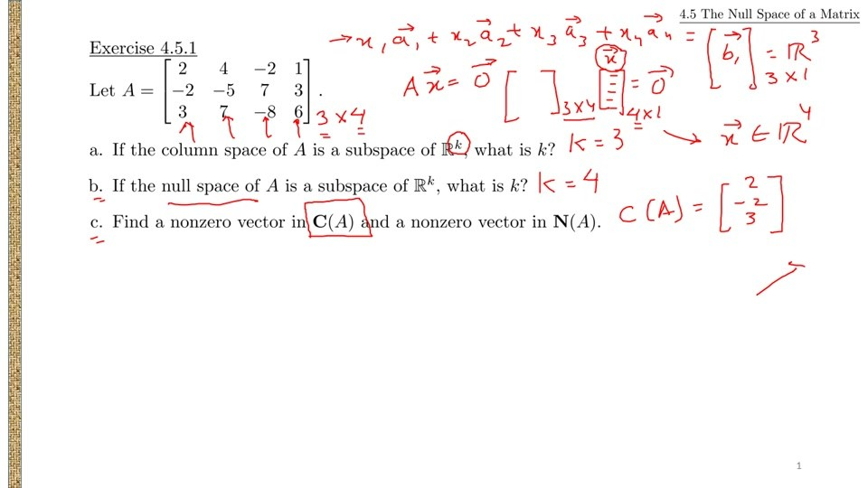

**Content —** Find a **non-zero vector in $C(A)$.**

- Any column of $A$ is itself in $C(A)$ (it is a linear combination — weight 1 on that column, 0 on the others). E.g. one of the columns works.
- This relates to the previous example: the column space of a matrix with two columns was the plane containing those two columns, and either column is a non-zero vector in that space.

> 🎙️ **Narration:** *"Find a non-zero vector in the column space of A. Since C(A) is all linear combinations of the columns, any column itself is in C(A) — e.g. taking x₁ = 1 and x₂ = x₃ = x₄ = 0 just picks the first column. This relates to the earlier example: the column space of that 3 × 2 matrix was the plane containing its two columns, and either column is a non-zero vector in that column space."*

---

### 🎬 Slide 5 — Exercise 4.5.1 (contd.): a nonzero vector in N(A)

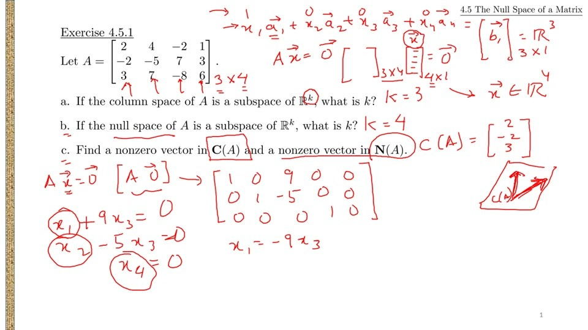

**Content — Find a non-zero vector in $N(A)$** (solve $A\mathbf x = \mathbf 0$).

Row-reduce $[A \mid \mathbf 0]$ to RREF:
$$\begin{bmatrix} 1 & 0 & 9 & 0 & 0 \\ 0 & 1 & -5 & 0 & 0 \\ 0 & 0 & 0 & 1 & 0 \end{bmatrix} \Rightarrow \begin{cases} x_1 + 9x_3 = 0 \\ x_2 - 5x_3 = 0 \\ x_4 = 0 \end{cases}$$

Leading variables in terms of the free variable $x_3$:
$$x_1 = -9x_3, \quad x_2 = 5x_3, \quad x_4 = 0$$

Choose $x_3 = -1$: $\mathbf x = (9, -5, -1, 0)$ is one non-zero vector in $N(A)$.

> 🎙️ **Narration:** *"Now find a non-zero vector in the null space of A — solve Ax = 0. Form the augmented matrix and reduce to RREF: we get rows [1 0 9 0 0], [0 1 −5 0 0], [0 0 0 1 0]. The system is x₁ + 9x₃ = 0, x₂ − 5x₃ = 0, x₄ = 0. Writing leading variables in terms of the free variable x₃: x₁ = −9x₃, x₂ = 5x₃, x₄ = 0. Choose x₃ = −1; then (9, −5, −1, 0) is one non-zero vector in the null space of A — not the whole null space, just one vector in it."*

---

### 🎬 Slide 6 — Exercise 4.5.1 (contd.): is u in N(A) or C(A)?

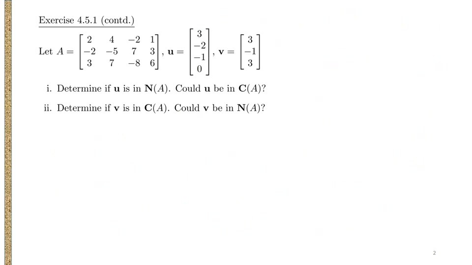

**Content —** Given a vector $\mathbf u$ (4 entries, as on the slide):

- **Is $\mathbf u \in N(A)$?** Compute $A\mathbf u$; the result is $\begin{pmatrix} 0 \\ -3 \\ 3 \end{pmatrix} \neq \mathbf 0$ ⇒ $\mathbf u$ is **not** in $N(A)$.
- **Could $\mathbf u$ be in $C(A)$?** No — vectors in $C(A) \subseteq \mathbb{R}^3$ have 3 entries, but $\mathbf u$ has 4 entries.

> 🎙️ **Narration:** *"The next subparts ask: is u in the null space of A? We just check whether Au = 0. Computing A times u gives (0, −3, 3), which is not the zero vector, so u is not in the null space of A. Could u be in the column space of A? Vectors in C(A) are linear combinations of the columns, which have three entries — so C(A) consists of 3-entry vectors, a subspace of ℝ³. But u has four entries, so u cannot be in the column space of A."*

---

### 🎬 Slide 7 — Exercise 4.5.1 (contd.): is v in C(A) or N(A)?

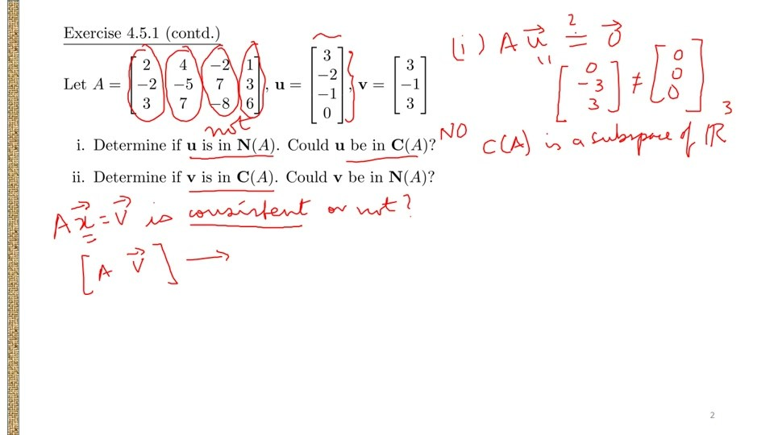

**Content —** Given a vector $\mathbf v$ (3 entries, as on the slide):

- **Is $\mathbf v \in C(A)$?** Check if $A\mathbf x = \mathbf v$ is consistent. Form $[A \mid \mathbf v]$ and reduce to echelon form; it has a **pivot in every row** ⇒ consistent ⇒ $\mathbf v$ **is** in $C(A)$.
- **Could $\mathbf v$ be in $N(A)$?** No — $N(A) \subseteq \mathbb{R}^4$ needs 4-entry vectors, but $\mathbf v$ has 3 entries.

> 🎙️ **Narration:** *"Is v in the column space of A? That means some linear combination of the columns of A equals v — i.e. there exists x with Ax = v. Using Chapter-1 language, we check whether the system Ax = v is consistent. Form the augmented matrix [A v] and reduce to echelon form — we are only checking consistency, not solving. The echelon form has a pivot in every row, so the system is consistent, and hence v is in the column space of A. Could v be in the null space of A? For that we would need Av = 0 with v a 4 × 1 vector, but v is 3 × 1. Since N(A) is a subspace of ℝ⁴ and v is in ℝ³, v cannot be in the null space of A."*

---

### 🎬 Slide 8 — Summary: comparing N(A) and C(A)

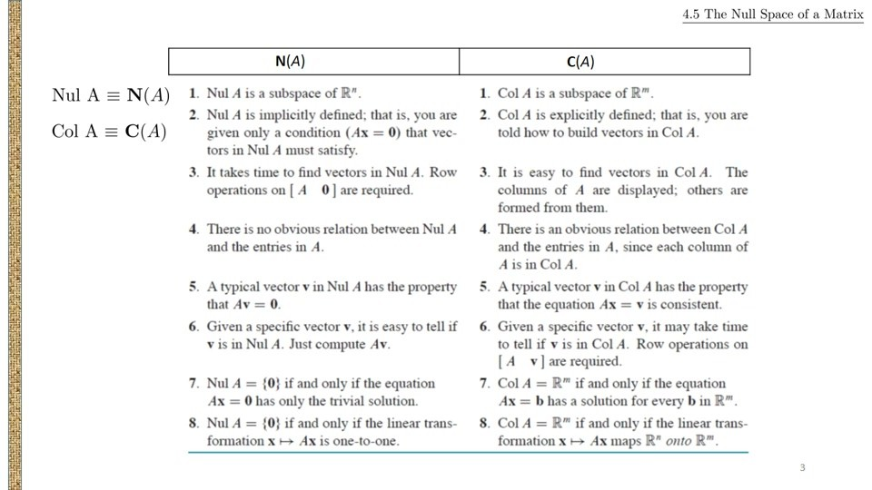

**Content —** A comparison table of $N(A)$ (null space) and $C(A)$ (column space) for an $m \times n$ matrix $A$: their definitions, which space they live in ($N(A) \subseteq \mathbb{R}^n$, $C(A) \subseteq \mathbb{R}^m$), what they are spanned by, etc.

> 🎙️ **Narration:** *"In this slide we compare and contrast the null space and the column space of a matrix. There is nothing new being said — go through each point comparing N(A) and C(A) and understand the properties of each."*

---

## V-4.6 — 4.6 Kernel and Range of a Linear Transformation

### 🎬 Slide 1 — Generalizing linear transformations to vector spaces

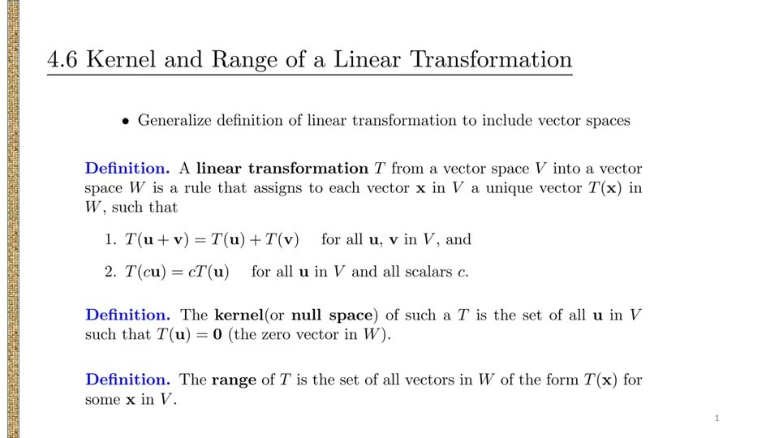

**Content — 4.6 Kernel and Range of a Linear Transformation:**

**Definition.** A **linear transformation** $T$ from a vector space $V$ into a vector space $W$ is a rule that assigns to each vector $\mathbf x$ in $V$ a unique vector $T(\mathbf x)$ in $W$, such that
1. $T(\mathbf u + \mathbf v) = T(\mathbf u) + T(\mathbf v)$ for all $\mathbf u, \mathbf v$ in $V$, and
2. $T(c\mathbf u) = cT(\mathbf u)$ for all $\mathbf u$ in $V$ and all scalars $c$.

**Definition.** The **kernel** (or **null space**) of such a $T$ is the set of all $\mathbf u$ in $V$ such that $T(\mathbf u) = \mathbf 0$ (the zero vector in $W$).

**Definition.** The **range** of $T$ is the set of all vectors in $W$ of the form $T(\mathbf x)$ for some $\mathbf x$ in $V$.

> 🎙️ **Narration:** *"In this section we revisit linear transformations and generalize their definition to include vector spaces. So far we talked about individual vectors x being transformed by a matrix A. Generalizing: a linear transformation T from a vector space V into a vector space W assigns to each x in V a unique T(x) in W such that the two conditions hold — these are the same two conditions as before (T(u+v) = T(u)+T(v), T(cu) = cT(u)), so nothing is new; we are formalizing to include vector spaces. Two new terms: the kernel or null space of T is the set of all u in V such that T(u) = 0 (the zero vector in W); the range of T is the set of all vectors in W of the form T(x) for some x in V. These are analogous to Ax = 0 and Ax = b — the only difference is we now speak in terms of the transformation T, which is represented by the matrix A."*

---

### 🎬 Slide 2 — Kernel and Range (with figure)

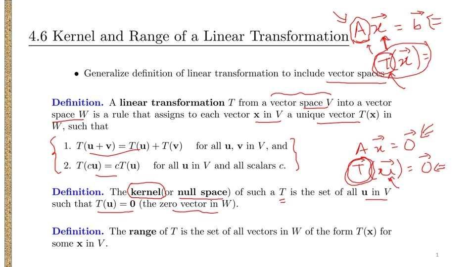

**Content:** Restates the definitions (kernel = {$\mathbf u \in V : T(\mathbf u) = \mathbf 0$}, range = {$\mathbf x$ images in $W$}) with the domain/codomain picture.

> 🎙️ **Narration:** *(The definitions of kernel and range are restated with the picture of the transformation V → W.)*

---

### 🎬 Slide 3 — Kernel = N(A), Range = C(A)

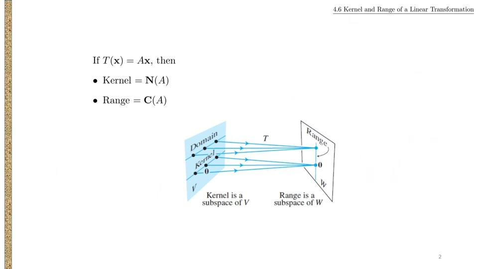

**Content —** If $T(\mathbf x) = A\mathbf x$, then:
- **Kernel = N(A)** — a subspace of $V$.
- **Range = C(A)** — a subspace of $W$.

> 🎙️ **Narration:** *"We already know Ax = 0 means x is in the null space of A, and linear combinations of the columns form the column space of A. So if T(x) = Ax, then the null space of A is the kernel of the transformation, and the column space of A is the range of the transformation. Visually: the kernel consists of those vectors in V that map to zero, and the range is the linear combination of all the columns of the matrix representing T. So the kernel is a subspace of V and the range is a subspace of W."*

---

## V-4.7a — 4.7 Bases: Linear Independence in Vector Spaces

### 🎬 Slide 1 — Linear independence revisited

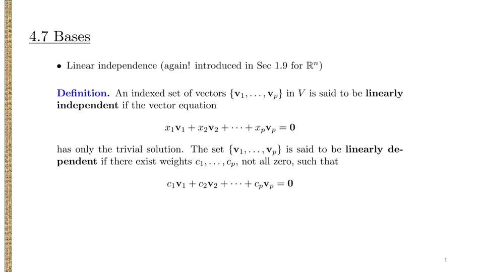

**Content — 4.7 Bases:**

**Definition.** An **indexed set of vectors** $\{\mathbf v_1, \dots, \mathbf v_p\}$ in $V$ is said to be **linearly independent** if the vector equation
$$x_1\mathbf v_1 + x_2\mathbf v_2 + \cdots + x_p\mathbf v_p = \mathbf 0$$
has only the **trivial solution** ($x_1 = x_2 = \cdots = x_p = 0$). The set is **linearly dependent** if there exist weights $c_1, \dots, c_p$, **not all zero**, such that $c_1\mathbf v_1 + \cdots + c_p\mathbf v_p = \mathbf 0$.

> 🎙️ **Narration:** *"In this section we introduce a new term, basis — although the term may be new, you have already seen bases in previous classes. But first, let's come back to linear independence, introduced in section 1.9 for vectors with n entries. Now, since we are familiar with vector spaces, the definition is not different: an indexed set of vectors v₁ … vₚ in the vector space V is linearly independent if the vector equation x₁v₁ + ⋯ + xₚvₚ = 0 has only the trivial solution (all xᵢ = 0). The set is linearly dependent if there exist weights c₁ … cₚ, not all zero, making the equation true."*

---

### 🎬 Slide 2 — Special cases of dependence

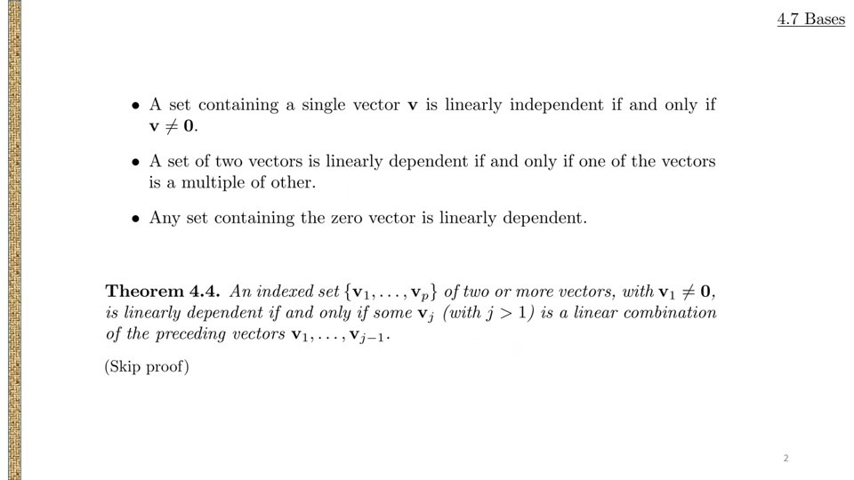

**Content — Special cases:**

- **A single vector $\{\mathbf v\}$** is linearly independent **iff** $\mathbf v \neq \mathbf 0$ (since $c\mathbf v = \mathbf 0$ forces $c = 0$ only when $\mathbf v \neq \mathbf 0$).
- **A set of two vectors** is linearly dependent **iff** one vector is a **multiple** of the other.
- **Any set containing the zero vector** is linearly dependent (choose $c_1 \neq 0$ on the zero vector).

> 🎙️ **Narration:** *"Some special cases. A set with a single vector v is linearly independent if and only if v ≠ 0 — because c₁v₁ = 0 then forces c₁ = 0. A set of two vectors is linearly dependent if and only if one is a multiple of the other: from c₁v₁ + c₂v₂ = 0 with c₂ ≠ 0, we get v₂ = −(c₁/c₂)v₁. And any set containing the zero vector is linearly dependent, since the zero vector can be weighted by any nonzero c₁."*

---

### 🎬 Slide 3 — Theorem 4.4: characterization of linear dependence

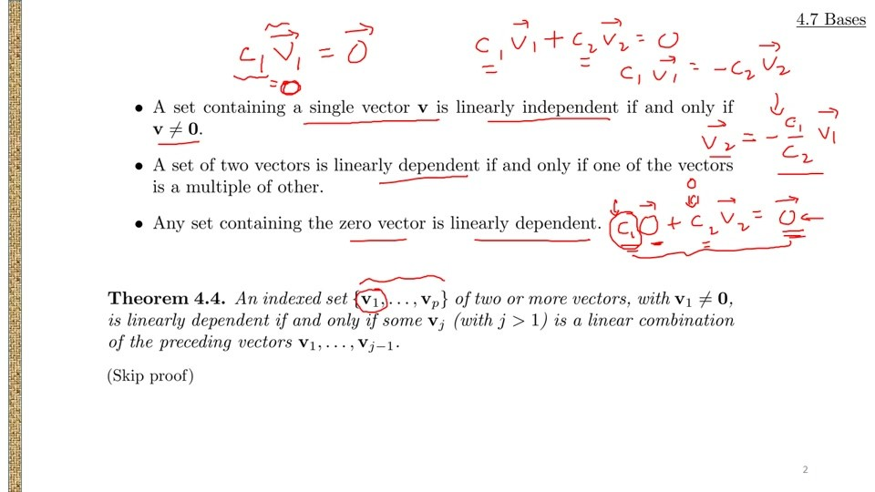

**Content — Theorem 4.4.** An indexed set $\{\mathbf v_1, \dots, \mathbf v_p\}$ of **two or more** vectors, with $\mathbf v_1 \neq \mathbf 0$, is **linearly dependent iff some $\mathbf v_j$** ($j > 1$) **is a linear combination of the preceding vectors** $\mathbf v_1, \dots, \mathbf v_{j-1}$.

> 🎙️ **Narration:** *"A set containing the zero vector has to be linearly dependent, and that leads to Theorem 4.4: an indexed set of two or more vectors with v₁ ≠ 0 is linearly dependent if and only if some vⱼ (j > 1) is a linear combination of the preceding vectors v₁ … vⱼ₋₁. For example, if v₃ can be written as a linear combination of v₁ and v₂, then the set {v₁, v₂, v₃} is linearly dependent."*

---

### 🎬 Slide 4 — Examples: polynomials and functions

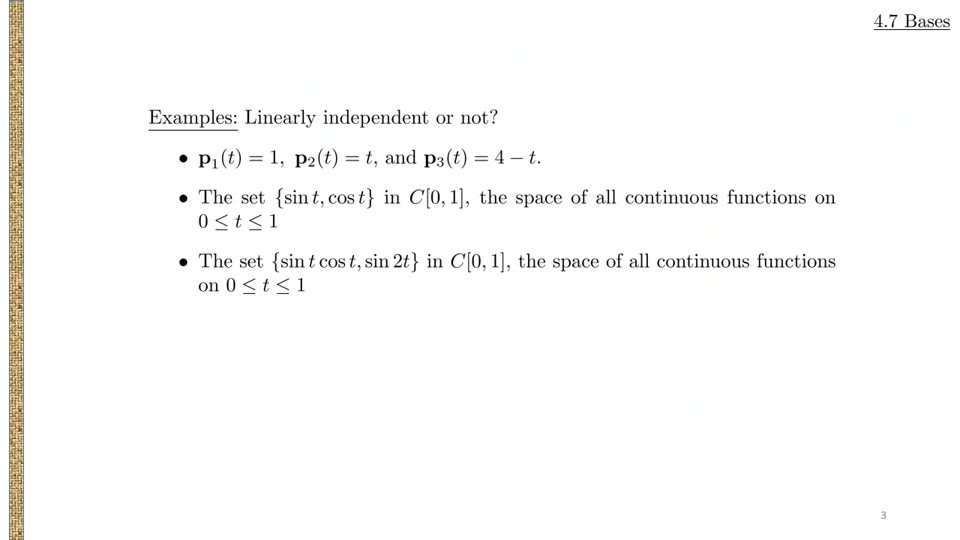

**Content — Determine if the sets are independent:**

1. $\{p_1(t) = 1,\ p_2(t) = t,\ p_3(t) = 4 - t\}$ in $P_2$: since $p_3 = 4p_1 + p_2$, the set is **linearly dependent**.
2. $\{\sin t,\ \cos t\}$ in $C[0,1]$ (continuous functions on $[0,1]$): not multiples of each other ⇒ **linearly independent**.

> 🎙️ **Narration:** *"Examples. Remember vectors are not just column matrices — vectors can be polynomials and functions. First: p₁(t) = 1, p₂(t) = t, p₃(t) = 4 − t. We can write p₃ = 4·p₁ + p₂, so by the theorem just seen the set is linearly dependent. Next: the set {sin t, cos t} in C[0,1], the space of continuous functions on [0,1]. sin t and cos t are not multiples of each other, so (by the two-vector case) they are linearly independent."*

---

### 🎬 Slide 5 — Example: $\{\sin t, \cos t, \sin 2t\}$

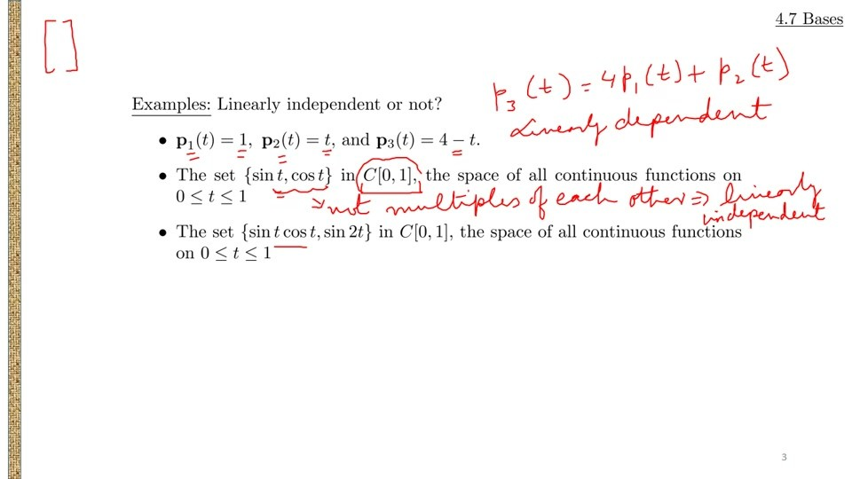

**Content —** The set $\{\sin t,\ \cos t,\ \sin 2t\}$ in $C[0,1]$: using the trigonometric identity $\sin 2t = 2\sin t \cos t$ — *(the lecture concludes this set is linearly dependent on this basis of the trig relation; see the slide.)*

> 🎙️ **Narration:** *"Finally, the set {sin t, cos t, sin 2t} in the same vector space of continuous functions on [0,1]. If you recall your trigonometry, sin 2t = 2 sin t cos t, and therefore — on the slide the lecture concludes this set is linearly dependent."*

---

## V-4.7b — 4.7 Bases: Definition & Examples

### 🎬 Slide 1 — Definition of a Basis

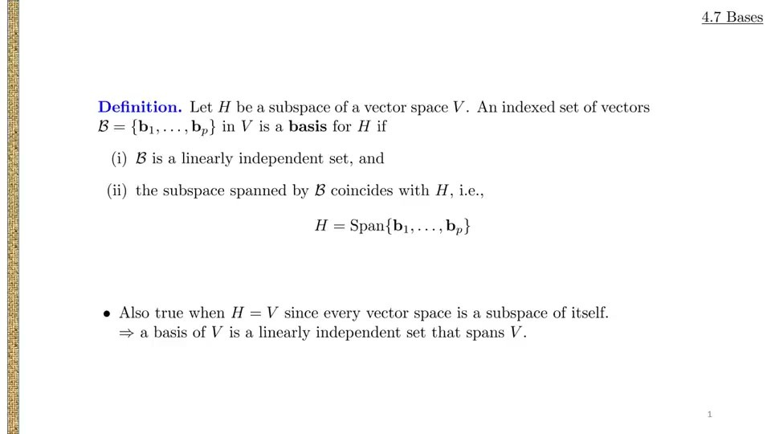

**Content — Definition.** Let $H$ be a subspace of a vector space $V$. An indexed set of vectors $\mathcal B = \{\mathbf b_1, \dots, \mathbf b_p\}$ in $V$ is a **basis for $H$** if

- **(i)** $\mathcal B$ is a **linearly independent** set, and
- **(ii)** the subspace spanned by $\mathcal B$ **coincides with $H$**, i.e. $H = \operatorname{Span}\{\mathbf b_1, \dots, \mathbf b_p\}$.

This is also true when $H = V$ (every vector space is a subspace of itself) ⇒ a basis of $V$ is a linearly independent set that spans $V$.

> 🎙️ **Narration:** *"Now we come to the actual definition of basis. Let H be a subspace of the vector space V. An indexed set of vectors B = {b₁ … bₚ} in V is a basis for the subspace H if two conditions are satisfied: (i) the set is linearly independent, and (ii) the subspace H is spanned by this set — i.e. Span{b₁ … bₚ} = H. Both conditions together mean B is a basis for H."*

---

### 🎬 Slide 2 — Basis for ℝ² (the vectors $\mathbf i, \mathbf j$)

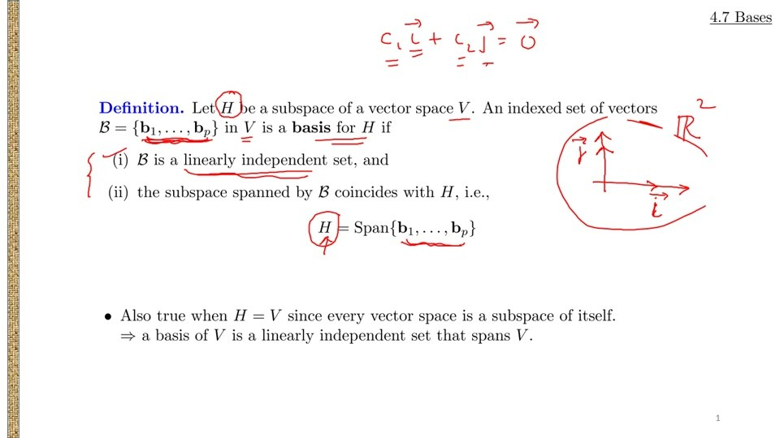

**Content —** In 2-D, the unit vectors $\mathbf i$ (x-direction) and $\mathbf j$ (y-direction):
- $\{\mathbf i, \mathbf j\}$ is **linearly independent** ($c_1\mathbf i + c_2\mathbf j = \mathbf 0$ only when $c_1 = c_2 = 0$).
- $\{\mathbf i, \mathbf j\}$ **spans** $\mathbb{R}^2$ (every vector is $c_1\mathbf i + c_2\mathbf j$).
- Therefore $\{\mathbf i, \mathbf j\}$ is a **basis** for $\mathbb{R}^2$.

> 🎙️ **Narration:** *"Let's look at the 2-D case: the unit vectors i (along x) and j (along y). Are they linearly independent? If c₁i + c₂j = 0, the only solution is c₁ = c₂ = 0 — so yes. Do they span ℝ²? Any vector in the 2-D space can be expressed as c₁i + c₂j, so yes, they span the whole space. Both conditions hold, so {i, j} is a basis for ℝ². This definition also applies when H = V itself."*

---

### 🎬 Slide 3 — Examples: invertible matrices and the standard basis

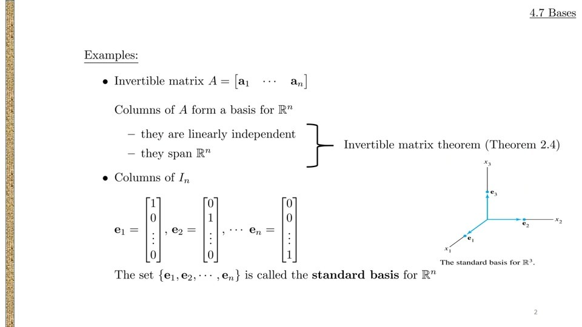

**Content — Examples:**

- **Invertible matrix $A = [\mathbf a_1 \cdots \mathbf a_n]$:** the columns of $A$ form a basis for $\mathbb{R}^n$ — by the Invertible Matrix Theorem (Theorem 2.4) they are linearly independent **and** they span $\mathbb{R}^n$.
- **Columns of $I_n$:** the standard basis vectors
  $$\mathbf e_1 = \begin{pmatrix}1\\0\\0\end{pmatrix},\ \mathbf e_2 = \begin{pmatrix}0\\1\\0\end{pmatrix},\ \dots,\ \mathbf e_n = \begin{pmatrix}0\\0\\1\end{pmatrix}$$
  The set $\{\mathbf e_1, \mathbf e_2, \dots, \mathbf e_n\}$ is called the **standard basis for $\mathbb{R}^n$**.

> 🎙️ **Narration:** *"Examples of bases. Let A be an n × n matrix with columns a₁ … aₙ. Do these columns form a basis for ℝⁿ? By the Invertible Matrix Theorem, if A is invertible its columns are linearly independent and span ℝⁿ — exactly the two conditions for a basis. What about the columns of Iₙ? The first column is e₁, the second e₂, and so on; the set {e₁, e₂, …, eₙ} is called the standard basis for ℝⁿ. Because e₁ is 1 followed by zeros, e₂ has 1 in the second place, etc., these special vectors form the standard basis."*

---

### 🎬 Slide 4 — Exercise 4.7.1: is $\{\mathbf v_1, \mathbf v_2, \mathbf v_3\}$ a basis for ℝ³?

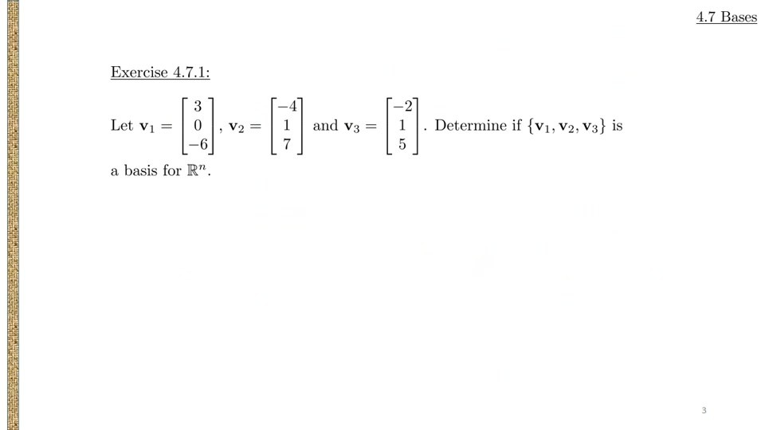

**Content — Exercise 4.7.1.** Let $\mathbf v_1 = \begin{pmatrix}3\\0\\-6\end{pmatrix}$, $\mathbf v_2 = \begin{pmatrix}-4\\1\\7\end{pmatrix}$, $\mathbf v_3 = \begin{pmatrix}-2\\1\\5\end{pmatrix}$. Determine whether $\{\mathbf v_1, \mathbf v_2, \mathbf v_3\}$ is a basis for $\mathbb{R}^3$.

**Solution.** Form $A = [\mathbf v_1 \ \mathbf v_2 \ \mathbf v_3] = \begin{bmatrix} 3 & -4 & -2 \\ 0 & 1 & 1 \\ -6 & 7 & 5 \end{bmatrix}$ and row-reduce. The matrix has **3 pivot positions** (a pivot in every row), so $A$ is **invertible**, and by the Invertible Matrix Theorem its columns form a **basis for $\mathbb{R}^3$**.

> 🎙️ **Narration:** *"Exercise 4.7.1: given v₁, v₂, v₃, determine whether {v₁, v₂, v₃} is a basis for ℝ³. We have said that if the columns of a 3 × 3 matrix form an invertible matrix, then they form a basis for ℝ³. So check whether A = [v₁ v₂ v₃] is invertible. The matrix is [3 −4 −2; 0 1 1; −6 7 5]. Reducing to echelon form we get pivots in all three rows — three pivot positions — so A is invertible."*

---

### 🎬 Slide 5 — Exercise 4.7.1 conclusion

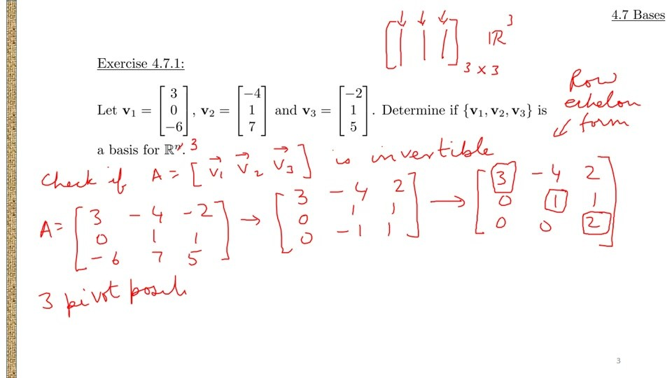

**Content —** Since $A$ is invertible (a pivot in every row), the columns of $A$ form a **basis for $\mathbb{R}^3$**.

> 🎙️ **Narration:** *"Since each row has a pivot position, A is invertible, and therefore the columns of A form a basis for ℝ³. All you need to check is whether the matrix is invertible — for an invertible matrix, the columns form a basis for ℝⁿ."*

---

### 🎬 Slide 6 — Exercise 4.7.2: the standard basis for $P_n$

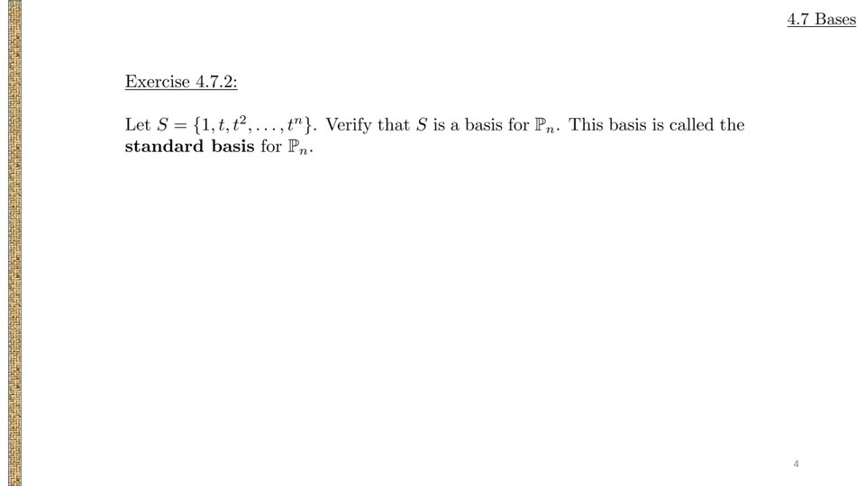

**Content — Exercise 4.7.2.** Verify that $S = \{1, t, t^2, \dots, t^n\}$ is a **basis for $P_n$** (the standard basis of the polynomial space of degree $\le n$).

- **S spans $P_n$:** every polynomial of degree $\le n$ is a linear combination of $1, t, t^2, \dots, t^n$.
- **S is linearly independent:** if $c_0 + c_1t + c_2t^2 + \cdots + c_nt^n = \mathbf 0$ (zero polynomial), then $c_0 = c_1 = \cdots = c_n = 0$.

Both conditions hold ⇒ $S$ is a basis for $P_n$.

> 🎙️ **Narration:** *"Exercise 4.7.2: the set S = {1, t, t², …, tⁿ} — verify that S is a basis for Pₙ, the space of polynomials of degree ≤ n. This basis is called the standard basis for Pₙ. Here we cannot write matrices or check invertibility, so we fall back on the two conditions. Spanning: every polynomial of degree ≤ n is a linear combination of these basis elements, so S spans Pₙ. Independence: consider c₀·1 + c₁·t + ⋯ + cₙtⁿ = 0 (the zero polynomial). This is true only if c₀ = c₁ = ⋯ = cₙ = 0 — the trivial solution — so S is linearly independent."*

---

### 🎬 Slide 7 — Exercise 4.7.2 conclusion

**Content —** Since $S$ spans $P_n$ and is linearly independent, the two conditions for a basis are satisfied ⇒ **$S$ is a basis for $P_n$** (the space of polynomials of degree $\le n$).

> 🎙️ **Narration:** *"We have both conditions: S spans Pₙ and S is linearly independent. Therefore the two conditions for a basis are satisfied, and we can say that S is a basis for the space of polynomials of degree ≤ n."*

---

## V-4.8 — 4.8 The Spanning Set Theorem

### 🎬 Slide 1 — Exercise 4.8.1: H = Span{v₁,v₂,v₃} = Span{v₁,v₂}

**Content — Exercise 4.8.1.** Let $H = \operatorname{Span}\{\mathbf v_1, \mathbf v_2, \mathbf v_3\}$, a subspace. Suppose $\mathbf v_3 = 5\mathbf v_1 + 3\mathbf v_2$. Show that $\operatorname{Span}\{\mathbf v_1, \mathbf v_2, \mathbf v_3\} = \operatorname{Span}\{\mathbf v_1, \mathbf v_2\}$.

*(Note: since $\mathbf v_3$ is a linear combination of $\mathbf v_1, \mathbf v_2$, the set $\{\mathbf v_1, \mathbf v_2, \mathbf v_3\}$ is **not** linearly independent.)*

**Proof sketch** (two inclusions):
- Every vector $c_1\mathbf v_1 + c_2\mathbf v_2 \in \operatorname{Span}\{\mathbf v_1,\mathbf v_2\}$ is also $c_1\mathbf v_1 + c_2\mathbf v_2 + 0\mathbf v_3 \in \operatorname{Span}\{\mathbf v_1,\mathbf v_2,\mathbf v_3\}$.
- Conversely, take $\mathbf x = c_1\mathbf v_1 + c_2\mathbf v_2 + c_3\mathbf v_3 \in H$. Substitute $\mathbf v_3 = 5\mathbf v_1 + 3\mathbf v_2$:
$$\mathbf x = c_1\mathbf v_1 + c_2\mathbf v_2 + c_3(5\mathbf v_1 + 3\mathbf v_2) = (c_1 + 5c_3)\mathbf v_1 + (c_2 + 3c_3)\mathbf v_2 \in \operatorname{Span}\{\mathbf v_1,\mathbf v_2\}.$$
So the two spans are the **same set**.

> 🎙️ **Narration:** *"We look at the spanning set theorem — we won't prove it, but the theorem is exactly what the exercise says. V₁, V₂, V₃ are three vectors and H = Span{v₁, v₂, v₃}. Note that v₃ = 5v₁ + 3v₂, so the set {v₁, v₂, v₃} is not linearly independent. We need to show Span{v₁,v₂,v₃} = Span{v₁,v₂}. Every vector in Span{v₁,v₂} is c₁v₁ + c₂v₂ = c₁v₁ + c₂v₂ + 0·v₃, which is in Span{v₁,v₂,v₃} = H. Conversely, take any x in H: x = c₁v₁ + c₂v₂ + c₃v₃, and substituting v₃ = 5v₁ + 3v₂ gives x = (c₁ + 5c₃)v₁ + (c₂ + 3c₃)v₂ — a linear combination of v₁ and v₂ only. So x is in Span{v₁,v₂}. Hence H and Span{v₁,v₂} are the same set of vectors."*

---

### 🎬 Slide 2 — Exercise 4.8.1 conclusion: a basis for H

**Content —** Since $\{\mathbf v_1, \mathbf v_2\}$ is **linearly independent** and **spans $H$**, $\{\mathbf v_1, \mathbf v_2\}$ is a **basis for $H$**.

> 🎙️ **Narration:** *"What are we going after? We want to find a basis for the subspace H. We saw that v₁ and v₂ are linearly independent, and they span H. These are the two conditions for a basis — so {v₁, v₂} forms a basis for H."*

---

### 🎬 Slide 3 — Theorem 4.5: The Spanning Set Theorem

**Content — Theorem 4.5 (Spanning Set Theorem).** Let $S = \{\mathbf v_1, \dots, \mathbf v_p\}$ be a set in a vector space $V$, and let $H = \operatorname{Span}\{\mathbf v_1, \dots, \mathbf v_p\}$.

1. If one of the vectors in $S$ — say $\mathbf v_k$ — is a linear combination of the remaining vectors in $S$, then the set formed from $S$ by **removing $\mathbf v_k$ still spans $H$**.
2. If $H \neq \{\mathbf 0\}$, then **some subset of $S$ is a basis for $H$**.

> 🎙️ **Narration:** *"This brings us to the spanning set theorem. Formally: let S = {v₁ … vₚ} be a set in some vector space V, and let H = Span{v₁ … vₚ}. If one of the vectors in S, say vₖ, is a linear combination of the remaining vectors, then the set formed by removing vₖ still spans H — that's exactly what we did in the previous exercise, removing v₃. And if H contains more than just the zero vector, then some subset of S is a basis for H — we saw that {v₁, v₂} was a basis for H."*

---

### 🎬 Slide 4 — Theorem 4.5 (proof skipped)

**Content:** Restates Theorem 4.5; the proof is skipped in the lecture.

> 🎙️ **Narration:** *"So what we did in the previous exercise we have formalized in this theorem. We will skip the proof — we will not be proving this theorem."*

---

## V-4.9a — 4.9 Bases for N(A) and C(A)

### 🎬 Slide 1 — A basis for N(A) needs no new method

**Content — 4.9 Bases for N(A) and C(A):**

- From Section 4.8, a basis for a subspace is a linearly independent spanning set.
- **Basis for N(A):** recall Exercise 4.4.3 — the method used there (write the general solution of $A\mathbf x = \mathbf 0$ as a linear combination of vectors, one per free variable) already produces vectors that span $N(A)$ **and** are linearly independent. So no new method is needed — it gives a basis for $N(A)$.

> 🎙️ **Narration:** *"In Section 4.8 we introduced bases: a set of vectors is a basis if it is linearly independent and spans the subspace. Here we look at two subspaces we've seen — the null space N(A) and the column space C(A) — and see how to find their bases. For N(A): go back to Exercise 4.4.3. There we found vectors that span the null space, and those vectors turned out to be linearly independent too — which are exactly the two conditions for a basis. So that method already produces a basis for the null space; no new method is needed."*

---

### 🎬 Slide 2 — Basis for C(B) where B is in RREF

**Content — Exercise 4.9.1.** Find a basis for the column space of a matrix $B$ in **reduced row echelon form** with columns $\mathbf b_1, \dots, \mathbf b_5$ (pivots in columns 1, 3, 5).

- Each **non-pivot column** of $B$ is a linear combination of the pivot columns.
- Here the non-pivot columns are $\mathbf b_2$ and $\mathbf b_4$.

> 🎙️ **Narration:** *"How do we find a basis for the column space? We have B — a matrix of five columns in reduced row echelon form (the pivots are 1, with zeros elsewhere in their columns). Recall: if a matrix is 'wide' (more columns than rows), the columns are linearly dependent — so there are non-pivot columns. Each non-pivot column of B is a linear combination of the pivot columns. So here we identify the non-pivot columns."*

---

### 🎬 Slide 3 — Exercise 4.9.1 solution: {b₁, b₃, b₅}

**Content —** The non-pivot columns satisfy
$$\mathbf b_2 = 4\mathbf b_1, \qquad \mathbf b_4 = 2\mathbf b_1 - \mathbf b_3.$$
By Theorem 4.5 (Spanning Set Theorem), we can **discard $\mathbf b_2$ and $\mathbf b_4$**; the set $\{\mathbf b_1, \mathbf b_3, \mathbf b_5\}$ still spans $C(B)$. By Theorem 4.4 ($\mathbf b_1 \neq \mathbf 0$ and no vector is a combination of the preceding ones — clear by inspection in RREF), $\{\mathbf b_1, \mathbf b_3, \mathbf b_5\}$ is linearly independent. Hence it is a **basis for $C(B)$**.

> 🎙️ **Narration:** *"Verify that b₂ = 4b₁ and b₄ = 2b₁ − b₃. Then by Theorem 4.5 (the spanning set theorem) we can discard b₂ and b₄ — throwing away the dependent columns — and {b₁, b₃, b₅} will still span the column space of B. To get a basis we check independence: by Theorem 4.4, since b₁ ≠ 0 and no vector in the set is a linear combination of the preceding ones (you can see this by inspection), the set is linearly independent. So {b₁, b₃, b₅} is a basis for the column space of B."*

---

## V-4.9b — 4.9 Bases for N(A) and C(A) (contd.)

### 🎬 Slide 1 — What if A is not in RREF?

**Content —** The previous video found a basis for $C(B)$ when $B$ was in RREF. What if the matrix $A$ is **not** in RREF?

- Any linear dependence relationship among the columns of $A$ can be expressed as $A\mathbf x = \mathbf 0$: $x_1\mathbf a_1 + \cdots + x_n\mathbf a_n = \mathbf 0$.
- If $A$ is row-reduced to $B$, then $A\mathbf x = \mathbf 0$ and $B\mathbf x = \mathbf 0$ have **exactly the same solution set** ⇒ the columns of $A$ have **exactly the same linear dependence relationships** as the columns of $B$.

> 🎙️ **Narration:** *"In the previous video we found a basis for the column space when the matrix was in RREF. But what if the matrix is not in RREF? Any linear dependence among the columns of A can be expressed as Ax = 0, i.e. x₁a₁ + x₂a₂ + ⋯ = 0. If A is row-reduced to B (not necessarily all the way to RREF), then Ax = 0 and Bx = 0 have exactly the same set of solutions — there is no change in x. So the columns of A have exactly the same linear dependence relationships as the columns of B."*

---

### 🎬 Slide 2 — Same dependence relationships (contd.)

**Content:** Restates the point — row-equivalent matrices have the same column dependence relationships, so dependence detected in the RREF applies to the original matrix.

> 🎙️ **Narration:** *"If the only solution is trivial (x₁ = x₂ = ⋯ = 0), the columns are independent; the same conclusion holds for B. So whatever relationships hold among the columns of A regarding linear independence apply equally to the columns of B."*

---

### 🎬 Slide 3 — Exercise 4.9.2: basis for C(A)

**Content — Exercise 4.9.2.** A matrix $A$ is row equivalent to the matrix $B$ of Exercise 4.9.1. Find a basis for $C(A)$.

From Exercise 4.9.1, $\mathbf b_2 = 4\mathbf b_1$ and $\mathbf b_4 = 2\mathbf b_1 - \mathbf b_3$. Since $A$ is row equivalent to $B$, the same relationships hold for $A$: $\mathbf a_2 = 4\mathbf a_1$ and $\mathbf a_4 = 2\mathbf a_1 - \mathbf a_3$ (verify!).

Discard the dependent columns $\mathbf a_2, \mathbf a_4$; the remaining $\{\mathbf a_1, \mathbf a_3, \mathbf a_5\}$ spans $C(A)$.

> 🎙️ **Narration:** *"We start with a matrix A row equivalent to the matrix B of Exercise 4.9.1, and ask for a basis of C(A). There we found b₂ = 4b₁ and b₄ = 2b₁ − b₃. Since A is row equivalent to B, the same relationships apply to the columns of A: a₂ = 4a₁ and a₄ = 2a₁ − a₃ — a good idea to verify. Just as in 4.9.1 we can discard a₂ and a₄ because they are linearly dependent on a₁ and a₃. We are left with {a₁, a₃, a₅}."*

---

### 🎬 Slide 4 — Exercise 4.9.2 conclusion

**Content —** If $\{\mathbf a_1, \mathbf a_3, \mathbf a_5\}$ is to be linearly independent, the corresponding columns $\{\mathbf b_1, \mathbf b_3, \mathbf b_5\}$ of $B$ must be independent — which is true. Hence $\{\mathbf a_1, \mathbf a_3, \mathbf a_5\}$ is independent and spans $C(A)$, so it is a **basis for $C(A)$**.

> 🎙️ **Narration:** *"For {a₁, a₃, a₅} to be linearly independent, the corresponding columns b₁, b₃, b₅ of B must also be independent — and that is true. Therefore a₁, a₃, a₅ are linearly independent and they span the column space of A. So {a₁, a₃, a₅} is a basis for the column space of A."*

---

### 🎬 Slide 5 — Theorem 4.6: pivot columns form a basis for C(A)

**Content — Theorem 4.6.** The **pivot columns** of a matrix $A$ form a **basis for $C(A)$**.

**Proof idea.** Let $B$ be the RREF of $A$. The pivot columns of $B$ are linearly independent; since $A$ and $B$ are row equivalent, the pivot columns of $A$ are linearly independent too, and every non-pivot column of $A$ is a linear combination of its pivot columns. Discard the non-pivot columns (Spanning Set Theorem) ⇒ the pivot columns of $A$ form a basis for $C(A)$.

> 🎙️ **Narration:** *"We end with a simple theorem and proof: the pivot columns of a matrix A form a basis for the column space of A. For example, for a wide 4 × 2 matrix with a pivot in each column, those pivot columns are the basis. Proof: let B be the RREF of A. The pivot columns of B are linearly independent, and since A and B are row equivalent the pivot columns of A are linearly independent; also every non-pivot column of A is a linear combination of the pivot columns of A. By the spanning set theorem we discard the non-pivot columns, leaving the pivot columns of A as the basis for C(A)."*

---

## V-4.10 — 4.10 Coordinate Systems

### 🎬 Slide 1 — Coordinates relative to a basis

**Content — Definition.** Suppose $\mathcal B = \{\mathbf b_1, \dots, \mathbf b_n\}$ is a **basis** for $V$ and $\mathbf x$ is in $V$. The **coordinates of $\mathbf x$ relative to the basis $\mathcal B$** (or the **$\mathcal B$-coordinates of $\mathbf x$**) are the **weights** $c_1, \dots, c_n$ such that
$$\mathbf x = c_1\mathbf b_1 + \cdots + c_n\mathbf b_n.$$

The **coordinate vector** of $\mathbf x$ relative to $\mathcal B$ is
$$[\mathbf x]_{\mathcal B} = \begin{pmatrix} c_1 \\ \vdots \\ c_n \end{pmatrix}.$$

*(In $\mathbb{R}^2$ with basis $\{\mathbf i, \mathbf j\}$, the vector $\mathbf x = \binom{a}{b}$ has $[\mathbf x]_{\mathcal B} = \binom{a}{b}$.)*

> 🎙️ **Narration:** *"Earlier we saw basis vectors — in 2-D the unit vectors i and j define a coordinate system. Now we study coordinate systems in a vector space. Given a set of vectors that is a basis for the vector space, for each x in the space there is a unique set of scalars c₁ … cₙ such that x is a linear combination of the basis vectors. In ℝ² any vector (a, b) can be written as a·i + b·j, so the scalars a, b are its coordinates. Definition: if B = {b₁ … bₙ} is a basis for V and x is in V, the B-coordinates of x are the weights c₁ … cₙ with x = c₁b₁ + ⋯ + cₙbₙ; the coordinate vector [x]_B is the vector of those weights."*

---

### 🎬 Slide 2 — Exercise 4.10.1: from coordinates to the vector

**Content — Exercise 4.10.1.** $\mathbf b_1 = \binom{1}{0}$, $\mathbf b_2 = \binom{1}{2}$ form a basis $\mathcal B$ for $\mathbb{R}^2$. If $[\mathbf x]_{\mathcal B} = \binom{-2}{3}$, find $\mathbf x$.

**Solution:**
$$\mathbf x = -2\mathbf b_1 + 3\mathbf b_2 = -2\binom{1}{0} + 3\binom{1}{2} = \binom{1}{6}.$$

> 🎙️ **Narration:** *"Exercise: b₁ = (1,0) and b₂ = (1,2) form a basis for ℝ², and the B-coordinate vector of x is given as x_B = (−2, 3). What is x? We know x = c₁b₁ + c₂b₂ with the B-coordinates giving c₁ = −2, c₂ = 3. Plugging in: x = −2(1,0) + 3(1,2) = (1, 6)."*

---

### 🎬 Slide 3 — Example with the standard basis (drawing)

**Content —** With the **standard basis** $\{\mathbf e_1, \mathbf e_2\}$, if $[\mathbf x]_{\mathcal B} = \binom{1}{6}$ then $\mathbf x = 1\mathbf e_1 + 6\mathbf e_2 = \binom{1}{6}$ — the coordinates in the standard basis are the vector itself.

*Figures: drawing the same point on "standard graph paper" (axes $\mathbf e_1, \mathbf e_2$) vs "$\mathcal B$-graph paper" (axes $\mathbf b_1 = (1,0)$, $\mathbf b_2 = (1,2)$):* the point $\mathbf x = (1,6)$ has standard coordinates $(1,6)$ but $\mathcal B$-coordinates $(-2, 3)$ (i.e. $\mathbf x = -2\mathbf b_1 + 3\mathbf b_2$). Collinearity is preserved.

> 🎙️ **Narration:** *"Example with the standard basis e₁ = (1,0), e₂ = (0,1): if x has standard coordinates (1,6), then x = 1·e₁ + 6·e₂ = (1,6) — not surprising, since x is already expressed in the standard basis. Now compare graph paper: in the previous example, v₂ = (1,2) and x = (1,6). On standard graph paper v₂ is the point (1,2) and x is the point (1,6). On the new B-graph paper, the axes are b₁ = (1,0) and b₂ = (1,2) — an inclined axis. x is written as −2·b₁ + 3·b₂ (from the previous exercise): go −2 in the b₁ direction and 3 in the b₂ direction to reach x in the B-graph paper. Note x, b₂ and b₁ lie in a straight line on both graph papers."*

---

### 🎬 Slide 4 — Exercise 4.10.2: from vector to coordinates

**Content — Exercise 4.10.2.** $\mathbf b_1 = \binom{2}{1}$, $\mathbf b_2 = \binom{-1}{1}$ form a basis $\mathcal B$ for $\mathbb{R}^2$; $\mathbf x = \binom{4}{5}$. Find $[\mathbf x]_{\mathcal B}$.

**Solution.** Write $\mathbf x = c_1\mathbf b_1 + c_2\mathbf b_2$ and solve:
$$c_1\binom{2}{1} + c_2\binom{-1}{1} = \binom{4}{5} \Rightarrow c_1 = 3,\ c_2 = 2.$$
So $[\mathbf x]_{\mathcal B} = \binom{3}{2}$ — check: $3(2,1) + 2(-1,1) = (6-2, 3+2) = (4,5)$. ✓

> 🎙️ **Narration:** *"Another exercise testing the same idea. b₁ and b₂ are basis vectors, x is given, and we need the coordinate vector of x relative to the basis B. Write x = c₁b₁ + c₂b₂ = (4,5) and solve for c₁, c₂ — the solution is [x]_B = (3,2). On standard graph paper b₁ = (2,1) and b₂ = (−1,1); the point (4,5) is x in the standard basis. On the B-graph paper, x = 3·b₁ + 2·b₂: go 3 in the b₁ direction and 2 in the b₂ direction."*

---

### 🎬 Slide 5 — The coordinate mapping matrix $P_{\mathcal B}$

**Content — Coordinate mapping.** Writing $c_1\mathbf b_1 + c_2\mathbf b_2 = \mathbf x$ is a matrix–vector equation:
$$P_{\mathcal B}[\mathbf x]_{\mathcal B} = \mathbf x, \qquad P_{\mathcal B} = [\mathbf b_1 \ \mathbf b_2 \ \cdots \ \mathbf b_n].$$
$P_{\mathcal B}$ **changes the $\mathcal B$-coordinates of $\mathbf x$ into the standard coordinates of $\mathbf x$**. Since the columns of $P_{\mathcal B}$ form a basis (linearly independent, spanning), $P_{\mathcal B}$ is **invertible**, so
$$[\mathbf x]_{\mathcal B} = P_{\mathcal B}^{-1}\mathbf x.$$
$P_{\mathcal B}^{-1}$ transforms standard coordinates into $\mathcal B$-coordinates.

> 🎙️ **Narration:** *"From the previous exercise we wrote the matrix–vector equation to solve for the B-coordinates. Think of it as a transformation: a linear system Ax = b transforms x by A into b. Here, the matrix P_B changes the B-coordinates of a vector x into the standard coordinates of x — we write x = P_B·[x]_B. The columns of P_B form a basis for ℝ², so by the Invertible Matrix Theorem P_B is invertible. Multiply both sides by P_B⁻¹ to get [x]_B = P_B⁻¹·x: so P_B⁻¹ transforms a vector in standard coordinates into B-coordinates."*

---

### 🎬 Slide 6 — Extension to $\mathbb{R}^n$; linearity

**Content —** Everything extends to $\mathbb{R}^n$: if $\mathbf x$ is in $V$ ($\dim V = n$), then $P_{\mathcal B}[\mathbf x]_{\mathcal B} = \mathbf x$ and $[\mathbf x]_{\mathcal B} = P_{\mathcal B}^{-1}\mathbf x \in \mathbb{R}^n$.

**Linearity of the coordinate mapping:**
$$[c_1\mathbf u_1 + \cdots + c_p\mathbf u_p]_{\mathcal B} = c_1[\mathbf u_1]_{\mathcal B} + \cdots + c_p[\mathbf u_p]_{\mathcal B}.$$

> 🎙️ **Narration:** *"Whatever was discussed can be extended to ℝⁿ: if x is in the vector space V, then P_B transforms [x]_B into x and P_B⁻¹ transforms x into [x]_B, where [x]_B is in ℝⁿ. Lastly, the B-coordinate vector of a linear combination c₁u₁ + ⋯ + cₚuₚ is the same linear combination of the individual B-coordinate vectors — using the same coefficients c₁ … cₚ."*

---

## V-4.11 — 4.11 Dimension of a Vector Space

### 🎬 Slide 1 — Definition of dimension

**Content — Definition.** If $V$ is a vector space, the **dimension** of $V$ (written $\dim V$) is the **number of vectors in a basis** for $V$. The dimension of the **zero vector space** is defined to be $0$.

- The standard basis for $\mathbb{R}^n$ contains $n$ vectors ⇒ $\dim \mathbb{R}^n = n$.
- $\dim \mathbb{R}^2 = 2$ (basis $\{\mathbf i, \mathbf j\}$).

> 🎙️ **Narration:** *"In this section we introduce the dimension of a vector space. ℝ² is a two-dimensional space, ℝⁿ an n-dimensional space — meaning there are n entries. But a vector space is not always a column matrix — it can be polynomials, matrices, or functions. How do we determine the dimension of such spaces? Definition: if V is a vector space, dim V is the number of vectors in a basis for V. The dimension of the zero vector space is defined to be 0. Examples: the standard basis for ℝⁿ has n vectors, so dim ℝⁿ = n; for ℝ² the basis is {i, j}, so dim ℝ² = 2."*

---

### 🎬 Slide 2 — $\dim P_2 = 3$; Exercise intro

**Content —** $P_2$ (polynomials of degree ≤ 2) has basis $\{1, t, t^2\}$ (3 vectors), so
$$\dim P_2 = 3.$$
*(Exercise: find the dimension of a given subspace $H$.)*

> 🎙️ **Narration:** *"For ℝ³ and so on it is similar. What about polynomials? P₂ is the vector space of polynomials of degree 2, with basis {1, t, t²} — any polynomial of degree 2 is a linear combination of these. Counting the basis elements: there are 3, so dim P₂ = 3. The number of vectors in the basis is the dimension. Now an exercise: find the dimension of the subspace H that we are given."*

---

### 🎬 Slide 3 — Exercise: finding the dimension of a subspace H

**Content —** $H$ is a set of vectors (with parameters $a,b,c,d$ real). To find $\dim H$, first find a basis for $H$. Separate the parameters:
$$H = \operatorname{Span}\left\{ \mathbf v_1 = \begin{pmatrix}1\\5\\0\\0\end{pmatrix},\ \mathbf v_2 = \begin{pmatrix}-3\\0\\1\\0\end{pmatrix},\ \mathbf v_3 = \begin{pmatrix}6\\0\\-2\\0\end{pmatrix},\ \mathbf v_4 = \begin{pmatrix}0\\4\\-1\\5\end{pmatrix} \right\}$$

> 🎙️ **Narration:** *"What is H? It is a set of vectors in which a, b, c, d are real — plug in values to generate H. To find dim H we find the number of basis vectors. Since H is a subspace it is the set of linear combinations of certain vectors. We separate out the a's, b's, c's and d's: separating a gives (1,5,0,0); we get v₁ = (1,5,0,0), v₂ = (−3,0,1,0), v₃ = (6,0,−2,0), v₄ = (0,4,−1,5). Now look at a spanning set: v₁ ≠ 0, v₂ is not a multiple of v₁, and v₃ is a multiple of v₂."*

---

### 🎬 Slide 4 — Discard dependent vectors; $\dim H = 3$

**Content —** $\mathbf v_3$ is a multiple of $\mathbf v_2$, so by the Spanning Set Theorem we can **discard $\mathbf v_3$**. $\mathbf v_4$ is not a linear combination of $\mathbf v_1, \mathbf v_2$, so $\{\mathbf v_1, \mathbf v_2, \mathbf v_4\}$ is linearly independent and spans $H$ — it is a **basis for $H$**. Hence
$$\dim H = 3.$$

> 🎙️ **Narration:** *"v₃ is a multiple of v₂, so by the Spanning Set Theorem we can discard v₃ — if one vector is a linear combination of the others it can be removed from the spanning set. What about v₄? v₄ is not a multiple of, nor a linear combination of, the previous vectors v₁ and v₂. So the vectors v₁, v₂, v₄ are linearly independent and belong to the subspace — they form a basis for H. Therefore the dimension of H is the number of vectors in the basis, which is 3."*

---

### 🎬 Slide 5 — All possible subspaces of $\mathbb{R}^3$

**Content — Subspaces of $\mathbb{R}^3$:**

- **0-dimensional:** the zero subspace $\{\mathbf 0\}$.
- **1-dimensional:** any line through the origin — spanned by a single non-zero vector.
- **2-dimensional:** any plane through the origin — spanned by two linearly independent vectors.
- **3-dimensional:** the whole space $\mathbb{R}^3$ (every vector space is a subspace of itself).

> 🎙️ **Narration:** *"This example shows all possible subspaces of ℝ³. One subspace is the zero-dimensional subspace — containing only the zero vector. Within ℝ³ you can have a one-dimensional subspace: any subspace spanned by a single non-zero vector is a straight line through the origin. Then a two-dimensional subspace — the plane: two linearly independent vectors, taking all linear combinations a·v₁ + b·v₂, generate the entire plane (which passes through the origin, since a subspace contains the zero vector). And the three-dimensional subspace is ℝ³ itself: three linearly independent vectors, with all combinations a·v₁ + b·v₂ + c·v₃, generate the whole 3-D space."*

---

## V-4.12 — 4.12 Dimensions of C(A) and N(A)

### 🎬 Slide 1 — $\dim C(A)$ and $\dim N(A)$

**Content —**
- The basis for $C(A)$ is the set of pivot columns ⇒ **$\dim C(A)$ = number of pivot columns of $A$.**
- The spanning set for $N(A)$ (one vector per free variable) is linearly independent ⇒ **$\dim N(A)$ = number of free variables, $k$.**

> 🎙️ **Narration:** *"We are now familiar with the two special subspaces C(A) and N(A), so it is natural to ask their dimensions. We already said the basis for C(A) is the pivot columns, so dim C(A) is simply the number of pivot columns of A. For N(A): with an m × n matrix A, reduce Ax = 0 to echelon form; if there are k free variables, the spanning set for N(A) has k linearly independent vectors (one per free variable), so dim N(A) = number of free variables."*

---

### 🎬 Slide 2 — Exercise 4.12.1

**Content — Exercise 4.12.1.** Find the dimension of the null space and column space of a given $3 \times 5$ matrix (RREF shown).

- **3 free variables** ($x_2, x_4, x_5$) ⇒ $\dim N(A) = 3$.
- **2 pivot columns** ⇒ $\dim C(A) = 2$.

> 🎙️ **Narration:** *"Example: this matrix has three rows and five columns — a 3 × 5 matrix. Reduce the augmented matrix for Ax = 0 to row echelon form. dim N(A) is the number of free variables. The first and third columns are pivot columns; the second, fourth and fifth columns are free variables (x₂, x₄, x₅). So there are 3 free variables, hence dim N(A) = 3. For the column space: dim C(A) is the number of pivot columns — there are two pivots — so dim C(A) = 2."*

---

## V-4.13 — 4.13 The Row Space

### 🎬 Slide 1 — Definition of the row space + Theorem 4.7

**Content — 4.13 The Row Space:**

The set of all linear combinations of the **rows** (row vectors) of a matrix $A$ is called the **row space of $A$**.

- Since the rows of $A$ are the columns of $A^T$, the row space of $A$ is denoted by **$C(A^T)$**.
- For an $m \times n$ matrix, each row has $n$ entries ⇒ $C(A^T)$ is a subspace of $\mathbb{R}^n$.

**Theorem 4.7.** If two matrices $A$ and $B$ are **row equivalent**, then their **row spaces are the same**. If $B$ is in echelon form, the **nonzero rows of $B$ form a basis** for the row space of $A$ as well as for that of $B$. *(Proof skipped.)*

> 🎙️ **Narration:** *"In this section we look at a third type of subspace — the row space. Just as there is a column space, there is a row space: the set of all linear combinations of the rows of A. Since the rows of A are the columns of Aᵀ, the row space of A is the column space of Aᵀ — denoted C(Aᵀ). Be clear: C(A) is the column space of A, C(Aᵀ) is the row space of A. For an m × n matrix, each row has n entries, so the row space is a subspace of ℝⁿ. Theorem 4.7: if A and B are row equivalent, their row spaces are the same. In particular, if B is in echelon form, the non-zero rows of B form a basis for the row space of A as well as of B. We skip the proof."*

---

### 🎬 Slide 2 — Theorem 4.7 (figure)

**Content:** Restates the row-space definition and Theorem 4.7 with a picture of the echelon form (if the last row of the echelon form $B$ is all zeros, the non-zero rows form a basis for the row space of $A$ and of $B$).

> 🎙️ **Narration:** *"If B is the row echelon form and the last row is all zeros, then the non-zero rows will form a basis for B as well as for A. We will not look at the proof for this theorem."*

---

### 🎬 Slide 3 — Exercise 4.13.1: bases for row, column and null spaces

**Content — Exercise 4.13.1.** Find bases for the row space, column space and null space of
$$A = \begin{bmatrix} 1 & 3 & 5 & 1 & 5 \\ -2 & -5 & 8 & 0 & -17 \\ 3 & 0 & 11 & 7 & 1 \\ 1 & 7 & -13 & 5 & -3 \end{bmatrix}.$$

**Solution.** Reduce $A$ to echelon form:
$$\begin{bmatrix} 1 & 3 & 5 & 1 & 5 \\ 0 & 1 & 2 & 2 & -7 \\ \vdots & & & & \end{bmatrix}$$
The **non-zero rows** of the echelon form form a **basis for the row space** of $A$.

> 🎙️ **Narration:** *"This exercise brings together the three subspaces of a matrix. A has four rows and five columns — a 4 × 5 matrix. The first step is to reduce A to echelon form. The basis for the row space is the set of non-zero rows in the echelon form."*

---

### 🎬 Slide 4 — Exercise 4.13.1: column space basis

**Content — Column space of $A$:** the basis for $C(A)$ is the **pivot columns of $A$** (not of the echelon form $B$). Here the pivots are in columns 1, 2, 4, so the corresponding columns of $A$ (columns 1, 2, 4 of $A$) form a basis for $C(A)$.

> ⚠️ **Careful:** although you reduce $A$ to echelon form $B$ and look at the pivot columns of $B$, the basis comes from the **corresponding pivot columns of $A$** — not of $B$.

> 🎙️ **Narration:** *"The row space of A (the column space of Aᵀ) has as basis the non-zero rows of the echelon form of A. What about the column space of A? The basis for the column space is the pivot columns. The pivot columns are columns 1, 2 and 4, and so the corresponding columns of A form the basis for the column space of A. Be careful: although you reduce A to row echelon form B and look at the pivot columns of B, the basis comes from the corresponding pivot columns of A, not B."*

---

### 🎬 Slide 5 — Exercise 4.13.1: null space basis

**Content — Null space of $A$:** reduce further to the RREF $C$. From $C\mathbf x = \mathbf 0$:
$$x_1 + x_3 + x_5 = 0, \qquad x_2 - 2x_3 + 3x_5 = 0, \qquad x_4 - 5x_5 = 0$$
so (leading variables in terms of free variables $x_3, x_5$):
$$x_1 = -x_3 - x_5, \quad x_2 = 2x_3 - 3x_5, \quad x_4 = 5x_5.$$
$$\mathbf x = x_3\begin{pmatrix}-1\\2\\1\\0\\0\end{pmatrix} + x_5\begin{pmatrix}-1\\-3\\0\\5\\1\end{pmatrix}$$
These two vectors form a **basis for $N(A)$**.

> 🎙️ **Narration:** *"Lastly, the null space — reduce to the reduced row echelon form C. Ax = 0 is equivalent to Cx = 0. Write the system: x₁ + x₃ + x₅ = 0, etc. Writing leading variables in terms of free variables: x₁ = −x₃ − x₅, x₂ = 2x₃ − 3x₅, x₄ = 5x₅. Putting all variables in a vector (x₁, x₂, x₃, x₄, x₅) and splitting into x₃ and x₅ parts gives the two basis vectors for the null space of A."*

---

## V-4.14a — 4.14 Rank: Definition & Geometry

### 🎬 Slide 1 — Definition of rank

**Content — Definition.** The **rank of $A$** is the **dimension of the column space of $A$**.

- $A\mathbf x = \mathbf b$ is consistent (has a solution) when $\mathbf b$ is in $C(A)$; so rank $A$ = dimension of the set of $\mathbf b$ such that $A\mathbf x = \mathbf b$ is consistent.
- E.g. if $A$ has four columns and three of them form a basis for $C(A)$, then $\operatorname{rank} A = 3$.

> 🎙️ **Narration:** *"In this section we introduce the rank of a matrix. Definition: the rank of A is the dimension of the column space of A. Recall Ax = b is consistent — has a solution — when b is in the column space of A, which is the set of linear combinations of the columns. So the rank of A is the dimension of the set of b such that Ax = b is consistent. For example, if A has four columns and three of them are a basis for C(A), then the rank of A is 3."*

---

### 🎬 Slide 2 — Rank $p < n$ ⇒ no unique solution (example: rank 1)

**Content —** Suppose $A$ is $n \times n$ with rank $p$. Then $A\mathbf x$ spans a **$p$-dimensional space**, so there is **no unique solution** — only 0 or infinitely many solutions.

**Example.** $A = \begin{bmatrix} 1 & 2 \\ 2 & 4 \end{bmatrix}$ (column 2 = 2·column 1). $\dim C(A) = 1$, so $\operatorname{rank} A = 1$; $A\mathbf x$ spans the line $y_2 = 2y_1$.

- If $\mathbf b = \binom{b_1}{b_2}$ is **not** on the line $y_2 = 2y_1$ ⇒ **no solution**.
- If $\mathbf b$ is on the line (e.g. $\binom{c}{2c}$), then the whole line $x_1 + 2x_2 = c$ maps onto that one point ⇒ **infinitely many solutions**.

> 🎙️ **Narration:** *"Now consider a square n × n matrix A with rank p: p of the n columns form a basis for C(A), so Ax spans a p-dimensional space — no unique solution. Example: A = [[1,2],[2,4]] — the second column is a multiple of the first, so dim C(A) = 1 and rank A = 1. Ax spans a one-dimensional space: the line y₂ = 2y₁ through the origin. Draw the domain (x₁,x₂) and codomain (y₁,y₂). The transformation maps all points (x₁,x₂) onto the line y₂ = 2y₁. If a target point is not on that line, there is no x mapping to it — zero solutions. If we pick a point on the line, say (c, 2c), all points on the line x₁ + 2x₂ = c map onto it — infinitely many solutions."*

---

### 🎬 Slide 3 — Rank deficient matrices

**Content —** Depending on where $\mathbf b$ is, $A\mathbf x = \mathbf b$ has **zero or infinitely many solutions** (never unique) when an $n \times n$ matrix has rank $p < n$.

- **Full rank:** $\operatorname{rank} A = n$.
- **Rank deficient:** $\operatorname{rank} A = p < n$ (not full rank).

> 🎙️ **Narration:** *"Depending on where the vector y is, we can have either zero solutions or infinitely many solutions — that is what we meant by 'no unique solution' when an n × n matrix has rank p (with p < n). Matrices with rank p less than the maximum possible rank n are called rank deficient — the matrix is not full rank. If the rank were n, we would call it a full-rank matrix; if it is p with p < n, it is a rank deficient matrix."*

---

## V-4.14b — 4.14 Rank: The Rank Theorem & the IMT

### 🎬 Slide 1 — rank = number of pivot columns

**Content —**
- The dimensions of the column space and the row space of an $m \times n$ matrix are equal.
- By Theorem 4.6, the pivot columns form a basis for $C(A)$ ⇒ $\operatorname{rank} A$ = number of pivot columns in $A$.
- The rows containing pivots form a basis for the row space ⇒ rank of $A$ is also the dimension of the **row space** of $A$.

> 🎙️ **Narration:** *"We have seen that the rank of a matrix is the dimension of its column space. Reduce A to echelon form and mark the pivots. By Theorem 4.6, the pivot columns form a basis for the column space of A — so the dimension of C(A), i.e. the rank of A, is the number of pivot columns in A. This equals the number of pivot positions in B. We have also seen that rows with pivots in B form a basis for the row space of A — so the rank of A is also the dimension of the row space of A. To find the rank you can determine the dimension of either one."*

---

### 🎬 Slide 2 — Theorem 4.8: The Rank Theorem

**Content —**
$$\operatorname{rank} A = \dim C(A) = \text{the number of columns with pivots},$$
$$\dim N(A) = \text{the number of free variables (columns without pivots)}$$

**Theorem 4.8 (The Rank Theorem).** If a matrix $A$ has $n$ columns, then
$$\operatorname{rank} A + \dim N(A) = n.$$

*(This is also called the **Rank-Nullity Theorem** — $\dim N(A)$ is the nullity of $A$.)*

> 🎙️ **Narration:** *"Rank of A = dim C(A) = the number of columns with pivots; dim N(A) = the number of free variables = the number of columns without pivots. Clearly, columns with pivots plus columns without pivots = the total number of columns n. This brings us to the Rank Theorem: if A has n columns, then rank A + dim N(A) = n. Some books call it the rank-nullity theorem (dim N(A) is the nullity), but we will stick with 'rank theorem'. This theorem connects the null space and the column space — recall C(A) is the set of b making Ax = b consistent."*

---

### 🎬 Slide 3 — Exercise 4.14.1: applying the Rank Theorem

**Content — Exercise 4.14.1.** A scientist found **two solutions** to a homogeneous system of 40 equations in 42 variables, and the solutions are linearly independent and span the null space of $A$. Can the scientist be certain that an associated non-homogeneous system (same coefficients) has a solution — i.e. does $A\mathbf x = \mathbf b$ have a solution for **every** $\mathbf b$?

- $A$ is $40 \times 42$; $\mathbf x \in \mathbb{R}^{42}$, $\mathbf b \in \mathbb{R}^{40}$.
- The two solutions form a **basis for $N(A)$**, so $\dim N(A) = 2$.

> 🎙️ **Narration:** *"A scientist found two solutions to a homogeneous system of 40 equations in 42 variables; the solutions are linearly independent and span the null space of A. Recall a linear system has 0, 1 or infinitely many solutions — here we mean two out of the infinitely many, which are independent and span N(A). A is a 40 × 42 matrix; x is 42 × 1 in ℝ⁴², b is 40 × 1 in ℝ⁴⁰. Since the two solutions are independent and span N(A), they form a basis for N(A). The question: can we be certain Ax = b has a solution for every b?"*

---

### 🎬 Slide 4 — Exercise 4.14.1: conclusion

**Content —** By the Rank Theorem,
$$\dim C(A) = n - \dim N(A) = 42 - 2 = 40.$$
So $C(A)$ has 40 basis vectors, which span the 40-dimensional space $\mathbb{R}^{40}$ — i.e. **$C(A) = \mathbb{R}^{40}$** (the only 40-dimensional subspace of $\mathbb{R}^{40}$ is $\mathbb{R}^{40}$ itself). Therefore every $\mathbf b$ in $\mathbb{R}^{40}$ is a linear combination of the columns of $A$, so **$A\mathbf x = \mathbf b$ has a solution for all $\mathbf b$**. Yes.

> 🎙️ **Narration:** *"We use the Rank Theorem: dim N(A) = 2, so dim C(A) = n − dim N(A) = 42 − 2 = 40. What does that mean? There are 40 basis vectors for the column space of A. Just as three basis vectors like i, j, k span all of ℝ³, these 40 vectors span all of ℝ⁴⁰. So any vector b in ℝ⁴⁰ can be written as a linear combination of those 40 columns of A that form the basis of C(A). All this means that Ax = b will have a solution for all b."*

---

### 🎬 Slide 5 — Exercise 4.14.1 (figure)

**Content:** *(conclusion of the exercise — since $C(A) = \mathbb{R}^{40}$, $A\mathbf x = \mathbf b$ is consistent for every $\mathbf b$.)*

> 🎙️ **Narration:** *"Conversely, for any b we can actually find an x which expresses b as a linear combination of the 40 columns of A — so Ax = b has a solution for every b."*

---

### 🎬 Slide 6 — Invertible Matrix Theorem (continued)

**Content — Theorem (IMT, continued).** For an $n \times n$ matrix $A$, if $A$ is invertible then:
- the columns of $A$ form a basis for $\mathbb{R}^n$ (so $C(A) = \mathbb{R}^n$);
- $\dim C(A) = n$ ⇒ $\operatorname{rank} A = n$;
- $N(A) = \{\mathbf 0\}$ ⇒ $\dim N(A) = 0$.

*(Derivation covered in the live lectures.)*

> 🎙️ **Narration:** *"Recall the Invertible Matrix Theorem from Chapter 2 — we are extending it to include the new terms introduced since then. If A is an n × n invertible matrix, the columns form a basis for ℝⁿ — so C(A) is the entire n-dimensional space ℝⁿ, and therefore dim C(A) = n, i.e. rank A = n. Also, the null space of A will contain only the zero vector, so dim N(A) = 0. We will go into more detail on how we derive this in the live lectures."*

---

## V-4.15 — 4.15 Change of Basis

### 🎬 Slide 1 — The change-of-basis problem

**Content — 4.15 Change of basis:**

A problem could be more easily solved by **changing the basis from $\mathcal B$ to $\mathcal C$**. Question: how are $[\mathbf x]_{\mathcal B}$ and $[\mathbf x]_{\mathcal C}$ related for each $\mathbf x$ in $V$?

**Two coordinate systems for the same vector space:** the same vector $\mathbf x$ drawn in the $\mathcal B$-system ($\mathbf b_1, \mathbf b_2$) and in the $\mathcal C$-system ($\mathbf c_1, \mathbf c_2$). In the figure, $[\mathbf x]_{\mathcal B} = \binom{3}{1}$ and $[\mathbf x]_{\mathcal C} = \binom{6}{4}$.

> 🎙️ **Narration:** *"This is the last section of this chapter. We have seen that a vector x in the standard basis (e₁, e₂, …) can be represented in some other basis using a transformation matrix. Now we generalize: we want to change basis from one set of basis coordinates to another, not just from the standard basis to the B-coordinates. The question is how [x]_B and [x]_C — the x vector in B coordinates and in C coordinates — are related. In the figure, the same vector x in the B system is 3 in the b₁ direction plus 1 in the b₂ direction, so [x]_B = (3,1); in the C system it is 6 in the c₁ direction and 4 in the c₂ direction, so [x]_C = (6,4)."*

---

### 🎬 Slide 2 — Exercise 4.15.1

**Content — Exercise 4.15.1.** Consider two bases $\mathcal B = \{\mathbf b_1, \mathbf b_2\}$ and $\mathcal C = \{\mathbf c_1, \mathbf c_2\}$ for a vector space $V$, such that
$$\mathbf b_1 = 4\mathbf c_1 + \mathbf c_2, \qquad \mathbf b_2 = -6\mathbf c_1 + \mathbf c_2.$$
If $\mathbf x = 3\mathbf b_1 + \mathbf b_2$, i.e. $[\mathbf x]_{\mathcal B} = \binom{3}{1}$, find $[\mathbf x]_{\mathcal C}$.

**Solution.** The coordinate mapping is a linear transformation, so
$$[\mathbf x]_{\mathcal C} = [3\mathbf b_1 + \mathbf b_2]_{\mathcal C} = 3[\mathbf b_1]_{\mathcal C} + 1[\mathbf b_2]_{\mathcal C} = \begin{bmatrix} [\mathbf b_1]_{\mathcal C} & [\mathbf b_2]_{\mathcal C} \end{bmatrix}\binom{3}{1}.$$
Since $[\mathbf b_1]_{\mathcal C} = \binom{4}{1}$ and $[\mathbf b_2]_{\mathcal C} = \binom{-6}{1}$,
$$[\mathbf x]_{\mathcal C} = \begin{bmatrix} 4 & -6 \\ 1 & 1 \end{bmatrix}\binom{3}{1} = \binom{6}{4}.$$

> 🎙️ **Narration:** *"Exercise 4.15.1 helps us establish the relationship between [x]_B and [x]_C. Two bases for V: {b₁, b₂} and {c₁, c₂}, with b₁ = 4c₁ + c₂ and b₂ = −6c₁ + c₂. If x = 3b₁ + b₂, we know [x]_B = (3,1); what is [x]_C? Since the coordinate mapping is a linear transformation, we can split: [x]_C = [3b₁ + b₂]_C = 3[b₁]_C + 1[b₂]_C, which is a matrix–vector product whose first column is [b₁]_C and second column [b₂]_C. We are given [b₁]_C = (4,1) and [b₂]_C = (−6,1). So [x]_C = [[4,−6],[1,1]]·(3,1) = (6,4)."*

---

### 🎬 Slide 3 — Theorem: change-of-basis matrix + END OF CHAPTER

**Content — Theorem.** Let $\mathcal B = \{\mathbf b_1, \dots, \mathbf b_n\}$ and $\mathcal C = \{\mathbf c_1, \dots, \mathbf c_n\}$ be bases of a vector space $V$. Then there is a **unique $n \times n$ matrix** $\mathop{P}\limits_{\mathcal C \leftarrow \mathcal B}$ such that
$$[\mathbf x]_{\mathcal C} = \mathop{P}\limits_{\mathcal C \leftarrow \mathcal B}[\mathbf x]_{\mathcal B}.$$

The columns of $\mathop{P}\limits_{\mathcal C \leftarrow \mathcal B}$ are the **$\mathcal C$-coordinate vectors of the vectors in the basis $\mathcal B$**:
$$\mathop{P}\limits_{\mathcal C \leftarrow \mathcal B} = \begin{bmatrix} [\mathbf b_1]_{\mathcal C} & [\mathbf b_2]_{\mathcal C} & \cdots & [\mathbf b_n]_{\mathcal C} \end{bmatrix}.$$

*(Two coordinate systems for $V$.)* — **✦ END OF CHAPTER ✦** — and the end of **Part 1 of the course**.

> 🎙️ **Narration:** *"What we did in the previous slide is put into this theorem — we will not prove it. Let B and C be bases of a vector space V. Then there is a unique n × n matrix P such that [x]_C = P·[x]_B, and the columns of P are the C-coordinate vectors of the basis vectors in B: P = [[b₁]_C [b₂]_C … [bₙ]_C]. So you need to know these columns in order to find [x]_C. Visually: in the vector space there is an x, which we can represent in the C coordinates, or in the B coordinates; the relationship between the two is given by the matrix P. And that is the end of this chapter — and the end of Part 1 of this course."*

---

# 📋 Formula Sheet / Quick Reference (Chapter 4 — Vector Spaces)

## Vector Spaces & Subspaces

| Concept | Result |
|---|---|
| Vector space $V$ | Nonempty set with addition + scalar multiplication satisfying the **10 axioms** |
| Subspace $H$ of $V$ | Subset with: (a) $\mathbf 0 \in H$; (b) closed under addition; (c) closed under scalar multiplication |
| Span | $\operatorname{Span}\{\mathbf v_1,\dots,\mathbf v_p\}$ = all linear combinations; is a **subspace** (Thm 4.1) |
| Null space | $N(A) = \{\mathbf x : A\mathbf x = \mathbf 0\}$, a subspace of $\mathbb{R}^n$ |
| Column space | $C(A) = \operatorname{Span}\{$columns of $A\}$, a subspace of $\mathbb{R}^m$ (Thm 4.3) |
| Kernel & range | For $T(\mathbf x) = A\mathbf x$: kernel = $N(A)$, range = $C(A)$ |

## Bases, Dimension, Rank

| Concept | Result |
|---|---|
| Basis for $H$ | linearly independent set that spans $H$ |
| Standard basis of $\mathbb{R}^n$ | $\{\mathbf e_1, \dots, \mathbf e_n\}$; of $P_n$: $\{1, t, t^2, \dots, t^n\}$ |
| Spanning Set Theorem (4.5) | discard a vector that is a combination of the others; some subset of a spanning set is a basis |
| Pivot columns (Thm 4.6) | the pivot columns of $A$ form a basis for $C(A)$ |
| Basis for $N(A)$ | general solution vector of $A\mathbf x = \mathbf 0$, split per free variable |
| Dimension | $\dim V$ = number of vectors in a basis; $\dim\{\mathbf 0\} = 0$; $\dim \mathbb{R}^n = n$; $\dim P_n = n+1$ |
| $\dim C(A)$ | number of pivot columns |
| $\dim N(A)$ | number of free variables |
| Row space | $C(A^T)$; row-equivalent matrices have the same row space; nonzero rows of echelon form are a basis (Thm 4.7) |
| Rank | $\operatorname{rank} A = \dim C(A) = \dim$ row space = number of pivots |
| Rank Theorem (4.8) | $\operatorname{rank} A + \dim N(A) = n$ |
| Rank deficient | $\operatorname{rank} A < n$ (not full rank) ⇒ $A\mathbf x = \mathbf b$ never has a unique solution |

## Coordinates & Change of Basis

| Concept | Result |
|---|---|
| $\mathcal B$-coordinates | $\mathbf x = c_1\mathbf b_1 + \cdots + c_n\mathbf b_n$ ⇒ $[\mathbf x]_{\mathcal B} = (c_1,\dots,c_n)$ |
| Coordinate mapping | $P_{\mathcal B}[\mathbf x]_{\mathcal B} = \mathbf x$, $P_{\mathcal B} = [\mathbf b_1 \cdots \mathbf b_n]$ (invertible) |
| Linearity | $[c_1\mathbf u_1 + \cdots + c_p\mathbf u_p]_{\mathcal B} = c_1[\mathbf u_1]_{\mathcal B} + \cdots + c_p[\mathbf u_p]_{\mathcal B}$ |
| Change of basis | $[\mathbf x]_{\mathcal C} = \mathop{P}\limits_{\mathcal C \leftarrow \mathcal B}[\mathbf x]_{\mathcal B}$, where $\mathop{P}\limits_{\mathcal C \leftarrow \mathcal B} = [[\mathbf b_1]_{\mathcal C} \ \cdots \ [\mathbf b_n]_{\mathcal C}]$ |

---

# ✅ Appendix: How This Guide Was Built

This guide is a **complete conversion of the entire Chapter 4 video series** — all 19 lecture videos (Sections 4.1 – 4.15 of *Vector Spaces*) into Markdown:

- **Slides (priority):** every slide from every video is embedded as an image (in `Linear_Algebra_C4_Study_Guide_assets/slides/`) **and** transcribed into text with the mathematics reconstructed in proper notation. Figure/animation slides are preserved as images so nothing is lost.
- **Voice-over:** the full spoken narration is included under each slide (marked 🎙️), aligned to the slide that was on screen while it was spoken.
- **Extras:** where the slides/narration were brief, short explanations and reconstructed formulas were added to make the content clearer.

Source videos (19): `V-4.1` → `V-4.15` (Sections 4.1 – 4.15 of Linear Algebra, by Deepu Rajan). This is the final chapter — **end of Part 1 of the course**.

*End of guide.*

