# Linear Algebra — C6 Complete Study Guide (Chapter 6: Orthogonality)

> A complete conversion of the **entire Chapter 6: Orthogonality** video series — all **36 lecture videos** (Sections 6.1.1 – 6.3.3) of **Part 2** of the course — into a single study guide.
>
> **What's inside:** Every slide from every video (shown as an image, plus its content transcribed), followed by the **full voice-over narration** spoken while that slide was on screen. Where the slides are image-only textbook pages and the narration is brief, short explanatory notes and reconstructed formulas have been added so nothing is lost.
>
> **Course:** Linear Algebra for Computing (CX1104 / SC1004) — taught by A/P Chng Eng Siong (slides) — **Part 2, Chapter 6**.
>
> **Source videos (C6)** — all from the Part 2 playlist *“P2, Ch 6 (Orthogonality)”*:
>
> | Unit | Section | Videos | Duration | Slides |
> |---|---|---|---|---|
> | V-6.1.1 | 6.1.1 Review of Vectors | 2 | 17.9 min | 10 |
> | V-6.1.2 | 6.1.2 Norm and Unit Vector | 3 | 23.8 min | 26 |
> | V-6.1.3 | 6.1.3 The Dot Product | 5 | 37.4 min | 37 |
> | V-6.1.4 | 6.1.4 Inequalities (Cauchy–Schwarz, Triangle) | 1 | 12.4 min | 10 |
> | V-6.2.1 | 6.2.1 Orthogonality — Definition | 3 | 19.0 min | 22 |
> | V-6.2.2 | 6.2.2 Orthogonal Projections | 3 | 22.8 min | 27 |
> | V-6.2.3 | 6.2.3 Orthogonal Sets and Orthogonal Basis | 4 | 22.9 min | 24 |
> | V-6.2.4 | 6.2.4 Orthonormal Sets and Orthogonal Matrices | 2 | 18.6 min | 21 |
> | V-6.2.5 | 6.2.5 Orthogonal Decomposition | 3 | 21.3 min | 17 |
> | V-6.3.1 | 6.3.1 QR — Motivation and Review | 3 | 16.5 min | 11 |
> | V-6.3.2 | 6.3.2 Gram–Schmidt Process for QR | 6 | 36.4 min | 36 |
> | V-6.3.3 | 6.3.3 QR Decomposition (examples / MATLAB) | 1 | 13.8 min | 22 |
> | **Total** | **6.1.1 – 6.3.3** | **36** | **≈ 4 h 23 min** | **263** |
>
> Slide images live in the `Linear_Algebra_C6_Study_Guide_assets/slides/` folder next to this file.

---

## Table of Contents

1. [V-6.1.1 — 6.1.1 Review of Vectors](#v-611--611-review-of-vectors)
2. [V-6.1.2 — 6.1.2 Norm and Unit Vector](#v-612--612-norm-and-unit-vector)
3. [V-6.1.3 — 6.1.3 The Dot Product](#v-613--613-the-dot-product)
4. [V-6.1.4 — 6.1.4 Inequalities](#v-614--614-inequalities)
5. [V-6.2.1 — 6.2.1 Orthogonality — Definition](#v-621--621-orthogonality--definition)
6. [V-6.2.2 — 6.2.2 Orthogonal Projections](#v-622--622-orthogonal-projections)
7. [V-6.2.3 — 6.2.3 Orthogonal Sets and Orthogonal Basis](#v-623--623-orthogonal-sets-and-orthogonal-basis)
8. [V-6.2.4 — 6.2.4 Orthonormal Sets and Orthogonal Matrices](#v-624--624-orthonormal-sets-and-orthogonal-matrices)
9. [V-6.2.5 — 6.2.5 Orthogonal Decomposition](#v-625--625-orthogonal-decomposition)
10. [V-6.3.1 — 6.3.1 QR — Motivation and Review](#v-631--631-qr--motivation-and-review)
11. [V-6.3.2 — 6.3.2 Gram–Schmidt Process for QR](#v-632--632-gramschmidt-process-for-qr)
12. [V-6.3.3 — 6.3.3 QR Decomposition](#v-633--633-qr-decomposition)
13. [Formula Sheet / Quick Reference](#-formula-sheet--quick-reference)
14. [Appendix: How This Guide Was Built](#-appendix-how-this-guide-was-built)

---

## V-6.1.1 — 6.1.1 Review of Vectors

> **Videos (2):** `6.1.1, pg 1~2` (5.3 min) · `6.1.1, pg 3~5` (12.5 min) — deck: `6.1.1_Review_Of_Vectors.pdf` (5 pages)

### 🎬 Slide 1 — Title: *Orthogonality — Review of Vectors*

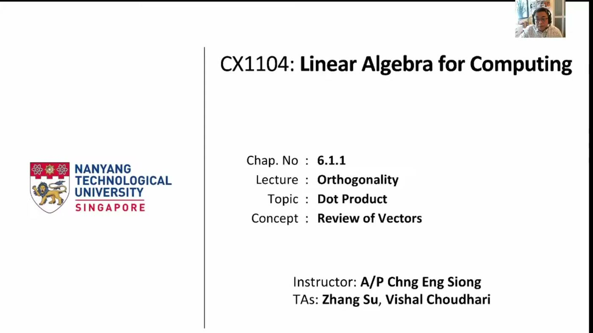

**Content:** Title card — *CX1104: Linear Algebra for Computing*. **Chap. No: 6.1.1 · Lecture: Orthogonality · Topic: Dot Product · Concept: Review of Vectors** (A/P Chng Eng Siong; TAs Zhang Su, Vishal Choudhari).

> 🎙️ **Narration:** *"Welcome to CX1104 Linear Algebra for Computing. In this chapter 6.1.1 we continue on orthogonality and the dot product, and today we will review vectors. A vector is an object that has both a magnitude and a direction, and the following ways are three equivalent ways to describe the vectors. Figure 3.1.1 shows a vector represented by a line segment, and in this line segment it is represented as an arrow with an initial point and a terminal point — hence it has a magnitude (the magnitude is here) and where the arrow is pointing to is its direction. Therefore if you have vectors being represented only by a magnitude and direction, you can see that these four vectors having the same magnitude and the same direction are therefore equivalent vectors."*

---

### 🎬 Slide 2 — Geometric Vectors: magnitude, direction and equivalent vectors

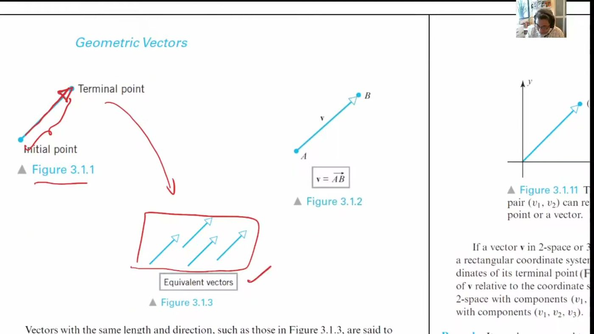

**Content — Geometric vectors** (from *Elementary Linear Algebra*):

- A vector is drawn as a **directed line segment**: **initial point** (tail) → **terminal point** (head).
- **Magnitude** = the length of the segment; **direction** = the way the arrow points.
- Notation: boldface $\mathbf v$, or $\mathbf v = \overrightarrow{AB}$ with initial point $A$, terminal point $B$.
- **Equivalent vectors** — same length *and* same direction — are equal, no matter where they are drawn.
- Figure 3.1.2 shows the same ordered pair $(v_1, v_2)$ can represent a **point** or a **vector**; Figure 3.1.3 shows equivalent vectors relative to a coordinate system.

> 🎙️ **Narration:** *"There is another way to represent vectors: here we use a boldface $\mathbf v$ to represent the vector, and we use capital A to represent the initial point and capital B to represent the final point, as in this figure, with a little arrow on top of A and B to show that this vector goes from point A to point B. In summary, geometrically we can picture a vector as a directed line segment whose length is the magnitude of the vector — the length is this length — with an arrow indicating the direction, and the direction is from the tail to its head. In the left plane of this slide…"*

---

### 🎬 Slide 3 — Geometric vectors *without* vs *with* a coordinate system

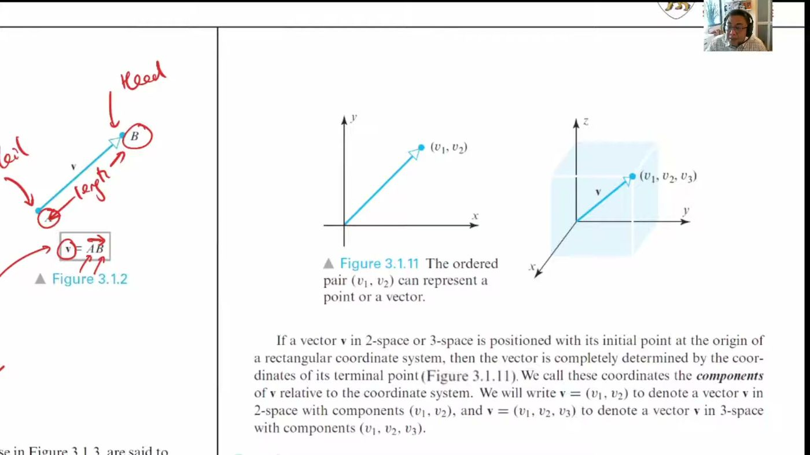

**Content:**

- **Left panel** — vectors described *geometrically*, without any coordinate system: purely a length and a direction.
- **Right panel** — vectors described *in a coordinate system*: a vector $\mathbf v$ is identified by a **list of numbers**, called its **coordinates** or **components**.
- In the standard Cartesian 2D system (horizontal $x$-axis, vertical $y$-axis) with the tail at the **origin**, the head is at $(v_1, v_2)$: $v_1$ is the component along the $x$-axis, $v_2$ along the $y$-axis (drop a vertical line from the head to read $v_1$; project onto the $y$-axis to read $v_2$).
- In 3D: $x$-, $y$-, $z$-axes; tail at the origin, head at $(v_1, v_2, v_3)$.
- **Watch out:** the same notation is used for a point and for a vector — think of a point as the vector whose tail is fixed at the origin; the context tells you which is meant.

> 🎙️ **Narration:** *"…we discuss vectors without any reference to a coordinate system. But on this right side, we are going to use a coordinate system to describe a vector. Having a coordinate system is useful as it will be easier for us to manipulate the coordinates of a vector rather than manipulating simply its magnitude and direction directly. When we express a vector in a coordinate system, we identify a vector $\mathbf v$ by a list of numbers, and we call these lists of numbers the coordinates of the vector — or sometimes we also call it the components of the vector. We will discuss examples using the standard Cartesian coordinate system for the 2D plane: we have the x-axis, the horizontal axis, and the y-axis, the vertical axis. The tail of the vector $\mathbf v$ is at the origin and the head of the vector is at $(v_1, v_2)$, where $v_1$ is the component along the horizontal axis or the x-axis, and $v_2$ is the component along the vertical axis. So where is $v_1$ and $v_2$? If we draw a vertical line dropping from $\mathbf v$ into the horizontal axis, this is $v_1$; and if we project the vector $\mathbf v$ onto the vertical axis, this is $v_2$. You may have noticed that we use the same notation to denote a point and a vector: here is a point and here is a vector. Actually you can think of a point as being represented by a vector whose tail is fixed at the origin — you have to figure out from the context whether we are thinking of a vector as having its tail fixed at the origin, or if we are talking about a point. To continue with the example of a three-dimensional vector, we have x-axis, y-axis and z-axis. The vector $\mathbf v$ has its tail at the origin and its head at $(v_1, v_2, v_3)$, where $v_1$ is the coordinate on the x-axis, $v_2$ the coordinate on the y-axis and $v_3$ on the z-axis — so it will be $v_1$ here, $v_2$ here and $v_3$ here, representing this vector $\mathbf v$ in the 3D coordinate system."*

---

### 🎬 Slide 4 — Vectors *not* at the origin; $n$-tuples; sets vs tuples

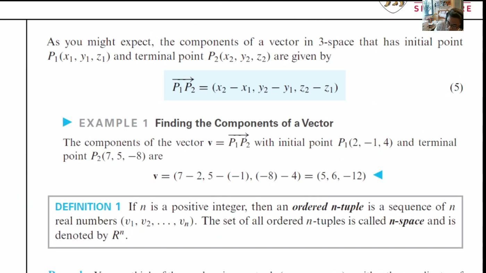

**Content:**

- **3D case:** for $\mathbf v$ from $P_1(x_1,y_1,z_1)$ to $P_2(x_2,y_2,z_2)$, subtract the coordinates of $P_1$ from those of $P_2$ to get the components.
- **Naming:** 2D → **2-tuple**, 3D → **3-tuple**, general → **$n$-tuple**.
- **Tuple** = an *ordered* collection: the position in the list matters, and repetition is allowed.
- **Set** = an *unordered* collection of **distinct** objects, written with curly braces $\{\ \}$.
- Example: the tuple $(1,2,3) \neq (3,2,1)$ (order matters) and $(1,2,2,3) \neq (1,2,3)$ (repetition counts), whereas the sets $\{1,2,2,3\} = \{1,2,3\} = \{3,2,1\}$.

> 🎙️ **Narration:** *"Now, as you might expect for the three-dimensional case, we are going to have the same idea of representing a vector from $P_1$ to $P_2$ in the 3D coordinate system, where if we are given $P_1$ to be $(x_1, y_1, z_1)$ and $P_2$ to be $(x_2, y_2, z_2)$, a vector $\mathbf v$ from $P_1$ to $P_2$ has new components simply by subtracting the components of $P_1$ from $P_2$. For the 2D case we call it 2-tuple, for the 3D case we call it 3-tuple, and therefore in the n-dimensional case, where n is an integer, we call it n-tuple. Here the word tuple means a collection of objects that are ordered; 'ordered' means that the position in the list of objects is important. The lists of objects are actually the coordinates or the components of the vector along each of these axes. Lastly, we describe the difference between a set and a tuple. We represent a set using curly braces, and a set is an unordered collection — unordered means the position within the braces is unimportant, but the elements must be distinct for sets. While a tuple is an ordered collection: the position in the sequence is important. In other words, a tuple can contain multiple instances of the same element value. For the tuple we are going to use round brackets to encapsulate the sequence or the list of elements or components. Here we have a four-dimensional tuple and on the right-hand side we have a three-dimensional tuple, and therefore they are not representing the same vector. However for the set we have a set enclosed by braces with elements 1, 2, 2, 3 — since a set does not care about order and only cares whether elements are distinct…"*

---

### 🎬 Slide 5 — Components of a vector relative to a coordinate system

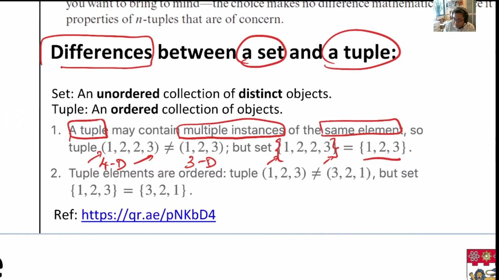

**Content — text from the reference book:**

> *"If a vector $\mathbf v$ in 2-space or 3-space is positioned with its initial point at the origin of a rectangular coordinate system, then the vector is completely determined by the coordinates of its terminal point (Figure 3.1.11). We call these coordinates the **components** of $\mathbf v$ relative to the coordinate system. We will write $\mathbf v = (v_1, v_2)$ to denote a vector $\mathbf v$ in 2-space with components $(v_1,v_2)$, and $\mathbf v = (v_1, v_2, v_3)$ to denote a vector $\mathbf v$ in 3-space with components $(v_1,v_2,v_3)$."*

- Vectors with the same length and direction (Figure 3.1.3) are **equivalent**.

> 🎙️ **Narration:** *"…not — 1, 2, 3 is the same set as 1, 2, 3, or this '2' appearing twice is not important in this set. Lastly, to reiterate that in a tuple the order is important: even though on the left side we have 1, 2, 3 and on the right-hand side we have also a 3-element tuple 3, 2, 1, because the position has been switched from the first element to the third element, the left vector and the right vector in the 3-tuple are not the same. Well, in the set case, since order does not matter, in the last example they are the same set. In this slide, we talk about Euclidean…"*

---

### 🎬 Slide 6 — Euclidean $n$-space

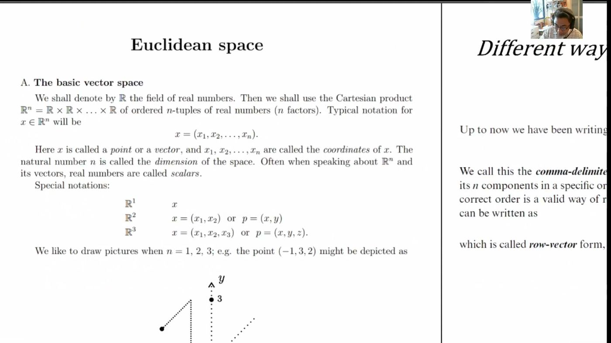

**Content:**

- **Euclidean** — named after Euclid, the great mathematician who wrote about geometry: the study of **size, shape, position and dimensions** of things.
- We study it first in 2D, then 3D, then generalise to **$n$ dimensions** — the **Euclidean $n$-space**.
- Cartesian coordinates use **real numbers** for each axis: 2D needs 2 real numbers ($\mathbb{R}^2$), 3D needs 3 ($\mathbb{R}^3$), and in general $\mathbb{R}^n$.

> 🎙️ **Narration:** *"…space. 'Euclidean' came from the name of Euclid, the great mathematician who wrote about geometry, and it is the study of size, shape, position and dimensions of things — typically we first study it in the 2D plane and finally in the 3D plane, or I should say 3D space. We then generalise 3D to n dimensions, and here when we talk about n dimensions we are still talking about Euclidean n-dimensional space. Now for the Cartesian coordinate we typically use real numbers to represent the dimension along each of the axes, and for 2D space…"*

---

### 🎬 Slide 7 — $\mathbb{R}^n$, the field $\mathbb{R}$, and three ways to write a vector

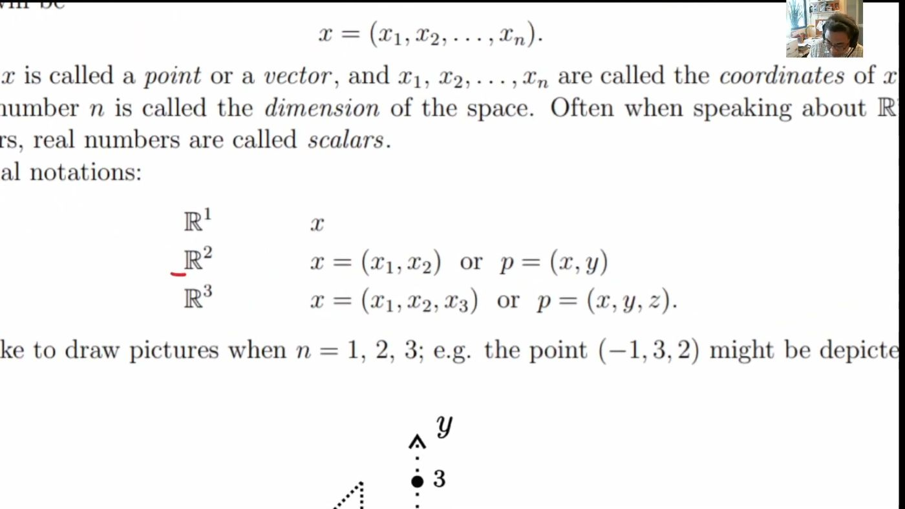

**Content:**

- $\mathbb{R}^2 = \mathbb{R} \times \mathbb{R}$ (Cartesian **product** of two copies of $\mathbb{R}$); $\mathbb{R}^3 = \mathbb{R} \times \mathbb{R} \times \mathbb{R}$; $\mathbb{R}^1$ is just a line.
- **$\mathbb{R}$ is the *field* of real numbers** — a set on which addition, subtraction, multiplication and division are defined (integers, rationals, reals are all fields).
- **Three notations for the same vector in $\mathbb{R}^n$:**
  1. **comma-delimited form:** $\mathbf v = (v_1, v_2, \dots, v_n)$,
  2. **row vector:** $\mathbf v = \begin{bmatrix} v_1 & v_2 & \cdots & v_n \end{bmatrix}$,
  3. **column vector:** $\mathbf v = \begin{bmatrix} v_1 \\ v_2 \\ \vdots \\ v_n \end{bmatrix}$.
- $\mathbb{C}^n$ (complex $n$-space) is the same idea with complex numbers instead of real numbers.

> 🎙️ **Narration:** *"…$\mathbb{R}^2$ we need two real numbers — the 2-tuple — and in 3D space, $\mathbb{R}^3$, we need three real numbers to represent the vector in 3D space. Of course we can also have $\mathbb{R}^1$, meaning basically we have values only along a line. The 'R2' actually represents only two of them, $\mathbb{R} \times \mathbb{R}$; and in $\mathbb{R}^3$ we will have three of them, $\mathbb{R}^3 = \mathbb{R} \times \mathbb{R} \times \mathbb{R}$. This 'times' within this representation is sometimes called a product, so that's why we call it the Cartesian product. We now digress a little bit to introduce the terminology 'field'. In this example, we say $\mathbb{R}$ is the field of real numbers. What is a field in mathematics? A field is actually a set on which addition, subtraction, multiplication and division operations are defined — so you have actually known about fields for a long time: when you are adding integers, real numbers, rational numbers, all these are actually sets having all these operations defined on them. For an interesting discussion of fields, look at Socratica's field definition over here; if you google 'Socratica field definition' you would see this video. Finally, we discuss here in these slides different ways to talk about vectors in $\mathbb{R}^n$. In $\mathbb{R}^n$ we have a tuple, and in the last two slides we said that a tuple is enclosed by round brackets with elements separated by commas, and the position of the element in the tuple is important because it represents that particular coordinate or basis. We call this the comma-delimited form. However, we can represent our n-vectors in another way: for example, we can represent it with square brackets and put them horizontally, and this is a row vector; or we can tilt it to this side, and now we have a column vector. They are the same vector $\mathbf v$ — they are just written in different notations, that's all. In this last…"*

---

### 🎬 Slide 8 — Example: components of a vector not at the origin; Definition of $\mathbb{R}^n$

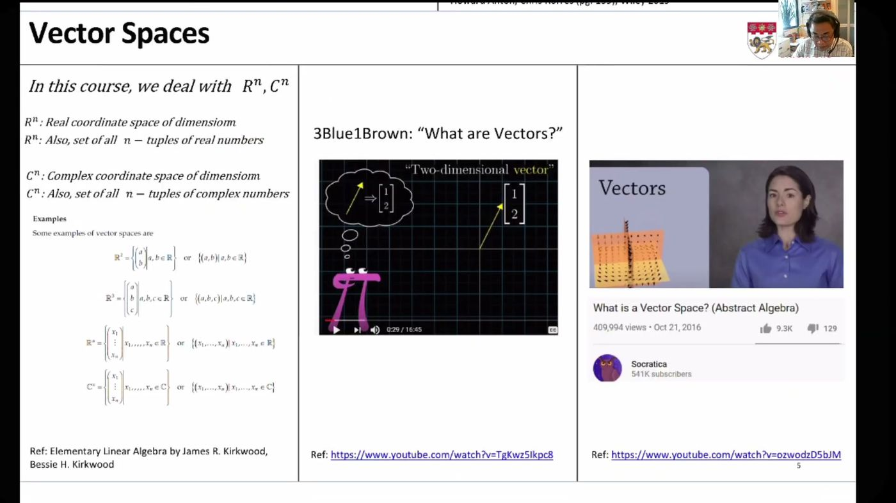

**Content:**

- **Example 1.** The components of the vector $\mathbf v = \overrightarrow{P_1P_2}$ with **initial point** $P_1(2,-1,4)$ and **terminal point** $P_2(7,5,-8)$ are obtained by subtracting coordinates:
$$\mathbf v = (7-2,\ 5-(-1),\ -8-4) = (5,\ 6,\ -12).$$
- **Definition 1.** If $n$ is a positive integer, then an **ordered $n$-tuple** is a sequence of $n$ real numbers $(v_1, v_2, \dots, v_n)$. The set of all ordered $n$-tuples is denoted by $\mathbb{R}^n$.
- **Remark.** You can think of the numbers in an $n$-tuple as a **generalised point** or as the **components of a generalised vector** — the choice makes no difference to the properties of $n$-tuples that are of concern.
- $\overrightarrow{P_1P_2} = \overrightarrow{OP_2} - \overrightarrow{OP_1}$.

> 🎙️ **Narration:** *"…slide we summarise our interest in the $\mathbb{R}^n$ vectors. We also have something called $\mathbb{C}^n$ vectors, where if R stands for the real field, C stands for the complex field — it means that the vectors here are n-dimensional complex numbers. Some…"*

---

### 🎬 Slide 9 — $\mathbb{R}^2$, $\mathbb{R}^3$ and $\mathbb{C}^n$ examples

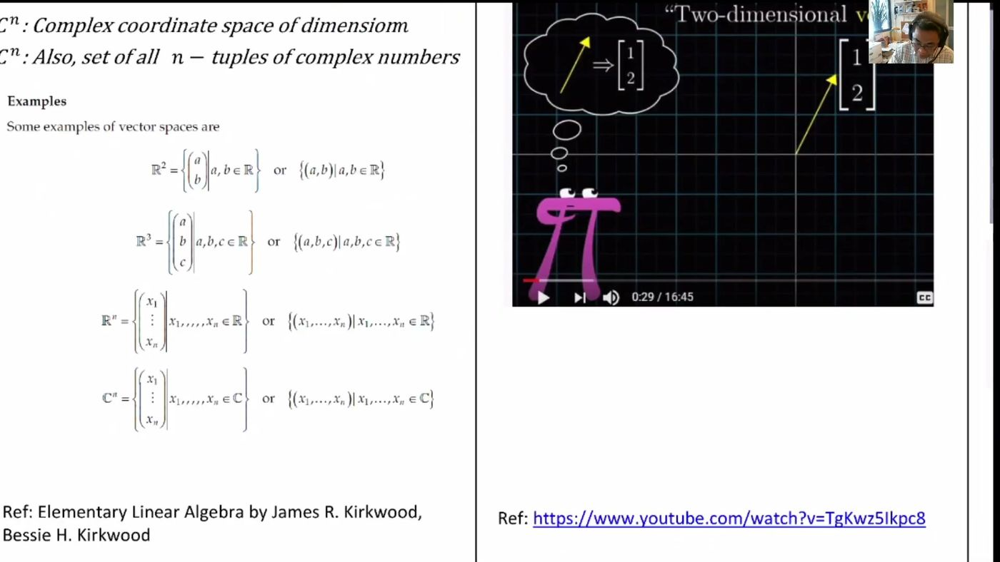

**Content:**

- Examples of $\mathbb{R}^2$ and $\mathbb{R}^3$ (real components), and of $\mathbb{C}^n$ (complex components).
- The **only difference** between $\mathbb{C}^n$ and $\mathbb{R}^n$ is whether the elements of the tuple are **complex** numbers or **real** numbers.
- Recommended viewing: *3Blue1Brown* — “Vectors, what even are they?” — and *Socratica* for the more abstract treatment.

> 🎙️ **Narration:** *"…examples of $\mathbb{R}^2$ and $\mathbb{R}^3$ here, and examples of $\mathbb{C}^n$ here. Basically the difference between $\mathbb{C}^n$ and $\mathbb{R}^n$ is that the elements in the tuple are simply complex numbers as opposed to real numbers for $\mathbb{R}^n$. I would like to suggest 3Blue1Brown…"*

---

### 🎬 Slide 10 — Formula for $\overrightarrow{P_1P_2}$ + sets vs tuples

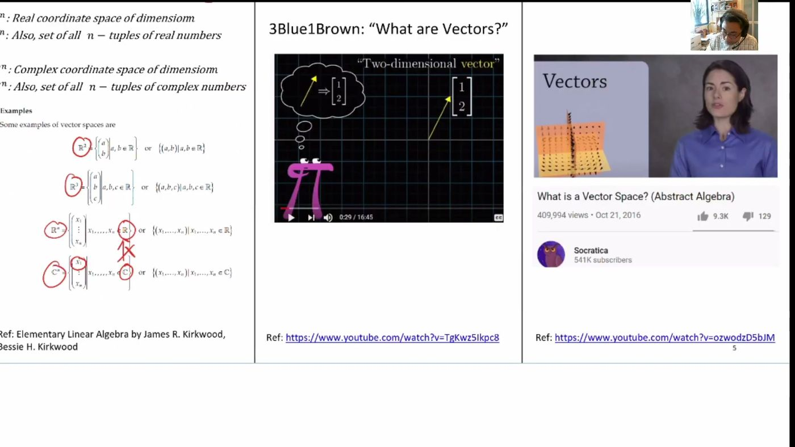

**Content:**

- **Formula.** If $\overrightarrow{P_1P_2}$ denotes the vector with initial point $P_1(x_1,y_1)$ and terminal point $P_2(x_2,y_2)$, then
$$\overrightarrow{P_1P_2} = (x_2 - x_1,\ y_2 - y_1), \qquad \overrightarrow{P_1P_2} = \overrightarrow{OP_2} - \overrightarrow{OP_1}.$$
- **Sets vs tuples:**
  - **Set:** an unordered collection of **distinct** objects.
  - **Tuple:** an ordered collection of objects.
  1. A tuple may contain multiple instances of the same element: $(1,2,2,3) \neq (1,2,3)$, but $\{1,2,2,3\} = \{1,2,3\}$.
  2. Tuple elements are ordered: $(1,2,3) \neq (3,2,1)$, but $\{1,2,3\} = \{3,2,1\}$.

> 🎙️ **Narration:** *"…[3Blue1Brown], an excellent job in explaining linear algebra and vectors in his series. For a more abstract discussion, if you're interested, Socratica did a very nice video on 'what are vectors' and abstract algebra in their series."*

---
## V-6.1.2 — 6.1.2 Norm and Unit Vector

> **Videos (3):** `6.1.2, Support` (7.3 min) · `6.1.2, pg 1~3` (8.9 min) · `6.1.2, pg 4~5` (7.5 min) — deck: `6.1.2_Norm_Unit_Vector.pdf` (5 pages)
>
> The *Support* video is background reading prepared for this section: the abstract definition of a **norm** and the concept of a **field**.

### 🎬 Slide 1 — Support: *What is a Norm?* (general/abstract definition)

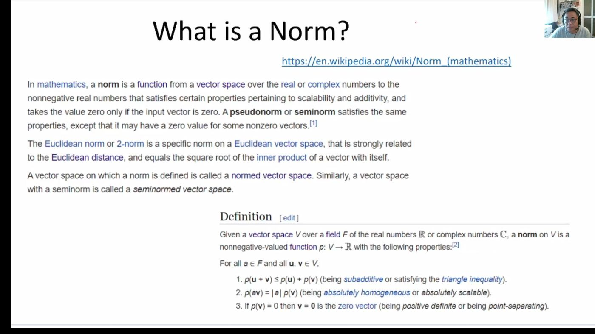

**Content — from the Wikipedia article “Norm (mathematics)”:**

- In mathematics, a **norm** is a function from a vector space over the real or complex numbers to the non-negative real numbers that satisfies certain properties pertaining to **scalability** and **additivity**, and takes the value zero only if the input vector is zero.
- A **pseudonorm / seminorm** satisfies the same properties, except that it may have a zero value for some nonzero vectors.
- The **Euclidean norm or 2-norm** is a specific norm on a Euclidean vector space; it equals the **square root of the inner product of a vector with itself**.
- A vector space on which a norm is defined is called a **normed vector space**.

**Definition.** Given a vector space $V$ over a field $F$ of the real numbers $\mathbb R$ or complex numbers $\mathbb C$, a norm on $V$ is a non-negative-valued function $p : V \to \mathbb{R}$ with the following properties. For all $a \in F$ and all $\mathbf u, \mathbf v \in V$:

1. $p(\mathbf u + \mathbf v) \le p(\mathbf u) + p(\mathbf v)$ — **subadditive** (triangle inequality),
2. $p(a\mathbf v) = |a|\,p(\mathbf v)$ — **absolutely homogeneous** (absolutely scalable),
3. $p(\mathbf v) = 0 \Rightarrow \mathbf v = \mathbf 0$ — **positive definite** (point-separating).

> 🎙️ **Narration:** *"I have prepared these lecture notes, 'What is a norm', to support 6.1.2. In our course, linear algebra, we have dealt with the norm in the L2 Euclidean sense. However, a norm is a very general concept, and in the concept of algebra — or modern algebra, sometimes called abstract algebra — a norm actually is a function: a vector space V over the real and complex numbers such that the function returns a non-negative real number that satisfies some properties, and the properties are as follows. Let us discuss the properties of the norm first before we go and discuss what is a function and what is the word 'over' the field of real or complex numbers. Let's focus on this notation which is often used to describe a norm. $p$ is a function, the colon means 'such that', $V$ here means the vector space, and the right arrow means a function that gives an output, a real number — the real number, in addition, is a non-negative value, and the vector space V is over a field $F$, and $F$ is typically the real numbers or the complex numbers. Let's talk about the properties. If $\mathbf u$ and $\mathbf v$ are elements of the vector space V and $a$ is an element of the field, then the norm $p$ of $\mathbf u + \mathbf v$ is less than or equal to $p(\mathbf u) + p(\mathbf v)$; this property is the triangle inequality — basically it means that the norm acting on the sum $\mathbf u + \mathbf v$ is less than or equal to the norm acting on $\mathbf u$ alone plus the norm acting on $\mathbf v$ alone. The second property, which is the absolutely scalable property, or sometimes called the absolutely homogeneous property, says this: the scalar $a$ multiplied by $\mathbf v$, and we take the norm of this $a\mathbf v$, is equal to the absolute value of the scalar $a$ multiplied by the norm of $\mathbf v$. And the third property, positive definite, is the norm always giving a positive value, and giving the zero value only when the vector $\mathbf v$ is the zero vector. These are the three properties that are needed to be called a norm on V. In our course for linear algebra we typically deal with only the Euclidean…"*

---

### 🎬 Slide 2 — Support: what a *function* is (arrow notation)

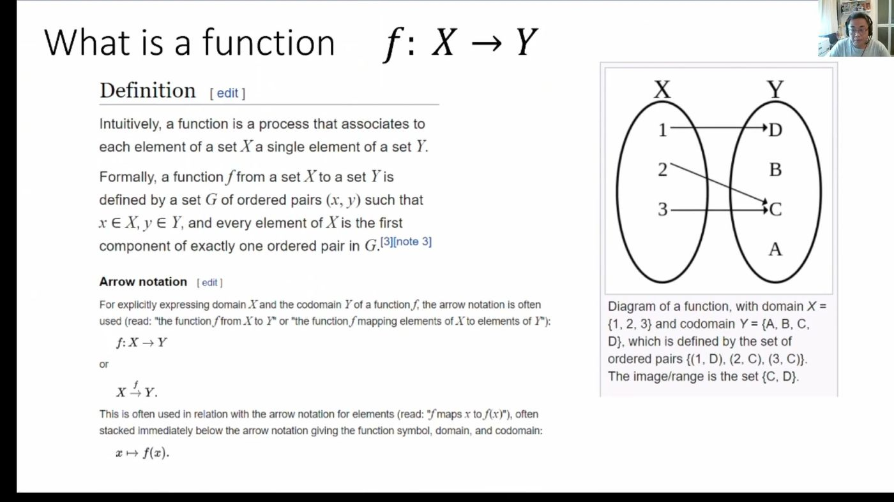

**Content:** The typical definition of a function notation is $f : X \to Y$: $f$ takes an element from $X$ and maps it to an element of $Y$; both $X$ and $Y$ are sets. We say *the function $f$ maps elements of $X$ to the elements of $Y$*. One rule of a function: **every element of $X$ must have exactly one** element in $Y$.

> 🎙️ **Narration:** *"The typical definition of a function notation looks like this: $f$ is a function such that it takes an element from $X$ and changes to an element of $Y$. Both $X$ and $Y$ are sets. Sometimes we use the words 'the function f maps elements of X to the elements of Y', and one of the rules of a function says every element of X must have exactly one element in Y. Now we go back to the first page…"*

---

### 🎬 Slide 3 — Support: norm definition (page 1, revisited)

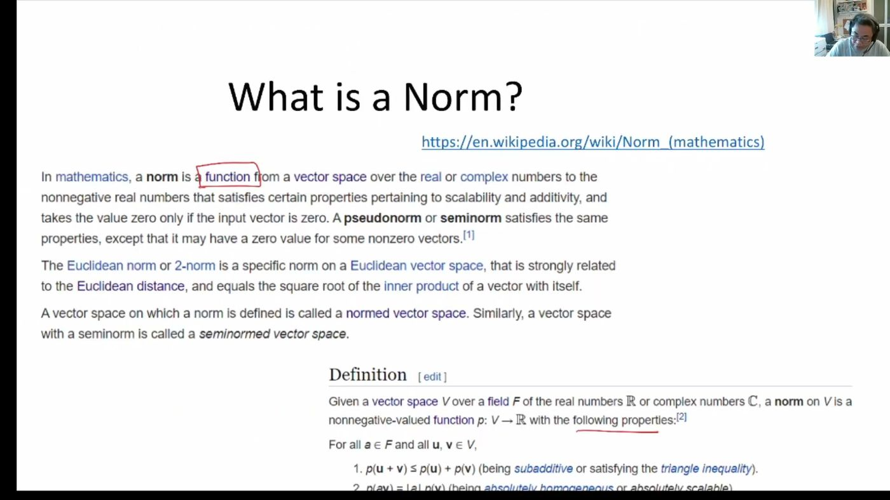

**Content:** *What is a Norm?* — the same Wikipedia definition, read again with emphasis on the phrase **“over the real or complex numbers”**.

> 🎙️ **Narration:** *"…what is a norm — it says a norm is a function from a vector space over the real and complex numbers. What does 'over the real or complex number field' mean? In our linear algebra…"*

---

### 🎬 Slide 4 — Support: what “vector space over the field $k$” means

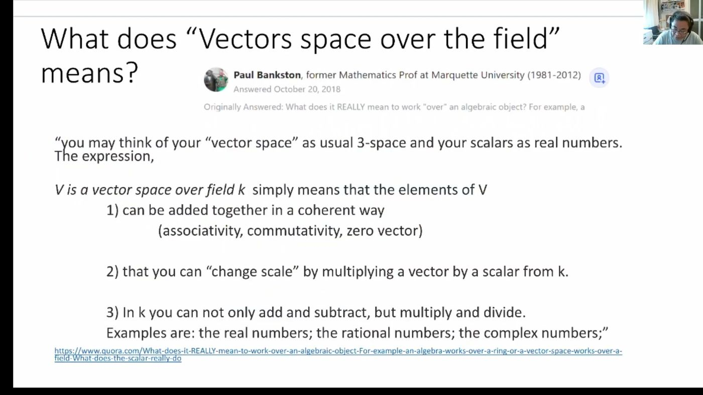

**Content:**

- *“V is a vector space over field k”* simply means that the elements of $V$
  1. can be **added together in a coherent way** (associativity, commutativity, zero vector),
  2. can be **scaled** — multiplying a vector by a scalar from $k$,
  3. and in $k$ you can not only add and subtract, but also **multiply and divide**.
- Examples of fields: the real numbers, the rational numbers, the complex numbers.

> 🎙️ **Narration:** *"…our vector spaces are the spaces $\mathbb{R}^2$ and $\mathbb{R}^3$, and the scalars — for example $\alpha$, $\beta$ — are real numbers, or sometimes complex numbers. In the $\alpha$ and $\beta$ of $\mathbb{R}^3$, the alphas and betas are real numbers. Briefly, the phrase 'a vector space over the field k', where k is the real or complex, means that the elements of the vector space can be added together in a coherent way. So we are now talking about a vector space V here, but in addition to that the vector can be multiplied by the scalar k, and k belongs to a field — and 'field' here means that it is a set where not only can we add or subtract but we can also multiply and divide. So k is an element of a field, and typically in our example it is the field of real or complex numbers. All these are very abstract; however, if you are more interested to understand this area of work, I would like to suggest to look at…"*

---

### 🎬 Slide 5 — Support: what a function is (Wikipedia, with diagram)

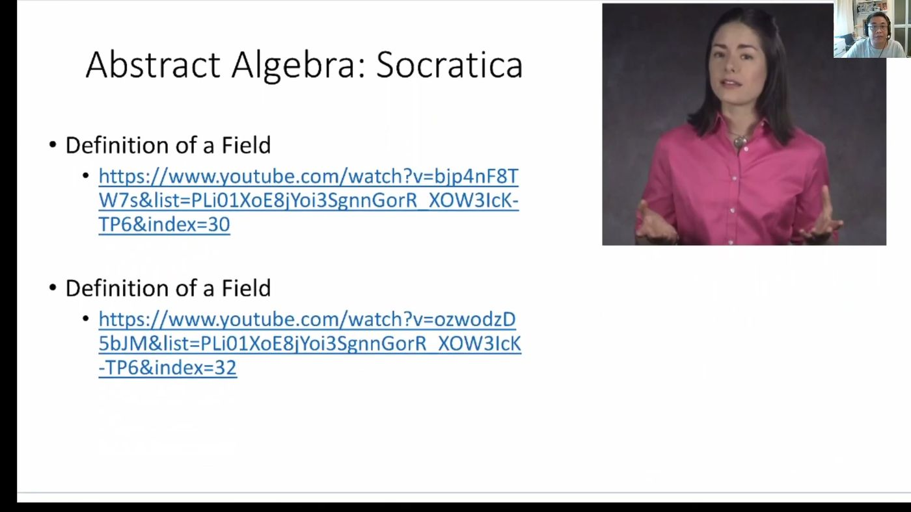

**Content:** *“Intuitively, a function is a process that associates to each element of a set $X$ a single element of a set $Y$.”* Formally, a function $f$ from $X$ to $Y$ is defined by a set $G$ of ordered pairs $(x,y)$ such that $x \in X$, $y \in Y$, and every element of $X$ is the first component of exactly one ordered pair in $G$. **Arrow notation:** $f: X \to Y$ (“the function $f$ from $X$ to $Y$”). *Diagram:* domain $X=\{1,2,3\}$, codomain $Y=\{A,B,C,D\}$, defined by $\{(1,D),(2,C),(3,C)\}$ — the image/range is $\{C,D\}$.

> 🎙️ **Narration:** *"…abstract algebra under Socratica — they will define what is a field and they will also define what is a vector space. Thank you."*

---

### 🎬 Slide 6 — 6.1.2 begins: Norm of a vector and unit vectors (title)

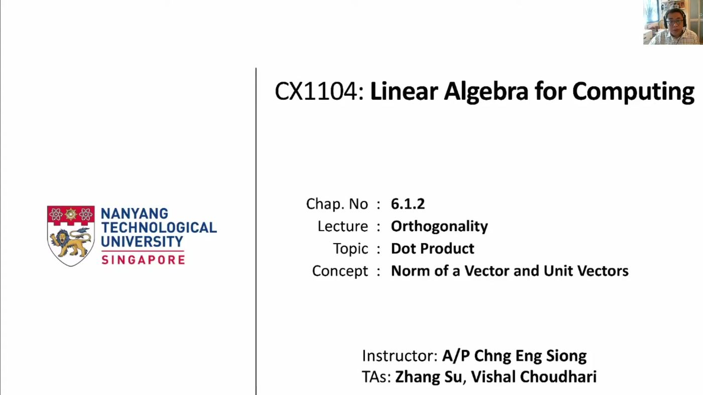

**Content:** The *What is a Norm?* reference page again — the section proper, **6.1.2 Norm of a Vector and Unit Vectors**, starts here.

> 🎙️ **Narration:** *"This is 6.1.2 Linear Algebra for Computing. In this section we will talk about the norm of a vector and unit vectors."*

---

### 🎬 Slide 7 — Support: “Vector space over the field” explained simply

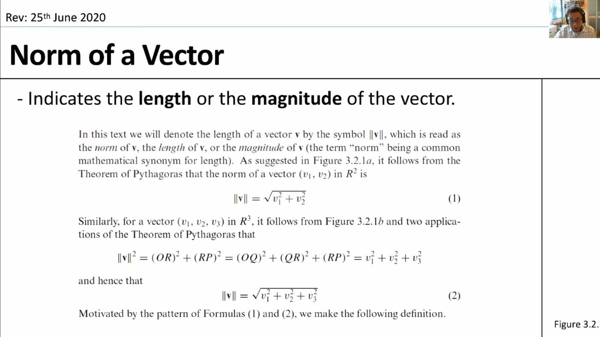

**Content — Paul Bankston (Marquette University):** *“You may think of your 'vector space' as usual 3-space and your scalars as real numbers. The expression ‘V is a vector space over field k’ simply means that the elements of V (1) can be added together in a coherent way (associativity, commutativity, zero vector); (2) that you can ‘change scale’ by multiplying a vector by a scalar from k; (3) in k you can not only add and subtract, but multiply and divide.”*

> 🎙️ **Narration:** *"The norm of a vector actually indicates the length of the vector. Or sometimes, instead of using the word length, we can also use the word magnitude. Basically it is a value that indicates how long this vector is. In our study we are interested in the norm as in the Euclidean norm — basically the Euclidean norm. For the $\mathbb{R}^2$ space, we can look at this example."*

---

### 🎬 Slide 8 — Support: further reading (Socratica, *Definition of a Field*)

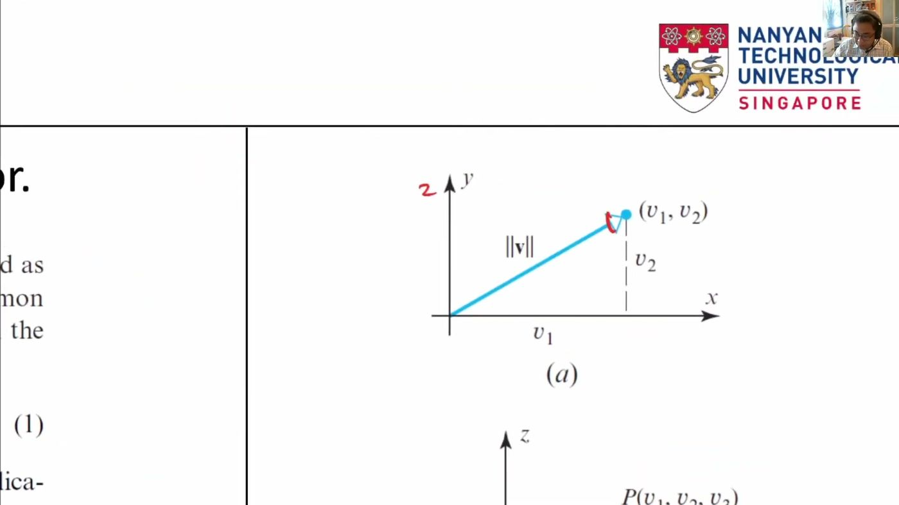

**Content:** Links to *Abstract Algebra: Socratica* — **Definition of a Field** (two YouTube links provided).

> 🎙️ **Narration:** *"We have the vector $\mathbf v \in \mathbb{R}^2$ with $v_1$ on the x-axis and $v_2$ on the y-axis. In our case the x- and y-axes are perpendicular to each other, and we can employ the Pythagoras theorem to find the longer side. The longer side — which is the length of $\mathbf v$ — is equal to $\sqrt{v_1^2 + v_2^2}$. If you square both sides, what we'll get is $\|\mathbf v\|^2 = v_1^2 + v_2^2$. Over here, to be more precise, we should say that it will be the **norm** of $\mathbf v$…"*

---

### 🎬 Slide 9 — Title slide of the 6.1.2 deck

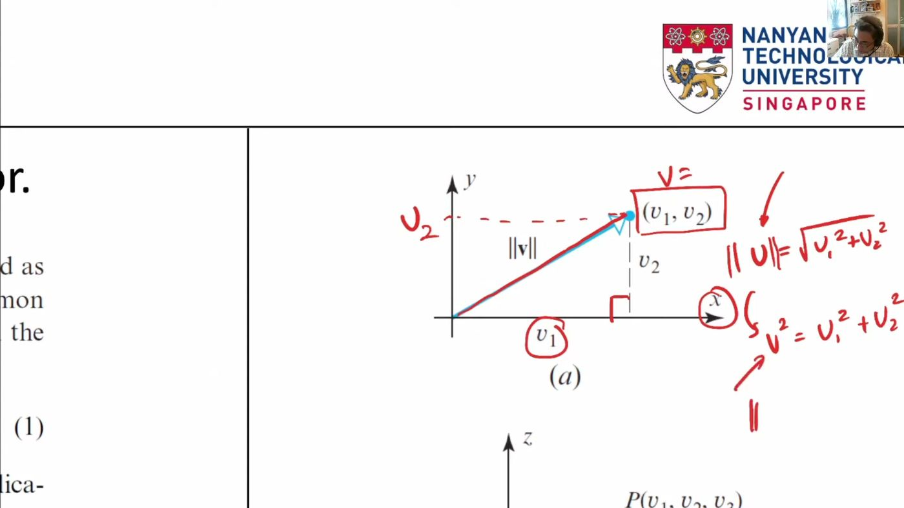

**Content:** *CX1104 — Chap. No: 6.1.2 · Lecture: Orthogonality · Topic: Dot Product · Concept: Norm of a Vector and Unit Vectors.*

> 🎙️ **Narration:** *"…and hence this equation is 'norm of v' squared. Hence equation one is the equation…"*

---

### 🎬 Slide 10 — Definition: the norm (length, magnitude) of a vector — $\mathbb{R}^2$ and $\mathbb{R}^3$

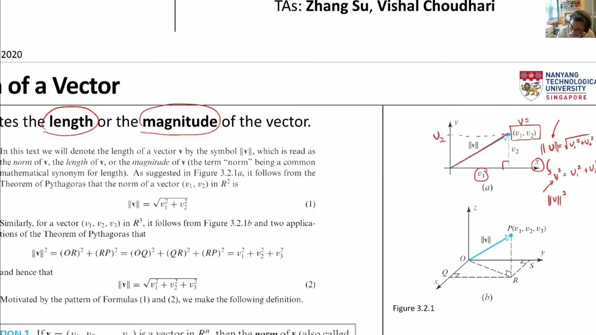

**Content — from the text (*Chapter 3, Euclidean Vector Spaces*):**

- The norm indicates the **length** or the **magnitude** of the vector. The length of a vector $\mathbf v$ is denoted $\|\mathbf v\|$ — read as “the norm of $\mathbf v$”, “the length of $\mathbf v$” or “the magnitude of $\mathbf v$”.
- For $\mathbf v = (v_1,v_2)$ in $\mathbb{R}^2$, by the **Theorem of Pythagoras** (Figure 3.2.1a):
$$\|\mathbf v\| = \sqrt{v_1^2 + v_2^2}\qquad(1)$$
- For $\mathbf v = (v_1,v_2,v_3)$ in $\mathbb{R}^3$, two applications of Pythagoras (Figure 3.2.1b) give
$$\|\mathbf v\|^2 = (OR)^2 + (RP)^2 = (OQ)^2 + (QR)^2 + (RP)^2 = v_1^2+v_2^2+v_3^2 \;\Longrightarrow\; \|\mathbf v\| = \sqrt{v_1^2+v_2^2+v_3^2}\qquad(2)$$

> 🎙️ **Narration:** *"…for the Pythagoras theorem solution of the length for $\mathbb{R}^2$. We now extend the…"*

---

### 🎬 Slide 11 — Pythagoras in $\mathbb{R}^3$ (figure)

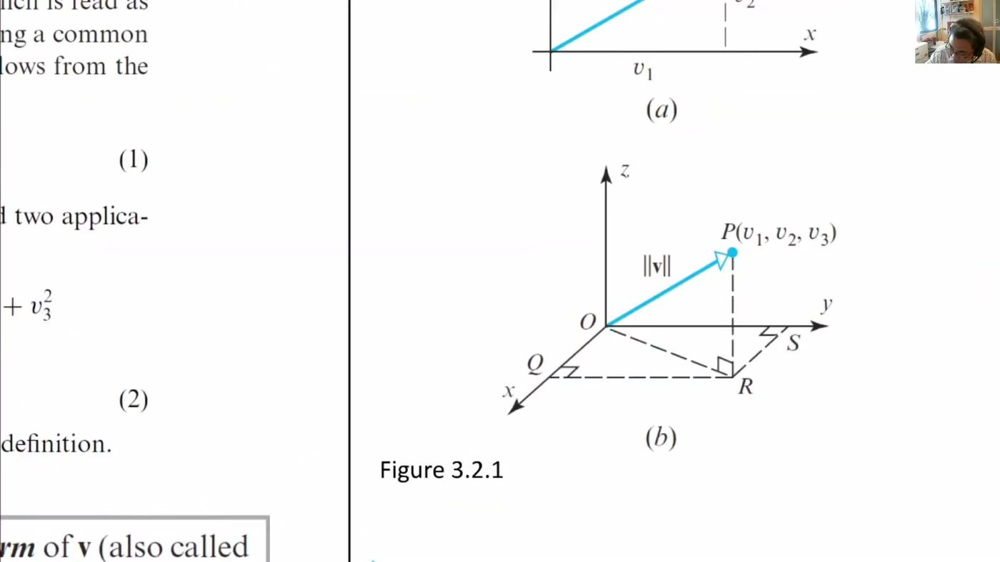

**Content — Figures 3.2.1(a) and (b):** the vector $\mathbf v = (v_1,v_2)$ in the plane and $\mathbf v = (v_1,v_2,v_3)$ in space, with the right-angle construction $O \to Q \to R \to P$ used to derive the norm.

> 🎙️ **Narration:** *"…Pythagoras theorem for $\mathbb{R}^3$. We have vector $\mathbf v$ with tuple in $\mathbb{R}^3$: $v_1$ as the first coordinate, $v_2$ as the second coordinate and $v_3$ as the third coordinate. If we study this right-angle triangle, then we will see that the length of $\mathbf v$ can be found by knowing the length $RP$ squared and $OQ$ squared. I'll write the equation again: the norm of $\mathbf v$ is equal to the square root of $RP$ squared plus $OR$ squared. If we square both sides, then it will be 'norm of v squared' equals $RP$ squared plus $OR$ squared. We can calculate $OR$ squared using this factor: $OR$ squared is this vector's length — it can be calculated using $OQ$ squared…"*

---

### 🎬 Slide 12 — The same derivation, continued

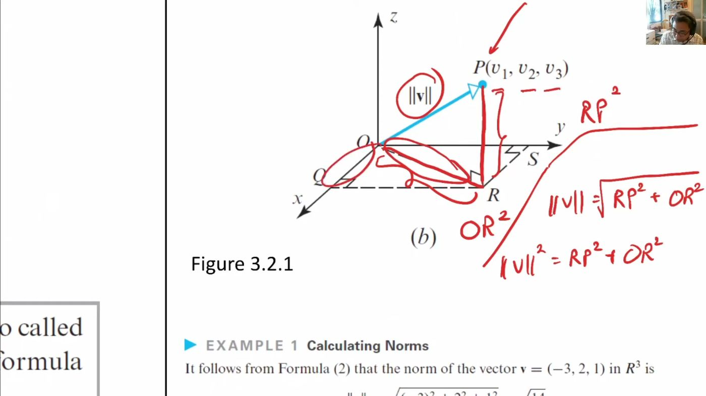

**Content:** Continuation of the $\mathbb{R}^3$ Pythagoras derivation: $\|\mathbf v\|^2 = (OR)^2 + (RP)^2$, with $(OR)^2 = (OQ)^2 + (QR)^2$, hence $\|\mathbf v\|^2 = v_1^2+v_2^2+v_3^2$.

> 🎙️ **Narration:** *(no narration on this transition frame — the explanation continues on the next slide)*

---

### 🎬 Slide 13 — Derivation completed: $\|v\|^2 = RP^2 + OQ^2 + QR^2$

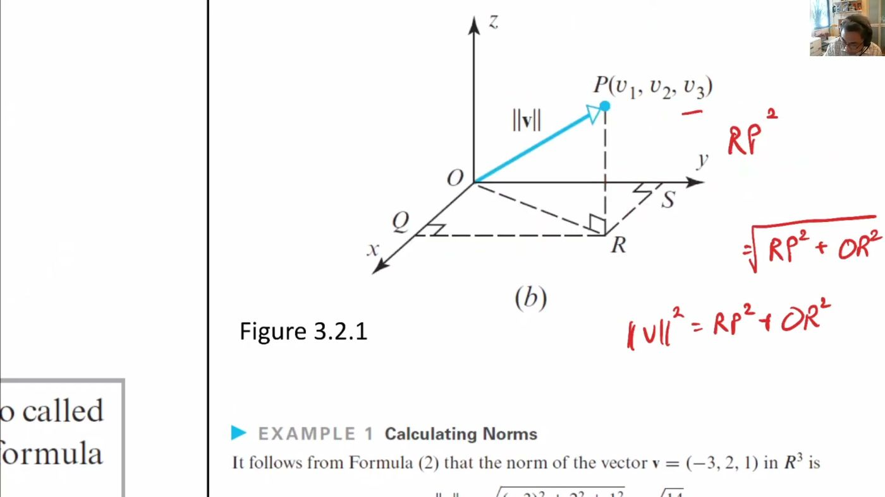

**Content:** $v_1^2 = RP^2$, and $(OR)^2 = OQ^2 + QR^2$, so $\|\mathbf v\|^2 = RP^2 + OQ^2 + QR^2$ — the space-diagonal result.

> 🎙️ **Narration:** *"…plus $QR$ squared. I repeat: $OQ$ squared plus $QR$ squared equals $OR$ squared. Therefore $RP$ squared plus $OQ$ squared plus $QR$ squared equals 'norm of v' squared — in the…"*

---

### 🎬 Slide 14 — The norm in $\mathbb{R}^n$ + Example 1

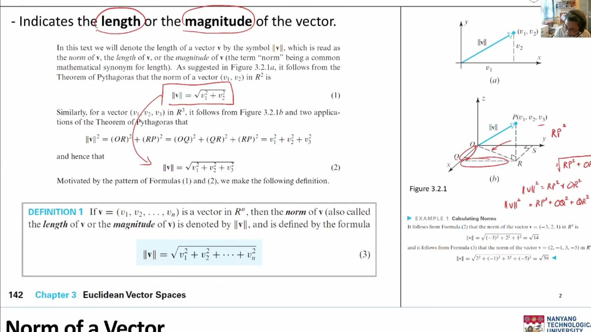

**Content:**

- Motivated by the pattern of (1) and (2), the norm of $\mathbf v = (v_1,\dots,v_n)$ in $\mathbb{R}^n$ is
$$\|\mathbf v\| = \sqrt{v_1^2 + v_2^2 + \cdots + v_n^2}\qquad(3)$$
- **Example 1 (worked in the lecture):** for $\mathbf v = (-3, 2, 1)$ in $\mathbb{R}^3$,
$$\|\mathbf v\| = \sqrt{(-3)^2 + 2^2 + 1^2} = \sqrt{14}.$$
- Note: because every coordinate is squared, negative entries are fine — the norm is **always non-negative**, and it is zero only when all entries are zero.

> 🎙️ **Narration:** *"…$\mathbb{R}^3$ example. Now, motivated by the pattern from the first equation and the second equation, for $\mathbb{R}^n$ the norm of $\mathbf v$ is represented by this equation here, which is taking the square root of the sum of all the $v_i$ squared. Let us see Example 1 in $\mathbb{R}^3$: we have the position coordinates — first coordinate is $-3$, second coordinate is 2, and 1 — and remembering, using equation (3), we basically take the square of each of these coordinates, sum, and find the square root, and the answer is $\sqrt{14}$. What is obvious now is that even if we have negative coordinates, because it will be squared, the entries that will be summed will always be positive before being square-rooted; therefore the final solution will always be a positive value, and can only be zero when all the entries are zero. In the next slide…"*

---

### 🎬 Slide 15 — **Theorem 3.2.1** (properties of the norm) — stated

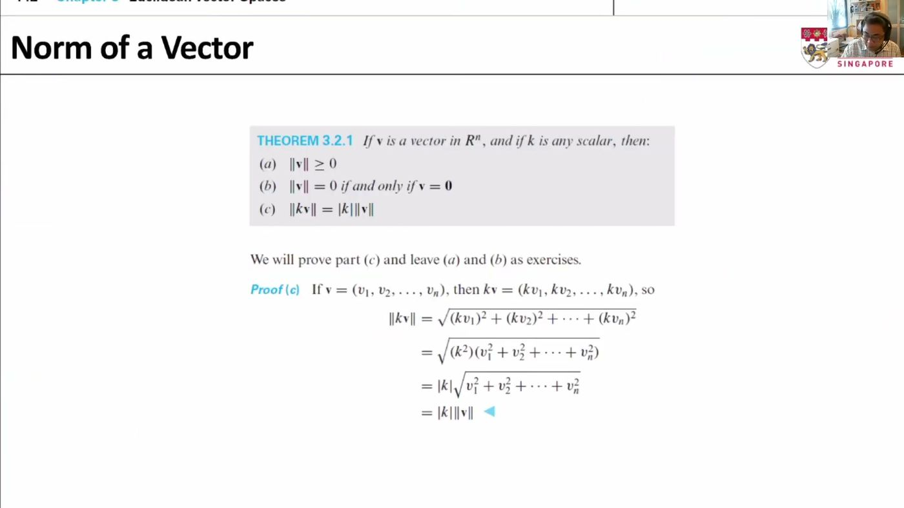

**Content — Theorem 3.2.1.** If $\mathbf v$ is a vector in $\mathbb{R}^n$, and if $k$ is any scalar, then:

**(a)** $\|\mathbf v\| \ge 0$  **(b)** $\|\mathbf v\| = 0$ if and only if $\mathbf v = \mathbf 0$  **(c)** $\|k\mathbf v\| = |k|\,\|\mathbf v\|$.

Part (c) is proved; (a) and (b) are left as exercises.

> 🎙️ **Narration:** *"…which now will summarise some properties regarding the norm. The first property is that it is a positive value — it will be 0 or greater than 0 — and it will only be 0 when the vector being evaluated is the 0 vector, where all entries are 0. The third property is: with a scalar $k$ multiplying the vector $\mathbf v$, what is this norm? And the answer is that its norm will be the absolute value of $k$, the scalar, multiplied by the norm of $\mathbf v$. Let us prove this property. We now treat $k\mathbf v$ as an entry $(kv_1, kv_2, \dots, kv_n)$ — basically we distribute the scalar $k$ into the coordinates. We then apply equation (3), which is the Pythagoras theorem — basically squaring each entry: $kv_2$ squared for the second entry, plus $kv_n$ squared for the last entry, and taking a square root. Now, by the law of exponents, we recognise $a^2b^2 = (ab)^2$. We convert each entry into its individual part and then we distribute the addition of each of these vector element coordinates multiplied by $k^2$. And again, using the law of exponents — that is, the square root of $AB$ is equal to the square root of $A$…"*

---

### 🎬 Slide 16 — Proof of Theorem 3.2.1(c), step 2

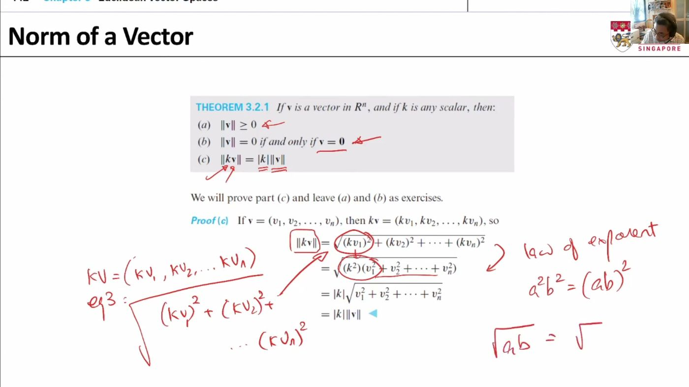

**Content — Proof (c).** If $\mathbf v = (v_1,v_2,\dots,v_n)$, then $k\mathbf v = (kv_1,kv_2,\dots,kv_n)$, so
$$\|k\mathbf v\| = \sqrt{(kv_1)^2+(kv_2)^2+\cdots+(kv_n)^2} = \sqrt{k^2\left(v_1^2+v_2^2+\cdots+v_n^2\right)} = |k|\sqrt{v_1^2+\cdots+v_n^2} = |k|\,\|\mathbf v\|.$$

> 🎙️ **Narration:** *"…multiplied by the square root of $B$. We can extract $k$ squared out, and applying square root will get the absolute value of $k$. We recognise that the second expression is reduced — or it is identical — to the norm of $\mathbf v$, and hence we get this final expression, which is: a scalar value $k$ multiplied by a vector $\mathbf v$, and its norm is…"*

---

### 🎬 Slide 17 — Proof completed (annotated)

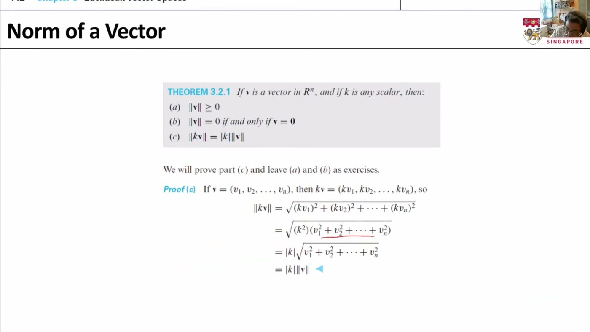

**Content:** Final line of the proof: $\|k\mathbf v\| = |k|\,\|\mathbf v\|$ — the **absolutely homogeneous** property; this is the same law as property 2 of the abstract norm definition in the Support video.

> 🎙️ **Narration:** *"…the same as the absolute value of $k$, the scalar, multiplied by the norm of $\mathbf v$. This slide shows…"*

---

### 🎬 Slide 18 — **Definition 1** (norm in $\mathbb{R}^n$) + Example 1 (both cases)

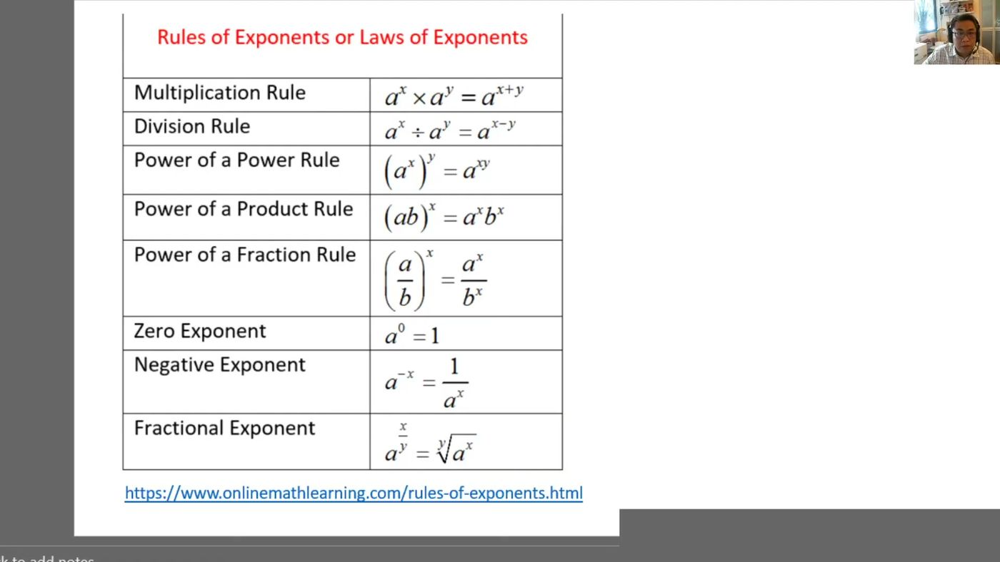

**Content — Definition 1.** If $\mathbf v = (v_1, v_2, \dots, v_n)$ is a vector in $\mathbb{R}^n$, then the norm of $\mathbf v$ (also called the **length** of $\mathbf v$ or the **magnitude** of $\mathbf v$), denoted $\|\mathbf v\|$, is defined by
$$\|\mathbf v\| = \sqrt{v_1^2 + v_2^2 + \cdots + v_n^2}\qquad(3)$$

**Example 1.**
- $\mathbf v = (-3,2,1)$ in $\mathbb{R}^3$: $\|\mathbf v\| = \sqrt{(-3)^2+2^2+1^2} = \sqrt{14}$.
- $\mathbf v = (2,-1,3,-5)$ in $\mathbb{R}^4$: $\|\mathbf v\| = \sqrt{2^2+(-1)^2+3^2+(-5)^2} = \sqrt{4+1+9+25} = \sqrt{39}$.

> 🎙️ **Narration:** *"…the summary of the rules of exponents which we have just used. The rule of exponents we are using is the 'power of a product' rule."*

---

### 🎬 Slide 19 — Norm summary + Examples (annotated)

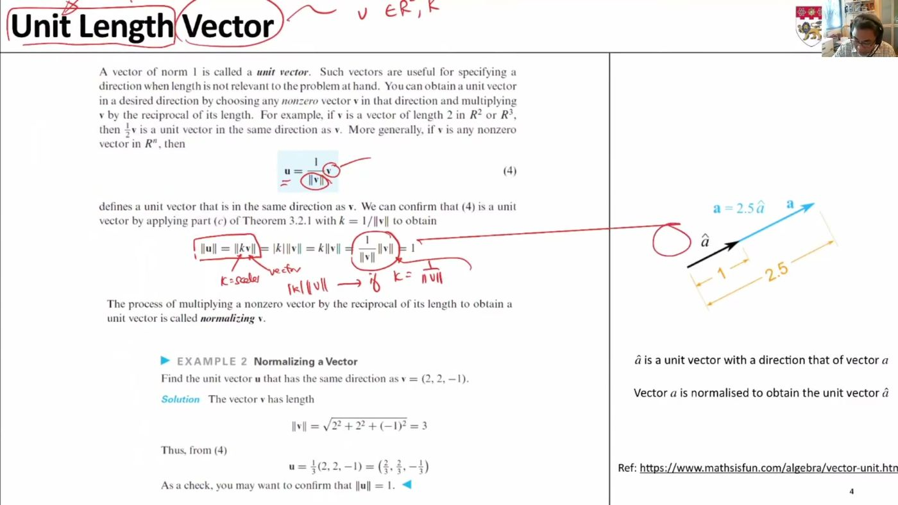

**Content:** The norm formula (3) with the two worked examples of Example 1 ($\sqrt{14}$ and $\sqrt{39}$) plus the start of the unit-vector discussion.

> 🎙️ **Narration:** *"…norm of $\mathbf v$ — therefore indicating that our norm of $\mathbf u$ is equal to 1. This process of multiplying…"*

---

### 🎬 Slide 20 — **Unit length vectors**: normalising

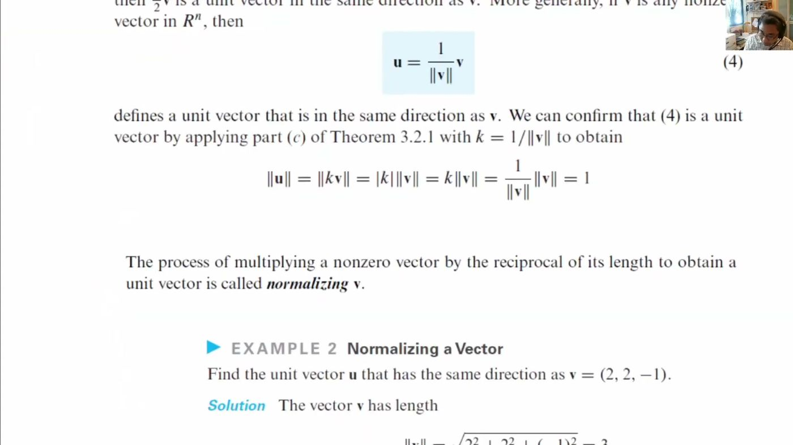

**Content:**

- A vector of norm 1 is called a **unit vector**. Such vectors are useful for specifying a **direction** when length is not relevant.
- You obtain a unit vector in a desired direction by taking any nonzero vector $\mathbf v$ in that direction and multiplying it by the **reciprocal of its length**: if $\mathbf v$ has length 2, then $\tfrac12\mathbf v$ is a unit vector in the same direction.
- More generally, for any nonzero $\mathbf v$ in $\mathbb{R}^n$,
$$\mathbf u = \frac{1}{\|\mathbf v\|}\mathbf v \qquad (4)$$
- Confirmation that (4) is a unit vector: $\displaystyle\left\|\frac{1}{\|\mathbf v\|}\mathbf v\right\| = \left|\frac{1}{\|\mathbf v\|}\right|\|\mathbf v\| = \frac{1}{\|\mathbf v\|}\|\mathbf v\| = 1$ (using Theorem 3.2.1(c) with $k = 1/\|\mathbf v\|$).
- The process of multiplying a nonzero vector by the reciprocal of its length is called **normalising** $\mathbf v$.

> 🎙️ **Narration:** *"…of a non-zero vector by the reciprocal of its length — reciprocal means 1 over the length — is the norm. This is called normalising the vector $\mathbf v$ to get a unit-length vector pointing in the direction…"*

---

### 🎬 Slide 21 — Theorem 3.2.1 + normalising (annotated worked example)

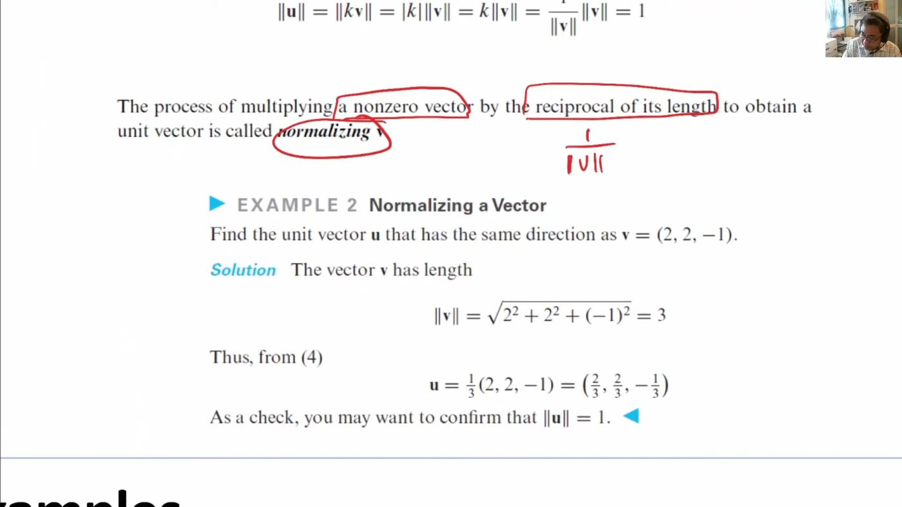

**Content:** Theorem 3.2.1 with its proof of (c), and — added by hand on the slide — the **$\mathbb{R}^3$ normalising example**: compute $\|\mathbf v\|$, then divide $\mathbf v$ by it.

> 🎙️ **Narration:** *"…of $\mathbf v$. This is an $\mathbb{R}^3$ example. We will find the norm; we will divide the vector $\mathbf v$ by the norm."*

---

### 🎬 Slide 22 — Normalising worked out; why unit vectors matter

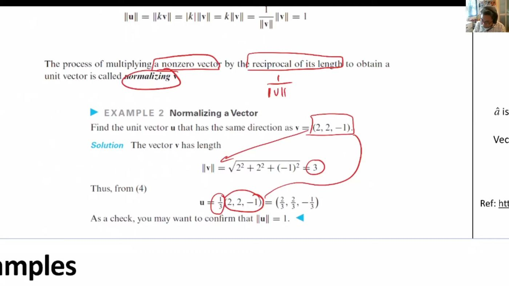

**Content:**

- The normalised vector (unit vector) is $\mathbf u = \frac{1}{3}\mathbf v$ for the example used; check that $\|\mathbf u\| = 1$.
- **Why unit vectors?** Any vector $\mathbf a$ can be written as a scalar multiple of the unit vector $\hat{\mathbf a}$ pointing the same way, e.g. $\mathbf a = 2.5\,\hat{\mathbf a}$: the length of $\mathbf a$ is 2.5 times the unit length, in the same direction as $\mathbf a$.

> 🎙️ **Narration:** *"Working through the examples, what we will see is that the new value is this: the normalised $\mathbf u$ — the unit vector, the unit-length vector of $\mathbf v$ — is equal to $\frac{1}{3}$ times the original components of $\mathbf v$. You should also check that the norm of $\mathbf u$ is 1. Why are we interested in unit-length vectors? Well, in this example the unit-length vector is $\hat{\mathbf a}$. Any vector $\mathbf a$ in this example can be represented as a scalar value multiplied by $\hat{\mathbf a}$, the unit-length vector. 2.5 basically means that the length of $\mathbf a$ is 2.5 times longer than the unit-length vector $\hat{\mathbf a}$, and it is pointing in the same direction as $\mathbf a$. In the last slide, basically we have further examples in $\mathbb{R}^4$ to…"*

---

### 🎬 Slide 23 — Support: Rules of Exponents

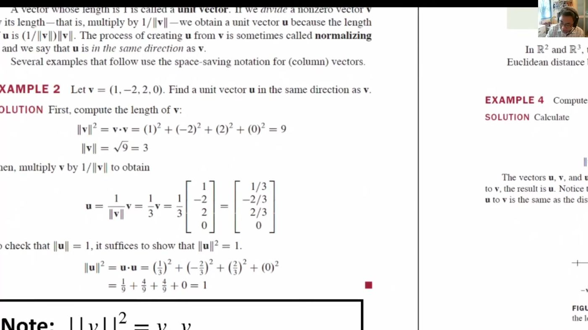

**Content — “Rules of Exponents / Laws of Exponents”:**

| Rule | Statement |
|---|---|
| Multiplication | $a^m a^n = a^{m+n}$ |
| Power of a power | $(a^m)^n = a^{mn}$ |
| **Power of a product** | $(ab)^n = a^n b^n$ |
| Power of a fraction | $\left(\dfrac{a}{b}\right)^n = \dfrac{a^n}{b^n}$ |
| Negative exponent | $a^{-n} = \dfrac{1}{a^n}$ |
| Fractional exponent | $a^{1/n} = \sqrt[n]{a}$ |

> 🎙️ **Narration:** *"…find the unit length, and I'll leave it to you to do these examples by yourself. What is interesting is that sometimes we express the length — the norm of the vector — as well as the **square** of the norm of the vector."*

---

### 🎬 Slide 24 — Unit length vectors (text) + **Example 2**

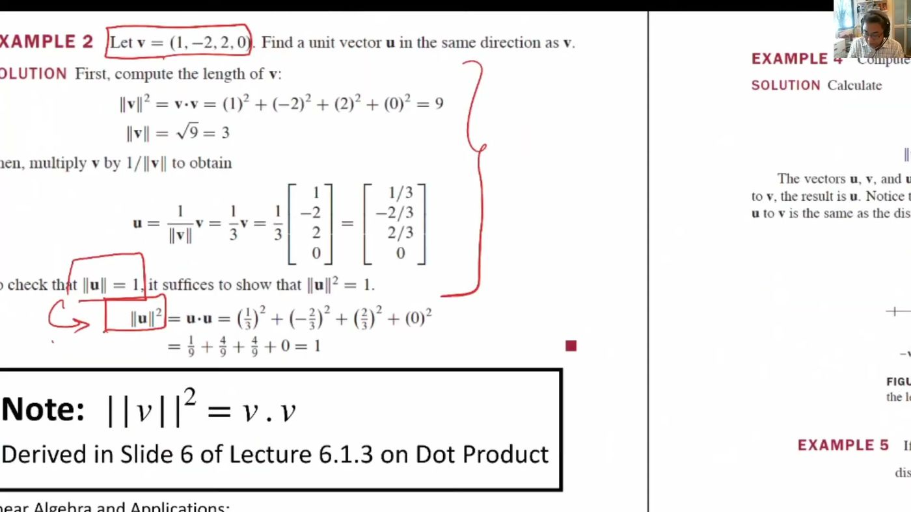

**Content:**

- A vector of norm 1 is a **unit vector**; useful for specifying a **direction** when length is not relevant.
- Obtain a unit vector in a desired direction: take any nonzero $\mathbf v$ in that direction and multiply by the reciprocal of its length; e.g. if $\mathbf v$ has length 2 then $\frac12\mathbf v$ is a unit vector in the same direction.
- In general $\mathbf u = \dfrac{1}{\|\mathbf v\|}\mathbf v$ (4) gives a unit vector in the same direction as $\mathbf v$; normalising $\mathbf v$ is the name for this process.
- **Example 2.** Find the unit vector $\mathbf u$ that has the same direction as $\mathbf v = (2,2,-1)$.
  $$\|\mathbf v\| = \sqrt{2^2+2^2+(-1)^2} = \sqrt{9} = 3, \qquad \mathbf u = \frac{1}{3}(2,2,-1) = \left(\tfrac{2}{3},\tfrac{2}{3},-\tfrac{1}{3}\right).$$

> 🎙️ **Narration:** *"And in the next slide, 6.1.3, [you] will realise that the square of the norm of the vector can be found by the dot product of the vector."*

---

### 🎬 Slide 25 — Distance between two vectors (Euclidean distance)

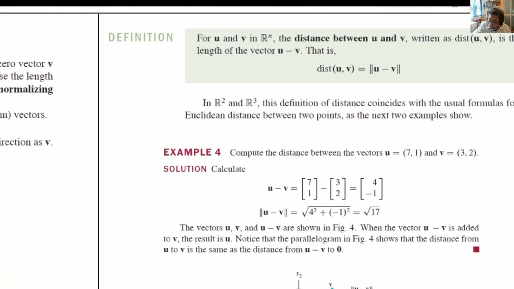

**Content:**

- **Example (2D).** $\mathbf u = (7,1)$ and $\mathbf v = (3,2)$. Inspecting the figure, the vector from $\mathbf v$ to the point $\mathbf q = (7,1)$ is 4 units right and 1 unit down.
- Going from the origin: $\mathbf v + \mathbf q = \mathbf u$, so $\mathbf q = \mathbf u - \mathbf v$; its length is the norm $\|\mathbf u - \mathbf v\|$.
- **General (Euclidean) distance** between $\mathbf u = (u_1,u_2,u_3)$ and $\mathbf v = (v_1,v_2,v_3)$:
$$d(\mathbf u,\mathbf v) = \|\mathbf u - \mathbf v\| = \sqrt{(u_1-v_1)^2 + (u_2-v_2)^2 + (u_3-v_3)^2}.$$

> 🎙️ **Narration:** *"In this example, we are interested to find the distance between two vectors — or here the word distance basically means the Euclidean distance — and we can use the norm. The norm of what? The norm of the vector between $\mathbf u$ and $\mathbf v$. Let us have this concrete example. $\mathbf u$ is an $\mathbb{R}^2$ vector at position 7, 1: 7 on the horizontal axis and 1 on the vertical axis — so $\mathbf u = (7,1)$ as a column vector, or as a tuple 7 comma 1. $\mathbf v$ is a vector with coordinates 3 comma 2: this is 3, this is 2. We can therefore, by visual inspection, find this vector from $\mathbf v$ to $\mathbf q$, which is 1 position… 4 positions to the right-hand side, 4 on the horizontal axis, and one position down from the vertical axis. Let us call this vector $\mathbf q$. Therefore if we start from the origin and we want to go to the position of point $\mathbf v$, it is $\mathbf v$; and from $\mathbf v$ we want to go to position $\mathbf q$, that is plus $\mathbf q$. Therefore the final position is equal to $\mathbf u$, implying that $\mathbf q$ can also be calculated as $\mathbf u - \mathbf v$. And if we want to find the length of $\mathbf q$, all we are doing is taking the norm of this vector, which is taking the norm of $\mathbf u - \mathbf v$. Concretely, this is shown in this equation over here. Therefore, to generalise, the example shows us how to find the norm of — or the distance between — $\mathbf u$ and $\mathbf v$. In this general example, $\mathbf u$ is given with coordinates $u_1,u_2,u_3$ and $\mathbf v$ is given coordinates $v_1,v_2,v_3$. The distance — or we should say the Euclidean distance — between $\mathbf u$ and $\mathbf v$ uses $\mathbf u - \mathbf v$ with the coordinates and takes the norm, which is simply done this way as well on the right-hand side: subtracting individual coordinates, squaring, summing and taking the square root."*

---

### 🎬 Slide 26 — Unit vectors summary + $\mathbf a = 2.5\hat{\mathbf a}$

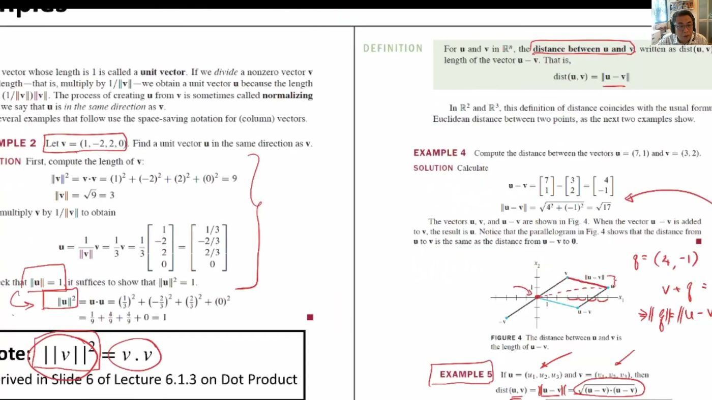

**Content:** Recap of unit vectors, the normalising formula (4) and the check $\|\mathbf u\| = 1$, with the annotation $\mathbf a = 2.5\,\hat{\mathbf a}$ illustrating that any vector is a scalar multiple of its unit direction vector.

> 🎙️ **Narration:** *(end of section — continues into 6.1.3)*

---
## V-6.1.3 — 6.1.3 The Dot Product

> **Videos (5):** `6.1.3, pg 1~3` (12.3 min) · `pg 4` (5.6 min) · `pg 5` (4.9 min) · `pg 7` (4.8 min) · `pg 8` (9.8 min) — deck: `6.1.3_The_Dot_Product.pdf` (8 pages)

### 🎬 Slide 1 — Title: *The Dot Product*

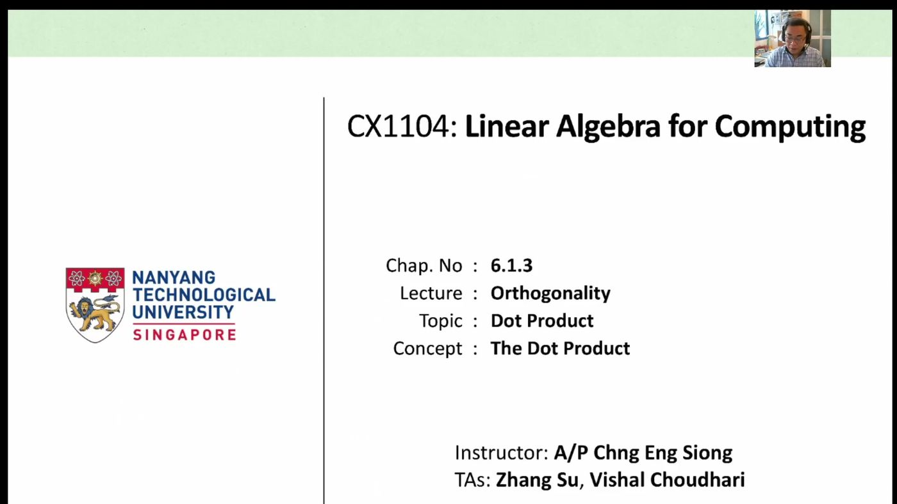

**Content — title card:** *Chap. No: 6.1.3 · Lecture: Orthogonality · Topic: Dot Product · Concept: The Dot Product.*

> 🎙️ **Narration:** *"Welcome to linear algebra for computing CX1104. Today we are talking about chapter 6.1.3, the dot product."*

---

### 🎬 Slide 2 — **Definition 3** — the dot product via the angle between two vectors

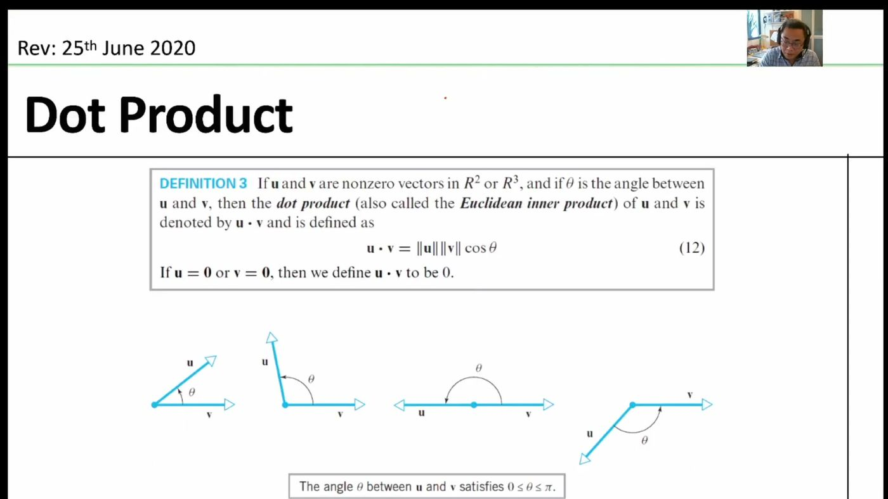

**Definition 3.** If $\mathbf u$ and $\mathbf v$ are nonzero vectors in $\mathbb{R}^2$ or $\mathbb{R}^3$, and if $\theta$ is the angle between $\mathbf u$ and $\mathbf v$, then the **dot product** (also called the **Euclidean inner product**) of $\mathbf u$ and $\mathbf v$ is denoted $\mathbf u \cdot \mathbf v$ and is defined as
$$\mathbf u \cdot \mathbf v = \|\mathbf u\|\,\|\mathbf v\|\cos\theta \qquad (12)$$
- Four diagrams show the angle $\theta$ measured between the vectors in different orientations.

> 🎙️ **Narration:** *"In the past, we are given vectors. For example, we are given vectors u and u will have a length and a direction. And we are given another vector v. And we can add u and v together. We can find the sum of u and v. We can also find the length of U denoted by these two parallel bars. This is the length of U or sometimes called the norm of U. This is the norm of V and of course this is U plus V and this is the norm. What else can we do with it? Well we are interested today to find a dot product between two factors. So we are given U and we are given V and the dot product is denoted by U dot V. v and it is defined to be the normal view, the length of view, the length of v and multiplied by something called cos theta, where theta is the angle between the two vectors u and v. Let's zoom in into theta. This is theta, the angle between the two vectors. We will see different examples of this theta in the"*

---

### 🎬 Slide 3 — How $\theta$ is measured (annotated)

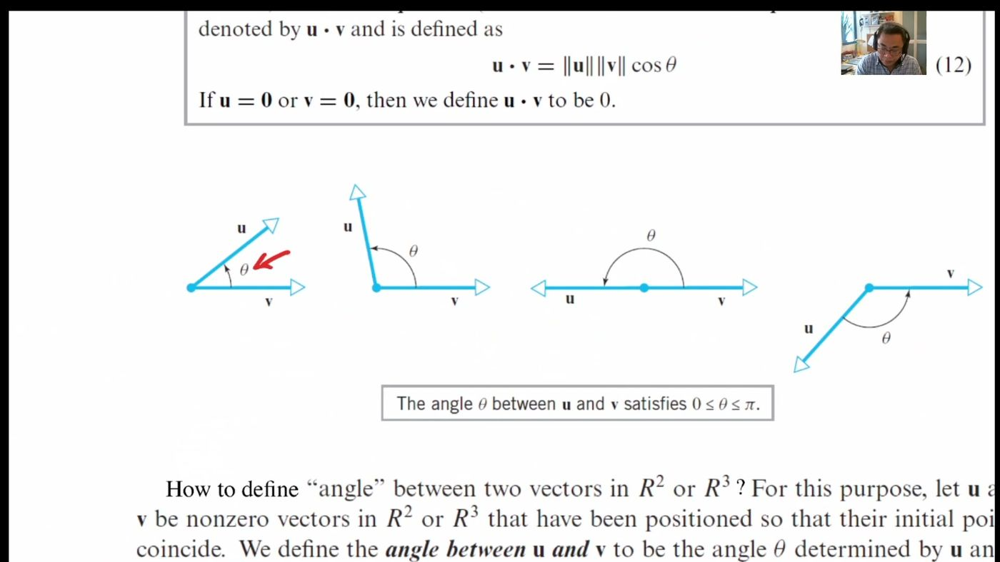

- The angle is measured **between the two vectors placed tail-to-tail**; the diagrams below put $\theta$ measured from $\mathbf v$.
- Rearranging (12) gives the useful form
$$\cos\theta = \frac{\mathbf u \cdot \mathbf v}{\|\mathbf u\|\,\|\mathbf v\|}.$$

> 🎙️ **Narration:** *"four diagrams below. You'll notice that we are putting theta, we are measuring theta with respect from v. Actually this is just a coincidence, we could have measured starting from u instead in this last example below. So what do we choose? Whether did we start to measure theta from v to u as in this example or from u to v as in this example and the answer lies in that we have to keep the angle between u and v to be between 0 to pi. Once we have"*

---

### 🎬 Slide 4 — Sign of the dot product tells you the angle

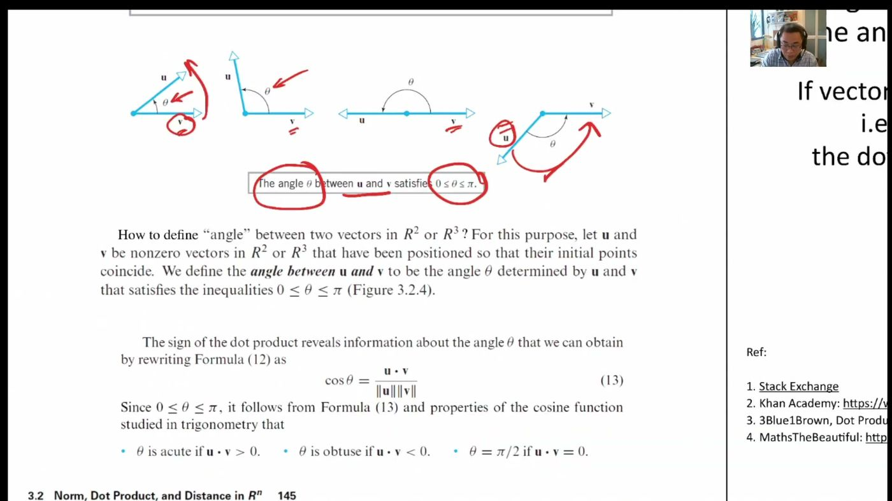

- If $\mathbf u \cdot \mathbf v > 0$ then $\cos\theta > 0$ — the angle is **acute** ($\theta < 90^\circ$).
- If $\mathbf u \cdot \mathbf v = 0$ then $\cos\theta = 0$ — the vectors are **perpendicular** ($\theta = 90^\circ$).
- If $\mathbf u \cdot \mathbf v < 0$ then $\cos\theta < 0$ — the angle is **obtuse** ($\theta > 90^\circ$).

> 🎙️ **Narration:** *"done so we can modify the equation to put norm of u, norm of v on the bottom of u.v as in this equation over here. This immediately reveals what cosine theta will tell us if u dot v is positive then theta is acute if u dot v is negative then theta is obtuse and if u dot v equals to zero then theta is the right angle. In short u dot v relates the angle between the two vectors. In fact we can see this more clearly when"*

---

### 🎬 Slide 5 — Dot product for **unit** vectors; the case $\mathbf u = \mathbf 0$ or $\mathbf v = \mathbf 0$

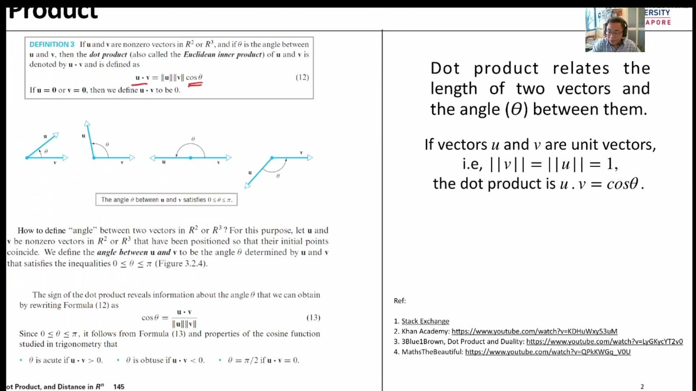

**Content — Dot product slide (deck):**

- The dot product relates the **length of two vectors** and the **angle $\theta$** between them.
- If $\mathbf u$ and $\mathbf v$ are **unit vectors**, i.e. $\|\mathbf u\| = \|\mathbf v\| = 1$, then (12) reduces to
$$\mathbf u \cdot \mathbf v = \cos\theta.$$
- If $\mathbf u = \mathbf 0$ or $\mathbf v = \mathbf 0$, we **define** $\mathbf u \cdot \mathbf v = 0$.
- The angle $\theta$ between $\mathbf u$ and $\mathbf v$ satisfies $0 \le \theta \le \pi$.
- Reference material: Stack Exchange, Khan Academy.

> 🎙️ **Narration:** *"we have unit vectors. If the vectors of u and v are unit vectors meaning that its length is 1, then equation 12 reduces to 1 times 1 times cosine of... now in the next slide let's repeat the equation for u dot v. In this case we have changed the vector name to be v and w instead but it is the same. So v.w is the norm of v multiplied by norm of w multiplied by cosine theta where theta is the angle between v and w. This is the definition of v and w, v.w and actually later on it can be derived v.w in the component form of the dot product. This is the component norm of the of the dot product which is simply much easier to calculate if v and w are vectors rn and v is a notation that looks like this v1, v2, a column vector of n elements and w is also"*

---

### 🎬 Slide 6 — The component form: $\mathbf v \cdot \mathbf w = \sum_i v_i w_i$

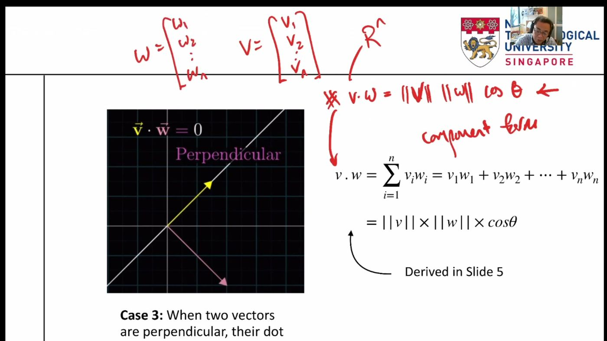

- For $\mathbf v = (v_1,\dots,v_n)$ and $\mathbf w = (w_1,\dots,w_n)$,
$$\mathbf v \cdot \mathbf w = \sum_{i=1}^{n} v_i w_i = v_1w_1 + v_2w_2 + \cdots + v_nw_n.$$
- This is the form used for **computation**; it gives the same value as $\|\mathbf v\|\,\|\mathbf w\|\cos\theta$.

> 🎙️ **Narration:** *"w1, w2, wn, then v.w is nothing but each component of these vectors multiplied by together and sum. Now armed with this v.w equation, we will now have three examples, concrete examples of v and w in the R2 space. These are taken from 3 blue 1 brown please have a look at the video and it is very insightful in this first example V has components for 1 and W has components 2 and minus 1. Therefore V dot W is simply the components multiplied by together and sum so it which is 4 times 2 plus 1 times minus 1. The answer is 8 minus 1 and the dot product of V and W is 7. What we are interested in is that it is the sine and we have positive 7. So why is positive sine interesting? Well, remember we have V dot W is equals to norm of phi norm of w cosine theta and therefore cosine theta is equals to v dot w divided by"*

---

### 🎬 Slide 7 — The three cases of the dot product, with worked example

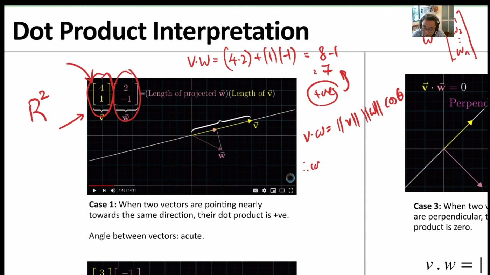

- Example: $\mathbf v = (3,1)$ and $\mathbf w = (-1,-2)$; compute $\mathbf v \cdot \mathbf w$ from the components.
- Three possible outcomes: **positive** (acute angle), **zero** (perpendicular), **negative** (obtuse).
- $\mathbf v \cdot \mathbf w = \|\mathbf v\|\,\|\mathbf w\|\cos\theta = 3(-1) + 1(-2) = -5$, and $\cos\theta = \dfrac{-5}{\|\mathbf v\|\,\|\mathbf w\|}<0$, so the angle is obtuse.

> 🎙️ **Narration:** *"norm of v norm of w. We have found that the numerator v dot w equals to positive. The denominator is always positive because norm of v is a positive number and norm of w is a positive number unless b or w is the zero vector. Let's plot cosine theta."*

---

### 🎬 Slide 8 — The cosine curve — why the sign of $\mathbf u\cdot\mathbf v$ gives the angle

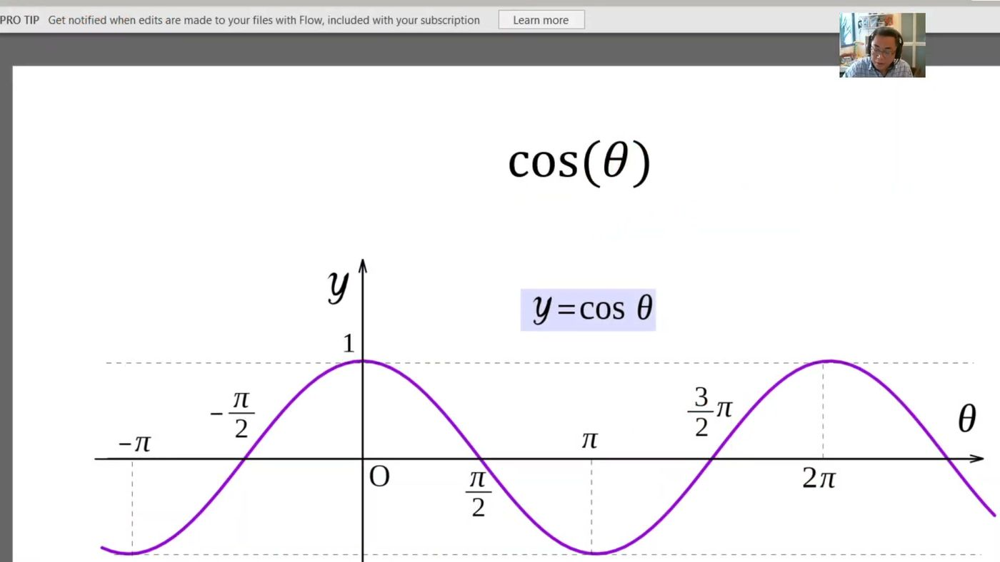

- Graph of $y = \cos\theta$ for $0 \le \theta \le \pi$: $\cos\theta > 0$ for $\theta \in [0,\pi/2)$, $\cos\theta = 0$ at $\theta = \pi/2$, and $\cos\theta < 0$ for $\theta \in (\pi/2,\pi]$.
- Hence $\theta$ is acute when the dot product is positive and obtuse when it is negative.

> 🎙️ **Narration:** *"Cosine theta is over here and theta is a horizontal axis and y is cosine theta. We'll note that when cosine theta is positive that means in this value here and when theta is between zero to pi then theta must be zero to pi over two for positive value and for negative value between pi over 2 to pi. So coming back to this diagram,"*

---

### 🎬 Slide 9 — Dot product **interpretation** — the three cases (deck slide 3)

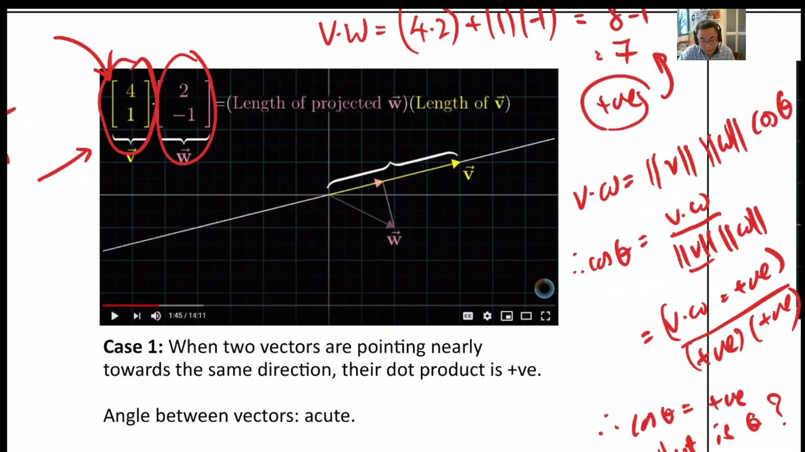

**Content — Dot Product Interpretation:**

- **Case 1:** when two vectors point **nearly in the same direction**, the dot product is **positive** — the angle is acute.
- **Case 2:** when two vectors point **away from one another**, the dot product is **negative** — the angle is obtuse.
- **Case 3:** when two vectors are **perpendicular**, the dot product is **zero**.
- Derived formula: $\mathbf v \cdot \mathbf w = \sum_i v_iw_i = \|\mathbf v\|\,\|\mathbf w\|\cos\theta$.

> 🎙️ **Narration:** *"we see that actually theta the angle between V and W over here must be between 0 to pi over 2 and this is the acute angle. Now we see the second case when the angle is obtuse. In this"*

---

### 🎬 Slide 10 — Interpretation via projection: $\mathbf v\cdot\mathbf w$ as length $\times$ projected length

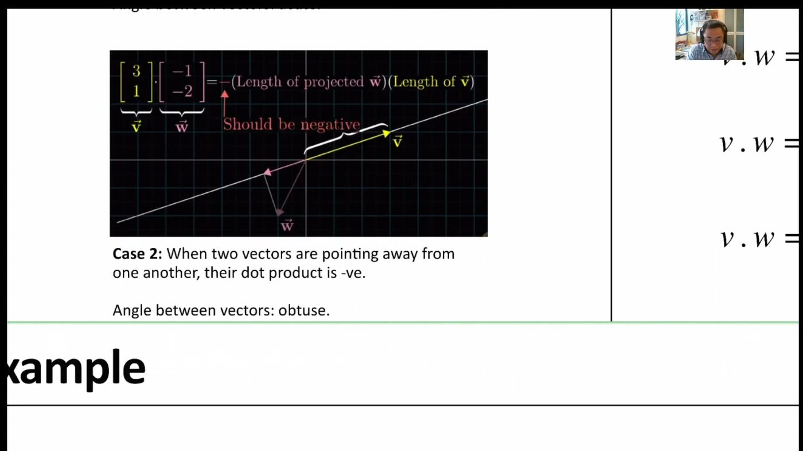

$$\mathbf v \cdot \mathbf w = \big(\|\mathbf w\|\cos\theta\big)\,\|\mathbf v\| = \big(\|\mathbf v\|\cos\theta\big)\,\|\mathbf w\|$$

- First reading: **length of the projection of $\mathbf w$ onto $\mathbf v$**, multiplied by **the length of $\mathbf v$**.
- Second reading (symmetric): **length of the projection of $\mathbf v$ onto $\mathbf w$**, multiplied by **the length of $\mathbf w$**.

> 🎙️ **Narration:** *"This example V has unit 3 1, so we have 3 unit here, 1 unit here, so this is vector V and vector W is here which is minus 1 and minus 2. Let's find the dot product of V dot W. If we write it in vector form, it is 3 1 minus one minus two and the answer is minus three plus minus two and we have minus five. And again when we remind ourselves for cos theta to be negative value of five, the angle theta must lie in the region of pi over 2 to pi. Lastly in the third example in case 3 where we have V this vector is 1.5 1.5 and this vector w is 2n minus 2. When we do V dot w what we are doing using the component form is 1.5 multiplied by 2 plus 1.5 multiplying by minus 2 and the answer is 0. When the dot product between two"*

---

### 🎬 Slide 11 — Where does the projection interpretation come from?

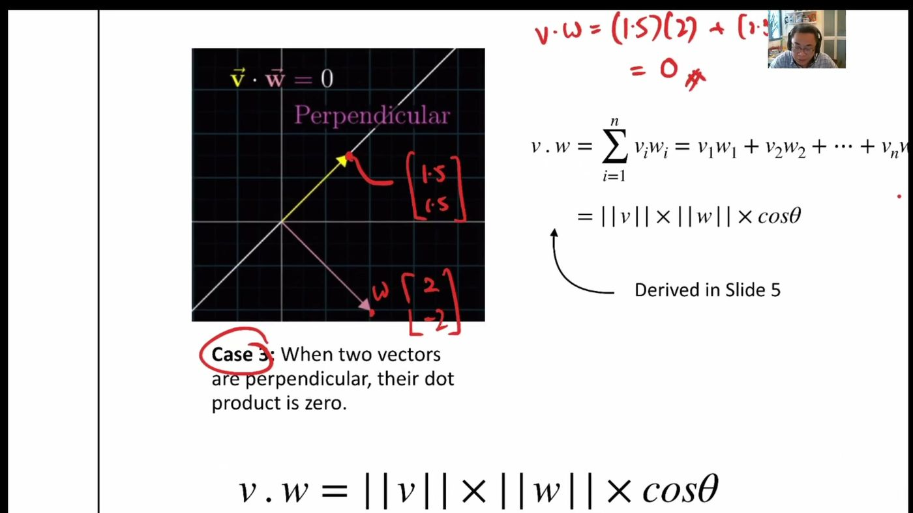

- $\mathbf v \cdot \mathbf w = \|\mathbf v\|\,\|\mathbf w\|\cos\theta$, and $\|\mathbf w\|\cos\theta$ is exactly the **signed length of the projection of $\mathbf w$ onto $\mathbf v$**.
- This geometric reading is the key to **orthogonal projection** (Sections 6.2.2 and 6.2.5) and to least squares (Chapter 7).

> 🎙️ **Narration:** *"vectors is equals to 0, it is clear from these R2 examples that the two vectors are perpendicular or orthogonal to each other. This carries on when we have R3 as well as R4 and R5 although we cannot visualize them. Lastly we can"*

---

### 🎬 Slide 12 — Worked check with $\theta = 45^\circ$

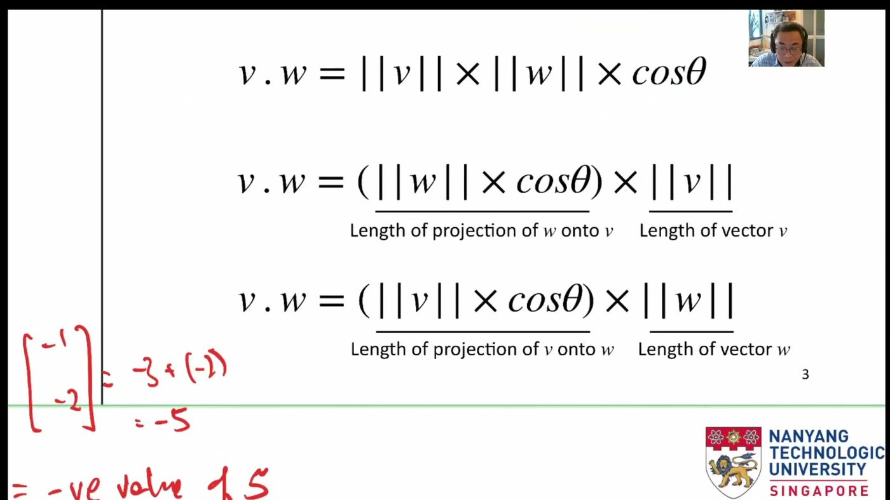

- Take $\theta = 45^\circ$ and convert to radians before computing $\cos\theta$.
- Example: with the vectors of the earlier deck page, $\|\mathbf v\|\,\|\mathbf w\|\cos 45^\circ$ reproduces the same value obtained from the component form — a good consistency check.

> 🎙️ **Narration:** *"interpret V.W in another way. We have seen the first way which is in this equation V.W is the norm of V not to multiply by norm of W multiplied by cosine theta. In the second way if we put the brackets in this order which"*

---

### 🎬 Slide 13 — Supporting graph of $y = \cos\theta$ (browser view)

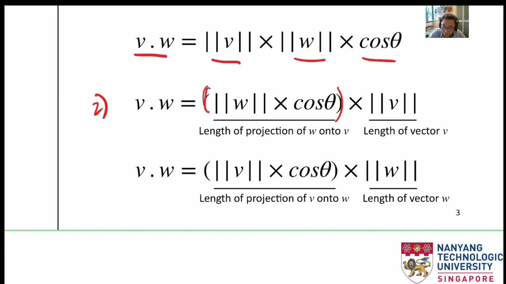

- A plot of $\cos\theta$ over $[0, 2\pi]$ used to show the sign and symmetry of the cosine — $\cos\theta = \cos(-\theta)$.
- *(The top strip is a browser notification banner captured in the screen recording, not lecture content.)*

> 🎙️ **Narration:** *"which is norm of w multiplied by cosine theta multiplied by norm of v. This first bracket can be interpreted as projecting of the w vector onto v, multiplying by the length of v. In the third way, when we put the bracket onto the other vector, norm of v multiplied by cosine of theta multiplied by norm of w. first bracket is actually the length of V projected onto the vector W. So depending on your applications, you can see V.W in this following way as well. Why do I say"*

---

### 🎬 Slide 14 — Revisiting the deck page: prove the **component form** of the dot product

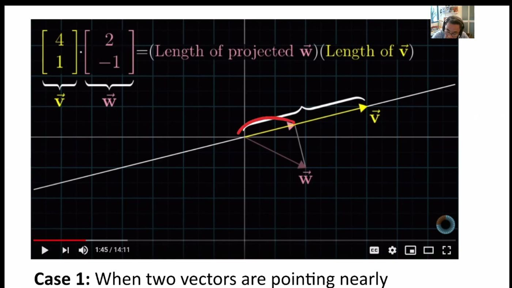

**Content — slide 5 of the dot product deck.**

- Goal: prove that $\mathbf u \cdot \mathbf v = \sum_i u_iv_i$.
- The component form is simply the **sum of products of matching components**.

> 🎙️ **Narration:** *"that this is W cosine theta? Where is W cosine theta? It is this vector with this length. It is the projection of w onto the vector v and getting its length."*

---

### 🎬 Slide 15 — Tool for the proof: the **law of cosines**


- For a triangle that is *not* right-angled, the **law of cosines** states
$$C^2 = A^2 + B^2 - 2AB\cos\theta.$$
- Applied to the triangle formed by $\mathbf u$, $\mathbf v$ and the vector $\mathbf v - \mathbf u$, it relates the norm of the difference to the norms and the angle.

> 🎙️ **Narration:** *"theta as we remember is the angle between u and v. In the figure theta is shown to be 45 degrees and if we plug in 45 degrees as theta we convert it into radian and we find cosine theta then we can use that equation and the answer"*

---

### 🎬 Slide 16 — Applying the law of cosines (annotated)


- The side $PQ = \mathbf v - \mathbf u$ is the side opposite the angle $\theta$ between $\mathbf u$ and $\mathbf v$.
- Note the sign: for an obtuse angle the corresponding dot product is **negative**.

> 🎙️ **Narration:** *"using this equation over here will be the same equals to 2. Now maybe we'll address the last question how can we find theta equals to 45 degrees? Well in this R3 examples is actually relatively easy. U is a vector and we can draw it in the R3 form that points to the only to the z direction so if we have x direction y direction and z direction here, which is the vector that has zero components on the x-axis, zero components on the y-axis and it has unit length at the z-axis. What about vector v? v has the component zero on the x-axis, two on the y-axis and two on the z axis. What we can then infer is that the x axis does not play any part in drawing U and V and we can just simply focus on U and V on the y-z plane. If we ignore the first part then what we can see is that U is a component along z and V is a component that is 45 degrees between z and y and hence it is now obvious to us where the theta came from, the 45 degrees value. The actually the typical way to solve the problem is to do this. u dot v equals to norm of u, norm of v cosine theta and because we are interested in cos theta now, we will reduce the equation to u.v divided by norm of u, norm of v. And because we can use the component form of u.v very quickly, we can calculate it in and we can also find the norm of u and norm of v quickly. We can also do it this way, living with us the value of cosine theta in this form and then simply theta will be equals to cosine inverse this value and it should be 45 degrees in radiate."*

---

### 🎬 Slide 17 — Simplifying to the component form


- Expanding $\|\mathbf v - \mathbf u\|^2 = (v_1-u_1)^2 + (v_2-u_2)^2 + (v_3-u_3)^2$ and substituting into the law of cosines, everything cancels except the cross terms, giving
$$\mathbf u \cdot \mathbf v = u_1v_1 + u_2v_2 + u_3v_3.$$

> 🎙️ **Narration:** *"Right, this is slide 5 of dot product. We will now try to prove the component form of the dot product. Given u dot v, the component form is simply the multiplications of u component for index i multiplied by v components of index i and sum for i equals to 1 to n if u and v belongs to Rn. To derive this component form, we have to"*

---

### 🎬 Slide 18 — Conclusion: the definition of the inner product


- Putting the derivation together: the **component (computational) form** and the **angle form** are the same quantity — so the dot product may be *defined* in either way, and the two definitions agree.
$$\mathbf v \cdot \mathbf w = \sum_{i=1}^{n} v_iw_i = \|\mathbf v\|\,\|\mathbf w\|\cos\theta$$

> 🎙️ **Narration:** *"review first the law of cosine. Given a triangle that is not right angle, we can have a formula that says the length C square is equals to one length A square plus length B square minus 2 times AB the length cosine gamma where gamma is is the angle facing the side of the triangle that we are interested in. We now plug in the law of"*

---

### 🎬 Slide 19 — Summary of the projection forms


$$\mathbf v \cdot \mathbf w = \big(\|\mathbf w\|\cos\theta\big)\|\mathbf v\| = \big(\|\mathbf v\|\cos\theta\big)\|\mathbf w\|$$

- $\|\mathbf w\|\cos\theta$: *length of the projection of $\mathbf w$ onto $\mathbf v$*; $\|\mathbf v\|\cos\theta$: *length of the projection of $\mathbf v$ onto $\mathbf w$*.

> 🎙️ **Narration:** *"cosine for this side p2q the vector pq is the side of the triangle that we are interested in and this side of the triangle is being looked at by theta the angle between u and v hence a direct application of this is we are looking at the side of this triangle P to Q is length square is equals to one side of the triangle U squared the other side norm V squared minus two times the norm of U times the norm of V cosine theta this is simply the direct application of law of cosine in this triangle. In the next step, we simply move this side and exchange it to the other side of the equation and now we have the following. Where we have substituted pq to be pq is the vector from v minus u because if we look right there in the other form, u plus pq will be equals to v. Now the half on the right hand side is due to this tool and finally we see that this equation norm of u times norm of v cosine theta is exactly the definition of u dot v We then expand the calculation of norm of u into its component form Which is simply the individual component square Similarly for v square, the norm of v square, we can establish it in the component form. And lastly v minus u which is the vector p to q can be written also in the component form such as this. Now if we expand this equation v1"*

---

### 🎬 Slide 20 — Alias: properties of the dot product (deck slide 7)


**Content — Properties of the Dot Product.** With $\mathbf u, \mathbf v, \mathbf w \in \mathbb{R}^n$ and $k$ a scalar:

1. $\mathbf u \cdot \mathbf v = \mathbf v \cdot \mathbf u$ (commutative),
2. $(\mathbf u + \mathbf v)\cdot\mathbf w = \mathbf u\cdot\mathbf w + \mathbf v\cdot\mathbf w$ (distributive),
3. $k(\mathbf u\cdot\mathbf v) = (k\mathbf u)\cdot\mathbf v = \mathbf u\cdot(k\mathbf v)$,
4. $\mathbf v \cdot \mathbf v = \|\mathbf v\|^2 \ge 0$, and $\mathbf v\cdot\mathbf v = 0$ iff $\mathbf v = \mathbf 0$,
5. $\mathbf 0 \cdot \mathbf v = 0$.

> 🎙️ **Narration:** *"minus u1 square is equals to v1 square plus u1 square minus 2 v1 u1. and this is the same for v2-u2 v3-u3. Hence when we plug in all these expanded forms into the original equation u.v we would get the component form of the dot product. So we have demonstrated for R3 in this example and similarly it could have been done for R2 and we see this pattern and therefore"*

---

### 🎬 Slide 21 — $\mathbf v\cdot\mathbf v = \|\mathbf v\|^2 \ge 0$ and **Theorem 3.2.3**


- $\mathbf v \cdot \mathbf v$ is a sum of squares, so it can never be negative; it is zero only when every component is zero.
- **Theorem 3.2.3** collects the algebraic properties (a)–(e) of the dot product — these match the list on the previous slide; they need not be proved in this course, but you should be able to apply them.

> 🎙️ **Narration:** *"therefore the definition of the inner product or the dot product is made."*

---

### 🎬 Slide 22 — Textbook **Example** — dot product from lengths and a $45^\circ$ angle


**Content — Example (Figure 3.2.5).** Find the dot product of the vectors shown.

- $\|\mathbf u\| = 1$ and $\|\mathbf v\| = \sqrt{8} = 2\sqrt{2}$, with $\theta = 45^\circ$ between them.
- $\cos 45^\circ = \frac{1}{\sqrt 2}$, so
$$\mathbf u \cdot \mathbf v = \|\mathbf u\|\,\|\mathbf v\|\cos 45^\circ = 1 \cdot 2\sqrt{2} \cdot \frac{1}{\sqrt2} = 2.$$
- Check with components: $\mathbf u = (0,0,1)$, $\mathbf v = (0,2,2)$ give $\mathbf u\cdot\mathbf v = 0 + 0 + 2 = 2$. ✔

> 🎙️ **Narration:** *(transition frame — the explanation continues on the next slide)*

---

### 🎬 Slide 23 — Example continued + exercise (Example 8)


- The same answer is obtained from the component form — confirmation that both definitions agree.
- **Exercise:** try **Example 8** of the text yourself; the answer is given on the right-hand side of the slide.

> 🎙️ **Narration:** *"This is slide 7 of 6.1.3 where we talk about the properties of the dot product. Here we have u, v and w are vectors of rn and k is a scalar. So we are going to have some scalar multiplying with some vectors and then checking the dot product. In the first instance, we have the symmetric property u.v is equal to v.u. Remember that u.v will produce a scalar and v.u will also produce a scalar. This should be the same and it is obviously they are the same when we look at the component form of the dot product. I'll now state the additional properties of the dot product without proving them. u dotting with the sum of v plus w can also be solved by distributing v dot plus w with u as u dot v plus u dot w. This is the distributive property of the dot product. In the next entry for c, we are interested in k, the scalar k multiplying by u.v. Remember that u.v is a scalar and k multiplied by a scalar will also be producing a scalar. This scalar is the same when we have multiplied k multiplied by the vector u first that means all entries of u is multiplied by k dotting with v. Maybe an example will be clearer so let us have k multiplied by u1 u2 to un and this will be entry will be k times u1 k times u2 k times un this vector dotting with v1 v2 vn so would be the same as k u dot v In the last entry, we are examining the positivity property means that if V is not equals to the zero vector, V dot V will always be greater than zero. The dot product of itself will not be a negative number. It will be zero only when the vector V is the zero vector. We use the both face 0 to denote a vector with entries of all 0. So the left hand side is the 0 vector, the right hand side is a vector with all components 0. The proof of the positivity"*

---

### 🎬 Slide 24 — Deck slide 8 — the dot product with a **transformation matrix** $A$


**Content — slide 8 of the dot product deck.**

- So far we have considered the dot product of two vectors, $\mathbf u \cdot \mathbf v$.
- Now introduce a **transformation matrix** $A$. The quantity of interest is the **matrix–vector–dot form**
$$\mathbf v^{\mathsf T} A\,\mathbf u,$$
- and the claim to be proved is that this equals the same inner-product value, i.e. the matrix sits inside the dot product.

> 🎙️ **Narration:** *"property simply comes from expanding the dot product by the component form seeing that each individual element is squared. We now know from basic math that any element square will be a positive value and will only be equals to zero when the component is equals to zero. Hence if we have the sum of all positive numbers"*

---

### 🎬 Slide 25 — Recall: two equivalent ways to write the dot product


- Angle form: $\mathbf u \cdot \mathbf v = \|\mathbf u\|\,\|\mathbf v\|\cos\theta$ (used historically in the course).
- Component form: $\mathbf u \cdot \mathbf v = \mathbf u^{\mathsf T}\mathbf v = \sum_i u_iv_i$ (used from here on).
- The component form is the one that extends to $\mathbb{R}^n$ and to matrix expressions.

> 🎙️ **Narration:** *"therefore v dot v will never be equals to negative value will not be equals to zero when any of its components is greater than zero. On the right hand side we have"*

---

### 🎬 Slide 26 — Using the **transpose** to express the inner product


- $\mathbf u^{\mathsf T}\mathbf v$ is a $1\times n$ row vector times an $n \times 1$ column vector, i.e. a **$1 \times 1$ scalar** — exactly $u_1v_1 + \cdots + u_nv_n$.
- Note $\mathbf u^{\mathsf T}\mathbf v = \mathbf v^{\mathsf T}\mathbf u$.

> 🎙️ **Narration:** *"some more theorems regarding u, v, and w with the dot product as well as the scalar k. Please read through them a to e and then you can apply them. We do not need to prove them"*

---

### 🎬 Slide 27 — Where the matrix form comes from: $\mathbf u^{\mathsf T}(A\mathbf v)$


- The expression to evaluate is $\mathbf u^{\mathsf T} A \mathbf v$: the entry of interest is obtained by dotting the columns of $A$ with $\mathbf u$.
- The claim: $\mathbf u^{\mathsf T} A\mathbf v = \mathbf v^{\mathsf T} A^{\mathsf T}\mathbf u$ — a scalar, so the transpose of a scalar changes nothing.

> 🎙️ **Narration:** *"in this course. As an exercise please do example 8. Now leave it to you to see the answer on the right hand side."*

---

### 🎬 Slide 28 — Bringing $A$ inside the dot product


- Starting from $\mathbf u^{\mathsf T} A \mathbf v$ and re-associating the matrix product gives $\mathbf v^{\mathsf T}A^{\mathsf T}\mathbf u$.
- Equivalently $(A\mathbf u)\cdot\mathbf v = \mathbf u\cdot(A^{\mathsf T}\mathbf v)$ — the matrix multiplies *inside* the dot product.

> 🎙️ **Narration:** *"Welcome to 6.1.3 slide number 8. We'll continue to talk about the dot product. In the past, we only talked about the dot product of u dot v. Today, we'll introduce a transformation matrix A, which is an n by n matrix, and we'll assume u and v are n by 1 column vectors. Sometimes they are column matrices, but they are actually column vectors. We would now want to perform transformation A on the first entry. So AU. Notice that AU is a 3 by 3 matrix A multiplied by U, which is a 3 by 1 vector. So this will result in a vector that is still 3 by 1. Let's call this vector W. and w.v is the same as before. It is a component we can resolve this w.v as a component wise dot product. Now you might think that if we have done transformation a on u.v it will be equals to u dot a transform v but this is not true the actual equation on the right hand side if we want to perform the same transformation must be u multiplied by or sorry dot product with a transform v similarly if we are applying the transformation matrix on the second entry, AV. U dot bracket AV is the same as the transpose of the transformation matrix A multiplied by U dot with V. Let us now"*

---

### 🎬 Slide 29 — Re-associating a triple product: $A(BC) = (AB)C$


- Matrix multiplication is **associative**: $(AB)C = A(BC)$ — the order of the factors may not change, but the grouping may.
- This is what allows us to move $A$ to the other side of the dot product.

> 🎙️ **Narration:** *"prove why this is so. First let's remember what U dot V is. U dot V we have defined as the norm of u, norm of v cosine theta. This is not the form we are using today. Instead, we are using the component form of u dot v, which is ui, bi for i equals to 1 to the n component. And we are summing. The component form of the dot product can be represented as a vector matrix multiplication. In this example, the U vector is a column vector 3 by 1. The V vector is also a column vector 3 by 1. To get matrix vector multiplication correct, we must transpose the first entry. U transpose is now 1 by 3 column vector, a row vector and V is a 3 by 1 column vector"*

---

### 🎬 Slide 30 — Applying the transpose property $(AB)^{\mathsf T} = B^{\mathsf T}A^{\mathsf T}$


- Second property of the transpose: $(AB)^{\mathsf T} = B^{\mathsf T}A^{\mathsf T}$.
- Applying it to $\left(A^{\mathsf T}\mathbf v\right)^{\mathsf T}$ and using $(A^{\mathsf T})^{\mathsf T} = A$ gives the chain that completes the proof.

> 🎙️ **Narration:** *"resulting in one by one entry which is a scalar. Now convince yourself that this is the correct equations by comparing the values u versus u transpose we are doing nothing but making the column vector as a row vector v is a column vector we are putting it onto here. If you forget about the row vector multiplied by the column vector multiplication, here is just a quick revision. U transpose V is nothing but the first entry of the row vector multiplied by the first entry of the column vector adding the second entry of the row vector multiplying by the second entry of the column vector adding the third entry of the row vector to the last entry of the column vector and sum. Now you can also convince yourself that U transpose V and V transpose U would be the same thing because actually if you compare these two equations carefully you are doing nothing but multiplying each entries and then sum. In short, this is the equation we want to remember. u dot b represented as matrix vector multiplication can be u transpose b or b transpose u."*

---

### 🎬 Slide 31 — Component-form derivation of a Formula (15)


- The textbook derives the component form: substituting $\|\mathbf u\|^2 = u_1^2+u_2^2+u_3^2$, $\|\mathbf v\|^2 = v_1^2+v_2^2+v_3^2$ and $\|\mathbf v - \mathbf u\|^2 = (v_1-u_1)^2+(v_2-u_2)^2+(v_3-u_3)^2$ into the law of cosines and simplifying gives
$$\mathbf u \cdot \mathbf v = u_1v_1 + u_2v_2 + u_3v_3 \qquad (15)$$

> 🎙️ **Narration:** *"Now let us go into the equation of interest, which is the transformation matrix A multiplied by the first entry dotting with the second column vector V. We are saying that it is the same as U dotting with A transpose V. Why is this so? Let's examine this proof. A U dot V, we recognize it as"*

---

### 🎬 Slide 32 — Formula (15) and its 2-space companion


$$\mathbf u\cdot\mathbf v = u_1v_1 + u_2v_2 + u_3v_3\quad(\mathbb{R}^3), \qquad \mathbf u\cdot\mathbf v = u_1v_1 + u_2v_2\quad(\mathbb{R}^2)$$

- The derivation assumed $\mathbf u$ and $\mathbf v$ are nonzero (so that the angle is defined); by the earlier convention the formula also holds trivially when one of them is $\mathbf 0$.

> 🎙️ **Narration:** *"this equation over here and if we put the A in front, then we are putting the A in front here so we are using the equation V transpose AU. We now have V transpose AU and now we are going to change into this equation. Why is this possible? All we are doing is to change the bracket and we are changing the bracket because matrix multiplication has this property that it is associative. What is associative? Associative means that if we have three matrix multiplying"*

---

### 🎬 Slide 33 — Textbook section: *Component Form of the Dot Product*


- For computational purposes it is desirable to express the dot product **in terms of components**.
- The text derives the formula for vectors in 3-space; the derivation for $\mathbb{R}^2$ is similar, and the pattern extends to $\mathbb{R}^n$.

> 🎙️ **Narration:** *"by each other A times B times C. It is the same as we are doing whether A multiplied by BC first or AB first multiplied by C. It doesn't matter the order of the matrix multiplication we are doing, it can be performed in any order. So what we have just now realized is that because we have"*

---

### 🎬 Slide 34 — The law of cosines setup (Figure 3.2.6)


- Let $\mathbf u = (u_1,u_2,u_3)$, $\mathbf v = (v_1,v_2,v_3)$ be two nonzero vectors, and $\theta$ the angle between them. The law of cosines gives
$$\|PQ\|^2 = \|\mathbf u\|^2 + \|\mathbf v\|^2 - 2\|\mathbf u\|\,\|\mathbf v\|\cos\theta \qquad (14)$$
- Since $PQ = \mathbf v - \mathbf u$, the left side is $\|\mathbf v - \mathbf u\|^2$.

> 🎙️ **Narration:** *"performed can be performed this matrix vector multiplication in any order we are basically changing the parenthesis order. So we are now saying that we are performing V transpose A first multiplied by U. What about this equation? How did the third expression, how is the third expression derived? This expression comes from the"*

---

### 🎬 Slide 35 — Rearranging the law of cosines


- Solve (14) for $\cos\theta$ and multiply by $\|\mathbf u\|\,\|\mathbf v\|$:
$$\mathbf u\cdot\mathbf v = \|\mathbf u\|\,\|\mathbf v\|\cos\theta = \tfrac12\left(\|\mathbf u\|^2 + \|\mathbf v\|^2 - \|\mathbf v-\mathbf u\|^2\right).$$

> 🎙️ **Narration:** *"property of transpose. Specifically, it is the second property of the matrix transpose operation. A B transpose is equal to B transpose A transpose. Let us"*

---

### 🎬 Slide 36 — Expanding the squared norms


- With $\|\mathbf v - \mathbf u\|^2 = (v_1-u_1)^2 + (v_2-u_2)^2 + (v_3-u_3)^2$, the squares of the individual components cancel and only the cross terms remain:
$$\mathbf u\cdot\mathbf v = u_1v_1 + u_2v_2 + u_3v_3 \qquad (15)$$

> 🎙️ **Narration:** *"start from this equation and we will apply the second property. A transpose V transpose is equals to V transpose multiplied by A transpose transpose. V transpose multiplied by A because A transpose transpose gets back A. In the last part we go from this equation and we recognize that it comes from this equation provided that we have done something here we are doing a transpose phi bracket and now we will get u dot a transpose phi as the answer as an example let us have this example 9 where we have the matrix A which is a 3 by 3 matrix the vector column vector u 3 by 1 the column vector v 3 by 1 as well and we want to show the transformation matrix A acting on u first dotting with v is the same as u dotting with the transpose of a multiplied by b. By brute force, you can compute a u as well as a transpose v resulting in the 3 by 1 column vector. You then plug in these two column vector one for here and the other one for here dotting with the respective b or u and and you will get the answer 11 in both cases showing that these two formulas works."*

---

### 🎬 Slide 37 — **Theorem 3.2.3** — properties of the dot product (final page)


- Dot products share many algebraic properties with products of real numbers.
- **Theorem 3.2.3.** If $\mathbf u, \mathbf v, \mathbf w \in \mathbb{R}^n$ and $k$ is a scalar, then:
  - (a) $\mathbf 0 \cdot \mathbf v = \mathbf v \cdot \mathbf 0 = 0$;
  - (b) $\mathbf u\cdot\mathbf v = \mathbf v\cdot\mathbf u$;
  - (c) $\mathbf u\cdot(\mathbf v+\mathbf w) = \mathbf u\cdot\mathbf v + \mathbf u\cdot\mathbf w$;
  - (d) $k(\mathbf u\cdot\mathbf v) = (k\mathbf u)\cdot\mathbf v$;
  - (e) $\mathbf v\cdot\mathbf v = \|\mathbf v\|^2$.

> 🎙️ **Narration:** *(transition frame — the explanation continues on the next slide)*

---
## V-6.1.4 — 6.1.4 Important Inequalities

> **Videos (1):** `6.1.4, pg 1~5` (12.4 min) — deck: `6.1.4_Inequalities.pdf` (5 pages)

### 🎬 Slide 1 — Title: *Important Inequalities*


**Content — title card:** *Chap. No: 6.1.4 · Lecture: Orthogonality · Concept: Important Inequalities.*

This section proves the two fundamental inequalities of inner-product spaces: the **Cauchy–Schwarz inequality** and the **triangle inequality**.

> 🎙️ **Narration:** *"This is CX1104, today we will talk about 6.1.4 important inequalities."*

---

### 🎬 Slide 2 — **Theorem 3.2.4** — Cauchy–Schwarz inequality


**Theorem 3.2.4 (Cauchy–Schwarz Inequality).** If $\mathbf u = (u_1,u_2,\dots,u_n)$ and $\mathbf v = (v_1,v_2,\dots,v_n)$ are vectors in $\mathbb{R}^n$, then
$$|\mathbf u \cdot \mathbf v| \le \|\mathbf u\|\,\|\mathbf v\| \qquad (22)$$
or, in terms of components,
$$\left|u_1v_1 + u_2v_2 + \cdots + u_nv_n\right| \le \left(u_1^2+u_2^2+\cdots+u_n^2\right)^{1/2}\left(v_1^2+v_2^2+\cdots+v_n^2\right)^{1/2}.$$

> 🎙️ **Narration:** *"Khao Chie Shuo's inequality is among the most famous of the inequality that we will study. In its dot product form, it is this equation over here. It basically says that the dot product of U and V, the absolute value of this, is less than or equal to the norm of U multiplied by the norm of V. Remember that the norm of U will be positive values of 0, the norm of V will also be positive values of 0. Norms are 0 only when the vector U or V are 0. On the left hand side, the dot product. Remember that the dot product we have learned in the last slides shows that u.v can be represented"*

---

### 🎬 Slide 3 — Why the absolute value is needed (discussion)


- $\mathbf u\cdot\mathbf v = u_1v_1 + u_2v_2 + \cdots + u_nv_n$ can be **positive, negative or zero**, depending on the angle between $\mathbf u$ and $\mathbf v$.
- The inequality is stated for $|\mathbf u\cdot\mathbf v|$ because $\|\mathbf u\|\,\|\mathbf v\|\ge 0$.
- Proof idea: since $\mathbf u\cdot\mathbf v = \|\mathbf u\|\,\|\mathbf v\|\cos\theta$, we have $|\mathbf u\cdot\mathbf v| = \|\mathbf u\|\,\|\mathbf v\|\,|\cos\theta| \le \|\mathbf u\|\,\|\mathbf v\|$ because $|\cos\theta| \le 1$.

> 🎙️ **Narration:** *"as u1v1 plus u2v2 plus unvn if u and v are n. Note that u.v can be positive or negative values or even zero depending on how u and v are related in terms of their anger. Regardless, we are going to take the absolute value of u.v and what we say is that the absolute of values of u.v is always less or equal to norm of u, norm of v. This is the Cauchy-Schwarz inequality. We will share some proofs of Cauchy-Schwarz in the later video and slides. Today we just use this in equality. Let us come back to the first slide where we define u.v the dot product of u and v to be the norm of u multiplied by norm of v multiplied by cosine theta where theta is the angle between the two vectors. In the case when either u or v is the zero vector then u.v is defined to be zero value the scalar. Now we manipulate this equation and move it to the left-hand side and we will get u.v divided by norm of u norm of v equals to cosine theta and therefore by taking or by trying to find theta we take arc cosine and this is the expression. Now for theta or for this equation to be defined this value must be in the range of must be in the range of zero sorry minus one to zero to one or this expression over here basically greater equals to minus one to less equals to minus one for this theta to be valid. Now making use of Cauchy Schwartz we know that this value is is definitely less than 1 less than equal to 1 greater equals to minus 1."*

---

### 🎬 Slide 4 — From Cauchy–Schwarz to the **triangle inequality**


- The right-hand side of Cauchy–Schwarz is exactly $\|\mathbf u\|\,\|\mathbf v\|$, which is the denominator in $\cos\theta$ — so Cauchy–Schwarz is the statement that $|\cos\theta| \le 1$.
- We now turn to the **triangle inequality** for norms.

> 🎙️ **Narration:** *"We next turn our attention to the triangle inequality. Simply the triangle"*

---

### 🎬 Slide 5 — **Theorem 3.2.5** — triangle inequality


**Theorem 3.2.5 (Triangle Inequality).** If $\mathbf u$ and $\mathbf v$ are vectors in $\mathbb{R}^n$, then
$$\|\mathbf u + \mathbf v\| \le \|\mathbf u\| + \|\mathbf v\|.$$

- Geometrically: in a triangle, the length of one side is at most the sum of the lengths of the other two sides.
- Proof strategy: expand $\|\mathbf u+\mathbf v\|^2$ and apply Cauchy–Schwarz.

> 🎙️ **Narration:** *"inequality says that this length the longer side of a triangle is norm basically the length is less than or equals to the length of one of its sides adding the length the norm of the other side. Intuitively it is clear that only in a degenerated triangle basically meaning that one side and the other triangle is formed by almost or in fact only a straight line of the sides that means the two sides are lying in the same direction as the longest side. This length the longest length be equals to the one side and the other side. Let us"*

---

### 🎬 Slide 6 — Proof of the triangle inequality — step 1


- Let $\mathbf w = \mathbf u + \mathbf v$. Since $\|\mathbf w\|^2 = \mathbf w\cdot\mathbf w$,
$$\|\mathbf u+\mathbf v\|^2 = (\mathbf u+\mathbf v)\cdot(\mathbf u+\mathbf v) = \mathbf u\cdot\mathbf u + 2(\mathbf u\cdot\mathbf v) + \mathbf v\cdot\mathbf v.$$

> 🎙️ **Narration:** *"now see the proof of this equation over here. Let w equals to u plus v. Remember that the norm of w can be written as w dot w square root. Therefore the norm square is equals to w u dot w. Since w u is equals to u plus v, so we now understand how this first line is gotten. We then expand this equation and we get the one on the right hand side by simple algebra. We remember that norm of u is is equals to u dot u and the norm of u square is equals to u dot u sorry it should be square on the top and therefore this is norm of u square. We substitute these identities over here and now we continue the next equation. Since u dot v can be a positive value or a negative value by taking the absolute value of u.v, what we are saying is that this equation on the next line is definitely greater or equals to the previous line. And in the next line, we apply Cauchy Schwarz which says the norm of u multiplied by the norm of v will always be greater or equals to u.v."*

---

### 🎬 Slide 7 — Proof of the triangle inequality — step 2 (apply Cauchy–Schwarz)


- Substitute the norms and bound the middle term:
$$\|\mathbf u+\mathbf v\|^2 = \|\mathbf u\|^2 + 2(\mathbf u\cdot\mathbf v) + \|\mathbf v\|^2 \le \|\mathbf u\|^2 + 2|\mathbf u\cdot\mathbf v| + \|\mathbf v\|^2 \le \|\mathbf u\|^2 + 2\|\mathbf u\|\,\|\mathbf v\| + \|\mathbf v\|^2 = \left(\|\mathbf u\| + \|\mathbf v\|\right)^2.$$
- Taking square roots (both sides are non-negative) completes the proof.

> 🎙️ **Narration:** *"and hence we can have this greater equal sign of this equation to the previous equation over here. Lastly we recognize that we can combine all these expressions as this equation over here. If we take the square root of the left and right hand side then we have u plus v is less or equals to the norm of u plus the norm of v which is what we are wanted to prove. From the triangle inequality we"*

---

### 🎬 Slide 8 — Proof (a) written out in full


$$\|\mathbf u + \mathbf v\|^2 = (\mathbf u+\mathbf v)\cdot(\mathbf u+\mathbf v) = \mathbf u\cdot\mathbf u + 2(\mathbf u\cdot\mathbf v) + \mathbf v\cdot\mathbf v = \|\mathbf u\|^2 + 2(\mathbf u\cdot\mathbf v) + \|\mathbf v\|^2$$
$$\le \|\mathbf u\|^2 + 2|\mathbf u\cdot\mathbf v| + \|\mathbf v\|^2 \quad\text{(property of absolute value)}$$
$$\le \|\mathbf u\|^2 + 2\|\mathbf u\|\,\|\mathbf v\| + \|\mathbf v\|^2 \quad\text{(Cauchy–Schwarz inequality)}$$
$$= \left(\|\mathbf u\| + \|\mathbf v\|\right)^2.$$

> 🎙️ **Narration:** *"can do the triangle inequality for distance over here where distance between between a point U and V is defined by a function D of U point V point. Now if we use the definition of the distance in the Euclidean sense, then in fact the triangle inequality for distance is exactly the same as the triangle inequality for vectors. This completes our discussion for triangle inequality, we next turn to parallel low gram equations for vectors."*

---

### 🎬 Slide 9 — Proof (a) continued — annotated steps


- Each line labels *why* the inequality holds: the **property of absolute value** ($x \le |x|$) and the **Cauchy–Schwarz inequality** ($|\mathbf u\cdot\mathbf v| \le \|\mathbf u\|\,\|\mathbf v\|$).
- Because both sides are non-negative, $\|\mathbf u+\mathbf v\|^2 \le (\|\mathbf u\|+\|\mathbf v\|)^2$ implies $\|\mathbf u+\mathbf v\| \le \|\mathbf u\| + \|\mathbf v\|$.

> 🎙️ **Narration:** *"Figure 3.2.10 shows a parallel low gram in which one of the sides is called v and the other side is called w. What is v plus u? Basically it means that we take a look at vector v, at the end point of vector V we add U. We move this vector U into its endpoint and therefore now this line colored in green. This vector is U plus V. What about the other line? This line. This line is U minus V. How do we show that this is true? We'll just take v plus u minus v and we will get u the endpoint starting from the origin. And then we show that these two lines of the parallelogram is expressed as u plus v as well as the other line u minus v. We are now ready to introduce the parallelogram equation for vectors. it says that the norm square of the diagonal lines, the two diagonal lines is equals to 2 times the norm of the first side plus the norm of the second side, both of them square. The proof is simple. All we are doing is to use a simple expansion. We remember that U plus V is square root of u plus v dot with u plus v. The square here basically is the square here. We will basically when squaring a square root, we remove the square root sign leaving u plus v dot u plus v. The second entry is similarly expanded and now Now we basically distribute this and expand and we get this equation over here. We recognize that the norm square is equals to u.u, the norm square is equals to v.v. We can therefore bring the two outside. This completes our proof of parallelogram equation for vectors. The last equation is a less famous cousin of the parallelogram equation. And this is the expression and the proof over here which will leave it to you to do at home."*

---

### 🎬 Slide 10 — Triangle inequality for **distance**; note on the source


- The same argument applies to the **distance function** $d(\mathbf u,\mathbf v) = \|\mathbf u-\mathbf v\|$:
$$d(\mathbf u,\mathbf v) \le d(\mathbf u,\mathbf w) + d(\mathbf w,\mathbf v)$$
- Proof: $\|\mathbf u-\mathbf v\| = \|(\mathbf u-\mathbf w) + (\mathbf w-\mathbf v)\| \le \|\mathbf u-\mathbf w\| + \|\mathbf w-\mathbf v\|$ — the triangle inequality with $\mathbf u-\mathbf w$ and $\mathbf w-\mathbf v$ in place of $\mathbf u$ and $\mathbf v$.
- Figure 3.2.10 (the parallelogram with sides $\mathbf u$ and $\mathbf v$ and diagonal $\mathbf u+\mathbf v$) illustrates the geometric meaning.
- **Credit:** the diagrams in this chapter are taken from Anton's *Elementary Linear Algebra* — see Chapter 3.1 and 3.2 of that book for the proofs and further details.

> 🎙️ **Narration:** *"All these nice diagrams that we have used today is taken from Anton's book. This is a very nice book and the proofs and more details are found in chapter 3.1 and 3.2. Thank you."*

---
## V-6.2.1 — 6.2.1 Orthogonality — Definition

> **Videos (3):** `6.2.1, pg 1` (4.3 min) · `pg 2` (9.4 min) · `pg 6~7` (5.3 min) — deck: `6.2.1_Orthogonality_Definition_25sep2021.pdf` (7 pages)

### 🎬 Slide 1 — Title: *Definition of Orthogonality*


**Content — title card:** *Chap. No: 6.2.1 · Lecture: Orthogonality · Topic: Orthogonality · Concept: Definition of Orthogonality.*

> 🎙️ **Narration:** *"Welcome to CX1104 6.2.1 Autogonality. In this subsection, we will talk about the definition of Autogonality. We say that two vectors in R, N, U and V are autogonal when their dot product is equals to zero. In the event that one of the vector is a zero vector that means all element is zero then we will still say that this vector is orthogonal to every vector in Rn. So what does this mean when we say the dot product is zero? Well when the dot product is zero the numerator of this expression is zero. The norm of the vectors are not zero if we assume that that unvs are not 0 vector and hence we are doing inverse cosine of 0 and this happens when theta is equal to the 90 degrees or sometimes we prefer to do it in radian pi over 2 radian."*

---

### 🎬 Slide 2 — **Definition 1** — orthogonal (perpendicular) vectors


**Definition 1.** Two nonzero vectors $\mathbf u$ and $\mathbf v$ in $\mathbb{R}^n$ are said to be **orthogonal** (or **perpendicular**) if
$$\mathbf u \cdot \mathbf v = 0.$$
We also agree that the **zero vector** in $\mathbb{R}^n$ is orthogonal to **every** vector in $\mathbb{R}^n$.

- Recall Formula (20): $\mathbf u\cdot\mathbf v = \|\mathbf u\|\,\|\mathbf v\|\cos\theta$, so $\mathbf u\cdot\mathbf v = 0$ with nonzero vectors means $\cos\theta = 0$, i.e. $\theta = 90^\circ$.

> 🎙️ **Narration:** *"What does 2 vectors with 90 degrees angle means? Well when theta equals to 90 degrees Basically it means that this is the right angle. So in the 2D world, when two vectors are pointing at 90 degrees away from each other, then they are orthogonal. In here we have i going along the x direction and j going along the y direction and they are 90 degrees. Actually, minus j is also orthogonal to i. You also learn that in the ij definition, these are called the standard unit vectors of R2, where the values of i is one unit along the x direction, zero unit along the y direction. And for j, it is zero unit along the x direction and one unit along the y direction. This R2 to R3 will extends naturally when we have R3. In this case, we still have i, j and now we have k. In addition, i is now an R3 vector, means that it has three elements x axis, y axis and the z axis. And as before, for the standard basis of the standard unit vector, each of these i, j and k"*

---

### 🎬 Slide 3 — **Example 1** — testing orthogonality; the standard unit vectors


**Example 1.**

- **(a)** Show that $\mathbf u = (-2,3,1,4)$ and $\mathbf v = (1,2,0,-1)$ are orthogonal vectors in $\mathbb{R}^4$.
$$\mathbf u\cdot\mathbf v = (-2)(1) + (3)(2) + (1)(0) + (4)(-1) = -2+6+0-4 = 0 \;\Longrightarrow\; \text{orthogonal.} \;\checkmark$$
- **(b)** Let $S = \{\mathbf i, \mathbf j, \mathbf k\}$ be the set of standard unit vectors in $\mathbb{R}^3$. Show that **each ordered pair** of vectors in $S$ is orthogonal: $\mathbf i\cdot\mathbf j = 0$, $\mathbf i\cdot\mathbf k = 0$, $\mathbf j\cdot\mathbf k = 0$ (and each is a unit vector, $\mathbf i\cdot\mathbf i = 1$, etc.).
- Orthogonality in low dimensions is easy to see: two vectors at $90^\circ$ (a right angle) have dot product zero.

> 🎙️ **Narration:** *"only have one in one of the axes and if we now examine this question 1b and its solution is asked us to show that the standard basis for r3, i, g and k vectors are orthogonal. What we do simply is doing using dot product of i and j, i and k, g and k and we show that all these dot products between these standard vectors are zero and hence the three vectors are orthogonal with respect to each other. So this is the working over here. So let's repeat the idea of autogonality. When two vectors are orthogonal, it means that the angle between them is 90 degrees. In another words the dot product between them is zero"*

---

### 🎬 Slide 4 — The standard unit vectors + lines and planes (digression)


**Content — The Standard Unit Vectors.**

- We now digress to **lines and planes determined by points and normals**.
- A vector is called **normal** to a line or plane when it is **orthogonal** (perpendicular) to it.
- In $\mathbb{R}^2$ or $\mathbb{R}^3$, the unit vectors in the **positive directions of the coordinate axes** are called the **standard unit vectors**: $\mathbf i = (1,0)$, $\mathbf j = (0,1)$ in $\mathbb{R}^2$; $\mathbf i = (1,0,0)$, $\mathbf j = (0,1,0)$, $\mathbf k = (0,0,1)$ in $\mathbb{R}^3$.

> 🎙️ **Narration:** *"In this slide, we are going to digress and we are going to talk about lines and planes determined by points and normal. We will focus on the word normal when we say that a vector is normal. It also means that it is orthogonal to something."*

---

### 🎬 Slide 5 — Figure 3.2.2 — $\mathbf i, \mathbf j$ in $\mathbb{R}^2$ and $\mathbf i, \mathbf j, \mathbf k$ in $\mathbb{R}^3$


- The standard unit vectors point along the positive coordinate axes and each has norm 1.
- Any vector can be written as a linear combination of them, e.g. $\mathbf v = (v_1,v_2,v_3) = v_1\mathbf i + v_2\mathbf j + v_3\mathbf k$.

> 🎙️ **Narration:** *"We begin with this example in R2 and where we have a line y equals to mx plus c. When x is equals to 0, y is equals to c and this is the value here, c. When y is equals to 0, mx equals to minus c therefore x equals to minus c over m, which is the point here. In this case, the slope is sloping towards the left and therefore m is a negative value for this example. So this is the typical way we express y. There is another way we can express"*

---

### 🎬 Slide 6 — Point–normal form for a **line** in $\mathbb{R}^2$


**Content — line $y = mx + c$.**

- Take the line $y = mx + c$: when $x=0$, $y=c$ (the $y$-intercept); when $y=0$, $x = -c/m$ (the $x$-intercept).
- A **line in $\mathbb{R}^2$** is determined uniquely by its **slope** and **one of its points**.
- Equivalently (and this is the form that generalises): a line is determined by a **normal vector** $\mathbf n$ and **one point** $P_0$ on the line.

> 🎙️ **Narration:** *"this equation. It is called a point and a normal. What we do is that we find a point on the line and we also find the normal vector n to the line. The idea is interesting. Once we have a point on the line P0 and let us now find another point P, well this in this case P can be any point x and y on the line. So therefore now from P0 to P, each is a vector along the line. Once we have this vector, since n is normal to the line, then the dot product of P0 to P and n will be equals to 0 which is defining that n is normal or n is orthogonal to P0P. It may seems to be a chore to learn a new way to express a line however now if you think of a 3D word this representation is actually very efficient. Let's repeat the point normal"*

---

### 🎬 Slide 7 — Point–normal equation of a **plane** in $\mathbb{R}^3$ (derivation)


- Let the plane contain the point $P_0(x_0,y_0,z_0)$ and let $\mathbf n = (a,b,c)$ be a **normal** vector (perpendicular to the plane).
- For any point $P(x,y,z)$ on the plane, the vector $\overrightarrow{P_0P}$ lies **in** the plane, hence
$$\mathbf n \cdot \overrightarrow{P_0P} = 0.$$

> 🎙️ **Narration:** *"expression for a R3 issue or problem. We have a plane in R3, the gray area. Let us find the point normal equation or expression for this plane. Let's first find a point let's call the point P0 we've coordinate x0 y0 z0 and it is sitting on the plane let us find or let us use another point and this point we assume that it is on the plane and it can be any values x y and z therefore"*

---

### 🎬 Slide 8 — Expanding the normal equation


$$\mathbf n\cdot\overrightarrow{P_0P} = a(x-x_0) + b(y-y_0) + c(z-z_0) = 0$$

- Collecting the constant terms gives the **linear (point–normal) equation of the plane**
$$ax + by + cz = d, \qquad d = ax_0+by_0+cz_0.$$
- **Key observation:** the coefficients of $x$, $y$, $z$ in the equation are exactly the components of the **normal vector** $\mathbf n = (a,b,c)$.

> 🎙️ **Narration:** *"from p0 to p. It is a vector on the plane. Let us have another vector n which is a vector that is normal to the plane and this vector has coordinate a, b and c. To find the expression"*

---

### 🎬 Slide 9 — **Example** — finding the point from the point–normal equation


- Given the point–normal equation, the values of $x,y,z$ that make the bracketed expression zero are the **coordinates of the point** $P_0$ on the plane.
- Example form: $a(x-3) + b(y - 0) + c(z-7) = 0$ — here $P_0 = (3,0,7)$ and $\mathbf n = (a,b,c)$.

> 🎙️ **Narration:** *"for the plane we begin with p0 to p dotting width n will be equals to 0."*

---

### 🎬 Slide 10 — Worked **Example 1** on the deck: (a) $\mathbb{R}^4$ and (b) standard basis


- **(a)** $\mathbf u = (-2,3,1,4)$, $\mathbf v = (1,2,0,-1)$: $\mathbf u\cdot\mathbf v = -2+6+0-4 = 0$ — orthogonal.
- **(b)** $S = \{\mathbf i,\mathbf j,\mathbf k\}$: $\mathbf i\cdot\mathbf j = 0$, $\mathbf i\cdot\mathbf k = 0$, $\mathbf j\cdot\mathbf k = 0$ — every ordered pair is orthogonal, so $S$ is an **orthogonal set** (and in fact orthonormal).

> 🎙️ **Narration:** *"If we express p0 to p as a column vector what we have is actually x minus x0 y minus y0 z minus z0 for this vector we are dotting with n and in our example n is a vector with coordinate a, b and c. A vector dotting with another vector will give you a scalar. When n is the normal to p0 to p, the scalar is 0. We open up the expression and we have a"*

---

### 🎬 Slide 11 — Applying the normal vector: the plane equation in $\mathbb{R}^3$


$$\overrightarrow{P_0P} = (x-x_0,\; y-y_0,\; z-z_0), \qquad \mathbf n\cdot\overrightarrow{P_0P} = a(x-x_0)+b(y-y_0)+c(z-z_0) = 0$$

> 🎙️ **Narration:** *"x minus x0 plus b, y minus y0 plus c, c minus c0, and the whole expression is"*

---

### 🎬 Slide 12 — Textbook page: *Lines and Planes Determined by Points and Normals*


- *“One learns in analytic geometry that a line in $\mathbb{R}^2$ is determined uniquely by its **slope** and one of its points, and that a plane in $\mathbb{R}^3$ is determined uniquely by its **'inclination'** and one of its points.”*
- The 'inclination' is captured by a **nonzero normal vector**: for a line, $\mathbf n = (a,b)$; for a plane, $\mathbf n = (a,b,c)$.
- **Theorem 3.3.1 (point–normal form):** an equation of the plane through $P_0(x_0,y_0,z_0)$ with normal $\mathbf n = (a,b,c)$ is $a(x-x_0)+b(y-y_0)+c(z-z_0)=0$; for a line in $\mathbb{R}^2$ through $P_0(x_0,y_0)$ with normal $\mathbf n = (a,b)$: $a(x-x_0)+b(y-y_0)=0$.

> 🎙️ **Narration:** *"equals to 0. When you continue solving for this, you have ax minus ax0 plus by minus B y 0 plus C z minus C z 0 equals to 0. We then bring or we move the variables to one side. We have A x plus B y plus C z is equals to A x 0 plus B y 0 plus C z 0. We call all these maybe just because they are numbers we just"*

---

### 🎬 Slide 13 — Figure 3.3.1 — geometry of the point–normal equation


- Figure 3.3.1 shows the normal vector $\mathbf n$ attached at $P_0$ and the vector $\overrightarrow{P_0P}$ lying in the line/plane, together with their dot product being zero.
- For a line in $\mathbb{R}^2$: $\mathbf n = (a,b)$; for a plane in $\mathbb{R}^3$: $\mathbf n = (a,b,c)$.

> 🎙️ **Narration:** *"have D. What you should take note now is that the coefficients of the normal vector n is clearly seen in A, B and C as coefficients of the equation here. If you"*

---

### 🎬 Slide 14 — Arriving at the standard form $ax+by+cz=d$


- Moving the constant terms to the right-hand side:
$$ax + by + cz = d \qquad \text{where } d = ax_0 + by_0 + cz_0.$$
- The same manipulation in $\mathbb{R}^2$ gives $ax + by = d$ with $d = ax_0 + by_0$.

> 🎙️ **Narration:** *"wish to have a good explanation of why are the coefficients of a line or plane are the normal vector values have a look at Khan Academy, Google Khan Academy normal vectors form a plane equation and you will land in this page. In this page he did a 10 minutes explanation of a R3 showing very similar examples as we have just done. Lastly we work on example 2, the second part of example 2 where we have the plane equation given by this expression and it the question asks us to find the normal to the plane all we need to do is to expand this 4x minus 12 because we are multiplying 4 by 3 plus 2y minus 5z and minus 5 times minus 7 is plus 35 equals to 0 all we need to do is to move the expression having all the variables x and y on the left hand side and we have plus 12 on the left right hand side, minus 35, simplify we have minus 23 on the right hand side and now we can identify the norm from the expression on the left hand side, the coefficients 4 to minus 5 are the coordinates of the norm for this plane."*

---

### 🎬 Slide 15 — Reading the normal vector off the equation (with reference)


- Because $d = \mathbf n\cdot \mathbf p_0$, the **coefficients** of the variables in the equation $ax+by+cz=d$ **are** the components of $\mathbf n$.
- Recommended reference: *Khan Academy — normal vector from plane equation*.

> 🎙️ **Narration:** *(transition frame — the explanation continues on the next slide)*

---

### 🎬 Slide 16 — Annotated example: reading the coefficients


- Given the annotated equation-in-progress, the bracketed terms $(x-x_0)$, $(y-y_0)$, $(z-z_0)$ are multiplied by the components $a$, $b$, $c$ of the normal.
$$a(x-x_0) + b(y-y_0) + c(z-z_0) = 0 \qquad \text{(from } \mathbf n \cdot \overrightarrow{P_0P} = 0)$$

> 🎙️ **Narration:** *"remember that the normal is true the point P0. How do we find the point? In fact, it"*

---

### 🎬 Slide 17 — Annotated example: locating the point $P_0$


- The normal is perpendicular at the point $P_0$; the coordinates of $P_0$ are the values of $x,y,z$ that make the bracket expression vanish.
- Worked pattern: $x-3$, $y$, $z-7$ ⟹ $P_0 = (3,0,7)$.

> 🎙️ **Narration:** *"is already shown in the equation over here x-3, y with no numbers, z-7. The values of x and y and z that give the expression in the round bracket to be zero are the coordinates of the point because only then is the left-hand side equation equals to the right-hand side which is equals to zero. This concludes our short discussion on using"*

---

### 🎬 Slide 18 — Annotated example: the expanded equation


- Writing out $a(x-x_0)+b(y-y_0)+c(z-z_0)=0$ and grouping terms gives the plane equation $ax+by+cz=d$ with $d = ax_0+by_0+cz_0$.

> 🎙️ **Narration:** *"points and normals to express lines and planes."*

---

### 🎬 Slide 19 — Summary: lines and planes from points and normals


**Summary.**

- A **line** in $\mathbb{R}^2$: point + normal (or slope) — $a(x-x_0)+b(y-y_0)=0$.
- A **plane** in $\mathbb{R}^3$: point + normal — $a(x-x_0)+b(y-y_0)+c(z-z_0)=0$.
- Both are just the orthogonality condition $\mathbf n \cdot \overrightarrow{P_0P} = 0$ written out in coordinates.

> 🎙️ **Narration:** *"In the next two slides, we will talk about the concept of orthogonal complement. If a vector z is orthogonal to any vector or every vector of a subspace w in Rn, then z is orthogonal to w. z is not orthogonal to one vector, z is orthogonal to the whole subspace of w. Let's see an example here. we have a vector z along a line l, z belongs to the space of l, we have w which is this space over here z is perpendicular to any vectors on this space. The set of vectors, the set of all vector z that"*

---

### 🎬 Slide 20 — **Orthogonal complement** (introduced here, formalised later)


- If a vector $\mathbf z$ is orthogonal to **every** vector of a subspace $W$ of $\mathbb{R}^n$, then $\mathbf z$ is said to be orthogonal to $W$.
- The set of all such vectors is called the **orthogonal complement** of $W$, written $W^{\perp}$ (read “W perp”).
- Notation in the lecture: the line $L = W^{\perp}$ (the perpendicular subspace of $W$).

> 🎙️ **Narration:** *"is orthogonal to w. It's called the orthogonal complement of w or simply w perpendicular or w"*

---

### 🎬 Slide 21 — Orthogonal complement notation $W^{\perp}$


- $W^{\perp} = \{\mathbf z \in \mathbb{R}^n : \mathbf z \cdot \mathbf w = 0 \text{ for all } \mathbf w \in W\}$.
- Elements of $W^{\perp}$ are precisely the vectors orthogonal to the whole subspace $W$ — never orthogonal to *W* means: orthogonal to every vector in *W*.

> 🎙️ **Narration:** *"perp. So what is the notation that we will use? L, the line in this example is equals to w perp. means it belongs to the perpendicular subspace of w. Corollary L perpendicular is equals to w. We also note that w-perk is a subspace of rn if w is a subspace of rn. Now we go to the next slide. We will now use our understanding"*

---

### 🎬 Slide 22 — Preview: orthogonal complements of the null space and row space


- Preview of the next two slides: the language of orthogonal complements describes the **fundamental subspaces** of a matrix $A$.
- For an $m \times n$ matrix $A$: $(\operatorname{Row} A)^{\perp} = N(A)$ and $(\operatorname{Col} A)^{\perp} = N(A^{\mathsf T})$ — the row space is orthogonal to the null space, and the column space is orthogonal to the left null space.
- Illustrated on a $3 \times 2$ example in the lecture.

> 🎙️ **Narration:** *"of the word orthogonal complement in the matrix A using it in the example of null space and row space. Specifically if we have a matrix A that is dimension m by n, let us try a 3 by 2 matrix first. 1 1 2 2 3 3 as a simple example. So if A matrix has dependent rows and we have x and y so this is A x the typical equations we know. The row space are these rows any linear combinations of these rows what about the null space remember the null space is whatever the solution Ax is equal to 0 on the right hand side. So it means that the rows of A multiplied by this factor xy will give 0. This is exactly what the null space is. It is a set of solutions that will make Ax equals to 0. So it means that actually the null space is the orthogonal complement to the row space of A. The details is in this paragraph. Pictorially it looks like this. If we see this as the row space of a m by m matrix A and this is the row space, it's row space A perp, the perpendicular space to the row space A is the null space of A. And if you perform a transformation, so here we perform a transformation and now we draw the column space of A, his perpendicular space is the null space of A transpose. Why is this so? Use the same example now, we perform a transform sorry a transpose we get 1, 1, 2, 2, 3, 3 and now the x vector if this is a transpose the x vector now let's call this x1, x2 and x3 now this belongs to R3 the row space of a transpose is R3 the rows of the a transpose multiplied by the x factor that gives you the null solution is perpendicular to the row space. Thank you."*

---
## V-6.2.2 — 6.2.2 Orthogonal Projections

> **Videos (3):** `6.2.2, pg 1~3` (12.6 min) · `pg 4` (4.9 min) · `pg 4~6` (5.3 min) — deck: `6.2.2_Orthogonal_Projections_01Oct2021.pdf` (7 pages)

### 🎬 Slide 1 — Title: *Orthogonal Projections*


**Content — title card:** *Chap. No: 6.2.2 · Lecture: Orthogonality · Topic: Orthogonality · Concept: Orthogonal Projections.*

> 🎙️ **Narration:** *"In this subsection 6.2.2 we will talk about orthogonal projections."*

---

### 🎬 Slide 2 — Why decompose into an orthogonal basis?


**Content — Orthogonal Projections (deck).**

- **Decomposing vectors into an orthogonal basis has many advantages.**
- *The standard basis is an orthogonal basis.* (Orthogonal bases are explained in 6.2.3.)
- **Example 1 — The Standard Basis for R^n.** The standard unit vectors span R^n and are linearly independent, so they form a basis — an orthogonal one.

> 🎙️ **Narration:** *"We will begin with an example in R2 space where we have a vector u in R2 and we want to decompose it into two terms."*

---

### 🎬 Slide 3 — **Decomposition of a vector in R²**


- *"In many applications it is necessary to **decompose** a vector u into a sum of two terms, one term being a **scalar multiple of a specified nonzero vector a** and the other term being **orthogonal to a**."*
- So we want
$$\mathbf u = \mathbf w_1 + \mathbf w_2, \qquad \mathbf w_1 = c\,\mathbf a, \qquad \mathbf w_2 \cdot \mathbf a = 0.$$

> 🎙️ **Narration:** *"We want to decompose u into one term along the vector a and one term along the vector that is orthogonal to a. perform this process we will find U in the R2 space and we assume that we have Q the initial point where we can have the vector A and Q shares the same initial point as U. The idea is that we are going to drop from the tip of U onto A and we will call this projection w1. Basically w1 is a projection of u onto a. Now by only using w1 we could only explain u along the direction of a. There is some more residual and because we have projected perpendicular to it, this is the residual and we can simply say u minus w1 would be this residual vector and we call it w2 and simply u is equals to if we move w1 to the right hand side is w1 plus w2. In other words we have managed"*

---

### 🎬 Slide 4 — The decomposition is unique: $\mathbf w_1 \parallel \mathbf a$, $\mathbf w_2 \perp \mathbf a$


- $\mathbf w_1$ is a **scalar multiple of $\mathbf a$** (the component of $\mathbf u$ *along* $\mathbf a$).
- $\mathbf w_2$ is **orthogonal to $\mathbf a$** (the component of $\mathbf u$ *perpendicular to* $\mathbf a$).
- Geometry: place $\mathbf u$ and $\mathbf a$ with a common initial point $Q$; then $\mathbf w_1$ is the projection of $\mathbf u$ onto the line through $\mathbf a$.

> 🎙️ **Narration:** *"to decompose u into two vectors and these two vectors w1 and w2 are orthogonal to each other and w1 is a scalar multiple of a because in this example on top a is a long vector and w1 is a smaller version of it but they are pointing to the same direction we have other examples where now u is a long version of the previous example and w1 is a longer version of a although they are still in the same direction. And in the last example where we have u turning anti-clockwise and now we are projecting u onto sa but now w1 is a negative scaled"*

---

### 🎬 Slide 5 — Figure 3.3.2 — decomposing $\mathbf u$ onto the line of $\mathbf a$


- If $\mathbf u$ and $\mathbf a$ are vectors in $\mathbb{R}^2$ positioned with the same initial point $Q$, we can create the decomposition (Figure 3.3.2) by **dropping a perpendicular from the tip of $\mathbf u$ to the line through $\mathbf a$**:
$$\mathbf u = \mathbf w_1 + \mathbf w_2, \qquad \mathbf w_1 = \operatorname{proj}_{\mathbf a}\mathbf u.$$

> 🎙️ **Narration:** *"version of A. You will realize that we like to decompose vectors into orthogonal bases. We'll revisit this term orthogonal bases later on, but you are very familiar with something called the standard basis. The standard basis of Rn is nothing but a vector, a set of vectors E1, e2 up to en where this small little n is the same as this and in our r2 case these two vectors are 1 0 0 1 the first column is e1 the second column is e2 and for the r3 clay case the first column"*

---

### 🎬 Slide 6 — Figure 3.3.2 continued — **three possible cases**


- **Case (a):** the angle $\theta$ between $\mathbf u$ and $\mathbf a$ is **acute** — $\mathbf w_1$ points the *same way* as $\mathbf a$.
- **Case (b):** $\theta$ is **obtuse** — $\mathbf w_1$ points *opposite* to $\mathbf a$.
- **Case (c):** $\theta = 90^\circ$ — $\mathbf w_1 = \mathbf 0$ and $\mathbf u = \mathbf w_2$ already.
- In all three cases $\mathbf w_1 + \mathbf w_2 = \mathbf u$ with $\mathbf w_1 \parallel \mathbf a$, $\mathbf w_2 \perp \mathbf a$.

> 🎙️ **Narration:** *"is 100. Here we use the row representation or the R3 tuple or alternatively we have to have written it as a column vector and so on. The use of orthogonal basis is also done for"*

---

### 🎬 Slide 7 — Orthogonal bases in the **complex plane** (deck slide with references)


- The standard basis is an orthogonal basis — the decomposition idea is used everywhere.
- The same picture appears with **complex numbers** on the unit circle: $\mathbf e_1$ is the **real line** and $\mathbf e_2$ the **imaginary line**, and they are orthogonal.
- References: Khan Academy (vectors, orthogonal basis), a quick revision link on complex numbers.

> 🎙️ **Narration:** *"complex numbers. The complex numbers is sometimes drawn in the complex plane where x here is the line of the real number line and y is the imaginary number line and they are orthogonal to each other. The first coordinate of a complex number is for the real part and the second coordinate for the imaginary part or sometimes we say z the imaginary number is equals to some real number plus and in this case the word I here stands for the imaginary axis times the value B where the B is the value here."*

---

### 🎬 Slide 8 — **Example 1 — the standard basis for $\mathbb{R}^n$**


- Recall (Example 11, Section 4.2): the standard unit vectors
$$\mathbf e_1 = (1,0,\dots,0),\ \ \mathbf e_2 = (0,1,\dots,0),\ \dots,\ \mathbf e_n = (0,0,\dots,1)$$
  **span** $\mathbb{R}^n$ and are **linearly independent** (Example 1 of Section 4.3).
- Hence they form a basis for $\mathbb{R}^n$ — the **standard basis**.
- Because $\mathbf e_i \cdot \mathbf e_j = 0$ for $i \ne j$, the standard basis is an **orthogonal** basis — and every vector is already decomposed orthogonally along it.

> 🎙️ **Narration:** *"If you need a revision here is a quick link to complex numbers. In this slide we'll discuss the projection theorem. The projection tells us that a vector U can only be expressed in exactly one way when we have w1 and w2 are orthogonal to each other. So this is very nice, it means that u has a unique representation when we decompose u into orthogonal vectors. There are various names, if we project u onto a and we get w1, sometimes the name or the notation is called orthogonal projection of U onto A. Sometimes we call this the vector component of U along A and sometimes we write it as W1 is equals to the projection of U onto A. What about W2? W2 is orthogonal to A. So W2 is sometimes also called the vector component of U that is orthogonal to A. How do we compute W2? Well W2 is simply U minus W1 and then we can use the clearer notation which is the projection of U onto A as the representation for W1. How do we find W1?"*

---

### 🎬 Slide 9 — The standard basis: the projected component interpretation


- Writing $\mathbf u = u_1\mathbf e_1 + u_2\mathbf e_2$ is exactly the orthogonal decomposition of $\mathbf u$ into the component along $\mathbf e_1$ and the component along $\mathbf e_2$.
- $\|\mathbf w_1\| = \|\mathbf u\|\cos\theta$ gives the *length* of the component of $\mathbf u$ along $\mathbf a$ — this is the "vector component" value of $\mathbf u$ along $\mathbf a$.

> 🎙️ **Narration:** *"the view one is equals to the projection of u onto a the equation is u dot a divided by the norm square of a multiplied by a the vector. We must always remember that w1 is a vector and it is a vector in the same direction as a. It is different to a because it is the vector component of u that means how"*

---

### 🎬 Slide 10 — Standard basis, span and linear independence (annotated page)


- "…they **span** $\mathbb{R}^n$ and from Example 1 of Section 4.3 they are **linearly independent** — so they form a basis for $\mathbb{R}^n$ that we call the **standard basis** for $\mathbb{R}^n$."
- The lecture then returns to the projection construction.

> 🎙️ **Narration:** *"large it is of u along a. Actually that's another easier way to see this it is"*

---

### 🎬 Slide 11 — Reference figure: Cartesian plane vs complex plane


- Figure from *Mister Corzi*: the **Cartesian plane** with $P(\cos\theta, \sin\theta)$ on the unit circle, $\mathbf e_1 = (1,0)$ — compare with the **complex plane** whose axes are the real line (real part) and the imaginary line (imaginary part).
- This is the unit-circle example where the two orthogonal basis directions are the real and imaginary axes.

> 🎙️ **Narration:** *"nothing but this value this is the vector component value of u on a What I mean is this length, the norm of w1, this length can be represented as cosine theta is equals to the adjacent over the hypotenuse. Then the adjacent is the norm of w1 and the hypotenuse is the norm of u. And therefore, w1, the length along A is equals to norm of u cosine theta. Now because we actually want to get w1 and not just simply the norm, we know that we are interested to find the direction of A. Now if A is not a unit length vector, what we can do is to get a unit length vector from A we divide by its norm and we"*

---

### 🎬 Slide 12 — Why the projection formula has $\|\mathbf a\|^2$


- Multiplying numerator and denominator by $\|\mathbf a\|$ converts the *length* $\dfrac{\mathbf u\cdot\mathbf a}{\|\mathbf a\|}$ into the **vector**
$$\mathbf w_1 = \left(\frac{\mathbf u\cdot\mathbf a}{\|\mathbf a\|}\right)\frac{\mathbf a}{\|\mathbf a\|} = \frac{\mathbf u\cdot\mathbf a}{\|\mathbf a\|^2}\,\mathbf a.$$
- That is: the projection is the **projected length times the unit direction vector**.

> 🎙️ **Narration:** *(transition frame — the explanation continues on the next slide)*

---

### 🎬 Slide 13 — **Theorem 3.3.2 — Projection Theorem** (statement)


**Theorem 3.3.2 (Projection Theorem).** If $\mathbf u$ and $\mathbf a$ are vectors in $\mathbb{R}^n$, and if $\mathbf a \ne \mathbf 0$, then $\mathbf u$ can be expressed in **exactly one way** in the form
$$\mathbf u = \mathbf w_1 + \mathbf w_2,$$
where $\mathbf w_1$ is a scalar multiple of $\mathbf a$ and $\mathbf w_2$ is orthogonal to $\mathbf a$:
$$\mathbf w_1 = \operatorname{proj}_{\mathbf a}\mathbf u = \frac{\mathbf u\cdot\mathbf a}{\|\mathbf a\|^2}\mathbf a, \qquad \mathbf w_2 = \mathbf u - \operatorname{proj}_{\mathbf a}\mathbf u.$$

> 🎙️ **Narration:** *"can continue to say that now we have this direction we multiply by the length now to get from this equation to this equation all we need to do is to multiply the top and bottom by the norm of A we then recognize this part as u.a. We collect the bottom and see that this part is equals to the norm of a square and the last factor a remains outside. So now we understand how this equation projection of u onto a is this complicated looking expression here. What about w2? Remember we say that w2 is equals to u minus w1. We substitute w1 here and we get u minus projection of u on a and then we substitute this complicated looking expression here and we get u minus u dot a divided by the norm of a square multiplied by vector a. We wish to remember that w2 is a vector component orthogonal to w1 or orthogonal to a. Below please try example 5 to project u and r3 component onto vector a. Once you have found that then find the vector component octog note 2e."*

---

### 🎬 Slide 14 — The **vector component** formulas (10) and (11)


$$\mathbf w_1 = \operatorname{proj}_{\mathbf a}\mathbf u = \frac{\mathbf u\cdot\mathbf a}{\|\mathbf a\|^2}\mathbf a \quad \text{(vector component of } \mathbf u \text{ along } \mathbf a\text{)} \qquad (10)$$
$$\mathbf w_2 = \mathbf u - \operatorname{proj}_{\mathbf a}\mathbf u = \mathbf u - \frac{\mathbf u\cdot\mathbf a}{\|\mathbf a\|^2}\mathbf a \quad \text{(vector component of } \mathbf u \text{ orthogonal to } \mathbf a\text{)} \qquad (11)$$

- Also $\|\mathbf w_1\| = \|\mathbf u\|\cos\theta$ — the length of the component along $\mathbf a$.

> 🎙️ **Narration:** *"In this slide, we will prove the projection of vector A onto another vector B. The mathematical notation for this operation is projection of A onto subscript B. To evaluate this projection, this is the equation. The numerator is the dot product of vector A and B, A dot B, dividing by the norm of B square. This will produce a scalar because the numerator is a scalar, the denominator is a scalar, so this is a scalar and a scalar multiplying by B. So the final resultant projection is a scale version of the vector B because that's what we want. We want to find out what we can get out of B from A. This is the diagram that we are interested in. This"*

---

### 🎬 Slide 15 — **Example 5** — vector component of $\mathbf u$ along $\mathbf a$


**Example 5.** Let $\mathbf u = (2,-1,3)$ and $\mathbf a = (4,-1,2)$. Find the vector components of $\mathbf u$ along $\mathbf a$ and orthogonal to $\mathbf a$.

- $\mathbf u\cdot\mathbf a = 2(4)+(-1)(-1)+3(2) = 8+1+6 = 15$, $\quad \|\mathbf a\|^2 = 16+1+4 = 21$
$$\mathbf w_1 = \frac{15}{21}(4,-1,2) = \frac{5}{7}(4,-1,2) = \left(\tfrac{20}{7},-\tfrac{5}{7},\tfrac{10}{7}\right)$$
$$\mathbf w_2 = \mathbf u - \mathbf w_1 = \left(-\tfrac{6}{7},-\tfrac{2}{7},\tfrac{11}{7}\right), \qquad \mathbf w_1\cdot\mathbf w_2 = 0 \;\checkmark$$

> 🎙️ **Narration:** *"is the A we are given, this is the B vector we are given, we went to find the projection of A onto V, it is this vector U here. You will realize that if we approximate A by U, there is a residual, this residual let us draw in another color green, this residual we"*

---

### 🎬 Slide 16 — Example 5 continued — two ways to prove the formula


- Two methods for the formula $\operatorname{proj}_{\mathbf b}\mathbf a = \left(\dfrac{\mathbf a\cdot\mathbf b}{\|\mathbf b\|^2}\right)\mathbf b$:
  - **Method 1:** using $\cos\theta$ — the projected length $\|\mathbf a\|\cos\theta$ times the unit direction.
  - **Method 2:** using the **residual** $\mathbf e = \mathbf a - \mathbf u$, which is orthogonal to $\mathbf b$.
- Reference: a short 5-minute online proof video is linked on the slide.

> 🎙️ **Narration:** *"We call it E, the error vector. Let E be the vector A minus U. We now have two methods"*

---

### 🎬 Slide 17 — Example 5 annotated — the projected length


- $\|\mathbf w_1\| = \|\mathbf u\|\cos\theta = \dfrac{\mathbf u\cdot\mathbf a}{\|\mathbf a\|}$ — the (scalar) **component of $\mathbf u$ along $\mathbf a$**.
- The vector component along $\mathbf a$ is then this scalar times the unit vector $\hat{\mathbf a}$.

> 🎙️ **Narration:** *"to prove this. In method 1, please follow this link. It is only a 5-minute video of"*

---

### 🎬 Slide 18 — Example 5 annotated — the orthogonal component


- The orthogonal component is obtained by subtraction: $\mathbf w_2 = \mathbf u - \mathbf w_1$.
- Because $\mathbf w_1$ is the closest point on the line through $\mathbf a$ to $\mathbf u$, the remainder $\mathbf w_2$ must be perpendicular to $\mathbf a$.

> 🎙️ **Narration:** *"the proof. And in this first method, they use the cosine theta, the angle between"*

---

### 🎬 Slide 19 — Theorem 3.3.2 with Example 5 — full worked slide


- Combining the theorem with Example 5, both components are computed from the two scalars $\mathbf u\cdot\mathbf a$ and $\|\mathbf a\|^2$.
- The lecture emphasises that $\mathbf w_1$ is a **vector**, not a scalar — the scalar $\dfrac{\mathbf u\cdot\mathbf a}{\|\mathbf a\|^2}$ only *scales* the direction $\mathbf a$.

> 🎙️ **Narration:** *"A and B vector to derive the projection equation. I would now present the second proof. The"*

---

### 🎬 Slide 20 — Method 2 written out — the residual argument


- Let $\mathbf u = \operatorname{proj}_{\mathbf b}\mathbf a$ and $\mathbf e = \mathbf a - \mathbf u$ (*the residual*).
- $\mathbf e$ is orthogonal to $\mathbf b$, so $\mathbf e \cdot \mathbf b = 0$:
$$(\mathbf a - \mathbf u)\cdot\mathbf b = 0 \;\Longrightarrow\; \mathbf a\cdot\mathbf b = \mathbf u\cdot\mathbf b.$$
- Since $\mathbf u = k\mathbf b$: $\;\mathbf a\cdot\mathbf b = k\,\|\mathbf b\|^2 \;\Longrightarrow\; k = \dfrac{\mathbf a\cdot\mathbf b}{\|\mathbf b\|^2}$, giving $\mathbf u = \dfrac{\mathbf a\cdot\mathbf b}{\|\mathbf b\|^2}\mathbf b$.

> 🎙️ **Narration:** *"second way to prove is to use this equation. Let the error be A minus U. This error is orthogonal. This vector E is orthogonal to B and we use this property to start. In In the later lecture, you realize that by having orthogonal projection, the error E is the smallest. So E.B equals to 0. This is a scalar 0. The dot product of E and B vectors is 0. We substitute E with what we define as E which is A minus U and we can open up the brackets. then move minus UB to the right hand side and A.B equals to U.B. We now"*

---

### 🎬 Slide 21 — Summary of the two formulas, with Example 5


$$\mathbf w_1 = \frac{\mathbf u\cdot\mathbf a}{\|\mathbf a\|^2}\mathbf a, \qquad \mathbf w_2 = \mathbf u - \frac{\mathbf u\cdot\mathbf a}{\|\mathbf a\|^2}\mathbf a, \qquad \mathbf u = \mathbf w_1 + \mathbf w_2$$

- Both $\mathbf u\cdot\mathbf a$ and $\|\mathbf a\|^2$ are scalars; only $\mathbf a$ carries direction.

> 🎙️ **Narration:** *"post multiply both sides by a B vector remembering that these guys are nothing but scalar. A.B is a scalar U.B is a scalar so we have just multiply a scalar with the vector B. We are interested in U. What we can do is that we open up the bracket and we combine u dot b times b to be the vector u which is a vector multiplying by a scalar b dot b. We now have u being independent and we can shift this b dot b to the denominator which is over here and we finally get this equation. The vector that we one which is the projection of A onto B is equals to A dot B divided by B dot B times B. What is B dot B? B dot B is the norm of B square since the norm of B is equals to B dot B square."*

---

### 🎬 Slide 22 — Geometric picture of the projection


- Picture $\mathbf u$ and $\mathbf v$; project $\mathbf u$ onto the **line of $\mathbf v$** by viewing it perpendicular to $\mathbf v$ — the shadow you see is $\operatorname{proj}_{\mathbf v}\mathbf u = \mathbf u_1$, and the rest is $\mathbf u_2$.
- Doing the same the other way round (projecting $\mathbf v$ onto the line of $\mathbf u$) gives the dual picture used in the Orthogonal Decomposition theorem (6.2.5).

> 🎙️ **Narration:** *"error. Please go through both ways of finding the projection of A onto B equation. Thank you."*

---

### 🎬 Slide 23 — Proof slide: Method 1 and Method 2 side by side


$$\mathbf u = \operatorname{proj}_{\mathbf b}\mathbf a = \frac{\mathbf a\cdot\mathbf b}{\|\mathbf b\|^2}\,\mathbf b$$

- **Method 1:** $\|\mathbf a\|\cos\theta \times \dfrac{\mathbf b}{\|\mathbf b\|}$.
- **Method 2:** let $\mathbf e = \mathbf a - \mathbf u$ (*the residual*); $\mathbf e \perp \mathbf b \Rightarrow \mathbf e\cdot\mathbf b = 0 \Rightarrow \mathbf a\cdot\mathbf b = \mathbf u\cdot\mathbf b \Rightarrow \mathbf u = \dfrac{\mathbf a\cdot\mathbf b}{\|\mathbf b\|^2}\mathbf b$.

> 🎙️ **Narration:** *"This is a nice diagram which shows vector u and vector v. We can project u onto the line of v. And imagine that now your eyes is here and you are looking into u directly perpendicular to v. And this point here is the projection of u onto v. To get back U from this point we need to add WV so U is equals to projection of U"*

---

### 🎬 Slide 24 — The residual drawn (annotated)


- The annotated figure shows the right triangle: $\mathbf a$ as hypotenuse, $\mathbf u$ as the projection onto $\mathbf b$, and $\mathbf e = \mathbf a - \mathbf u$ as the perpendicular side.
- It is precisely because the residual is perpendicular that the projection is the **closest vector** on the line — the idea behind least squares (Chapter 7).

> 🎙️ **Narration:** *"onto V plus WV. We can repeat this for the other way round. We now will project V onto U. So now our eyes is looking at this direction. We are looking perpendicular to U. We look at the tip and we project it onto this point. And this vector here is projection of v onto u and because there is some residual and we want to complete it we will just find v is equals to projection of v onto u plus the residual w u which is orthogonal to u."*

---

### 🎬 Slide 25 — Proof page continued (annotated)


- The same conclusion is reached by expanding $\mathbf e\cdot\mathbf b = 0$ and solving for the scalar $k$ in $\mathbf u = k\mathbf b$.
- $\mathbf a\cdot\mathbf b$ is a scalar and $\mathbf b\cdot\mathbf b = \|\mathbf b\|^2$, so the ratio of two scalars scales the vector $\mathbf b$.

> 🎙️ **Narration:** *"In the next slide we are interested in just finding the norm which is the length of the projected component and basically for this example if we are interested in just finding the length all we do is to first find the vector and then take its norm which results in a scalar value. Lastly we examine Pythagoras theorem and Pythagoras theorem says that the length square of the two smaller sides is equals to the length square of the longer side. In this case it means u square plus v square equals to u plus v square where in this example we are saying that u and v are just numbers length representing the triangle. Now Pythagoras theorem is only valid when we have a right-angled triangle and when we have a right angle triangle, u is orthogonal to v if we now think of u and v as vectors. So why is this true? Well first remember that u and v are orthogonal to each other. Let us try to find the norm square of u plus v, the longest length. Remember that the norm of a vector u can be found by using u.u the dot product of each of himself square root. Therefore, when we do u norm of u square what we are doing is square root of u.u square. The square root and the square cancels and we have u.u and now we understand why this equation comes about. we are just using u plus v dot u plus v and then we are finding the norm of u plus v square. We can expand this term and we'll get norm of u square plus norm of v square plus 2 times u dot v and remember that u.v is zero because they are perpendicular it reduces to norm of u square plus norm of v square is equals to norm of u plus v square the"*

---

### 🎬 Slide 26 — Closing: length via Pythagoras; exercise


- To obtain only the **length** of the projected component, use $\|\mathbf w_1\| = \|\mathbf u\|\cos\theta$ — no need to form the vector.
- The right triangle satisfies **Pythagoras**: $\|\mathbf u\|^2 = \|\mathbf w_1\|^2 + \|\mathbf w_2\|^2$.
- An exercise is set on the slide; this concludes orthogonality and projection for 6.2.2.

> 🎙️ **Narration:** *"Pythagoras theorem. An example is shown on the right hand side please try it yourself and this concludes our discussion of autogonality and projection for 6.2.2"*

---

### 🎬 Slide 27 — Textbook page 159 — the proof written out


- The full proof from the text: with $\mathbf u = \operatorname{proj}_{\mathbf b}\mathbf a = \left(\dfrac{\mathbf a\cdot\mathbf b}{\|\mathbf b\|^2}\right)\mathbf b$, both methods (cosine and residual) are displayed side by side on the page.

> 🎙️ **Narration:** *(transition frame — the explanation continues on the next slide)*

---
## V-6.2.3 — 6.2.3 Orthogonal Sets and Orthogonal Basis

> **Videos (4):** `6.2.3, pg 1~3` (9.4 min) · `pg 4` (4.7 min) · `pg 5` (4.2 min) · `pg 6` (4.6 min) — deck: `6.2.3_Orthogonal_Sets_Orthogonal_Basis_1Oct2021.pdf` (6 pages)

### 🎬 Slide 1 — Title: *Orthogonal Sets and Orthogonal Basis*


**Content — title card:** *Chap. No: 6.2.3 · Lecture: Orthogonality · Topic: Orthogonality · Concept: Orthogonal Sets & Orthogonal Basis.*

> 🎙️ **Narration:** *"This is CX1104, section 6.2.3, autogonal sets and autogonal basis."*

---

### 🎬 Slide 2 — **Definition — orthogonal set**


**Definition.** A set of vectors $\{\mathbf u_1, \dots, \mathbf u_p\}$ in $\mathbb{R}^n$ is said to be an **orthogonal set** if **each pair of distinct vectors** from the set is orthogonal, that is, if
$$\mathbf u_i \cdot \mathbf u_j = 0 \quad \text{whenever } i \ne j.$$

- Note the standard basis for $\mathbb{R}^n$ is an orthogonal set: $\mathbf e_i\cdot\mathbf e_j = 0$ for $i\ne j$.

> 🎙️ **Narration:** *"Autogonal sets. Here we are dealing with a set of vectors. For example, U1 to UP in Rn means U1 belongs to Rn as well as U2 belonging to Rn and so on. When we say they are in addition to being a set, they are also orthogonal. What we are saying is that the vectors ui.uj will result in zero, showing that ui and uj, if i is not equals to j, they are perpendicular or orthogonal to each other."*

---

### 🎬 Slide 3 — **Example 1** — show that $\{\mathbf u_1,\mathbf u_2,\mathbf u_3\}$ is an orthogonal set


**Example 1.** Show that $\{\mathbf u_1,\mathbf u_2,\mathbf u_3\}$ is an orthogonal set, where
$$\mathbf u_1 = \begin{bmatrix} 3\\1\\1\end{bmatrix}, \quad \mathbf u_2 = \begin{bmatrix} -1\\2\\1\end{bmatrix}, \quad \mathbf u_3 = \begin{bmatrix} -1/2\\-2\\7/2\end{bmatrix}.$$
- All three vectors live in $\mathbb{R}^3$; to test orthogonality we compute the three pairwise dot products.

> 🎙️ **Narration:** *"Let us see an example in example 1. We have u1 with 311, u2 with this value, u3 with this value. They are all these u1 to u3 belongs to R3. To show that they are orthogonal to each other, we will compute u1.u2, u1.u3 as well as u2.u3. We do not need to compute u3.u2 because as you will see, dot products are symmetrical and therefore u3.u1 is also the same as well as u2.u1. The brute force approach to compute the dot product is shown here showing that all these dot products result in zero, showing that all these pair of vectors are orthogonal to each other and therefore we again say that this u1 u2 u3 forms an"*

---

### 🎬 Slide 4 — Example 1 — the three pairwise dot products


$$\mathbf u_1\cdot\mathbf u_2 = 3(-1) + 1(2) + 1(1) = 0$$
$$\mathbf u_1\cdot\mathbf u_3 = 3(-\tfrac12) + 1(-2) + 1(\tfrac72) = 0$$
$$\mathbf u_2\cdot\mathbf u_3 = (-1)(-\tfrac12) + 2(-2) + 1(\tfrac72) = 0$$
- Every pair is orthogonal, so $\{\mathbf u_1,\mathbf u_2,\mathbf u_3\}$ is an **orthogonal set**.
- The most familiar example in $\mathbb{R}^3$ is the set of standard unit vectors $\mathbf i,\mathbf j,\mathbf k$ (and in general $\mathbf e_1,\dots,\mathbf e_n$), which is orthogonal column-by-column.

> 🎙️ **Narration:** *"orthogonal set. The most common example of R3 when n equals to 3 is this set of orthogonal vectors. Immediately it is obvious that the column 1 is orthogonal to column 2 is orthogonal to column 3. Visually it is also very satisfying we see that the first column i which is 1 0 0 is 90 degrees to the second column 0 1 0 which is also 90 degrees to the third column"*

---

### 🎬 Slide 5 — Definition revisited + the standard basis


- Restating the definition: an **orthogonal set** is a set of vectors such that **all pairs** are orthogonal to each other; all the vectors belong to $\mathbb{R}^n$.
- **The standard basis for $\mathbb{R}^n$ is an orthogonal set.**
- Recall what a **basis** is: a set of **linearly independent** vectors that **spans** the space (or subspace).

> 🎙️ **Narration:** *"0 0 1. So let's visit the definition again. Autogonal set is a set of factors such that all pairs are orthogonal to each other. The vectors u1, u2, and so on, up all belongs to rn, n dimensional vectors. However, p does not need to be equals to n. If p is equals to n, then we have a set of vectors that forms a basis for the Rn space. If p is strictly less than n, then we only have p number of column vectors that span a subspace of Rn. Let's digress a bit"*

---

### 🎬 Slide 6 — Examples of orthogonal sets in $\mathbb{R}^n$ (permutation-type matrices)


**Content — Examples of orthogonal sets of vectors in $\mathbb{R}^n$:**

- **Note: $p \le n$** — an orthogonal set in $\mathbb{R}^n$ can have at most $n$ nonzero vectors.
- Examples shown as matrices whose columns are orthogonal: the identity-type pattern such as
$$\begin{bmatrix} 1&0&0\\0&1&0\\0&0&1\end{bmatrix}, \qquad \begin{bmatrix} 1&0&1\\0&1&1\\0&0&1\end{bmatrix}$$
  — in the first, every pair of columns has dot product zero.
- Also the $\{\mathbf u_1,\mathbf u_2,\mathbf u_3\}$ of Example 1: columns $(3,1,1)$, $(-1,2,1)$, $(-\tfrac12,-2,\tfrac72)$ are pairwise orthogonal.

> 🎙️ **Narration:** *"to understand the definition of a basis. A basis is a set of independent vectors that spans vector space. Here the vector space can be a complete vector space or a subspace. We now need to define what is independence and what is span. In the previous lectures you have independence means that two vectors are not scalar versions of each other if we only have two vectors. When we have more vectors it means that linear combinations of these vectors cannot become one of the vector in this set. And lastly the word span. Span basically means that it is the linear combinations of the given vectors. I should say all linear combinations of the given set of vectors. So in this theorem, it is claimed that orthogonal set of vectors, non-zero vectors, is linearly independent and therefore because they are linearly independent they can become a basis for a subspace and this subspace is sent by S where S is the set of the orthogonal vectors U1 to UP. The proof is following the following strategy. On the left hand side we have the"*

---

### 🎬 Slide 7 — **Theorem 4** — an orthogonal set of nonzero vectors is linearly independent


**Theorem 4** *(note: $p \le n$)*. If $S = \{\mathbf u_1,\dots,\mathbf u_p\}$ is an **orthogonal set of nonzero vectors** in $\mathbb{R}^n$, then $S$ is **linearly independent** and hence is a **basis** for the subspace spanned by $S$.

**Proof.** Suppose $\mathbf 0 = c_1\mathbf u_1 + \cdots + c_p\mathbf u_p$ for some scalars $c_1,\dots,c_p$. Then
$$\mathbf 0 = \mathbf 0\cdot\mathbf u_1 = \left(c_1\mathbf u_1 + \cdots + c_p\mathbf u_p\right)\cdot\mathbf u_1 = c_1(\mathbf u_1\cdot\mathbf u_1)$$
because every other term $\mathbf u_j\cdot\mathbf u_1 = 0$ for $j \ne 1$. Since $\mathbf u_1 \ne \mathbf 0$, $\mathbf u_1\cdot\mathbf u_1 > 0$, so $c_1 = 0$. The same argument with $\mathbf u_2,\dots,\mathbf u_p$ gives $c_2 = \cdots = c_p = 0$.

> 🎙️ **Narration:** *"zero vector and we say that the zero vector can be formed by some linear combinations of u1 to up. If all the c1, c2, the scalar multipliers of this u1 to up needs to be zero so that the right-hand side is zero and the left-hand side is also zero agreeing then u1 to up are linearly independent. In other words, there is no way we can get the zero vector except all zero multiplying with u1 to up. If this is true, then u1 to up are linearly independent. So let's proceed. Let's assume on the left hand side we have the zero vector which is the bold zero and the right hand side we have the representation decomposing the zero vectors into c1 by u1, c2 by u2 all the way adding to cp by up and we have not fixed any values of c1 to cp yet it'll be any arbitrary values. On the left hand side we multiply by or we dot product with u1 and therefore we are also dot-producing with the right hand side. Remember that u1 and up are orthogonal, meaning u1 dot u2 is equals to zero and so on. We open up the expression, we bring u1 into this and we open it up. Therefore now we have c1 u1 dot with u1, c2 u2 dot with u1."*

---

### 🎬 Slide 8 — Proof continued — why all the other terms vanish


- Expanding $\mathbf 0\cdot\mathbf u_1 = (c_1\mathbf u_1 + c_2\mathbf u_2 + \cdots + c_p\mathbf u_p)\cdot\mathbf u_1$ term by term: the terms $\mathbf u_2\cdot\mathbf u_1, \dots, \mathbf u_p\cdot\mathbf u_1$ are **all zero** by orthogonality.
- Hence only $c_1(\mathbf u_1\cdot\mathbf u_1) = 0$ remains; since $\mathbf u_1\cdot\mathbf u_1 = \|\mathbf u_1\|^2 \ne 0$ (the vectors are nonzero), $c_1 = 0$.
- Repeating with $\mathbf u_2, \dots, \mathbf u_p$ shows that the only solution of $\sum c_i\mathbf u_i = \mathbf 0$ is $c_1 = \cdots = c_p = 0$ — so $S$ is **linearly independent**.

> 🎙️ **Narration:** *"And of course the last term cp up doting with u1. Remember that u2 doting with U1 is 0, Up doting with U1 is also 0. In fact, all the other U's that are not U1 doting with U1 will give you 0, leaving with us only the first term here. We can open up the brackets. C1 is the same as U1 dot U1 and we remember that U1 dot u1 is the norm square of u1. u1 is also not the zero vector therefore this u1.u1 is non-zero however on the left hand side we want to have the zero on the left hand side we have the zero value what happened is that it's actually it is a zero value because it is the zero vector doting with u1. To get the scalar to be zero, what we need is c1 to be zero. And this can also be proved for c2 all the way to cp. And hence, we now can see that, or we have proven that the set of vector s, when they are orthogonal, they are also linearly independent."*

---

### 🎬 Slide 9 — Theorem 4 (repeated for the second video) — proof setup


*“If $S = \{\mathbf u_1,\dots,\mathbf u_p\}$ is an orthogonal set of nonzero vectors in $\mathbb{R}^n$, then $S$ is linearly independent and hence is a basis for the subspace spanned by $S$.”*

- Proof begins by assuming a linear dependence relation $\mathbf 0 = c_1\mathbf u_1 + \cdots + c_p\mathbf u_p$ and dotting with $\mathbf u_1$.

> 🎙️ **Narration:** *"In this slide, we will discuss the idea of projecting Y onto a subspace W means. Specifically, we are interested in this problem projection of vector Y onto a subspace W. So W is not a vector anymore, it is a space, a subspace. We call this typically the projection y hat and this is how we denote it abstractly in the figure y hat is the projection of y onto w will be in the space of w it must be in the space we're projecting y onto the space of w so y hat must be inside the space the other thing that is interesting is this this is the error vector the error vector is equals to y minus y hat and he must be orthogonal, e must be orthogonal to w, any vectors in w. So with these two properties, later on we'll derive the least squares solution. Now we want to introduce the idea that y is a combination of two vectors, in this case is y hat plus E. Y hat is in the space of W and E is orthogonal to the space of W. Let's have a concrete example in example one in the next page. Let us imagine we are in a space of R5"*

---

### 🎬 Slide 10 — Proof annotated — the weights vanish one by one


- Dotting the dependence relation with $\mathbf u_1$: $\;0 = \mathbf 0\cdot\mathbf u_1 = c_1(\mathbf u_1\cdot\mathbf u_1) + c_2(\mathbf u_2\cdot\mathbf u_1) + \cdots = c_1\|\mathbf u_1\|^2$, so $c_1 = 0$.
- Repeating with $\mathbf u_2,\dots,\mathbf u_p$ gives all $c_i = 0$ — hence linear independence.

> 🎙️ **Narration:** *"therefore a vector has five elements and this belongs to R5 where each of these elements is a real number. Now because it's R5, we need five independent factors to spend the space. We call it a basis. And in addition, we're interested in an orthogonal basis. It means that U1 is not only independent to the rest. U1 is orthogonal to U2. And U1 is orthogonal to U3. and so on. Every vector u1, u2 and u5 are orthogonal to each other. That's what the autogonal basis means. Now once you have an autogonal basis, you can decompose y into scaled versions of u1 plus scaled version of u2 until scaled version of u5. You can then find the scale, scale last c1, c2 very easily because u1, u2 up to U5 are orthogonal. Now imagine in our previous diagram we only we have W"*

---

### 🎬 Slide 11 — Theorem 4 — proof completed (annotated)


- Because $\{\mathbf u_1,\dots,\mathbf u_p\}$ is linearly independent and spans $W = \operatorname{Span}\{\mathbf u_1,\dots,\mathbf u_p\}$, it is a **basis for $W$**.
- An orthogonal set of $p$ nonzero vectors in $\mathbb{R}^n$ therefore satisfies $p \le n$ and spans a $p$-dimensional subspace.

> 🎙️ **Narration:** *"spanned by let's say U1 and U2. W spanned by two independent"*

---

### 🎬 Slide 12 — **Projecting a vector onto a subspace** spanned by an orthogonal basis


**Content — Projecting a vector onto a subspace (spanned by an orthogonal basis).**

- **Example 1.** Let $\{\mathbf u_1,\dots,\mathbf u_5\}$ be an **orthogonal basis** for $\mathbb{R}^5$ and let
$$\mathbf y = c_1\mathbf u_1 + \cdots + c_5\mathbf u_5.$$
- Consider the subspace $W = \operatorname{Span}\{\mathbf u_1, \mathbf u_2\}$, and write $\mathbf y$ as the sum of a vector $\mathbf z_1$ **in $W$** and a vector $\mathbf z_2$ **in $W^{\perp}$**.

> 🎙️ **Narration:** *"vectors and we call it U1 and U2. What we can then say is that if we find Y Y hat, Y hat will be a combination of U1 and U2 only and the error will be a combination linear combinations of U3, U4, U5. That's because the first part U1"*

---

### 🎬 Slide 13 — The unique closest vector in $W$ (Figure 1)


- **Figure 1.** Given a vector $\mathbf y$ and a subspace $W$ in $\mathbb{R}^n$, there is a vector $\hat{\mathbf y}$ in $W$ such that
  1. $\hat{\mathbf y}$ is the **unique** vector in $W$ for which $\mathbf y - \hat{\mathbf y}$ is **orthogonal to $W$**, and
  2. $\hat{\mathbf y}$ is the **unique** vector in $W$ **closest to $\mathbf y$**.
- These two properties of $\hat{\mathbf y}$ are exactly what makes orthogonal projection (and later least squares) work.

> 🎙️ **Narration:** *"and U2 spans W and the error is in the orthogonal space. Why can we show that E is orthogonal to y-hat. Well, you can do it this way. Let E be z2. z2 dotting with u1 is this expression here. Dotting with u1, but u1 and u3, u4, u5 are orthogonal so they would become 0 and then you can repeat sec 2 doting with u2 to show again that it is 0 and therefore e is orthogonal to the space of the linear combinations of u1 and u2"*

---

### 🎬 Slide 14 — Solution of Example 1 — splitting the orthogonal basis


**Solution.** Write
$$\mathbf y = \underbrace{c_1\mathbf u_1 + c_2\mathbf u_2}_{\mathbf z_1 \in W} + \underbrace{c_3\mathbf u_3 + c_4\mathbf u_4 + c_5\mathbf u_5}_{\mathbf z_2 \in W^{\perp}}$$

- Because the basis is **orthogonal**, the part of $\mathbf y$ in $W$ uses only $\mathbf u_1,\mathbf u_2$ and the orthogonal part uses the remaining basis vectors.
- The reason we prefer an orthogonal basis: the **weights $c_i$ are computed one at a time** — there is no system of equations to solve.

> 🎙️ **Narration:** *"This slide explains why we like autogonal basis. Autogonal basis is better than independent basis because the weights of the linear combinations can be computed easily. Why is this so? First let U1 to UP be an autogonal basis for space w. Therefore, y can be written as a linear combination of the basis where c1 to cp are the weights. We claim that c1 to cp can be easily found. It does not need to be found by Gaussian elimination and such. It can be more easily found. Why? Because we show now that cj, j equals to 1 to p can be found simply by the numerator y.uj where y is the vector to be approximated uj is the basis so y.uj is the scalar u.uj is also a scalar so a scalar divided by a scalar gives you scalar cj therefore the widths of the linear combinations can simply be found by just these few operations why is this so? to prove if y is given by this equation y dotting with u1 is this whole"*

---

### 🎬 Slide 15 — Why the weights are easy: $c_j = \dfrac{\mathbf y\cdot\mathbf u_j}{\mathbf u_j\cdot\mathbf u_j}$


- Dot $\mathbf y = c_1\mathbf u_1 + \cdots + c_5\mathbf u_5$ with $\mathbf u_1$:
$$\mathbf y\cdot\mathbf u_1 = c_1(\mathbf u_1\cdot\mathbf u_1) + c_2(\mathbf u_2\cdot\mathbf u_1) + \cdots + c_5(\mathbf u_5\cdot\mathbf u_1) = c_1\|\mathbf u_1\|^2$$
  because all the other terms vanish.
- Hence
$$c_1 = \frac{\mathbf y\cdot\mathbf u_1}{\mathbf u_1\cdot\mathbf u_1}, \qquad \text{and in general} \qquad c_j = \frac{\mathbf y\cdot\mathbf u_j}{\mathbf u_j\cdot\mathbf u_j}.$$

> 🎙️ **Narration:** *"expression here dotting with u1 if we open up the bracket because u1 is orthogonal to uj where j is not equals to 1 basically removing everything that is not u1. So on the right hand side we are left with c1 u1 doting with u1. On the left hand side is y dot u1. Therefore when we want to solve for c1, this is simply y dot u1"*

---

### 🎬 Slide 16 — Lay's *Linear Algebra and its Applications*, p. 338


- The example is from Lay's textbook: *Chapter 6, Orthogonality and Least Squares*, page 338 — the dot product between vectors $\mathbf u_i$ and $\mathbf y$ gives the coefficients.
- The lecture works through the same computation as the book.

> 🎙️ **Narration:** *"divided by u1 doting with u1. Okay and then for the rest of the cj, ubcj equals to y dot uj"*

---

### 🎬 Slide 17 — Example 1 — full solution with the weights


- $\mathbf z_1 = c_1\mathbf u_1 + c_2\mathbf u_2 \in W$ and $\mathbf z_2 = c_3\mathbf u_3 + c_4\mathbf u_4 + c_5\mathbf u_5 \in W^{\perp}$ with
$$c_j = \frac{\mathbf y\cdot\mathbf u_j}{\mathbf u_j\cdot\mathbf u_j}.$$

> 🎙️ **Narration:** *"divided by uj doting with uj. We now talk about theorem 8 of"*

---

### 🎬 Slide 18 — Example 1 continued — computed coefficients


- Each $c_j$ is obtained by dividing $\mathbf y\cdot\mathbf u_j$ by $\mathbf u_j\cdot\mathbf u_j$.
- This gives the decomposition $\mathbf y = \mathbf z_1 + \mathbf z_2$ where $\mathbf z_1$ is the **projection of $\mathbf y$ onto $W$** and $\mathbf z_2$ is the component orthogonal to $W$.

> 🎙️ **Narration:** *"Facebook and in this theorem it is about the orthogonal decomposition theorem. Basically we went from theorem 5 where we say that we have w spending by u1 to up basis or talk on a basis and to get y hat the projection of y onto the space of w we only will be using u1 up to up the autogon a basis in w or spanning w and here z is the error vector z z is y minus y hat the error vector typically we call it e is orthogonal to y hat e is orthogonal to y hat e is also orthogonal to any vector v that belongs to the space of w that's the idea in fact abstractly we can use any orthogonal basis to represent w and the equation to get whitehead which still be the same thank you"*

---

### 🎬 Slide 19 — Worked matrix form: $S = [\mathbf u_1\ \mathbf u_2\ \mathbf u_3]$


- Take $S = \begin{bmatrix} \mathbf u_1 & \mathbf u_2 & \mathbf u_3\end{bmatrix}$ whose columns **span $W$** and are pairwise **orthogonal**.
- Because the columns are orthogonal, the weights are
$$c_1 = \frac{\mathbf y\cdot\mathbf u_1}{\mathbf u_1\cdot\mathbf u_1}, \quad c_2 = \frac{\mathbf y\cdot\mathbf u_2}{\mathbf u_2\cdot\mathbf u_2}, \quad c_3 = \frac{\mathbf y\cdot\mathbf u_3}{\mathbf u_3\cdot\mathbf u_3}.$$

> 🎙️ **Narration:** *"Let us now have an example. Let us have a matrix called s where s have three columns u1, u2 and u3. Now these three factors spans the space of w. They are orthogonal to each other. Not only that they are actually octo normal to each other because u1 dotting with himself has length one. one. U1 is orthogonal to U2, U1 is orthogonal to U3 and so on. Let us now project Y onto the space of W and let us decon-all, in other words, let us decompose Y into the orthogonal basis U1, U2, U3. What are the weights? This is u1, this is u2, and this is u3. These are the weights c1, c2, and c3."*

---

### 🎬 Slide 20 — **Theorem 5** — the Orthogonal Decomposition Theorem


**Theorem 5 (Orthogonal Decomposition Theorem).** Let $W$ be a subspace of $\mathbb{R}^n$. Then each $\mathbf y$ in $\mathbb{R}^n$ can be written **uniquely** in the form
$$\mathbf y = \hat{\mathbf y} + \mathbf z$$
where $\hat{\mathbf y} \in W$ and $\mathbf z \in W^{\perp}$. If $\{\mathbf u_1,\dots,\mathbf u_p\}$ is an **orthogonal basis** of $W$, then
$$\hat{\mathbf y} = \frac{\mathbf y\cdot\mathbf u_1}{\mathbf u_1\cdot\mathbf u_1}\mathbf u_1 + \frac{\mathbf y\cdot\mathbf u_2}{\mathbf u_2\cdot\mathbf u_2}\mathbf u_2 + \cdots + \frac{\mathbf y\cdot\mathbf u_p}{\mathbf u_p\cdot\mathbf u_p}\mathbf u_p.$$

> 🎙️ **Narration:** *"How is c1, c2, c3 form? It is by this equation over here on the left. y dot uj divided by uj divided"*

---

### 🎬 Slide 21 — The weights theorem (labelled Theorem 8 on the deck)


**Theorem (weights in a linear combination).** *“The next theorem suggests why an orthogonal basis is much nicer than other bases: the weights in a linear combination can be computed easily.”*

- If $\{\mathbf u_1,\dots,\mathbf u_p\}$ is an **orthogonal basis** for a subspace $W$ of $\mathbb{R}^n$, then for each $\mathbf y$ in $W$, the weights in
$$\mathbf y = c_1\mathbf u_1 + \cdots + c_p\mathbf u_p$$
are given by
$$c_j = \frac{\mathbf y\cdot\mathbf u_j}{\mathbf u_j\cdot\mathbf u_j}, \qquad j = 1,\dots,p.$$

> 🎙️ **Narration:** *"by uj. Sorry, y dot uj divided by uj dotting with uj. Let us see whether this is what we get. c1 is equals to y dotting with u1 divided by u1 dotting with u1. What do we get on the top? Since this is the identity matrix, the vector u1 u2 u3 are actually e1 e2 e3. y dot u1 is exactly 6. u1 dot u1 because this is an octonalma basis is 1 so why it is equals to c1 equals to 6 and this factor is u1"*

---

### 🎬 Slide 22 — Putting Theorem 5 and the weights theorem together


- Theorem 5 gives the **orthogonal decomposition** $\mathbf y = \hat{\mathbf y} + \mathbf z$ with $\hat{\mathbf y}\in W$, $\mathbf z \in W^{\perp}$.
- The weights theorem says the coefficients of $\hat{\mathbf y}$ in an orthogonal basis are just $\dfrac{\mathbf y\cdot\mathbf u_j}{\mathbf u_j\cdot\mathbf u_j}$ — so whenever the basis is orthogonal, **projection is a set of scalar divisions**.

> 🎙️ **Narration:** *"like what we have in theorem 5 so you realize that when we have an orthogonal"*

---

### 🎬 Slide 23 — Worked check of $c_1$ and closing


- Check: $c_1 = \dfrac{\mathbf y\cdot\mathbf u_1}{\mathbf u_1\cdot\mathbf u_1}$ — the numerator is $\mathbf y$ dotted with the first basis vector, the denominator is the squared length of that basis vector.
- Same for $c_2, c_3, \dots$
- The lecture concludes: with an orthogonal basis, finding the linear combination that produces $\mathbf y$ is simply a matter of computing these dot products — the problem reduces to $c_1, c_2, c_3$ from the formula.

> 🎙️ **Narration:** *"basis the weights are easily found the more direct way of looking at this of course is that if we already realize that this is the identity matrix then all we are doing is to break the elements of 618. The R3 element equals to Y into three parts. And because the three parts are spent by orthogonal basis and this is the standard basis that we all know, it is very easy to show that 6, for example, this is the first axis and let's say this is origin this is 6 and the second origin and the second axis let's say this is x2 we need 1 and in the third axis we need minus 8 so the third axis is also orthogonal to the other two axis and we have x3 here going on top and we need minus 8 for example minus 8 here and we would have our point over somewhere here the vector y. Please do example one and example two by yourself. In example one we're again given an orthogonal set. Why do we know that it is an orthogonal set? All you need to do is to prove that all pairs of combinations dotting product will be zero therefore this is an orthogonal set. The second thing we want to do is to find y as a linear combinations of u1, u2, u3 which is the orthogonal basis of example 1 and then"*

---

### 🎬 Slide 24 — Second view of Theorem 5 (final page)


**Theorem 5 (Orthogonal Decomposition Theorem).** Let $W$ be a subspace of $\mathbb{R}^n$; let $\{\mathbf u_1,\dots,\mathbf u_p\}$ be an orthogonal basis for a subspace of $\mathbb{R}^n$. For each $\mathbf y$ in $W$, the weights in the linear combination
$$\mathbf y = c_1\mathbf u_1 + \cdots + c_p\mathbf u_p$$
are given by $c_j = \dfrac{\mathbf y\cdot\mathbf u_j}{\mathbf u_j\cdot\mathbf u_j}$; and if $\mathbf y \in \mathbb{R}^n$ with $\mathbf y = \hat{\mathbf y} + \mathbf z$, $\hat{\mathbf y}\in W$, $\mathbf z\in W^{\perp}$, then $\hat{\mathbf y}$ is the projection of $\mathbf y$ onto $W$ (and is the closest point of $W$ to $\mathbf y$).

- *“The problem is simply to find $c_1$, $c_2$ and $c_3$ using these equations — showing that this is the linear combination that gives $\mathbf y$.”*

> 🎙️ **Narration:** *"the problem of course is simply to find c1, c2 and c3 using these equations here showing that this is the linear combinations to get y thank you"*

---
## V-6.2.4 — 6.2.4 Orthonormal Sets and Orthogonal Matrices

> **Videos (2):** `6.2.4, pg 1~3` (11.9 min) · `pg 4~5` (6.6 min) — deck: `6.2.4_Orthonormal_Sets_Orthogonal_Matrices_1Oct2021.pdf` (5 pages)

### 🎬 Slide 1 — Title: *Orthonormal Sets and Orthogonal Matrices*


**Content — title card:** *Chap. No: 6.2.4 · Lecture: Orthogonality · Topic: Orthogonality · Concept: Orthonormal Sets & Orthogonal Matrices.*

> 🎙️ **Narration:** *"This is CX1104 leading algebra for computing chapter 6.2.4 In this chapter, we'll talk about octonormal sets and octogonal matrices"*

---

### 🎬 Slide 2 — **Definition — orthonormal set and orthonormal basis**


**Definition.** A set $\{\mathbf u_1,\dots,\mathbf u_p\}$ is an **orthonormal set** if it is an **orthogonal set of unit vectors**, i.e.
$$\mathbf u_i\cdot\mathbf u_j = \begin{cases} 0, & i \ne j \\ 1, & i = j.\end{cases}$$
- If $W$ is the subspace spanned by such a set, then $\{\mathbf u_1,\dots,\mathbf u_p\}$ is an **orthonormal basis** for $W$ — the set is automatically linearly independent (Theorem 4), so it *is* a basis.
- The standard unit vectors $\mathbf e_1,\dots,\mathbf e_n$ form an orthonormal set; **any nonempty subset of them** is orthonormal too.

> 🎙️ **Narration:** *"The more is that octonormal set An octonormal set is a set of factors that are not only octogonal They only also have unit length factor 1 So they are described by two terms as in part octogonal and normal as a normalized vector with unit length 1. If w is a subspace span by such a set, then this set of vector is called the octonormal basis. Remember, a basis is a set of vectors that spans a space. So u1 to up spans a space w if you want to up is not only octogonal but octonormal there are an octonormal basis. The most common example, simplest example of an octonormal basis is the standard basis where e is 1 0 0 and And then for example, this is the last one is 001 for the R3 standard basis. And E2 is of course 010. In this example, we are shown V1, V2 and V3, they are orthogonal to each other. Now therefore, because they are orthogonal to each other, they form an orthogonal set spanning the R3 space. If V1, V2 and V3 the length is also equal to 1, then V1, V2 and V3 is an octonormal set"*

---

### 🎬 Slide 3 — **Example 5** — show that $\{\mathbf v_1,\mathbf v_2,\mathbf v_3\}$ is an orthonormal basis of $\mathbb{R}^3$


**Example 5.** Show that $\{\mathbf v_1,\mathbf v_2,\mathbf v_3\}$ is an orthonormal basis of $\mathbb{R}^3$, where
$$\mathbf v_1 = \frac{1}{\sqrt{11}}\begin{bmatrix} 3\\1\\1\end{bmatrix}, \qquad \mathbf v_2 = \frac{1}{\sqrt{6}}\begin{bmatrix} -1\\2\\1\end{bmatrix}, \qquad \mathbf v_3 = \frac{1}{\sqrt{66}}\begin{bmatrix} -1\\-4\\7\end{bmatrix}.$$
- The three vectors are the **normalised** versions of the orthogonal set of Example 1 in 6.2.3.

> 🎙️ **Narration:** *"for R3. An example of this V1, V2, V3 is here. V1, V2, V3 first we want to prove that an octonormal basis will have to first prove that they're octogonal first by computing the dot product between v1 to v2, v1 to v3 and v2 to v3. That means all possible pairs. If the results are zero, they are octogonal, then we can now find whether they are octonormal. The length of v1 is equals to v1 dot v1 square root. In this example, v1 dot v1 is equals to 1, square of one is one so the length is one same with v2 v3 and therefore v1 v2 v3 is an octonormal set spending r3 therefore they are an octonormal basis for r3 numbers here now in madlab"*

---

### 🎬 Slide 4 — Computing the pairwise dot products


$$\mathbf v_1\cdot\mathbf v_2 = \frac{-3}{\sqrt{66}} + \frac{2}{\sqrt{66}} + \frac{1}{\sqrt{66}} = 0$$
$$\mathbf v_1\cdot\mathbf v_3 = \frac{-3}{\sqrt{726}} - \frac{4}{\sqrt{726}} + \frac{7}{\sqrt{726}} = 0$$
$$\mathbf v_2\cdot\mathbf v_3 = \frac{1}{\sqrt{396}} - \frac{8}{\sqrt{396}} + \frac{7}{\sqrt{396}} = 0$$
- Thus $\{\mathbf v_1,\mathbf v_2,\mathbf v_3\}$ is an **orthogonal set**.

> 🎙️ **Narration:** *(transition frame — the explanation continues on the next slide)*

---

### 🎬 Slide 5 — Matlab-style check: the columns of $U$ and $U^{\mathsf T}U$


- Instead of three separate dot products, put the vectors in a matrix $U = [\mathbf v_1\ \mathbf v_2\ \mathbf v_3]$ and compute $U^{\mathsf T}U$:
  - diagonal entries give $\mathbf v_j\cdot\mathbf v_j = 1$,
  - off-diagonal entries give $\mathbf v_i\cdot\mathbf v_j = 0$.
- Any nonempty subset of an orthonormal set is orthonormal, too.

> 🎙️ **Narration:** *"i can very quickly check whether v1 v2 v3 is octogonal or not by doing this we simply have a matrix and let's call it S3 transpose S3 right therefore what we are doing is that we are taking the column vectors we're transposing so we are making the first vector as v1 transpose and we are taking the other one as v1 so we are computing the v1 transpose v1 here here is v2 transpose v2 here this is v3 transpose v3 here and then this is v1 transpose v2 the other guy is v1 transpose v3 so very quickly by performing it on a matrix multiplication of S3 transpose S3, we get an identity matrix then this shows that these three vectors are octo-normal to each other. They are both octogonal, their length is one."*

---

### 🎬 Slide 6 — Normality checks: $\|\mathbf v_i\| = 1$


$$\mathbf v_1\cdot\mathbf v_1 = \tfrac{9}{11}+\tfrac{1}{11}+\tfrac{1}{11} = 1, \quad \mathbf v_2\cdot\mathbf v_2 = \tfrac{1}{6}+\tfrac{4}{6}+\tfrac{1}{6} = 1, \quad \mathbf v_3\cdot\mathbf v_3 = \tfrac{1}{66}+\tfrac{16}{66}+\tfrac{49}{66} = 1$$
- Since the vectors are orthogonal **and** each has length 1, $\{\mathbf v_1,\mathbf v_2,\mathbf v_3\}$ is an **orthonormal set** — an orthonormal basis of $\mathbb{R}^3$.

> 🎙️ **Narration:** *"Let's see octo-normal sets again in the form of u transpose u. If a matrix u, it can be rectangle, it has octo-normal column then we can very quickly know that it has octo-normal column by performing u transpose u. Why? What is u transpose u? Well let us now have three octo-normal columns in this example u1, u2, u3. When we perform u transpose therefore we are getting it as now row vector. So u1 transpose, u2 transpose, u3 transpose. We are multiplying u transpose with u, so this is the column vectors of u. The entries are u1 transpose u1 in the diagonal, u2 transpose u2, u3 transpose u3. This will show us the length, the length square. Now we need the length squared to be 1 because we need the length to be 1"*

---

### 🎬 Slide 7 — The matrix view: $U^{\mathsf T}U = I$


- Stack the orthonormal vectors as columns of $U$ and compute $U^{\mathsf T}U$: the diagonal is 1 and all off-diagonal entries are 0, i.e.
$$U^{\mathsf T}U = I.$$
- Quick test: check whether $\mathbf v_1,\mathbf v_2,\mathbf v_3$ are orthogonal by forming the matrix, calling it $S$, and evaluating $S^{\mathsf T}S$.

> 🎙️ **Narration:** *"therefore along the diagonal we'll get identity. Now what about all the other terms? All the other terms should be 0 because if the column vectors are orthogonal then the dot product of U2 to U1, U3 to U1 would be 0. Now so we"*

---

### 🎬 Slide 8 — Example 5 — the orthonormal basis confirmed


- All three pairwise dot products vanish and all three norms equal 1.
- Therefore $\{\mathbf v_1,\mathbf v_2,\mathbf v_3\}$ is an **orthonormal basis** of $\mathbb{R}^3$.

> 🎙️ **Narration:** *"show an example when u is a square matrix that means 3 by 3 so these are the three columns of u you want you to u3 very quickly we compute u transpose u"*

---

### 🎬 Slide 9 — Square vs rectangular $U$: $U^{\mathsf T}U$ and $UU^{\mathsf T}$


- For a **square** $3\times3$ $U$ with orthonormal columns: $U^{\mathsf T}U = I$, so $U$ is **invertible** with $U^{-1} = U^{\mathsf T}$.
- Next question: what happens with a **rectangular** $U$ (only two of the columns retained)? Then $U^{\mathsf T}U = I_2$ still, but $UU^{\mathsf T} \ne I_3$ — the MATLAB example explores this.

> 🎙️ **Narration:** *"and we get the identity so this shows that the columns are octonormal now what about u u transpose so u is 3 by 3 u transpose is also 3 by 3 we also"*

---

### 🎬 Slide 10 — **Theorem 6** — orthonormal columns $\iff U^{\mathsf T}U = I$


**Theorem 6.** An $m \times n$ matrix $U$ has **orthonormal columns** if and only if
$$U^{\mathsf T}U = I_n.$$

**Proof (sketch).** Write $U = [\mathbf u_1\ \cdots\ \mathbf u_n]$; then the $(i,j)$ entry of $U^{\mathsf T}U$ is $\mathbf u_i\cdot\mathbf u_j$. This equals 1 when $i=j$ and 0 when $i\ne j$ exactly when the columns are orthonormal. (The book proves it for three columns to simplify notation; the argument is identical in general.)

> 🎙️ **Narration:** *"get the identity. In this very special case, then the matrix U is called an orthogonal matrix. It has a very special name. When its inverse is equals to the transpose, and then we can get U transpose U and UU transpose to be identity, then this is an orthogonal matrix. Now what about"*

---

### 🎬 Slide 11 — MATLAB example: square $U$ $(3\times3)$ vs rectangular $U_2$ $(3\times2)$


```matlab
>> U  = [3/sqrt(11) -1/sqrt(6) -1/sqrt(66); ...
         1/sqrt(11)  2/sqrt(6) -4/sqrt(66); ...
         1/sqrt(11)  1/sqrt(6)  7/sqrt(66)];
>> U'*U        % = I  (3x3 identity)
>> U2 = [U(:,1) U(:,2)];
>> U2'*U2      % = I  (2x2 identity)
```

- With a square $U$ the columns are orthonormal and $U^{\mathsf T}U = I$.

> 🎙️ **Narration:** *"when u is rectangle so we now only take two columns of u from the previous example so this is u1 same as this guy here this is u2 same as this guy here therefore from the previous example we know that these columns are not only octogonal they are octonormal let us compute u2 transpose U2. The 2 here stands for the two columns of U. We get identity because remember although U3 is 3"*

---

### 🎬 Slide 12 — Rectangular $U_2$: $U_2^{\mathsf T}U_2 = I_2$ but $U_2U_2^{\mathsf T} \ne I_3$


```matlab
>> U2 = [U(:,1) U(:,2)];      % 3x2 matrix, first two columns of U
>> U2'*U2                     % 2x2 identity
>> U2*U2'                     % 3x3, NOT the identity
ans =
    0.9848   -0.1061   -0.1231
   -0.1061    0.3015    0.8165
   -0.1231    0.8165    0.4886
```

- So $U_2^{\mathsf T}U_2 = I$ does **not** imply $U_2U_2^{\mathsf T} = I$ when $U_2$ is rectangular.

> 🎙️ **Narration:** *"by 2 matrix, U2 transpose is a 2 by 3 matrix. U2 is a 3 by 2 matrix therefore what we get is a"*

---

### 🎬 Slide 13 — The rectangular product $U_2U_2^{\mathsf T}$ is a **projection matrix**


- The matrix $P = U_2U_2^{\mathsf T}$ is **symmetric** and satisfies $P = P^2$ — it is the **projection matrix** onto the column space of $U_2$ (see Section 7.1.4).
- So a rectangular matrix with orthonormal columns gives a projection onto the subspace it spans; a square one gives the identity (projection onto the whole space).

> 🎙️ **Narration:** *"2 by 2 identity. Now what about U2? U2 transpose. U2 is a 3 by 2 matrix. U2 transpose is a 2 by 3 matrix. We get a 3 by 3 matrix. So although we get a 3 by 3 matrix,"*

---

### 🎬 Slide 14 — MATLAB output for the rectangular case


- The MATLAB output shows $U_2^{\mathsf T}U_2$ (2×2 identity) alongside $P = U_2U_2^{\mathsf T}$ (3×3) with entries such as 0.9848, −0.1061, −0.1231, 0.3015, 0.8165.
- Because $U_2$ has only **two** orthonormal columns, $P$ projects $\mathbb{R}^3$ onto a **2-dimensional subspace**.

> 🎙️ **Narration:** *"it is not the identity as in the last example. The last example we got an identity but here we don't get an identity. This is a very special matrix. Let's call this matrix P. okay P is U2 times U2 transpose this is this guy this matrix has only two dependent rows sorry two independent rows or two independent columns how do we know we compute its rank the rank of P is 2 not only that P times P is equals"*

---

### 🎬 Slide 15 — Square case again: computing $U^{\mathsf T}U$ and $UU^{\mathsf T}$


- For the square $3\times3$ case the MATLAB commands
```matlab
>> U'*U
>> U*U'
```
both return the **identity** — the sign that $U$ is an **orthogonal matrix**.

> 🎙️ **Narration:** *"to p. So this is p, this is p times p and if you compare the entries they are the same. In another lecture I'll explain that any matrix that satisfies p equals to p square is called"*

---

### 🎬 Slide 16 — The special case: **orthogonal matrix**


- When $U$ is **square** with orthonormal columns, $U^{\mathsf T}U = I$ implies $U^{\mathsf T} = U^{-1}$: the inverse of $U$ is simply its transpose.
- Such a matrix is called an **orthogonal matrix**. (Note: the *columns* are orthonormal; the *matrix* is called orthogonal.)

> 🎙️ **Narration:** *"a projection matrix. So in summary if I have a matrix u and it is number of rows is m and"*

---

### 🎬 Slide 17 — Square case: $U^{\mathsf T}U$ and $UU^{\mathsf T}$ from MATLAB


- For the square $3\times3$ matrix the MATLAB session computes both products:
```matlab
>> U*U'    % returns the 3x3 identity
```
- Both $U^{\mathsf T}U$ and $UU^{\mathsf T}$ are the identity, confirming that the square matrix with orthonormal columns is an **orthogonal matrix**.

> 🎙️ **Narration:** *"And the number of columns is 2 for example. Then this matrix, let's say these two columns of U has an octo normal. Then we want to ask a generic question, what are the characteristics of the matrices for U transpose U and U U transpose first is U transpose U with identity because the two columns are octo normal. guy will not be identity. First it would be dimension m by m, m by m. This is a square matrix but it's not identity. It has a rank of 2 because it only has two independent columns. It was formed by two independent columns. This P matrix spans the column space of U and later on we'll show that it is called a projection matrix because P equals to P times P and the P matrix can be used to project a given vector y so by U U transpose to project y into the space of U okay so P times y will give us y hat which is the best approximation of y in the column space of U You can see this in chapter 6.2.5"*

---

### 🎬 Slide 18 — General setting: $m \times n$ matrix with orthonormal columns


- Let $U$ be $m \times n$ with **orthonormal columns** (columns orthogonal to each other, each of length 1).
- Questions addressed: what are the characteristics of $U^{\mathsf T}U$ and $UU^{\mathsf T}$? What does multiplication by $U$ do to lengths?

> 🎙️ **Narration:** *"Let's continue our discussion of the matrix U, where U has octonormal columns and this U has n columns and m rows. So it is a m by n matrix and the columns of U are orthogonal to each other and has length one. So they are octonormal columns. matrix U has these properties, there are several interesting that will happen. U times X is length is the same as X. That means performing transformation using U preserve length of the vector to be transformed x. ux.uy is equals to x.y. It preserves the relationship, the dot product relationship between x and y. So transforming x by ux, y by uy and dotting them is the same as x.y. And in the transform vector ux.y equals to 0, then this will only happen when x.y equals to zero. So we say that performing linear transformation with u on the vector x preserve the length and the orthogonality and anger between the vectors after the transformation. Let us have an example. In this case, u is a 3 by 2. So this is u1, this is u2. you can show that U transpose U is octonormal because you get the identity and then now we are going to take U performing on or performing a transformation on x through U by x. U is a 3 by 2 therefore x must be a 2 by 1 factor resulting in a 3 by 1 factor. We transform a R2 to a R3 vector. This is the brute force computation you can try it by yourself. And now once you have given, you have found this is UX. You can find its length simply by taking these values and then finding ux transpose ux square root. Basically the entries are squared so this is 9, this is 1 because minus 1 times minus 1 is 1, 1 times 1 is 1 so we are summing the square and performing the square root. This is the length of ux and And then we can also compute the original length here."*

---

### 🎬 Slide 19 — Multiplication by $U$ **preserves length**


- If $U$ has orthonormal columns, then for every $\mathbf x$:
$$\|U\mathbf x\| = \|\mathbf x\|.$$
- Example check: $\|(2,3)\| = \sqrt{2^2+3^2} = \sqrt{13}$; after multiplying by the orthonormal-column matrix the length is unchanged — a **linear transformation that preserves length** (an isometry on its column space).
- Proof: $\|U\mathbf x\|^2 = (U\mathbf x)^{\mathsf T}(U\mathbf x) = \mathbf x^{\mathsf T}U^{\mathsf T}U\mathbf x = \mathbf x^{\mathsf T}\mathbf x = \|\mathbf x\|^2$.

> 🎙️ **Narration:** *"So this is square root 2 square plus 3 square square root is 2 plus 9 square root square root 11 showing that as expected, performing a linear transformation on x by u preserved the original length of x."*

---

### 🎬 Slide 20 — Extending to the square case — the summary


- Extending the rectangular discussion to a **square** $U$ with orthonormal columns: $U$ is **orthogonal**, so $U^{\mathsf T} = U^{-1}$ and both $U^{\mathsf T}U$ and $UU^{\mathsf T}$ are the identity.
- Orthogonal matrices preserve lengths, angles and dot products — this is why they are the "nicest" matrices to work with (they will reappear with the QR decomposition in 6.3 and with diagonalisation in Chapter 8).

> 🎙️ **Narration:** *"Next, we extend the idea of u from a rectangle to the special case when u is a square matrix. That means we have a square matrix and we have octonormal columns. The columns of the square matrix are octonormal. In this particular case, this such a square matrix is called an octogonal matrix because its inverse is equals to the transpose because u transpose u equals 2i u u transpose equals 2i because an inverse matrix is u minus 1 u equals 2i u u minus 1 equals 2i that's the idea so an octagonal matrix is a very special matrix because its inverse it simply is transpose. You can take a look at the Wikipedia definition. An octo- octogonal matrix has octonormal columns and it is a square matrix. Now, so there are some confusions to the word octogonal matrix. First remember that octogonal matrix must be square. So if If a matrix U only has octonormal columns, for example, it's a 3 by 2. In our previous example, the two columns of U are octonormal. It is not an octogonal matrix. We simply can just say that it is a rectangular matrix with octonormal columns. It has no special name. The special name comes when this rectangle matrix becomes a square matrix. And when it is a square matrix, then it is called an octogonal matrix. Now so but please remember if u has octonormal columns, it will have two properties. U transpose u will be the identity, the dimension will be n by n if it is originally an m by n matrix. UU transpose will be m by m square matrix, but it's not equals to identity. It is a projection matrix with rank n. That's all we have. Thank you."*

---

### 🎬 Slide 21 — Theorem 6 and the MATLAB summary (final page)


- **Theorem 6.** An $m \times n$ matrix $U$ has orthonormal columns if and only if $U^{\mathsf T}U = I$.
- Together with the MATLAB demonstrations:
  - square $U$: $U^{\mathsf T}U = I$ and $UU^{\mathsf T} = I$, $U$ is an **orthogonal matrix**;
  - rectangular $U$: $U^{\mathsf T}U = I$ but $UU^{\mathsf T}$ is a **projection matrix**;
  - in both cases $U$ preserves the norm: $\|U\mathbf x\| = \|\mathbf x\|$.

> 🎙️ **Narration:** *(transition frame — the explanation continues on the next slide)*

---
## V-6.2.5 — 6.2.5 Orthogonal Decomposition

> **Videos (3):** `6.2.5, pg 1~2` (6.4 min) · `pg 3~4` (8.2 min) · `pg 4~8` (6.8 min) — deck: `6.2.5_Orthogonal_Decomposition_1Oct2021.pdf` (8 pages)

### 🎬 Slide 1 — Title: *Orthogonal Decomposition*


**Content — title card:** *Chap. No: 6.2.5 · Lecture: Orthogonality · Topic: Orthogonality · Concept: Orthogonal Decomposition.*

**The problem:** given a vector $\mathbf y$ and a subspace $W$, find the **best approximation** $\hat{\mathbf y}$ of $\mathbf y$ inside $W$.

> 🎙️ **Narration:** *"This is 6.2.5 orthogonal decomposition. The problem at hand is that we are given y the vector and we are given w the subspace. We wish to find the estimate of y in the subspace of w that best represents y. first discuss how to perform orthogonal projection of y onto w that is how to find y hat that is a function of the basis of w or maybe we can write it the other way around it will be summation of i equals to 1 to p for example if w has p basis and we are doing ci u to where Ui are orthogonal basis as discussed previously. Remember that basis means a set of vectors that spans W. Not only do they span W, they are also orthogonal. In the last lecture, we found that to find c i for orthogonal basis we can use this formula where this is c 1 this is cp"*

---

### 🎬 Slide 2 — **Theorem 8** — the orthogonal projection formula


**Theorem 8.** Let $W$ be a subspace of $\mathbb{R}^n$ with **orthogonal basis** $\{\mathbf u_1,\dots,\mathbf u_p\}$, and let $\mathbf y \in \mathbb{R}^n$. Define
$$\hat{\mathbf y} = \operatorname{proj}_W \mathbf y = \frac{\mathbf y\cdot\mathbf u_1}{\mathbf u_1\cdot\mathbf u_1}\mathbf u_1 + \frac{\mathbf y\cdot\mathbf u_2}{\mathbf u_2\cdot\mathbf u_2}\mathbf u_2 + \cdots + \frac{\mathbf y\cdot\mathbf u_p}{\mathbf u_p\cdot\mathbf u_p}\mathbf u_p.$$

- Then $\hat{\mathbf y} \in W$, and $\mathbf z = \mathbf y - \hat{\mathbf y}$ is orthogonal to every vector in $W$ (i.e. $\mathbf z \in W^{\perp}$).
- So $\mathbf y = \hat{\mathbf y} + \mathbf z$ is the **orthogonal decomposition** of $\mathbf y$; $\hat{\mathbf y}$ is called the **orthogonal projection of $\mathbf y$ onto $W$**, written $\hat{\mathbf y} = \operatorname{proj}_W\mathbf y$ (Figure 2).
- *We may assume $W$ is not the zero subspace* — otherwise $W^{\perp} = \mathbb{R}^n$ and the decomposition is simply $\mathbf y = \mathbf 0 + \mathbf y$.

> 🎙️ **Narration:** *"this equation is therefore the equation that we will apply to find y hat the best approximation of y in the space of w. In this example y hat is not in the space of w therefore there will be a residual. The residual here means that the error of approximation left. Let us call this error z and we say that z is equals to y the desired or the desired vector minus y hat the vector that is used to approximate y. Therefore, y is equals to z plus y hat giving us the equation number 1. We will now show that this error vector z is orthogonal to y hat. In other words, z z lives in the subspace of w-autogonal, the autogonal space of w."*

---

### 🎬 Slide 3 — Proof of Theorem 8 — set up $\mathbf z = \mathbf y - \hat{\mathbf y}$


**Proof.** Let $\{\mathbf u_1,\dots,\mathbf u_p\}$ be an **orthogonal basis** for $W$ and define $\hat{\mathbf y}$ as above. Then

1. $\hat{\mathbf y} \in W$ because it is a **linear combination of the basis vectors**.
2. Let $\mathbf z = \mathbf y - \hat{\mathbf y}$; we must show $\mathbf z$ is orthogonal to every vector of $W$.

- Since $\mathbf u_1$ is orthogonal to $\mathbf u_2,\dots,\mathbf u_p$, dotting gives
$$\mathbf z\cdot\mathbf u_1 = (\mathbf y - \hat{\mathbf y})\cdot\mathbf u_1 = \mathbf y\cdot\mathbf u_1 - \left(\frac{\mathbf y\cdot\mathbf u_1}{\mathbf u_1\cdot\mathbf u_1}\right)\mathbf u_1\cdot\mathbf u_1 - 0 - \cdots - 0 = \mathbf y\cdot\mathbf u_1 - \mathbf y\cdot\mathbf u_1 = 0.$$

> 🎙️ **Narration:** *"Let's prove this statement. What we do is that we take z which is y-y hat. We dot product with u1 where u1 as you remember is one of the vector in the space of w. The first autogonal vector in w. Let us open up this bracket over here. Remembering that y hat is"*

---

### 🎬 Slide 4 — Proof continued — all cross terms vanish


- The key step: because the basis is orthogonal, $\mathbf u_j \cdot \mathbf u_1 = 0$ for every $j \ne 1$, so **only the first term survives** in the dot product.
- Consequently $\mathbf z\cdot\mathbf u_1 = 0$.

> 🎙️ **Narration:** *(transition frame — the explanation continues on the next slide)*

---

### 🎬 Slide 5 — Proof continued — substituting the formula


- Writing out $\hat{\mathbf y}$ from the theorem and distributing the dot product:
$$\mathbf z\cdot\mathbf u_1 = \mathbf y\cdot\mathbf u_1 - \frac{\mathbf y\cdot\mathbf u_1}{\mathbf u_1\cdot\mathbf u_1}(\mathbf u_1\cdot\mathbf u_1) - \frac{\mathbf y\cdot\mathbf u_2}{\mathbf u_2\cdot\mathbf u_2}(\mathbf u_2\cdot\mathbf u_1) - \cdots = \mathbf y\cdot\mathbf u_1 - \mathbf y\cdot\mathbf u_1 = 0.$$

> 🎙️ **Narration:** *"made up of equation 2. We substitute equation 2 into this equation and we evaluate. The"*

---

### 🎬 Slide 6 — Proof continued — why $\hat{\mathbf y} \in W$


- $\hat{\mathbf y}$ is a linear combination of $\mathbf u_1,\dots,\mathbf u_p$, all of which lie in $W$ — and a subspace is closed under linear combinations, so $\hat{\mathbf y} \in W$.
- The lecture comments: this result is *very satisfying* — whatever part of $\mathbf y$ is left over cannot be explained by any vector in $W$.

> 🎙️ **Narration:** *"first entry is y dot u1. The second entry onwards is an expression from y hat doting with U1. When we expand Y hat using equation 2, we get this. The only thing interesting about this equation is the first entry. In Y hat being represented by U1, we have Y dot U1 divided by U1 dot U1 dotting with U1 and then dotting with U1 over here. The The rest of the entries are 0 because what we basically have is we have u1 dotting with u2 which is 0 and then the last one is u1 dotting with up which is 0 as well. This equation therefore reduces to y dot u1 minus y dot u1 which is 0. What it says is on the right hand side is the 0. On the left hand side, we have constructed it from z, the error dotting with u1. Therefore, z.u1 being zero means that z cannot be contributed from u1. z is orthogonal to u1. You repeat this for all uj. So we repeat for all uj, j equals to 1 to p and we will realize that z is orthogonal to all uj for j equals to 1 to p. It shows us that z is in the orthogonal space of w. This"*

---

### 🎬 Slide 7 — Proof continued — $\mathbf z \perp \mathbf u_1$


$$\mathbf z\cdot\mathbf u_1 = (\mathbf y - \hat{\mathbf y})\cdot\mathbf u_1 = \mathbf y\cdot\mathbf u_1 - \left(\frac{\mathbf y\cdot\mathbf u_1}{\mathbf u_1\cdot\mathbf u_1}\right)(\mathbf u_1\cdot\mathbf u_1) = \mathbf y\cdot\mathbf u_1 - \mathbf y\cdot\mathbf u_1 = 0$$

> 🎙️ **Narration:** *"result is very satisfying. It means that whatever z left cannot be explained by any vectors in W."*

---

### 🎬 Slide 8 — Proof completed — $\mathbf z$ is orthogonal to all of $W$


- The same calculation with $\mathbf u_2,\dots,\mathbf u_p$ shows $\mathbf z\cdot\mathbf u_j = 0$ for every $j$.
- Because $\{\mathbf u_1,\dots,\mathbf u_p\}$ is a **basis** of $W$, any $\mathbf w\in W$ can be written as a combination of the $\mathbf u_j$, so $\mathbf z\cdot\mathbf w = 0$.
- Hence $\mathbf z \in W^{\perp}$ and $\;\mathbf y = \hat{\mathbf y} + \mathbf z$ with $\hat{\mathbf y}\in W$, $\mathbf z\in W^{\perp}$ — the **Orthogonal Decomposition**.

> 🎙️ **Narration:** *"So this interpretation is explained here. The orthogonal projection of y onto y hat of w is a a sum of projection of y onto the y-dimensional subspace of U1, U2 up to Up, and not only that, U1, U2, Up are orthogonal to each other. On the right is an example of one we have is y belonging to r3 and the subspace r2, the subspace w is only formed by two orthogonal vectors u1 is orthogonal to u2 and they are when they are performed linear combinations of each other they would get the subspace w the lingo here is w is spanned by u1 u2 our problem now is to write y as a sum of vectors in w or in other words we are going decompose Y into the basis of W. We can use equation 2 over here where remember we have U1 and U2 the basis here is C1 here is C2 as and found by this expression. Please plug the values by yourself. I'll circle them for you. This is U1, this is U2, this is C1, this is C2 and we can get Y hat. Once you have found Y hat, you can find the error vector and we call it Z in the previous example. This is C. Try"*

---

### 🎬 Slide 9 — Proof — final check and meaning


- The decomposition is **unique** (Theorem 5), and in fact $\hat{\mathbf y}$ is the **sum of the projections of $\mathbf y$ onto the one-dimensional subspaces** spanned by the individual $\mathbf u_j$ — those one-dimensional subspaces are mutually orthogonal (Figure 3).
- At home, check directly that $\mathbf z\cdot\mathbf u_1 = 0$ and $\mathbf z\cdot\mathbf u_2 = 0$.

> 🎙️ **Narration:** *"it at home, Z is orthogonal to U1, Z is orthogonal to U2. You can check by finding the dot product between z and u1 as well as z and u2. Lastly we want to ensure that we are correct. We plug in z here, we plug in y hat here and then we should y hat plus z should be equals to y. Now why are we interested in orthogonal projection? Autogonal projection not only allow us to calculate easily what is y hat given w. Additionally, the orthogonal projection of y onto the space of w is that it is actually y hat is the closest point in w to y. It means that we cannot find any better approximation of y in w. In the language of math, it says that y minus y hat, which is the error term, norm, the length of the error term is less than the norm of y minus v, where v is any other point in w. This is a very important theorem, it is called the best approximation"*

---

### 🎬 Slide 10 — **Theorem 9** — the Best Approximation Theorem (graphical proof)


**Theorem 9 (Best Approximation Theorem).** Let $W$ be a subspace of $\mathbb{R}^n$, let $\mathbf y$ be any vector in $\mathbb{R}^n$, and let $\hat{\mathbf y}$ be the orthogonal projection of $\mathbf y$ onto $W$. Then $\hat{\mathbf y}$ is the **closest point in $W$ to $\mathbf y$**, in the sense that
$$\|\mathbf y - \hat{\mathbf y}\| < \|\mathbf y - \mathbf v\| \qquad (3)$$
for all $\mathbf v$ in $W$ distinct from $\hat{\mathbf y}$.

- **Proof idea (Pythagoras):** for any $\mathbf v \in W$, $\mathbf y - \mathbf v = (\mathbf y - \hat{\mathbf y}) + (\hat{\mathbf y} - \mathbf v)$, where the two terms are **orthogonal**; hence $\|\mathbf y - \mathbf v\|^2 = \|\mathbf y - \hat{\mathbf y}\|^2 + \|\hat{\mathbf y} - \mathbf v\|^2 > \|\mathbf y-\hat{\mathbf y}\|^2$.

> 🎙️ **Narration:** *"theorem to repeat. It says that by projecting y onto w, by orthogonal projection of y onto w, it is the best point in w to approximate y. Here is a graphical proof of the best approximation theorem. This is y and this is the space of w. y hat is the orthogonal projection of y onto w. So we have a right angle here. If we use any other point v on the space of w to approximate y then its error is this factor over here y minus v. Compare this to y minus y hat. You'll notice that this is the shorter side, this is the hypotenuse and therefore the length of this error will always be greater than here. This theorem uses the"*

---

### 🎬 Slide 11 — Figure 3 + **Example 2** (orthogonal basis of $W$)


**Content — Figure 3 and Example 2.**

- Figure 3: $W$ is a subspace spanned by $\mathbf u_1$ and $\mathbf u_2$; the projection of $\mathbf y$ onto $W$ is the **sum of its projections onto the one-dimensional subspaces** spanned by $\mathbf u_1$ and $\mathbf u_2$ — those are mutually orthogonal.
- **Example 2.** Let $\mathbf u_1 = (3,1,1)$, $\mathbf u_2 = (-1,2,1)$, $\mathbf y = (1,2,3)$. Observe that $\{\mathbf u_1,\mathbf u_2\}$ is an **orthogonal basis** for $W = \operatorname{Span}\{\mathbf u_1,\mathbf u_2\}$. Write $\mathbf y$ as the sum of a vector in $W$ and a vector orthogonal to $W$.

> 🎙️ **Narration:** *"Pythagoras theorem to say that the length of the longer side, the longer side is the square of the both short sides."*

---

### 🎬 Slide 12 — Example 2 — solution: the projection onto $W$


**Solution.** The orthogonal projection of $\mathbf y$ onto $W$ is
$$\hat{\mathbf y} = \frac{\mathbf y\cdot\mathbf u_1}{\mathbf u_1\cdot\mathbf u_1}\mathbf u_1 + \frac{\mathbf y\cdot\mathbf u_2}{\mathbf u_2\cdot\mathbf u_2}\mathbf u_2.$$

- with $\mathbf y\cdot\mathbf u_1 = 3+2+3 = 8$, $\;\mathbf u_1\cdot\mathbf u_1 = 11$;
- and $\mathbf y\cdot\mathbf u_2 = -1+4+3 = 6$, $\;\mathbf u_2\cdot\mathbf u_2 = 6$ (so the second weight is 1).
- Hence
$$\hat{\mathbf y} = \frac{8}{11}\begin{bmatrix}3\\1\\1\end{bmatrix} + 1\begin{bmatrix}-1\\2\\1\end{bmatrix} = \begin{bmatrix}13/11\\30/11\\19/11\end{bmatrix}.$$

> 🎙️ **Narration:** *"The next slide gives some links on why the Pythagoras theorems can be extended to higher dimension. We now introduce theorem 10. In theorem 10, our basis is still u1, u2, up to up. However, this time u1 is not only orthogonal, it is octonormal. Basically it means that the norm of u1, the norm of u2 up to up is all one. And of course, u1 is still orthogonal to u2, u2 is still orthogonal to u3, and all combinations"*

---

### 🎬 Slide 13 — Example 2 continued — Theorem 10 for an orthonormal basis


**Theorem 10.** If $\{\mathbf u_1,\dots,\mathbf u_p\}$ is an **orthonormal basis** for a subspace $W$ of $\mathbb{R}^n$, then
$$\operatorname{proj}_W\mathbf y = (\mathbf y\cdot\mathbf u_1)\mathbf u_1 + (\mathbf y\cdot\mathbf u_2)\mathbf u_2 + \cdots + (\mathbf y\cdot\mathbf u_p)\mathbf u_p \qquad (4)$$
and, if $U = [\,\mathbf u_1\ \ \mathbf u_2\ \ \cdots\ \ \mathbf u_p\,]$, then
$$\operatorname{proj}_W\mathbf y = UU^{\mathsf T}\mathbf y \quad \text{for all } \mathbf y \in \mathbb{R}^n. \qquad (5)$$

- **Proof.** (4) follows immediately from (2) in Theorem 8 (the denominators are 1). Equations (4)–(5) show that $\operatorname{proj}_W\mathbf y$ is a linear combination of the columns of $U$ with weights $\mathbf y\cdot\mathbf u_1,\dots$ — which are exactly the entries of $U^{\mathsf T}\mathbf y$. **Note: $p \le n$.**
- Because the basis is orthonormal, there are **no $\mathbf u_j\cdot\mathbf u_j$ denominators** to divide by.

> 🎙️ **Narration:** *"of them are orthogonal to each other. In this case, we have an octo-normal basis. When we have an octo-normal basis, equation 2 becomes easier."*

---

### 🎬 Slide 14 — Example 2 — the orthogonal component $\mathbf z = \mathbf y - \hat{\mathbf y}$


- The desired decomposition of $\mathbf y$ is
$$\mathbf y = \hat{\mathbf y} + \mathbf z, \qquad \mathbf z = \mathbf y - \hat{\mathbf y} = \begin{bmatrix}1\\2\\3\end{bmatrix} - \begin{bmatrix}13/11\\30/11\\19/11\end{bmatrix} = \begin{bmatrix}-2/11\\-8/11\\14/11\end{bmatrix}.$$
- **Check** (as the text advises): $\mathbf z\cdot\mathbf u_1 = (-6-8+14)/11 = 0$ and $\mathbf z\cdot\mathbf u_2 = (2-16+14)/11 = 0$, so $\mathbf z$ is orthogonal to both basis vectors — and hence to all of $W$. ✔
- Theorem 8 guarantees $\mathbf y - \hat{\mathbf y} \in W^{\perp}$; the check above is the good practice recommended in the book.

> 🎙️ **Narration:** *"Let's recap equation 2, where in this example, u1 to up are only orthogonal basis. They are not octo-normal basis. They do not have unit length. However, in octonormal basis, norm of u1 is equal to 1. Therefore, the dot product of u1 with itself, the denominator would be 1 for octonormal basis. This is why all these cancels and equation 2"*

---

### 🎬 Slide 15 — **Theorem 9** — Best Approximation, with the Pythagoras proof


- **Theorem 9 (Best Approximation).** Let $W$ be a subspace of $\mathbb{R}^n$, $\mathbf y \in \mathbb{R}^n$, and $\hat{\mathbf y}$ the orthogonal projection of $\mathbf y$ onto $W$. Then $\hat{\mathbf y}$ is the closest point in $W$ to $\mathbf y$:
$$\|\mathbf y - \hat{\mathbf y}\| < \|\mathbf y - \mathbf v\| \quad \text{for all } \mathbf v \in W,\ \mathbf v \ne \hat{\mathbf y}. \qquad (3)$$
- **Proof.** Decompose $\mathbf y - \mathbf v = (\mathbf y - \hat{\mathbf y}) + (\hat{\mathbf y} - \mathbf v)$; the two terms are orthogonal (the first is in $W^{\perp}$, the second in $W$), so by Pythagoras $\|\mathbf y-\mathbf v\|^2 = \|\mathbf y-\hat{\mathbf y}\|^2 + \|\hat{\mathbf y}-\mathbf v\|^2$.
- **Properties of orthogonal projections.** If $\{\mathbf u_1,\dots,\mathbf u_p\}$ is an orthogonal basis for $W$ and $\mathbf y$ happens to be **in $W$**, then the formula for $\operatorname{proj}_W\mathbf y$ is exactly the representation of $\mathbf y$ from Theorem 5 — in that case $\operatorname{proj}_W\mathbf y = \mathbf y$.

> 🎙️ **Narration:** *"becomes equation 4 over here. We do not have any more u1.u1 terms in the bottom, u2.u2 terms in the bottom. In other words, we like autogonal basis but we like octonormal basis even more because it simplifies how we can find C1, C2 and Cp because we do not need to divide the dot product of ui.ui. This expression over here can be reduced into this expression over here. Let us first write the equation in more compact form. Projection of y onto w is equals to the sum of i equals to 1 to p y dot ui multiplied by ui. You also can write it in this form equals to u1 u2 up multiplying by c1 c2 cp. This is the entry of ci. Now let us figure out how to write equation 5. This term here is u. uty is actually this expression here calculating ci. How do I know this? Well Let us study what is UT? Why? UT is a P by N matrix. Y is a N by one column vector. Therefore we will result in P by one column vector. And this is the vector"*

---

### 🎬 Slide 16 — Theorem 9 and Theorem 10 side by side


**Theorem 9.** $\hat{\mathbf y} = \operatorname{proj}_W\mathbf y$ is the closest point of $W$ to $\mathbf y$: $\;\|\mathbf y-\hat{\mathbf y}\| < \|\mathbf y-\mathbf v\|$ for all $\mathbf v \in W$, $\mathbf v\ne\hat{\mathbf y}$.

**Theorem 10.** For an **orthonormal** basis, $\;\operatorname{proj}_W\mathbf y = (\mathbf y\cdot\mathbf u_1)\mathbf u_1 + \cdots + (\mathbf y\cdot\mathbf u_p)\mathbf u_p = UU^{\mathsf T}\mathbf y$.

- Comment from the lecture: we like an orthogonal basis, but we like an **orthonormal** basis even more — because the $\mathbf u_j\cdot\mathbf u_j$ denominators disappear, and if $p=n$ (a full square orthonormal matrix) the projection is simply the identity-like expression $UU^{\mathsf T}\mathbf y = \mathbf y$.

> 🎙️ **Narration:** *"c1 to cp. In the case when we have p equals to n, that means we have enough columns, in fact we have all columns that needs to spend the Rn space, then u is an n by n square matrix and if it is octonormal then what happened is that u transpose u, u transpose times u will also still be equals to i the identity matrix and the result is that the projection of y onto the subspace w if w is full then the projection of y onto w is y. For the practice problem and the examples given in the next slide will leave it to you to practice."*

---

### 🎬 Slide 17 — Best Approximation — closing slide


- Restating Theorem 9 (the closest-point property) and the properties of orthogonal projections (when $\mathbf y \in W$, $\operatorname{proj}_W\mathbf y = \mathbf y$).
- *This concludes the discussion of orthogonal decomposition.*

> 🎙️ **Narration:** *"This concludes our discussion on orthogonal decomposition."*

---
## V-6.3.1 — 6.3.1 QR — Motivation and Review of Concepts

> **Videos (3):** `6.3.1, pg 1~3` (6.0 min) · `pg 4` (2.2 min) · `pg 5~6` (8.3 min) — deck: `6.3.1_QR_Motivation_Review_25sep2021.pdf` (6 pages)

### 🎬 Slide 1 — Title: *Gram–Schmidt for QR — Motivation and Review*


**Content — title card:** *Chap. No: 6.3.1 · Lecture: Orthogonality · Topic: Gram–Schmidt for QR · Concept: Motivation and Review of Concepts.*

- The slide shows the equation $A = QR$ in matrix form, together with $A\mathbf x = \mathbf b$.
- **What is QR?** A factorization of a matrix $A$ into a matrix $Q$ with **orthonormal columns** times an **upper-triangular** matrix $R$.

> 🎙️ **Narration:** *"Welcome to CX1104 chapter 6 by 3.1. Today we'll continue with the topic orthogonality and specifically we'll focus on QR using Gram-Smidge. What is QR?"*

---

### 🎬 Slide 2 — Introducing $A = QR$ — the QR factorization


**Content — Introducing $A = QR$.** Given an $m \times n$ matrix $A$ we can decompose it into the product of two matrices: $A = QR$.

**Properties of $Q$:**
- $C(Q) = C(A)$ — the **column spaces are the same**;
- $Q^{\mathsf T}Q = I$, i.e. $Q$ has **orthonormal columns** (but $Q$ need not be square);
- $QQ^{\mathsf T}$ = **projection matrix** onto the column space of $A$.

**The QR Factorization (theorem).** If $A$ is an $m \times n$ matrix with **linearly independent columns**, then $A$ can be factored as
$$A = QR,$$
where $Q$ is an $m\times n$ matrix whose columns form an **orthonormal basis for $\operatorname{Col} A$**, and $R$ is an $n \times n$ **upper triangular invertible** matrix with **positive entries on its diagonal**.

> 🎙️ **Narration:** *"In the previous chapter we are given a matrix A and we can decompose into two matrices, a product of two matrices Q and R and this decomposition in the literature is called the QR decomposition. We will now talk about the properties of Q. The first property, important property you have to realize is that the column space of A will be the same as the column space of Q. In fact, Q will be derived from A and the columns of Q will be taken from the column space of A. In addition to the column space, it has other properties. Qtq will be the identity. What does it mean? It means that the columns of Q will be octonormal columns and this octonormal column spans the space, the column space of A. Qqt will also be another square matrix but it might not be the identity if q is not square. So one of the important remark is that Q may not be square and hence QQT will not be i. QTQ is i but QQT may not be i. In fact, it has a name which is the projection matrix into the column space of A. We will now talk about R, the second matrix associated with the QR decomposition. R is a square upper triangle matrix and depending on A, if A has independent column, R is invertible and if A has dependent column, R is not invertible. Alright so let's see the Leys theorem shelf. In Leys theorem, please remember that Leys has only stated this theorem for independent column. Let's see what happened for independent column. If A is a rectangle matrix m by n with independent column, so this QR factorization theorem only applies for independent column, then A can be factored into QR, Q is m by n, and if m is not equals to n then this will be a rectangle matrix. Now this m by n have octonormal columns and the columns of A is spanned by column of Q. While R is a square upper triangle invertible matrix. So here it is resetting what we have just stated. We can"*

---

### 🎬 Slide 3 — Looking at the columns of $Q$ and $R$


- Write $A = [\mathbf a_1\ \cdots\ \mathbf a_n]$ ($m$ rows, $n$ columns) and $Q = [\mathbf q_1\ \cdots\ \mathbf q_n]$ — again $n$ columns.
- Then
$$A = QR = [\,Q\mathbf r_1\ \ Q\mathbf r_2\ \ \cdots\ \ Q\mathbf r_n\,]$$
where $\mathbf r_j$ are the columns of the upper-triangular $R$: $\mathbf a_j$ is a combination of $\mathbf q_1,\dots,\mathbf q_j$ only.
- This triangular structure is what makes $R$ easy to invert by **back-substitution**.

> 🎙️ **Narration:** *"write it in this way. The columns of A is here. We have n columns. So this is m rows and n columns. Now when we write in QR and remember Q, if we now write it as q1, q2 and q, how many would that be? There will be n of them, n columns, this is m rows and n columns for q matrix and while in the r matrix it will be n by n and the nice part about this being an upper triangle is that this part will be zero and only these values are few including the diagonal elements of the R matrix will be non-zero. There are many"*

---

### 🎬 Slide 4 — The QR factorization — same slide, read again


- Restating the theorem: $A = QR$ with $Q$ ($m\times n$) having orthonormal columns that form a basis for $\operatorname{Col} A$, and $R$ ($n\times n$) upper triangular with **positive diagonal** entries.
- The lecture explains that the columns of $Q$ come from the columns of $A$ via the **Gram–Schmidt process**.

> 🎙️ **Narration:** *"motivations to perform QR decomposition. One of them is to solve the least squares. So in the previous chapter we have already seen this. Let this be the equation we are interested to solve. We are given the matrix A or we are given equations systems of linear equations and we form A. We set up the equations into a matrix form. We have ax equals to y, the right hand side. We perform QR decomposition to let a equals to QR. So we get QRx equals to y. And remember the property that Qtq will be identity. We multiply both sides by Qt. And then we will reduce this to the identity times Rx equals to Qty. Now why do we go into one big round to solve for x in this way because we still have to solve for xx is still unknown. What is interesting now is that this is the upper triangle and this upper triangle can be easily solved rx because we can do back substitution okay so this is one of the reasons why we have to use qr and qr is popular. Now in the coming slides, there are many ways to solve for QR decomposition, we will only introduce the Gram-Synch Octo Normalization to get the Q first and then R will naturally come out. For references, You can look at the UCL-E PDF and as well as some data size YouTube video."*

---

### 🎬 Slide 5 — Motivation for QR — solving least squares


**Content — Motivation for QR.** It has many applications, e.g. **solving least squares**:
$$A\mathbf x = \mathbf y \;\Longrightarrow\; QR\mathbf x = \mathbf y \;\Longrightarrow\; Q^{\mathsf T}QR\mathbf x = Q^{\mathsf T}\mathbf y \;\Longrightarrow\; R\mathbf x = Q^{\mathsf T}\mathbf y$$

- The last system is **easily solved because $R$ is upper triangular** (back-substitution).
- *(If $R$ is not invertible, the problem is more involved — see the least-squares chapter.)*
- There are further applications of the QR decomposition beyond least squares.

> 🎙️ **Narration:** *"In this slide, we're interested to find out why is it important that Q has autogonal columns and that the column space of Q is equals to the column space of A. Let's have a concrete example. We have A as a 3 by 2 matrix. The two columns, let's call them x1 and x2. are not orthogonal because x1. with x2 is not the zero. So we know that the columns of A are not orthogonal. However, if we perform QR decomposition, we'll get two columns of Q. Q1 and Q2. And the"*

---

### 🎬 Slide 6 — What does *having the same column space* mean?


**Content — What does having same column space mean?** $C(Q) = C(A)$

- When we can convert
$$A\mathbf x = \mathbf b \quad \longrightarrow \quad QR\mathbf x = \mathbf b,$$
  then finding the solution $\mathbf x$ is **easier and more efficient**, especially when $A$ is large (e.g. thousands of rows and columns).
- The solution found is **the same** as for the original system — the column space (the set of all possible $A\mathbf x$) is unchanged.

> 🎙️ **Narration:** *"important point about this linear combinations of q1 and q2 is that they span the same space of A. This is what it means by having the column space of Q similar to column space of A. Now in addition to that the norm of q1 is"*

---

### 🎬 Slide 7 — How to find $Q$ from $A$ — the Gram–Schmidt process


**Content — How to find Q from A? What does the Gram–Schmidt process do?**

- Input: $A = \{\mathbf v_1, \mathbf v_2, \mathbf v_3, \dots, \mathbf v_n\}$ — an $m \times n$ matrix whose columns are assumed **not** orthogonal; $\mathbf v_i \in \mathbb{R}^m$, $i = 1..n$.
- Output: $Q = \{\mathbf u_1, \mathbf u_2, \mathbf u_3, \dots, \mathbf u_n\}$ — the columns of $Q$ are **orthonormal**:
$$\|\mathbf u_i\| = 1, \qquad \mathbf u_i \cdot \mathbf u_j = 0 \ (i \ne j).$$
- Because they span the same space, the $\mathbf u_i$ form an **orthonormal basis** of the column space (the range) of $A$.

> 🎙️ **Narration:** *"equals to 1. So the length of each of these q is 1. Not only that q1 dot with q2 equals to zero. So they not only have length one, q1 and q2 are also octogonal to each other. So we call them the octonormal set. In addition to that, since they span the same space as a, this particular remark, we say that the columns of q are octonormal because they"*

---

### 🎬 Slide 8 — Gram–Schmidt output: an orthonormal basis of $C(A)$


- The $\mathbf u_i$ are not only orthogonal but **normalised** (length 1).
- They are enough in number to **span the column space** of $A$ — so they are a basis of $\operatorname{Col} A$ (the range of $A$).
- This is the whole point of the Gram–Schmidt process: turn an arbitrary basis into an **orthonormal** one.

> 🎙️ **Narration:** *"are not only orthogonal, they are normalized vector. They are also a basis because these two are enough to span the column space of A. So they are basis in other words of the range of A. Thank you."*

---

### 🎬 Slide 9 — Book figure: $C(A)$ is the plane containing the two columns


**Content — Figure 3.2.**

- For the example matrix $A = \begin{bmatrix} 1&0\\4&3\\2&3\end{bmatrix}$ ($3\times 2$), the column space $C(A)$ is the **plane containing the two columns** of $A$.
- The equation $A\mathbf x = \mathbf b$ has a solution when $\mathbf b$ lies in that plane; here $\mathbf b$ is shown together with the projection onto the plane.
- $Q$ for this example is $3\times2$ with orthonormal columns spanning the same plane.

> 🎙️ **Narration:** *"In the previous slide we found that Q forms an octonormal basis. What's so interesting about octonormal basis or octogonal basis?"*

---

### 🎬 Slide 10 — Review: why orthonormal bases are so useful


- Recall 6.2.5: **Theorem 8** (the orthogonal decomposition / projection with an orthogonal basis) and **Theorem 10** (the simpler projection formula with an **orthonormal** basis, $\operatorname{proj}_W\mathbf y = (\mathbf y\cdot\mathbf u_1)\mathbf u_1 + \cdots$ or $UU^{\mathsf T}\mathbf y$).
- With an orthonormal basis the projection weights are just dot products — no divisions by $\|\mathbf u_j\|^2$.
- This is exactly why we want $Q$ with orthonormal columns when solving $A\mathbf x = \mathbf b$.

> 🎙️ **Narration:** *"In this slide we'll remember that in 6.2.5 in the last slides we talked about theorem 8, the octogonal decomposition theorem and theorem 10 for not an octogonal but an a normal decomposition. Let's recap. If w is a subspace of Rn and we have u1 to up an octogonal basis. Octogonal basis means u1.u2 is equals to 0, ui.uj equals to 0 when i is not equals to j but the norm of the norm of ui is not equals to 1. They are just orthogonal, they are not octo-normal. Now if u1 to up are octogonal basis of w, that means we have a very nice set of vectors telling us what w is, the minimum set of vectors that spans the space of w we can easily approximate y in the space of w by this equation. We do not need to solve it with this least square solution inverses to find the parameters. Instead, we simply can just perform individual dot product to get the parameter associated with each U. So this you can think of it as x1 times U and this guy is xp times Up. What is x1? x1 is the width associated with U1. It is found by the required vector y doting with u1 divided by u1 dot u1. What about xp is y the vector doting with up dividing by up dot up. Now look at the bottom parameters is u1 dot u1 if u1 dot u1 is equals to 1 when the vector u is normal this equation theorem 8 reduces to theorem 10 because simply if you look at this equation the only difference is that the numerator remains while the denominator u1.u1 is equals to 1. So theorem 8 and theorem 10 are the same equation when the norm of u1 is equals to or the norm of the u columns are equals to 1. So to recap we like octogonal basis because it allows us to find the width associated with each of these columns very very quickly. Now you come to here so if u1 and up are now octonormal basis which is the Q so you can think of this Q as the U now then all we are doing is we can find the weights associated very very quickly but when you look at this equation and if you put U into this matrix as UUT times Y then actually these two equations are identical okay because y dot u1 multiplied by the u1 factor is actually utu so what happened is that we take the columns of u and we put it as horizontal columns so this guy is ut and this guy is y and we will get the parameters here. We multiply by u again and this u will be formed for this from these columns of u. The name uut is the projection matrix into the column space of or the space of w. uut is a projection matrix and remember we typically call the projection matrix sp P and you can check the P square is equals to P, the property of a projection matrix."*

---

### 🎬 Slide 11 — How to find $Q$ — the Gram–Schmidt method (closing)


- *“Lastly, how do we find Q from A? In this linear algebra course we will teach you only one of the three available methods: the **Gram–Schmidt** process.”*
- The next section (6.3.2) develops the Gram–Schmidt process in detail and shows how it produces $Q$ and $R$.

> 🎙️ **Narration:** *"Lastly, how do we find Q from U? In this linear algebra course, we will only teach you one of them, one of the three methods available. The method we are going to teach is the Gram-Simmich decomposition. In the Gram-Simage decomposition, we are given the process or we are given the matrix A and we denote it by v1, v2, vn where we have n columns of the matrix and we will spit out u1, u2 up to un and these columns of q will span the same space as required. Once we are given once we have found Q from A then we can find R to complete the QR decomposition. For references you can see some of these especially MATLAB. Now as a caveat the idea is this. There's two types of decomposition by MATLAB. One is called the economy decomposition and one is called the full qr decomposition. There are two types of decomposition mellab can perform and you should know both of them. Here a briefly state, here q can be rectangle and same size as a. In the full q is a square matrix of size in the size of m by n, it will be a square matrix of m by m. So for example if we have a A of 3 by 2, in the economy we have a 3 by 2 Q, but in the full we will have a 3 by 3 Q. So you must know that there are different variations of QR factorization depending on the parameters send to MATLAB or to Python to get its dirty composition. Python as in the NumPy package in Python. Thank you."*

---
## V-6.3.2 — 6.3.2 The Gram–Schmidt Process for QR

> **Videos (6):** `6.3.2, pg 1~3` (9.6 min) · `pg 4` (9.5 min) · `pg 6~7` (4.6 min) · `pg 8` (1.5 min) · `pg 9~10` (4.0 min) · `pg 11~14` (7.2 min) — deck: `6.3.2_GS_for_QR_25sep2021.pdf` (14 pages)

### 🎬 Slide 1 — Title: *Gram–Schmidt Process for QR decomposition*


**Content — title card:** *Chap. No: 6.3.2 · Lecture: Orthogonality · Topic: Gram–Schmidt Process · Concept: Gram–Schmidt Process for QR decomposition* (Rev: 25 Sep 2021).

- The slide also shows the matrix equation $A = QR$ and $A\mathbf x = \mathbf b$.

> 🎙️ **Narration:** *"Welcome to CX1104 linear algebra for computing. This is chapter 6.3.2. In this sub chapter we are discussing how to use the Gram-Smitch to perform the QR decomposition."*

---

### 🎬 Slide 2 — **QR factorisation revisited** — the $Q$ factor (economy QR)


**Content — QR Factorisation revisited.**

- The QR decomposition **can be performed by Gram–Schmidt**. Given an $m\times n$ matrix $A$:

**The $Q$ factor (economy QR):**
- $Q$ is $m \times n$ with **orthonormal columns** and $Q^{\mathsf T}Q = I$ of dimension $n\times n$;
- if $A$ is **square** ($m = n$), then $Q$ is **orthogonal**, i.e. $Q^{\mathsf T}Q = QQ^{\mathsf T} = I$;
- if $A$ is **tall** ($m > n$), then $QQ^{\mathsf T} \ne I$: the matrix $QQ^{\mathsf T}$ is a **projection matrix** of dimension $m \times m$ that projects a vector in $\mathbb{R}^m$ onto the column space of $A$ (giving the least-squares approximation $\hat{\mathbf y}$).

> 🎙️ *The lecture emphasizes:* $R$ is $n\times n$; it is **invertible when $A$ has independent columns** and **not invertible when $A$ has dependent columns**.

> 🎙️ **Narration:** *"Let's revise the QR first. QR is a technique to decompose a matrix A into the product of two matrices the first matrix is called Q and the second matrix is called R. The size of the matrix A is M by N, it can be Rantanga. The important point to note is the properties of these QR matrices. If A is an M by N, it can have independent columns or it can have dependent column. It doesn't matter which. If A has independent column then let's discuss what happened or what do we expect R to be. First, A is m by n, R will be a n by n matrix. So R is a square matrix. If A has independent column, R is invertible. If A has dependent column then R is not invertible. We will show why this is true in the later slides but now let's continue with what we expect the Q matrix to be. Now if R is N by N, the number of columns in Q would be N. What about the dimension of or the length or the number of elements in Q? it will be M. So Q is a M by N matrix. While R is a N by N matrix to produce A that is M by N. In such a factorization or QR factorization we call it the economy QR factorization. Later on we'll show you that we can have a full QR factorization. Let's further discuss the properties of the Q matrix. The most important property is this, qtq is equals to the identity. So if q is m by n, qt is n by m, q is m by n. Therefore qtq is n by m, m by n, this is a square matrix. And not only it is a square matrix, it is the identity matrix. So Q has very special columns. The columns of Q are not only orthogonal to each other, that means Q i transpose Q j will be equals to 0 if i is not equals to j. All the columns of Q are orthogonal to each other. What about to itself? Q i transpose Q i, which is equals to one. This is the property of octonormal columns. So the columns of Q are very special. They are octonormal columns. Now let's discuss what happens if we have a n by n matrix. That means a is square. Therefore the Q would be Rn. The number of elements in eqs are n. There will be still n of them. Now qtq will still be equals to the identity matrix. qqt will be the identity matrix. So we call matrices with such property orthogonal matrix. Now sometimes students will be confused with the word orthogonal matrix, but an orthogonal matrix is a matrix that has this property, a matrix that has octonormal columns and it is square. You may now be wondering if A is a square matrix but has dependent column but has dependent column. Now Q, TQ will still be I, QQT will still be I, but this guy here would become singular. So an invertible matrix Q multiplied by a singular matrix will still be singular to produce a singular matrix square. We will show you how to to produce a square singular matrix that looks like this but as a footnote what you see is that some of the elements here in the diagonal will be zero corresponding to the columns of A that are dependent. Let's visit the situation when A is tall M is greater than N that's the typical problems that we are faced with. Qtq Q would still be i, which is m by n matrix. But QQT, because for example, you only have a very few numbers of octonormal columns, QQT is not i. QQT although is a square matrix, it is not the identity matrix. In this aspect, QQT is a projection matrix. QQT is a projection matrix and the dimension is a m by m production matrix and a projection matrix as you remember allow us to take a vector in Rm for example y and we apply qqt in it we'll get y hat where y hat is the least squares approximation of y in the column space of a or I should say in the column space of Q which is the same. We will discuss what is the least squares approximation later on in chapter 7.1.4 but now just think of it as y hat being the nearest point we can get to y sorry yeah the nearest point we can get to y in the space of Q or alternatively in the space of column space of A. The column space of Q is equal to the column space of A. We'll show you. So we must now be wondering how to get Q from A and it is through one of the methods is through the Gram-Smitch process. They are alternative methods but in this course we're only going to study the Gram-Smitch process short form SGS. Now what does the Gram-Smitch process do? It basically"*

---

### 🎬 Slide 3 — Properties of $Q$ discussed in detail


- $Q^{\mathsf T}Q = I$: since $Q$ is $m\times n$, $Q^{\mathsf T}$ is $n\times m$, so $Q^{\mathsf T}Q$ is $n\times n$ — and it is the **identity**.
- Consequence: $\mathbf q_i^{\mathsf T}\mathbf q_j = 0$ for $i\ne j$ and $\mathbf q_i^{\mathsf T}\mathbf q_i = 1$ — the columns of $Q$ are **orthonormal**.
- **Economy vs full QR:** the factorisation with $Q$ of size $m\times n$ and $R$ of size $n\times n$ is the **economy QR**; a *full* QR factorisation (with a square $m\times m$ $Q$) is also possible.

> 🎙️ **Narration:** *"auto-organizes a set of vectors. Imagine that I have given you a matrix called a, we extract the columns out and we call them x1 to xn and each of these xi is dimension m so we have a m by n matrix. We call it w here in this notation to simply say that we are now taking a set of vectors,"*

---

### 🎬 Slide 4 — The square case $(m=n)$ — orthogonal matrix


- If $A$ is square, then $Q$ is square and $Q^{\mathsf T}Q = QQ^{\mathsf T} = I$: $Q$ is called an **orthogonal matrix**.
- Terminology warning: an orthogonal matrix means a **square** matrix with orthonormal columns (it is the *columns*, not the matrix, that are orthogonal).
- If such a square $A$ has a **dependent column**, then $Q^{\mathsf T}Q = QQ^{\mathsf T} = I$ still holds, but $R$ becomes **singular**: the diagonal of $R$ has a zero in the position corresponding to the dependent column.

> 🎙️ **Narration:** *"we don't care how is it ordered and this set of factors spans a space so we we are using this notation here the Gram-Smitch process basically take this set of factors and generate another set of vectors v1 to vn each of these v is still the same dimension as the original x what now happens is that the dot product between v i and v j equals to zero when i is not equals to zero so they're orthogonal sets of vectors and the important thing is that the span of this space w is the same as the span of this space in v that's the cool idea in the coming slides we'll show you the Gram-Spitch process in detail"*

---

### 🎬 Slide 5 — The tall case $(m>n)$ — $QQ^{\mathsf T}$ is a projection


- For a **tall** matrix $A$ ($m > n$): $Q^{\mathsf T}Q = I$ ($n\times n$) still holds, but $QQ^{\mathsf T}$ (an $m\times m$ matrix) is **not** the identity — it is a **projection matrix**.
- Applying $QQ^{\mathsf T}$ to a vector $\mathbf y \in \mathbb{R}^m$ gives $\hat{\mathbf y}$ — the **least-squares approximation** of $\mathbf y$ in $\operatorname{Col} A = \operatorname{Col} Q$ (developed in Chapter 7).
- This is the neat link: **QR decomposition**, **projection matrices** and **least squares** are all the same idea.

> 🎙️ **Narration:** *(transition frame — the explanation continues on the next slide)*

---

### 🎬 Slide 6 — QR revisiting — the key properties on one page


- Given $A$ ($m\times n$): $Q$ is $m\times n$ with orthonormal columns, $R$ is $n\times n$ upper triangular.
- $C(Q) = C(A)$, so $A\mathbf x = \mathbf b$ and $R\mathbf x = Q^{\mathsf T}\mathbf b$ have the same solution.
- Because $R$ is triangular, solving is by **back-substitution**.

> 🎙️ **Narration:** *"Let us examine the Gram-Smith process. We will begin with the simpler problem where the columns of X are independent and hence because they are independent we call it a basis and this set of P vectors spans a sub space W for Rn. What it means is that each of these is dimension n and we have p of them. For it to be a proper subspace p is less than for example in this case and the Gram-Smith process basically is going to take from this set of vectors to produce another set of vectors the same number of them, P of them, but in this case the relationship of V to his other counterparts, Vi dot product with Vj is equals to zero, that means we are producing a set of orthogonal vectors because there are P of them, we call it the orthogonal basis because there are no extra columns, the columns of V's are independent columns as in the set of the x1 to x2 to xp. The important point is that v1 to vk in this will span the same space as x1 to xk. How do we do this? For example, if x only has one vector and we are only allowed to extract one vector then the simplest thing to do is to say that v1 is equal to x1. Therefore, v1 spans the same space of x1. So this is obvious. What happens if now we have two vectors? We have x1 and x2. That's all. If we have already used up x1 by v1, what about v2? Remember the orthogonal projection idea. The second idea is that the second V2 should be orthogonal to V1 and how do we do that? We use this equation. To"*

---

### 🎬 Slide 7 — How do we get $Q$ from $A$? — the Gram–Schmidt process


- *“The most important property is $Q^{\mathsf T}Q = I$… we must now be wondering how to get $Q$ from $A$: it is through the **Gram–Schmidt process**.”*
- There are alternative methods (Householder, Givens), but this course studies **Gram–Schmidt** only.
- Gram–Schmidt takes the columns of $A$ and returns an **orthonormal** set spanning the same space.

> 🎙️ **Narration:** *"understand this equation let's draw a pictorial representation in R2 space. Let us think of this as x1 and let us think of this as x2. We have already chosen v1. v1 is the same as x1. We are going to project x2 onto v1. How do we do that? The projection of x2 on v1 is here. This little guy here, x2 projecting onto v1 is the closest point along v1 to x2. What is this factor that I'm drawing now in purple? This factor is nothing but x2 dotting with v1 divided by v1 v1 dot multiplied by v1. So it is aligned, it is aligned along v1 and it has a scale of, it is scaled by this value and this scale of this value"*

---

### 🎬 Slide 8 — The three sizes of $A$ — behaviour of $R$


- **Independent columns:** $R$ is $n\times n$ and **invertible** (all diagonal entries positive).
- **Dependent columns (square $A$):** $Q^{\mathsf T}Q = QQ^{\mathsf T} = I$ but $R$ is **singular** — its diagonal contains zeros at the positions of the dependent columns; the product $QR$ reproduces the singular $A$.
- **Tall $A$:** $m > n$ (the typical case) — $QQ^{\mathsf T}$ is a projection matrix.

> 🎙️ **Narration:** *(transition frame — the explanation continues on the next slide)*

---

### 🎬 Slide 9 — QR revisited — same page (detailed reading)


- $A$ ($m\times n$) can have independent **or** dependent columns; the QR factorisation exists either way.
- The dimension bookkeeping: if $A$ is $m\times n$ then $R$ is $n\times n$, and $Q$ must have $n$ columns of length $m$ — so $Q$ is $m\times n$ and $QR$ reproduces the $m\times n$ matrix $A$.

> 🎙️ **Narration:** *"will bring it to a point along v1 that is closest to x2. Now if this is the closest point to x2. This is the residue and we would let this residue be v2. So v2 is"*

---

### 🎬 Slide 10 — Why $R$ is invertible exactly when the columns are independent


- $A = QR$ with $Q$ having orthonormal columns means $R = Q^{\mathsf T}A$; the columns of $A$ are exactly $R$ applied to the orthonormal columns of $Q$.
- If some columns of $A$ are dependent, the corresponding entries in $R$'s diagonal vanish and $R$ becomes **singular**.

> 🎙️ **Narration:** *"equals to x2 minus the projection of x2 on v1. The projection of x2 on v1 and this term is here"*

---

### 🎬 Slide 11 — QR — worked structure of the decomposition


- Write $A = [\mathbf a_1\ \cdots\ \mathbf a_n]$ and $Q = [\mathbf q_1\ \cdots\ \mathbf q_n]$; then
$$\mathbf a_j = r_{1j}\mathbf q_1 + r_{2j}\mathbf q_2 + \cdots + r_{jj}\mathbf q_j$$
  — the triangularity of $R$ means only the first $j$ $\mathbf q$'s are needed for $\mathbf a_j$.

> 🎙️ **Narration:** *"and we get the second equation. Let us now try to get the third equation V3. V3 is equals to x3 minus the projection of x3 on V1 minus the projection of x3 on V2. We are taking away the contribution by V1 and V2, leaving up with us whatever"*

---

### 🎬 Slide 12 — QR — the projection matrix viewpoint


- $QQ^{\mathsf T}$ projects onto $\operatorname{Col} Q = \operatorname{Col} A$; for a tall $A$ it is **not** the identity.
- The projection $\hat{\mathbf y} = QQ^{\mathsf T}\mathbf y$ is the closest vector in the column space to $\mathbf y$ — the **least-squares** fit (Chapter 7).

> 🎙️ **Narration:** *"left is called v3. Let us also see this graphically. This is x3 and we have already chosen v1 and we have already chosen v2. This is right angle. v1 is orthogonal to v2. v1 and v2 spans the first two"*

---

### 🎬 Slide 13 — QR — summary of the $Q$ factor conditions


- $Q$ ($m\times n$) with orthonormal columns: $Q^{\mathsf T}Q = I_n$;
- $A$ square: $Q$ orthogonal, $Q^{\mathsf T}Q = QQ^{\mathsf T} = I$;
- $A$ tall: $QQ^{\mathsf T} \ne I$, and $QQ^{\mathsf T}$ is a projection matrix of dimension $m\times m$.

> 🎙️ **Narration:** *"column of w which is x1 and x2. This is what it's trying to say. When we want to find x3 onto w2 that means that from the first two columns on the space of the first two columns of w, this is the point. This point is the closest point in the W space to x3. No other point is closer than that. This is called the projection of x3 onto W2 and the equation for this is here. So we can say that the"*

---

### 🎬 Slide 14 — QR — the tall case again (projection onto $\operatorname{Col} A$)


- For the typical problems, $A$ is **tall** ($m > n$): we have only a few orthonormal columns, so $QQ^{\mathsf T}$ is a square $m\times m$ matrix that is **not** the identity.
- $QQ^{\mathsf T}$ is the **projection matrix** onto the column space; it maps $\mathbf y \in \mathbb{R}^m$ to the nearest point in $\operatorname{Col} A$.

> 🎙️ **Narration:** *"projection of x3 onto W2 is actually is equals to x3 dot with v1 v1 dot with v1 v1 plus x3 dot with v2 v2 dot v2 v2. The whole thing is actually x3 minus this guy to produce v3. The interpretation is actually more important. The calculation looks a little bit scary but the"*

---

### 🎬 Slide 15 — QR — full statement of the properties


- $Q^{\mathsf T}Q = I$ (columns orthonormal), $C(Q) = C(A)$;
- square $A$ ⟹ $Q$ orthogonal;
- tall $A$ ⟹ $QQ^{\mathsf T}$ = projection matrix (dimension $m\times m$).

> 🎙️ **Narration:** *"interpretation is much easier it basically says that to calculate the third V3, we see, to calculate the third V3 we take X3 we minus this guy to get so hence it is this vector plus V3 is equals to X3 that's the idea but how to find this this vector closest to x3 in the space of the first two columns or in the space of W2 in this example is this equation called projection of x3 onto W2. What is projection of x3 onto"*

---

### 🎬 Slide 16 — QR — why the column spaces agree


- Because each $\mathbf a_j$ is a combination of $\mathbf q_1,\dots,\mathbf q_j$, the column space of $A$ is contained in that of $Q$; conversely, $A = QR$ with $R$ invertible gives the reverse inclusion.
- Hence $C(Q) = C(A)$ — solving $A\mathbf x = \mathbf b$ is equivalent to solving $R\mathbf x = Q^{\mathsf T}\mathbf b$.

> 🎙️ **Narration:** *"W2? Which is nothing but these two guys adding up. Okay now we can then continue up to VP. The interesting thing is that the V's found by this will form the autogonal basis because you realize that we are always taking the autogonal parts that is left after using the other vectors. The next slide I took from Lei which gives the detailed proof of this,"*

---

### 🎬 Slide 17 — QR revisited — closing page of the review


- The review concludes: the QR decomposition gives an orthogonal/orthonormal basis for the column space, and the projection matrix $QQ^{\mathsf T}$ is the bridge to least squares.

> 🎙️ **Narration:** *(transition frame — the explanation continues on the next slide)*

---

### 🎬 Slide 18 — **The Gram–Schmidt process** — what does it do?


**Content — The Gram–Schmidt Process.**

- **What does the Gram–Schmidt process do? It *orthogonalises* a set of vectors!**
- Input: $W = \{\mathbf x_1, \mathbf x_2, \dots, \mathbf x_n\}$ with $\mathbf x_i \in \mathbb{R}^m$ (typically the columns of a matrix $A$).
- Output: $W' = \{\mathbf v_1, \mathbf v_2, \dots, \mathbf v_n\}$ with $\mathbf v_i \in \mathbb{R}^m$ and
$$\mathbf v_i \cdot \mathbf v_j = 0 \quad \text{when } i \ne j, \qquad \operatorname{Span}(W) = \operatorname{Span}(W').$$
- So the new set is an **orthogonal basis for the same subspace**.

> 🎙️ **Narration:** *"but we will not go through it here, you can read. And now we follow by an example."*

---

### 🎬 Slide 19 — Gram–Schmidt: orthogonalising the columns of $A$


- Given a matrix $A$, extract its columns $\mathbf x_1,\dots,\mathbf x_n$, each of dimension $m$ (so $A$ is $m\times n$).
- The Gram–Schmidt process replaces them by orthogonal vectors $\mathbf v_1,\dots,\mathbf v_n$ spanning the same space.

> 🎙️ **Narration:** *"and V1 spans the same space as X1 and X2. You can then continue to calculate"*

---

### 🎬 Slide 20 — Gram–Schmidt replaces an arbitrary basis by an orthogonal one


- $W = \{\mathbf x_1,\dots,\mathbf x_n\} \to W' = \{\mathbf v_1,\dots,\mathbf v_n\}$ with $\mathbf v_i\cdot\mathbf v_j = 0$ ($i\ne j$) and $\operatorname{Span}(W) = \operatorname{Span}(W')$.
- Typically we give a matrix $A$ and the $\mathbf x_i$ are its columns.

> 🎙️ **Narration:** *"projection of x3 onto w2 and then you can get v3. Please try to do this yourself"*

---

### 🎬 Slide 21 — **Theorem 11** — the Gram–Schmidt process


**Theorem 11 (The Gram–Schmidt Process).** Given a basis $\{\mathbf x_1,\dots,\mathbf x_p\}$ for a nonzero subspace $W$ of $\mathbb{R}^n$, define
$$\mathbf v_1 = \mathbf x_1$$
$$\mathbf v_2 = \mathbf x_2 - \frac{\mathbf x_2\cdot\mathbf v_1}{\mathbf v_1\cdot\mathbf v_1}\mathbf v_1$$
$$\mathbf v_3 = \mathbf x_3 - \frac{\mathbf x_3\cdot\mathbf v_1}{\mathbf v_1\cdot\mathbf v_1}\mathbf v_1 - \frac{\mathbf x_3\cdot\mathbf v_2}{\mathbf v_2\cdot\mathbf v_2}\mathbf v_2$$
$$\vdots$$
$$\mathbf v_p = \mathbf x_p - \frac{\mathbf x_p\cdot\mathbf v_1}{\mathbf v_1\cdot\mathbf v_1}\mathbf v_1 - \frac{\mathbf x_p\cdot\mathbf v_2}{\mathbf v_2\cdot\mathbf v_2}\mathbf v_2 - \cdots - \frac{\mathbf x_p\cdot\mathbf v_{p-1}}{\mathbf v_{p-1}\cdot\mathbf v_{p-1}}\mathbf v_{p-1}$$

Then $\{\mathbf v_1,\dots,\mathbf v_p\}$ is an **orthogonal basis** for $W$. (In basic Gram–Schmidt we assume $\{\mathbf x_1,\dots\}$ are **independent** columns.)

> 🎙️ **Narration:** *"at home and check that your answer is the same as what we have in the slide. You'll notice something here v1 and v2 are the autogonal factors. Wouldn't it be very nice if v1 dotting with v1 equals to 1 and v2 dotting with v2 equals to one and if this is so, this reduces and we have the octonormal decomposition instead of orthogonal decomposition. So how do we get the length of V1 and V2 to be equals to 1? In the next slide, we'll show you how to how to form an octonormal basis from an autogonal basis"*

---

### 🎬 Slide 22 — **The entries of the $R$ matrix during Gram–Schmidt**


**Content — The entries of $R$ during GS.** Assume $A$ has independent columns ($m \times n$).

- Normalise: $\;\mathbf u_i = \dfrac{\mathbf v_i}{\|\mathbf v_i\|}$.
- The projection used at each step: $\;\operatorname{Proj}_{\mathbf v}\mathbf x = \dfrac{\mathbf v\cdot\mathbf x}{\mathbf v\cdot\mathbf v}\mathbf v$.
- Starting with $\mathbf v_1 = \mathbf x_1$, the coefficients $r_{ij} = \dfrac{\mathbf x_j\cdot\mathbf v_i}{\mathbf v_i\cdot\mathbf v_i}$ are exactly the **entries of $R$**; the diagonal entries are $r_{jj} = \|\mathbf v_j\| > 0$.
- Reference: a UCLA Gram–Schmidt handout (linked on the slide).

> 🎙️ **Narration:** *(transition frame — the explanation continues on the next slide)*

---

### 🎬 Slide 23 — Theorem 11 formulas written out (annotated)


- The slide repeats the Gram–Schmidt definitions with the projector notation $P_{\mathbf v}\mathbf x$ highlighted in the margin.
$$\mathbf v_j = \mathbf x_j - \sum_{i<j}\frac{\mathbf x_j\cdot\mathbf v_i}{\mathbf v_i\cdot\mathbf v_i}\mathbf v_i$$

> 🎙️ **Narration:** *"by the length of B2. In the Gram-Smith process, we find first find the autogonal basis and then for each of these, we find U1 which is the octonormal version of the V1. U1, U2 is the octonormal version of V1 and V2. We do it this way because then we avoid unnecessary writing of the square root."*

---

### 🎬 Slide 24 — Figure 2 — the construction of $\mathbf v_3$


- **Figure 2:** geometric construction of $\mathbf v_3$ from $\mathbf x_3$ and $W_2 = \operatorname{Span}\{\mathbf v_1,\mathbf v_2\}$: project $\mathbf x_3$ onto $W_2$ and subtract.
$$\mathbf v_3 = \mathbf x_3 - \operatorname{proj}_{W_2}\mathbf x_3, \qquad \operatorname{proj}_{W_2}\mathbf x_3 = \frac{\mathbf x_3\cdot\mathbf v_1}{\mathbf v_1\cdot\mathbf v_1}\mathbf v_1 + \frac{\mathbf x_3\cdot\mathbf v_2}{\mathbf v_2\cdot\mathbf v_2}\mathbf v_2$$

> 🎙️ **Narration:** *"Let's continue now on the Gram-Smith and how to calculate the R-metrics during the Gram-Smith process We are given A which is m by n and this step is the step to construct the octogonal columns in V1, V2, V3 that spans the same space as X1, X2 and X3 We then added a step to perform octo normalization normalization, taking the columns of v1, v2, dividing it by their norms so that u1, u2, and ui are octo-normal columns, spanning the same space as v1, v2, and vi. We would now use these u1, u2, and ui to form Q matrix. So now you realize that the Q matrix are formed by this actually this tool process. First, autogonalization followed by normalization. Once you have the Q matrix, U1, U2, and Un, then you realize that QtQ would be equals to i. We are now ready to find R. To find R, actually because we started with a equals to Q R, we have columns of A, we have already columns of Q, how do we form R? So this is how we form R. For example, the first column of X1 is a link, is formed by using U1"*

---

### 🎬 Slide 25 — Theorem 11 — the general step and the conclusion


- Each new vector is the previous input minus its projection on the subspace spanned by all the vectors already produced:
$$\mathbf v_j = \mathbf x_j - \operatorname{proj}_{\operatorname{Span}\{\mathbf v_1,\dots,\mathbf v_{j-1}\}}\mathbf x_j.$$
- Conclusion: $\{\mathbf v_1,\dots,\mathbf v_p\}$ is an **orthogonal basis** for $W$, and $\operatorname{Span}\{\mathbf v_1,\dots,\mathbf v_j\} = \operatorname{Span}\{\mathbf x_1,\dots,\mathbf x_j\}$ for every $j$ (so the spans match at every stage, in particular at the end).

> 🎙️ **Narration:** *"and U1 dotting with X1. This value is R11. What about forming X2? X2 is formed by using u2 u1.x2 u2 u2.x2 we can then continue this process to find all these constants multiplying by the associated u1 u2 and u3 you realize that this equation is very simple because the u's are normalized to with length one and they are orthogonal to each other. In matrix notation the R11's"*

---

### 🎬 Slide 26 — Gram–Schmidt step-by-step (deck page, again)


- $\mathbf v_1 = \mathbf x_1$; then subtract from each new $\mathbf x_j$ its projections onto all previously computed $\mathbf v_i$.
- The denominators $\mathbf v_i\cdot\mathbf v_i$ are needed because the $\mathbf v_i$ are **orthogonal but not normalised**.

> 🎙️ **Narration:** *"R12, R13 are extracted in this form R22, R23 so you realize that that if you can now interpret A equals to QR with these coefficients you would get this equation. To have a concrete example, let us now perform a Gram-Smith decomposition"*

---

### 🎬 Slide 27 — Worked examples — pointers from the deck


**Content — worked examples recommended on the deck** (Lay, *Linear Algebra and its Applications*, 4th ed.):

1. Gram–Schmidt worked example (video link)
2. QR decomposition worked example (video link)
3. MIT Gram–Schmidt lecture (video link)

This slide is where the lecture sets the exercise: *“on a $3\times3$ matrix — a is square and has independent columns, so $q$ is $3\times3$ and $r$ is $3\times3$; please proceed to work this out.”*

> 🎙️ **Narration:** *"on a 3 by 3 matrix. So a is square and in this example, a has independent column and then if a is 3 by 3, q would be 3 by 3 and then r would also be 3 by 3. okay so please proceed to work this out first we find the orthogonal columns followed by the normalization to get the octo normal columns for Q and then you work out each of these individual elements such that QR is equals to A using the equation we have over here. That's it. Thank you."*

---

### 🎬 Slide 28 — Figure 2 with the projector annotation


- $\mathbf v_3 = \mathbf x_3 - P_{\mathbf v_1}\mathbf x_3 - P_{\mathbf v_2}\mathbf x_3$: the picture shows $\mathbf x_3$, its projections onto $\mathbf v_1$ and $\mathbf v_2$, and the resulting $\mathbf v_3$ perpendicular to $W_2 = \operatorname{Span}\{\mathbf v_1,\mathbf v_2\}$.

> 🎙️ **Narration:** *(transition frame — the explanation continues on the next slide)*

---

### 🎬 Slide 29 — Gram–Schmidt definitions and the projector notation


- $P_{\mathbf v}\mathbf x = \dfrac{\mathbf x\cdot\mathbf v}{\mathbf v\cdot\mathbf v}\mathbf v$ is the projection of $\mathbf x$ onto the line of $\mathbf v$ — the building block of every Gram–Schmidt step.

> 🎙️ **Narration:** *"Now this topic is advanced so just have a review of this. What happens when A has dependent columns in QR factorization? Well what it means is that for example if this is 1 1 1 and this guy is 2 2 2 the second column of A is some dependent column of the first one or in fact the third column is actually also dependent the first one. So what will happen in this case? You'll realize that when this happens, then the generation of the queues will become a zero vector. And in this case, the answer is, we just ignore this queue and skip to the next to process the next column A. We do not expect you to work on this problem unless it is a very simple case of a 2 by 2 or only a 3 by 3 matrix."*

---

### 🎬 Slide 30 — Figure 2 — the construction of $\mathbf v_3$ (annotated)


- Same figure with the notation $\mathbf v_3 = \mathbf x_3 - P_{\mathbf v_1}\mathbf x_3 - P_{\mathbf v_2}\mathbf x_3$ and $W_2 = \operatorname{Span}\{\mathbf v_1,\mathbf v_2\}$ written beside it.

> 🎙️ **Narration:** *"What will also happen is that then the R matrix, the R square matrix, the diagonal will not be all non-zero. In fact, you have a star case and so therefore some of the elements that should be zero sorry should be non-zero has become zero and in this case then the r matrix is singular. The other advanced question which we also will"*

---

### 🎬 Slide 31 — Theorem 11 with the projection labels


- The definitions of $\mathbf v_1,\mathbf v_2,\mathbf v_3,\dots,\mathbf v_p$ with each subtracted term identified as a projection.
- This is the form used to build $Q$: after Gram–Schmidt, normalise each $\mathbf v_i$ to get $\mathbf q_i = \mathbf v_i/\|\mathbf v_i\|$.

> 🎙️ **Narration:** *"briefly only discuss is how to get a full QR decomposition. Remember that a is m by n and then q is now m by n and r is now n by n. A full decomposition, so this is the economy decomposition. A full decomposition, a is still m by n, q is m by m, r is m by n. So this is the difference. And for example, if m is greater than n, then we have a tall and skinny a. In this case, what we will get is the q matrix, it can be broken up into two sets, q1 and q2, the r1 because now this is also a rectangle matrix. The interesting thing part is that the bottom part of the r matrix now is the zero element."*

---

### 🎬 Slide 32 — Gram–Schmidt recap (final formulation)


- Full statement: for a basis $\{\mathbf x_1,\dots,\mathbf x_p\}$ of a nonzero subspace $W$ of $\mathbb{R}^n$, the formulas above produce an **orthogonal basis** $\{\mathbf v_1,\dots,\mathbf v_p\}$ for $W$ with $\operatorname{Span}\{\mathbf v_1,\dots,\mathbf v_j\} = \operatorname{Span}\{\mathbf x_1,\dots,\mathbf x_j\}$.

> 🎙️ **Narration:** *"means that there is no contribution by Q2 to construct A. Only Q1 spans the column space of A and Q2 is actually perpendicular to Q1. Specifically Q2 columns are"*

---

### 🎬 Slide 33 — **Dependent columns** in the QR factorisation (advanced note)


- What happens when $A$ has **dependent columns**? Example: if two columns are parallel (e.g. $(1,1,1)$ and $(2,2,2)$), then Gram–Schmidt produces a **zero** vector at that step, and correspondingly the diagonal of $R$ has a **zero** entry — so $R$ is **singular**.
- The factorisation still exists (this is the *rank-deficient* case), but $R$ is not invertible.

> 🎙️ **Narration:** *"autonormal and octogonal to Q1. How do we find a full factorization? Then what we do is that if we are given a tall and skinny matrix we augment it with more columns such that these new columns form a full-ranked matrix M okay and one simple example is that we can use a colon equals to i we just pad it with more columns and in fact we can even use the identity so for example if a is 3 by 2 so this is a then we have a prime we have a 3 by 3 so we now have a 3 by 5 matrix. So we are actually adding more columns some of them are of course not necessary but at least they make up the full column space then we apply the Gram-Smitch on this noting that the first few columns of a are in front and the a tilde are at the back and what we will get is that we'll be able to construct Q1 and Q2 on from this matrix."*

---

### 🎬 Slide 34 — A **full** QR decomposition (advanced note)


- So far we have the **economy** decomposition: $A$ is $m\times n$, $Q$ is $m\times n$, $R$ is $n\times n$.
- A **full** QR decomposition augments $Q$ with extra columns so that $Q$ becomes $m\times m$ (square, orthogonal):
$$A = Q_{\text{full}}R_{\text{full}} = \begin{bmatrix} Q & Q_2\end{bmatrix}\begin{bmatrix} R \\ 0\end{bmatrix}$$
- The added columns $Q_2$ are **orthonormal and orthogonal to $Q$** — they contribute nothing to $A$ (the corresponding block of $R$ is zero), they only extend $Q$ to an orthogonal matrix of full size.

> 🎙️ **Narration:** *"Lastly, this is also quite important. We know that QTQ is the identity matrix and we know that QQT sometimes is not equals to I and it's not equals to I when qqt when q is rectangle but qqt we have said in the first few slides that it is a projection matrix and the projection matrix is important and then we realize that it is very related to something called a least squares later on in our later chapter chapter 7.1.4 now a boy in this lecture showed that actually QQT is the projection matrix related to the least squares. The projection matrix allow us to project a vector onto a space column space and we will get a vector nearest to our desired B in the column space. How do we get B hat from B? actually the projection matrix multiplied by B will give you B hat and what is the projection matrix? It is in our example it is Q Qt is our projection matrix to get B hat and later on you realize that Q Qt is the same matrix"*

---

### 🎬 Slide 35 — Tying $QQ^{\mathsf T}$ to the projection and to least squares


- $Q^{\mathsf T}Q = I$ always (for orthonormal columns); $QQ^{\mathsf T} = I$ only when $Q$ is **square**.
- When $Q$ is rectangular, $QQ^{\mathsf T}$ is the **projection matrix** onto $\operatorname{Col} Q = \operatorname{Col} A$.
- Applied to $\mathbf b$ it gives $\hat{\mathbf b} = QQ^{\mathsf T}\mathbf b$ — the **least-squares solution/projection** of $\mathbf b$ onto the column space. This is the link between the QR decomposition, the projection matrix and the least-squares lecture.

> 🎙️ **Narration:** *"derived from the least squares solution which is here this is B hat this is B"*

---

### 🎬 Slide 36 — Closing slide — worked examples to do yourself


- The deck ends by pointing to worked examples (Gram–Schmidt, QR, MIT lecture) for practice.
- *The lecture closes:* $QQ^{\mathsf T}$ is the projection matrix, tying together the QR decomposition and the least-squares formulation; more detail follows in Chapter 7.

> 🎙️ **Narration:** *"and this is actually the same as Q QT this is a very nice way to tie the projection matrix derived from the QR decomposition as well as the least squares to lectures. You may not understand this now please kindly wait until 7.1.3 and then we visit this equation over here. Thank you."*

---
## V-6.3.3 — 6.3.3 Using MATLAB to get QR (4 cases of $A$)

> **Videos (1):** `6.3.3, pg 1~8` (13.8 min) — deck: `6.3.3_QR_Matlab_25sep2021.pdf` (8 pages)

### 🎬 Slide 1 — Title: *Using MATLAB to get QR and 4 cases of $A$*


**Content — title card:** *Chap. No: 6.3.3 · Lecture: Orthogonality · Topic: Gram–Schmidt Process · Concept: Using MATLAB to get QR and 4 cases of A.*

- The plan for this lecture: use MATLAB to compute the QR decomposition for **four cases of $A$**, covering both **dependent and independent columns**.

> 🎙️ **Narration:** *"This is CX1104 linear algebra for computing chapter 6.3.3 In today's lecture, we will use MATLAB to get QR decomposition for four cases of A where A has dependent and independent columns"*

---

### 🎬 Slide 2 — Using MATLAB for QR — the two common cases


**Content — Using MATLAB for QR.**

- MATLAB function: `qr` — *Orthogonal-triangular decomposition*.
- We consider only the **two common cases**:
  1. $A$ is a **square** matrix;
  2. $A$ has dimension $m\times n$ with $m > n$ (a **tall** matrix).
- *Correspondence to Python:* the NumPy option `reduced` corresponds to MATLAB's *economy* decomposition.

> 🎙️ **Narration:** *"A is tau and skinny and A is square"*

---

### 🎬 Slide 3 — MATLAB documentation for `qr`


```matlab
% MATLAB -- Orthogonal-triangular decomposition
[Q,R] = qr(A)     % A is m-by-n; produces an m-by-n upper triangular R
                  % and an m-by-m unitary matrix Q, so that A = Q*R
[Q,R] = qr(A,0)   % "economy size" decomposition (= numpy 'reduced')
```

- *“If m > n, only the first n columns of Q …”* — the economy option keeps only the columns of $Q$ needed to reproduce $A$.

> 🎙️ **Narration:** *"We will only consider two common cases The two common cases are that A is a square matrix first that's the easier one and the other one is A is tall and skinny. Now for MATLAB there are two options one is the economy decomposition which we have studied in our lectures and something called a complete or full decomposition. You should read the MATLAB's help manual as well as the NumPy"*

---

### 🎬 Slide 4 — Full vs economy QR in MATLAB (and NumPy)


**Content.**

- MATLAB naming: **full** vs **economy size** decomposition.
- NumPy naming: `numpy.linalg.qr` with the option `reduced` — equivalent to MATLAB's *economy* decomposition.
- `[Q,R] = qr(A,0)` gives the economy decomposition; `[Q,R] = qr(A)` gives the complete (full) one.
- References on the slide: the Wikipedia *QR decomposition* article and the Stanford EE263 *QR* lecture notes.

> 🎙️ **Narration:** *"linear algebra QR decomposition help manual the naming conventions of full and you know economy is slightly different in the MATLAB's help manual you will see that the word economy size is being used while in the NumPy it is called reduced so the naming convention of economy size is not the same between MATLAB and linear algebra and NumPy. Okay, let's see the help. This is MATLAB. What it says is that if you send a matrix A into a function called qr, you receive two matrices q and r and A is rectangle. You'll produce a upper triangle R and you produce a m by m unitary. So the word unitary here is that qtq equals to i when q are real. In addition of course we have to ensure that a equals to qr. Now immediately you will see that this the first option is the full decomposition because even though you have m by n we had expected it the q to be m by n but here it produces m by m. Alright, now this is what we are more familiar with which is called the economy decomposition. If m is greater than n, only the first n columns of q and the first n rows of r are computed. So we are saving computation. Okay, so for example we have 3 by 2 then we are so this is m and this is n then only the first two columns of q are computed only the first two rows of r are computed let's see the following four cases the first case we have two examples the first example"*

---

### 🎬 Slide 5 — MATLAB `qr` help text in full


```matlab
[Q,R] = qr(A), where A is m-by-n, produces an m-by-n upper
  triangular matrix R and an m-by-m unitary matrix Q
  so that A = Q*R.
[Q,R] = qr(A,0) produces the "economy size" decomposition.
  If m>n, only the first n columns of Q …
```

- So the **full** decomposition always has a **square** $Q$ ($m\times m$) and a rectangular $R$ ($m\times n$); the **economy** decomposition trims both to the parts that matter ($Q$: $m\times n$, $R$: $n\times n$).

> 🎙️ **Narration:** *"is a square and a has size three by three the first case is a has independent column the second case is A has two independent column, the third column is dependent. In the second case, we have tau 3 by 2 and now A has two independent column and now A has dependent column. That means the second column is dependent on the first column. We want to study the effect of QR on these four cases. Now we are not"*

---

### 🎬 Slide 6 — QR using MATLAB — the **4 cases** of $A$ explored


**Content — QR using MATLAB and the 4 cases.** We explore the QR of $A$ for the following 4 cases:

1. **Square $A$ ($3\times3$)** — *Ex 1:* $A$ has **3 independent columns**;
2. **Square $A$ ($3\times3$)** — *Ex 2:* $A$ has **2 independent columns and 1 dependent column**;
3. **Tall $A$ ($3\times2$)** — *Ex 3:* $A$ has **2 independent columns**;
4. **Tall $A$ ($3\times2$)** — *Ex 4:* the columns of $A$ are **dependent**.

- (You are not expected to write MATLAB code in the exam; the point is to **interpret** what MATLAB/NumPy produce.)

> 🎙️ **Narration:** *"expecting you to write MATLAB code in the exams, we're just seeing the"*

---

### 🎬 Slide 7 — **Example 1** — square $A$ with independent columns


**Content — Introducing $A = QR$, Example 1:** $A$ is $3\times3$ square with **independent columns**:

```matlab
>> A = [1 2 3; 1 2 4; 1 1 3]
>> [Q,R] = qr(A)
Q =
   -0.5774   -0.4082    0.7071
   -0.5774   -0.4082   -0.7071
   -0.5774    0.8165   -0.0000
```

- $Q$ is $3\times3$ and $R$ is $3\times3$ (upper triangular): the orthonormal columns of $Q$ are the Gram–Schmidt vectors of the columns of $A$.

> 🎙️ **Narration:** *"results here and understanding what MATLAB or what NAMPY should produce. Some notation Q transpose in the MATLAB notation it is Q prime so prime is used in place of transpose. Now when matrix is when a is square and has independent column then qtq equals to qqt equals to i. Additionally i is square and invertible. Let's see whether this is true. So let us give an example of a here. We initialize a, we visualize a and then to check whether a is invertible or not, we check the rank of a. You have not studied rank yet, just review it. The rank of a tell us how many independent row and column it has. Since this is a square matrix 3 by 3, we hope that the rank will be 3 to be to be an invertible matrix. And in this case, it tells us the rank is 3 and that's great. All right, we generate a QR decomposition using this MATLAB command. We see the matrix Q"*

---

### 🎬 Slide 8 — Example 1 — $R$ is upper triangular and invertible


- Since $A$ is square ($3\times3$): $Q$ is $3\times3$, $R$ is $3\times3$, and $R$ is **upper triangular**.
- More importantly, the **diagonal elements of $R$ are non-zero** — so $R$ is **invertible**.
- Numerically, $R$ is approximately
$$R \approx \begin{bmatrix} -1.7321 & -2.8868 & -4.0415 \\ 0 & -0.8165 & -1.6330 \\ 0 & 0 & -0.7071\end{bmatrix}.$$

> 🎙️ **Narration:** *"and we see the matrix R. So we have a 3 by 3, Q is 3 by 3, R is 3 by 3, R is upper triangle and not only that, more importantly the elements of the diagonal is non-zero, so R is invertible."*

---

### 🎬 Slide 9 — Example 1 — sanity checks in MATLAB


```matlab
>> rank(A)        % 3   (A has full rank)
>> rank(R)        % 3   (R is invertible)
>> Q'*Q           % identity  (columns of Q are orthonormal)
>> Q*Q'           % identity  (Q is an orthogonal matrix)
>> Q*R            % reproduces A
```

- All checks pass, exactly as the theory predicts for a **square** matrix with **independent columns**.

> 🎙️ **Narration:** *"So we check the rank of R is really true, which is invertible and we want to check that Q transpose q is equals to i which is true and qq transpose is also equals to i so this is what we expected"*

---

### 🎬 Slide 10 — Example 1 — reconstructing $A = QR$


- The final check multiplies $Q$ by $R$ and recovers the original $A$ — confirming the factorisation.
- The lecture notes that for a square matrix with independent columns this case is *quite trivial*: $Q$ is an **orthogonal matrix** ($Q^{\mathsf T}Q = QQ^{\mathsf T} = I$) and $R$ is invertible.

> 🎙️ **Narration:** *"and for the sanity check we multiply q with r and we see that the values of qr is the same as"*

---

### 🎬 Slide 11 — Example 1 — properties of $Q$ and $R$ summarised


- **Columns of $Q$ are orthogonal unit vectors** — an orthonormal basis of $\mathbb{R}^3$.
- $R$ is **upper triangular** (also called *right* triangular).
- **When is the factorisation unique?** If we require the **diagonal entries of $R$ to be positive**, the QR factorisation is unique — that is the convention MATLAB uses.

> 🎙️ **Narration:** *"what we have assigned and we are quite happy that we now know that the answer is correct so this"*

---

### 🎬 Slide 12 — Example 1 (square, independent) — closing remarks


- *“This is what we expect for a square matrix that has independent columns, so this is quite trivial.”*
- Next: what changes when a column of $A$ is **dependent**?

> 🎙️ **Narration:** *"is what we expect for a square matrix that has independent column so this is quite trivial."*

---

### 🎬 Slide 13 — **Example 2** — square $A$ with a **dependent** column


**Content — Square $A$ with a dependent column (Example 2).** Take a new $A$ whose third column is the **sum of the first two**:

```matlab
>> A = [1 2 3; 1 2 3; 1 1 2]      % col3 = col1 + col2
>> rank(A)
ans = 2                            % rank is 2, not 3
>> [Q,R] = qr(A)
```

- Although $R$ is square, it is **singular** — the diagonal of $R$ now contains a **zero** (and the rank of $R$ is 2).

> 🎙️ **Narration:** *"Now what happens when A has dependent column? So let us try a new A, we have this A."*

---

### 🎬 Slide 14 — Example 2 — $Q$ is still orthogonal, $R$ is singular


**Content — when $A$ is square and has a dependent column:**

- It **still can be decomposed** into $QR$, and
$$Q^{\mathsf T}Q = QQ^{\mathsf T} = I$$
  i.e. $Q$ is still an **orthogonal matrix**;
- **BUT** now $R$ — which is square — is **NOT invertible**: $R$ has rank 2 because $A$ has only 2 independent columns.
- Numerically the diagonal contains a 0 (e.g. entries `0` and `3` appear on the diagonal of $R$), and the rank of $R$ equals `rank(A) = 2`, as expected.

> 🎙️ **Narration:** *"So the first column, second column and third column, you realize that I did nothing but adding the third column. This is the sum of the first two columns. So therefore the rank of A in this case is 2 as expected and this is nice. We"*

---

### 🎬 Slide 15 — Example 2 — the MATLAB checks


```matlab
>> A = [1 2 3; 1 2 3; 1 1 2]
>> [Q,R] = qr(A)
>> rank(A)      % 2
>> Q'*Q         % identity
>> Q*Q'         % identity
>> rank(R)      % 2
```

- $Q^{\mathsf T}Q$ and $QQ^{\mathsf T}$ are the identity (no problem at all), even though $R$ is singular.
- **Take-home message:** when working with the QR decomposition, **$R$ tells you which columns of $A$ are dependent** — a zero (or near-zero) diagonal entry of $R$ flags a dependency.

> 🎙️ **Narration:** *"again do QR decomposition, we get Q and we get R. So now observe that R has a 0 and 3 along the diagonal. The rank of R is 2 as expected because it's telling us that although R is a square matrix, its rank is less than 3 in this example and therefore it is not invertible. Over Q, Q transpose Q, Q transpose Q is still the identity, qq transpose is still the identity. So the only thing that told us that the original a is not invertible or has dependent column is from the entries of r. We still can get qr equals to"*

---

### 🎬 Slide 16 — Example 2 — the dependent column identified


- The lecture identifies the dependency explicitly: the third column of $A$ is the **sum of the first two columns**, so the rank of $A$ is 2.
- In the QR factorisation the corresponding diagonal entry of $R$ vanishes, and $R$ becomes singular — but the factorisation and the orthonormality of $Q$ are unaffected.

> 🎙️ **Narration:** *"a no problem at all. So the take-home message is that when we are playing with qr decomposition, r is telling us which entries of A or which columns of A are dependent on up from by studying elements of R. Okay, so now we switch gear we can now study when A is tall and skinny"*

---

### 🎬 Slide 17 — Example 2 (annotated) — diagonal zeros in $R$


- The annotated output highlights the zero on the diagonal of $R$ and the value `3` above it — showing that the third column of $A$ carries **no new direction**.
- So the QR factorisation of a rank-deficient square matrix still exists; only $R$'s invertibility is lost.

> 🎙️ **Narration:** *(transition frame — the explanation continues on the next slide)*

---

### 🎬 Slide 18 — Recap: tall and skinny $A$ — splitting $Q$


- *Recap:* when $A$ is **tall and skinny** we can break $Q$ into two matrices: $Q_1$ spans the **column space of $A$**, and $Q_2$ contains the remaining orthonormal directions **orthogonal to $Q_1$** (needed only for the **full** decomposition).
- This is exactly the structure $A = \begin{bmatrix} Q_1 & Q_2\end{bmatrix}\begin{bmatrix} R_1 \\ 0\end{bmatrix}$.

> 🎙️ **Narration:** *"so we now have a rectangle matrix or A and we still can see q r. Okay, and as a recap when A is tall and skinny will break Q into two matrices Q1 will spend the column space of A Q2 will be the perpendicular will spend the perpendicular subspace of A R1 multiplied by Q1 will give you A and the subset Q2 will be multiplied by zero so it's showing you Q2 does not contribute to A at all. okay now let's try the first thing we try is that we have a that is 3 by 2 a has"*

---

### 🎬 Slide 19 — Recap continued — independent columns of the tall matrix


- Even though we started with a *rectangular* matrix $A$ (with only two independent columns), the **full** QR decomposition still returns a **square $3\times3$** $Q$.
- The full $Q$ has 3 orthonormal columns; only the first two contribute to $A$ (the third multiplies the zero block of $R$).

> 🎙️ **Narration:** *"two independent column so although so so we have the first column of a and the second column of a and these are independent of each other the full decomposition q we still get 3 by 3 so sorry 3 by 3 by 3 a is 3 by 2, Q is 3 by 3, R is 3 by 2. So you realize that only this part contributes to the front part, this is Q1 and the back part is multiplying with this, this is Q2. You can study this very well. The columns of Q2 are orthogonal to these two columns. Let's proceed on to study the properties of Q. Q transpose Q is still the identity matrix. Q times Q transpose is still the identity matrix. What else do we want to get out of this?"*

---

### 🎬 Slide 20 — **Introducing $A = QR$ for a tall $A$ ($m>n$)** — full decomposition


**Content — Rectangular matrix (full decomposition).**

- More generally, we can factor a complex $m\times n$ matrix $A$, with $m \ge n$, as the product of an **$m\times m$ unitary matrix $Q$** and an **$m\times n$ upper triangular matrix $R$**.
- As the bottom $(m-n)$ rows of an $m\times n$ upper triangular matrix consist entirely of **zeros**, the last $m-n$ columns of $Q$ are not needed — giving the **economy** form.

> 🎙️ **Narration:** *"So on the left, we have the full decomposition of this matrix. On the right, we are going to study the economy decomposition. The economy decomposition, the only difference is here,"*

---

### 🎬 Slide 21 — Full vs economy — the MATLAB command difference


- The only difference in MATLAB is the **second parameter** of `qr`:
```matlab
>> [Q,R] = qr(A)     % complete (full) decomposition: Q is m x m
>> [Q,R] = qr(A,0)   % economy decomposition: Q is m x n
```
- Setting the parameter to `0` tells MATLAB to perform the **economy decomposition**.

> 🎙️ **Narration:** *"So observe the only difference is this command with the parameter set to zero in QR bracket a comma zero the second parameters tells mad lab that we want to perform Economy decomposition. So what we get? Well, we now get Q as three by two R is two by two This guy and this guy are the same as Q1 extracted from the full decomposition. The elements of R is exactly the top part of R previously. So the economy decomposition does nothing but you know saving more computation showing not what is not required to construct A. What is interesting now is well Q transpose Q is a 2 by 3 matrix multiplied by a 3 by 2 matrix therefore it is i as expected q q transpose is an interesting one which is 3 by 2 multiplied by 2 by 3 and this is a projection matrix so you can get this let's call this p and then you can try p square and then you realize that p square equals to p as what a projection metric should be. So please try this at home. And our last example is the Tor A but it has"*

---

### 🎬 Slide 22 — **Example 3** — tall $A$ ($3\times2$) with independent columns


**Content — Tall A, Example 3:** $A$ is tall ($3\times2$) with **2 independent columns**.

```matlab
>> [Q,R] = qr(A)    % complete decomposition
```

- **Complete $Q$ has size $3\times3$** — it is an **orthogonal matrix**, even though $A$ is only $3\times2$.
- **$R$ is $3\times2$** — rows 1 and 2 of $R$ are non-zero (because $A$ has 2 independent columns), and the remaining row of $R$ is zero.
- So: $A = \begin{bmatrix} Q_1 & Q_2\end{bmatrix}\begin{bmatrix} R_1 \\ 0\end{bmatrix} = Q_1R_1$ — the economy factorisation is the part that matters; $Q_2$ and the zero block are exactly what the `0` option drops.

> 🎙️ **Narration:** *"dependent columns. So a Tor A has dependent column. Our A is 3 by 2 so the only way I can get a dependent column is to make the second column dependent on the first one. Let us construct the full decomposition on the left and the economy on the right. the full decomposition, you will get this Q which is 3 by 3, get this R which is 3 by 2, it reveals that there are zeros in the diagonal entries to tell us that the columns of A are dependent. So only this guy is interesting. The first column of A, can you see, isn't this column vector spans this as well as spans this. Now, what about, what do you call that? Economy decomposition. In economy decomposition, when we apply QR with entry zero here, this guy is still, this guy, this guy is still, this guy. So there is no change. The economy decomposition is just stopping at the number of columns originally A has. Again, by studying only by studying the entries of R, do we know whether A has dependent or independent columns. So that's all we have today. Thank you."*

---
---

# 📐 Formula Sheet / Quick Reference (Chapter 6 — Orthogonality)

## Norm, Dot Product

| Concept | Result |
|---|---|
| Norm (length, magnitude) | $\|\mathbf v\| = \sqrt{v_1^2 + v_2^2 + \cdots + v_n^2}$ |
| Properties of the norm (Thm 3.2.1) | (a) $\|\mathbf v\|\ge 0$; (b) $\|\mathbf v\| = 0 \iff \mathbf v = \mathbf 0$; (c) $\|k\mathbf v\| = \|k\|\,\|\mathbf v\|$ |
| Unit vector / normalising | $\mathbf u = \dfrac{1}{\|\mathbf v\|}\mathbf v$, so $\|\mathbf u\| = 1$ |
| Distance | $d(\mathbf u,\mathbf v) = \|\mathbf u - \mathbf v\| = \sqrt{\sum_i (u_i-v_i)^2}$ |
| **Dot product** (angle form) | $\mathbf u\cdot\mathbf v = \|\mathbf u\|\,\|\mathbf v\|\cos\theta$ (12) |
| **Dot product** (component form) | $\mathbf u\cdot\mathbf v = \sum_i u_iv_i = u_1v_1+\cdots+u_nv_n$ (15) |
| Unit vectors | $\mathbf u\cdot\mathbf v = \cos\theta$ when $\|\mathbf u\| = \|\mathbf v\| = 1$ |
| Sign of the dot product | $>0$ acute · $=0$ right angle · $<0$ obtuse |
| Projection reading | $\mathbf v\cdot\mathbf w = (\|\mathbf w\|\cos\theta)\|\mathbf v\| = (\|\mathbf v\|\cos\theta)\|\mathbf w\|$ |
| Dot product properties (Thm 3.2.3) | $\mathbf u\cdot\mathbf v = \mathbf v\cdot\mathbf u$; $\mathbf u\cdot(\mathbf v+\mathbf w) = \mathbf u\cdot\mathbf v+\mathbf u\cdot\mathbf w$; $k(\mathbf u\cdot\mathbf v) = (k\mathbf u)\cdot\mathbf v$; $\mathbf v\cdot\mathbf v = \|\mathbf v\|^2$; $\mathbf 0\cdot\mathbf v = 0$ |
| Matrix form | $\mathbf u\cdot\mathbf v = \mathbf u^{\mathsf T}\mathbf v$; $(A\mathbf u)\cdot\mathbf v = \mathbf u\cdot(A^{\mathsf T}\mathbf v)$ |

## Inequalities

| Concept | Result |
|---|---|
| **Cauchy–Schwarz** (Thm 3.2.4) | $\mid\mathbf u\cdot\mathbf v\mid \le \|\mathbf u\|\,\|\mathbf v\|$ (22); component form $\left\|\sum u_iv_i\right\| \le \left(\sum u_i^2\right)^{1/2}\left(\sum v_i^2\right)^{1/2}$ |
| **Triangle inequality** (Thm 3.2.5) | $\|\mathbf u+\mathbf v\| \le \|\mathbf u\|+\|\mathbf v\|$ |
| Triangle inequality for distance | $d(\mathbf u,\mathbf v) \le d(\mathbf u,\mathbf w)+d(\mathbf w,\mathbf v)$ |

## Orthogonality

| Concept | Result |
|---|---|
| Orthogonal vectors | $\mathbf u\cdot\mathbf v = 0$; the zero vector is orthogonal to every vector |
| Orthogonal set | $\mathbf u_i\cdot\mathbf u_j = 0$ for all $i \ne j$ |
| Orthogonal set ⟹ independent (Thm 4) | an orthogonal set of **nonzero** vectors in $\mathbb{R}^n$ is linearly independent (so $p \le n$) and is a basis for its span |
| Orthonormal set | orthogonal **and** every vector has norm 1: $\mathbf u_i\cdot\mathbf u_j = \delta_{ij}$ |
| Point–normal line ($\mathbb{R}^2$) | $a(x-x_0)+b(y-y_0) = 0$, normal $\mathbf n = (a,b)$ |
| Point–normal plane ($\mathbb{R}^3$) | $a(x-x_0)+b(y-y_0)+c(z-z_0) = 0$, i.e. $ax+by+cz=d$, normal $\mathbf n=(a,b,c)$ |
| Orthogonal complement | $W^{\perp} = \{\mathbf z : \mathbf z\cdot\mathbf w = 0 \ \forall \mathbf w\in W\}$ |

## Projections and Decomposition

| Concept | Result |
|---|---|
| Projection of $\mathbf u$ onto $\mathbf a$ | $\operatorname{proj}_{\mathbf a}\mathbf u = \dfrac{\mathbf u\cdot\mathbf a}{\|\mathbf a\|^2}\mathbf a$ (10) — component along $\mathbf a$ |
| Orthogonal component | $\mathbf w_2 = \mathbf u - \dfrac{\mathbf u\cdot\mathbf a}{\|\mathbf a\|^2}\mathbf a$ (11) |
| Length of the projection | $\|\mathbf w_1\| = \|\mathbf u\|\cos\theta = \dfrac{\mathbf u\cdot\mathbf a}{\|\mathbf a\|}$ |
| **Projection Theorem** (Thm 3.3.2) | $\mathbf u = \mathbf w_1+\mathbf w_2$ **uniquely**, $\mathbf w_1$ a multiple of $\mathbf a$, $\mathbf w_2\perp\mathbf a$ |
| Projection onto a subspace (orthogonal basis) — **Thm 8** | $\hat{\mathbf y} = \operatorname{proj}_W\mathbf y = \dfrac{\mathbf y\cdot\mathbf u_1}{\mathbf u_1\cdot\mathbf u_1}\mathbf u_1+\cdots+\dfrac{\mathbf y\cdot\mathbf u_p}{\mathbf u_p\cdot\mathbf u_p}\mathbf u_p$ |
| Orthogonal decomposition — **Thm 5** | $\mathbf y = \hat{\mathbf y}+\mathbf z$ uniquely, $\hat{\mathbf y}\in W$, $\mathbf z \in W^{\perp}$ |
| Weights in an orthogonal basis | $c_j = \dfrac{\mathbf y\cdot\mathbf u_j}{\mathbf u_j\cdot\mathbf u_j}$ |
| Orthonormal basis — **Thm 10** | $\operatorname{proj}_W\mathbf y = (\mathbf y\cdot\mathbf u_1)\mathbf u_1+\cdots+(\mathbf y\cdot\mathbf u_p)\mathbf u_p$; with $U = [\mathbf u_1\cdots\mathbf u_p]$: $\operatorname{proj}_W\mathbf y = UU^{\mathsf T}\mathbf y$ (4)–(5) |
| $UU^{\mathsf T}$ for a square orthonormal $U$ | $UU^{\mathsf T} = I$ (no projection — the whole space) |
| **Best Approximation** (Thm 9) | $\|\mathbf y-\hat{\mathbf y}\| < \|\mathbf y-\mathbf v\|$ for all $\mathbf v\in W$, $\mathbf v\ne\hat{\mathbf y}$ |
| Pythagoras for projections | $\|\mathbf y-\mathbf v\|^2 = \|\mathbf y-\hat{\mathbf y}\|^2+\|\hat{\mathbf y}-\mathbf v\|^2$ |

## Orthogonal / Orthonormal Matrices

| Concept | Result |
|---|---|
| Orthonormal columns | $U^{\mathsf T}U = I$ (**Theorem 6**), for $U$ of size $m\times n$ |
| Square orthonormal $U$ | $U$ is an **orthogonal matrix**: $U^{\mathsf T}U = UU^{\mathsf T} = I$, so $U^{-1} = U^{\mathsf T}$ |
| Rectangular orthonormal $U$ | $U^{\mathsf T}U = I$ but $UU^{\mathsf T} \ne I$; $UU^{\mathsf T}$ is the **projection matrix** onto $\operatorname{Col} U$ |
| Length preservation | $\|U\mathbf x\| = \|\mathbf x\|$ for any $U$ with orthonormal columns |
| Projection matrix (idempotent) | $P = QQ^{\mathsf T}$ satisfies $P^2 = P$ and $P^{\mathsf T} = P$ |

## QR Decomposition and Gram–Schmidt

| Concept | Result |
|---|---|
| QR factorisation | $A = QR$; $Q$ ($m\times n$) has orthonormal columns forming a basis of $\operatorname{Col} A$; $R$ ($n\times n$) is upper triangular; $r_{jj} > 0$ makes it unique |
| Column spaces agree | $C(Q) = C(A)$; $Q^{\mathsf T}Q = I$; $QQ^{\mathsf T}$ = projection onto $\operatorname{Col} A$ |
| Solving with QR | $A\mathbf x = \mathbf b \Rightarrow QR\mathbf x = \mathbf b \Rightarrow R\mathbf x = Q^{\mathsf T}\mathbf b$ — solved by back-substitution |
| Gram–Schmidt (Thm 11) | $\mathbf v_1 = \mathbf x_1$; $\mathbf v_j = \mathbf x_j - \sum_{i<j}\dfrac{\mathbf x_j\cdot\mathbf v_i}{\mathbf v_i\cdot\mathbf v_i}\mathbf v_i$ |
| Gram–Schmidt output | $\{\mathbf v_1,\dots,\mathbf v_p\}$ is an **orthogonal basis** for $W$; normalise to get $Q$: $\mathbf q_i = \mathbf v_i/\|\mathbf v_i\|$ |
| Entries of $R$ | $r_{ij} = \dfrac{\mathbf x_j\cdot\mathbf v_i}{\mathbf v_i\cdot\mathbf v_i}$ for $i<j$, $r_{jj} = \|\mathbf v_j\|$ |
| Dependent columns | a zero on the diagonal of $R$ marks a dependent column of $A$; $R$ is then singular |
| Full vs economy | full: $Q$ is $m\times m$, $R$ is $m\times n$ (bottom $m-n$ rows zero); economy: $Q$ is $m\times n$, $R$ is $n\times n$ (`qr(A,0)` in MATLAB, `reduced` in NumPy) |

---

# ✅ Appendix: How This Guide Was Built

This guide is a **complete conversion of the entire Chapter 6 video series** — all **36 lecture videos** (Sections 6.1.1 – 6.3.3 of *Orthogonality*) into Markdown:

- **Slides (priority):** every slide state from every video is embedded as an image (in `Linear_Algebra_C6_Study_Guide_assets/slides/`) **and** transcribed into text with the mathematics reconstructed in proper notation. Figure, book-page and worked-example slides are preserved as images so nothing is lost.
- **Voice-over:** the full spoken narration is included under each slide (marked 🎙️), aligned to the slide that was on screen while it was spoken.
- **Extras:** where the slides were image-only pages of the reference text or brief support material, the content was reconstructed from the narration and the corresponding deck pages of the course PDFs; short explanations, diagrams and worked numbers were added where they help.
- **Sources:** all 36 videos come from the **Part 2** playlist *“P2, Ch 6 (Orthogonality)”* of the course channel `@linearalgebra1884`; the slide decks used for cross-checking are the course PDFs (`6.1.1_Review_Of_Vectors.pdf` … `6.3.3_QR_Matlab_25sep2021.pdf`).

**Course:** Linear Algebra for Computing (CX1104 / SC1004), Part 2 — Chapter 6 (*Orthogonality*). Next in the course: Chapter 7 (*Least Squares*) and Chapter 8 (*Eigenvalues/Eigenvectors*), then Chapter 8A (*Complex Numbers & DFT*).

*End of guide.*
