# Linear Algebra — C7 Complete Study Guide (Chapter 7: Least Squares)

> A complete conversion of the **entire Chapter 7: Least Squares** video series — all **15 lecture videos** (Sections 7.1.1 – 7.2.1) of **Part 2** of the course — into a single study guide.
>
> **What's inside:** Every slide from every video (shown as an image, plus its content transcribed), followed by the **full voice-over narration** spoken while that slide was on screen. Where the slides are image-only pages of the reference text or brief support material, short explanatory notes and reconstructed formulas have been added so nothing is lost.
>
> **Course:** Linear Algebra for Computing (CX1104 / SC1004) — **Part 2, Chapter 7**.
>
> **Source videos (C7)** — all from the Part 2 playlist *“P2, Ch 7 (Least Squares)”*:
>
> | Unit | Section | Videos | Duration | Slides |
> |---|---|---|---|---|
> | V-7.1.1 | 7.1.1 Consistency in a System of Equations (introduction) | 3 | 26.4 min | 26 |
> | V-7.1.2 | 7.1.2 The Least Squares Problem | 2 | 19.7 min | 20 |
> | V-7.1.3 | 7.1.3 Best Approximation Theorem & Normal Equation | 4 | 31.6 min | 45 |
> | V-7.1.4 | 7.1.4 Projection Matrix Properties | 2 | 14.4 min | 17 |
> | V-7.1.5 | 7.1.5 Summary — The Least Squares Solution | 1 | 7.7 min | 9 |
> | V-7.2.1 | 7.2.1 Applications of Least Squares | 3 | 16.1 min | 8 |
> | **Total** | **7.1.1 – 7.2.1** | **15** | **≈ 1 h 56 min** | **125** |
>
> Slide images live in the `Linear_Algebra_C7_Study_Guide_assets/slides/` folder next to this file.

---

## Table of Contents

1. [V-7.1.1 — 7.1.1 Consistency in a System of Equations](#v-711--711-consistency-in-a-system-of-equations)
2. [V-7.1.2 — 7.1.2 The Least Squares Problem](#v-712--712-the-least-squares-problem)
3. [V-7.1.3 — 7.1.3 Best Approximation Theorem & Normal Equation](#v-713--713-best-approximation-theorem--normal-equation)
4. [V-7.1.4 — 7.1.4 Projection Matrix Properties](#v-714--714-projection-matrix-properties)
5. [V-7.1.5 — 7.1.5 Summary — The Least Squares Solution](#v-715--715-summary--the-least-squares-solution)
6. [V-7.2.1 — 7.2.1 Applications of Least Squares](#v-721--721-applications-of-least-squares)
7. [Formula Sheet / Quick Reference](#-formula-sheet--quick-reference)
8. [Appendix: How This Guide Was Built](#-appendix-how-this-guide-was-built)

---

## V-7.1.1 — 7.1.1 Consistency in a System of Equations

> **Videos (3):** `7.1.1, pg 1~3` (9.7 min) · `pg 4` (5.7 min) · `pg 5` (11.0 min) — deck: `7.1.1_LeastSquares_Introduction_Review_Equations.pdf` (5 pages)

### 🎬 Slide 1 — Title: *Consistency in a System of Equations*

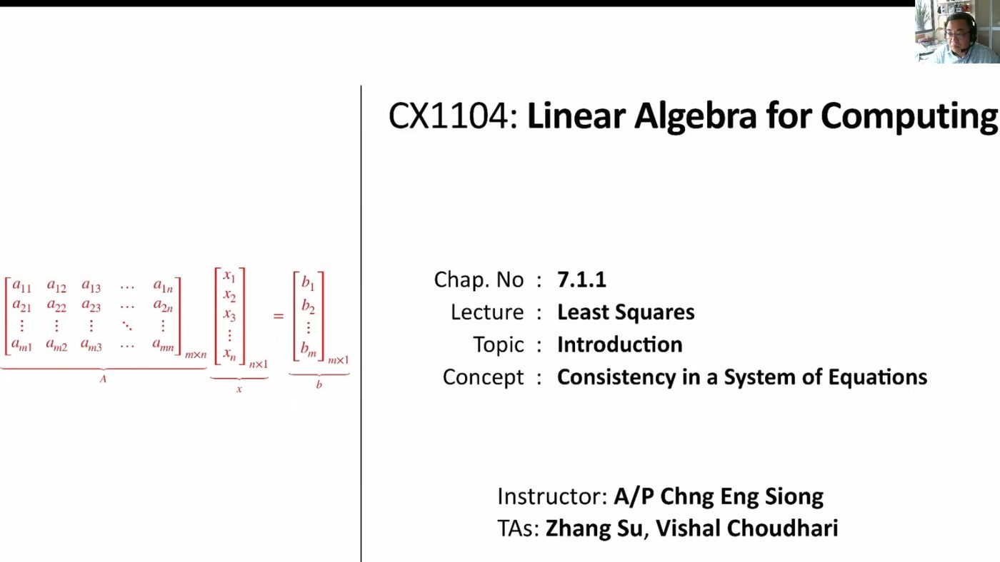

**Content — title card:** *Chap. No: 7.1.1 · Lecture: Least Squares · Topic: Introduction · Concept: Consistency in a System of Equations* (last updated 10 Dec 2025).

- Chapter 7 opens with a review of when $A\mathbf x = \mathbf b$ **has** a solution, because least squares is the answer when it does **not**.

> 🎙️ **Narration:** *"This is CX1104 chapter 7.1.1 least squares. Today we will talk about consistency in a system of equations."*

---

### 🎬 Slide 2 — Setting up $A\mathbf x = \mathbf b$ — the sizes involved

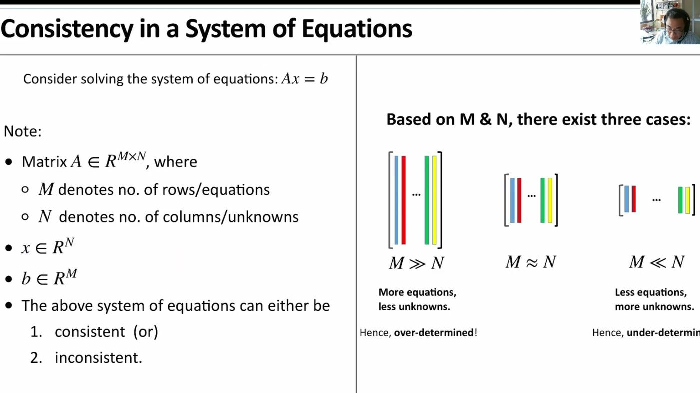

**Content — Consistency in a System of Equations.** Consider solving $A\mathbf x = \mathbf b$.

**Note:**
- Matrix $A \in \mathbb{R}^{M\times N}$, where $M$ = number of **rows / equations**, $N$ = number of **columns / unknowns**;
- $\mathbf x \in \mathbb{R}^{N}$, $\;\mathbf b\in\mathbb{R}^{M}$;
- the system can be **over-determined** (more equations than unknowns) or **under-determined** (fewer equations than unknowns).

> 🎙️ **Narration:** *"The problem we want to solve is again AX equals to B and by least squares we are talking about phi X given A and B. The word v square means find the best b sorry the best x that approximate. Now there are several situations first a is a matrix here the word r means real number and as you remember m by n is telling us the size of the matrix where m is the number of rows and n is the number of columns. So it is a is a real matrix. x is a vector of rn so that a by x we can perform this operation matrix row matrix and column vector multiplication. b is rm because it must then agree that b this is a m by n matrix multiplied by n by one therefore we should be getting a m by one so the dimension of b must be m by one in this equation and again if we are multiplying a real matrix by a real column vector this is real and this is real then b must be real. What is the idea of consistent equations and inconsistent equation. So the word above system basically means that we have many rows of A. So the A's are the equations, systems of equations. Consistent means that whether the left-hand side AX agrees with the right-hand side B. So if it is agreeing AX equals to B, then we have a consistent equation and if it doesn't agree for whatever reason and we'll see it later then it's called an inconsistent equation. Now depending on the size of m by n, so this is number"*

---

### 🎬 Slide 3 — The three cases: $M > N$, $M = N$, $M < N$

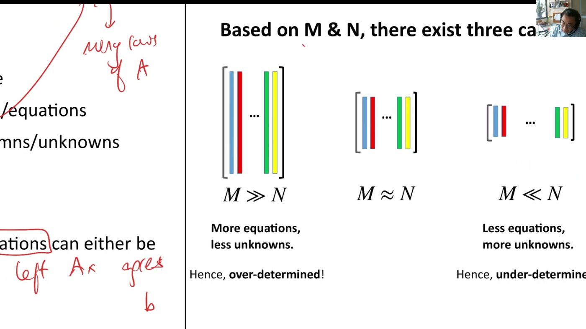

**Based on $M$ and $N$, there exist three cases:**

| Case | Meaning | Consequence |
|---|---|---|
| $M > N$ | more equations, fewer unknowns | **over-determined** |
| $M = N$ | same number of equations and unknowns | square system |
| $M < N$ | fewer equations, more unknowns | **under-determined** |

- An over-determined system ($M>N$, a **tall and thin** $A$) usually has **no exact solution** — this is exactly the case where least squares is needed.

> 🎙️ **Narration:** *"of rows and here is the number of column 1, 2 until n. So when m is greater greater than n means that it is a tall and thin matrix. Then we have more equations because each row represents one equation. We have more equations than unknowns. The unknowns are the number of columns because later on you realize that the unknowns we are talking about is the x, x1 to xn. How many unknowns are there? So there are more equations that are unknown in this and this is an over-determined system. and that's a typical case we will have to face in machine learning. Now when m is equals to m, then actually m and this is a square matrix and when m is less than n where there are only fewer equations, fewer equations than unknown, we have more unknowns then the system is undetermined. So this is overdetermined on the left and"*

---

### 🎬 Slide 4 — The three cases (continued)

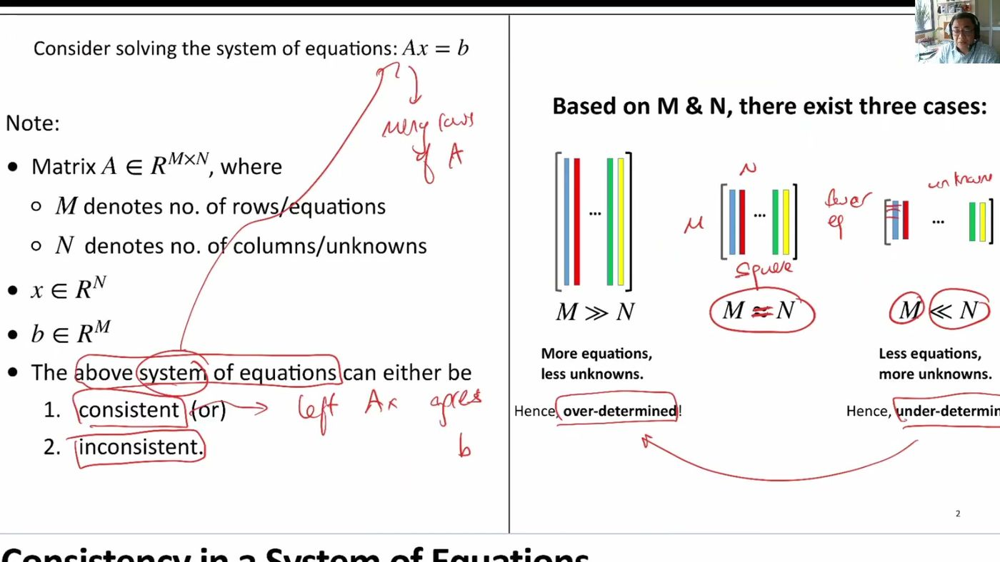

- $M > N$: tall and thin $A$ — more equations ⇒ the equations may be **inconsistent**.
- $M < N$: short and wide $A$ — more unknowns ⇒ typically **infinitely many** solutions.
- Which case we are in determines whether we can solve exactly at all.

> 🎙️ **Narration:** *"undetermined on the right. With this background we can talk about consistency. The idea of"*

---

### 🎬 Slide 5 — The three cases (annotated)

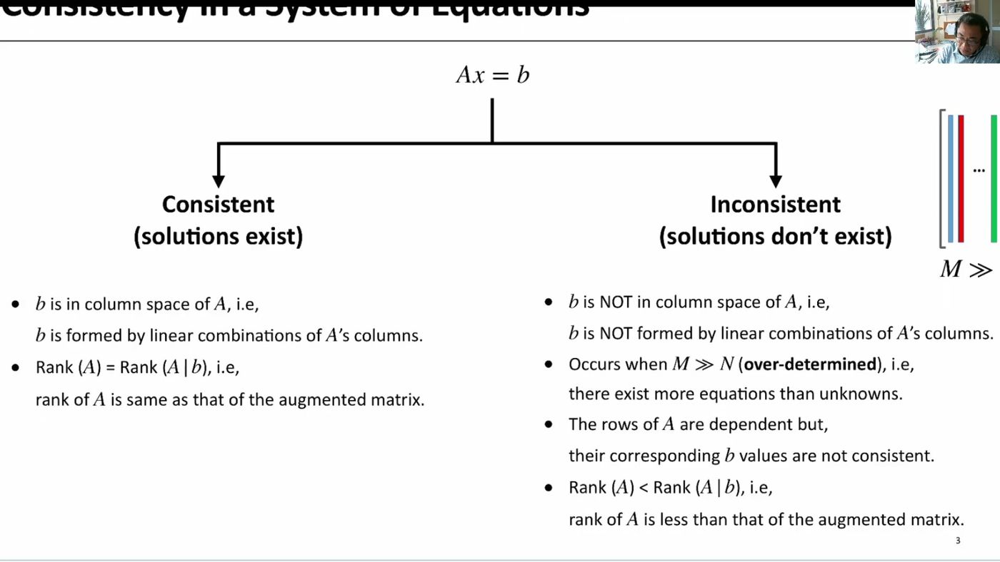

- On the annotated slide: $A$ is $M\times N$, $\mathbf x\in\mathbb{R}^N$, $\mathbf b\in\mathbb{R}^M$; the panel highlights that when $M>N$ the system is **over-determined**, and when $M<N$ it is **under-determined**.

> 🎙️ **Narration:** *"a consistent equation is that B can be solved by given A and finding X. That is we can"*

---

### 🎬 Slide 6 — **Consistent vs inconsistent**

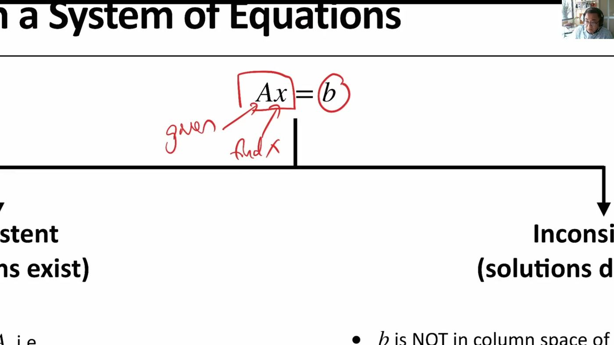

**Content — $A\mathbf x=\mathbf b$:**

| **Consistent** (solutions exist) | **Inconsistent** (solutions don't exist) |
|---|---|
| $\mathbf b$ is in the **column space** of $A$, i.e. $\mathbf b$ is formed by linear combinations of $A$'s columns | $\mathbf b$ is **NOT** in the column space of $A$ |
| $\operatorname{rank}(A) = \operatorname{rank}([A\mid\mathbf b])$ — the rank of $A$ equals the rank of the augmented matrix | $\operatorname{rank}(A) < \operatorname{rank}([A\mid\mathbf b])$ |

> 🎙️ **Narration:** *"find x unknown, we can solve for these values and then the answer would be b. The system of equations given a and b are consistent. I'll give you an example. Maybe 1, 1, x1, x2 equals 2. Let's say 2. Now if I give you another 1, 1, another equation and now if I give you three then the equations are not consistent because the first row 1 1 tells us x1 plus x2 equals to 2 the second equation x1 plus x2 equals to 3 so so this the word inconsistency comes from this idea what about the interpretation in math well when we say that B can be formed by a linear combinations of A, that means A times whatever x is equals to B, then the system is consistent. The other way to think about is that once you can find a linear combination of A columns, you're actually saying that B is in the column space of A. So B is formed by columns of A, some linear combination, therefore it is a column space of A. Another way to find out that this is true is find the rank of A. Rank of A means the number of independent columns or independent rows and by augmenting by creating a matrix A augment B basically means that you take all the A's and you take one column of B and this is the augmented matrix and you find its rank and if it is rank it is equals to A matrix then basically by adding one extra column of B the rank did not change"*

---

### 🎬 Slide 7 — Consistent systems — worked discussion

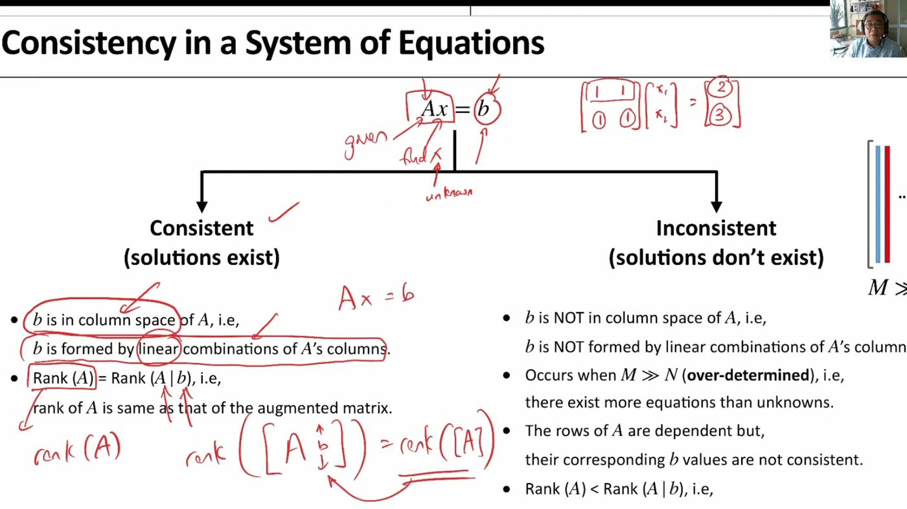

- If we can find $\mathbf x$ such that $A\mathbf x = \mathbf b$, the system is **consistent**.
- **Example idea from the lecture:** with $A = \begin{bmatrix}1&1\\1&2\end{bmatrix}$ and a suitable $\mathbf b$, the solution exists — equivalently, $\mathbf b$ lies in the column space of $A$.

> 🎙️ **Narration:** *"and of course this is telling us that the B again the B again is in the column space that means B is in the column space of A. Now let's discuss the right hand side inconsistent equation the easiest way to understand is B is not found by a linear combinations of A because in this example 2, 3 cannot be formed by these columns or n combinations of this column. You can try to multiply x1 multiplied by the first column, x2 multiplied by the second column and add them up and there is no way you can get this value. The columns of B is not in the column space of A. So there is the idea here. Now when can it occur? It usually typically occurs when M the number of equations is much greater than N. So it typically occurs okay and that is what happened in our machine learning where we have more equations than unknown and then we cannot find a solution. A solution means that ax will always be equals to b. So all these are interpretations of when an inconsistent equation happens. The roles of a's are dependent but the b's are not consistent. So that was the problem of 1, 1, 1, 1. Roles of a are dependent because in fact they are the same. Or let's try 2, 2. This is x1 and x2 and then the previous example maybe we give a 2 and then we have another 2. So the first row gives 2, the second row even though it's doubled, still gives 2. So the right hand side is inconsistent, the B's are inconsistent and the last interpretation is by adding an extra column, then the rank of this augmented matrix has increased by 1 as compared to rank of A. it means that B is not in the column space of A so this interpretation is actually the same as the first line"*

---

### 🎬 Slide 8 — Consistent: unique vs infinitely many solutions

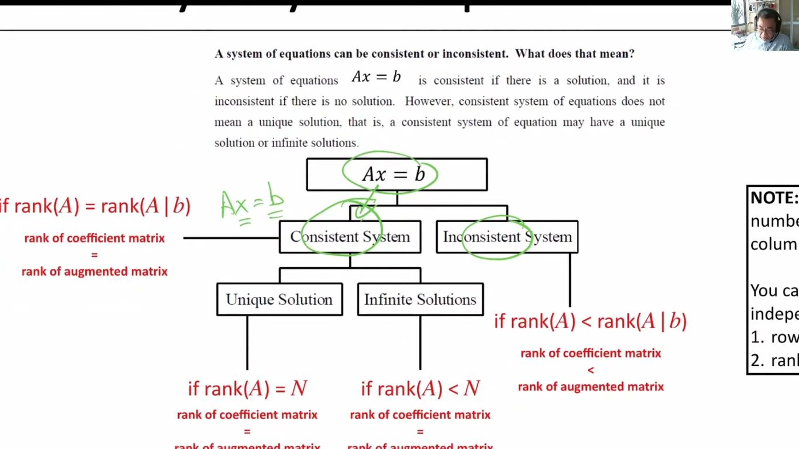

- A consistent system does **not** mean a unique solution: it may have a **unique** solution or **infinitely many**.
- The number of solutions is governed by the rank:
  - $\operatorname{rank}(A) = N$ ⇒ **unique** solution;
  - $\operatorname{rank}(A) < N$ ⇒ **infinitely many** solutions.

> 🎙️ **Narration:** *"When this happens, the system is consistent but there are two different types of solutions we need to be aware of. The unique solution of x and infinite solutions of x, meaning that there is only one x, one vector of x that can solve Ax equals to b. Or here infinite means that there are many sets of x and Ax will still be equals to be for different types of x. For consistent equations, remember that we can quickly determine if a system of equations is consistent by checking the rank of A versus the rank of the augmented matrix as in the rank of A augmenting with the columns of B and if they are the same it means that increasing one column of A using the B vector did not change the number of independent columns. That also exactly means that B is in the column space of A. In the situation when A is the M by N matrix, if the rank of A equals to n means that all the columns are independent and not only that, the number of columns that are independent is equals to n, therefore its rank is also equals to n and when this happens there is only one x that will make ax x equals to b. So we call that the unique solution. That is x is unique. Now this can happen in"*

---

### 🎬 Slide 9 — Rank conditions — why extra rows help

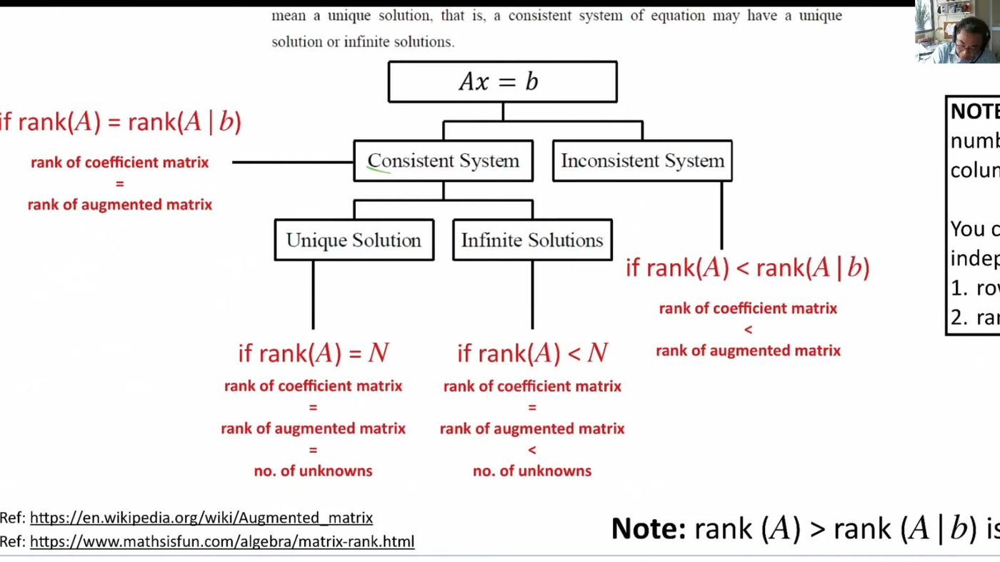

- For an $m\times n$ matrix, even when $m > n$ we can still have $\operatorname{rank}(A) = n$.
- That means the extra rows (the additional equations) are **redundant** — they do not add new information, and the system can still be consistent.

> 🎙️ **Narration:** *"a m by n matrix. Even when m is greater than n, we can still find the rank of a being only n. What it means is that the additional rows, because we have more equations that are known had not increased any information in A. What it basically happens is that the more rows we have in M, they are simply linear combinations of the previous rows, the only N independent rows. What about for the case when the rank of A is less than n. Basically in a short and fat matrix for example this is a and m is a number of rows and n is the number of columns and n is big compared to m and when we find the rank of such a matrix the best that we can do is to get rank goes to m the number of independent rows and here it's very obvious that number of m sorry number of independent rows is definitely less than n the number of columns and here is the underdetermined system as we have seen in this"*

---

### 🎬 Slide 10 — An under-determined example gives infinite solutions

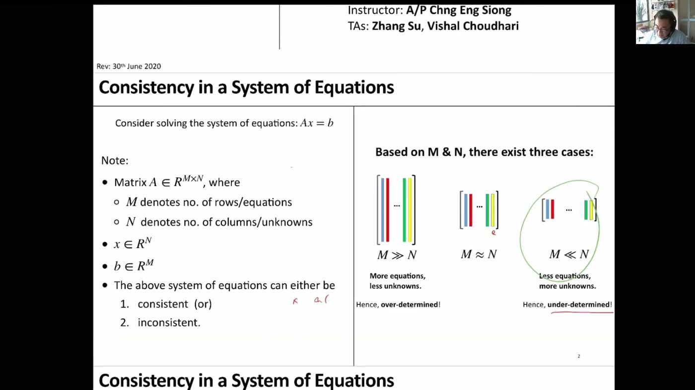

- In the **under-determined** case (fewer equations than unknowns) we typically get **infinitely many** solutions — the solution set is a line/plane in $\mathbb{R}^n$.

> 🎙️ **Narration:** *"example here and in the undetermined system we can have infinite solutions"*

---

### 🎬 Slide 11 — Rank conditions for consistency (summary)

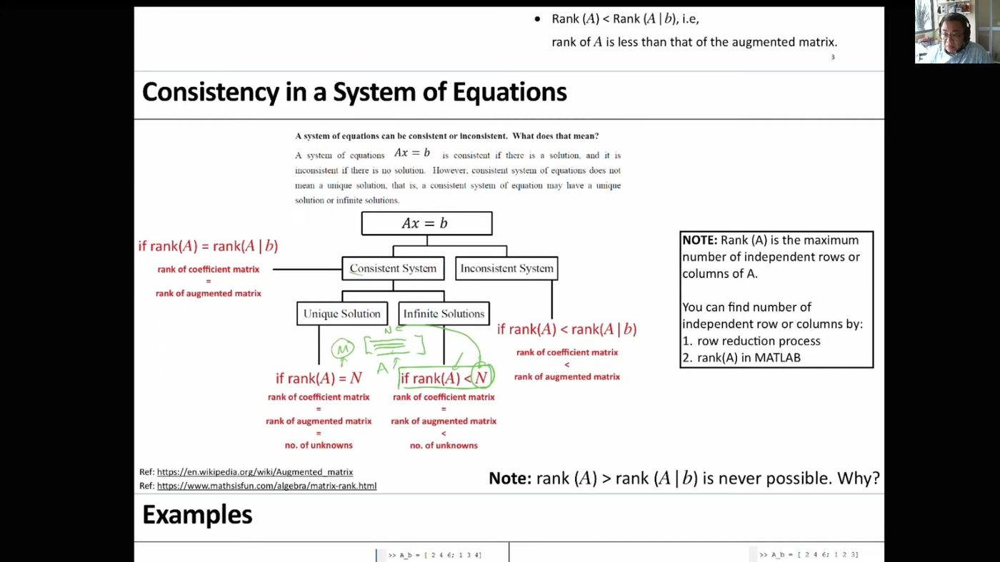

- $\operatorname{rank}(A) < \operatorname{rank}([A\mid\mathbf b])$ ⇒ **inconsistent**: no linear combination of the columns of $A$ can produce $\mathbf b$.
- If $\mathbf b$ is in the column space of $A$, the system is consistent and the error is exactly zero.

> 🎙️ **Narration:** *"we'll see examples of that later and finally in consistent equations remember we said that if the rank of a is less than the rank of the augmented matrix, it means that by increasing, by making, combining A and the columns of B, this rank has increased. It means that we have more independent column. It also means that B is not in the subspace of A. It also means that there is no combinations of A that can give B, and that means this is an inconsistent system. In fact, most of the real-life example is"*

---

### 🎬 Slide 12 — Rank conditions panel (annotated)

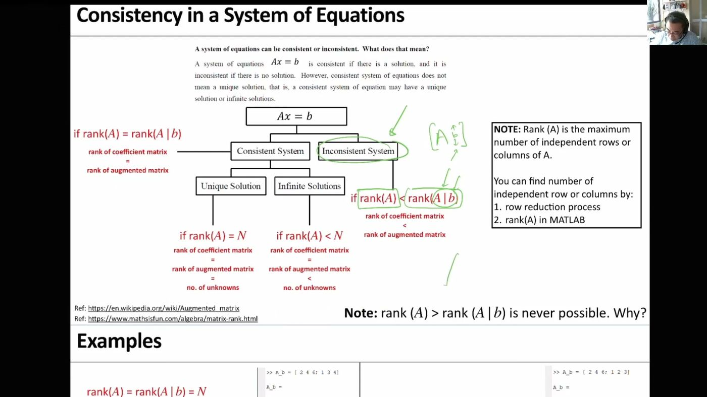

- On the annotated panel the two rank comparisons are highlighted:
$$\operatorname{rank}(A) = \operatorname{rank}([A\mid\mathbf b]) \;\Rightarrow\; \text{consistent}, \qquad \operatorname{rank}(A) < \operatorname{rank}([A\mid\mathbf b]) \;\Rightarrow\; \text{inconsistent}.$$
- Augmenting $A$ with $\mathbf b$ cannot *reduce* the rank — so $\operatorname{rank}(A)\le\operatorname{rank}([A\mid\mathbf b])$ always.

> 🎙️ **Narration:** *"that we have in-con system system. And we ask you to think about this, we say that by augmenting a matrix, its rank is less than a. And of course that's not possible because basically you're increasing a column in the matrix by a dash b. And once you have increased the column, the rank will typically increase if b is not in the column space. And if b is in the column space then rank does not increase but it will never decrease."*

---

### 🎬 Slide 13 — A $2\times2$ consistent example (unique solution)

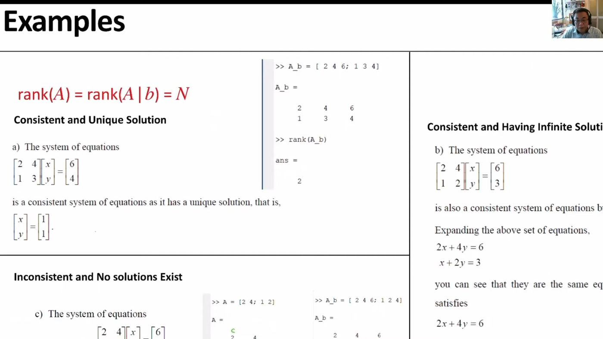

- **Example:** $A$ is $2\times2$, $\mathbf x$ the unknown vector, $\mathbf b$ the right-hand side; the two equations are solved simultaneously.
- The lecture plots the two lines: they **intersect at a single point** — that point is the unique solution.

> 🎙️ **Narration:** *"In this slide, we'll give consistent versus inconsistent equation using A as a 2 by 2 matrix. In the first example, this is A, this is the vector x of unknown and this is B. We have two equations. This is the first equation and this is the second equation with the associated piece. We can therefore write the first equation as 2x plus 4y equals to 6 and the second equation as 1x plus 3y equals to 4. Implying that 4y equals to 6 minus 2x implying y equals to 6 over 4 minus x over 2. And the second equation is implying 3y is equals to 4 minus x implying y equals to 4 over 3 minus x over 3. We can plot these two equations and when the lines of these"*

---

### 🎬 Slide 14 — The same example — geometric reading

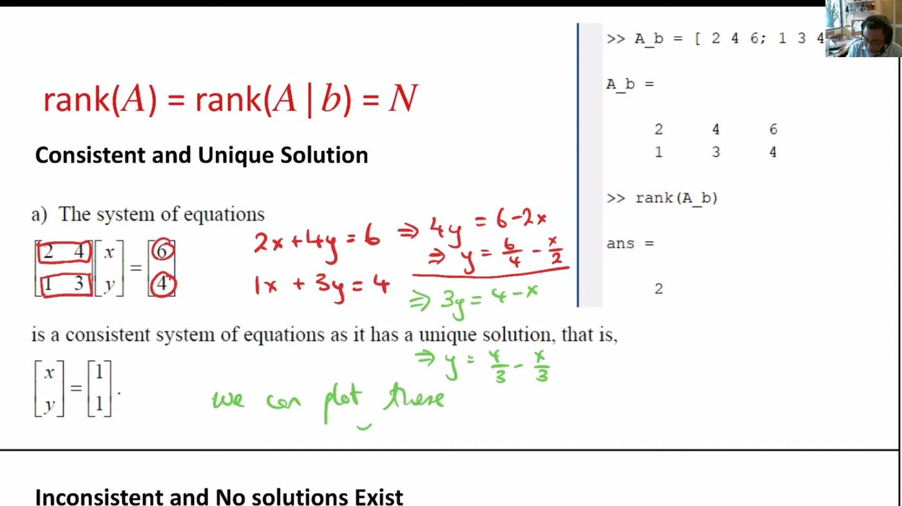

- Two equations in two unknowns = two lines in $\mathbb{R}^2$; a unique solution means a **single intersection point**.

> 🎙️ **Narration:** *"two equation matches that will be the solution for the vector xy. I have"*

---

### 🎬 Slide 15 — The picture: unique solution at the intersection

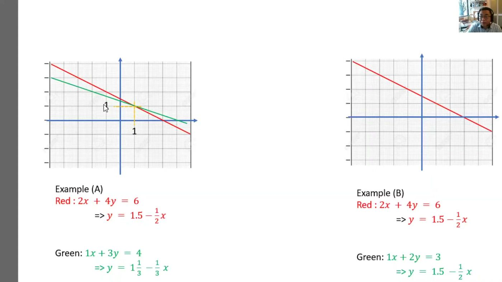

- The red line is the first equation and the green line the second; they intersect at the coordinate $(1,1)$ — the **unique solution**.
- Hence the system is **consistent and not only that it has a unique solution**.

> 🎙️ **Narration:** *"plotted this two lines red for the first equation and green for the second equation and it shows that this equation intersects at one one coordinate. This coordinate one one is the solution of these two equations that is this solution satisfies both equations at the same time and therefore we say that"*

---

### 🎬 Slide 16 — Textbook page — consistent vs inconsistent, stated

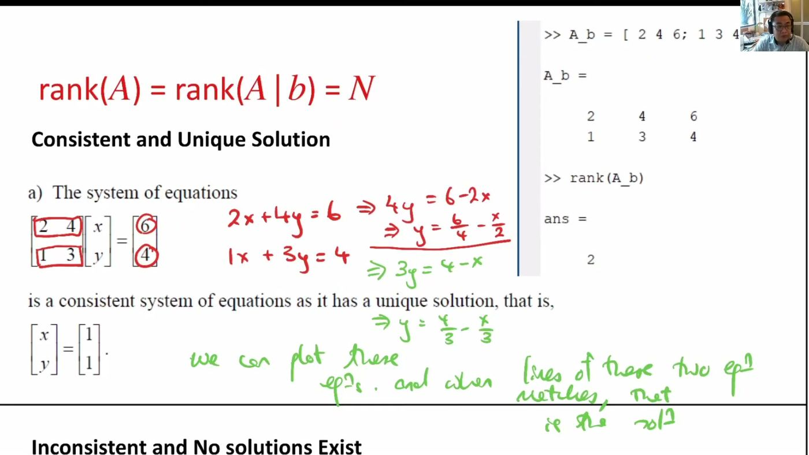

- *"A system of equations $A\mathbf x = \mathbf b$ is **consistent** if there is a solution, and it is **inconsistent** if there is no solution."*
- *"However, a consistent system of equations does **not** mean a unique solution: a consistent system may have a unique solution or infinitely many solutions."*

> 🎙️ **Narration:** *"this system of equation is consistent. This system of equation is consistent and not only that it has a unique solution. There is only one solution coordinate one one that satisfy both equations. This way of solving or finding that the system of equation is consistent and unique is troublesome and it's a simpler way. In this lecture we have learned that by doing this rank of A versus the rank of the augmented matrix A and B and we check whether they are the same rank. If the rank is equal then what happens is that we will know that the columns of B is in the column space of A, implying that the equation is consistent will have a solution. Secondly, the rank of A is equals to 2 which is equals to n and in this case implying that we will have a unique solution. We now"*

---

### 🎬 Slide 17 — The rank table (unique / infinite / inconsistent)

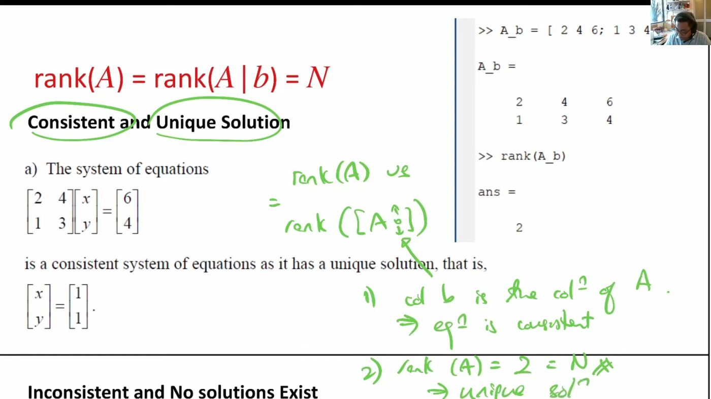

**Content — the rank criteria:**

| Condition | Conclusion |
|---|---|
| $\operatorname{rank}(A) = \operatorname{rank}([A\mid\mathbf b]) = N$ | consistent, **unique solution** |
| $\operatorname{rank}(A) = \operatorname{rank}([A\mid\mathbf b]) < N$ | consistent, **infinitely many solutions** |
| $\operatorname{rank}(A) < \operatorname{rank}([A\mid\mathbf b])$ | **inconsistent** (no solution) |

- ($N$ = number of unknowns.)

> 🎙️ **Narration:** *(transition frame — the explanation continues on the next slide)*

---

### 🎬 Slide 18 — Infinite-solution example — the two lines coincide

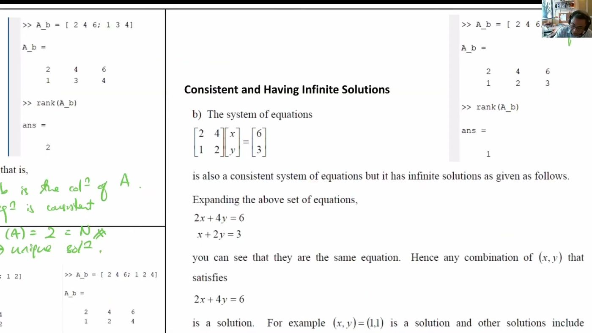

- Second example: the system is **consistent with infinitely many solutions**.
- Plotting the two equations shows the red and green lines **lying on top of each other** — every point of the line is a solution.

> 🎙️ **Narration:** *"Now explore the second example where the system of equation is consistent but has infinite solution. Again, we will take a brute force approach and plot the first equation as well as the second equation. Let us again use the first equation in rate. Implying is 2x plus 4y is equals to 6, allowing us to reduce to 4y equals to 6 minus 2x. Dividing both side by 4, the answer is 1 and a half minus half x. In the second equation, we have 1x plus 2y is equals to 3, implying 2y equals to 3 minus x, implying y is equals to 1 half minus half x. It shows that the red equation and the in green equation are the same. we plot we will have both red line and green line on the same line. This is what we will see."*

---

### 🎬 Slide 19 — Why the lines coincide — the second row is a multiple

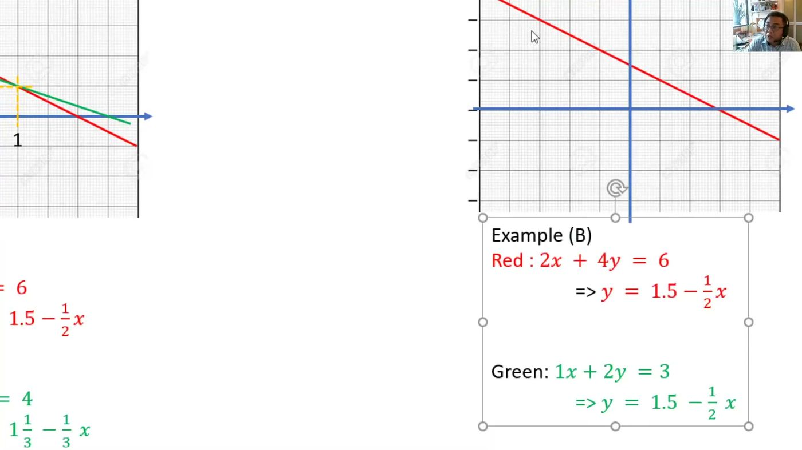

- The two equations are multiples of one another, so the second equation adds **no new constraint**: $\operatorname{rank}(A) = \operatorname{rank}([A\mid\mathbf b]) < N$.

> 🎙️ **Narration:** *"I only plotted the red line with the red equation which is the same as the previous red line. The green line is sitting exactly on the same place as the red line. It shows that the two equations are exactly the same. All values along this line satisfy this equation and hence we have infinite solutions. As an example, you can substitute different values of x and y"*

---

### 🎬 Slide 20 — Checking infinite solutions by rank

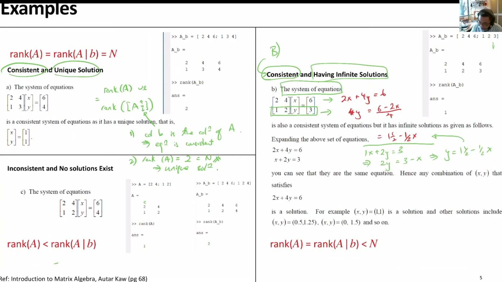

- *"Is there a simpler way to check whether the system is consistent and has infinitely many solutions?"* — Yes: compute the ranks.
- Here $N = 2$ but $\operatorname{rank}(A) = 1 < 2$, so we get a **free variable** and an infinite solution set.

> 🎙️ **Narration:** *"and you will still get the correct value. Is there a simpler way to solve or to check whether the system of equation is consistent and having infinite solution? Yes there is and it is through this criteria. We will check the rank of A and in this case the rank of A is equal to 1 because A has dependent rows or n in fact you can see that it has also dependent columns and the number of independent rows and columns is only equals to 1. The number of unknown variable n is equals to 2. First let's check for consistency. To check whether a system of equation is consistent all we do is to check rank of A versus the rank of A augmented by B. If the rank is the same then the system of equation is consistent. It basically says that adding B will not change the rank. Column B is is in the same column space as a. In this example, a slash b rank is also equals to 1."*

---

### 🎬 Slide 21 — Why an augmented rank can't exceed $\operatorname{rank}(A)$

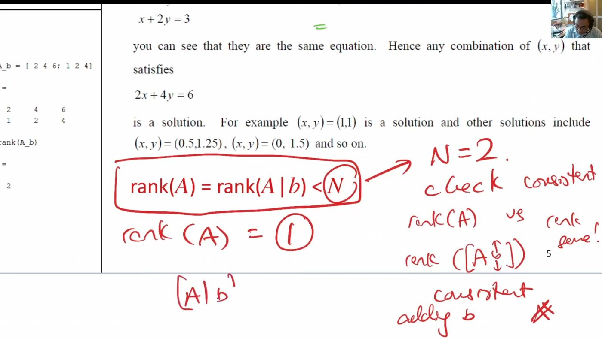

- *“We ask you to think about this: we say that by augmenting a matrix, its rank is less than $A$ — and of course that's not possible.”*
- Adding a column to a matrix (forming $[A\mid\mathbf b]$) can **never decrease** the rank.

> 🎙️ **Narration:** *(transition frame — the explanation continues on the next slide)*

---

### 🎬 Slide 22 — An **inconsistent** example

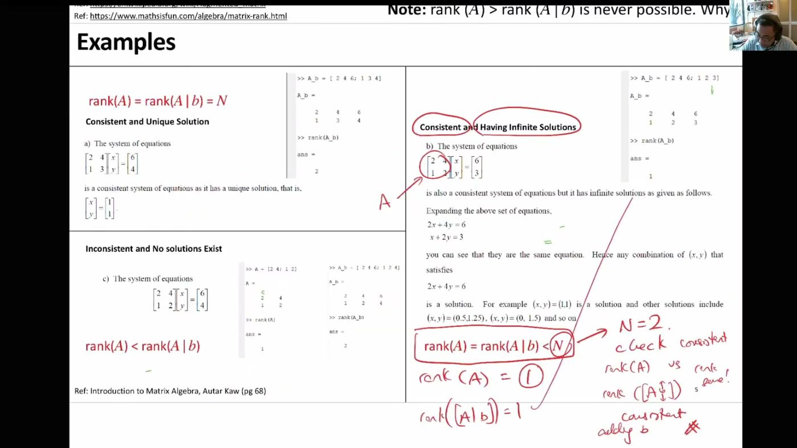

- In the third example the two lines are **parallel and distinct**, so there is **no intersection**: $\operatorname{rank}(A) < \operatorname{rank}([A\mid\mathbf b])$.
- No linear combination of the columns of $A$ can produce $\mathbf b$ — the system is inconsistent.

> 🎙️ **Narration:** *"We can see this visually, this is b. In fact, columns of b is nothing but columns 1 multiplied by 3. Now to check that it has infinite solution, is this criteria here number of unknown is 2 but the rank is 1 therefore we have one free variable and therefore we have infinite solution. In the last equation let's check out again these two equations writing rate for the first equation 2x plus 4y is equals to 6 implying y is again as before 1.5 minus half x. What about the second equation? In the second equation, we will write 1x plus 2y is equals to 4. When we evaluate this, we get y is equals to 2 minus half x. Now what is interesting is this. It's that both of them have the same slope. They just have different intercept. Now let's draw this graph. The"*

---

### 🎬 Slide 23 — Reading the inconsistent example carefully

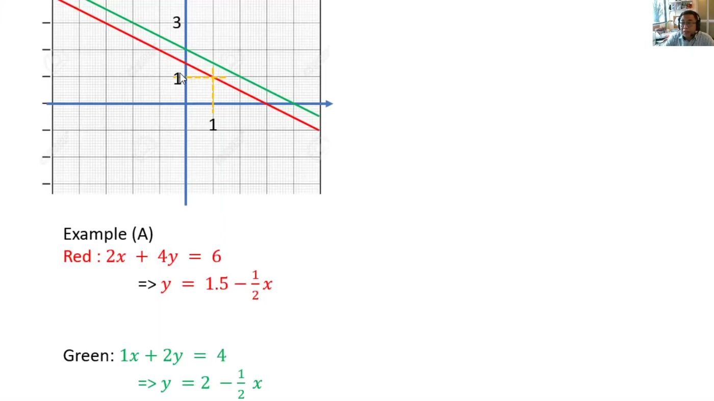

- The red line has intercept $1.5$ when $x=0$, the green line has intercept $2$: they never meet.
- Hence **no solution** exists; the best we can do is to find the closest approximation — the motivation for **least squares**.

> 🎙️ **Narration:** *"red line has intercept one and a half when x equals to zero. The green line has intercept two when x is equals to zero. It shows when you study this very carefully, it shows that the red line and the green line are parallel lines they will never meet and hence there is no solutions. Is there an easier way to find out whether the problem is consistent or if no solution exists, there is, instead of plotting the two graphs and checking whether they intercept, instead we check the rank of A versus the rank of A augmented with B. If the rank of A augmented with B is greater than rank of A, then implying that column B does not live in the column space of A and implying"*

---

### 🎬 Slide 24 — MATLAB examples: `rank(A) = rank([A|b]) = N`

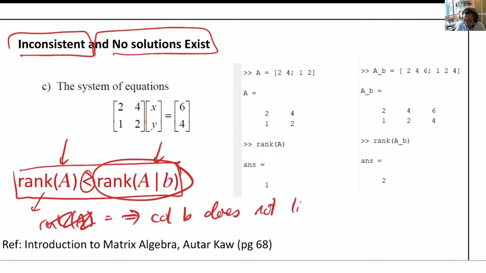

```matlab
>> Ab = [2 4 6; 1 3 4]
>> rank(Ab)
ans = 2
```

- (a) The system $\begin{bmatrix}2&4\\1&3\end{bmatrix}\binom{x}{y} = \binom{6}{4}$ is **consistent with a unique solution**.
- (b) The system $\begin{bmatrix}2&4\\1&2\end{bmatrix}\binom{x}{y} = \binom{6}{7}$ … — the lecture uses MATLAB to compute ranks and classify the system.

> 🎙️ **Narration:** *"that we'll never get columns of A multiplied or linear combination to get B. In this case what happened is that we call this system of equation inconsistent. What is the rank of A? Well if you use this equation plugging in this matrix we get 1 and we know this one because if you check the first column the second column is nothing but a multiple of the first column. All about checking is row again we see that row 1 is the multiple of row 2. What about the augmented matrix. This is A, this is B. When we check the rank, the rank is 2. The rank is 2 because actually we have two independent rows. Although we have three columns, only two of them are independent. First column and the third column are independent. The second column is two times"*

---

### 🎬 Slide 25 — MATLAB examples (continued) — the three classifications

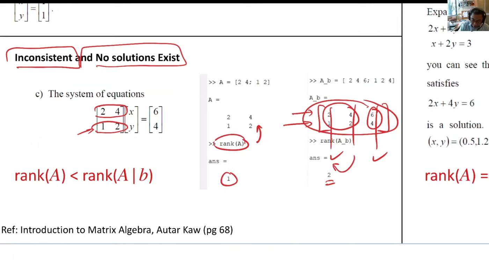

- **Example (a):** $\operatorname{rank}(A) = \operatorname{rank}([A\mid\mathbf b]) = N$ ⇒ consistent and **unique solution**, e.g. $\mathbf x = (1, \tfrac12)$.
- **Example (b):** $\operatorname{rank}(A) = \operatorname{rank}([A\mid\mathbf b]) < N$ ⇒ consistent and having **infinitely many solutions**.
- **Example (c):** $\operatorname{rank}(A) < \operatorname{rank}([A\mid\mathbf b])$ ⇒ **inconsistent**.

> 🎙️ **Narration:** *"the first column. Therefore to repeat to check whether the system of equation is inconsistent all we need is to check the rank of A versus its augmented matrix AB rank. And if rank of AB is greater than A then the system of equation is inconsistent. So this concludes our discussion"*

---

### 🎬 Slide 26 — Checking consistency — the take-away

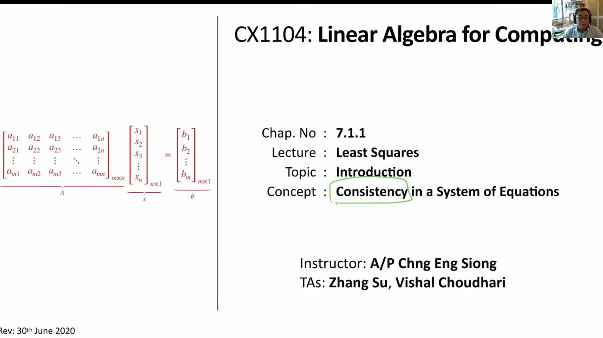

- To check whether a system is inconsistent, compare $\operatorname{rank}(A)$ with $\operatorname{rank}([A\mid\mathbf b])$:
$$\operatorname{rank}([A\mid\mathbf b]) > \operatorname{rank}(A) \;\Longrightarrow\; \text{inconsistent}.$$
- When inconsistent, $\mathbf b \notin \operatorname{Col} A$ — which leads directly into the least-squares problem of 7.1.2.

> 🎙️ **Narration:** *"for consistency in the system of equations."*

---
## V-7.1.2 — 7.1.2 The Least Squares Problem

> **Videos (2):** `7.1.2, pg 1~4` (8.2 min) · `pg 5` (11.5 min) — deck: `7.1.2_The_Least_Squares_Problem.pdf` (5 pages)

### 🎬 Slide 1 — Title: *The Least Squares Problem*

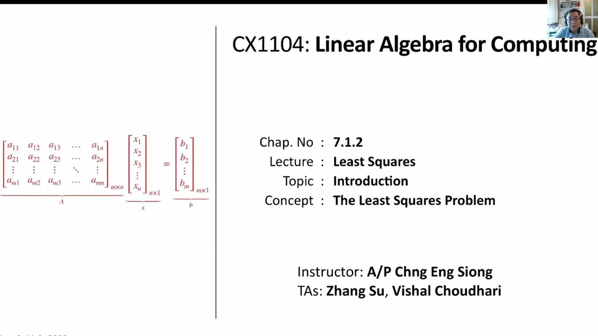

**Content — title card:** *Chap. No: 7.1.2 · Lecture: Least Squares · Topic: Introduction · Concept: The Least Squares Problem.*

- The slide shows the full matrix equation $A\mathbf x = \mathbf b$ with the sizes annotated: $A$ is $m\times n$, $\mathbf x$ is $n\times 1$, $\mathbf b$ is $m\times 1$.

> 🎙️ **Narration:** *"This is 7.1.2 least squares. In this subsection, we'll introduce the least squares problem."*

---

### 🎬 Slide 2 — Recall: consistent vs inconsistent

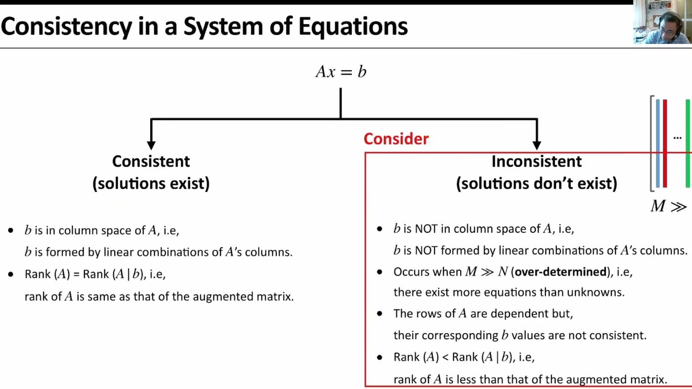

**Content — Consistency in a System of Equations (recap).**

- The problem is still $A\mathbf x = \mathbf b$ with $A$ and $\mathbf b$ given: find $\mathbf x$.
- **Consistent:** $\mathbf b$ is in the column space of $A$ ($\mathbf b$ is a combination of the columns of $A$).
- **Inconsistent:** $\mathbf b$ is **not** in the column space of $A$.

> 🎙️ **Narration:** *"The problem at hand is still Ax equals to b and we are given a and we are given b and the problem is to find x. In the last lecture, we talk about consistent equation where if B is in the column space of A, then we can find X such that Ax will be equals to B and therefore there is zero error in approximating X, approximating X using B. We also talk about the situation of inconsistent system of equations. Typically we say that when the number of equations, the number of rows in A is greater than the number of variables n, then there might be chances that there are inconsistent equations. specifically that is B is not in the column space of A. In other words, we cannot form B using any linear combinations of A. That is, no matter how we find X to perform the linear combinations, AX will never be equals to B. So what should we do when we're given"*

---

### 🎬 Slide 3 — What to do when $\mathbf b \notin \operatorname{Col} A$: best approximation

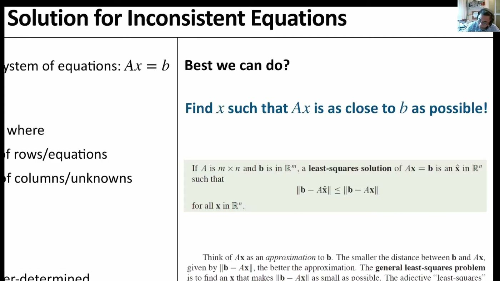

- When the system is inconsistent, we cannot make $A\mathbf x = \mathbf b$ exact — so we look for $\mathbf x$ such that $A\mathbf x$ is **as close to $\mathbf b$ as possible**.
- Call that best $\mathbf x$ **$\hat{\mathbf x}$**; the vector $A\hat{\mathbf x}$ is the closest point of $\operatorname{Col} A$ to $\mathbf b$ (its **projection**).

> 🎙️ **Narration:** *"such a situation. The idea is that we have to find x such that ax will produce a b hat and b hat is as close to b as possible. Let us call the best x that does the trick x hat. What happened is that now we want to find x hat such that ax hat is as close to b as possible by as close we are talking about the Euclidean norm of the approximation error. This two parallel bar is the symbol for norm. What we are saying is let's find x hat such that compared to any x, the error on the left will be the best as in the smallest we can ever achieve. This is called the least square solution. Here the word least square"*

---

### 🎬 Slide 4 — Measuring "close": the norm of the error

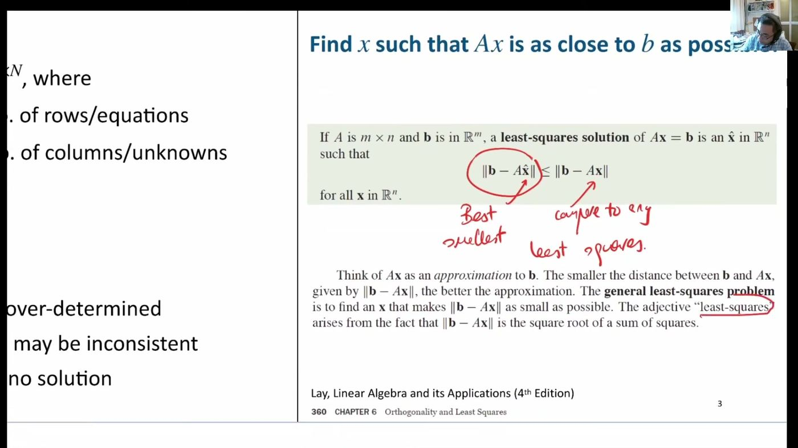

- The error is $\mathbf b - A\mathbf x$, and "closeness" is measured by its **norm**
$$\|\mathbf b - A\mathbf x\| = \sqrt{\sum_i \left(b_i - (A\mathbf x)_i\right)^2}.$$
- The norm is a **square root of a sum of squares** — this is the *approximation error* we want to minimise.

> 🎙️ **Narration:** *"means that it is actually the square root of a sum of square because we're talking about the norm. The norm is a square root of a sum of squares and here is the approximation error. The approximation error between b, that one factor we are desiring or it is the target to ax hat that is the one we are producing. We have actually seen this problem before under dot product, under orthogonal projection as well as in Gram-Smith. What we are saying is that we have the columns of A and the shaded region is the column space of A. We We can produce any vector Ax in this point or Ax in this point by finding different combinations of A since if this is A1, A2, A, and n columns and by using different x1, x2, and xn we are actually generating x1 a1 plus x2 a2 plus xn an finding different columns of a or scaling different columns of a to get ax the lecture in orthogonal projection tells us that if we want to find the smallest Euclidean norm of the approximation error because this is B, our desired output and this is A hat. Maybe I should call this B hat our best approximation to B. The smallest error E, smallest is the norm of E is the norm of B minus B hat which is equals to b minus a hat, a x hat and by orthogonal projection we remember that e the error is orthogonal to the column space of a. Of course in the situation when b lies in"*

---

### 🎬 Slide 5 — The error is zero exactly when the system is consistent

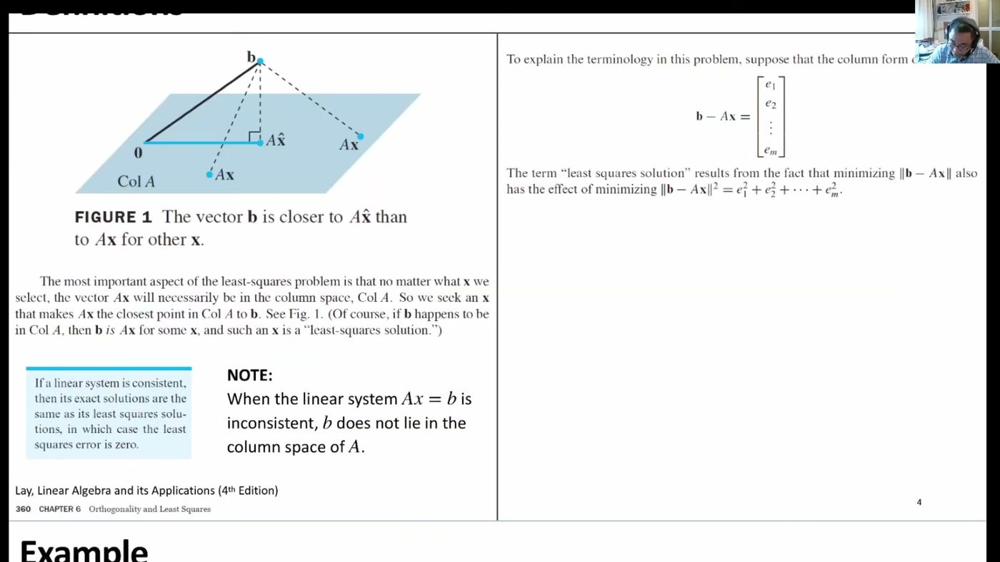

- If $\mathbf b$ lies in the column space of $A$, some $\mathbf x$ gives $A\mathbf x = \mathbf b$ and the error is **zero** — that is the consistent case.
- When $\mathbf b$ is *not* in the column space, the error can never reach zero; the least-squares solution makes it as small as possible.

> 🎙️ **Narration:** *"the column space of a then b would be inside or on one of the point of the column space and there will be no error. That situation will only happen when AX equals to B is consistent. And when AX equals to B is inconsistent, B does not lie on the column space of A and you see in this diagram it is not on the blue plane. Some standard terminology, this is the error factor, we call it E and it is point B minus AX and each of these terms E1, E2 until EM will be the error at each coordinate. And here we are interested in least squares, the word squares here means the error square. So it is the norm of the error square using dot product remember Since norm of E is equals to square root of E dot product with E, therefore norm of E square is equals to E dot E. And referring to your dot product equation, E dot E is equals to individual element square. The number of elements in factored E is M element because matrix A belongs to Rm by N. Number of equations is M."*

---

### 🎬 Slide 6 — **Least squares solution** — the definition

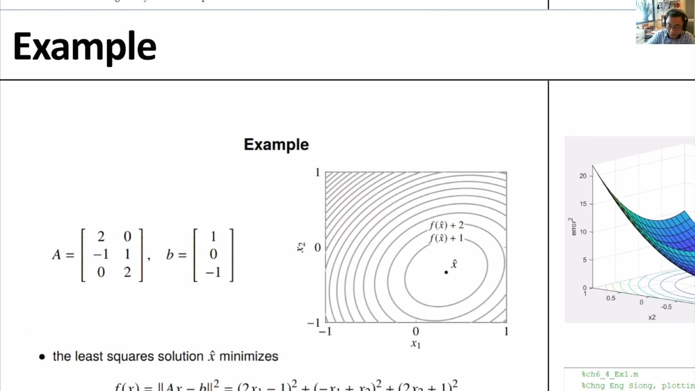

**Content — Least Squares Solution for Inconsistent Equations.**

- **Best we can do? Find $\mathbf x$ such that $A\mathbf x$ is as close to $\mathbf b$ as possible!**
- *If $A$ is $m\times n$ and $\mathbf b\in\mathbb{R}^m$, a **least-squares solution** of $A\mathbf x=\mathbf b$ is an $\hat{\mathbf x}\in\mathbb{R}^n$ such that*
$$\|\mathbf b - A\hat{\mathbf x}\| \le \|\mathbf b - A\mathbf x\| \qquad \text{for all } \mathbf x\in\mathbb{R}^n.$$
- Note: when $m > n$ the system is **over-determined** ($A$ is tall and thin) and the equations **may be inconsistent** — the case least squares is designed for.

> 🎙️ **Narration:** *"In this example, we will solve for ax equals to b. However, what we will see is that for this example of a, where we have three equations, because there are three rows and two variables, two unknowns, the equations are inconsistent and there is no x that will solve for the system. We have the vector x and we call x1 and x2 to delimit the parameters inside x vector."*

---

### 🎬 Slide 7 — Think of $A\mathbf x$ as an approximation to $\mathbf b$

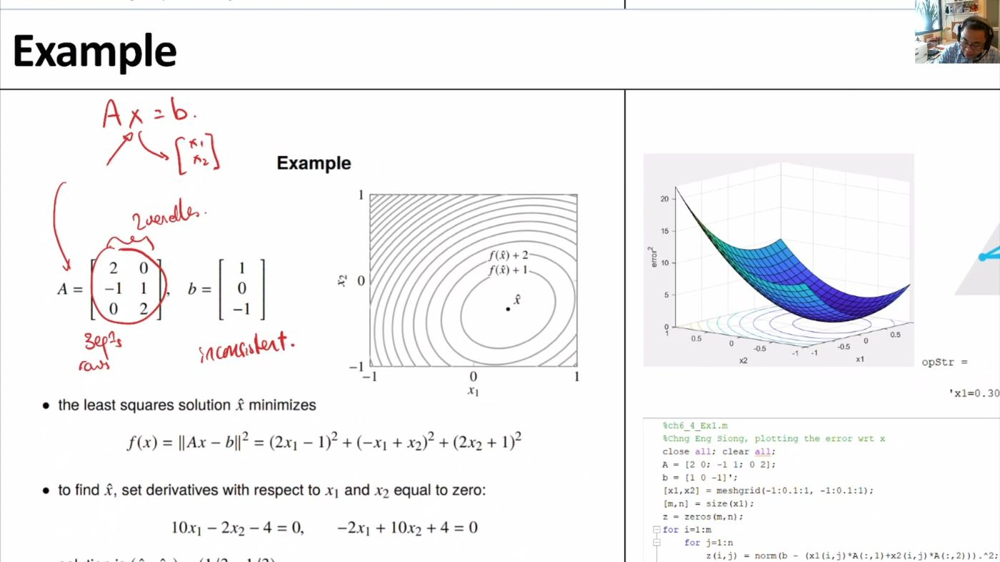

- *“Think of $A\mathbf x$ as an approximation to $\mathbf b$. The smaller the distance between $\mathbf b$ and $A\mathbf x$, the better the approximation.”*
- The least-squares solution is the one that **minimises that distance**.

> 🎙️ **Narration:** *"By varying different x, we see that there is an error function. The vertical axis is the error in approximating ax minus b, as we vary x. By changing different values of x, the error will change and we are plotting the norm square which is the typical error function that we're using. The function, the graph on the right hand side and the left hand side are actually the same. We would use two methods. The method one will use calculus to solve for the best point of x and on the right hand side we'll write MATLAB code to solve."*

---

### 🎬 Slide 8 — Varying $\mathbf x$: the error function

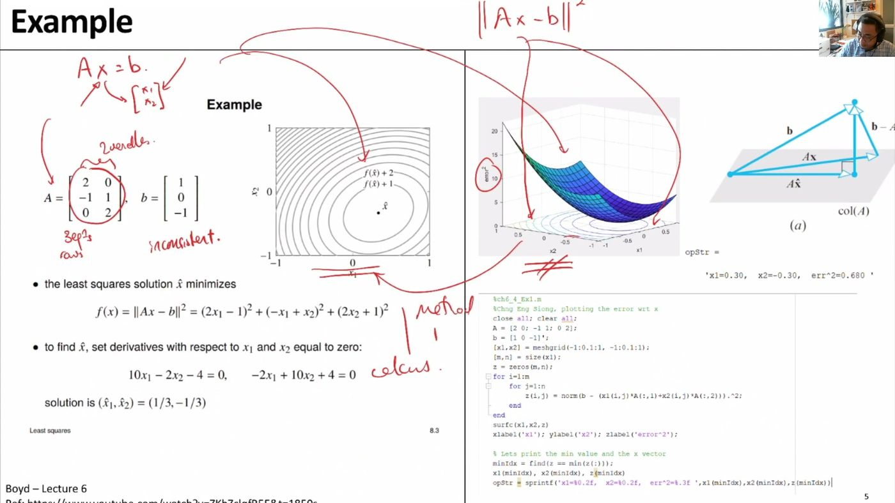

- As $\mathbf x$ varies, the error $\|A\mathbf x - \mathbf b\|$ varies — it defines a **cost/error function** whose minimum we are looking for.
- Example used in the lecture: $A = \begin{bmatrix}2&0\\-1&1\\0&2\end{bmatrix}$, $\mathbf b = \begin{bmatrix}1\\0\\-1\end{bmatrix}$ (three equations, two unknowns).

> 🎙️ **Narration:** *"Both these examples shows that there are other ways to perform least square solutions for ax"*

---

### 🎬 Slide 9 — The terminology: why *least squares*?

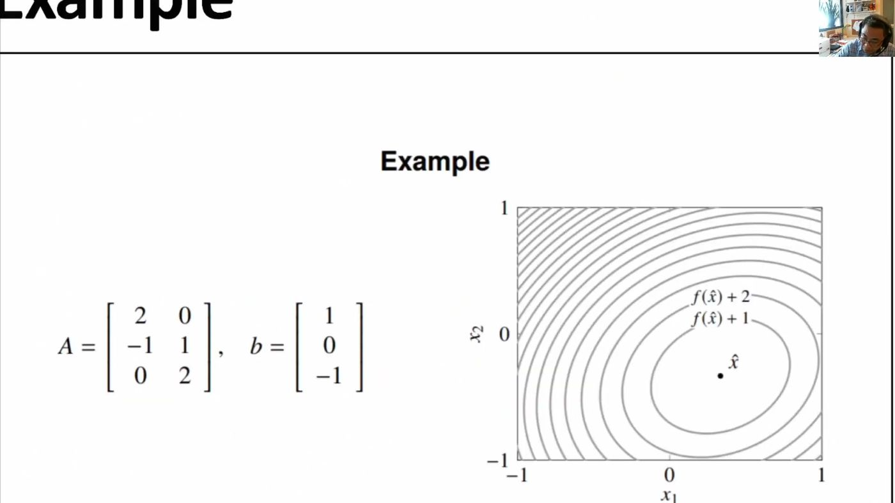

**Content — Definitions.**

- Minimising $\|\mathbf b - A\mathbf x\|$ is the same as minimising $\|\mathbf b - A\mathbf x\|^2$, the **sum of the squares** of the errors
$$\|\mathbf b - A\mathbf x\|^2 = e_1^2 + e_2^2 + \cdots + e_m^2, \qquad \mathbf e = \mathbf b - A\mathbf x.$$
- The term **“least squares solution”** comes precisely from this: we minimise the sum of squares of the components of the error vector.
- **Figure 1:** the vector $\mathbf b$ is closer to $A\hat{\mathbf x}$ than to $A\mathbf x$ for other $\mathbf x$ — $A\hat{\mathbf x}$ is the projection of $\mathbf b$ onto $\operatorname{Col} A$.

> 🎙️ **Narration:** *"equals to b. Let's open up the equation. We'll write a here 2, 0, minus 1, 1, 0, 2. And we'll write the variable as x1, x2. Now we'll expand out this matrix factor equation and we'll have 2x1 plus 0x2 and on the right hand side b is equals to 1. For the first equation, for the second equation, we'll have minus 1x1 plus x2 equals to 0. And for the third equation, we'll have 0x1 plus 2x2 is"*

---

### 🎬 Slide 10 — Figure 1 — $\mathbf b$, $\operatorname{Col} A$ and the best $A\hat{\mathbf x}$

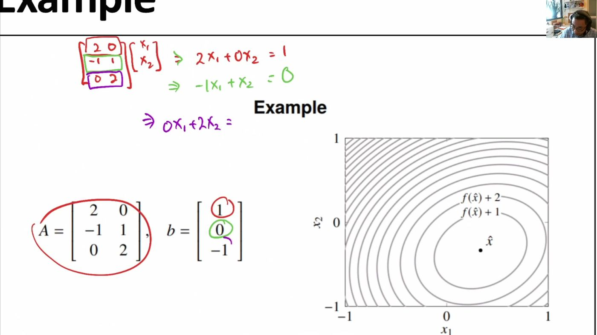

- The picture: $\operatorname{Col} A$ is a plane/subspace, $\mathbf b$ sits outside it, and $A\hat{\mathbf x}$ is the foot of the perpendicular from $\mathbf b$.
- The residual $\mathbf b - A\hat{\mathbf x}$ is **orthogonal to $\operatorname{Col} A$** — the property that will give the normal equations.

> 🎙️ **Narration:** *"equals to minus 1. We have three equations and two unknowns and we can try to solve for it. What are we solving? We are trying to minimize the error as in"*

---

### 🎬 Slide 11 — Writing the error in components

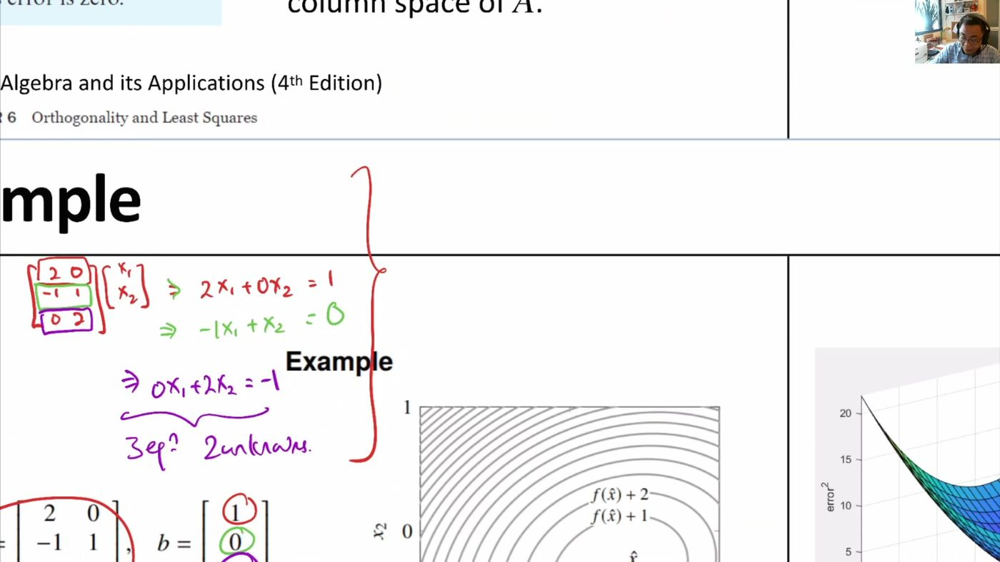

- With $\mathbf b - A\mathbf x = (e_1,\dots,e_m)$, the quantity to minimise is $e_1^2 + \cdots + e_m^2$.
- For the lecture's example:
$$A = \begin{bmatrix}2&0\\-1&1\\0&2\end{bmatrix},\quad \mathbf b=\begin{bmatrix}1\\0\\-1\end{bmatrix} \;\Longrightarrow\; \mathbf e = \begin{bmatrix}2x_1 - 1\\ -x_1+x_2\\ 2x_2+1\end{bmatrix}.$$

> 🎙️ **Narration:** *"ax minus b which is the error, the norm of the error square. We're trying to minimize this cost function. We will set fx to be this cost function and we we want to find x that minimizes this function. To do that in calculus, we perform derivative of the fx with respect to the vector x. But in our case, because x is not single variable, it is multivariable, we perform partial derivative. So we find x1. Now what is this equation?"*

---

### 🎬 Slide 12 — Example — the error vector for the worked example

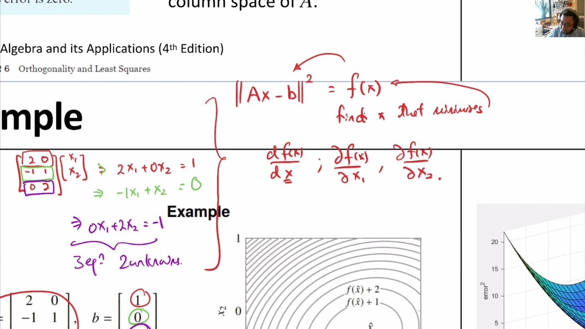

- For $A = \begin{bmatrix}2&0\\-1&1\\0&2\end{bmatrix}$ and $\mathbf b = (1,0,-1)$, the three **errors** are
$$e_1 = 2x_1-1, \qquad e_2 = -x_1+x_2, \qquad e_3 = 2x_2+1.34191
- The least-squares solution minimises $e_1^2+e_2^2+e_3^2$ — the sum of squares of exactly these three terms.

> 🎙️ **Narration:** *"equations. Well, we have really gotten ax equals to b in these following equations. So all we need is to shift b from the right hand side to the left hand side to get ax minus b. Implying these three equations are 2x1 plus 0x2 minus 1 is equals to 0 for the first equation. for the second equation is minus 1x1 plus x2 equals to 0 and the third equation is 0x1 plus 2x2 plus 1 is equals to 0. We have three equations in this form now. We then want to calculate the error square. In fact you realize that the first term is E1 the error for"*

---

### 🎬 Slide 13 — Example — minimising $f(\mathbf x) = \|A\mathbf x-\mathbf b\|^2$

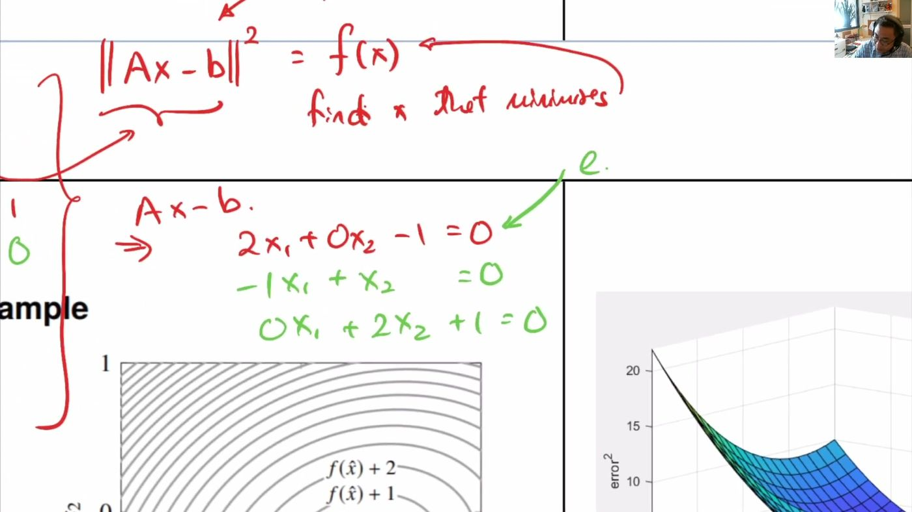

- For the example above, the cost function is
$$f(x_1,x_2) = \|A\mathbf x - \mathbf b\|^2 = (2x_1-1)^2 + (-x_1+x_2)^2 + (2x_2+1)^2.$$
- Setting the partial derivatives to zero gives the least-squares solution.

> 🎙️ **Narration:** *"the first coordinate, this is the error for the second coordinate, this is the error for the third coordinate, that is the three equations are here for each of the term of E1, E2 and"*

---

### 🎬 Slide 14 — Example — the surface $f(x)$ and its minimum

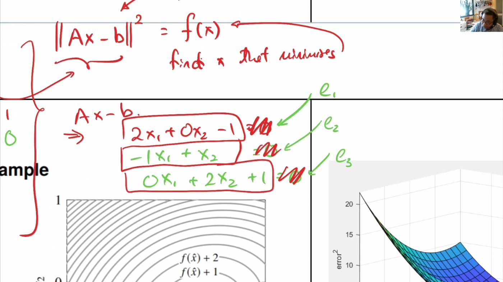

- Plotting $f$ over a grid of $(x_1,x_2)$ gives a **convex surface**; its minimum is the least-squares solution.
- The lecture plots the surface and the contour to show where the minimum sits.

> 🎙️ **Narration:** *"E3. In fact, we should look at these as vectors and they are Ax minus B, the vectors of entries for the error term. Now I've written it over here. This was what I've written"*

---

### 🎬 Slide 15 — Example — the minimum found

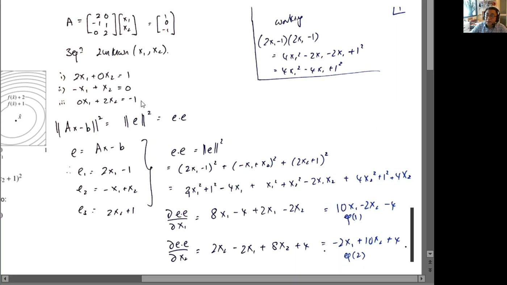

- Carrying out the minimisation gives
$$x_1 = \tfrac13, \qquad x_2 = -\tfrac13.$$
- The lecture notes: *“This solution is a minimum point — it is **not** the exact solution of $A\mathbf x=\mathbf b$.”*

> 🎙️ **Narration:** *"previously on the slides. These are the error term e1, e2 and e3. And what we now have to compute is ax minus b norm square. We know from our past lecture that if we have called this the e vector, the error vector, to get norm of e square all we need to do is to perform dot product of E, E dot E. Each element of E is squared. So basically we are taking E1 square plus E2 square plus E3 square giving us these equations over here. From calculus we now know that if this is the function to optimize all we need to do is to find the partial derivative of this equation and set it to zero. In our case, we take this function, we perform partial derivative with respect to x1, we get this function. We perform this partial derivative on x2, we will get this function. We set both of the functions to equal to 0 and we solve."*

---

### 🎬 Slide 16 — Example — the projected point in $\operatorname{Col} A$

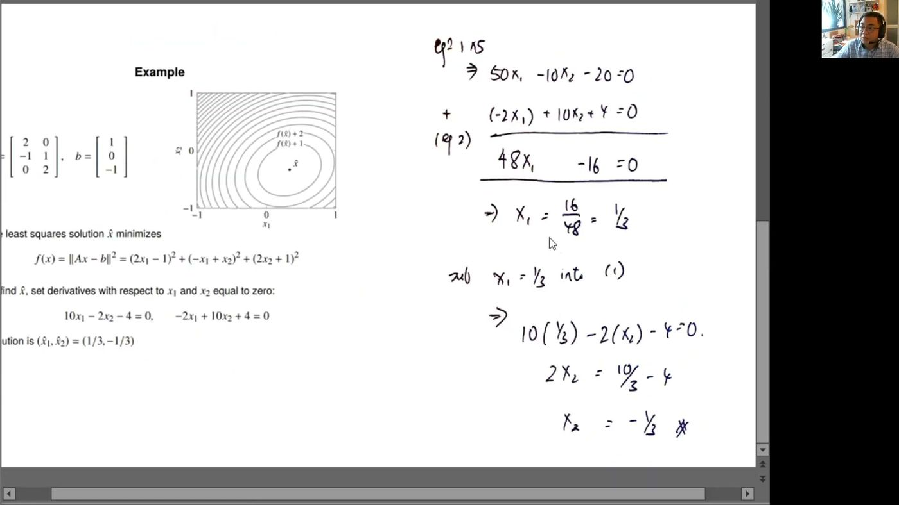

- The point $A\hat{\mathbf x}$ with $\hat{\mathbf x} = (\tfrac13, -\tfrac13)$ is the point **in the column space of $A$ closest to $\mathbf b$** — the best approximation.
- The graphs make it clear what is happening: $\mathbf b$ is outside $\operatorname{Col} A$, and $A\hat{\mathbf x}$ is its orthogonal projection onto it.

> 🎙️ **Narration:** *"Solving, we get x1 equals to 1 third and x2 equals to minus 1 third. We plot the point here and this is the minimum point. Now this solution is a minimum point it is not the exact solution of ax equals to b that is when x is set to 1 third and minus 1 third we will not get it exactly equals to b there's some residual error and the reason is because b is not in"*

---

### 🎬 Slide 17 — Example — setting up the minimisation

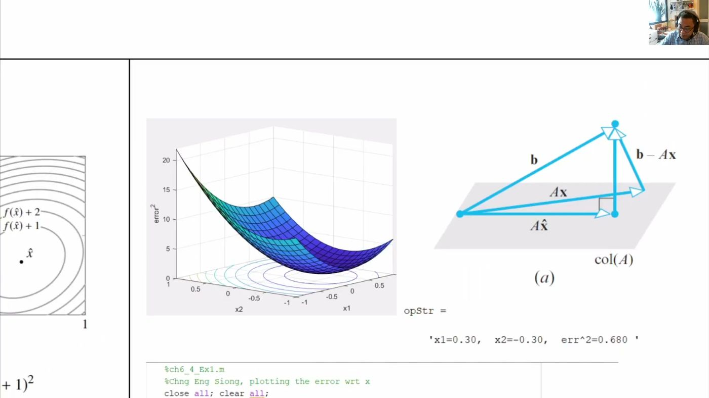

- The cost is $f(x_1,x_2) = (2x_1-1)^2 + (-x_1+x_2)^2 + (2x_2+1)^2$, and the minimum is found by solving the two partial-derivative equations (which will be exactly the **normal equations** of 7.1.3).

> 🎙️ **Narration:** *"the column space of a. These graphs actually succinctly tell us what's happening this is the point B and when we have found x being 1 third and minus 1 third we have gotten into this point the best point on the column space of A nearest producing the nearest point to B implying the smallest error. What about any other point for example a point here a point here and a point here by doing that we are actually varying x1 and x2. So if we want to plot the error surface, the error that will be found if we have used the different x, we are going to write some software. What this software does is first we set up the"*

---

### 🎬 Slide 18 — Example — expanding the derivatives

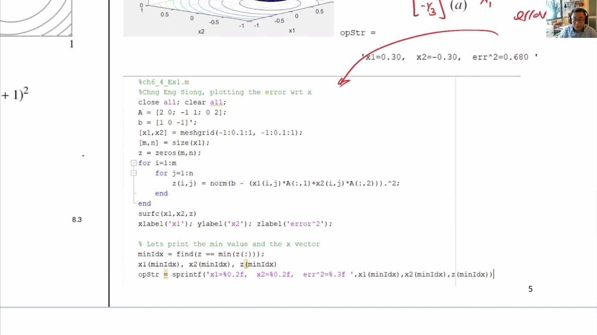

- Expanding and differentiating leads to the linear system
$$\begin{cases} 6x_1 - 2x_2 = 2\\ -2x_1 + 6x_2 = 2\end{cases} \;\Longrightarrow\; x_1 = \tfrac13,\; x_2 = -\tfrac13.$$
- Note how the left-hand side is $A^{\mathsf T}A$ and the right-hand side is $A^{\mathsf T}\mathbf b$.

> 🎙️ **Narration:** *"equation of A, A equals to 2, 0, minus 1, 1, 0, 2 and set up B, 1, 0, minus 1 and we create a mesh grid of X meaning that we are going to create a grid like this and this is X1 and this is X2 from the range of minus 1, 2, 1 and steps of 0.1 You can see the equations more clearly if I have erased this. What we then do is simple. We are going to look across all x1 and x2 and we are going to calculate b minus ax the norm square. Basically we will keep the error term for different x and then we are going to plot is surface using this command surface plot contour x1 x2 with the amplitude or the vertical axis as z and this is the answer the result shows that"*

---

### 🎬 Slide 19 — Example — the convex surface and its minimum

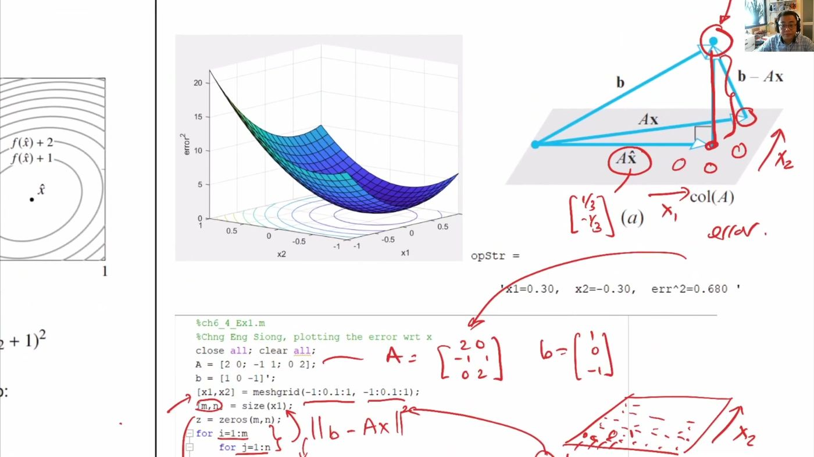

- The lecture displays the **mesh/surface plot** of $f$ and points out that it is a convex surface with a single minimum — so the least-squares solution is unique in this example.
- The minimum occurs at $(x_1,x_2) = (\tfrac13,-\tfrac13)$.

> 🎙️ **Narration:** *"there is a minimum point and if you look at it carefully which is 1 third and minus 1 third over here for x1 and x2 it is a surface and it is a convex surface and interestingly and importantly at the minimum point over here I've written the error the error is not 0 which is this value over here 0.68 showing that what we have talked about this inconsistent equation problem is true that there is an error E because B is not in the surface of AX. With this we"*

---

### 🎬 Slide 20 — Example — the two derivative equations written out

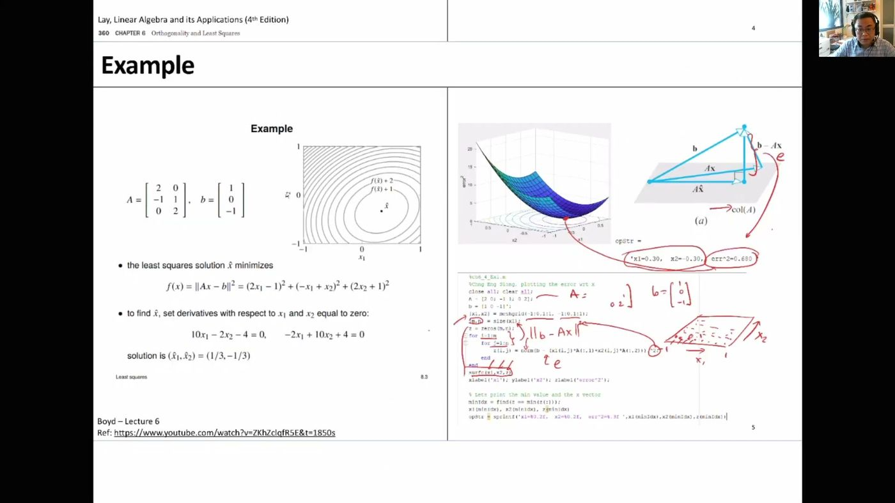

- The final slide writes the normal equations explicitly:
$$\frac{\partial f}{\partial x_1} = 0,\quad \frac{\partial f}{\partial x_2} = 0 \;\Longleftrightarrow\; \begin{bmatrix} 4+2 & -2\\ -2 & 1+4+1\end{bmatrix}\binom{x_1}{x_2} = \binom{(2)(1)}{(2)(-1)}$$
  i.e. $A^{\mathsf T}A\hat{\mathbf x} = A^{\mathsf T}\mathbf b$ — the **normal equation**, derived systematically in 7.1.3.
- *“Further examples will find the least-squares solutions using the linear algebra approach.”*

> 🎙️ **Narration:** *"end the discussion for this example. In further examples we will actually find the least squares solutions using linear algebra approach. Thank you."*

---
## V-7.1.3 — 7.1.3 Best Approximation Theorem and the Normal Equation

> **Videos (4):** `7.1.3, pg 1~2` (6.8 min) · `pg 3` (9.3 min) · `pg 4~6` (8.6 min) · `pg 7~8` (6.8 min) — decks: `7.1.3_Best_Apprx_Thm_Normal_Equation.pdf` (8 pages), `7.1.3A_Suppplement_Proof_Normal_Equation.pdf` (10 pages)

### 🎬 Slide 1 — Title: *Best Approximation Theorem and Normal Equation*

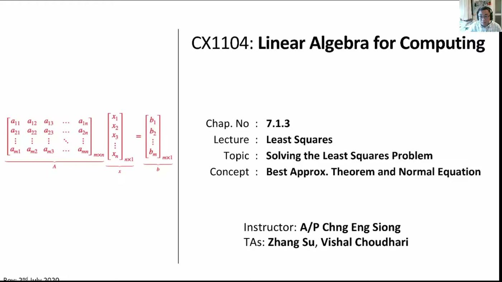

**Content — title card:** *Chap. No: 7.1.3 · Lecture: Least Squares · Topic: Solving the Least Squares Problem · Concept: Best Approx. Theorem and Normal Equation.*

> 🎙️ **Narration:** *"This is 7.1.3 least squares best approximation theorem and normal equation"*

---

### 🎬 Slide 2 — Recall the Best Approximation Theorem (from 6.2.5)

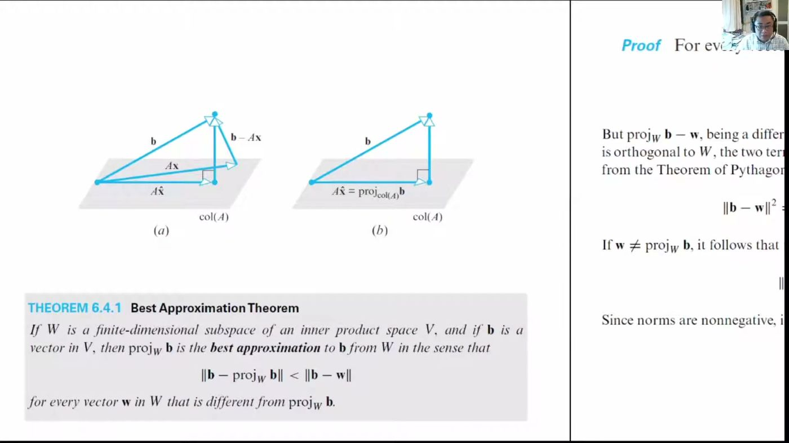

- We discussed the **Best Approximation Theorem** in section 6.2.5: the orthogonal projection of $\mathbf b$ onto a subspace $W$ is the closest point of $W$ to $\mathbf b$.
- Here we apply it with $W = \operatorname{Col} A$: the projection $A\hat{\mathbf x} = \operatorname{proj}_{\operatorname{Col}A}\mathbf b$ is the closest vector in the column space to $\mathbf b$.
- Figures (a) and (b) show $\mathbf b$ outside $\operatorname{Col} A$ and the projection $A\hat{\mathbf x}$.

> 🎙️ **Narration:** *"We discussed best approximation theorem in Chapter 6.2.5. Please review this chapter basically in that chapter we discuss the orthogonal projection the projection of B onto the space of of A will result in the error E equals to B minus B hat where B hat is equals to the projection of B under the column space of A. The norm of E square is the smallest among all AX we can choose. Hence this best solution is called the"*

---

### 🎬 Slide 3 — **Theorem 6.4.1 — Best Approximation Theorem**

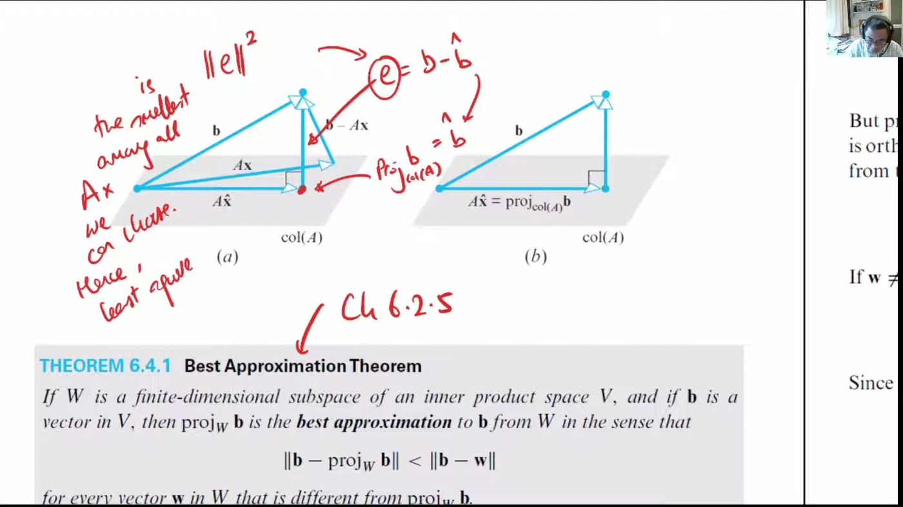

**Theorem 6.4.1 (Best Approximation Theorem).** If $W$ is a finite-dimensional subspace of an inner product space $V$, and if $\mathbf b$ is a vector in $V$, then $\operatorname{proj}_W\mathbf b$ is the **closest point in $W$ to $\mathbf b$**:
$$\|\mathbf b - \operatorname{proj}_W\mathbf b\| < \|\mathbf b - \mathbf w\| \quad \text{for all } \mathbf w\in W, \mathbf w\ne \operatorname{proj}_W\mathbf b.$$

> 🎙️ **Narration:** *"least squares solution and this theorem is called the best approximation theorem."*

---

### 🎬 Slide 4 — The right-triangle picture of the error

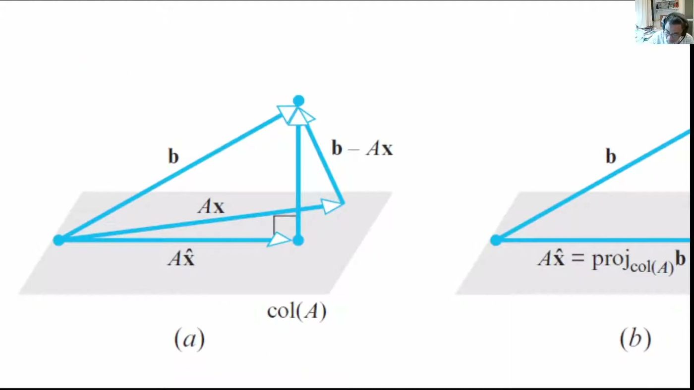

- The error $\mathbf e = \mathbf b - A\hat{\mathbf x}$ is **orthogonal to the columns of $A$**, hence to $\operatorname{Col} A$ (the shaded region).
- So $\mathbf b$, $A\hat{\mathbf x}$ and the error form a **right-angled triangle** — with $\mathbf b$ as the hypotenuse, $A\hat{\mathbf x}$ as one leg and the error as the other.

> 🎙️ **Narration:** *"This theorem can be understood when we draw a right-angled triangle. Remember that the error E which is equals to B minus projection of B onto the column space of A is orthogonal to the columns"*

---

### 🎬 Slide 5 — The same picture, drawn out


- Every vector in $\operatorname{Col} A$ is orthogonal to the error $\mathbf e$; the closest point of the plane to $\mathbf b$ is the foot of the perpendicular, $A\hat{\mathbf x}$.

> 🎙️ **Narration:** *"to the columns of A. Now the columns of A can be used to form the column space of A which is this shaded region over here. Now any vectors on this column space is orthogonal to E. We can now view the problem as the Pythagoras theorem because if you look at this, this is the right-angled triangle with the red line here as E and this is the hypotenuse and the hypotenuse is formed by another"*

---

### 🎬 Slide 6 — Pythagoras: why the projection is closest


- Writing $\mathbf b - \mathbf w = (\mathbf b - A\hat{\mathbf x}) + (A\hat{\mathbf x} - \mathbf w)$ with the two terms **orthogonal**, Pythagoras gives
$$\|\mathbf b-\mathbf w\|^2 = \|\mathbf b-A\hat{\mathbf x}\|^2 + \|A\hat{\mathbf x}-\mathbf w\|^2 > \|\mathbf b-A\hat{\mathbf x}\|^2,$$
  so $A\hat{\mathbf x}$ is the **smallest** possible error.

> 🎙️ **Narration:** *"point through AX while this point is through AX hat the best point that we can achieve. The best point nearest to B. Therefore it is now obvious that the hypotenuse, its length, or the error of approximation is always greater than E. Since it is the longest side of a right-angled triangle. If you need to"*

---

### 🎬 Slide 7 — Figure reference — projection of $\mathbf b$ onto $\operatorname{Col} A$


- The slides repeatedly draw $\mathbf b$, the subspace $\operatorname{Col} A$, the projection $A\hat{\mathbf x} = \operatorname{proj}_{\operatorname{Col}A}\mathbf b$, and the residual $\mathbf b - A\hat{\mathbf x}$.
- *“Please see the 6.2.5 video lectures, which discuss this problem in great detail.”*

> 🎙️ **Narration:** *"refer, please see again 6.2.5 video lectures which will discuss this problem in great detail. Now we have another equation that we deal with quite often which is this the projection of a vector in a column space. In here the example the column space w is equals to column space of a. How do we find projection of b onto w? This was discussed in great detail in chapter 6.3.2 the Gram-Smith process. For discussion again, please refer to this video. Just now when we discuss this equation and I explained that this is the right angle triangle. Let's call this point W a point in the column space of A. This point is the projection of B"*

---

### 🎬 Slide 8 — The projection of $\mathbf b$ onto $\operatorname{Col} A$


- The projection is the quantity $A\hat{\mathbf x}$; the lecture notes that later the column space of $A$ will often be written as $W$.

> 🎙️ **Narration:** *"B onto the column space of A. Later in the text, we will also call the column space of"*

---

### 🎬 Slide 9 — **Proof** of the Best Approximation Theorem


**Proof.** For every vector $\mathbf w\in W$ we can write
$$\mathbf b - \mathbf w = (\mathbf b - \operatorname{proj}_W\mathbf b) + (\operatorname{proj}_W\mathbf b - \mathbf w). \qquad (1)$$
- $\operatorname{proj}_W\mathbf b - \mathbf w \in W$ (difference of two vectors in the subspace), and $\mathbf b - \operatorname{proj}_W\mathbf b$ is **orthogonal to $W$**, so the two terms on the right of (1) are orthogonal.
- The **Theorem of Pythagoras** then gives $\|\mathbf b-\mathbf w\|^2 = \|\mathbf b-\operatorname{proj}_W\mathbf b\|^2 + \|\operatorname{proj}_W\mathbf b-\mathbf w\|^2$.

> 🎙️ **Narration:** *"A as the capital W. This vector is B minus W. W is this W here. This vector is projection"*

---

### 🎬 Slide 10 — Proof continued (projection described as $A\hat{\mathbf x}$)


- Replacing $\operatorname{proj}_{\operatorname{Col}A}\mathbf b$ by $A\hat{\mathbf x}$ (the quantity we can actually compute from $A$ and $\mathbf b$) gives the same Pythagoras identity.
- The lecture pauses here: the next slides finish the proof.

> 🎙️ **Narration:** *(transition frame — the explanation continues on the next slide)*

---

### 🎬 Slide 11 — Proof continued


- Because $\operatorname{proj}_W\mathbf b - \mathbf w \in W$ and the error is orthogonal to $W$, Pythagoras applies to give the strict inequality (unless $\mathbf w = \operatorname{proj}_W\mathbf b$).

> 🎙️ **Narration:** *(transition frame — the explanation continues on the next slide)*

---

### 🎬 Slide 12 — Proof — the Pythagoras step


- The square of the hypotenuse ($\|\mathbf b - \mathbf w\|^2$) equals the sum of the squares of the legs: the square of the error ($\|\mathbf b-A\hat{\mathbf x}\|^2$) plus the square of the distance from $A\hat{\mathbf x}$ to $\mathbf w$.
- Hence the error at $\mathbf w$ is never smaller than the error at $A\hat{\mathbf x}$ — the proof is complete.

> 🎙️ **Narration:** *"of b onto w minus w and this vector is b minus projection of b onto w. Now compare this to"*

---

### 🎬 Slide 13 — Proof continued — the smallest error is at $A\hat{\mathbf x}$


- *“The longer-side square is equal to one of the side's square plus the other side's square — read the rest to complete the proof, which says that when we project $\mathbf b$ onto $W$, the error found is the smallest.”*

> 🎙️ **Narration:** *"the equations over here and you will now understand that this is the Pythagoras theorem. The longer"*

---

### 🎬 Slide 14 — Setting up: the space of $\mathbf x$ and $A\mathbf x$


- Here $A$ is $m\times n$, so $\mathbf x\in\mathbb{R}^n$ and $A\mathbf x \in \operatorname{Col} A \subseteq \mathbb{R}^m$.
- Among all $\mathbf x$, we want the $\hat{\mathbf x}$ whose image $A\hat{\mathbf x}$ is nearest to $\mathbf b$.

> 🎙️ **Narration:** *"side square is equals to one of the side square plus the other side length square and read the rest to complete the proof which says that when we project B onto W, the error found is the smallest among all the errors we could ever achieve for any W."*

---

### 🎬 Slide 15 — Proof recap — calculus vs linear algebra


- *“On the left we used calculus (minimising the sum of squares) and on the right brute-force search; today we use the **linear algebra** approach.”*
- The linear-algebra route gives the **normal equation** in one line.

> 🎙️ **Narration:** *"In the next few slides, we will continue to examine the problem of Ax equals to b and our problem again is phi the x such that Ax is produced to be nearest to b."*

---

### 🎬 Slide 16 — The linear algebra approach: multiply by $A^{\mathsf T}$


- Starting from the orthogonality condition, multiply both sides by $A^{\mathsf T}$:
$$A^{\mathsf T}\!\left(\mathbf b - A\hat{\mathbf x}\right) = \mathbf 0 \;\Longrightarrow\; A^{\mathsf T}A\hat{\mathbf x} = A^{\mathsf T}\mathbf b.$$
- This system is called the **normal equation**; its solution is the least-squares solution $\hat{\mathbf x}$.

> 🎙️ **Narration:** *"This is the space of x. It is rn because a is rm by n. Ax therefore x is of dimension n. Among any x that we can take in this space, we are interested in the x hat such that when x hat is multiplied on the left by a, you will produce B hat and B hat is in the column space of A such that the error is orthogonal to the column space of A. In the last lecture we have seen two ways to solve"*

---

### 🎬 Slide 17 — **The Normal Equation** (Lay, p. 379)


**Content — The Normal Equation (Solution of the General Least-Squares Problem).**

- Given $A$ and $\mathbf b$ as above, apply the Best Approximation Theorem in Section 6.3 to the subspace $\operatorname{Col} A$.
- Because $\mathbf b - A\hat{\mathbf x}$ is orthogonal to every column of $A$:
$$A^{\mathsf T}A\hat{\mathbf x} = A^{\mathsf T}\mathbf b.$$
- *There are many solutions of (1) if the equation has free variables.*

> 🎙️ **Narration:** *"this problem. On the left we have used calculus to solve it and on the right we have used brute force to solve it. In today's lecture we are going to use the linear algebra's approach which is to form the normal equation. The normal"*

---

### 🎬 Slide 18 — Figure 2 — the least-squares solution lives in $\mathbb{R}^n$


- **Figure 2:** $\mathbf b \in \mathbb{R}^m$, $\operatorname{Col} A$ is a subspace of $\mathbb{R}^m$, and the least-squares solution $\hat{\mathbf x}$ is in $\mathbb{R}^n$ with $A\hat{\mathbf x}$ the closest point to $\mathbf b$.

> 🎙️ **Narration:** *"equation is formed by multiplying the left hand side by A transpose and hence the right hand side will also have to multiply by A transpose. We'll get this equation called A transpose AX equals to A transpose B. This is the normal equation. The least squares solution of x can be found from this normal equation."*

---

### 🎬 Slide 19 — Figure 2 (continued)


- The same picture with the residual $\mathbf b - A\hat{\mathbf x}$ drawn perpendicular to the subspace.

> 🎙️ **Narration:** *"How do we prove the normal equation? We'll use first this figure. This is the desired point B in the space of rm. B hat is equals to ax hat. We do not know the value of ax hat now but what we know is that for the error to be smallest the error vector E equals to B minus B hat must be orthogonal to the column space of A. The column space of A means any vectors made up by columns of A linear combinations. There is any linear combinations of columns of A. In other words, the error vector E"*

---

### 🎬 Slide 20 — Why the residual is orthogonal to every column


- $A\hat{\mathbf x}$ is the projection of $\mathbf b$ onto the column space; consequently
$$\mathbf a_j\cdot(\mathbf b - A\hat{\mathbf x}) = 0 \quad \text{for each column } \mathbf a_j \text{ of } A,$$
  which in matrix form is $A^{\mathsf T}(\mathbf b - A\hat{\mathbf x}) = \mathbf 0$, i.e. the normal equation.

> 🎙️ **Narration:** *"is orthogonal to all columns each and every column of A therefore if AJ AJ is A1, A2, A, N where this is the matrix A AJ is each one of the column of J sorry j is equals to 1 to n, any of the columns of a. It is orthogonal to the error vector, that means the dot product of the columns, any of the columns of a is orthogonal to the error vector b minus a x hat. The dot product can be represented in another way using vector to vector multiplication. What we do is that we turn the column vector into a row vector by saying aj transpose and then we are multiplying with the column vector b minus ax hat. Now aj, j is equals to 1 to n means that all the rows, might need to satisfy this criteria. We can actually combine all these rows into the matrix A transpose. This basically have A1, A2 transpose until"*

---

### 🎬 Slide 21 — Worked example numbers (3×2 case)


- Example used in the lecture: $A = \begin{bmatrix}2&0\\-1&1\\0&2\end{bmatrix}$, $\mathbf b = (1,0,-1)$, and the least-squares solution is
$$\hat{\mathbf x} = (x_1,x_2) = (\tfrac13, -\tfrac13) \approx (0.30, -0.30), \qquad \|\mathbf b - A\hat{\mathbf x}\|^2 \approx 0.680.$$

> 🎙️ **Narration:** *"An transpose, implying that this equation says that all columns of A is is orthogonal to the error vector which is exactly this diagram here. The error vector"*

---

### 🎬 Slide 22 — Where "normal" comes from


- The equation is called **normal** because the error vector $\mathbf b - A\hat{\mathbf x}$ is **normal (perpendicular)** to the range of $A$ — i.e. to $\operatorname{Col} A$.
- Reference shown on the slide: Wolfram MathWorld — *Normal Equation*.

> 🎙️ **Narration:** *"is orthogonal to any vectors in the columns of A. We are almost in a position to see the normal equation. All we need to do is to expand this equation by removing the brackets ATB minus ATAX hat equals to zero. We can now move one of the part of the equations to the other side which gives us ATAX hat equals to ATB. This few steps shows that the least"*

---

### 🎬 Slide 23 — Sizes: $A^{\mathsf T}A$ is $n\times n$


- If $A$ is $m\times n$, then $A^{\mathsf T}$ is $n\times m$ and $A^{\mathsf T}A$ is **$n\times n$** — square, and in most cases invertible.
- When $A^{\mathsf T}A$ is invertible, $\hat{\mathbf x} = (A^{\mathsf T}A)^{-1}A^{\mathsf T}\mathbf b$.

> 🎙️ **Narration:** *"square solution for AX equals to B will satisfy this equation. This equation is called the"*

---

### 🎬 Slide 24 — Proof of the normal equation (textbook)


- *“Suppose $\hat{\mathbf x}$ satisfies $A\hat{\mathbf x} = \hat{\mathbf b}$. By the Orthogonal Decomposition Theorem in Section 6.3, the projection $\hat{\mathbf b}$ has the property that $\mathbf b - \hat{\mathbf b}$ is orthogonal to $\operatorname{Col} A$, so $\mathbf b - A\hat{\mathbf x}$ is orthogonal to **each column** of $A$.”*

> 🎙️ **Narration:** *"normal equation. Have a look at Wolfram's math world under the normal equation. It says that the"*

---

### 🎬 Slide 25 — The normal equation — expanded form


- Expanding $A^{\mathsf T}(\mathbf b - A\hat{\mathbf x}) = \mathbf 0$:
$$A^{\mathsf T}\mathbf b - A^{\mathsf T}A\hat{\mathbf x} = \mathbf 0 \;\Longrightarrow\; A^{\mathsf T}A\hat{\mathbf x} = A^{\mathsf T}\mathbf b.$$

> 🎙️ **Narration:** *"normal equation is called normal because the error vector v minus ax is normal to the range of a"*

---

### 🎬 Slide 26 — The normal equation — proof conclusion


- If $\mathbf a_j$ is any column of $A$, then $\mathbf a_j\cdot(\mathbf b - A\hat{\mathbf x}) = 0$, and since each $\mathbf a_j^{\mathsf T}$ is a **row of $A^{\mathsf T}$**,
$$A^{\mathsf T}(\mathbf b - A\hat{\mathbf x}) = \mathbf 0 \;\Longrightarrow\; A^{\mathsf T}A\hat{\mathbf x} = A^{\mathsf T}\mathbf b.$$
- This is Theorem 6.5.1 of the text (also referenced as Theorem 3 in Section 6.1).

> 🎙️ **Narration:** *"that is the column space of a. Now why are we almost ready to solve for x? Because if a is a matrix of m by n, A transpose is a matrix of n by m, A transpose A is a matrix of n by m, multiplied by m by n, this dimension agrees will produce a square matrix of n by n. This being a square matrix, if its inverse axis ATA inverse evicted axis, then we can multiply this equation the normal equation by ATA inverse on the left hand side means that we also multiply on the right hand side we'll get this equation ATA x equals to ATA inverse ATP. Remember that if the that by multiplying on the inverse of the matrix we get identity t which is this equation here we strike off with using it to i, implying x is equals to a t a inverse multiplied by a transpose b. So basically if we have a t a being invertible we can get x hat in this form. Getting x hat in this form is the least square solution of x. The x that will produce the least error, the least squares error. Now in most cases, ATA is invertible. When ATA is invertible, these three conditions are logically equivalent. It means that the columns of A are independent. It means that the solution of Ax equals to b is unique. In the next three slides we have some examples."*

---

### 🎬 Slide 27 — Setting up a larger example ($A$ is $6\times4$)


- In the next example $A$ is a $6\times4$ matrix and $\mathbf b$ is a $6\times1$ vector.
- So $A^{\mathsf T}$ is $4\times6$ and $A^{\mathsf T}A$ is $4\times4$ — square, but **not necessarily invertible**.

> 🎙️ **Narration:** *(transition frame — the explanation continues on the next slide)*

---

### 🎬 Slide 28 — Building the normal equation for the $6\times4$ example


- Compute $A^{\mathsf T}$ ($4\times6$), then $A^{\mathsf T}A$ ($4\times4$) and $A^{\mathsf T}\mathbf b$ ($4\times1$).
- $A^{\mathsf T}A$ is always square; most of the time it is invertible — but in this example it is **not**, which is the case the lecture wants to examine.

> 🎙️ **Narration:** *"In this slide, we will examine the following A and given B and using this equation over here to find x hat, the x that will give the least square solution. This example can be approached mechanically. Simply we will find A transpose A first. Basically given A, we will find A transpose which is rotating or tilting the columns of A into rows. Like so for A transpose. Once we have found A transpose, we can multiply by A to get A transpose A. A. In this case, A is a 3 by 2 matrix. A transpose A will be a 3, sorry, a 2 by 3 matrix multiplied by 3 by 2 matrix giving us a 2 by 2 square matrix. A transpose B is a 2 by 3 matrix for A transpose and B is a 3 by 1 vector therefore you result in 2 by 1 vector as shown here. Once we have A transpose A we can plug it into here we have A transpose B we can plug into here now we are ready to solve for x1 and x2. All we need to do is to apply this equation here basically first we have to find A transpose A inverse and because this is a 2 by 2 matrix we can use the famous formula for the invertible or inverse of a 2 by 2 matrix we can plug all these in and we get solve for x hat equals to half or sorry first entry is one second entry is two. Now this example reminds us that in this example A transpose A is invertible but this is not always the case and we always have to check. Let us now use a figure to interpret the columns of A are R3 there are three coordinates the The first coordinate is x1. The second coordinate is called x2 and the third coordinate is called x3 in this figure. We have x1 over here in this coordinate and over here we have x2 in this coordinate and the vertical coordinate is x3. Let us draw the vectors associated with column 1. This is this one. Four along x1, zero along x2 and one along x3. The second column of A is here. Zero along coordinate x1, two along coordinate x2, and one along coordinate x3. Here, once we have drawn the first column and the second column any linear combination of these two columns fills up this blue plane this is the column space of A using the normal equation we have solved x hat equals to 1 2 implying the first column of A is 401021 multiplying by 12 means that one is multiplying by the first column, two is multiplying by the second column and we add it up together. This is AX hat and where is AX hat? You can work it out and the answer is 443 which is this point over here. Now if we use this x hat by multiplying by the first column, we have reached this point and 2 multiplying by the second column, we are basically asking us to go 2 this way, 1, 2, 2 along the second column and we will reach a x hat as well using this interpretation. not we can compute it by brute force and we get this value. We have found ax hat here, a point in the blue plane which is in the column space of A but where is B? B is sitting not on the plane and therefore there is this dash line that is connecting from B to ax hat and we call this the vector E which is B minus A x hat is equals to E and we have calculated in this example that the error is square root of 84. We'll show"*

---

### 🎬 Slide 29 — Consistency of the normal equation


- The normal equation $A^{\mathsf T}A\hat{\mathbf x} = A^{\mathsf T}\mathbf b$ is **always consistent**: $A^{\mathsf T}\mathbf b$ always lies in $\operatorname{Col}(A^{\mathsf T}A) = \operatorname{Col}(A^{\mathsf T})$.
- Hence a least-squares solution always exists (though it need not be unique when the columns of $A$ are dependent).

> 🎙️ **Narration:** *"that in the next slide. All we need to do is to plug in x hat here even A and and therefore we will have b hat which is equals to a multiplied by x hat. b minus b hat would be the error vector. This is b and this is b hat. The error vector is this value and you can try it for yourself, the error vector is orthogonal to all columns of A. So if you try minus 2, minus 4, 8 versus the first column 4, 0, 1, you will see that the answer is minus 8 plus 0 plus 8 is equals to 0 for the first column a1. You can try it for the second column and you will get the same. In fact you can find any linear combinations on this blue plane and it will still be orthogonal to E the error vector. These slides also show one more point. Once we have the error vector we are interested to find its length which is taking the norm of this and the norm of error vector is nothing but square root of the inner product which is square root of minus 2 times minus 2 plus minus 4 times minus 4 plus 8 times 8 and the answer is square root of 84 the length of the dash line is square root of 84 showing us that this is the best that we can do and there is still an error of square of 84 unit to from a hat x hat to b"*

---

### 🎬 Slide 30 — When $A^{\mathsf T}A$ is singular


- For the $6\times4$ example, $\operatorname{rank}(A^{\mathsf T}A) = 3 < 4$: the columns of $A$ are **linearly dependent**, so $A^{\mathsf T}A$ is not invertible.
- Then $\hat{\mathbf x} = (A^{\mathsf T}A)^{-1}A^{\mathsf T}\mathbf b$ cannot be used; instead solve the consistent system $A^{\mathsf T}A\hat{\mathbf x} = A^{\mathsf T}\mathbf b$ by **Gaussian elimination** (or use the pseudo-inverse).

> 🎙️ **Narration:** *(transition frame — the explanation continues on the next slide)*

---

### 🎬 Slide 31 — Solving with Gaussian elimination


- Form the augmented matrix $[\,A^{\mathsf T}A \mid A^{\mathsf T}\mathbf b\,]$ and row-reduce: this gives the least-squares solution(s) directly.
- When $A^{\mathsf T}A$ is singular there are **infinitely many** least-squares solutions (free variables).

> 🎙️ **Narration:** *"In this example, we will continue to find ax equals to be the best x, least squares x. For a here, now it is a 6 by 4 matrix and the b is a 6 by 1 column factor."*

---

### 🎬 Slide 32 — The normal equation (Wolfram MathWorld reference)


- The slide shows the MathWorld page: *“Given a matrix equation $A\mathbf x=\mathbf b$, the normal equation is that which minimizes the sum of the squares of the residuals”* — the naming and the formula $A^{\mathsf T}A\mathbf x = A^{\mathsf T}\mathbf b$.

> 🎙️ **Narration:** *"Again, we will create a transpose which is a 4 by 6 matrix and a is a 6 by 4."*

---

### 🎬 Slide 33 — MathWorld page (scrolled view)


- The same page scrolled to show the derivation context and the pseudo-inverse discussion.

> 🎙️ **Narration:** *"we will result in a 4 by 4 matrix. We mentioned that A transpose A is always square. Most of the time is invertible. In this example, A transpose A is not invertible, and we want to find out the reason why. Study the column, first column of A. In fact, the first column is nothing but the linear combinations of the second, third and fourth column of A. The rank of A is only 3."*

---

### 🎬 Slide 34 — Reading the proof slide again (annotated)


- The annotated slide repeats the argument: $\mathbf b - A\hat{\mathbf x}$ is orthogonal to each column ⇒ $A^{\mathsf T}(\mathbf b - A\hat{\mathbf x}) = \mathbf 0$ ⇒ normal equation.

> 🎙️ **Narration:** *"However, A transpose A is a 4 by 4 matrix, implying that we only have 3 independent rows or columns. There is not enough, there is not sufficient 4 of them to make A transpose A"*

---

### 🎬 Slide 35 — MATLAB for the large example


- In MATLAB: build $A$ and $\mathbf b$, compute `A'*A` and `A'*b`, then solve.
- `rank(A'*A)` returns **3**, confirming the singularity of $A^{\mathsf T}A$ for this example.

> 🎙️ **Narration:** *"invertible. In this case we cannot use A transpose A inverse to find x hat because A transpose A inverse does not exist. What we can do is to use Gaussian emanation and augmented matrix. So this is A transpose A here, the 4 by 4 matrix. This is the right-hand side A transpose B. We will reduce to use Gaussian in elimination and we reduce it into these equations over here showing us that there is one free variable x4 allowing us to express x hat in this form. In this form it shows that there are infinite many solutions for x hat with the same this squares and the reason why this is so is because A transpose A was not invertible because columns of A was linearly dependent. There were too many features as in too many columns of A as compared to number of rows, number of equations. One possible way was to delete some features, meaning that instead of having four columns of A, we could have thrown away the first column as it provides no information whatsoever. So the take-home message in this example is that sometimes A transpose A inverse does not exist and we have to be careful when we use the normal equations to solve for x hat. In the next slide we will use MATLAB to solve for this example 2. We will copy the values of A and B"*

---

### 🎬 Slide 36 — Three ways to solve when $A^{\mathsf T}A$ is singular


- (i) Gaussian elimination on $[A^{\mathsf T}A \mid A^{\mathsf T}\mathbf b]$;
- (ii) pseudo-inverse of $A^{\mathsf T}A$ (as suggested by Andrew Ng's lectures) instead of the inverse;
- (iii) a numerical/matrix-factorisation approach (QR) — see 7.1.4.
- The lecture warns that using `inv(A'*A)` on a nearly singular matrix gives **numerically wrong** answers.

> 🎙️ **Narration:** *(transition frame — the explanation continues on the next slide)*

---

### 🎬 Slide 37 — **Example 1** (Lay): least-squares solution of an inconsistent system


**Example 1.** Find a least-squares solution of the inconsistent system $A\mathbf x=\mathbf b$ for
$$A = \begin{bmatrix} 4&0\\0&2\\1&1\end{bmatrix}, \qquad \mathbf b = \begin{bmatrix}2\\0\\11\end{bmatrix}.$$

**Solution.** Use the normal equations:
$$A^{\mathsf T}A = \begin{bmatrix}17&1\\1&5\end{bmatrix}, \qquad A^{\mathsf T}\mathbf b = \begin{bmatrix}19\\11\end{bmatrix}.$$
Since $A^{\mathsf T}A$ is $2\times2$ and invertible, solving $A^{\mathsf T}A\hat{\mathbf x} = A^{\mathsf T}\mathbf b$ gives
$$\hat{\mathbf x} = \begin{bmatrix}1\\2\end{bmatrix}.$$

> 🎙️ **Narration:** *(transition frame — the explanation continues on the next slide)*

---

### 🎬 Slide 38 — Example 1 — row operations vs the inverse


- Row operations can be used to solve the $2\times2$ system; since $A^{\mathsf T}A$ is invertible and $2\times2$ it is probably faster to compute $(A^{\mathsf T}A)^{-1}$.
- Both routes give $\hat{\mathbf x} = (1,2)$.

> 🎙️ **Narration:** *"and represented into the MATLAB format. This is A and this is B. We calculate A transpose A. The MATLAB"*

---

### 🎬 Slide 39 — Example 1 — the best value for a singular case


- The lecture notes that this is the best value we can obtain for $\hat{\mathbf x}$, even when $A$ (or $A^{\mathsf T}A$) is singular — obtained via elimination rather than inversion.

> 🎙️ **Narration:** *"notations for transpose is the acrocyphal. So A acrocyphal multiplied by A. In the next line,"*

---

### 🎬 Slide 40 — Example 1 — practical advice (pseudo-inverse)


- Andrew Ng's suggestion: use the **pseudo-inverse** of $A^{\mathsf T}A$ to mitigate the situation whenever $A^{\mathsf T}A$ is singular.
- Equivalently, use a stable factorisation (QR) instead of forming $A^{\mathsf T}A$.

> 🎙️ **Narration:** *"we check for the rank of A transpose A using this command rank and the answer is 3 as we have suspected because the first column of A was dependent and now we offer you three different ways to solve for X. The way that we have taught in class is X2. Inverse of A transpose A multiplied by A transpose B. But in this case, our answer"*

---

### 🎬 Slide 41 — **Example 3** — the least-squares error


**Example 3.** Given $A$ and $\mathbf b$ as in Example 1, determine the **least-squares error** in the least-squares solution of $A\mathbf x=\mathbf b$.

**Solution.** With $\hat{\mathbf x} = (1,2)$:
$$A\hat{\mathbf x} = \begin{bmatrix}4\\4\\3\end{bmatrix}, \qquad \mathbf b - A\hat{\mathbf x} = \begin{bmatrix}2\\0\\11\end{bmatrix}-\begin{bmatrix}4\\4\\3\end{bmatrix} = \begin{bmatrix}-2\\-4\\8\end{bmatrix},$$
$$\|\mathbf b - A\hat{\mathbf x}\| = \sqrt{(-2)^2+(-4)^2+8^2} = \sqrt{84} \approx 9.17.$$

> 🎙️ **Narration:** *"shows that it is wrong and the answer is wrong because the matrix A transpose A is almost singular. You get some values but when you multiply by a inverse of a singular matrix you get into numerical imprecision and hence this value is wrong. Is there any way around it? In fact there's something called P inverse. P stands for pseudo inverse and we can perform pseudo inverse of A even though A is not a square matrix. When we calculate x1 equals to pseudo inverse of A multiplied by B,"*

---

### 🎬 Slide 42 — Example — dependency structure of a dependent-columns case


**Content — Example 7 (Lay): note the linear dependency in the rows and columns of $A$:**

- **Column 1 = Column 2 + Column 3 + Column 4**;
- **Rows 1 & 2 are the same**, but their corresponding $\mathbf b$ values differ — so the system is **inconsistent**;
- the remaining rows create additional dependencies.

> 🎙️ **Narration:** *(transition frame — the explanation continues on the next slide)*

---

### 🎬 Slide 43 — Dependent columns — implications for $A^{\mathsf T}A$


- Because the columns of $A$ are dependent, $A^{\mathsf T}A$ is **singular** and $\operatorname{rank}(A^{\mathsf T}A) = \operatorname{rank}(A) < n$.
- The least-squares problem still has solutions (infinitely many) — they are found from the consistent system $A^{\mathsf T}A\hat{\mathbf x} = A^{\mathsf T}\mathbf b$.

> 🎙️ **Narration:** *"we get this value. This is actually the best value that we can achieve for x even when A is singular."*

---

### 🎬 Slide 44 — Summary: the normal equation route


$$\boxed{\;A^{\mathsf T}A\hat{\mathbf x} = A^{\mathsf T}\mathbf b\;}$$

- If $A^{\mathsf T}A$ is **invertible**: $\hat{\mathbf x} = (A^{\mathsf T}A)^{-1}A^{\mathsf T}\mathbf b$.
- If $A^{\mathsf T}A$ is **singular**: solve by Gaussian elimination (or use the pseudo-inverse / a QR-based method).
- The least-squares **error** is $\|\mathbf b - A\hat{\mathbf x}\|$ (Example 3 above: $\sqrt{84}$).

> 🎙️ **Narration:** *"Andrew Ng in his lecture suggested another way instead of using inverse of A transpose A, where he uses pseudo inverse of A transpose A to mitigate the situation whenever we have singular A transpose A. The answer using Andrew Ng's method in x3 is the same as SX1. We will introduce the pseudo inverse matrix operation under SVD in chapter 8. This concludes our discussion for 7.1.3. Thank you."*

---

### 🎬 Slide 45 — Closing — ties to the rest of the chapter


- The normal equation is the algebraic heart of least squares; the next sections look at the **projection matrix** $P = A(A^{\mathsf T}A)^{-1}A^{\mathsf T}$ (7.1.4), summarise the solution (7.1.5) and apply it to curve fitting (7.2.1).

> 🎙️ **Narration:** *(transition frame — the explanation continues on the next slide)*

---
## V-7.1.4 — 7.1.4 Projection Matrix and its Properties

> **Videos (2):** `7.1.4, pg 1~2` (9.0 min) · `pg 3~5` (5.4 min) — deck: `7.1.4_Projection_Matrix_Properties.pdf` (5 pages)

### 🎬 Slide 1 — Title: *Projection Matrix and its Properties*


**Content — title card:** *Chap. No: 7.1.4 · Lecture: Least Squares · Topic: Least Squares · Concept: Projection Matrix and its Properties.*

> 🎙️ **Narration:** *"This is section 7.1.4, we'll talk about projection matrix and its properties."*

---

### 🎬 Slide 2 — Revision: projection of $\mathbf u$ onto the line of $\mathbf v$ (6.2.2)


- Recall (6.2.2, slide 4) the projection of a vector $\mathbf u$ onto the subspace spanned by a single vector $\mathbf v$:
$$\operatorname{proj}_{\mathbf v}\mathbf u = \frac{\mathbf v\cdot\mathbf u}{\mathbf v\cdot\mathbf v}\,\mathbf v, \qquad \mathbf w_2 = \mathbf u - \frac{\mathbf v\cdot\mathbf u}{\mathbf v\cdot\mathbf v}\mathbf v.$$
- The figure shows $\mathbf u$, the line of $\mathbf v$, the projection (drop a perpendicular from the tip of $\mathbf u$) and the orthogonal component.

> 🎙️ **Narration:** *"We'll first revise 6.2.2 orthogonal projection slide 4, in which this figure presents projection of factor U on line V, or on the subspace of V. This is U and this is V. Here V, the space of V is only span by a single line and in the previous section we learned"*

---

### 🎬 Slide 3 — Rewriting the projection with transposes


- Use the **transpose definition of the inner product** ($\mathbf v\cdot\mathbf u = \mathbf v^{\mathsf T}\mathbf u$) and the **associative property** of multiplication:
$$\operatorname{proj}_{\mathbf v}\mathbf u = \frac{1}{\mathbf v^{\mathsf T}\mathbf v}\mathbf v(\mathbf v^{\mathsf T}\mathbf u) = \left(\frac{\mathbf v\mathbf v^{\mathsf T}}{\mathbf v^{\mathsf T}\mathbf v}\right)\mathbf u.$$
- *“When performing the dot product, a scalar multiplier may be placed anywhere you wish.”*

> 🎙️ **Narration:** *"that this is the projection of U on V where basically we would drop a"*

---

### 🎬 Slide 4 — The projection matrix for a single-vector space


- The expression $\mathbf v\mathbf v^{\mathsf T}$ is a **matrix** ($n\times n$), and the coefficient $\frac{1}{\mathbf v^{\mathsf T}\mathbf v}$ is a **scalar**.
- Hence
$$P = \frac{\mathbf v\mathbf v^{\mathsf T}}{\mathbf v^{\mathsf T}\mathbf v}, \qquad \operatorname{proj}_{\mathbf v}\mathbf u = P\mathbf u.$$

> 🎙️ **Narration:** *"perpendicular line down assuming that we have we're looking at the direction"*

---

### 🎬 Slide 5 — The projection matrix — why the name


- $P$ is an $n\times n$ matrix multiplying the $n\times 1$ vector $\mathbf u$.
- *“This matrix is very special — it has a name: it is called the **projection matrix**; it projects $\mathbf u$ onto the space of $\mathbf v$.”*

> 🎙️ **Narration:** *"perpendicular to V dropping the line down from point of view and we will get a point on V. This point would be the projection of U on V and the vector is the vector along V. Under orthogonal projection we have realized that this is the smallest error that we can ever achieve. If we try to land U onto any other place along the space of V, for example here and here, the error would be larger than this error. Let us try to interpret this point. This point is a long vector v. It has a length determined by this scalar because u is a vector transpose multiplying with v is a real number. the denominator of norm of v square is also a real number so a real number divided by a real number is still a real number it is a scalar hence we can see that it is a vector v in the direction of vector v multiplying by a scalar to give us exactly this point with the origin as the start of the vector landing here. Now if this is a scalar, we can move the scalar to the"*

---

### 🎬 Slide 6 — The projection written as $\frac{1}{\mathbf v^{\mathsf T}\mathbf v}\mathbf v(\mathbf v^{\mathsf T}\mathbf u)$


- Grouping differently: $\operatorname{proj}_{\mathbf v}\mathbf u = \frac{1}{\mathbf v^{\mathsf T}\mathbf v}\mathbf v(\mathbf v^{\mathsf T}\mathbf u) = \frac{1}{\mathbf v^{\mathsf T}\mathbf v}(\mathbf v\mathbf v^{\mathsf T})\mathbf u$.
- Both groupings give the same result (associativity) — the second isolates the **matrix** $\mathbf v\mathbf v^{\mathsf T}$ acting on $\mathbf u$.

> 🎙️ **Narration:** *"left-hand side and this is what we'll do in this equation over here. The numerator v dot u is the dot product between v and u. It can also be written as v transpose u or u transpose v. In our example here we have written it in this"*

---

### 🎬 Slide 7 — From a line to the column space of $A$


- *“In the previous slide the target space was a line; now we are interested in projecting $\mathbf b$ onto the **column space of $A$**.”*
- We want to solve $A\mathbf x = \mathbf b$ when $\mathbf b$ is **not** in the column space of $A$ — i.e. the inconsistent case of 7.1.1.

> 🎙️ **Narration:** *"form. What about the denominator? The denominator norm of V square is equals to V dot V. So we see how we went from this equation on the left hand side to the equation on the right hand side. We are going to manipulate V dot U, the dot product between V and U vectors, which can be written as v transpose u. So this v is here, we have not changed a single thing. v dot v is also written as v transpose v. So basically we are going to change the order of the braces and now we have moved v v transpose under numerator, v transpose v under denominator multiplying by u. What is vv transpose? Let v be a rn vector. vv transpose is rn multiplied by r1 by n. So actually on the left is n by 1. 1 by n means n by 1, 1 by n will get a n by n matrix. Multiplying vectors this way is called outer product. This matrix is a matrix of rank 1 because basically it is a single vector multiplying by itself to form a matrix. What about its denominator? V transpose V is 1 by n, n by 1 is 1 by 1 a scalar. What about this guy? U is also r, n by 1, a column vector. So remember this is a n by n matrix, multiplying by n by 1, dividing by a scalar. This will result in an n by one column vector which is what we are expected because this is saying we are projecting u a vector u onto v space and we will get back a column vector that is of the same dimension as v. Now we knew all this already in 6.2.2 what is new now is this interpretation projecting a vector u onto the space of v can be thought of as"*

---

### 🎬 Slide 8 — The projection matrix for $\operatorname{Col} A$


- Using the normal equation $A^{\mathsf T}A\hat{\mathbf x} = A^{\mathsf T}\mathbf b$:
$$\hat{\mathbf x} = (A^{\mathsf T}A)^{-1}A^{\mathsf T}\mathbf b,$$
- and therefore
$$\hat{\mathbf b} = A\hat{\mathbf x} = \underbrace{A(A^{\mathsf T}A)^{-1}A^{\mathsf T}}_{\textstyle P}\;\mathbf b.$$
- So $P = A(A^{\mathsf T}A)^{-1}A^{\mathsf T}$ is the **projection matrix onto $\operatorname{Col} A$**.

> 🎙️ **Narration:** *"multiplying a matrix n by n matrix on a column vector u which is n by 1. This matrix is very special it has a name it is called the projection matrix it it projects U onto the space of V. So once we have found the projection matrix, we call it P, we can project for example any vector let's say Y onto V, it will be P times Y. So by going through this process, we have now learned a new type of special matrix called projection matrix. The projection matrix projects our target vector onto the space of our input. In this example, it is the input space of V. Now what happened when our input space is not only a single vector but a span of vector V1, V2, V3 and so on. Can we find also a projection matrix that does the same thing, the next slide will tell us how the projection matrix can be found for a space that is spanned by a few vectors and in fact you'll realize that these few vectors we've collected them together and called A. So we have V1 here, V2 here and Vn here, a collection of vectors independent forming a basis and we are interested to project another vector on the column space of A"*

---

### 🎬 Slide 9 — Identifying the projection matrix


- Comparing with the single-vector case: whereas $P = \frac{\mathbf v\mathbf v^{\mathsf T}}{\mathbf v^{\mathsf T}\mathbf v}$ projects onto a line, $P = A(A^{\mathsf T}A)^{-1}A^{\mathsf T}$ projects onto the column space of $A$.
- The input is $\mathbf b$; multiplying by $P$ gives $\hat{\mathbf b}$ — the closest point of $\operatorname{Col} A$ to $\mathbf b$.

> 🎙️ **Narration:** *"In the previous slide, the target space was aligned B."*

---

### 🎬 Slide 10 — Where the formula comes from


- $\hat{\mathbf b} = A\hat{\mathbf x}$ (the projection lies in $\operatorname{Col} A$) and $\hat{\mathbf x} = (A^{\mathsf T}A)^{-1}A^{\mathsf T}\mathbf b$ (from the normal equation).
- Substituting gives $\hat{\mathbf b} = P\mathbf b$ with $P = A(A^{\mathsf T}A)^{-1}A^{\mathsf T}$ — **provided $A^{\mathsf T}A$ is invertible**.

> 🎙️ **Narration:** *(transition frame — the explanation continues on the next slide)*

---

### 🎬 Slide 11 — **Properties** of a projection matrix


**Content — properties of the projection matrix $P$:**

1. $P$ is **square** ($m\times m$, since $A$ is $m\times n$);
2. $P$ is **symmetric**: $P^{\mathsf T} = P$;
3. $P$ is **idempotent**: $P^2 = P$ (projecting twice is the same as projecting once).

- Proof of symmetry: $P^{\mathsf T} = (A(A^{\mathsf T}A)^{-1}A^{\mathsf T})^{\mathsf T} = A(A^{\mathsf T}A)^{-1}A^{\mathsf T} = P$.
- Proof of idempotence: $P^2 = A(A^{\mathsf T}A)^{-1}\underbrace{A^{\mathsf T}A(A^{\mathsf T}A)^{-1}}_{I}A^{\mathsf T} = P$.

> 🎙️ **Narration:** *"In this slide, we are interested to project B on the column space of A. Specifically, we are interested to solve Ax equals to B. When the vector B is not in the column space of A, there is no solution. Instead we find the least squares solution and we know from past slides and past lectures that the least squares solution can be found by the normal equation. When this is found by the normal equation the error is orthogonal to the surface, the column space of A. In other words, we are projecting B onto the column space of A and the error is orthogonal to the surface of A and this situation is exactly the same as the previous slide where the space we are interested"*

---

### 🎬 Slide 12 — Projection matrix — the two key properties in the lecture


- *“It has two interesting properties: a projection matrix is a **square** matrix, and not only that, its **transpose equals itself** ($P^{\mathsf T} = P$) — it is symmetric.”*
- Together with $P^2 = P$ these characterise projection matrices.

> 🎙️ **Narration:** *"in it was only a line. Now through the normal equation we found that the best x x hat satisfy this normal equation if A transpose A is invertible that is A transpose A inverse axis then we can multiply both left-hand side and right-hand side on the left by this inverse matrix allowing us to get x hat equals to this equation here. A transpose A inverse A transpose B is x hat. Now once we have gotten x hat, we can"*

---

### 🎬 Slide 13 — Why $P^2 = P$ — geometric meaning


- If $\hat{\mathbf b} \in \operatorname{Col} A$ then projecting it again changes nothing: $P\hat{\mathbf b} = \hat{\mathbf b}$, hence $P^2\mathbf b = P\mathbf b$ for all $\mathbf b$.
- A matrix $P$ with $P = P^2 = P^{\mathsf T}$ is exactly an **orthogonal projection matrix**.

> 🎙️ **Narration:** *"substitute x hat as x basically allowing us to do this A, multiplying by this whole matrix A transpose A inverse A transpose B to get B hat where B hat is"*

---

### 🎬 Slide 14 — Putting it together: $A\hat{\mathbf x} = P\mathbf b$


- The lecture identifies the matrix in front of $\mathbf b$ with $P$: $\;A\hat{\mathbf x} = P\mathbf b$.
- So the least-squares fit and the projection are the same operation: **fitted values = $P\mathbf b$**.

> 🎙️ **Narration:** *"is this matrix A multiplied by x hat and x hat was how we have found it using this equation. Now at this point compare this equation with this equation here we're now in a position to identify the projection matrix let me circle it for you this is the projection matrix b hat is equals to the projection matrix multiplied by b. That's the interpretation. b hat equals"*

---

### 🎬 Slide 15 — Recap of the two properties


- $P$ square, $P^{\mathsf T} = P$, $P^2 = P$.
- Consequence: $\mathbf b - P\mathbf b = (I-P)\mathbf b \in (\operatorname{Col} A)^{\perp}$ — the residual is perpendicular to the column space.

> 🎙️ **Narration:** *"to ax hat is equals to the projection matrix multiplied by b. Using the projection matrix idea, the input is b, multiplying projection matrix p, b will get b hat. So we now have identify the projection matrix given that the input space is spanned by columns of A derived using the least squares solution. In the next slide, we talk about some properties"*

---

### 🎬 Slide 16 — Further reading recommended in the lecture


- *“You can have a look at lecture 16 of Strang's 18.06 Linear Algebra (2010) video series, where he talks about projection matrices and least squares.”*
- Strang's treatment emphasises exactly the properties $P^{\mathsf T}=P$ and $P^2=P$.

> 🎙️ **Narration:** *"of the projection matrix. It has two interesting properties. A projection matrix is a square matrix first and not only is it a square matrix it's transpose is equals to itself P transpose is equals to P not only that P multiplied by P is equals to P P multiplied by P multiplied by P and times is still equals to P so it is called the important property of the projection matrix these two properties together, other properties that will always exist when we say that a matrix is a projection matrix."*

---

### 🎬 Slide 17 — Closing — the projection matrix in practice


- With $P = A(A^{\mathsf T}A)^{-1}A^{\mathsf T}$:
  - the least-squares fitted vector is $\hat{\mathbf b} = P\mathbf b$;
  - the residual is $\mathbf b - \hat{\mathbf b} = (I - P)\mathbf b$ and lies in $(\operatorname{Col} A)^{\perp}$;
  - the least-squares solution itself is $\hat{\mathbf x} = (A^{\mathsf T}A)^{-1}A^{\mathsf T}\mathbf b$ (when $A^{\mathsf T}A$ is invertible).

> 🎙️ **Narration:** *"You can have a look at lecture 16 of Strengths 1606 linear algebra 2010 video series where he talk about projection matrices and the least squares."*

---
## V-7.1.5 — 7.1.5 Summary: Solving Least Squares (and with QR)

> **Videos (1):** `7.1.5, pg 1~5` (7.7 min) — deck: `7.1.5_Summary_LeastSquares_Sol.pdf` (5 pages)

### 🎬 Slide 1 — Title: *Summary — Least Squares Solution*


**Content — title card:** *Chap. No: 7.1.5 · Lecture: Least Squares · Topic: Least Squares · Concept: Summary: Least Squares Solution.*

- The slide also announces the topic *Solving Least Squares using **QR Factorisation** and MATLAB*.

> 🎙️ **Narration:** *"This is 7.1.5. Here we discuss least square solution a summary. The least square solution"*

---

### 🎬 Slide 2 — The three cases of $A\mathbf x = \mathbf b$ — overview


**Content — Solving $A\mathbf x=\mathbf b$:**

| | Case 1 | Case 2 | Case 3 |
|---|---|---|---|
| Size | $M \approx N$ | $M \ll N$ | $M \gg N$ |
| Type | square | under-determined | **over-determined** |
| Note | $A$ square, invertible (full rank) | more unknowns than equations ⇒ infinitely many solutions | $\mathbf b$ may not be in $\operatorname{Col} A$, hence $\mathbf b = A\mathbf x + \boldsymbol\epsilon$ with $\boldsymbol\epsilon$ modelling error/noise |

- **Least squares applies to Case 3**: only when there are more rows than columns can $\mathbf b$ fail to lie in the column space of $A$.

> 🎙️ **Narration:** *"is only applicable for A of this size when number of rows is greater than the number of columns. This is because only in this case the vector B sometimes is not in the column space of A matrix and when that happens then we have to find the least squares solutions. What about the other two case when A is a square matrix or A is a short"*

---

### 🎬 Slide 3 — **Case 1** — square and invertible: solve directly


**Say:** $A$ is square and invertible (full rank). **Then** $\mathbf b$ is in the column space of $A$.

**Solution:** because $\mathbf b\in\operatorname{Col} A$, a **unique** solution exists:
$$\mathbf x = A^{-1}\mathbf b, \qquad \text{since } A \text{ is square and has full rank.}$$

> 🎙️ **Narration:** *"and fat matrix? For case A when A is a square matrix M rows equals to N column additional to that if all the columns or the rows are independent then A is invertible. In addition B would be of dimension M as well and since A is full rank then B will definitely live in the space of A and therefore we can solve explicitly ax equals to b by multiplying a inverse of ax equals to a inverse of b. This cancels to be identity matrix then we are left with ax equals to a inverse b. Using these solutions we would precisely get ax equals to b, a a unique solution and there is no error in approximation. What about the second"*

---

### 🎬 Slide 4 — Case 1 illustrated


- Case 1 is the easy case studied in Chapters 1–2: $M = N$, $A$ invertible, and $\mathbf x = A^{-1}\mathbf b$.

> 🎙️ **Narration:** *"case? In the second case, A is a short and fat matrix. In this case, the number of equations is the less than the number of features or columns. The vector B is also of dimension RM is also a short vector. In this short and fat case typically we have enough columns of independent vectors for columns of A. In this case B can be constructed by many different types of columns of A that is it has infinitely many solutions. Hence the problem is not a least-quare problem instead it is to find which combinations of A such that the norm of x the coefficients in ax equals to b is minimized. This typically is not our problems to solve instead our problem to solve is case 3 the least squares solution where b is not in the column space of a. In the last few slides and lectures"*

---

### 🎬 Slide 5 — **Case 2** — short and fat: infinitely many solutions


- In the second case $A$ is **short and fat**: the number of equations is **less** than the number of unknowns (columns).
- $\mathbf b \in \mathbb{R}^M$ is also short.
- Under-determined: there are **more unknowns than equations**, hence **infinitely many** solutions (free variables).

> 🎙️ **Narration:** *"we have discussed how to find the best x using the normal equation. We showed that x hat is equals to A transpose A inverse A transpose B to solve for the least squares solution. This approach is called inverting the normal equation to solve for x hat. Later on in chapter 8 when we perform SVD, we will solve for x in another way. x hat is equals to a pseudo inverse multiplied by b. MATLAB has the function p inverse for p is time for"*

---

### 🎬 Slide 6 — **Case 3** — tall and thin: least squares


- In the third case $A$ is **tall and thin** ($M \gg N$): more equations than unknowns.
- $\mathbf b$ **may not** be in the column space of $A$, so we write
$$\mathbf b = A\mathbf x + \boldsymbol\epsilon, \qquad \boldsymbol\epsilon \text{ models error/noise}.$$
- We find the best $\mathbf x$ using the **normal equation**:
$$\hat{\mathbf x} = (A^{\mathsf T}A)^{-1}A^{\mathsf T}\mathbf b.$$
- The lecture notes this approach uses the **pseudo-inverse** of $A$.

> 🎙️ **Narration:** *"pseudo pseudo inverse of a lastly we have mentioned that we also can solve for x using the qr factorization the details is in the next slide let's go through it briefly given"*

---

### 🎬 Slide 7 — Case 3 — solve with the QR factorisation


- Alternatively, factor $A = QR$ where $Q$ has **orthonormal columns** ($Q^{\mathsf T}Q = I$) and $R$ is **upper triangular**:
$$A\mathbf x = \mathbf b \;\Longrightarrow\; QR\mathbf x = \mathbf b \;\Longrightarrow\; R\mathbf x = Q^{\mathsf T}\mathbf b.$$
- Because $R$ is triangular, this is solved by **back-substitution** — numerically much better behaved than forming $A^{\mathsf T}A$.

> 🎙️ **Narration:** *"ax equals to b and a can be factorized in qr where q is the octonormal matrix that is q transpose q is equals to i and r is the upper triangle of matrix basically it looks like this with elements on the diagonal as well as above the diagonal and along the diagonal it has non-zero elements but this is asking for is that a is invertible or non-singular now when a can be composed as qr we simply replace a as qr writing ax equals to b as qrx equals to b. Multiplying both sides on the left by q transpose we have q transpose qrx q transpose b. Remember that q is an autonormal matrix q transpose q equals to identity reducing to our last equation rx equals to q transpose b. Once we have reached this point, since r is a upper"*

---

### 🎬 Slide 8 — Solving with QR — the mechanics


- Multiply through by $Q^{\mathsf T}$: $\;Q^{\mathsf T}QR\mathbf x = Q^{\mathsf T}\mathbf b \Rightarrow R\mathbf x = Q^{\mathsf T}\mathbf b$ (using $Q^{\mathsf T}Q=I$).
- $R$ is upper triangular, so solve from the bottom row upwards.

> 🎙️ **Narration:** *"triangle matrix, we can solve for x simply by back substitution. Of course, if we are lazy, we use this as in we perform r minus 1 times rx equals to r minus 1 q transpose times b. R-1R will result in identity because the upper triangle matrix is non-zero in the diagonal elements we are assuming and therefore is invertible. However, we will never do this in practice because there is no much point to perform R-1 if we can perform A-1 directly. For discussion, please take a look at Dr. Payam's link where he used QR to solve for Ax equals to b and the reason is that it is computationally efficient where he talked about the number of multiplications required for these operations."*

---

### 🎬 Slide 9 — **Three ways to solve Case 3**


**Content — Three ways to solve for Case 3:**

1. **Pseudoinverse** — $\hat{\mathbf x} = (A^{\mathsf T}A)^{-1}A^{\mathsf T}\mathbf b$ (or the Moore–Penrose pseudo-inverse when $A^{\mathsf T}A$ is singular);
2. **Normal equation** — solve $A^{\mathsf T}A\hat{\mathbf x} = A^{\mathsf T}\mathbf b$ by elimination;
3. **QR factorisation** — $R\hat{\mathbf x} = Q^{\mathsf T}\mathbf b$, solved by back-substitution (also directly available in MATLAB via the backslash operator).

- MATLAB reference: for a tall $A$, `x = A\b` solves the least-squares problem with a QR-based algorithm.

> 🎙️ **Narration:** *"So in summary, we see that there are actually three ways, at least we now know, to solve for the pseudo inverse sorry to solve for the least squares of AX equals to B. Thank you."*

---
## V-7.2.1 — 7.2.1 Applications of Least Squares: Linear Models

> **Videos (3):** `7.2.1, pg 1~3` (7.1 min) · `pg 4` (4.2 min) · `pg 5~6` (4.8 min) — deck: `7.2.1_Applications_Least_Squares.pdf` (6 pages)

### 🎬 Slide 1 — Title: *Applications to Linear Models — Linear in the Parameter Models*


**Content — title card:** *Chap. No: 7.2.1 · Lecture: Least Squares · Topic: Applications to Linear Models · Concept: Linear in the parameter Models* (rev. 3 Oct 2021).

> 🎙️ **Narration:** *"Welcome to CX1104 linear algebra for computing. This is chapter 7.2.1. In today's lecture, we are talking about applications of least squares to linear model. Let us set up the"*

---

### 🎬 Slide 2 — Fitting a line to data


**Content — Least-Squares Lines.**

- The simplest relation between two variables $x$ and $y$ is the linear equation
$$y = \beta_0 + \beta_1 x.$$
- Experimental data often produce points $(x_1,y_1),\dots,(x_n,y_n)$ that, when graphed, seem to lie close to a line.
- We want the line that best fits the data — the **least-squares line** (regression line).

> 🎙️ **Narration:** *"problem. We are given X and Y. So this point is X1 and along here this is Y1 value. So this point if this is x of j then this point is x of j for the first element and y of j for the second element and given the last point this is x of n then of course this point is y of n. In this setup we are given a few points in this example we are given j is one to three so we are given three points for xj, we are given three points for yj. What we are then asked to do is we are going to form an equation y is equals to some constant plus beta one another constant multiplied by the given x. In this case for our example let us pretend that we are found what is beta 0 and beta 1 and we plot y versus x. x is the independent variable and y is the dependent variable. I'll now like to draw this y line which is the green line over here. Sorry I will now redraw it. After you redraw the green line this is the equation satisfying y equals to beta0 plus beta1x. We have to find beta0 and beta1. The idea is that the beta0 and beta1 file will create a line y which is a linear line such that the residual error meaning that the actual point for example here the actual point of xj, yj to the predicted point or the estimate point of beta 0 beta 1 xj is small by small it means that it is closest we of course have to analyze for all the points j equals to 1 to n such that the sum of residual error square is the smallest leading us to the least square problem let's introduce some notation here typically when we want to predict y we add a little carrot on top of it to say that this is the estimated Y for time index J. So if this is X of J and this is Y of J then this is the actual point. Now I use the green for the predicted point. If you choose a different color, this is the predicted point and then what is the difference is called the error or the residue at point j, E of j. So please remember we are only given data point x1, y1 until xn, yn. We ourselves created an equation to say that y is modded by beta 0 plus beta 1x. So in fact we are only given x and y. We have just added on beta 0 and added the relationship that it will be x times beta 1. So this is the simplest of the linear equation that we can think of and actually although it's very simple, if your data is actually well represented by a linear line, this is a very good way to find beta 0 and beta 1. There are some terminologies that you may need to know. Y is called the least square line or sometimes the line is called the line of regression of Y on X and the beta 0s and beta 1 are called regression coefficients. Epsilon is the residual vector so we now represent the error as a vector, the actual y as a vector, x is the information matrix, beta is the parameters of the linear model. So when we set up the equation like this, you can"*

---

### 🎬 Slide 3 — Data points, the fitted line and residuals


**Content — notation and residuals.**

- For each data point $(x_j,y_j)$ the model predicts $\hat y_j = \beta_0 + \beta_1 x_j$ (*point on line*).
- The **residual** is the vertical gap: $\;y_j - \hat y_j$.
- This notation $y = \beta_0 + \beta_1 x$ is commonly used for least-squares lines instead of $y = mx + b$.

> 🎙️ **Narration:** *"think of the predicted values of y as beta 0, beta 1 times x1 for y1, beta 0 plus beta 1 times x2 for y2 and so on. This is how we set up the the table containing the information of our our line to our observed values. In matrix form, we can write it this way where beta consists of beta 0 and beta 1 and x is this matrix. Now if you see this x matrix multiplying by beta 0 and beta 1, you will get exactly these equations on the left and then to get the equation on the right, which is nothing but Y1, Y2 into a vector. In this form, we now see how we have cast our linear regression line into matrix notation X, which is the rectangle matrix, n by 2 matrix, beta is a 2 by 1 vector. So this is n by 2, beta is 2 by 1, therefore y is n by 1. We cast it in this form and now we can solve for the least squares by first generating the normal equation multiplying by xt in front for both sides and then pre multiplying by xt x minus 1 to get rid of this guy so that beta now is found by this least"*

---

### 🎬 Slide 4 — The table of predicted values


- Writing out the prediction for every data point:
$$y_1 \approx \beta_0 + \beta_1 x_1, \quad y_2 \approx \beta_0 + \beta_1 x_2, \quad \dots, \quad y_n \approx \beta_0 + \beta_1 x_n,$$
  which in matrix form is $\mathbf y \approx A\boldsymbol\beta$ with $A$ the design matrix whose rows are $(1, x_j)$ and $\boldsymbol\beta = (\beta_0,\beta_1)$.
- The least-squares solution $\hat{\boldsymbol\beta}$ minimises the sum of squared residuals — the **least-squares line**.

> 🎙️ **Narration:** *"square solution. We'll continue with my example in the next page. Thank you."*

---

### 🎬 Slide 5 — The same setup, continued


- Data point, point on the line, residual — the three ingredients of the least-squares fit (the picture is reproduced from the reference text).
- *The least-squares solution of $A\boldsymbol\beta=\mathbf y$ gives the best-fitting line.*

> 🎙️ **Narration:** *"In this slide, we'll introduce a problem where a linear line is not a good solution to the data given to us. Let's focus on this figure. The dots are the data x and y given to us. And it is"*

---

### 🎬 Slide 6 — When a line is not enough — curved data


- The lecture introduces data that clearly **curve** (they go down and then up again): a straight line will fit poorly.
- **Idea:** allow a model with extra powers of $x$, i.e. a **polynomial** model — a function with quadratic powers fits much better.

> 🎙️ **Narration:** *"obvious that if we try to fit a linear line along this, it will not do very well because the data actually curves now and go up again. Maybe a function with quadratic powers would be better. In such a case, the problem is still not lost. We still can cast our problem to a linear"*

---

### 🎬 Slide 7 — The quadratic model — motivation


- Comparing the straight-line fit with the data shows large residuals; a quadratic model is more appropriate.
- The model stays **linear in the parameters** ($\beta_0,\beta_1,\beta_2$), which is what makes it a *linear model* — so least squares still applies directly.

> 🎙️ **Narration:** *"model. What do I mean? Let us now try to create a linear model such that y, the dependent variable is a function of the independent variable x in this kind of equation where beta's other parameters of the models, f are some known function, predefined known function. You'll realize that when we cast the problem in this form, the model is still linear because the problem is still linear in the unknown parameters and when the problem is cast this way, the resultant model still looks like this. It is the design matrix multiplied by the unknown parameters of the model beta plus the rest you will realize that once the f0, f1 and fk are fixed then the design matrix x is fixed the only unknown in this case is beta. Let us see some example in example 2 we are"*

---

### 🎬 Slide 8 — Setting up the polynomial (linear-in-parameters) model


- Model: $\;y = \beta_0 + \beta_1 x + \beta_2 x^2$ (and in general $y = \beta_0+\beta_1x+\cdots+\beta_kx^k$).
- The design matrix is the **Vandermonde** matrix
$$A = \begin{bmatrix} 1 & x_1 & x_1^2\\ 1 & x_2 & x_2^2\\ \vdots & \vdots & \vdots\\ 1 & x_n & x_n^2\end{bmatrix},$$
  and the normal equation $A^{\mathsf T}A\hat{\boldsymbol\beta} = A^{\mathsf T}\mathbf y$ gives the best-fit coefficients.
- Important: the model is a **linear system in the unknown parameters** $\beta_i$, even though it is nonlinear in $x$ — that is exactly what the phrase *“linear in the parameter models”* means.

> 🎙️ **Narration:** *"given x and y and again the dots represent the data points given to us. In this case, we know that we should have an equation that has some quadratic forms. Let us assume that the model that we want to find looks like this, where y is the dependent variable, x is the independent available and betas are the unknowns. When you cast the equation in this form then the design matrix is simply this. The first column represents 1 times beta 0. The second column is x1, 1 beta 1 times x1. The third column is beta 2 times x1 to the power of square for the first entry y1. What about the second entry? Well if you plug in this equation the second entry would look like y2 is equals to beta 0 plus beta 1 x2 plus beta 2 x2 square. Now if you study this matrix notation this is y2, this is 1 times beta 0, so we get the first element first entry correct. The second one is x2 times beta 1 which is this element here and then the last element entry is x2 square times beta 2 which is this guy. Now you'll notice that we add the epsilon 2 to represent the error. So if you If you observe this matrix notation representation along with the systems of linear equations, you will understand the complete relationships. How we got all this from this model, from the engineering perspective. Of course trying to find a model that looks like this is a very difficult problem but if the model is given to you then estimating beta 0, beta 1 and beta 2 is not difficult when we cast it into this least squares problem. In the tutorial we'll give you two questions which allow you to have more practice. Thank you."*

---
---

# 📐 Formula Sheet / Quick Reference (Chapter 7 — Least Squares)

## Consistency and the Least-Squares Problem

| Concept | Result |
|---|---|
| Consistency | $A\mathbf x=\mathbf b$ consistent $\iff$ $\mathbf b \in \operatorname{Col} A$ $\iff$ $\operatorname{rank}(A) = \operatorname{rank}([A\mid\mathbf b])$ |
| Unique / infinite solutions | $\operatorname{rank}(A)=\operatorname{rank}([A\mid\mathbf b])=N$ ⇒ unique; $= \operatorname{rank}(A) < N$ ⇒ infinitely many; $\operatorname{rank}(A) < \operatorname{rank}([A\mid\mathbf b])$ ⇒ inconsistent |
| Three cases by size | $M=N$: solve $\mathbf x = A^{-1}\mathbf b$ · $M<N$: under-determined (infinitely many) · $M>N$: over-determined ⇒ **least squares** |
| Noise model (over-determined) | $\mathbf b = A\mathbf x + \boldsymbol\epsilon$, with $\boldsymbol\epsilon$ modelling error/noise |
| **Least-squares solution** | $A$ is $m\times n$, $\mathbf b\in\mathbb{R}^m$: $\hat{\mathbf x}\in\mathbb{R}^n$ with $\|\mathbf b - A\hat{\mathbf x}\| \le \|\mathbf b - A\mathbf x\|$ for all $\mathbf x$ |
| Sum of squares | $\|\mathbf b - A\mathbf x\|^2 = e_1^2+\cdots+e_m^2$, $\mathbf e = \mathbf b-A\mathbf x$ |

## Normal Equation and Projection

| Concept | Result |
|---|---|
| **Normal equation** | $A^{\mathsf T}A\hat{\mathbf x} = A^{\mathsf T}\mathbf b$ |
| Solution (if $A^{\mathsf T}A$ invertible) | $\hat{\mathbf x} = (A^{\mathsf T}A)^{-1}A^{\mathsf T}\mathbf b$ |
| Why "normal" | the residual $\mathbf b - A\hat{\mathbf x}$ is **normal (⊥)** to $\operatorname{Col} A$ |
| Orthogonality condition | $\mathbf a_j\cdot(\mathbf b - A\hat{\mathbf x}) = 0$ for every column $\mathbf a_j$ of $A$ |
| Fitted vector | $\hat{\mathbf b} = A\hat{\mathbf x} = P\mathbf b$, the projection of $\mathbf b$ onto $\operatorname{Col} A$ |
| **Projection matrix** | $P = A(A^{\mathsf T}A)^{-1}A^{\mathsf T}$ |
| Properties of $P$ | square ($m\times m$); **symmetric** $P^{\mathsf T}=P$; **idempotent** $P^2=P$ |
| Projection onto a line | $P = \dfrac{\mathbf v\mathbf v^{\mathsf T}}{\mathbf v^{\mathsf T}\mathbf v}$ |
| Residual | $\mathbf b - P\mathbf b = (I-P)\mathbf b \in (\operatorname{Col} A)^{\perp}$ |
| Least-squares error | $\|\mathbf b - A\hat{\mathbf x}\|$ — e.g. Example 3: $\sqrt{84}\approx 9.17$ |
| When $A^{\mathsf T}A$ is singular | infinitely many least-squares solutions; solve $A^{\mathsf T}A\hat{\mathbf x}=A^{\mathsf T}\mathbf b$ by elimination, or use the pseudo-inverse / QR |

## Three Ways to Solve the Over-Determined Case

| Way | Method |
|---|---|
| 1 | **Pseudoinverse:** $\hat{\mathbf x} = (A^{\mathsf T}A)^{-1}A^{\mathsf T}\mathbf b$ (Moore–Penrose when singular) |
| 2 | **Normal equation + elimination:** solve $[\,A^{\mathsf T}A \mid A^{\mathsf T}\mathbf b\,]$ |
| 3 | **QR:** $A=QR \Rightarrow R\hat{\mathbf x} = Q^{\mathsf T}\mathbf b$ by back-substitution |

## Worked Numbers to Remember

| Example | Data | Result |
|---|---|---|
| 7.1.2 example | $A=\begin{bmatrix}2&0\\-1&1\\0&2\end{bmatrix}$, $\mathbf b=(1,0,-1)$ | $\hat{\mathbf x} = (\tfrac13,-\tfrac13)\approx(0.30,-0.30)$, $\|A\hat{\mathbf x}-\mathbf b\|^2\approx0.680$ |
| Lay Example 1 | $A=\begin{bmatrix}4&0\\0&2\\1&1\end{bmatrix}$, $\mathbf b=(2,0,11)$ | $A^{\mathsf T}A=\begin{bmatrix}17&1\\1&5\end{bmatrix}$, $A^{\mathsf T}\mathbf b=(19,11)$, $\hat{\mathbf x}=(1,2)$ |
| Lay Example 3 | same $A,\mathbf b$ | $\hat{\mathbf b}=(4,4,3)$, residual $=(-2,-4,8)$, error $=\sqrt{84}\approx9.17$ |

## Linear Models (7.2.1)

| Concept | Result |
|---|---|
| Least-squares line | $y=\beta_0+\beta_1x$; residuals $y_j-\hat y_j$ |
| Design matrix (line) | rows $(1, x_j)$, unknowns $\boldsymbol\beta=(\beta_0,\beta_1)$ |
| Polynomial model | $y=\beta_0+\beta_1x+\beta_2x^2+\cdots+\beta_kx^k$ |
| Design matrix (quadratic) | Vandermonde: rows $(1, x_j, x_j^2)$ |
| "Linear in the parameters" | the model is **linear in the $\beta_i$**, so least squares (and the normal equation) applies directly |

---

# ✅ Appendix: How This Guide Was Built

This guide is a **complete conversion of the entire Chapter 7 video series** — all **15 lecture videos** (Sections 7.1.1 – 7.2.1 of *Least Squares*) into Markdown:

- **Slides (priority):** every slide state from every video is embedded as an image (in `Linear_Algebra_C7_Study_Guide_assets/slides/`) **and** transcribed into text with the mathematics reconstructed in proper notation.
- **Voice-over:** the full spoken narration is included under each slide (marked 🎙️), aligned to the slide that was on screen while it was spoken.
- **Extras:** the reference-text examples (Lay's *Linear Algebra and its Applications*) were worked out in full — e.g. $\hat{\mathbf x}=(1,2)$ with error $\sqrt{84}$ — together with the calculus and linear-algebra derivations of the normal equation.
- **Sources:** all 15 videos come from the **Part 2** playlist *“P2, Ch 7 (Least Squares)”*; the deck PDFs used for cross-checking are `7.1.1_LeastSquares_Introduction_Review_Equations.pdf` … `7.2.1_Applications_Least_Squares.pdf`.

**Course:** Linear Algebra for Computing (CX1104 / SC1004), Part 2 — Chapter 7 (*Least Squares*). Previous chapter: C6 (*Orthogonality*). Next: C8A (*Complex Numbers & DFT*) and C8 (*Eigenvalues and Eigenvectors*).

*End of guide.*
