# Linear Algebra — C8 Complete Study Guide (Chapter 8: Eigenvalues & Eigenvectors)

> A complete conversion of the **entire Chapter 8 video series** — all **72 lecture videos** (Sections 8.1.0 – 8.1.6) of **Part 2** of the course — into a single study guide.
>
> **What's inside:** Every slide state from every video (shown as an image) with the **full voice-over narration** spoken while it was on screen, plus transcribed/reconstructed slide content. Because these lectures annotate the same page repeatedly, consecutive views of the same page are **grouped** into one entry (the fullest view is shown).
>
> **Course:** Linear Algebra for Computing (CX1104 / SC1004) — **Part 2, Chapter 8**.
>
> **Source videos (C8)** — all from the Part 2 playlist *“P2, Ch 8 (EigenValue/Vectors)(updated Jan2021)”*:
>
> | Unit | Section | Videos | Duration | Slides |
> |---|---|---|---|---|
> | V-8.1.0 | 8.1.0 Overview | 2 | 5.5 min | 4 |
> | V-8.1.1 | 8.1.1 Eigenvalues and Eigenvectors | 12 | 61.5 min | 53 |
> | V-8.1.2 | 8.1.2 The Characteristic Equation | 6 | 48.7 min | 46 |
> | V-8.1.3 | 8.1.3 Diagonalization | 20 | 99.1 min | 91 |
> | V-8.1.4 | 8.1.4 Powers of a Matrix ($A^k$) | 2 | 18.3 min | 12 |
> | V-8.1.5A | 8.1.5A Revision — Coordinate Systems | 12 | 56.6 min | 40 |
> | V-8.1.5B | 8.1.5B Eigenvectors and Linear Transformations | 14 | 62.0 min | 70 |
> | V-8.1.6 | 8.1.6 Complex Eigenvalues | 4 | 18.5 min | 30 |
> | **Total** | **8.1.0 – 8.1.6** | **72** | **≈ 6 h 10 min** | **346** |
>
> Slide images live in the `Linear_Algebra_C8_Study_Guide_assets/slides/` folder next to this file.

---

## Table of Contents

1. [V-8.1.0 — 8.1.0 Overview](#v-810--810-overview)
2. [V-8.1.1 — 8.1.1 Eigenvalues and Eigenvectors](#v-811--811-eigenvalues-and-eigenvectors)
3. [V-8.1.2 — 8.1.2 The Characteristic Equation](#v-812--812-the-characteristic-equation)
4. [V-8.1.3 — 8.1.3 Diagonalization](#v-813--813-diagonalization)
5. [V-8.1.4 — 8.1.4 Powers of a Matrix](#v-814--814-powers-of-a-matrix)
6. [V-8.1.5A — 8.1.5A Revision: Coordinate Systems](#v-815a--815a-revision-coordinate-systems)
7. [V-8.1.5B — 8.1.5B Eigenvectors and Linear Transformations](#v-815b--815b-eigenvectors-and-linear-transformations)
8. [V-8.1.6 — 8.1.6 Complex Eigenvalues](#v-816--816-complex-eigenvalues)
9. [Formula Sheet / Quick Reference](#-formula-sheet--quick-reference)
10. [Appendix: How This Guide Was Built](#-appendix-how-this-guide-was-built)

---

## V-8.1.0 — 8.1.0 Overview

> **Videos (2):** `8.1.0 pg1 2` (5.5 min) — deck: `8.1.0_Overview.pdf` (4 pages)
>
> *Repeated views of the same page are grouped; the fullest view is shown.*

### 🎬 Slide 1 — CX1104: Linear Algebra for Computing Instructor: A/P Chng Eng Siong TAs: Zhang Su, Vishal Choudhari Rev: 3rd J

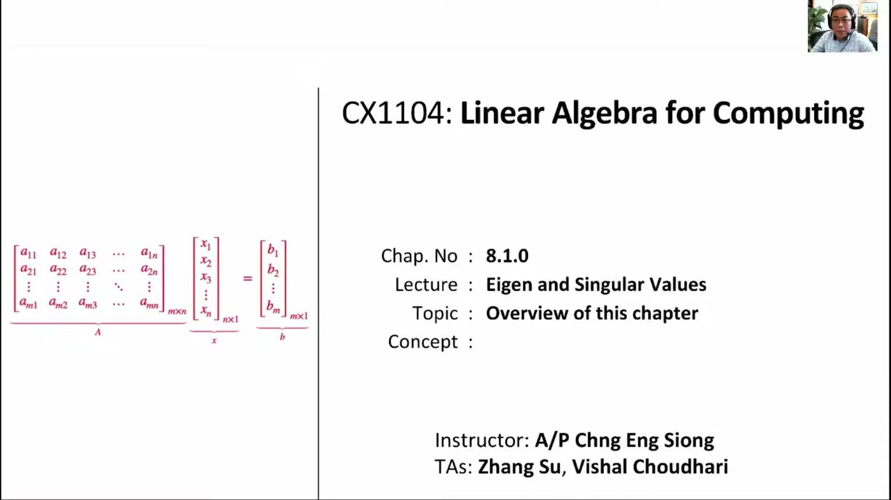

**Deck page — 8.1.0_Overview.pdf, p. 1:**

> CX1104: Linear Algebra for Computing Instructor: A/P Chng Eng Siong TAs: Zhang Su, Vishal Choudhari Rev: 3rd July 2020 Chap. No : 8.1.0 Lecture : Eigen and Singular Values Topic : Overview of this chapter Concept :

> 🎙️ **Narration:** *"Welcome to CX1104 linear algebra for computing. This is chapter 8 of the course. In this chapter 8, we'll be talking about primarily Argon value and later on in the chapters we'll talk about singular values of a matrix. This slide first presents the overview of this chapter, the first part, 8.1."*

---

### 🎬 Slide 2 — Content 2 Lay, Linear Algebra and its Applications (4th Edition) We will use Lay’s (4th edition) chapter 5.1-5

**Deck page — 8.1.0_Overview.pdf, p. 2:**

> Content 2 Lay, Linear Algebra and its Applications (4th Edition) We will use Lay’s (4th edition) chapter 5.1-5.4 for the slides Ch 5.5 and 5.6 for future offerings

> 🎙️ **Narration:** *(transition frames — the explanation continues on the next slide)*

---

### 🎬 Slide 3 — CX1104: Linear Algebra for Computing Instructor: A/P Chng Eng Siong TAs: Zhang Su, Vishal Choudhari Rev: 3rd J

**Deck page — 8.1.0_Overview.pdf, p. 1:**

> CX1104: Linear Algebra for Computing Instructor: A/P Chng Eng Siong TAs: Zhang Su, Vishal Choudhari Rev: 3rd July 2020 Chap. No : 8.1.0 Lecture : Eigen and Singular Values Topic : Overview of this chapter Concept :

> 🎙️ **Narration:** *(transition frames — the explanation continues on the next slide)*

---

### 🎬 Slide 4 — Content 2 Lay, Linear Algebra and its Applications (4th Edition) We will use Lay’s (4th edition) chapter 5.1-5

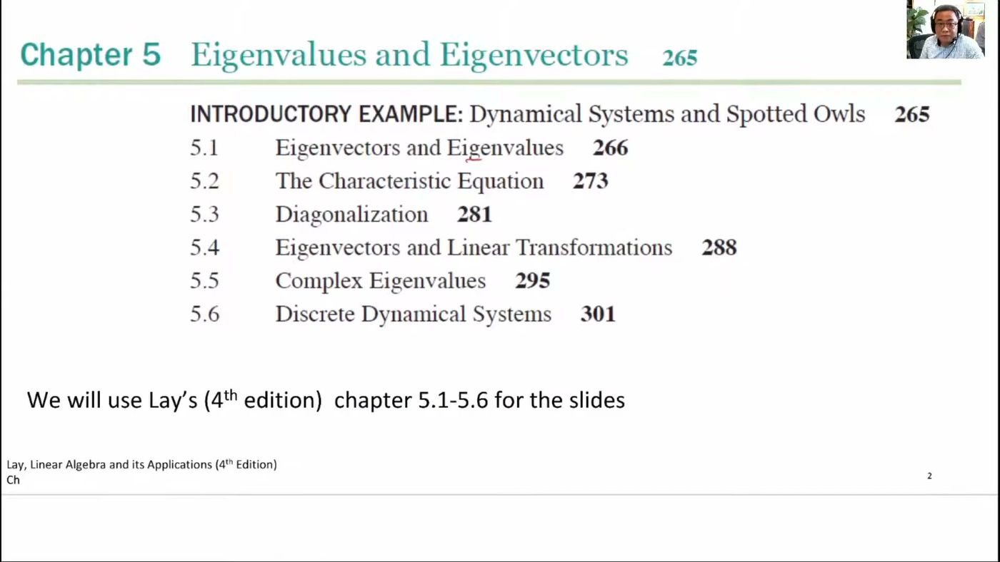

**Deck page — 8.1.0_Overview.pdf, p. 2:**

> Content 2 Lay, Linear Algebra and its Applications (4th Edition) We will use Lay’s (4th edition) chapter 5.1-5.4 for the slides Ch 5.5 and 5.6 for future offerings

> 🎙️ **Narration:** *"In this part of the Argan Value and Argan Vectors lecture, we are primarily using Leys fourth edition book. In this fourth edition chapter 5, we are going to cover the following subsections. Chapter 5.1 to chapter 5.6. We will first discuss what is the Argan Value and Argan Vectors, then followed by we will introduce what is the characteristic equations. The characteristic equation is the process used to extract the argon values from a matrix A. We then talk about a very close topic to argon value and argon vectors which is called diagonalization, basically converting a matrix A into a matrix D to some transformation where A is the original matrix given to us which must be square and D is a diagonal matrix and hence the term diagonalization. We will also closely study what is the Argan factors and the associated linear transformations through the process of converting the matrix A and understanding it as the D matrix. We also have a chance to talk about complex Argan values. You'll be surprised that given a real matrix A, we can have complex Argan values. finally we discuss about the dynamical system basically the trajectory of x of n plus 1 given the x of n plus 1 is equals to a times x of n and we are given first x of 0 and then we basically plot the equations in and repeatedly calculate x of 1 2 3 finding the trajectory of x of n and here the word dynamical means basically we are seeing how A is acting on the sequence of X. Right, so this is an important chapter. Please also have a read on this chapter from Lay as well."*

---
## V-8.1.1 — 8.1.1 Eigenvalues and Eigenvectors

> **Videos (12):** `8.1.1, pg 1~2` … `pg 8~12` (61.5 min) — deck: `8.1.1_EigenValues.pdf` (13 pages)
>
> *Repeated views of the same page are grouped; the fullest view is shown.*

### 🎬 Slide 1 — CX1104: Linear Algebra for Computing Instructor: A/P Chng Eng Siong TAs: Zhang Su, Vishal Choudhari Rev: 3rd J

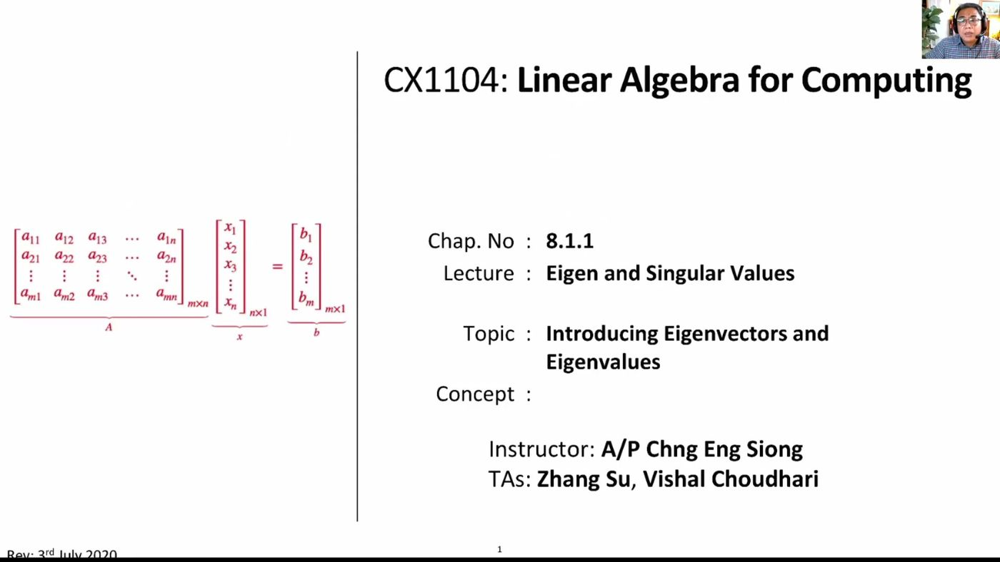

**Deck page — 8.1.1_EigenValues.pdf, p. 1:**

> CX1104: Linear Algebra for Computing Instructor: A/P Chng Eng Siong TAs: Zhang Su, Vishal Choudhari Rev: 3rd July 2020 Chap. No : 8.1.1 Lecture : Eigen and Singular Values Topic : Introducing Eigenvectors and Eigenvalues Concept : 1

> 🎙️ **Narration:** *"This is Cx11048.1.1, Argan value and singular values. We will introduce the Argan values and Argan vectors today. Given a square matrix A and by n"*

---

### 🎬 Slide 2 — On-screen reference / annotated frames

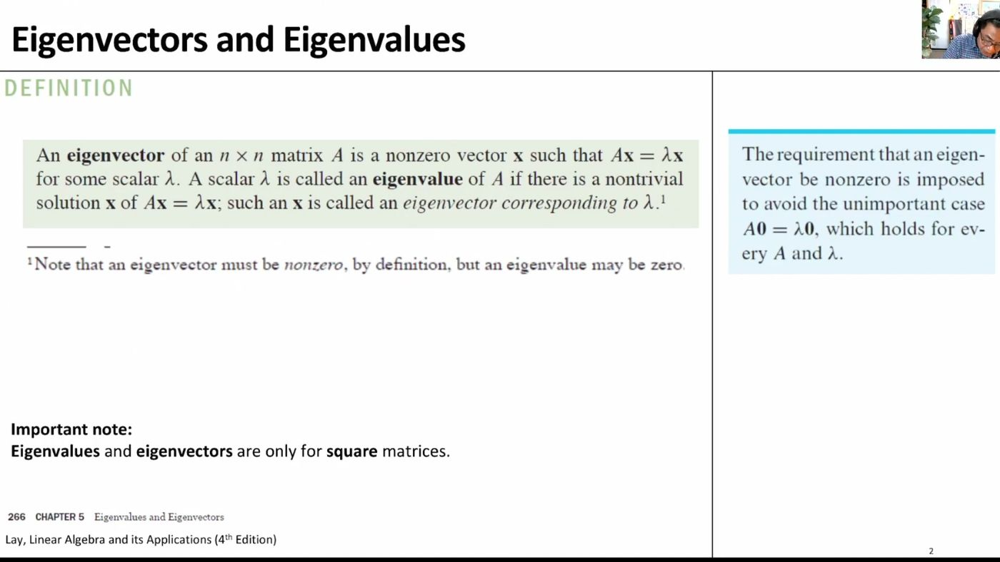

**Frames without a deck page:** the screen shows reference material (web page, video, or handwritten annotation) — the narration below explains what is being discussed.

> 🎙️ **Narration:** *(transition frames — the explanation continues on the next slide)*

---

### 🎬 Slide 3 — CX1104: Linear Algebra for Computing Instructor: A/P Chng Eng Siong TAs: Zhang Su, Vishal Choudhari Rev: 3rd J

**Deck page — 8.1.1_EigenValues.pdf, p. 1:**

> CX1104: Linear Algebra for Computing Instructor: A/P Chng Eng Siong TAs: Zhang Su, Vishal Choudhari Rev: 3rd July 2020 Chap. No : 8.1.1 Lecture : Eigen and Singular Values Topic : Introducing Eigenvectors and Eigenvalues Concept : 1

> 🎙️ **Narration:** *(transition frames — the explanation continues on the next slide)*

---

### 🎬 Slides 4–9 — On-screen reference / annotated frames

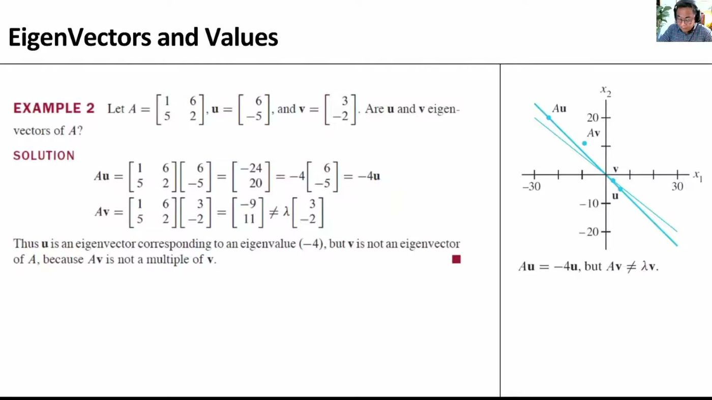

**Frames without a deck page:** the screen shows reference material (web page, video, or handwritten annotation) — the narration below explains what is being discussed.

> 🎙️ **Narration:** *"dimension, the Argan vector of this matrix A is the vector x, a non-zero vector x such that A multiplied by the vector x is equals to some constant times this vector x. If we have a matrix A and x and lambda to exhibit this behavior then the relationship is now called x is an eigenvector and lambda is an eigenvalue of A. You will find that for a matrix A there could be a a few Argan values and corresponding to this Argan value is the Argan vector. We can find another Argan value let's say called lambda 1 and then maybe v1 for the Argan vector lambda 2 Argan vector v2 and so on up to n of them. We could have less than n of them but we'll see this problem later on. Note that the Argonvectors must be non-zero, otherwise this is not very interesting. Let us now have a concrete example of a argon vector and argon value. We will explore the matrix A which is a 2 by 2 matrix and we want to see whether U or V is an argon vector of matrix A. Remember that an argon vector is a vector x such that when A multiplied by x it will be lambda multiplied by x. the interpretation of lambda multiplied by x basically means that x is scaled by a constant lambda. Now in the case of a two-dimension vector for example in this case v this is v here this is 2 and this is 1 and when we do a multiply by v what we are doing of course is nothing but putting the matrix A here multiplying by 2, 1 and you can work it out and the answer is 4, 2. Now 4, 2 is nothing but 2 multiplied by the original vector 2, 1 or 2 V. What if you now compare this equation with the definition of eigenvector and eigenvalue, you realize that v is an eigenvector, the corresponding eigenvalue is 2. Visually, it's very interesting. Visually, the vector v is here and the vector av lies on the same line as v. And that's the key interpretation because v is only scale. Therefore, the resultant AV must be on the same line. If it is going on the same direction, then it is a positive constant lambda which is a negative that means it points away from the original V, then the lambda, the scaling eigenvalue is negative. So that's the geometric interpretation and here is the algebraic interpretation. Alright, let's have a counter example. The counter example is of course U. Now if we have U here, which is minus 1 and 1, and then now we are going to apply A on U, again you should write the matrix 3 1 minus 2 0 and multiplying it by minus 1 1, and you will get this value here, which is minus 5 minus 1. Now Now there is no constant a U, there is no constant such that this will happen and therefore of course algebraically you know that U is not a n-argan factor. What about geometrically? Geometrically you look at this figure, U which is pointing in this direction has now changed its direction. Let me clean this up. this was original direction of U and this is the new direction of A times U. Since A times U is different direction to U, therefore again we know that U is not an argon vector of matrix A. We now have another example, example 2 from Lei. In this example again this A is a 2 by 2 matrix. We again have two vectors U and V and we ask which of them are Argon vectors. Simply we multiply A by U and we put A here and we put U here we do the matrix vector multiplication we get this and we realize that AU is nothing but minus 4 times U showing us that lambda of this argon vector is minus 4 and U is an argon vector and if If you are wondering what does lambda equals to minus 4 ducs to U, then this is U, which is 6 minus 5, 6 along the x1 axis, and minus 5 along the x2 axis. We will draw a dark blue line from the origin to U and extend it onwards as well as backwards. we find where AU lands. Remember geometrically, AU must land on the same line. And now it shows us that when lambda equals to minus 4, the direction of AU is opposite to U. So it points now upwards. And the length is 4 times that of the original length. That is the lambda, the argon value for this argon vector. Now we go through the other possible vector called v. We multiply av to get minus 9, 11. We saw that there is no way we can find a lambda such that when multiplied by v would be equals to av. So algebraically we now know that v is not and argon vector. What about geometrically? Well let's look at it here again. V is this point here and we draw a light blue line extending from the origin downwards as well as upwards. And now we see where AV is and AV does not land on this light blue line. So geometrically again we also see"*

---

### 🎬 Slide 10 — Matlab–sanity check 11 MATLAB Note: Here, . Hence, there are two eigenvectors corresponding to the eigenvalue 

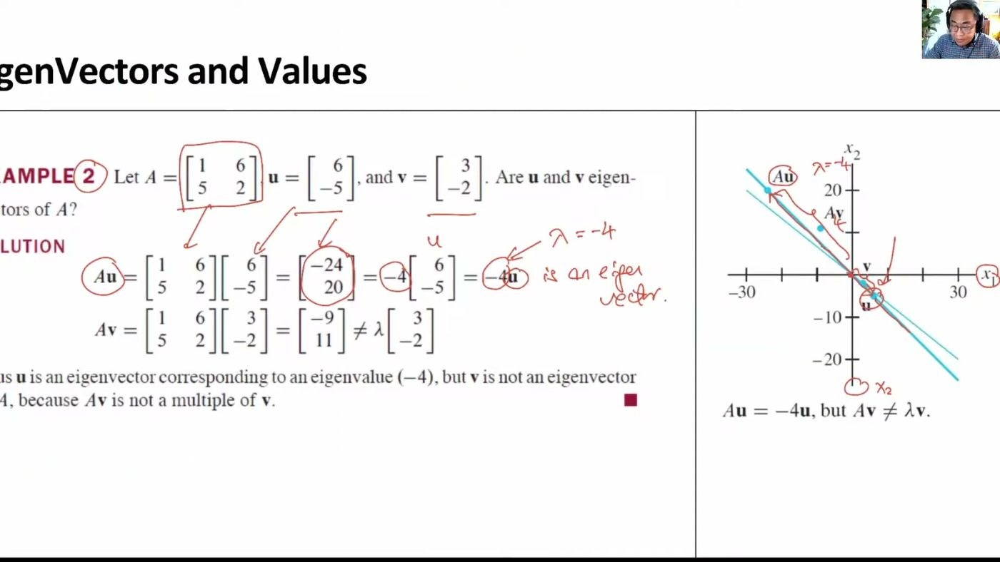

**Deck page — 8.1.1_EigenValues.pdf, p. 11:**

> Matlab–sanity check 11 MATLAB Note: Here, . Hence, there are two eigenvectors corresponding to the eigenvalue of 2. The eigen space can be formed by any set of basis vectors that span it. Hence, the eigen space spanned by the basis on LHS is the same eigen space spanned by the 2nd and 3rd columns of matrix . Eigenvector corresponding to 1 Eigenvector corresponding to 2 Eigenvector corresponding to 3 Matlab provide solutions of eigenvectors such that the norm of the eigenvectors == 1. When the matrix A is not symmetrical, the eigenvectors will not be orthogonal to each other. In the special case when matrix is symmetric, eigen vectors will be orthogonal to each other.

> 🎙️ **Narration:** *(transition frames — the explanation continues on the next slide)*

---

### 🎬 Slides 11–12 — On-screen reference / annotated frames

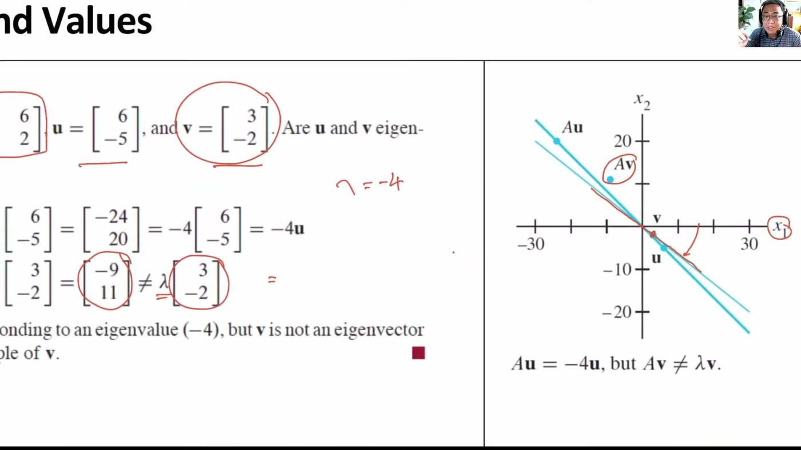

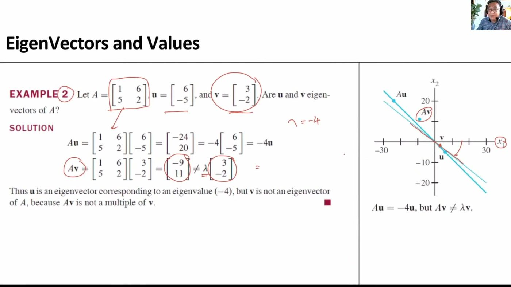

**Frames without a deck page:** the screen shows reference material (web page, video, or handwritten annotation) — the narration below explains what is being discussed.

> 🎙️ **Narration:** *"that V is not an argon factor for this matrix A."*

---

### 🎬 Slide 13 — References Videos 13 Ritvik Math - overview https://youtu.be/KTKAp9Q3yWg - how to compute 2x2 eigvalue and vec

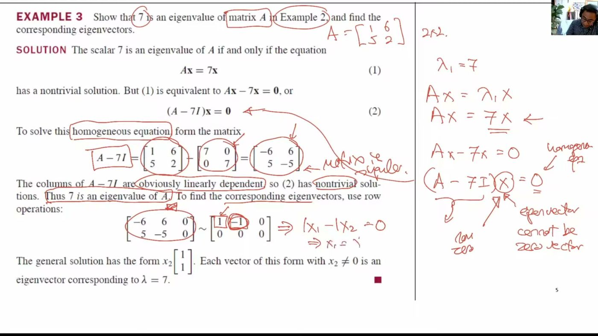

**Deck page — 8.1.1_EigenValues.pdf, p. 13:**

> References Videos 13 Ritvik Math - overview https://youtu.be/KTKAp9Q3yWg - how to compute 2x2 eigvalue and vector https://youtu.be/glaiP222JWA Eigen vector 33 mins: Brunton: https://youtu.be/ZSGrJBS_qtc MIT Strang, https://youtu.be/cdZnhQjJu4I lecture 21: (51 mins) https://youtu.be/U8R54zOTVLw (11 mins) Trevor Bazett: https://youtu.be/4wTHFmZPhT0 ( 9. Min - geometric) Examples - https://youtu.be/LsZ-nNy0ZRs (4.5min example) https://youtu.be/4u55V_Yp-QI (7 min) https://youtu.be/EZkDtcyPP6Q (9 mins - repeated eigenvalues, complex eigenvalues,) Zach Star: applications of eigen vectors values https://youtu.be/i8FukKfMKCI

> 🎙️ **Narration:** *(transition frames — the explanation continues on the next slide)*

---

### 🎬 Slide 14 — On-screen reference / annotated frames

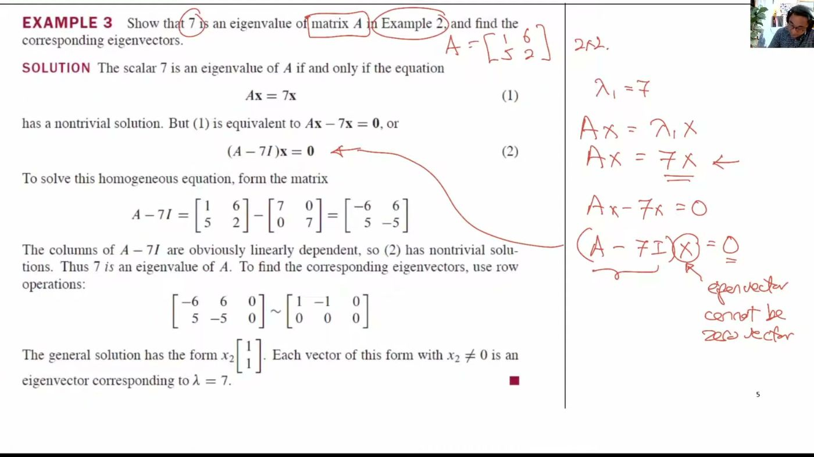

**Frames without a deck page:** the screen shows reference material (web page, video, or handwritten annotation) — the narration below explains what is being discussed.

> 🎙️ **Narration:** *"equation is true. Now this equation is called homogenous equation because the right hand side is the right hand side of this equation is the zero vector. So we say to solve this homogenous equation let's work on this matrix A minus 7i. So we have A minus 7i here, we have A here, we have 7i here, 7i is nothing but the constant 7 multiplied by the identity matrix of 2 by 2 in this example and therefore we have this matrix here. We work out the numbers and the numbers is very interesting. It's minus 6, 5 for the first column, 6 minus 5 for the second column. You realize that the second column is negative 1 multiplied by the first column, implying that this matrix is singular or it has dependent column. And because it has dependent column therefore we can find a non-zero x to combine this column such that the output is zero. Okay so this is the discussion here. This matrix a-7i is obviously linearly dependent, it has linearly dependent column and therefore it has non-trivial solution meaning non-zero x such that a minus 7i times x equals to the zero vector. So this proves that 7 is an argon value of a. So we can stop here now for the first part show that 7 is an argon value of matrix A. Now to find the second part, what do we do? Well, you can do row reduction because we are now trying to solve for x. So this is what you have done before in the past lectures. We're now trying to find a solution for this equation and because we have dependent columns, therefore we have dependent rows and therefore you only have one pivot and one free variable. This is the free variable and this is the pivot in the square and therefore now you can find a general solution. You can write the equation as 1x1 minus 1x2 equals to the zero and therefore implying x1"*

---

### 🎬 Slide 15 — Example: How to find EigenVectors EigenSpace Note: The that are solutions of equation (3) are the eigenvalue a

**Deck page — 8.1.1_EigenValues.pdf, p. 6:**

> Example: How to find EigenVectors EigenSpace Note: The that are solutions of equation (3) are the eigenvalue and vector respectively. The eigenvector that is a solution of the above is tied to the eigenvalue. The eigenvalue could be repeated and there could be more than 1 independent eigenvector. (See Example 4) 6

> 🎙️ **Narration:** *"equals to x2 since x2 is the free variable we fix x1 and we have now the solution of the Arkan factor x. So if we can put any value of x2 here, now we'll get an Arkan factor. Okay, so that's it. Maybe to convince yourself, let's try a concrete example. 1 5 6 2, multiply by 1 1 and we will get 7 7 and then we can we show that if the vector is 1 1 we have 7 as this vector scale by 7 times what about 1 5 6 2 multiply by 2 2 2 2 is also an eigen vector and therefore what we have in In fact, if you do not want to calculate all you can immediately think that h is multiplying 7 multiplied by 2 by 2 which is 14, 14. So you realize that Arkan vector lies on the line. practice along that line is an argon factor of E."*

---

### 🎬 Slide 16 — On-screen reference / annotated frames

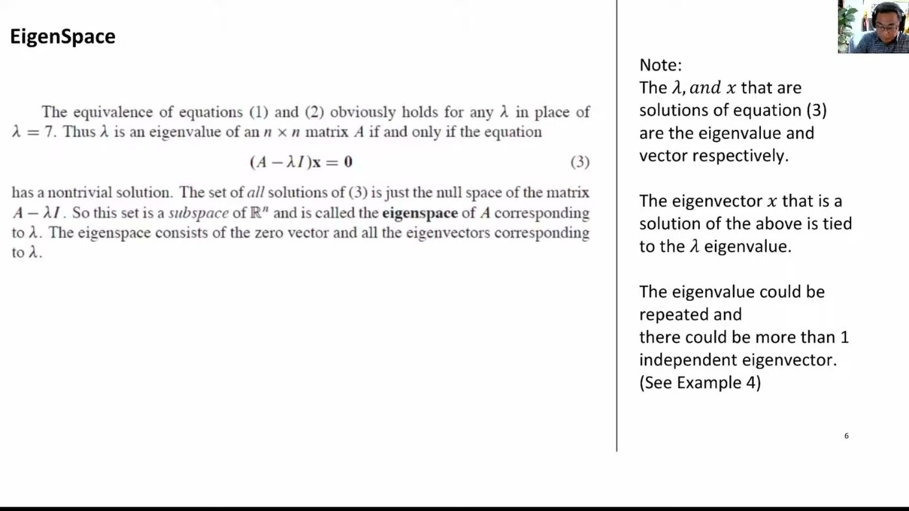

**Frames without a deck page:** the screen shows reference material (web page, video, or handwritten annotation) — the narration below explains what is being discussed.

> 🎙️ **Narration:** *"In this slide we'll introduce the term argon space. Argon space is associated with the argon vectors. In our previous equation, to find the argon vector x, we arrive at this equation. We found that a minus lambda i must have dependent column. must be a singular matrix such that a minus lambda i multiplied by x equals to zero when lambda is an argon value. Now we also show that x when we solve for it is actually has a general"*

---

### 🎬 Slide 17 — Matlab–sanity check 11 MATLAB Note: Here, . Hence, there are two eigenvectors corresponding to the eigenvalue 

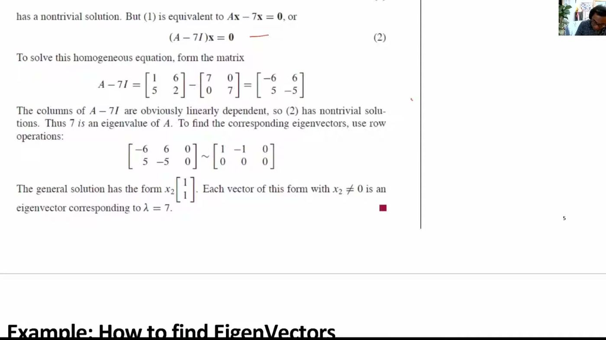

**Deck page — 8.1.1_EigenValues.pdf, p. 11:**

> Matlab–sanity check 11 MATLAB Note: Here, . Hence, there are two eigenvectors corresponding to the eigenvalue of 2. The eigen space can be formed by any set of basis vectors that span it. Hence, the eigen space spanned by the basis on LHS is the same eigen space spanned by the 2nd and 3rd columns of matrix . Eigenvector corresponding to 1 Eigenvector corresponding to 2 Eigenvector corresponding to 3 Matlab provide solutions of eigenvectors such that the norm of the eigenvectors == 1. When the matrix A is not symmetrical, the eigenvectors will not be orthogonal to each other. In the special case when matrix is symmetric, eigen vectors will be orthogonal to each other.

> 🎙️ **Narration:** *"solution. It implies that it is not a single point in this example in the R2 space. It is a line along the R2 space. So in this example, 7 is an eigenvalue, 1, 1, the vector along this line is an eigenvector. And here we want to be more specific, we say that all solutions,"*

---

### 🎬 Slides 18–19 — On-screen reference / annotated frames

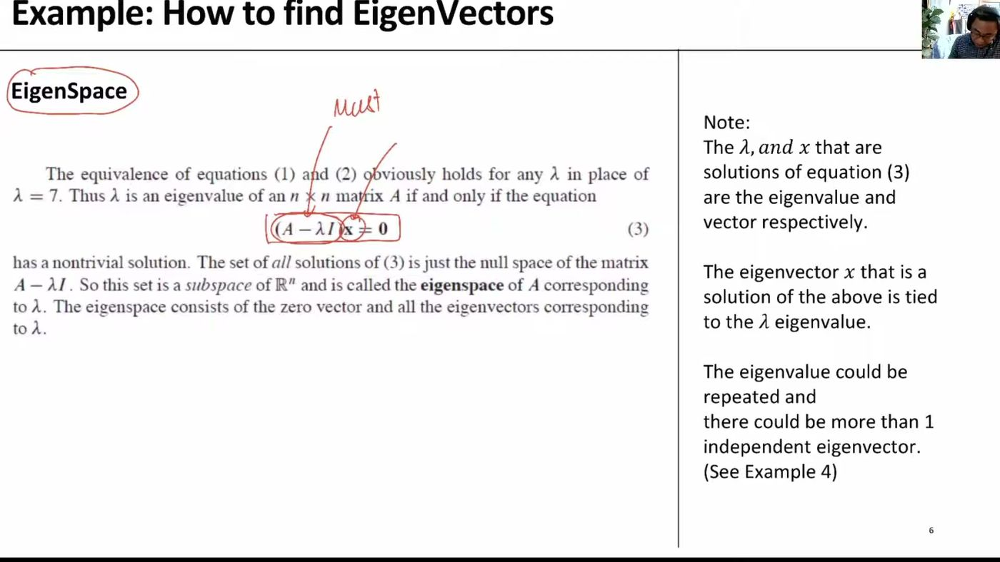

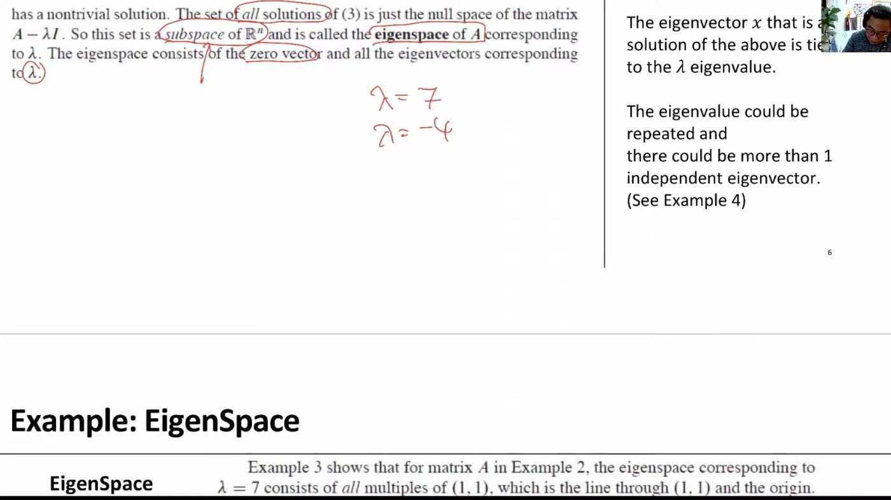

**Frames without a deck page:** the screen shows reference material (web page, video, or handwritten annotation) — the narration below explains what is being discussed.

> 🎙️ **Narration:** *"1 1 2 2 in this example 3 3 along this line are solution and therefore this is a set of points along this line and it is actually a subspace of Rn because it also consists of the zero vector and the subspace of the argon vectors all the Argan practice corresponding to this lambda forms a space and we call it the Argan space of the matrix. So concretely what does that mean? We still look at this example and we know that there is lambda equals 2. These two lambda are Argan values. Let's be concrete about it. Typically we'll call one of them lambda 1"*

---

### 🎬 Slide 20 — References Videos 13 Ritvik Math - overview https://youtu.be/KTKAp9Q3yWg - how to compute 2x2 eigvalue and vec

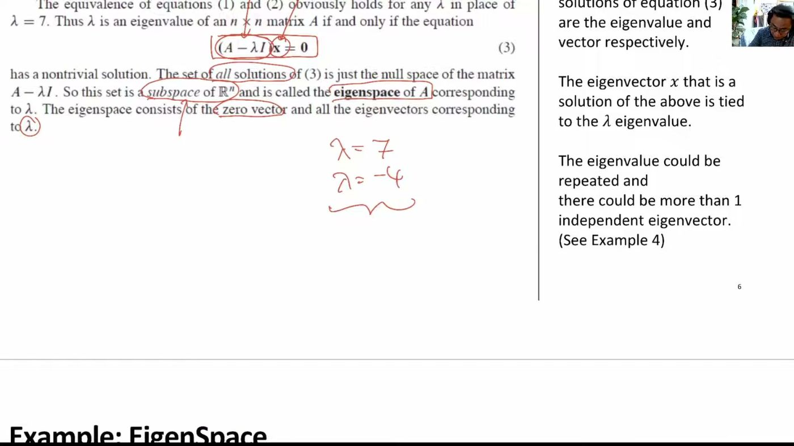

**Deck page — 8.1.1_EigenValues.pdf, p. 13:**

> References Videos 13 Ritvik Math - overview https://youtu.be/KTKAp9Q3yWg - how to compute 2x2 eigvalue and vector https://youtu.be/glaiP222JWA Eigen vector 33 mins: Brunton: https://youtu.be/ZSGrJBS_qtc MIT Strang, https://youtu.be/cdZnhQjJu4I lecture 21: (51 mins) https://youtu.be/U8R54zOTVLw (11 mins) Trevor Bazett: https://youtu.be/4wTHFmZPhT0 ( 9. Min - geometric) Examples - https://youtu.be/LsZ-nNy0ZRs (4.5min example) https://youtu.be/4u55V_Yp-QI (7 min) https://youtu.be/EZkDtcyPP6Q (9 mins - repeated eigenvalues, complex eigenvalues,) Zach Star: applications of eigen vectors values https://youtu.be/i8FukKfMKCI

> 🎙️ **Narration:** *"and there one lambda 2 and we have v1 and v2 for the corresponding Argan vectors."*

---

### 🎬 Slide 21 — On-screen reference / annotated frames

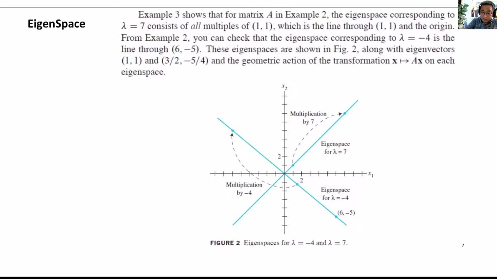

**Frames without a deck page:** the screen shows reference material (web page, video, or handwritten annotation) — the narration below explains what is being discussed.

> 🎙️ **Narration:** *(transition frames — the explanation continues on the next slide)*

---

### 🎬 Slide 22 — Example: How to find EigenVectors EigenSpace Note: The that are solutions of equation (3) are the eigenvalue a

**Deck page — 8.1.1_EigenValues.pdf, p. 6:**

> Example: How to find EigenVectors EigenSpace Note: The that are solutions of equation (3) are the eigenvalue and vector respectively. The eigenvector that is a solution of the above is tied to the eigenvalue. The eigenvalue could be repeated and there could be more than 1 independent eigenvector. (See Example 4) 6

> 🎙️ **Narration:** *(transition frames — the explanation continues on the next slide)*

---

### 🎬 Slides 23–32 — On-screen reference / annotated frames

**Frames without a deck page:** the screen shows reference material (web page, video, or handwritten annotation) — the narration below explains what is being discussed.

> 🎙️ **Narration:** *"Now when we draw it this diagram shows the Argan space for the matrix A equals to 1562 as in example 2 and we found lambda equals to 7 is an Argan value lambda equals to minus 4 as the other Argan value and we found 2 lines, each line corresponding to the argon factor and these two blue lines is called the argon space of A. But in addition to saying the argon space of A we are actually very specific we want to say the argon space corresponding to which lambda. So this line corresponds to lambda argon value equals to 7. The the line corresponds to lambda equals to minus 4. So to repeat, Argan factor is not a single point, it is it can be a line like in this example and later on we'll show you that it can even be a plane okay and therefore we call it Argan space to allude it to that it is a subspace of in this example A2. Let's now continue with another example. In this example, the matrix is a 3 by 3 matrix and we are asked to find a basis for an argon space for lambda equals to 2 and argon value. So we have some new words basis and argon space. So what does that mean? In this example, shows that we actually can find multiple argon vectors for a single argon value and this is very interesting so it means that the argon space dimension the number of vectors that spans the space is greater than one. In the previous examples we saw that for every argon value we only found one argon vector I mean we found a basis for that argon vector any scalar version of that eigenvector is the same eigenvector for the eigenvalue. But now we can see that actually for this matrix A with lambda equals to 2, there are two eigenvectors or should I say two independent eigenvectors for this eigenvalue. So let's proceed. So what do we do? We begin with always with a minus lambda i x equals to zero. We are given lambda equals to two. So we substitute that over here. And now a is a three by three matrix. So i must be a three by three matrix. So this i is a three by three matrix. And we write a here. We write two times i here. We have a here and 2 times i here and now we have a minus 2i. Once we have a minus 2i, we are trying to solve for this equation of x such that x is a non-zero argon vector. Okay, so how do we solve? Again, we perform row reduction on this matrix a minus 2i. Now here the word augmented matrix because we padded the right hand side with the zero vector. Alright so let's proceed on and we perform row reduction, we skip all the steps and we found that we have one pivot and two free variables. In fact this could have been observe here as well. You can see that this matrix definitely has only one independent column. The other two are nothing but the skewed version of this column. Okay, so with that we know that this matrix is singular and this matrix has only one pivot because it has only one independent column. Alright so once we can reach here, we want to find the general solution for x which is we can write down as 2x1 minus x2 plus 6x3 is equals to zero. So this is a pivot so we can put a square here, put a circle here for the free variable and now we can solve. And remember that the free variable, when we say that they are free means they can take in any values that we can assign to it. Fix, the pivots must be fixed, so typically we fix it as value 1. Alright so let's proceed, so we have 2x1 minus x2 equals to zero because we have assigned x3 to be zero first. Therefore, 2x1 equals to x2 and x1 equals to half of x2. So we now assign x2 to be one because it's free and therefore x1 would be half. So we have now a solution x1 x2 x3 will be equals to half and then x2 will be 1 and x3 will be 0. In fact we multiply by x2 because x2 can still be any value."*

---

### 🎬 Slides 33–34 — On-screen reference / annotated frames

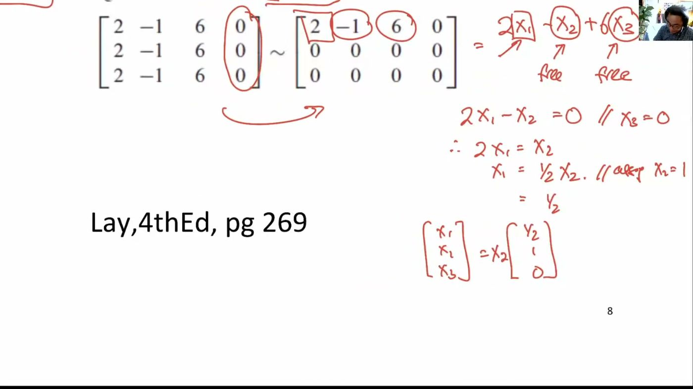

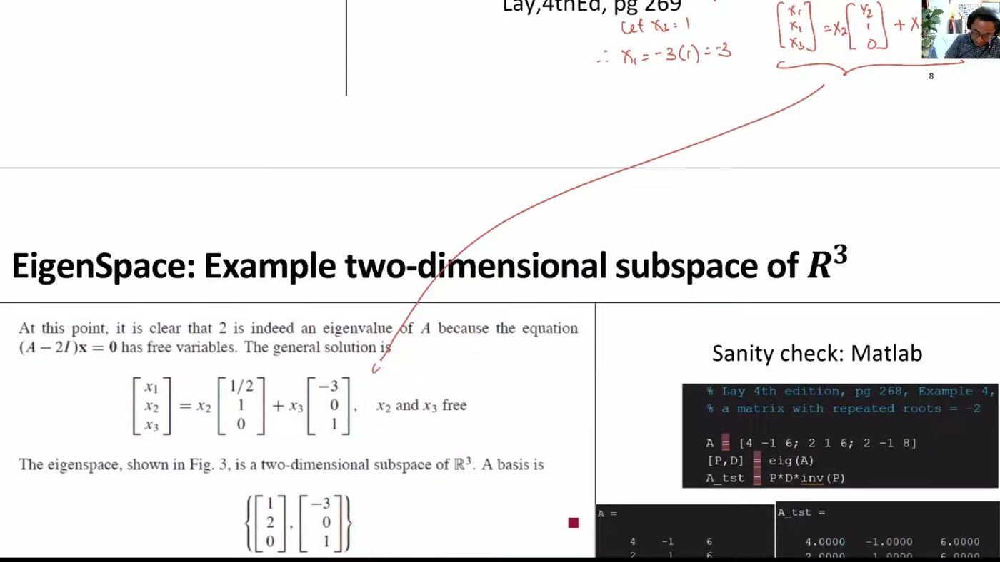

**Frames without a deck page:** the screen shows reference material (web page, video, or handwritten annotation) — the narration below explains what is being discussed.

> 🎙️ **Narration:** *"And now we plus the second solution which is again we have 2x1 and now we assign 0 to x2 and plus 6x3 equals to 0 and now we solve 2x1 equals to minus 6x3 and therefore x1 equals to minus 3x3. So again typically we let x3 equals to 1 so therefore x1 equals to minus 3 times 1 equals to minus 3 and now we can right plus x3 equals to minus 3 x2 was set to 0 and x3 was set to 1. So this is the general solution for the argon vector. So we now can proceed to see this here. So if you compare this to our previous example, you realize that for argon value of equals to 2, the Argan vector has two independent vectors and it is two independent vectors multiplied by its linear combination. So we call this the Argan space and these two vectors are the basis for the Argan space. So these are all the the terms you need to know. So we can write the basis as a set of these two vectors here. Notice that this lay changed the notation from half 1, 0 to 1 to 0. I mean any scale version of the original vector is a bit is also valid factor for that basis. These two are independent so"*

---

### 🎬 Slide 35 — Example: How to find EigenVectors EigenSpace Note: The that are solutions of equation (3) are the eigenvalue a

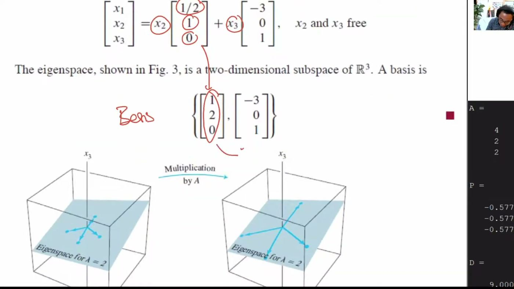

**Deck page — 8.1.1_EigenValues.pdf, p. 6:**

> Example: How to find EigenVectors EigenSpace Note: The that are solutions of equation (3) are the eigenvalue and vector respectively. The eigenvector that is a solution of the above is tied to the eigenvalue. The eigenvalue could be repeated and there could be more than 1 independent eigenvector. (See Example 4) 6

> 🎙️ **Narration:** *"So a linear combination forms a space. So the blue shaded line is that space that we are talking about. Okay, now any vectors, any vector on this space,"*

---

### 🎬 Slide 36 — On-screen reference / annotated frames

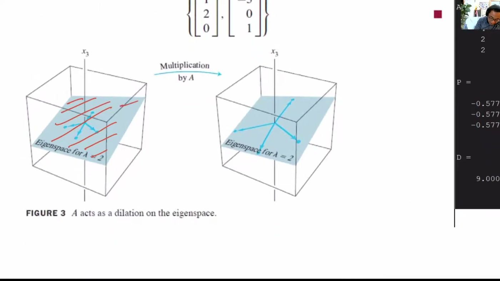

**Frames without a deck page:** the screen shows reference material (web page, video, or handwritten annotation) — the narration below explains what is being discussed.

> 🎙️ **Narration:** *"and let's write it as four of them. Let's call this one, two, three, four. One, two, three, four, four points. And then multiply by A. A multiplied by any of these four vectors result in these four vectors 1, 2, 3, 4. Basically these four vectors will be stretched by 2, the given eigen value. This length will be stretched by 2. Its direction remains exactly the same so this was the original 1, this was the original 2, this was the original 3 and so forth. four. It doubles the length. Okay, so that's the key idea of this example. Now if you want to have a"*

---

### 🎬 Slides 37–39 — Example: How to find EigenVectors EigenSpace Note: The that are solutions of equation (3) are the eigenvalue a

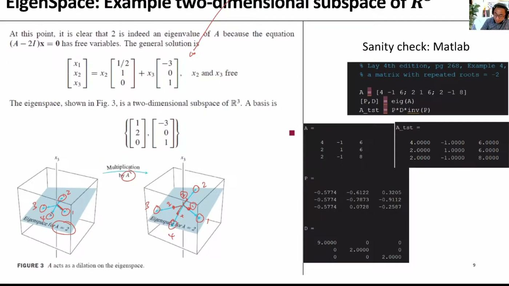

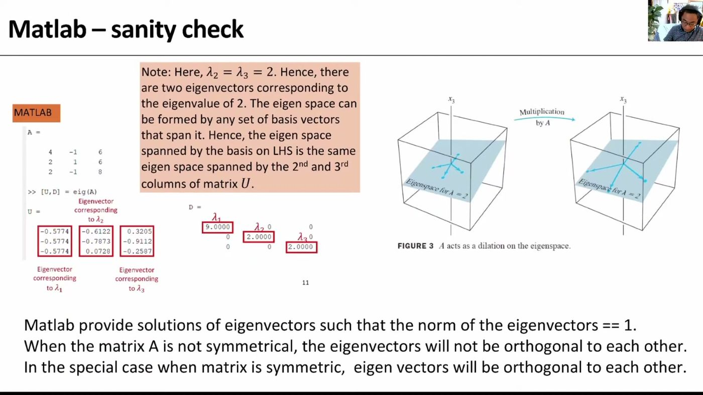

**Deck page — 8.1.1_EigenValues.pdf, p. 6:**

> Example: How to find EigenVectors EigenSpace Note: The that are solutions of equation (3) are the eigenvalue and vector respectively. The eigenvector that is a solution of the above is tied to the eigenvalue. The eigenvalue could be repeated and there could be more than 1 independent eigenvector. (See Example 4) 6

> 🎙️ **Narration:** *"sanity check, so typically we'll ask you to use MATLAB or Python to solve for the eigenvalue eigenvector. So in MATLAB it's easy. This is a syntax a equals to square bracket the values of the elements of this matrix and then to get new columns, sorry get new rows you put a semicolon. The EIG is the command for eigen value, eigen factor decomposition. So EIG of A will give you two matrices. P is the matrix of columns of eigen factors and D is the diagonal matrix of argon values. So we have a here and we have p here and we have d here. So we see that 9 is an argon value and 2 is repeated twice. And what about the argon vectors? So this is v1, this is v2, this is v3. Okay and then if you compare v2 and v3 to this guy, they don't look the same but if you... so where are they not the same? They are actually... remember Argan vectors can be anywhere along this blue plane. Okay so if you check carefully these two vectors are definitely on this blue plane and then why are all these funny numbers because the norm of this vector is one. Okay so medlab gives you a normalized Argan vectors. Okay, what else? Now for description of the MATLAB's eigenvalue eigenvectors, please read it up. Alright, and one thing to note is that the eigenvalues produced by MATLAB is typically not sorted. So in this previous example, it was just an accident that it was sorted. Okay, finally you can go through the sanity check always for all our computations so that you can see that it is correct. Lastly,"*

---

### 🎬 Slides 40–42 — On-screen reference / annotated frames

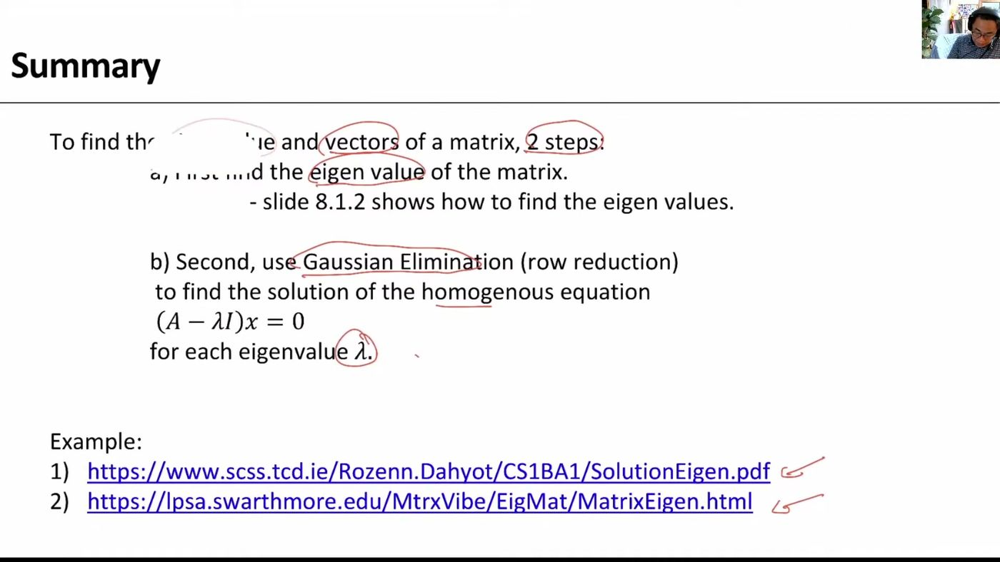

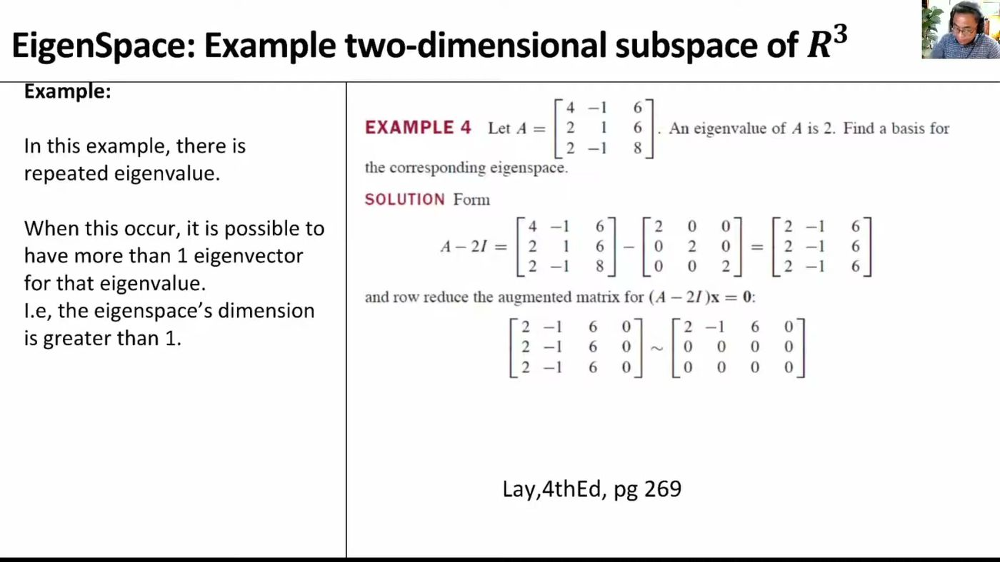

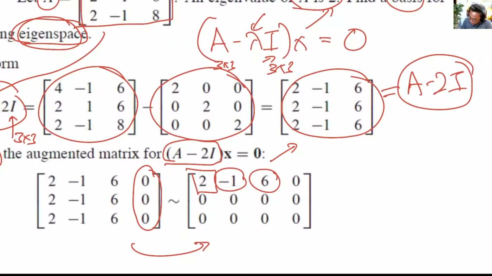

**Frames without a deck page:** the screen shows reference material (web page, video, or handwritten annotation) — the narration below explains what is being discussed.

> 🎙️ **Narration:** *(transition frames — the explanation continues on the next slide)*

---

### 🎬 Slide 43 — Example: How to find EigenVectors EigenSpace Note: The that are solutions of equation (3) are the eigenvalue a

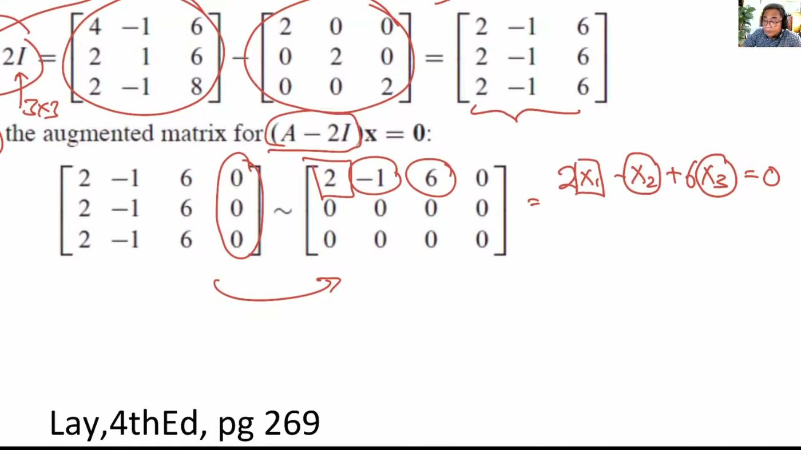

**Deck page — 8.1.1_EigenValues.pdf, p. 6:**

> Example: How to find EigenVectors EigenSpace Note: The that are solutions of equation (3) are the eigenvalue and vector respectively. The eigenvector that is a solution of the above is tied to the eigenvalue. The eigenvalue could be repeated and there could be more than 1 independent eigenvector. (See Example 4) 6

> 🎙️ **Narration:** *(transition frames — the explanation continues on the next slide)*

---

### 🎬 Slide 44 — On-screen reference / annotated frames

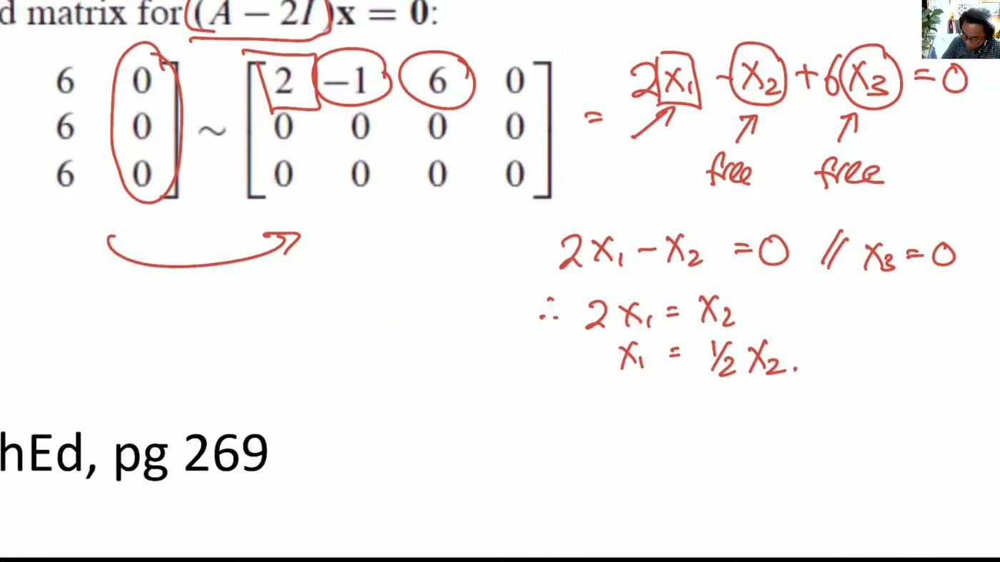

**Frames without a deck page:** the screen shows reference material (web page, video, or handwritten annotation) — the narration below explains what is being discussed.

> 🎙️ **Narration:** *(transition frames — the explanation continues on the next slide)*

---

### 🎬 Slides 45–47 — Example: How to find EigenVectors EigenSpace Note: The that are solutions of equation (3) are the eigenvalue a

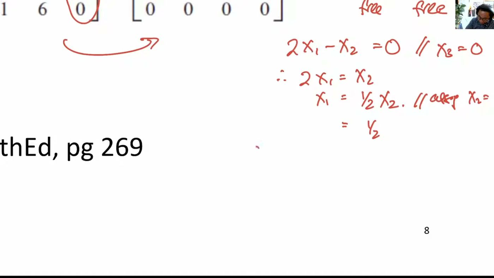

**Deck page — 8.1.1_EigenValues.pdf, p. 6:**

> Example: How to find EigenVectors EigenSpace Note: The that are solutions of equation (3) are the eigenvalue and vector respectively. The eigenvector that is a solution of the above is tied to the eigenvalue. The eigenvalue could be repeated and there could be more than 1 independent eigenvector. (See Example 4) 6

> 🎙️ **Narration:** *(transition frames — the explanation continues on the next slide)*

---

### 🎬 Slides 48–50 — On-screen reference / annotated frames

**Frames without a deck page:** the screen shows reference material (web page, video, or handwritten annotation) — the narration below explains what is being discussed.

> 🎙️ **Narration:** *(transition frames — the explanation continues on the next slide)*

---

### 🎬 Slide 51 — EigenSpace: Example two-dimensional subspace of Example: In this example, there is repeated eigenvalue. When t

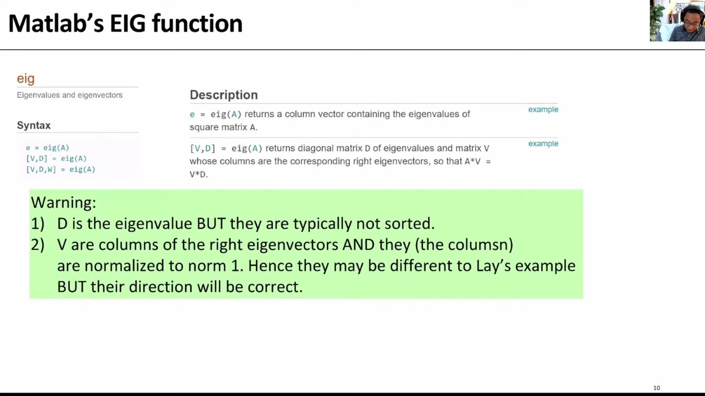

**Deck page — 8.1.1_EigenValues.pdf, p. 8:**

> EigenSpace: Example two-dimensional subspace of Example: In this example, there is repeated eigenvalue. When this occur, it is possible to have more than 1 eigenvector for that eigenvalue. I.e, the eigenspace’s dimension is greater than 1. 8 Lay,4thEd, pg 269

> 🎙️ **Narration:** *(transition frames — the explanation continues on the next slide)*

---

### 🎬 Slide 52 — References Videos 13 Ritvik Math - overview https://youtu.be/KTKAp9Q3yWg - how to compute 2x2 eigvalue and vec

**Deck page — 8.1.1_EigenValues.pdf, p. 13:**

> References Videos 13 Ritvik Math - overview https://youtu.be/KTKAp9Q3yWg - how to compute 2x2 eigvalue and vector https://youtu.be/glaiP222JWA Eigen vector 33 mins: Brunton: https://youtu.be/ZSGrJBS_qtc MIT Strang, https://youtu.be/cdZnhQjJu4I lecture 21: (51 mins) https://youtu.be/U8R54zOTVLw (11 mins) Trevor Bazett: https://youtu.be/4wTHFmZPhT0 ( 9. Min - geometric) Examples - https://youtu.be/LsZ-nNy0ZRs (4.5min example) https://youtu.be/4u55V_Yp-QI (7 min) https://youtu.be/EZkDtcyPP6Q (9 mins - repeated eigenvalues, complex eigenvalues,) Zach Star: applications of eigen vectors values https://youtu.be/i8FukKfMKCI

> 🎙️ **Narration:** *(transition frames — the explanation continues on the next slide)*

---

### 🎬 Slide 53 — EigenSpace: Example two-dimensional subspace of Example: In this example, there is repeated eigenvalue. When t

**Deck page — 8.1.1_EigenValues.pdf, p. 8:**

> EigenSpace: Example two-dimensional subspace of Example: In this example, there is repeated eigenvalue. When this occur, it is possible to have more than 1 eigenvector for that eigenvalue. I.e, the eigenspace’s dimension is greater than 1. 8 Lay,4thEd, pg 269

> 🎙️ **Narration:** *"I want to summarize in these few slides what we did was to define what is argon value and argon vectors and we saw that to find the argon value, argon vectors we produce, we have to exercise it in two steps. We first find the argon values and then find the argon vectors by Gaussian elimination to solve this equation. Okay, you can see some more examples in these two slides. You'll take you a while to get familiar with it, but typically after some examples you'll be okay. And in our quizzes and our tutorials, we typically restrict to 2 by 2 or 3 by 3 matrices. Alright, that's it for the 8.1 slide. Thank you."*

---
## V-8.1.2 — 8.1.2 The Characteristic Equation

> **Videos (6):** `8.1.2, pg 1~6`, `pg 7~9`, `pg 10~13` (48.7 min) — deck: `8.1.2_CharacteristicEqn.pdf` (13 pages)
>
> *Repeated views of the same page are grouped; the fullest view is shown.*

### 🎬 Slide 1 — CX1104: Linear Algebra for Computing Instructor: A/P Chng Eng Siong TAs: Zhang Su, Vishal Choudhari Rev: 3rd J

**Deck page — 8.1.2_CharacteristicEqn.pdf, p. 1:**

> CX1104: Linear Algebra for Computing Instructor: A/P Chng Eng Siong TAs: Zhang Su, Vishal Choudhari Rev: 3rd July 2020 Chap. No : 8.1.2 Lecture : Eigen and Singular Values Topic : Characteristic Equation Concept : How to find eigenvalue and vectors 1

> 🎙️ **Narration:** *"This is CX1104 chapter 8.1.2 we discussed about characteristic equation basically want to use the characteristic equation to find the eigenvalues and hence then find the eigenvectors. So basically we are trying to find a"*

---

### 🎬 Slide 2 — How to find eigenValues? 2 𝐴𝐴𝐴𝐴 = 𝜆𝜆𝐴𝐴 𝐴𝐴𝐴𝐴 − 𝜆𝜆𝐴𝐴 = 0 𝐴𝐴 − 𝜆𝜆𝜆𝜆 𝐴𝐴 = 0 𝜆𝜆𝜆𝜆 − 𝐴𝐴 𝐴𝐴 = 0 For the above equatio

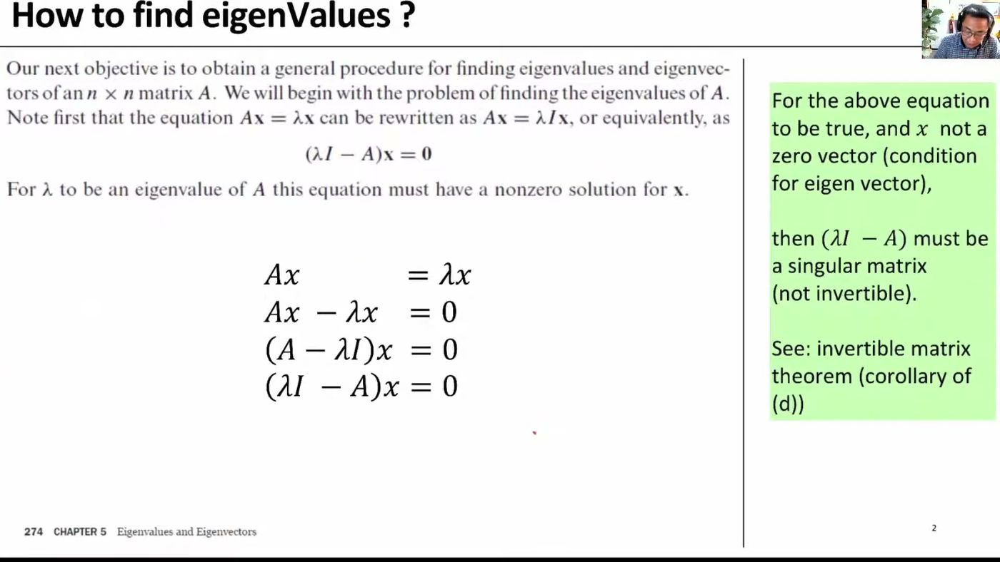

**Deck page — 8.1.2_CharacteristicEqn.pdf, p. 2:**

> How to find eigenValues? 2 𝐴𝐴𝐴𝐴 = 𝜆𝜆𝐴𝐴 𝐴𝐴𝐴𝐴 − 𝜆𝜆𝐴𝐴 = 0 𝐴𝐴 − 𝜆𝜆𝜆𝜆 𝐴𝐴 = 0 𝜆𝜆𝜆𝜆 − 𝐴𝐴 𝐴𝐴 = 0 For the above equation to be true, and 𝐴𝐴 not a zero vector (condition for eigen vector), then (𝜆𝜆𝜆𝜆 − 𝐴𝐴) must be a singular matrix (not invertible). See: invertible matrix theorem (corollary of (d))

> 🎙️ **Narration:** *"procedure to find eigenvalues and an eigenvectors of a square matrix A. In the last lecture you realize that somehow we have given you either the argon values and then find the argon vectors or given the argon vectors and then find the argon values. You realize that actually there are two unknowns in this problem, argon values and argon vectors. So how do you find these two unknowns together? So we begin with this problem as usual first the definition of eigenvalues and eigenvectors a times the eigenvector equals to the eigenvalue lambda times the eigenvector. Once we have this we can shift this right hand side to the left hand side to achieve this equation reducing it to this form as we have seen in the last lecture and then realizing that to solve for this equation, this matrix here a-thumb.i this matrix must be singular, must be singular or in another words not invertible because it must have columns that are dependent. When the columns are dependent then we can find x, a vector x such that a minus lambda i multiplied by x will be equals to 0 for non-zero x. Okay that's the procedure. Now we could have gone the other way around. We could have like moved this guy to the right hand side so it will be 0 equals to lambda x minus ax and then we can then do lambda times i x minus ax and then lambda i minus a times x equals to 0 which is the last equation and we also can solve for these matrix of or find the correct lambda to make these matrix singular. Okay so both ways are fine, it doesn't matter which way. Right so it looks like the key idea is that this matrix A-lambda i or lambda i-a must be singular or not invertible. So let's go and see the invertible matrix theorem and see how we can exploit this fact. Now be very careful here A-lambda i is the"*

---

### 🎬 Slides 3–5 — On-screen reference / annotated frames

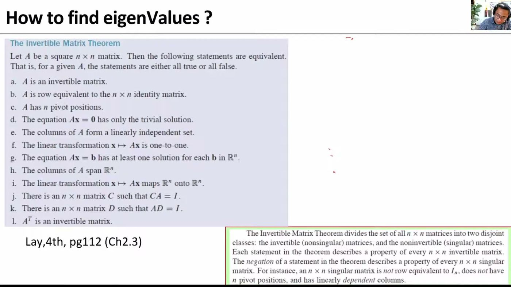

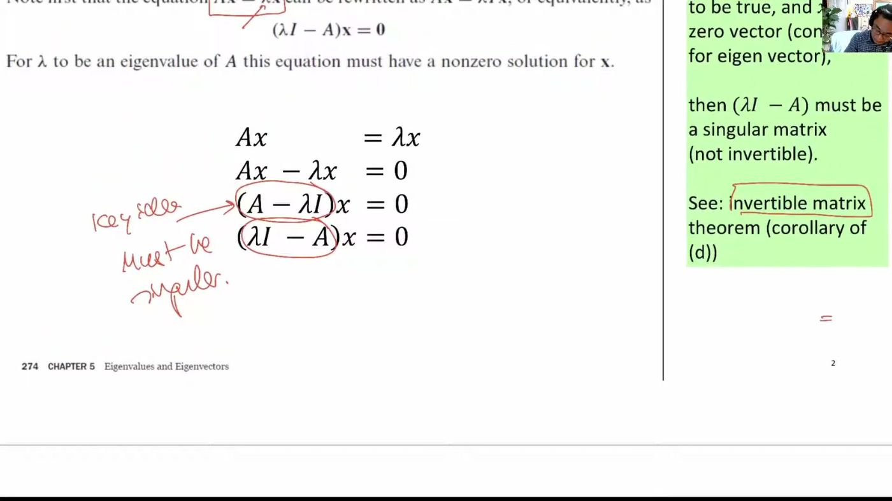

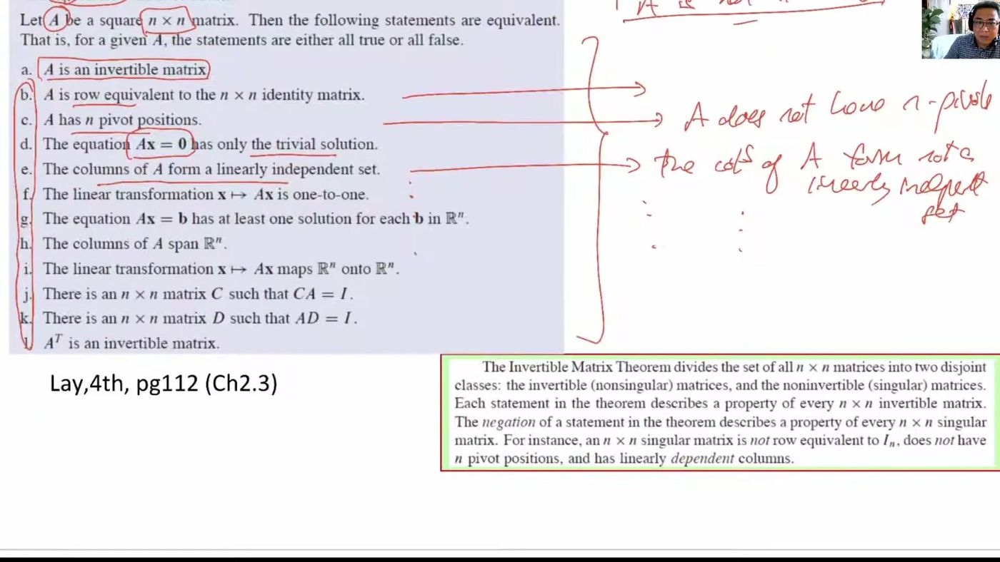

**Frames without a deck page:** the screen shows reference material (web page, video, or handwritten annotation) — the narration below explains what is being discussed.

> 🎙️ **Narration:** *"matrix to be considered and here the word A is any square matrix so we are actually thinking that this is that little A we are talking about okay so don't become confused so this matrix this whole matrix here is A in this discussion alright this matrix is square because A was square lambda times I and i is an n by n matrix is still square so a minus lambda i is still a square n by n matrix and the invertible matrix theorem says this if we claim that a is invertible then all this is also true equivalent statements so if we say that a is invertible then a is row equivalent it has n pverts, a x equals to 0 only has the trivial solution columns of a forms linearly independent set and so on. Alright so what about if we say that a is not invertible then when we say a is not invertible then what we are saying is that we're going to say a lot of this statement the negation of this statement we say that maybe this is more clear, A does not have n pivots, the columns of A forms not a linearly independent set and so on and so forth. So it's a negation of all these statements. We are interested in these matrix being not invertible. Okay because remember in the past we want this matrix A minus lambda I, lambda I minus A to be not invertible. Okay now among the properties that are most interesting is number E. The columns of A forms a linearly independent set for invertible matrix or in another words for not invertible matrix the columns of A must not form a linearly independent set."*

---

### 🎬 Slide 6 — How to find eigenValues? 2 𝐴𝐴𝐴𝐴 = 𝜆𝜆𝐴𝐴 𝐴𝐴𝐴𝐴 − 𝜆𝜆𝐴𝐴 = 0 𝐴𝐴 − 𝜆𝜆𝜆𝜆 𝐴𝐴 = 0 𝜆𝜆𝜆𝜆 − 𝐴𝐴 𝐴𝐴 = 0 For the above equatio

**Deck page — 8.1.2_CharacteristicEqn.pdf, p. 2:**

> How to find eigenValues? 2 𝐴𝐴𝐴𝐴 = 𝜆𝜆𝐴𝐴 𝐴𝐴𝐴𝐴 − 𝜆𝜆𝐴𝐴 = 0 𝐴𝐴 − 𝜆𝜆𝜆𝜆 𝐴𝐴 = 0 𝜆𝜆𝜆𝜆 − 𝐴𝐴 𝐴𝐴 = 0 For the above equation to be true, and 𝐴𝐴 not a zero vector (condition for eigen vector), then (𝜆𝜆𝜆𝜆 − 𝐴𝐴) must be a singular matrix (not invertible). See: invertible matrix theorem (corollary of (d))

> 🎙️ **Narration:** *"Additionally there's a theorem which we have not introduced yet, we'll introduce it now, for matrix to be invertible, another of the property is this, the determinant of the matrix must not be equals to zero. Implying if a matrix is not invertible, then the determinant of a must be equals to zero, that's the negation. Okay, now we're going to use this property explicitly, clearly to help us solve the argon value problem in a minus lambda i. As I've pointed out, as we've seen, to solve for this a minus lambda i times x equals to zero require us to know lambda and x. There's two unknowns and we have to find one unknown then we can solve their unknown but since you have two unknowns you cannot solve for it. However, if we use this clever idea of determinant of a equals to zero what we then do is to allow us to reduce the problem to one of only Argon value. Let us see how this clever idea works in practice. Alright, first let's review the determinant of a 2 by 2 matrix."*

---

### 🎬 Slides 7–8 — On-screen reference / annotated frames

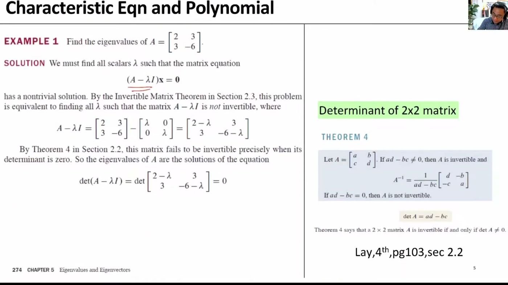

**Frames without a deck page:** the screen shows reference material (web page, video, or handwritten annotation) — the narration below explains what is being discussed.

> 🎙️ **Narration:** *"First, a matrix A consisting of four elements, A, B, C, D has the determinant as a times d minus b times c. This is what we know. Now when the determinant is 0 then 1 over 0 is infinity so the inverse does not exist. So the determinant of a 2 by 2 is 80 minus bc. Now remember we want to reduce the determinant of a minus lambda i to be equals to 0. So let's start with a if s we have a here and then we are going to find we're going to write our usual equation to solve a minus lambda i times x equals to zero and we want to say that it must have a non-trivial solution x must be not zero therefore a minus lambda i is singular and when we say singular means it's not invertible Therefore, I want to solve for a minus lambda i. So this is a here and lambda i is nothing but the diagonal elements of this matrix being lambda and we can now have 2 minus lambda is 2 minus lambda here, 3 remains as 3, 3 remains as 3 minus 6 minus lambda is that element. apply this equation the determinant of a 2 by 2 matrix is 2 minus lambda multiplied by minus 6 minus lambda minus 3 by 3 and this is equals to the determinant of a minus lambda i. Now you open it up let's see when we open it up you'll get this equation here so you can work out the math collect all the polynomials together you'll get this equation this is a polynomial it has a"*

---

### 🎬 Slides 9–10 — Determinant and Invertibility Lay, pg171 (Ch3.2) Since 𝐴𝐴 − 𝜆𝜆𝜆𝜆 is a singular matrix (NOT invertible), theref

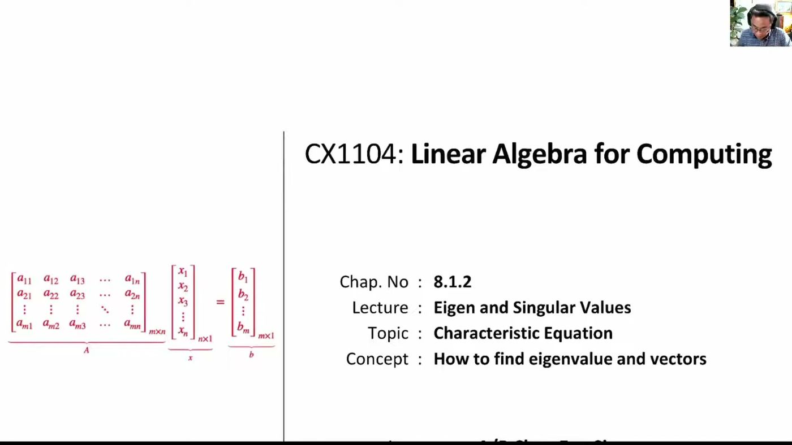

**Deck page — 8.1.2_CharacteristicEqn.pdf, p. 4:**

> Determinant and Invertibility Lay, pg171 (Ch3.2) Since 𝐴𝐴 − 𝜆𝜆𝜆𝜆 is a singular matrix (NOT invertible), therefore det 𝐴𝐴 − 𝜆𝜆𝜆𝜆 = 0 Clever idea: The determinant transforms the original problem of 𝐴𝐴 − 𝜆𝜆𝜆𝜆 𝐴𝐴 = 0, an equation with two unknowns 𝜆𝜆, 𝐴𝐴 into a polynomial with only 1 unknown 𝜆𝜆. Allowing us to solve first for the eigen value 𝜆𝜆, the roots of the polynomial. The polynomial is called the “characteristic equation”of A. 4

> 🎙️ **Narration:** *(transition frames — the explanation continues on the next slide)*

---

### 🎬 Slides 11–14 — On-screen reference / annotated frames

**Frames without a deck page:** the screen shows reference material (web page, video, or handwritten annotation) — the narration below explains what is being discussed.

> 🎙️ **Narration:** *(transition frames — the explanation continues on the next slide)*

---

### 🎬 Slide 15 — CX1104: Linear Algebra for Computing Instructor: A/P Chng Eng Siong TAs: Zhang Su, Vishal Choudhari Rev: 3rd J

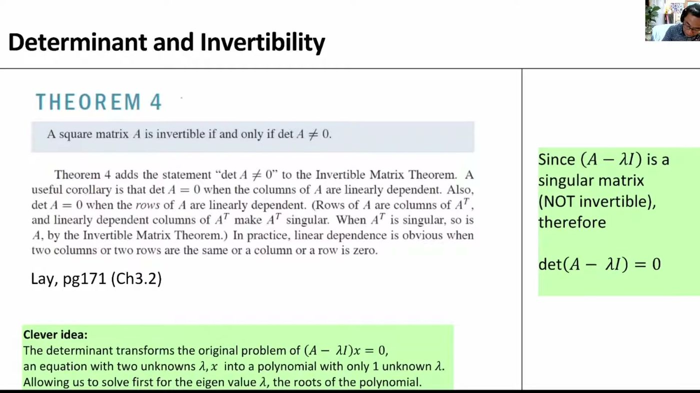

**Deck page — 8.1.2_CharacteristicEqn.pdf, p. 1:**

> CX1104: Linear Algebra for Computing Instructor: A/P Chng Eng Siong TAs: Zhang Su, Vishal Choudhari Rev: 3rd July 2020 Chap. No : 8.1.2 Lecture : Eigen and Singular Values Topic : Characteristic Equation Concept : How to find eigenvalue and vectors 1

> 🎙️ **Narration:** *(transition frames — the explanation continues on the next slide)*

---

### 🎬 Slide 16 — How to find eigenValues? 2 𝐴𝐴𝐴𝐴 = 𝜆𝜆𝐴𝐴 𝐴𝐴𝐴𝐴 − 𝜆𝜆𝐴𝐴 = 0 𝐴𝐴 − 𝜆𝜆𝜆𝜆 𝐴𝐴 = 0 𝜆𝜆𝜆𝜆 − 𝐴𝐴 𝐴𝐴 = 0 For the above equatio

**Deck page — 8.1.2_CharacteristicEqn.pdf, p. 2:**

> How to find eigenValues? 2 𝐴𝐴𝐴𝐴 = 𝜆𝜆𝐴𝐴 𝐴𝐴𝐴𝐴 − 𝜆𝜆𝐴𝐴 = 0 𝐴𝐴 − 𝜆𝜆𝜆𝜆 𝐴𝐴 = 0 𝜆𝜆𝜆𝜆 − 𝐴𝐴 𝐴𝐴 = 0 For the above equation to be true, and 𝐴𝐴 not a zero vector (condition for eigen vector), then (𝜆𝜆𝜆𝜆 − 𝐴𝐴) must be a singular matrix (not invertible). See: invertible matrix theorem (corollary of (d))

> 🎙️ **Narration:** *(transition frames — the explanation continues on the next slide)*

---

### 🎬 Slides 17–19 — On-screen reference / annotated frames

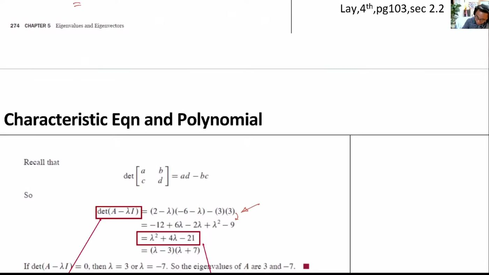

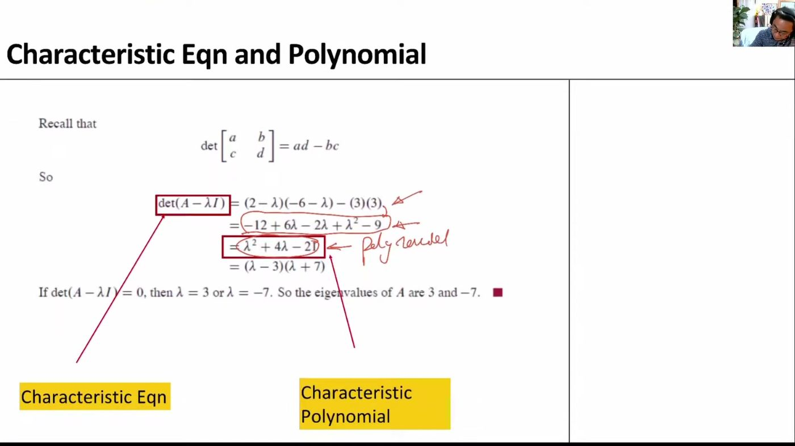

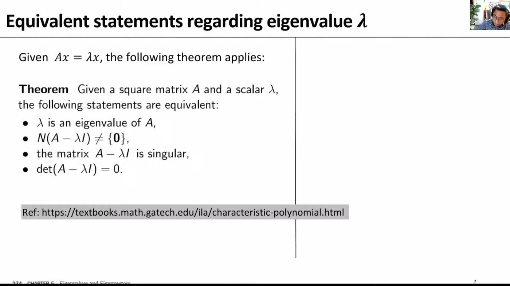

**Frames without a deck page:** the screen shows reference material (web page, video, or handwritten annotation) — the narration below explains what is being discussed.

> 🎙️ **Narration:** *"special name it's called a characteristic polynomial and it should be equals to zero because that's what we are claiming we're claiming that this matrix is not invertible therefore it's determinant must be equals to zero Now we have a polynomial of second degree second order equals to zero we can solve for it and we found that we factorize it lambda can be equals to three or lambda can be equals to minus seven showing us that these are the two eigen values of a okay there are some names that you must remember the this is called the characteristic polynomial which is on the variable lambda the eigen values to the power of n where n is the dimension of the n by n in this case is 2 and now you also see that the number of eigen values will be equals to the number of roots and since it's a second order there will be two roots. This equation also have a name is called the characteristic equation is the determinant of a minus lambda i. Alright with that, this is the first step. We show how we use the characteristic equation to solve for the argon value. In this slide we will examine equivalent statements regarding Argan values and actually also Argan vectors x. Now if this is true, Ax equals to lambda x and then there are lambda and there are x that satisfy this equation, then the following four statements are equivalent. if we say lambda is an argon value of A, then what we are also saying is that A minus lambda I will become a singular matrix. Its determinant is equals to zero. So this was what we have seen it as we applied the characteristic equation. So this was what we have applied. A minus lambda I is singular. Now when we know that a minus lambda i is singular then a minus lambda i multiplied by x can be zero for non-zero vector x. It means that the null space, so remember the null space is this matrix multiplied by some x will be equals to zero. So it says the null space does not only contain the zero vector it contains something else. Finally when this is all true then lambda of course is an argon value of a and we should say x is an argon vector of a. Okay so so all these statements are related and you should actually switch between them in your understanding. Now we'll go through"*

---

### 🎬 Slide 20 — How to find eigenValues? 2 𝐴𝐴𝐴𝐴 = 𝜆𝜆𝐴𝐴 𝐴𝐴𝐴𝐴 − 𝜆𝜆𝐴𝐴 = 0 𝐴𝐴 − 𝜆𝜆𝜆𝜆 𝐴𝐴 = 0 𝜆𝜆𝜆𝜆 − 𝐴𝐴 𝐴𝐴 = 0 For the above equatio

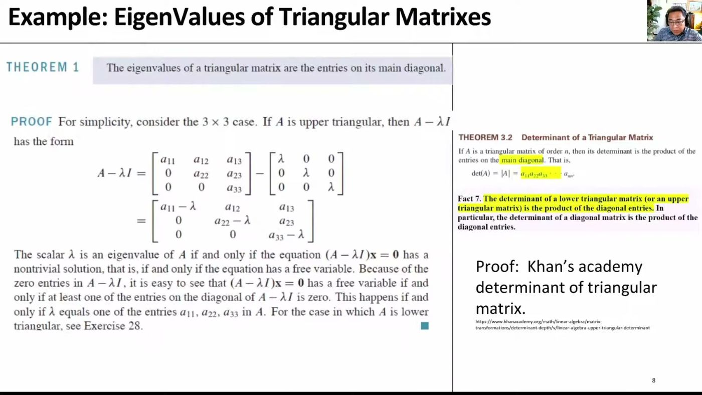

**Deck page — 8.1.2_CharacteristicEqn.pdf, p. 2:**

> How to find eigenValues? 2 𝐴𝐴𝐴𝐴 = 𝜆𝜆𝐴𝐴 𝐴𝐴𝐴𝐴 − 𝜆𝜆𝐴𝐴 = 0 𝐴𝐴 − 𝜆𝜆𝜆𝜆 𝐴𝐴 = 0 𝜆𝜆𝜆𝜆 − 𝐴𝐴 𝐴𝐴 = 0 For the above equation to be true, and 𝐴𝐴 not a zero vector (condition for eigen vector), then (𝜆𝜆𝜆𝜆 − 𝐴𝐴) must be a singular matrix (not invertible). See: invertible matrix theorem (corollary of (d))

> 🎙️ **Narration:** *"some examples we're interested in A being a triangular matrix and when we have a triangular matrix then we have very interesting properties for the determinant the determinant of a triangular matrix so now let's consider a triangular matrix like this or like this it means this is the upper triangle and here's the lower triangle means only these values are non-zero or in upper triangle only the upper"*

---

### 🎬 Slides 21–22 — On-screen reference / annotated frames

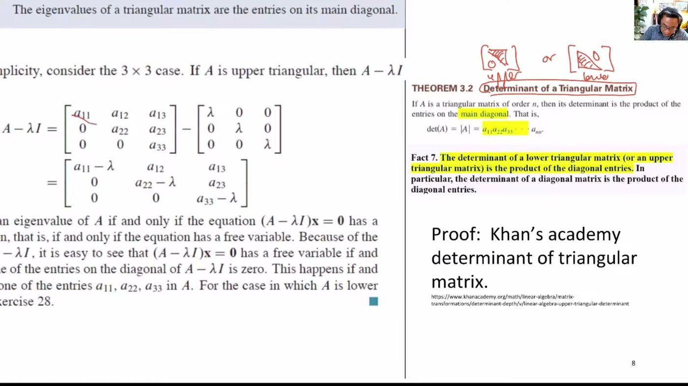

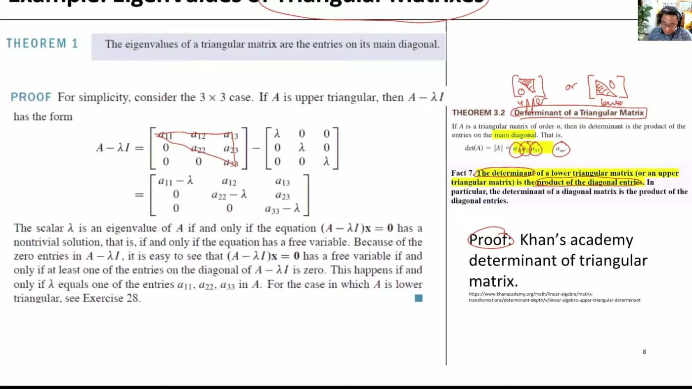

**Frames without a deck page:** the screen shows reference material (web page, video, or handwritten annotation) — the narration below explains what is being discussed.

> 🎙️ **Narration:** *"side are non-zero. So in this example, these are the upper triangle matrix. Now when we have an upper triangle or lower triangle matrix, the determinant is very interesting. It is nothing but the product of the diagonal entries. And you can see the proof here in the Khan Academy, basically because of this structure, then the determinant is simply a11 multiplied by a22 multiplied by a33 up to a and n. So the determinant is very simple, it's very simple to calculate for upper or lower triangular matrix. So what does it do for us when we are dealing with this for Argan value Argan vector? Right, let's try. Now if a is upper triangle and we have lambda i here and in this case it's a 3 by 3 matrix then we will realize that we just get e11 minus lambda, e12 remains the same, e13 remains the same. The other one is e22 minus lambda, e23 remains the same, e33 minus lambda for the last element. This is still an upper triangle matrix. It's determinant is the diagonal elements multiplying by each other. So the determinant of a minus lambda i is equals to a11 minus lambda 1, or I should say lambda, and a22 minus lambda multiplied by a33 minus lambda. Now if this is the determinant, then obviously it really reveals that all the Argan value is a11 lambda equals to a22 lambda equals to a33 because all you need to do is substitute a11 as lambda and you get this first factor as 0 and then of course the determinant will be equals to 0. So the triangle matrix is a very nice matrix to work with when it's given to us and the determinant is this and the argon value is also the diagonal element. So"*

---

### 🎬 Slides 23–24 — Determinant and Invertibility Lay, pg171 (Ch3.2) Since 𝐴𝐴 − 𝜆𝜆𝜆𝜆 is a singular matrix (NOT invertible), theref

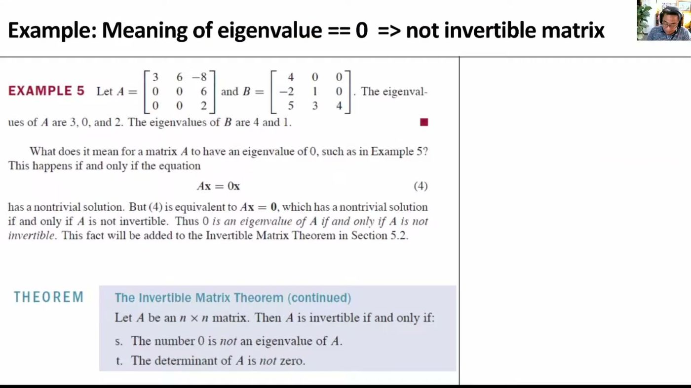

**Deck page — 8.1.2_CharacteristicEqn.pdf, p. 4:**

> Determinant and Invertibility Lay, pg171 (Ch3.2) Since 𝐴𝐴 − 𝜆𝜆𝜆𝜆 is a singular matrix (NOT invertible), therefore det 𝐴𝐴 − 𝜆𝜆𝜆𝜆 = 0 Clever idea: The determinant transforms the original problem of 𝐴𝐴 − 𝜆𝜆𝜆𝜆 𝐴𝐴 = 0, an equation with two unknowns 𝜆𝜆, 𝐴𝐴 into a polynomial with only 1 unknown 𝜆𝜆. Allowing us to solve first for the eigen value 𝜆𝜆, the roots of the polynomial. The polynomial is called the “characteristic equation”of A. 4

> 🎙️ **Narration:** *(transition frames — the explanation continues on the next slide)*

---

### 🎬 Slides 25–28 — On-screen reference / annotated frames

**Frames without a deck page:** the screen shows reference material (web page, video, or handwritten annotation) — the narration below explains what is being discussed.

> 🎙️ **Narration:** *"let's have some examples now we have a upper triangle matrix in A, lower triangle matrix in B and of course from the previous theorem we know that the the argon value of other diagonal elements so this is it for A, the argon values are 302 nothing to compute and this guy is 414 so we don't say 4 comma 4 comma 1 we just say 4 is repeated twice and one so it has only two argon values 4 and 1 now what's also interesting when we have an argon value equals to 0 is this Therefore the determinant of A is 0 because the determinant of A is the dagger elements multiplied by each other so 3 times 0 times 2 is 0 so it implies that when you have an argon value of 0 then the matrix A is actually also not invertible. Okay so maybe the statement here I should repeat when 0 is an eigenvalue of A, it means that A is not invertible. Okay, so we have added some additional statements in the invertible matrix theorem. For matrix to be invertible, 0 is not an eigenvalue of A, the determinant of A is not 0. We have added these two statements to it."*

---

### 🎬 Slide 29 — Equivalent statements regarding eigenvalue 𝝀𝝀 7 Given 𝐴𝐴𝐴𝐴 = 𝜆𝜆𝐴𝐴, the following theorem applies:

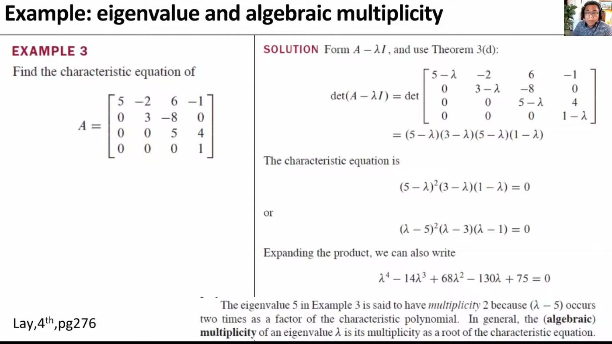

**Deck page — 8.1.2_CharacteristicEqn.pdf, p. 7:**

> Equivalent statements regarding eigenvalue 𝝀𝝀 7 Given 𝐴𝐴𝐴𝐴 = 𝜆𝜆𝐴𝐴, the following theorem applies: Ref: https://textbooks.math.gatech.edu/ila/characteristic-polynomial.html

> 🎙️ **Narration:** *"We now continue with example 3. In this example again we are given a upper triangle matrix and then as we remember the diagonal elements are the argon values. So very quickly we could form a-lambda i and observe that the product of the determinant, sorry the product of these elements along the diagonal is this, which is the determinant of a minus lambda i, directly showing us that 5, 3, 5 and 1 are the eigenvalues. We can then write the characteristic equation very quickly, collecting 5 minus lambda to be squared because there are two eigenvalues that is equals to 5, 3 minus lambda as well as 1 minus lambda. Now that 2 there, power of 2 shows us that the Argan value 5 has occurred twice in this characteristic equation and we call this phenomena multiplicity. The Argan value 5 has multiplicity 2 or in other words is repeated twice and this is called the algebraic multiplicity of the argon value lambda. The word algebraic occurs because we are dealing with this polynomial and this is argon value repeated twice is revealed from this equation. Later on we will also encounter something called geometric multiplicity of the argon vector and tackle this then. So in this slide, we introduce the new term something called algebraic multiplicity of the argon value which is used to indicate the number of times this argon value repeats in the characteristic equation. Now let's continue"*

---

### 🎬 Slide 30 — On-screen reference / annotated frames

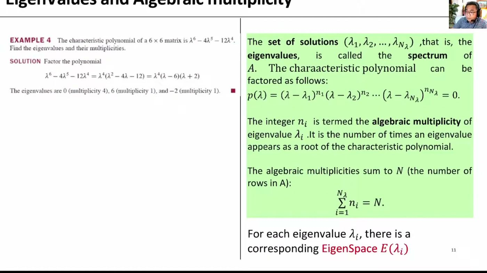

**Frames without a deck page:** the screen shows reference material (web page, video, or handwritten annotation) — the narration below explains what is being discussed.

> 🎙️ **Narration:** *"with another example in this example the matrix A is a 6 by 6 matrix and the"*

---

### 🎬 Slide 31 — Example: EigenValuesof Triangular Matrixes 8 Proof: Khan’s academy determinant of triangular matrix. https://w

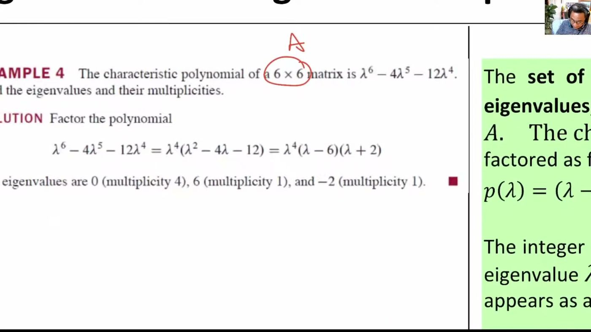

**Deck page — 8.1.2_CharacteristicEqn.pdf, p. 8:**

> Example: EigenValuesof Triangular Matrixes 8 Proof: Khan’s academy determinant of triangular matrix. https://www.khanacademy.org/math/linear-algebra/matrix- transformations/determinant-depth/v/linear-algebra-upper-triangular-determinant

> 🎙️ **Narration:** *"characteristic polynomial is given to us and then it asks us to find the"*

---

### 🎬 Slides 32–34 — On-screen reference / annotated frames

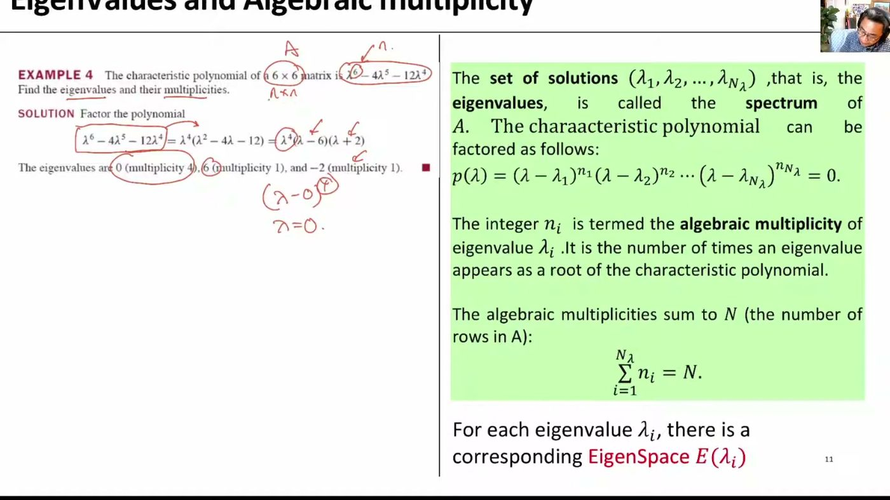

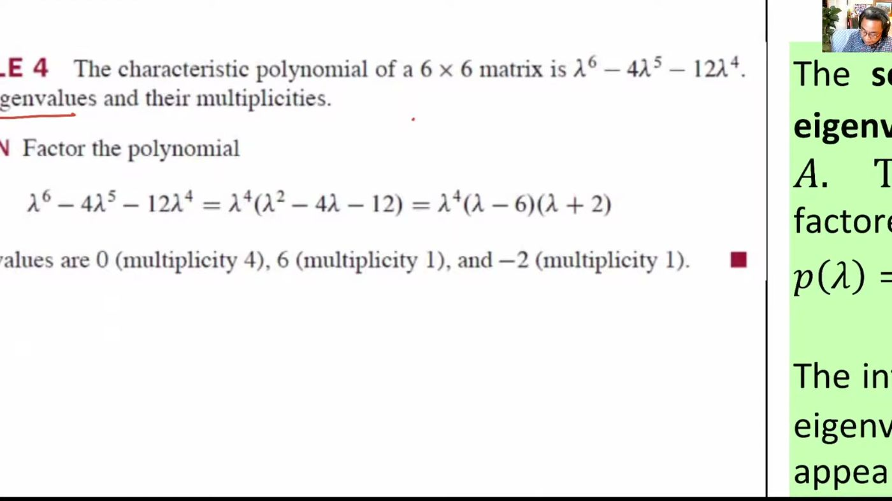

**Frames without a deck page:** the screen shows reference material (web page, video, or handwritten annotation) — the narration below explains what is being discussed.

> 🎙️ **Narration:** *"eigenvalues and their multiplicity. So something interesting if we have a n by n the highest power is n and in a polynomial with n degree there will be the n roots and the n roots can be real values or complex value but there will be n roots. That's the fundamental theorem of algebra. Right, so once we have the characteristic polynomial to find the argon value, the idea of course then is simply to factor it out such that we can see the factorization so that now when we have this factorization for example if we substitute lambda equals to 6, then this term becomes 0 and the whole characteristic polynomial equals to 0. So we realize that lambda equals to 6 is an eigenvalue, lambda equals to minus 2 is an eigenvalue, and lambda equals to 0 are also eigenvalue. Now talk about multiplicity. Lambda to the of 4, it also means lambda minus 0 4, it also means that lambda equals to 0 is an argon value and it's repeated four times. So the multiplicity of argon value equals to 0 is 4, the multiplicity at argon value equals to 6 is only 1, lambda equals to minus 2 is only 1. Okay so this is a practice of multiplicity and getting the argon values from the characteristic polynomial. Alright let's turn our attention to the right hand side now. The solutions of the Argan value is sometimes also called the spectrum of A. Okay so when we say find a spectrum of A, we are actually asking you to find the Argan values of A. The characteristic polynomial can be factor in this form. So if we have the characteristic polynomial, then to find the Argan values, normally we factor in this so that we can identify that lambda equals to lambda 1, lambda equals to lambda 2, lambda equals to lambda n lambda, and the power here will tell us the multiplicity. Okay? What you'll realize is that if you add up all this power you'll be equals to n, where n is the n by n matrix, the dimension of the n by n matrix A. So if you look back at the previous example, the multiplicity is 4, 1 and one the sum is six and this six is the same and by n n equals to six here"*

---

### 🎬 Slide 35 — Equivalent statements regarding eigenvalue 𝝀𝝀 7 Given 𝐴𝐴𝐴𝐴 = 𝜆𝜆𝐴𝐴, the following theorem applies:

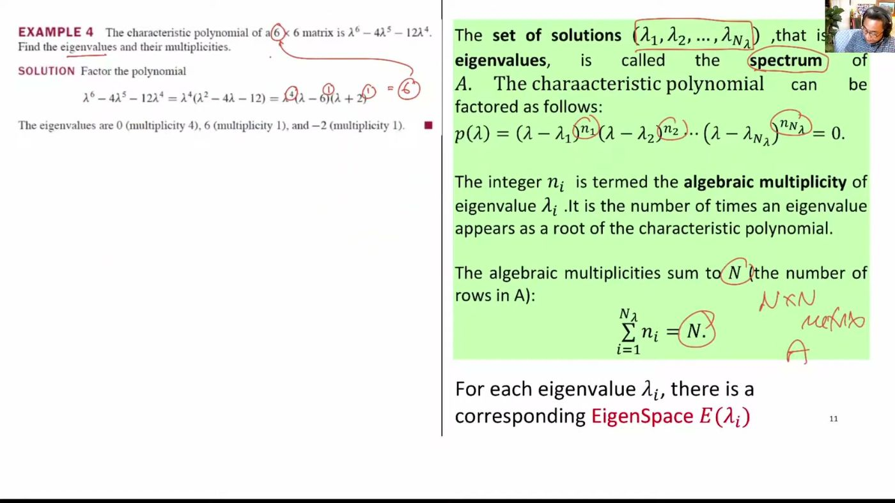

**Deck page — 8.1.2_CharacteristicEqn.pdf, p. 7:**

> Equivalent statements regarding eigenvalue 𝝀𝝀 7 Given 𝐴𝐴𝐴𝐴 = 𝜆𝜆𝐴𝐴, the following theorem applies: Ref: https://textbooks.math.gatech.edu/ila/characteristic-polynomial.html

> 🎙️ **Narration:** *"okay right they talk on in another few slides we'll talk about argon space so we'll wait for a while before we reach there now for practices I would"*

---

### 🎬 Slide 36 — On-screen reference / annotated frames

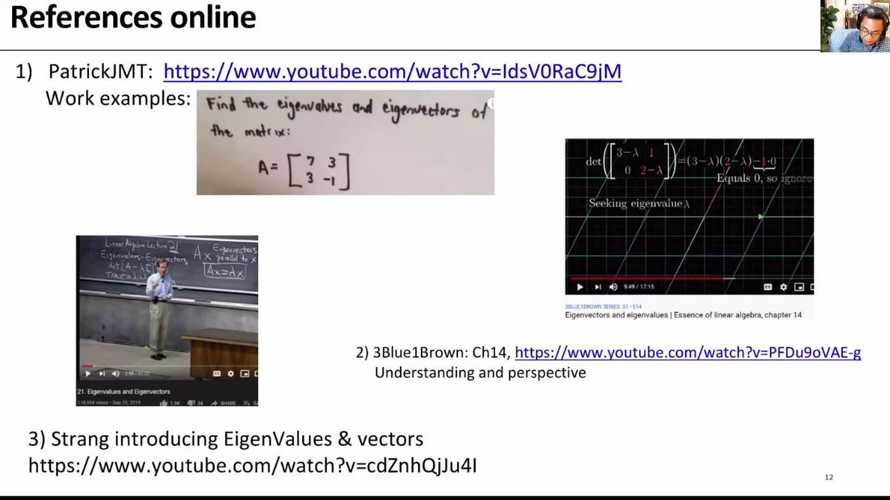

**Frames without a deck page:** the screen shows reference material (web page, video, or handwritten annotation) — the narration below explains what is being discussed.

> 🎙️ **Narration:** *"suggest you look at Patrick GMT this is the link for simple work examples of two by two matrices. You can also look at STRENG introducing the Argan value Argan vector problem and then for interesting understanding with a lot of pictures then I would suggest 3bru 1brow talking about Argan value and"*

---

### 🎬 Slide 37 — Example: EigenValuesof Triangular Matrixes 8 Proof: Khan’s academy determinant of triangular matrix. https://w

**Deck page — 8.1.2_CharacteristicEqn.pdf, p. 8:**

> Example: EigenValuesof Triangular Matrixes 8 Proof: Khan’s academy determinant of triangular matrix. https://www.khanacademy.org/math/linear-algebra/matrix- transformations/determinant-depth/v/linear-algebra-upper-triangular-determinant

> 🎙️ **Narration:** *(transition frames — the explanation continues on the next slide)*

---

### 🎬 Slides 38–41 — On-screen reference / annotated frames

**Frames without a deck page:** the screen shows reference material (web page, video, or handwritten annotation) — the narration below explains what is being discussed.

> 🎙️ **Narration:** *(transition frames — the explanation continues on the next slide)*

---

### 🎬 Slides 42–46 — EigenValuesand Algebraic multiplicity The set of solutions (𝜆𝜆1, 𝜆𝜆2, … , 𝜆𝜆𝑁𝑁𝜆𝜆 ) ,that is, the eigenvalues, 

**Deck page — 8.1.2_CharacteristicEqn.pdf, p. 11:**

> EigenValuesand Algebraic multiplicity The set of solutions (𝜆𝜆1, 𝜆𝜆2, … , 𝜆𝜆𝑁𝑁𝜆𝜆 ) ,that is, the eigenvalues, is called the spectrum of 𝐴𝐴. The charaacteristic polynomial can be factored as follows: 𝑝𝑝 𝜆𝜆 = 𝜆𝜆 − 𝜆𝜆1 𝑛𝑛1 𝜆𝜆 − 𝜆𝜆2 𝑛𝑛2 ⋯ 𝜆𝜆 − 𝜆𝜆𝑁𝑁𝜆𝜆 𝑛𝑛𝑁𝑁𝜆𝜆 = 0. The integer 𝑛𝑛𝑖𝑖 is termed the algebraic multiplicity of eigenvalue 𝜆𝜆𝑖𝑖 .It is the number of times an eigenvalue appears as a root of the characteristic polynomial. The algebraic multiplicities sum to 𝑁𝑁 (the number of rows in A): ∑ 𝑖𝑖=1 𝑁𝑁𝜆𝜆 𝑛𝑛𝑖𝑖 = 𝑁𝑁. For each eigenvalue 𝜆𝜆𝑖𝑖, there is a corresponding EigenSpace 𝐸𝐸(𝜆𝜆𝑖𝑖) 11

> 🎙️ **Narration:** *"Argan vector the perspective. There are also Chessnoff from teaching in Hong Kong. you also have a very good series again he go through very quickly the eigenvalue problem and the characteristic equation and the characteristic polynomial seeing with Brunton's lecture eigenvalue as well okay so these are excellent resources which you can use thank you"*

---
## V-8.1.3 — 8.1.3 Diagonalization

> **Videos (20):** `8.1.3, pg 1~2` … `pg 21~23` (99.1 min) — deck: `8.1.3_Diagonalization_Nov2022.pdf` (23 pages)
>
> *Repeated views of the same page are grouped; the fullest view is shown.*

### 🎬 Slide 1 — CX1104: Linear Algebra for Computing Instructor: A/P Chng Eng Siong TAs: Zhang Su, Vishal Choudhari Rev: 3rd J

**Deck page — 8.1.3_Diagonalization_Nov2022.pdf, p. 1:**

> CX1104: Linear Algebra for Computing Instructor: A/P Chng Eng Siong TAs: Zhang Su, Vishal Choudhari Rev: 3rd July 2020 Chap. No : 8.1.3 Lecture : Eigen and Singular Values Topic : Similarity and Diagonalization Concept : When can we represent 𝑨ൌ𝑷 𝑫 𝑷 ି𝟏 1 Last updated: 7Nov 2022

> 🎙️ **Narration:** *"Welcome to Cx1104 chapter 8.1.3 in this subsection. We will study similarity and diagonalization of a square matrix A. What do we mean? Similarity is the transforming A to a matrix, another matrix D through this transformation, PDP-1. we say that A and D are similar. So let's begin. Given a matrix A that is"*

---

### 🎬 Slide 2 — Similarity and Diagonalization 2 Given two nxn matrix A and P , and P is invertible ሺmeans it has n- independe

**Deck page — 8.1.3_Diagonalization_Nov2022.pdf, p. 2:**

> Similarity and Diagonalization 2 Given two nxn matrix A and P , and P is invertible ሺmeans it has n- independent columnሻ, then we can have a matrix B generated as follows: 𝑃ିଵ𝐴𝑃 ൌ 𝐵AP ൌ PB 𝐴 ൌ 𝑃𝐵𝑃ିଵ then we say that A and B are similar matrixes, and the transformation from A to B ൌ 𝑃ିଵ𝐴𝑃 is called similarity transformation. In the special case that B is a diagonal matrix, then we also say that A is diagonalizable! Wiki: insight See Lecture 8.1.5B

> 🎙️ **Narration:** *(transition frames — the explanation continues on the next slide)*

---

### 🎬 Slide 3 — CX1104: Linear Algebra for Computing Instructor: A/P Chng Eng Siong TAs: Zhang Su, Vishal Choudhari Rev: 3rd J

**Deck page — 8.1.3_Diagonalization_Nov2022.pdf, p. 1:**

> CX1104: Linear Algebra for Computing Instructor: A/P Chng Eng Siong TAs: Zhang Su, Vishal Choudhari Rev: 3rd July 2020 Chap. No : 8.1.3 Lecture : Eigen and Singular Values Topic : Similarity and Diagonalization Concept : When can we represent 𝑨ൌ𝑷 𝑫 𝑷 ି𝟏 1 Last updated: 7Nov 2022

> 🎙️ **Narration:** *(transition frames — the explanation continues on the next slide)*

---

### 🎬 Slide 4 — Similarity and Diagonalization 2 Given two nxn matrix A and P , and P is invertible ሺmeans it has n- independe

**Deck page — 8.1.3_Diagonalization_Nov2022.pdf, p. 2:**

> Similarity and Diagonalization 2 Given two nxn matrix A and P , and P is invertible ሺmeans it has n- independent columnሻ, then we can have a matrix B generated as follows: 𝑃ିଵ𝐴𝑃 ൌ 𝐵AP ൌ PB 𝐴 ൌ 𝑃𝐵𝑃ିଵ then we say that A and B are similar matrixes, and the transformation from A to B ൌ 𝑃ିଵ𝐴𝑃 is called similarity transformation. In the special case that B is a diagonal matrix, then we also say that A is diagonalizable! Wiki: insight See Lecture 8.1.5B

> 🎙️ **Narration:** *"square, given a matrix P that is also square, additionally it must be invertible, then a matrix B can be generated from A to B through this process. What do we mean? Well we take A, we We pose multiply by P and square matrix. And as long as P minus one exists, we can also find P minus one. We pre multiply by P minus one and we will get a matrix B. This process is called similarity transformation. We like similarity transformation because the matrix A and the matrix B have similar properties. So the word similarity is because after this transformation, this process, the matrix B that comes out, still have similar properties to A. Most interestingly, if B is a diagonal matrix, when B is a diagonal matrix, and typically we use the term D as a diagonal matrix, Then we say that matrix A is diagonalizable through this transformation, similarity transformation. Why are we interested in converting A to a diagonal matrix through this diagonalization process? It is because diagonal matrix can be studied very easily and have very very simple properties which we can very quickly find out. We'll come to that in the next page. Additionally, before we go there, we say that similar matrices A and B in this example represents the same linear map, or in other words, same linear transformation under different basis P. okay so we'll come to that again in 8.1.5p"*

---

### 🎬 Slides 5–10 — On-screen reference / annotated frames

**Frames without a deck page:** the screen shows reference material (web page, video, or handwritten annotation) — the narration below explains what is being discussed.

> 🎙️ **Narration:** *"Now when we can convert a matrix A to a matrix B through similarity transformation, then both matrices A and B share the same certain characteristics. And these characteristics to preserve through similarity transformation is called similarity invariant. These properties are invariant. Or we can say A, in other words, the properties are invariant under similarity transformation. So what are the similarity invariant properties? They are the determinant of A and the determinant of B through this similarity transformation. That means we have P minus 1, A, P equals to B. Then matrices A and matrices B have the same determinant. If A is invertible then B is also invertible. So you think of this as B. What else? The rank of A is the rank of B. The nullity of A is the nullity of B. Remember nullity is a number, the dimension of the null space of A. Here is just a number. How many dimension in the null space. So the number of dimension in null space of A is the same as the null space of B. The trace are the same. The characteristic polynomials are the same. Even the Argan values are the same. Lastly, the Argan vectors are not the same but the Argan space dimension are the same. So you realize that if we are studying we have A and we can convert it to B, then B has so much similar properties to A that if B is a very simple matrix, then many things can be revealed. So the simplest matrix that we can ever find, or one of the simplest, is the diagonal matrix because a diagonal matrix has very nice way to compute its rank, its invertibility, its determinant, its trace, its eigenvalues. Okay? So why do we like a matrix to be similar to a diagonal matrix?"*

---

### 🎬 Slide 11 — We like a matrix to be similar to a diagonal matrix 4 Why we like diagonal matrix? Diagonal matrixes have nice

**Deck page — 8.1.3_Diagonalization_Nov2022.pdf, p. 4:**

> We like a matrix to be similar to a diagonal matrix 4 Why we like diagonal matrix? Diagonal matrixes have nice properties: 1) Eigenvalues of diagonal matrixes are its diagonal element 2) Determinant == product of diagonal entries 3) Rank == number of non‐zero entries in the diagonal 4) Multiplication: given A and diagonal matrix D (AD and DA): 5) A diagonal matrix’s inverse is reciprocal of diagonal elements 6) Product of diagonal matrixes are easy to compute. Ref: 1) https://www.statlect.com/matrix‐algebra/diagonal‐matrix 2) http://www.robertosmathnotes.com/uploads/8/2/3/9/8239617/la10‐3_diagonal_matrices.pdf

> 🎙️ **Narration:** *(transition frames — the explanation continues on the next slide)*

---

### 🎬 Slides 12–17 — On-screen reference / annotated frames

**Frames without a deck page:** the screen shows reference material (web page, video, or handwritten annotation) — the narration below explains what is being discussed.

> 🎙️ **Narration:** *"are the two nodes that you can find more details. I have summarized them. The first is that the eigenvalues of a diagonal matrix are simply the diagonal elements. We have seen that in the past lecture. The determinant is simply the product of the diagonal entries. So very quickly we can determine the product, sorry, we can determine the determinant value of the matrix. The rank is the number of non-zero entries in the diagonal. We can count very quickly what is the rank of a matrix D. Additionally, the matrix multiplication of A times D and D times A, in here the A is any matrix okay, not the A we're talking about just now. A times D and D times A is when we pre-multiply A by a diagonal matrix D, so that means it's D times A, then what we are doing is we are multiplying the rows of A with the elements of D. Post-multiply means A times D. This will be useful. The columns of A are multiplied with the diagonal elements of D. So you'll see that later on. Now, the diagonal matrix inverse is also very simple. simply the reciprocal of the diagonal elements and if we have diagonal matrices multiplying with each other especially d times d equals to d square then it is simply the diagonal elements square so we also come to that so we like diagonal matrices very much So now we want to answer when is a diagonalizable? That means a can be converted to a matrix d that is a diagonal matrix through p-1, a, p such that d is a diagonal matrix. In this theorem 5 in Leigh's book, he says that a is diagonalizable only when a has n n linearly independent argon vectors and these argon vectors are put in the matrix P. So we have v1, v2 until vn where each of these v1 to vn are independent argon vectors of A, where A is an n by n matrix. Now if you have these v1 and v2 as argon vectors then for sure d would be lambda 1, lambda 2, lambda n, where these are the eigenvalues. So now this relates eigenvalues, eigenvectors to the concept of diagonalization. In the past few lectures, we have also found that sometimes a does not have n independent eigenvectors. So we now realize that a can be diagonalized to d only when it has n independent argon vectors, precisely because we need p-1 to exist. We can view up the columns of p but if p does not have enough or n independent argon vectors or n columns, then p-1 will not be able to be evaluated because p-1 exists only when p is invertible and p is invertible only when it has n independent columns and in this case they must be argon vectors. Okay now in another words we need p to be a basis of rn because we need it to be n dimension because a is a n by n matrix and we need p to be a basis meaning it has to have n independent vectors to span the space of n We will now discuss some proof why A times the eigenvectors contained in P matrix will produce diagonalization. Alright, first let's assume that P is invertible. applying that p-1 axis and what we will have is that we have ap times p-1 is equals to a matrix B let's say and when we have p on the left hand side to pre-multiply both we'll have ap equals to pB. Now if p contains Argan vectors for example we have called it as v1 v2 and they are distinct and independent Argan vectors then what we will get instead of the B matrix any B matrix we will get PD where D is a diagonal matrix of Argan values so this is lambda1, lambda2 and lambdan. Why is this so? Well we begin with ap and p"*

---

### 🎬 Slide 18 — We like a matrix to be similar to a diagonal matrix 4 Why we like diagonal matrix? Diagonal matrixes have nice

**Deck page — 8.1.3_Diagonalization_Nov2022.pdf, p. 4:**

> We like a matrix to be similar to a diagonal matrix 4 Why we like diagonal matrix? Diagonal matrixes have nice properties: 1) Eigenvalues of diagonal matrixes are its diagonal element 2) Determinant == product of diagonal entries 3) Rank == number of non‐zero entries in the diagonal 4) Multiplication: given A and diagonal matrix D (AD and DA): 5) A diagonal matrix’s inverse is reciprocal of diagonal elements 6) Product of diagonal matrixes are easy to compute. Ref: 1) https://www.statlect.com/matrix‐algebra/diagonal‐matrix 2) http://www.robertosmathnotes.com/uploads/8/2/3/9/8239617/la10‐3_diagonal_matrices.pdf

> 🎙️ **Narration:** *(transition frames — the explanation continues on the next slide)*

---

### 🎬 Slide 19 — When is A Diagonalizable? 5 Lay, pg 282, Ch 5.3 Special case of similarity, B is D (a diagonal matrix).

**Deck page — 8.1.3_Diagonalization_Nov2022.pdf, p. 5:**

> When is A Diagonalizable? 5 Lay, pg 282, Ch 5.3 Special case of similarity, B is D (a diagonal matrix). Ref:https://textbooks.math.gatech.edu/ila/similarity.html

> 🎙️ **Narration:** *"contains v1 to vn where they are eigenvectors of A and they are n independent of them and therefore we call it a basis because there are enough eigenvectors to form a basis for Rn. We need n of them and independent factors. Right, so we will multiply a multiply by p we can act a on v1 individually and this is a v1, this is a v2 and a vn. Remember that the for Argan vectors a times x equals to lambda times x only when x is an Argan vector. So v1 v2 are all argon vectors so we have a v1 therefore it must be equals to lambda 1 times v1. Now lambda 1 times v1 this guy is a constant it's a scalar and this guy is a vector of n. We can of course put it as here if this is v1, we can put it as lambda1, a constant multiplied by v1, or we can put v1 multiplied by a constant is the same. Or individual entries of it will be lambda1, v1, 1, lambda1, v1, 2 and so on. Okay? Or should I put it? Well, we just simply the elements of V1. These are until the end element of V1. What about A V2? Well, A V2 again is lambda 2 V2 or V2 times lambda 2. Again, lambda 2 is the Argan value. value corresponding to the second eigenvector. What it means is that if we... I'll just put it this way. Now when you want to write it as columns, and you want to relate it to p and d matrix, it is simply the columns of p, which are the argon vector, poles multiply right hand side, multiply by d, because do it by yourself. Columns of p here will be scaled by the diagonal elements of d to get these matrix over here. Okay? So what we are saying is that column vector v1 v2 multiply, post multiply by d11 d22 all the rest are 0. We'll be equal to, you look at this post multiplication. The first column of p will be affected only by D11, so this D11 multiplied by V1. The second column of P which is V2 only be affected by D22, so it's D22 V2 and so on and so forth until the last column. So that is why we are now saying that this guy P times D is equals to this representation. This reveals that if P is the Argan vectors arranged as column, then similarity transform of A will generate a matrix D that is a diagonal matrix and the entries are simply the Argan values. So this completes the proof."*

---

### 🎬 Slide 20 — On-screen reference / annotated frames

**Frames without a deck page:** the screen shows reference material (web page, video, or handwritten annotation) — the narration below explains what is being discussed.

> 🎙️ **Narration:** *"This is practice problem 2. We are given a 2 by 2 matrix A and we are given two Argan vectors of A. We are not told the Argan values, we are simply told the Argan vectors. Use this information to diagonalize A. To diagonalize A remember it must be P minus 1A P equals to D. So we need to find D. Well we have already been given P, we have been given A. Do we need to perform P minus 1? That's one way we can do it but we do it more simply by remembering that A times V1 is equals to lambda 1 times V1. A times V2 equals to lambda 2 times V2. We can quickly find what is lambda 1 and lambda 2 and we can put it in D which which is simply lambda 1, lambda 2 and 0 elsewhere. Okay, so that's the trick. So we compute A v1, we found that this is A, this is v1, giving us v1, therefore lambda 1 is equals to 1. A v2 is equals to this is A, this is v2, this is lambda 2 v2 showing us that lambda 2 is equal to 3 and now we can just simply form the matrix D is equal to 1, 3, 0 everywhere else. Okay, so this trick bypassed the computation of P. This is simple. We can actually do it both ways but this way is easier."*

---

### 🎬 Slide 21 — When is A Diagonalizable? 5 Lay, pg 282, Ch 5.3 Special case of similarity, B is D (a diagonal matrix).

**Deck page — 8.1.3_Diagonalization_Nov2022.pdf, p. 5:**

> When is A Diagonalizable? 5 Lay, pg 282, Ch 5.3 Special case of similarity, B is D (a diagonal matrix). Ref:https://textbooks.math.gatech.edu/ila/similarity.html

> 🎙️ **Narration:** *"Alright, let's have some sanity check. We have A here and to get MATLAB to perform"*

---

### 🎬 Slides 22–31 — On-screen reference / annotated frames

**Frames without a deck page:** the screen shows reference material (web page, video, or handwritten annotation) — the narration below explains what is being discussed.

> 🎙️ **Narration:** *"argon value decomposition, we send A into EIG, the function, and expecting two matrices, P and D. P is the argon vector, D is the argon value, and what happens is that we can get method to compute. So here's the answer. This is A, this is P, and this is D. So we see that we got D correct, 1 and 3. Now the Argan vectors are arranged this way. This is V1 corresponding to lambda 1. This is V2 corresponding to lambda 2. Now if you want to be very sure that there is no mistake what you might want to compare is that this should be exactly this guy and the second it should be this one so how do we know we are correct well let's examine v1 v1 is the direction 3 1 so if you now look at madlab solution this first element is three times a second element. About V2, the first element is two times the size of the first element. So it's two times the size of the first element. What about all these negative signs and things like that? It doesn't matter. Remember that Arkan vectors are pointing to one direction. Pointing to opposite direction is a negative. Arkan vectors are along these whole directions. And what about Y is mad lab producing all these funny values that are not so nice? is because the norm of these factors is equal to 1. So MATLAB actually compute the argon vectors and then normalize it so that's why you can get all these funny floating point numbers. But when you compute the norm, which is 1. Okay, now the second thing we have always been telling you is that this is a equals to p minus 1 d sorry we've been always telling you that this is the definition of similarity transform implying that a equals to pdp minus 1 so I put d here so I compute to make sure that I get the value so this is P1 which is what is given to us this is D1 and then we get the same value of A okay so so you just use my lab to do"*

---

### 🎬 Slides 32–33 — On-screen reference / annotated frames

**Frames without a deck page:** the screen shows reference material (web page, video, or handwritten annotation) — the narration below explains what is being discussed.

> 🎙️ **Narration:** *"this mechanical computation to see that your algebra is correct"*

---

### 🎬 Slide 34 — References Similar Matrixes A) Trefor Bazett: Similar matrices have similar properties Link: https://www.youtu

**Deck page — 8.1.3_Diagonalization_Nov2022.pdf, p. 23:**

> References Similar Matrixes A) Trefor Bazett: Similar matrices have similar properties Link: https://www.youtube.com/watch?v=jNtiENbAcFM B) MIT Strang: “Similar Matrixes” https://www.youtube.com/watch?v=TSdXJw83kyA https://www.youtube.com/watch?v=LKMGo8G7‐vk https://www.youtube.com/watch?v=KUuxdk_V7To C) Technion 1M : https://youtu.be/MJic8o5ph5M, https://youtu.be/l2BEIOnG54k D) Dan Yasaki https://youtu.be/ObTVoBQDBx8 E) Mathaholic: https://www.youtube.com/watch?v=H2pv1Rug0RQ Prof. Strang shows similar matrices 𝐴 and 𝐵 have the same eigenvalues in the first 3 minutes and works out some examples of similar matrices later! 23 Diagonalization: A) MIT Strang: “Diagonalizing a matrix” https://www.youtube.com/watch?v=U8R54zOTVLw B) MIT Strang: “Diagonalization and Powers of A” https://www.youtube.com/watch?v=13r9QY6cmjc Example: Time == 22:10 (triangular matrix and eigenvalues) Time == 24:00 (algebraic multiplicity==2, geometric multiplicity=1) ‐> not diagonalizable.

> 🎙️ **Narration:** *"Let us recap how to diagonalize a matrix of size n by n. To diagonalize a matrix A to a diagonal matrix D, perform the following. Find the eigenvalues of A for each of the eigenvalues of A. Find the corresponding eigenvector. And if there are n independent eigenvectors put them as p such that we have v1, v2, until vn. Now this p will be an n by n matrix because there are n eigenvectors and each eigenvectors are n. Now if they are independent then p-1 exists and when p-1 exists therefore p-1 times a times p will be equals to d where d is the diagonal matrix containing the corresponding argon values. Okay so the this following matrix multiplication will first review yA times P, A the matrix times its eigenvalues sorry, eigenvectors in columns will be represented as P times D and D of course will be each elements are along the diagonals are the eigenvalues okay and therefore similarity transform can be realized only when we have a complete set of basis and this set of basis must be the argon vectors. So now we turn our attention when can we"*

---

### 🎬 Slides 35–41 — On-screen reference / annotated frames

**Frames without a deck page:** the screen shows reference material (web page, video, or handwritten annotation) — the narration below explains what is being discussed.

> 🎙️ **Narration:** *"diagonalize matrix what is the sufficient condition. Well remember that in the previous slides if we have n distinct argon value each distinct argon value will produce a distinct argon vector so when we have an distinct eigenvector then the distinct eigenvectors will be independent and therefore when the matrix has n distinct eigenvalue then for sure we know that the matrix is diagonalizable. But this is a sufficient condition meaning that once we have shown that these eigenvalues are distinct for sure okay but it is not a necessary condition it means that if you do not have distinct Argan value maybe you still can have independent Argan vectors okay so this is a sufficient but not necessary condition all right so in the next few examples we will see this interesting phenomena but first let us prove this thing are good value means this thing are good vectors this thing are good vectors are independent therefore the matrix is diagonalizable alright so this is the proof we will not go through the proof we'll just remember to use this result. I should point out that here the word distinct or in fact I should say that this set of Argan factors correspond to distinct Argan values are linearly independent. So maybe you can go through this theorem 2 in page 270 of the fourth edition of Lay. This next two-page details given this proof. Now we jump straight to this example"*

---

### 🎬 Slide 42 — References Similar Matrixes A) Trefor Bazett: Similar matrices have similar properties Link: https://www.youtu

**Deck page — 8.1.3_Diagonalization_Nov2022.pdf, p. 23:**

> References Similar Matrixes A) Trefor Bazett: Similar matrices have similar properties Link: https://www.youtube.com/watch?v=jNtiENbAcFM B) MIT Strang: “Similar Matrixes” https://www.youtube.com/watch?v=TSdXJw83kyA https://www.youtube.com/watch?v=LKMGo8G7‐vk https://www.youtube.com/watch?v=KUuxdk_V7To C) Technion 1M : https://youtu.be/MJic8o5ph5M, https://youtu.be/l2BEIOnG54k D) Dan Yasaki https://youtu.be/ObTVoBQDBx8 E) Mathaholic: https://www.youtube.com/watch?v=H2pv1Rug0RQ Prof. Strang shows similar matrices 𝐴 and 𝐵 have the same eigenvalues in the first 3 minutes and works out some examples of similar matrices later! 23 Diagonalization: A) MIT Strang: “Diagonalizing a matrix” https://www.youtube.com/watch?v=U8R54zOTVLw B) MIT Strang: “Diagonalization and Powers of A” https://www.youtube.com/watch?v=13r9QY6cmjc Example: Time == 22:10 (triangular matrix and eigenvalues) Time == 24:00 (algebraic multiplicity==2, geometric multiplicity=1) ‐> not diagonalizable.

> 🎙️ **Narration:** *(transition frames — the explanation continues on the next slide)*

---

### 🎬 Slides 43–46 — On-screen reference / annotated frames

**Frames without a deck page:** the screen shows reference material (web page, video, or handwritten annotation) — the narration below explains what is being discussed.

> 🎙️ **Narration:** *"here where distinct Argon values shows that the matrix is diagonalizable. So this is an upper triangle matrix. So the upper triangle matrix and very nice to play with because the argon values are shown in the diagonal entries immediately. In this example, the argon values are 5, 0 and minus 2 since the theorem says that if they have distinct argon values, therefore they must have independent argon vectors and all three of them, therefore this matrix is diagonalizable. We are making use of the theorem of triangular matrix, the argon values of triangular matrix are the mean diagonal. Later on we will show that when the argon values are repeated, it is still possible to be diagonalizable but there are also examples to show that when the argon values are repeated they are not diagonalizable. times the multiplicity of the Argan values of one of the particular Argan value. So if we have for example the Argan value is 1, 1, let's say 2, 4, then the algebraic multiplicity of the Argan value is 2, in this case 4, Argan value 1. Here, algebraic multiplicity for the Argan value 2 is 1, here again 1. What about geometric multiplicity? Well, remember that associated with each argon vector, it is, sorry, associated with each argon value is an argon vector. So if the algebraic multiplicity is one, then there is only one argon vector for the argon value. But in this case, when the argon value is repeated, then the dimension of the argon space here can be one or two. So the geometric multiplicity is talking about how many factors in the basis for this argon value. Or we should say the dimension of the argon space corresponding to this argon value. If this is the matrix of argon value in the diagonal. All right let's see we need to introduce the term argon space. All right the argon space is the spaceman's bider argon factor of corresponding to this particular argon value."*

---

### 🎬 Slide 47 — Recap: Steps to diagonalize a Matrix Given a matrix A size NxN, to diagonalize it to D, perform: 1) Find the e

**Deck page — 8.1.3_Diagonalization_Nov2022.pdf, p. 9:**

> Recap: Steps to diagonalize a Matrix Given a matrix A size NxN, to diagonalize it to D, perform: 1) Find the eigenvalues of A. 2) For each eigenvalue, find the eigenvectors of corresponding 𝜆௜ 3) If there are N independent eigenvectors 𝑣௜, then the matrix A can be represented as: 𝐴𝑃 ൌ 𝑃𝐷 𝐴 ൌ 𝑃𝐷𝑃ିଵ 𝑃ିଵ𝐴𝑃 ൌ 𝐷 Where D = diagonal matrix with eigenvalues 𝜆௜ And P is a matrix with columns that are corresponding eigenvectors 𝑣௜. 9

> 🎙️ **Narration:** *"Okay now given a let's assume lambda is an argon value of a and we can find the argon vectors of A. The argon vectors of A is simply A x equals to lambda x and therefore we will get A minus lambda i x equals to zero, the non-zero vectors of x are the argon vectors and simply it is the null space of this solution. So we are now repeating ourselves. The null space of this matrix is a space because if this is a non-zero vector, any linear combinations or any skilled versions of this vector is a solution. What is interesting is that it can be formed by a few factors. So So this space is not dimension only one. It can be more than one dimension. That's the interesting thing. All right. Now, so when we are examining the argon space, we must fix lambda. We must be studying the argon space only for one particular argon value. And all the argon vectors for such that the argon value lambda actually will form the argon space. Okay let's see in this simple example of 2 by 2 matrix it was given to us that minus 1 is an argon value of a. Once we are given an argon value we can compute the argon vector this is the argon vector which is only a single argon vector and therefore we say that the argon space of A for the argon value of minus one is spanned by these argon vectors. That means any linear combination of minus one one multiplied by any scalar still is an argon vector. And we have seen that before we say the argon vector is along this direction and it can be scaled by any constant and if we want to flip the direction we multiply alpha as a negative value and we'll flip the direction of the argon vector. Okay for sanity check you can use EIG again you plug in the values of A into EIG generating P and D we see again that we get two argon vectors and we want argon vector is sorry one and the other value is minus 1, this corresponding to the eigenvector of 2 and minus 1 respectively. Now because these eigenvalues are distinct, therefore each of these eigenvalues have only algebraic multiplicity of 1. How about geometric multiplicity? Remember algebraic multiplicity"*

---

### 🎬 Slide 48 — Example: Distinct EigenValues‐> Diagonalizable Distinct eigenvalue is a sufficient BUT not necessary condition

**Deck page — 8.1.3_Diagonalization_Nov2022.pdf, p. 13:**

> Example: Distinct EigenValues‐> Diagonalizable Distinct eigenvalue is a sufficient BUT not necessary condition to have linearly independent eigenvectors. Example 3 (later) shows that eigenvalues are repeated, but it is still diagonalizable. And Example 4 shows counter‐example. 13 See Slide 8.1.2 (pg 8) To see slide “EigenValues of Triangular Matrixes”

> 🎙️ **Narration:** *"is the number of repeated roots is is related to the number of repeated roots which is the root at the power of the root. So geometric multiplicity is the dimension of the argon space for that particular argon value. So simply the geometric multiplicity is the dimension of the argon space. So what does dimension means dimension is the number, this is the cardinality or it is basically counting the number of vectors in the basis for that vector space. So we're talking about this vector space, the argon space of matrix A for this particular value, how many vectors need to be formed the basis. That's the dimension. In our previous example, since A has an argon value of minus 1 and we found only one argon vector associated with minus 1, therefore the geometric multiplicity of ea-1 is equal to 1. The dimension of this space is geometric space is only 1. In another words, determining geometric multiplicity is nothing but counting the number of factors in the now space of this matrix. Now let's have another example. This example is 1201."*

---

### 🎬 Slides 49–52 — On-screen reference / annotated frames

**Frames without a deck page:** the screen shows reference material (web page, video, or handwritten annotation) — the narration below explains what is being discussed.

> 🎙️ **Narration:** *(transition frames — the explanation continues on the next slide)*

---

### 🎬 Slide 53 — Example: Distinct EigenValues‐> Diagonalizable Distinct eigenvalue is a sufficient BUT not necessary condition

**Deck page — 8.1.3_Diagonalization_Nov2022.pdf, p. 13:**

> Example: Distinct EigenValues‐> Diagonalizable Distinct eigenvalue is a sufficient BUT not necessary condition to have linearly independent eigenvectors. Example 3 (later) shows that eigenvalues are repeated, but it is still diagonalizable. And Example 4 shows counter‐example. 13 See Slide 8.1.2 (pg 8) To see slide “EigenValues of Triangular Matrixes”

> 🎙️ **Narration:** *(transition frames — the explanation continues on the next slide)*

---

### 🎬 Slide 54 — Recap: Steps to diagonalize a Matrix Given a matrix A size NxN, to diagonalize it to D, perform: 1) Find the e

**Deck page — 8.1.3_Diagonalization_Nov2022.pdf, p. 9:**

> Recap: Steps to diagonalize a Matrix Given a matrix A size NxN, to diagonalize it to D, perform: 1) Find the eigenvalues of A. 2) For each eigenvalue, find the eigenvectors of corresponding 𝜆௜ 3) If there are N independent eigenvectors 𝑣௜, then the matrix A can be represented as: 𝐴𝑃 ൌ 𝑃𝐷 𝐴 ൌ 𝑃𝐷𝑃ିଵ 𝑃ିଵ𝐴𝑃 ൌ 𝐷 Where D = diagonal matrix with eigenvalues 𝜆௜ And P is a matrix with columns that are corresponding eigenvectors 𝑣௜. 9

> 🎙️ **Narration:** *(transition frames — the explanation continues on the next slide)*

---

### 🎬 Slide 55 — Example: Distinct EigenValues‐> Diagonalizable Distinct eigenvalue is a sufficient BUT not necessary condition

**Deck page — 8.1.3_Diagonalization_Nov2022.pdf, p. 13:**

> Example: Distinct EigenValues‐> Diagonalizable Distinct eigenvalue is a sufficient BUT not necessary condition to have linearly independent eigenvectors. Example 3 (later) shows that eigenvalues are repeated, but it is still diagonalizable. And Example 4 shows counter‐example. 13 See Slide 8.1.2 (pg 8) To see slide “EigenValues of Triangular Matrixes”

> 🎙️ **Narration:** *"we plug in A here again we plug in A into EIG we get P the first argon vector the second argon vector and we have one one as the argon value so one is repeated two times so the algebraic multiplicity of lambda equals to one is two because the argon value is repeated twice. So algebraic multiplicity is higher than one. What about the Argan vectors? Now here gives you a hint. Argan vector actually, well you think it looks different but in fact they're pointing to the same direction. The second Argan vector is simply pointing to the opposite direction of the first Argan vector but they're still pointing to the same direction. So what does that tell us? the second Argan vector is not independent of the first Argan vector, which is a scale negative version of the first Argan vector. And therefore in this particular case, these metrics cannot be diagonalized. You can try also by finding p-1 and you realize that you cannot find because the determinant is zero. So that again is review. So why did this happen? Well one thing is that when we have repeated argon values, sometimes we are lucky we can find a full set of argon vectors and sometimes we cannot. Okay that's the problem. Alright"*

---

### 🎬 Slides 56–59 — On-screen reference / annotated frames

**Frames without a deck page:** the screen shows reference material (web page, video, or handwritten annotation) — the narration below explains what is being discussed.

> 🎙️ **Narration:** *"Let's review the problem is when is a matrix diagonalizable or specifically we're not interested in when is a repeated argon value Well, when is a matrix with repeated argon values diagonalizable? Because we already know that when the argon values are not repeated the argon vectors are independent and therefore it is diagonalizable. However, when an argon value is repeated, then there are two cases. Sometimes it's diagonalizable, sometimes it's not. To understand that, we introduce the terms algebraic multiplicity. Remember that algebraic multiplicity is counting the number of times the argon value is repeating. The geometric multiplicity is counting the dimension of the argon vectors associated with the Argan values. In general, the geometric multiplicity of a particular Argan value can never exceed the Algebraic multiplicity and the values can differ to the geometric multiplicity. Finally, for all the Argan values when we add up the Algebraic multiplicity of an m by m matrix it will be equals to n. For each of the argon value when we are adding the geometric multiplicity, if it is equals to the algebraic multiplicity, then the matrix is diagonalizable. It means that for every argon value when there the algebraic multiplicity will be equals to the geometric multiplicity, then the matrix is diagonalizable. For details, please read theorem 7, fourth addition pitch 25. This is example 3 when we are trying to diagonalize a matrix with repeated argon values. In this particular examples, we see that it is possible to diagonalize a even though we have repeated argon values. Alright, so let's remember how to do it. First, the matrix A must be a square matrix. In this case is a 3 by 3 matrix and we're going to find D through the similarity transformation, we have to find P the argon vectors and then we have to find D the argon values. To do that first the first step is to find the argon values. Remember we find the characteristic equations and we set the determinant of of the characteristic equation to zero and we solve for the eigenvalues through this factorization. In here it is obvious that lambda equals to one is an eigenvalue, lambda equals to minus two is also an eigenvalue because it's repeated then we know that the eigenvalues are only two but the algebraic multiplicity for lambda equals to minus two is two. So here is the detail. the geometric multiplicity is also minus 2 and we will also show it in the next few slides because this is so therefore the matrix is diagonalizable. The other way to look at this is that lambda equals to 1 minus 2 minus 2 are all Argon values there are three of them although minus 2 is repeated. they are three of them because precisely because matrix A is a n by n 3 by 3 matrix. Now to see whether the matrix is diagonalizable, now we have to find the argon vectors and we need to find three of them. They are linearly independent. If we cannot find three of them, then the matrix P is not invertible. So this is actually the critical step for the diagonalization. right? So remember how to find the argon vector for the distinct argon value of lambda equals one that's simple so we will not go through that. What about for lambda equals to minus 2? You'll realize that there are two free variables and we can find two argon vectors that are independent. When this happens then we can count one argon vector, two argon vector, three argon vectors that are independent and because we can find it therefore we can now form p using v1, v2 and v3 and because they are all independent p is invertible. Now if you forgot how to find argon vectors given argon value please refer to previous slides. The important thing now is that once we have formed p we can continue but let's have a sanity check first we set a we use eig the medlab command to find p and d we check that our argon values are correct"*

---

### 🎬 Slide 60 — Example: Distinct EigenValues‐> Diagonalizable Distinct eigenvalue is a sufficient BUT not necessary condition

**Deck page — 8.1.3_Diagonalization_Nov2022.pdf, p. 13:**

> Example: Distinct EigenValues‐> Diagonalizable Distinct eigenvalue is a sufficient BUT not necessary condition to have linearly independent eigenvectors. Example 3 (later) shows that eigenvalues are repeated, but it is still diagonalizable. And Example 4 shows counter‐example. 13 See Slide 8.1.2 (pg 8) To see slide “EigenValues of Triangular Matrixes”

> 🎙️ **Narration:** *"which is 1 minus 2 minus 2 we find this is v1 this is v2 and this is v3 and we can compare"*

---

### 🎬 Slides 61–64 — When is a matrix with repeated roots diagonalizable? Introducing algebraic and geometrix multiplicity. 14 Alge

**Deck page — 8.1.3_Diagonalization_Nov2022.pdf, p. 14:**

> When is a matrix with repeated roots diagonalizable? Introducing algebraic and geometrix multiplicity. 14 Algebraic multiplicity = multiplicity of eigenvalues 𝜆௞ Geometric multiplicity = Dimension of eigenspace corresponding to eigenvalue 𝜆௞ Ref: https://people.math.carleton.ca/~kcheung/math/notes/MATH1107/wk10/10_algebraic_and_geometric_multiplicities.html

> 🎙️ **Narration:** *"it against them so v1 is this one v2 is our guess and it's very hard to guess what happened is that v2 and v3 should span the same space as this v2 and this v3 should span the same space okay so what you can do is you will see that linear combinations of these two is the same as linear combinations of these two that's the idea for a check you can see how I tried to do this verification using MATLAB what I basically did was I find P2 and P3 and I extract them to form this matrix I extract V2 here minus 1 1 0 as a column factor and I find the coordinates using this as the basis and I realize that yes I can find or I can generate V2 as some linear combination of this P2 and P2 3 matrix. So V2 estimate is exactly minus 1, 1, 0 which is this guy. Therefore"*

---

### 🎬 Slides 65–69 — On-screen reference / annotated frames

**Frames without a deck page:** the screen shows reference material (web page, video, or handwritten annotation) — the narration below explains what is being discussed.

> 🎙️ **Narration:** *"I can show you that V2 estimate can be formed by linear combination of second and third column of P using these weights showing that actually they live on the same space. okay but this is a digression this basically shows you how to map map lab solution to solutions provided by lay for v2 and v3. Alright finally what do we do well we have P which is v1 v2 and v3 now we can have D which is lambda 1 lambda 2 repeated and then we have p sent these and now we can check whether we did it correctly. We have the matrix A multiplied by p. So this is A and this is p and we get equals to p. A p will be equals to pd. So we try it the other way around. We multiply p which is what we have found. We have d which is what we file and then we see that the matrices are the same and therefore we now know that D is the diagonal matrix, a similar matrix to A through this transformation. Alright so in summary this this example shows us that even though A has repeated Argan values which is minus 2 twice this matrix is diagonalizable because for this lambda equals to minus 2 we can find two independent Argan vectors. We will now go to the next example which is example 4 where we see"*

---

### 🎬 Slides 70–73 — When is a matrix with repeated roots diagonalizable? Introducing algebraic and geometrix multiplicity. 14 Alge

**Deck page — 8.1.3_Diagonalization_Nov2022.pdf, p. 14:**

> When is a matrix with repeated roots diagonalizable? Introducing algebraic and geometrix multiplicity. 14 Algebraic multiplicity = multiplicity of eigenvalues 𝜆௞ Geometric multiplicity = Dimension of eigenspace corresponding to eigenvalue 𝜆௞ Ref: https://people.math.carleton.ca/~kcheung/math/notes/MATH1107/wk10/10_algebraic_and_geometric_multiplicities.html

> 🎙️ **Narration:** *(transition frames — the explanation continues on the next slide)*

---

### 🎬 Slides 74–78 — On-screen reference / annotated frames

**Frames without a deck page:** the screen shows reference material (web page, video, or handwritten annotation) — the narration below explains what is being discussed.

> 🎙️ **Narration:** *(transition frames — the explanation continues on the next slide)*

---

### 🎬 Slides 79–80 — When is a matrix with repeated roots diagonalizable? Introducing algebraic and geometrix multiplicity.

**Deck page — 8.1.3_Diagonalization_Nov2022.pdf, p. 17:**

> When is a matrix with repeated roots diagonalizable? Introducing algebraic and geometrix multiplicity. 17 Ref: https://people.math.carleton.ca/~kcheung/math/notes/MATH1107/wk10/10_algebraic_and_geometric_multiplicities.html See also (Theorem 7) in Lay, 4thEd, pg 285, Ch 5.3

> 🎙️ **Narration:** *(transition frames — the explanation continues on the next slide)*

---

### 🎬 Slides 81–82 — Example 3: Diagonalizable A with repeated eigenValue Lay4th, pg 283, Ch 5.2 Note: In this example, the eigenva

**Deck page — 8.1.3_Diagonalization_Nov2022.pdf, p. 18:**

> Example 3: Diagonalizable A with repeated eigenValue Lay4th, pg 283, Ch 5.2 Note: In this example, the eigenvalues are NOT distinct (𝜆ൌെ 2), i.e repeated, But this matrix is diagonalizable. Algebraic multiplicity of eigenvalue = ‐2 is 2 AND Geometric multiplicity of eigenvalue = ‐2 is ALSO 2. HENCE there is a complete set of linearly independent eigenvectors for A, allowing A to be diagonalizable. 18

> 🎙️ **Narration:** *"that the matrix A has repeated Argan values but it is not diagonalizable so test in the next video."*

---

### 🎬 Slides 83–91 — On-screen reference / annotated frames

**Frames without a deck page:** the screen shows reference material (web page, video, or handwritten annotation) — the narration below explains what is being discussed.

> 🎙️ **Narration:** *"to page 18, the characteristic equation is identical showing us that lambda equals to 1, lambda equals to minus 2 are also the argon values of these matrix in page 21. Now we then go on and find the argon vectors for lambda equals to 1, you can find the basis of it, the argon space for lambda equals to 1 is this. For lambda equals to minus 2, interestingly we can only find one argon vector even though the argon value is repeated. So the algebraic multiplicity for the argon value of minus 2 is 2 but the geometric multiplicity, the number of vectors in the argon space for lambda equals to minus 2 is only 1. What it means is that the geometric multiplicity is less than algebraic multiplicity for argon value equals to minus 2. Hence we cannot find a complete basis. that is we cannot form p equals to v1 and v2. There is no v3, there is no v3, there is no independent argon vector that is that can be found. Since p has no independent argon vector for v3 then p is not invertible. Now if you ask Matlab to do this, he will produce a p. So what is the third argon vector? Well, let's see. This is a as before using EIG we get P of D. So this is V1, this is V2 and this is V3. Notice that in fact it produces exactly the same argon vector. So V2 and V3 returns the same. What about D? D is 1 minus 2 and minus 2. Notice that it generates complex because of some numerical instability trying to find the eigenvalues and eigenvectors. Since obviously P has dependent columns in column 2 and column 3, P is not invertible. Okay? So that ends This is example 4. Example 4 is similar to example 3. However, in this particular case, this 3 by 3 matrix is not diagonalizable even though it has the same actually characteristic equation as example 3. Now let's go through first given A to find whether a matrix is diagonalizable. First we determine the characteristic equation, find the determinant of the characteristic equation and in this case, page 21 compared our discussion for similarity and diagonalization. So this is a very big topic. You can watch travel buzzard as well as strength discussing this. So strength discusses this in two lectures and finally we'll go into using the diagonalization when we see the powers of A. Thank you."*

---
## V-8.1.4 — 8.1.4 Powers of a Matrix

> **Videos (2):** `8.1.4, pg 1~6` (18.3 min) — deck: `8.1.4_Power_of_A.pdf` (6 pages)
>
> *Repeated views of the same page are grouped; the fullest view is shown.*

### 🎬 Slide 1 — CX1104: Linear Algebra for Computing Instructor: A/P Chng Eng Siong TAs: Zhang Su, Vishal Choudhari Rev: 3rd J

**Deck page — 8.1.4_Power_of_A.pdf, p. 1:**

> CX1104: Linear Algebra for Computing Instructor: A/P Chng Eng Siong TAs: Zhang Su, Vishal Choudhari Rev: 3rd July 2020 Chap. No : 8.1.4 Lecture : Eigen and Singular Values Topic : Powers of A Concept : Efficiently compute 𝑨𝑨𝑲𝑲 1

> 🎙️ **Narration:** *"This is CX1104 linear algebra for computing chapter 8.1.4. We're going to efficiently compute A to the power of K. In this section, we'll show that if"*

---

### 🎬 Slides 2–7 — On-screen reference / annotated frames

**Frames without a deck page:** the screen shows reference material (web page, video, or handwritten annotation) — the narration below explains what is being discussed.

> 🎙️ **Narration:** *"matrix A can be diagonalized, that means factored into PDP-1 where D is a diagonal matrix, then we can efficiently compute A to the power of K. What is A to the power of k? It means A multiplied by A multiplied by A k times. And when k is very large for example a thousand or ten thousand, we can efficiently compute A to the power of k not by multiplying A times A times A k times. To introduce this problem let us first consider a very simple diagonal matrix 2 by 2, 5 and 3 in the diagonal elements. What is D2? By brute force, you put D here and D here, we get D squared. And if you open up the matrix to matrix multiplication, you'll realize that only the elements in the diagonals are affected and in fact they are very affected very simply by five of the original elements which is here and three the other diagonal elements which is here square square because it is multiplied by two times d times d and what about d cube again you just simply either pre-multiplied the d squared or post-multiplied by d you'll get d cube either way you simply plug in the values again and you will see that again d cube is simply the diagonal elements of d cube and hence we realize that when we have a diagonal matrix and only for a diagonal matrix we can calculate d to the power k very easily. This gives us a motivation to use a equals to pd p minus 1 to compute ak. this idea. Let's now turn to the example 2 of finding ak using the diagonalize a. Now again we begin with a equals to a 2 by 2 matrix and this time we are given p and d. d was before in example 1's d. The diagonal elements are 5 and 3. What about P? Well in a problem when we are not given P or D we have to find and put this problem we're given both P and D so we have P and what about P minus 1? Remember that given a 2 by 2 matrix to find the inverse of a 2 by 2 matrix is very simple so please remember how to do the inverse of a 2 by 2 matrix Now what you should also remember is that P multiplied by P minus 1 equals to identity or P minus 1 times P is equals to identity. That's the property of the inverse of a matrix. Okay so what is let's find a square. A square is a times a. We plug in the diagonalized version of a is PD P minus 1 multiplied by a pdp-1 since matrix multiplication is associative, associative means that a times b times c is equals to a times b times c or equals to a times b followed by multiplying by c. So it means that bracket does not matter here. We can throw away the bracket and remember that p-1 times p is equals to identity meaning that nothing it is x like value one and what we get is d times d in the meter. d times d as you remember if d is a diagonal matrix is d squared so we can block it now d squared here and we have our original p here and p minus one. Of course in this very simple version of a squared when the power of k is very small, this is not very effective, but imagine if k is very large 100 or 1000, then by performing this process we are actually saving a lot of computation. So let's proceed again to from a squared to a cube. What we had was we have a squared here and this is a. So a times a squared equals a cubed. Again you put pdp minus one multiplied by what we have found of a squared. Again p minus one times p is reduced to the identity and we have pd cubed p minus one. So in general we now realize that a to the power of k is nothing but p times dk, p minus 1. And remember that dk can be computed very easily. And once we have this formula, we can open it up and reduce to this form for the full computation of a to the power of k. So this is a take-home message to compute a to the power of k when a is diagonalizable this is the formula to remember and we have just shown not proof by an example of why this formula works. To complete this short section let's compute a to the power of 8 where a is given by this matrix. Here p and d are not given to us so this is a typical case to find P and D, remember practice your Argan value and Argan vector decomposition. D is the Argan value matrix, P is the Argan vector matrix, and first we have to check whether A is diagonalizable or not. Well, to find the Argan values compute the characteristic equation by the roots of the characteristic equation, and here we have two roots. lambda equals to 1 and lambda equals to 2 showing that we have two Argan values for these 2 by 2 matrix. In addition, they are distinct which implies that we definitely have two Argan vectors and we can find them. We will not go through them here but you can find them and then you put the first Argan vector here and the second Argan vector here with the corresponding Argan value of the first guy and the second guy. So please remember that you must put the Argan vectors associated with the Argan values in the correct order, otherwise you will not be getting way A back. Once you have found P, you can compute P minus 1 because this is something like the inverse of a 2 by 2 matrix and you know how to do this. And so we have P, D and P minus 1 equals to A. equals to PDP minus 1. We then apply the formula A to the power of 8 is equals to P times D to the power of 8 times P minus 1. This is P, this is D to the power of 8. Remember that D to the power of 8 is a diagonal matrix and D to the power of 8 is the diagonal elements to the power of 8. P minus 1, we open it up and we get the values by brute force. Multiply this. Okay? So remember the number of computation is very easy because d to the power of 8 is computed very simply. Of course you have to do the extra effort of finding the Argan values and Argan factors. Lastly, if you want to see Gilbert's"*

---

### 🎬 Slide 8 — References 1) MIT Strang : Lect 22. Diagonalization and Powers of A https://www.youtube.com/watch?v=13r9QY6cmj

**Deck page — 8.1.4_Power_of_A.pdf, p. 6:**

> References 1) MIT Strang : Lect 22. Diagonalization and Powers of A https://www.youtube.com/watch?v=13r9QY6cmjc 6

> 🎙️ **Narration:** *(transition frames — the explanation continues on the next slide)*

---

### 🎬 Slide 9 — CX1104: Linear Algebra for Computing Instructor: A/P Chng Eng Siong TAs: Zhang Su, Vishal Choudhari Rev: 3rd J

**Deck page — 8.1.4_Power_of_A.pdf, p. 1:**

> CX1104: Linear Algebra for Computing Instructor: A/P Chng Eng Siong TAs: Zhang Su, Vishal Choudhari Rev: 3rd July 2020 Chap. No : 8.1.4 Lecture : Eigen and Singular Values Topic : Powers of A Concept : Efficiently compute 𝑨𝑨𝑲𝑲 1

> 🎙️ **Narration:** *(transition frames — the explanation continues on the next slide)*

---

### 🎬 Slides 10–12 — On-screen reference / annotated frames

**Frames without a deck page:** the screen shows reference material (web page, video, or handwritten annotation) — the narration below explains what is being discussed.

> 🎙️ **Narration:** *"strength, give an example of diagonalization as well as the powers of A. please have a look at lecture 22 of the MIT linear algebra. Thank you."*

---
## V-8.1.5A — 8.1.5A Revision: Coordinate Systems

> **Videos (12):** `8.1.5A, pg 1~3` … `pg 11~13` (56.6 min) — deck: `8.1.5A_Revision_CoordinateSystems.pdf` (14 pages)
>
> *Repeated views of the same page are grouped; the fullest view is shown.*

### 🎬 Slide 1 — CX1104: Linear Algebra for Computing Instructor: A/P Chng Eng Siong TAs: Zhang Su, Vishal Choudhari Rev: 3rd J

**Deck page — 8.1.5A_Revision_CoordinateSystems.pdf, p. 1:**

> CX1104: Linear Algebra for Computing Instructor: A/P Chng Eng Siong TAs: Zhang Su, Vishal Choudhari Rev: 3rd July 2020 Chap. No : 8.1.5A Topic : Revision – coordinate systems Concept : Coordinate systems and Change of basis 1 Note: This is a quick revision on coordinates and change of basis

> 🎙️ **Narration:** *"This is CX1104 Chapter 8.1.5a. In today's lecture we will review coordinate system. If you are familiar with coordinate system then you may skip this chapter. This chapter leads to coordinate systems and change of basis. Let us review the word basis."*

---

### 🎬 Slides 2–3 — On-screen reference / annotated frames

**Frames without a deck page:** the screen shows reference material (web page, video, or handwritten annotation) — the narration below explains what is being discussed.

> 🎙️ **Narration:** *"Given a vector space V and H is a subspace of this vector space, we say a basis for vector space H is an index. Index basically means we are going to count 1, 2, 3 until P and all that means that the position is important. An index set of vectors B that spans H and it is linearly independent. So let's repeat a basis is basically a set of independent vectors and it must be ordered. Basically we can call them 123456 and it will span the space that we are interested in and in this example which now when is independent set meaning that if we add one more vector into this set then the set does not become linearly independent. So please understand this clear requirement to be a basis. Additionally if this is an independent set spanning the space H, if you take one away from this set then we are left with not enough factors to spend H. So these are the two views of a basis. You can read about these two views here."*

---

### 🎬 Slide 4 — CX1104: Linear Algebra for Computing Instructor: A/P Chng Eng Siong TAs: Zhang Su, Vishal Choudhari Rev: 3rd J

**Deck page — 8.1.5A_Revision_CoordinateSystems.pdf, p. 1:**

> CX1104: Linear Algebra for Computing Instructor: A/P Chng Eng Siong TAs: Zhang Su, Vishal Choudhari Rev: 3rd July 2020 Chap. No : 8.1.5A Topic : Revision – coordinate systems Concept : Coordinate systems and Change of basis 1 Note: This is a quick revision on coordinates and change of basis

> 🎙️ **Narration:** *(transition frames — the explanation continues on the next slide)*

---

### 🎬 Slides 5–6 — On-screen reference / annotated frames

**Frames without a deck page:** the screen shows reference material (web page, video, or handwritten annotation) — the narration below explains what is being discussed.

> 🎙️ **Narration:** *"Let's have a concrete example. In this example, we have R3, the Euclidean space that requires three vectors to spend this space. If we are only given two factors, then they are not a basis this set is not a basis because even though they are linearly independent meaning one of the vector is not a multiple of the other vector but it does not spend the required space of r3 because there's only two of them. In the second example this is a set and in this set we have three vectors and they are independent and any linear combinations of this will spend the whole space sorry or combinations, linear combinations of these three vectors will spend R3. Therefore, this is a valid basis for R3. What it means is that we can find infinite number of bases because we can choose any linearly independent set for, spends the space. And in the last example here, remember that we need an independent set. We are now given four vectors for R3 even though or in this case when we're given four vectors for R3 they cannot be an independent set. They must be linearly dependent. They span R3 but they are not linearly independent. So therefore this example is not a basis as well."*

---

### 🎬 Slide 7 — Revision: Coordinate system 4 Lay4th, Sec 4.4, pg 216 Another way to look at this: e.g if 𝑥𝑥 ∈ 𝑅𝑅𝑛𝑛, 𝑐𝑐 ∈ 𝑅𝑅𝑛𝑛

**Deck page — 8.1.5A_Revision_CoordinateSystems.pdf, p. 4:**

> Revision: Coordinate system 4 Lay4th, Sec 4.4, pg 216 Another way to look at this: e.g if 𝑥𝑥 ∈ 𝑅𝑅𝑛𝑛, 𝑐𝑐 ∈ 𝑅𝑅𝑛𝑛, and 𝑃𝑃𝐵𝐵 = [𝑏𝑏1 … 𝑏𝑏𝑛𝑛] ∈ 𝑅𝑅𝑛𝑛𝑛𝑛𝑛𝑛 , 𝑃𝑃𝐵𝐵 is invertible since cols are independent, and relating 𝑥𝑥 and 𝑐𝑐 𝑏𝑏𝑏𝑏 𝑥𝑥 = 𝑃𝑃𝐵𝐵𝑐𝑐 Then 𝑐𝑐 = 𝑃𝑃𝐵𝐵 −1𝑥𝑥 Since 𝑃𝑃𝐵𝐵 −1 𝑒𝑒𝑥𝑥𝑒𝑒𝑒𝑒𝑒𝑒, then 𝑐𝑐 is unique. 𝑥𝑥 𝑏𝑏 = 𝑐𝑐 is a vector ∈ 𝑅𝑅𝑛𝑛 representing 𝑥𝑥 In the B basis.

> 🎙️ **Narration:** *"We will now use the basis to represent a vector x in V as a coordinate. So what do we mean by that? Let x be the vector of interest. x belongs to V and we have V1 to Bn as the basis that spans V and we can put this as b1, b2, and bn. And remember that since this is a basis, they must be independent set. And we can find a vector c1, c2, and cn such that we will perform a linear combinations of b. And since b, the basis vectors are independent therefore the coordinate scalars c1 to cn is unique. To prove what we do is that we assume that x can be represented by another coordinate vectors d1 to dn and d1 to dn here is assumed not to be the same as c1 to cn and what we then do is x representing using the d coordinates and the c coordinates may be different but we will prove that they are the same by doing this. x minus x, x represented using the c coordinate, x representing using the d coordinate so basically we will get this equality and remember that since B's are independent then to get the zero factor this must be zero implying that C1 equals to D1 and that is the we can look at it another way if we have x belonging to Rn then we can cast the basis as a matrix we call it Pb and this Pb is an n by n matrix since first each of these b1 to bn must be rn and since there are n of them to be a complete or to be a basis to cover the space to span the space so pb is an n by n matrix Each column of PB is one of the independent vectors of the basis B. Now because each of the column B1, B2 to Bn is independent, therefore PB is invertible. So what we now can do is to cast this expression x equals to pb because this is what we are trying to do. x equals to pv multiplied by the c vector. Okay? Now, since pb is square and invertible, pb minus 1 exists and therefore what we can do now is we multiply both sides by PB minus 1. This is PB minus 1 times PB. Can we getting rid of this because this is identity showing that the coordinate vector C is PB minus 1 times X. Since PB minus 1 X is C is unique because this is nothing but a matrix multiplying by a vector and a unique representation will come out because PB-1 is invertible."*

---

### 🎬 Slide 8 — On-screen reference / annotated frames

**Frames without a deck page:** the screen shows reference material (web page, video, or handwritten annotation) — the narration below explains what is being discussed.

> 🎙️ **Narration:** *"We will now give some definitions for the coordinate factor. If B is a basis for factor space B and X is an element of B, then the coordinates of X relative to using basis B is called the B coordinates of X and the widths associated with this V coordinate C1 to CN are related to X, the original vector by the linear combinations using C1 as the scalar, multiplying the column vectors in basis B in this form, an ordered form where B1 to Bn is multiplied with C1 to CN. So this is the linear combination and again the representation is x, the original vector is v1, v2 to bn linearly combining with c1, c2 to cn or in the previous slide we show it as pb representing the b basis multiplying c vector. In fact, when this C vector, we now call this the C vector as the X vector in the B coordinate. So we call this the coordinate factors of X relative to B or we say it as the B coordinate factor of X. to repeat x of b is nothing but this factor of c1 to cn. Let's have an example. Now we"*

---

### 🎬 Slides 9–10 — Revision: Coordinate system 4 Lay4th, Sec 4.4, pg 216 Another way to look at this: e.g if 𝑥𝑥 ∈ 𝑅𝑅𝑛𝑛, 𝑐𝑐 ∈ 𝑅𝑅𝑛𝑛

**Deck page — 8.1.5A_Revision_CoordinateSystems.pdf, p. 4:**

> Revision: Coordinate system 4 Lay4th, Sec 4.4, pg 216 Another way to look at this: e.g if 𝑥𝑥 ∈ 𝑅𝑅𝑛𝑛, 𝑐𝑐 ∈ 𝑅𝑅𝑛𝑛, and 𝑃𝑃𝐵𝐵 = [𝑏𝑏1 … 𝑏𝑏𝑛𝑛] ∈ 𝑅𝑅𝑛𝑛𝑛𝑛𝑛𝑛 , 𝑃𝑃𝐵𝐵 is invertible since cols are independent, and relating 𝑥𝑥 and 𝑐𝑐 𝑏𝑏𝑏𝑏 𝑥𝑥 = 𝑃𝑃𝐵𝐵𝑐𝑐 Then 𝑐𝑐 = 𝑃𝑃𝐵𝐵 −1𝑥𝑥 Since 𝑃𝑃𝐵𝐵 −1 𝑒𝑒𝑥𝑥𝑒𝑒𝑒𝑒𝑒𝑒, then 𝑐𝑐 is unique. 𝑥𝑥 𝑏𝑏 = 𝑐𝑐 is a vector ∈ 𝑅𝑅𝑛𝑛 representing 𝑥𝑥 In the B basis.

> 🎙️ **Narration:** *(transition frames — the explanation continues on the next slide)*

---

### 🎬 Slide 11 — On-screen reference / annotated frames

**Frames without a deck page:** the screen shows reference material (web page, video, or handwritten annotation) — the narration below explains what is being discussed.

> 🎙️ **Narration:** *"have a vector space R2, we are given b1 to b2 as the basis, b1 is 1 0, b2 is 1 2 so So we can put it as this way. This is PB, this is V1, this is V2. The two columns are independent and these two columns span R2. So PB is the basis. We are given that the coordinates vector x using the B basis is minus 2 and 3. So what it means is that this is x using the coordinate, sorry using the basis b, this is minus 2 and 3 and we are asked to find x. So the formula to find x is nothing but multiplying x or b with the basis and we would get x. So this is how we calculate this and x therefore is nothing but minus 2 times 1 0 this is b1 plus 3 multiplied by 1 2 this is b2 and the weights are this is c1 which is here and C2 which is here equals to answer is 1 6. So what is 1 6? 1 6 is x and x is a vector belonging to R2 then you will be thinking 1 6 must be with respect to something right because these are coordinate vectors 1 6 is with respect to something called the standard basis because the standard basis e1 and e2 this is e1 this is e2 and let's describe the standard basis it's nothing but a vector that has one in only one of the element e1 means the first element is one e2 means the second element is 1, the rest is 0. So this is the orthogonal basis or the standard basis meaning that we have x, y and z and no kind of representation. They are orthogonal to each other. They are the simplest basis that we typically deal with. And therefore 1, 6 is respect to the standard basis because you can think of this as 1 6 is The first element 1 multiplied by e1 the second element multiplied by e2 and we all get 1 6"*

---

### 🎬 Slide 12 — Revision: Coordinate system 4 Lay4th, Sec 4.4, pg 216 Another way to look at this: e.g if 𝑥𝑥 ∈ 𝑅𝑅𝑛𝑛, 𝑐𝑐 ∈ 𝑅𝑅𝑛𝑛

**Deck page — 8.1.5A_Revision_CoordinateSystems.pdf, p. 4:**

> Revision: Coordinate system 4 Lay4th, Sec 4.4, pg 216 Another way to look at this: e.g if 𝑥𝑥 ∈ 𝑅𝑅𝑛𝑛, 𝑐𝑐 ∈ 𝑅𝑅𝑛𝑛, and 𝑃𝑃𝐵𝐵 = [𝑏𝑏1 … 𝑏𝑏𝑛𝑛] ∈ 𝑅𝑅𝑛𝑛𝑛𝑛𝑛𝑛 , 𝑃𝑃𝐵𝐵 is invertible since cols are independent, and relating 𝑥𝑥 and 𝑐𝑐 𝑏𝑏𝑏𝑏 𝑥𝑥 = 𝑃𝑃𝐵𝐵𝑐𝑐 Then 𝑐𝑐 = 𝑃𝑃𝐵𝐵 −1𝑥𝑥 Since 𝑃𝑃𝐵𝐵 −1 𝑒𝑒𝑥𝑥𝑒𝑒𝑒𝑒𝑒𝑒, then 𝑐𝑐 is unique. 𝑥𝑥 𝑏𝑏 = 𝑐𝑐 is a vector ∈ 𝑅𝑅𝑛𝑛 representing 𝑥𝑥 In the B basis.

> 🎙️ **Narration:** *"This is example 4 of coordinate system. In this example, we are first given b, so we can write pb Again, we have 2 1 minus 1 1 This is b1 and this is b2 and we are given x the unknown factor in The R2 space. Well not unknown in this example. We are told that he is at 4 5 position Now if this is the standard basis E1 and E2, you will be thinking that this guy is 4 along the E1 basis and 5 along the E2 basis because this is what? X in the space of the standard basis. The question now is if we are given the PB basis, this is B1 and this is B2, what is x of b the x factor in the b coordinate. Remember that what we are trying to find is c1 and c2 linear combined with b1 and b2 to give x. This representation is better represented in the matrix vector representation where now we have always seen this as pb this guy is x of b and the right hand side is the original matrix x when represented in this form if we now pre-multiply by PB minus 1 because PB minus 1 exists because PB is an invertible matrix. Then we have PB minus 1 multiplied by PB multiplied by xB is equals to PB minus 1 times x. This product is the identity because PB minus 1 multiplied by PB is equals to i leaving us with this formula calculating xp so all we need to do is to pre multiply x by"*

---

### 🎬 Slides 13–22 — On-screen reference / annotated frames

**Frames without a deck page:** the screen shows reference material (web page, video, or handwritten annotation) — the narration below explains what is being discussed.

> 🎙️ **Narration:** *"PB minus 1 and we will get the x in the b coordinate and this is what we do and This is what we have found. The answer of x in the b-coordinate is equals to 3 and 2. What does this mean? It means that we would do 3 multiplied by b1 plus 2 multiplied by b2 will be equals to x. What is 3 multiplied by b1 and 2 multiplied by b2 means let us sketch what is what is B1 and B2? B1 is 2 1 2 to the along the E1 axis 1 along the E2 axis what about B2? B2 is minus 1 1 minus 1 along the E1 basis plus 1 along the E2 basis. So this is the sketch of B1 and B2. What does 3B1 plus 2B2 means? It means we travel three times along the B1 axis and two times along the B2 axis reaching the same point of 4, 5. So now we understand that this equation of using XB as 3 to means that we are moving along the R2 space using the B coordinate. Now what's interesting about this fact is that what is x equals to zero zero and what about xb you realize that you also be equals to zero zero the origin in any coordinate system is the same point otherwise we don't know where to start This is page 10 of 8.1.5a. We will now motivate why we are interested to convert x which belongs to an abstract vector space v into a coordinate factor xb using the basis b. First, this mapping of converting x to xb is one to one, means that we can get back x given representation of xb. So there's no loss of information, it's one to one. We'll prove it in the next page. So graphically, abstractly what are we doing? Well, we have a vector x belonging to this vector space v. We perform a linear transformation and this is linear and we will get a coordinate vector xb in Rn space if vector v is spanned by v1, v2 until vn needs n dimension. It has n vectors that spans the space. Why do we prefer to be in xB according to a vector? Because remember that this is a column vector and we are very familiar with column vectors. We know how to deal with column vectors. We know how to use matrix multiplying by column vectors. So we know how to add column vectors, scale column vectors, much better more than when V is abstract. So what can V possibly be? Remember that V is a vector space and anything that satisfies the axiom is a vector space. One example of vector space is P2, polynomials of degree at most two. Polinomials are a times x square plus b times x plus c and this is of up to degree two because we do not have something to the power of x Now, ABCs are the values associated with these polynomials and they can be represented as a vector ABC. This is R3. This representation is X as a polynomial. This representation is X as a coordinate vector and this transformation of X to XB nothing is lost. we call this isomorphic. XB is isomorphic to X and one of the reasons we prefer to deal with XB is we are more familiar with coordinate vectors. In this slide, there's a short proof of showing that this one-to-one linear transformation from X to XB is linear. So to prove linearity, we have to prove these two operations preserve the linear structure meaning that the sum of two vectors in the B coordinate and the scalar product of the B coordinate observe or preserve addition and scalar multiplication. Please go through the proof by yourself and then we are done with this"*

---

### 🎬 Slides 23–32 — On-screen reference / annotated frames

**Frames without a deck page:** the screen shows reference material (web page, video, or handwritten annotation) — the narration below explains what is being discussed.

> 🎙️ **Narration:** *"This is page 11 of 8.1.5a where we talk about change of basis. I'm going to use travelBersert's slide to explain change of basis. This is the link for the detailed lecture. Now remember that we have infinite number of basis because a basis is nothing but a collection of vectors such that it spans the space and it is independent. So I can give you a list of vectors B, I can give you another list of vectors C and as long as they satisfy the condition of spanning the basis of spanning the vector space and independent their basis. What it means is that given an arbitrary vector X and in this example x can be in the standard basis first and then if I want to represent it as the c basis I apply this equation and if I want to apply it or I want to find x in the b basis I do this equation the green one and because we now can see the relationship of this xb, x and xc, we can pre-multiply by xpb or pre-multiply by pc to get rid of this what you call that matrices, allowing us to do change of coordinate from pb to pc in this example or pc to pb in this example. So change of coordinate using this idea is very straightforward and allowing us to find the equations very quickly. Now let's expand this equation. This equation says that x of c, the coordinate vector in the c coordinate, the coordinate vector in the c coordinate is the coordinate vector in the b coordinate pre-multiply by Pb pre-multiply by PC-1. What does it mean? Well, let's start from there and x of b is the x coordinate in the b basis. By pre-multiplying with Pb, we are converting x of b into x. You see this? Pre-multiplying xb with PB is converting it into the standard basis. Multiplying my PC-1 converts the standard basis into the C basis viewpoint to give us x of C. Okay so go through this and you will understand change of basis through Trevor Bursat's lecture. Here I give more examples of change of coordinate, change of basis, they are the same idea looking grass, universe gives very good examples of this as well Adam Panagos gives two examples of change of coordinates three blue and one brown also explains change of coordinate and the last one by Technion in Lectures 37 of Linear Algebra introduce change of coordinate. You can use any of these four. I'll suggest you to read from or view the first lectures first on travel-preserve, followed by these four in the order, and it will give you a deep understanding of change of coordinate."*

---

### 🎬 Slides 33–35 — Ref: TreforBazettexplaining Change of Basis 12 • Trefor Bazett:Visualizing Change Of Basis Dynamically • https

**Deck page — 8.1.5A_Revision_CoordinateSystems.pdf, p. 12:**

> Ref: TreforBazettexplaining Change of Basis 12 • Trefor Bazett:Visualizing Change Of Basis Dynamically • https://www.youtube.com/watch?v=s4GC6zoULi0 Trefor Bazett: Changing between 2 bases https://www.youtube.com/watch?v=KjlTOLhaI9s

> 🎙️ **Narration:** *(transition frames — the explanation continues on the next slide)*

---

### 🎬 Slide 36 — On-screen reference / annotated frames

**Frames without a deck page:** the screen shows reference material (web page, video, or handwritten annotation) — the narration below explains what is being discussed.

> 🎙️ **Narration:** *(transition frames — the explanation continues on the next slide)*

---

### 🎬 Slides 37–38 — Ref: TreforBazettexplaining Change of Basis 12 • Trefor Bazett:Visualizing Change Of Basis Dynamically • https

**Deck page — 8.1.5A_Revision_CoordinateSystems.pdf, p. 12:**

> Ref: TreforBazettexplaining Change of Basis 12 • Trefor Bazett:Visualizing Change Of Basis Dynamically • https://www.youtube.com/watch?v=s4GC6zoULi0 Trefor Bazett: Changing between 2 bases https://www.youtube.com/watch?v=KjlTOLhaI9s

> 🎙️ **Narration:** *(transition frames — the explanation continues on the next slide)*

---

### 🎬 Slides 39–40 — Ref: Other notable explanations of change of coordinate 1) Looking Glass Universe (Change of Basis) • https://

**Deck page — 8.1.5A_Revision_CoordinateSystems.pdf, p. 13:**

> Ref: Other notable explanations of change of coordinate 1) Looking Glass Universe (Change of Basis) • https://youtu.be/Qp96zg5YZ_8 2) Adam Panagos – 2examples change of coordinates • https://www.youtube.com/watch?v=VG4-8yW3Ce8 • https://youtu.be/2K6ipONMIgg 3) 3Blue1Brown: change of basis • https://www.youtube.com/watch?v=P2LTAUO1TdA 4) Technion, Dr Aviv Censor (lecture 37 – coordinate vectors) https://youtu.be/XxRwKd9qPxw

> 🎙️ **Narration:** *"Alright, lastly, we're not into isomorphism in this lecture because this is not a math this is not a math degree so just have a look and then you understand what is isomorphism or you have a small inkling of what is isomorphism between two vector space thank you"*

---
## V-8.1.5B — 8.1.5B Eigenvectors and Linear Transformations

> **Videos (14):** `8.1.5B, pg 1~4` … `pg 10` (62.0 min) — deck: `8.1.5B_EigenVectors_LinearTransformation.pdf` (24 pages)
>
> *Repeated views of the same page are grouped; the fullest view is shown.*

### 🎬 Slide 1 — CX1104: Linear Algebra for Computing Instructor: A/P Chng Eng Siong TAs: Zhang Su, Vishal Choudhari Rev: 3rd J

**Deck page — 8.1.5B_EigenVectors_LinearTransformation.pdf, p. 1:**

> CX1104: Linear Algebra for Computing Instructor: A/P Chng Eng Siong TAs: Zhang Su, Vishal Choudhari Rev: 3rd July 2020 Chap. No : 8.1.5B Lecture : Linear Transformation and EigenVectors Concept : Linear Transformation and Change of Basis using eigen Basis 1 Note: Revise 8.1.5A first if unfamiliar with coordinate system and change of basis. Revised: 24 Oct 2021

> 🎙️ **Narration:** *"right welcome back this is 8.1.5b in this chapter we are talking about linear transformation and argon factors with respect to argon basis and change of basis you will need to refer to 8.1.5a first to revise as well as 8.1.5b"*

---

### 🎬 Slide 2 — 1) Overview: 𝑨𝑨𝑨𝑨 = 𝒚𝒚, Least Squares vs Linear Transformation 1) In Gaussian Elimination for system of equati

**Deck page — 8.1.5B_EigenVectors_LinearTransformation.pdf, p. 2:**

> 2 1) Overview: 𝑨𝑨𝑨𝑨 = 𝒚𝒚, Least Squares vs Linear Transformation 1) In Gaussian Elimination for system of equations and Least Squares, the equation 𝐴𝐴𝐴𝐴 = 𝑦𝑦 is presented. In this case, 𝐴𝐴 and 𝑦𝑦 represent the given equation values and target respectively - The problem there is to find 𝐴𝐴 that minimize the error to approximate 𝑦𝑦. 2) In Linear Transformation, the problem also has the same equation 𝐴𝐴𝐴𝐴 = 𝑦𝑦, in this case, the interpretation is different to (1). Here, - 𝐴𝐴 is the input vector to be transformed to desired vector 𝑦𝑦 through the linear transformation y = T(𝐴𝐴), evaluated as y = A𝐴𝐴 - In some machine learning problems, 𝐴𝐴 represents the input, 𝑦𝑦 the target and 𝐴𝐴 the model. The machine learning algorithm strive to find the best A. - Here, the ML community do not use linear models A, but nonlinear models. - and the number of examples (𝐴𝐴𝑖𝑖, 𝑦𝑦𝑖𝑖) typically number into the millions.

> 🎙️ **Narration:** *"work example for recap in the first few chapters of our course what we did was given a system of linear equations we form a from the equations and y from the given values and we are asked to solve for x the unknowns. However in linear transformation although we are still observing the same equation it is of a different nature. In this case the input to the system is x, a is the model or the linear transformation we're trying to design and y is the targeted output. So the focus is now on what happened to x when ax on the x to get y. When we say that the system of or when the system is linear what we are trying to mean is that we have x1 plus x2 it can be decomposed into x2 or a alpha x1 plus beta x2 then it can be composed into alpha a x1 plus beta a x2. When this behavior occurs we say that the system is linear so in this course we are only talking about linear transformation and a here representing linear transformation is"*

---

### 🎬 Slides 3–6 — 1.1) Linear Transformation 𝒚𝒚 = 𝑻𝑻 𝑨𝑨 = 𝑨𝑨𝑨𝑨

**Deck page — 8.1.5B_EigenVectors_LinearTransformation.pdf, p. 3:**

> 3 1.1) Linear Transformation 𝒚𝒚 = 𝑻𝑻 𝑨𝑨 = 𝑨𝑨𝑨𝑨 Ref: 1) https://math.libretexts.org/Bookshelves/Linear_Algebra/Book%3A_A_First_Course_in_Linear_Algebra_(Kuttler)/05%3A_ Linear_Transformations (Ch5.1, 5.2) Given input vector 𝐴𝐴 ∈ 𝑅𝑅𝑛𝑛, with coordinates in the standard basis and linear transformation 𝑇𝑇: 𝑅𝑅𝑛𝑛 → 𝑅𝑅𝑚𝑚 represented by matrix 𝐴𝐴, then 𝑦𝑦 = 𝑇𝑇 𝐴𝐴 = 𝐴𝐴𝐴𝐴 ∈ 𝑅𝑅𝑚𝑚, The columns of 𝐴𝐴 are: 𝐴𝐴 𝐴𝐴 ∈ 𝑅𝑅𝑛𝑛 𝑦𝑦 = 𝐴𝐴𝐴𝐴 ∈ 𝑅𝑅𝑚𝑚𝐴𝐴 𝑇𝑇 𝑦𝑦 = 𝑇𝑇(𝐴𝐴)abstract Std basis 𝐴𝐴 ∈ 𝑅𝑅𝑚𝑚x𝑛𝑛 Fig: representation of a linear transformation

> 🎙️ **Narration:** *"simply a matrix. Abstractly when x belong to a vector space v and y belong to another vector space for example w then transformation of x is from v to w for example. If the system is linear then a can be a matrix representing the transformation t. The input x can be represented in a standard coordinate where for example if there are n number of independent components to represent the basis of v then x can be represented as a vector in Rn space. So whether x is abstractly in the vector space belonging to v or x belonging to Rn where Rn is the vector space representing v it is the same. So abstractly on the top x is being acted on to t so we write tx and y is this. Similarly we can use a matrix a to represent t and y can be written as a times x to represent the linear transformation. Now in this case if the input is rn and output is rm, therefore a must be a m by n matrix. If you are wondering about the columns of a, what is a made of? a is a matrix of m by n dimension and each of these columns of a is the linear transformation t acting on the identity matrix e1 e2 where e1 e2 are the columns from the identity matrix. E1, E2 up to EN are the standard basis for RM. So in this slide we understand that the linear transformation T can be represented concretely by a matrix A of dimension m by N given that x belong to RM and y belong to RM. Right, we'll leave you to read the proof here y the tx can be represented as a matrix product a times x. Briefly if x can be represented as rn, an element of rn then we write it as a column vector where each of this element x1 to xn are the real numbers. Now we want to find out y tx can be represented as ax the first idea is we decompose the vector x into its basis this is e1 this is e2 and this is en this is the standard basis because each of these basis or each of this column vector only have an element 1 and with the rest 0 the second one is 1 in the second coordinate and the The last one E n is the one in the last coordinate. Since x can be decomposed into linear combinations of the standard basis, then the elements x1, x2 are simply the elements of this factor. Now because t is linear, whether tx on the original x or operates onto the linear combination, it does not matter. remember when a system is linear then this operator can move inside and operate directly on the basis because now we treat Xi as a scalar and we can bring it out remember what we are trying to do here is alpha x where alpha is the scalar so it can be t of x and then the other the other property that we are dealing with is alpha x plus beta x1 and beta x2 and now we are doing alpha t x1 plus beta t x2. So we use the property where t is linear so that we can achieve this effect. t of x is simply the scalar of each coordinate multiplied by t on each basis and we sum it up. Now we can therefore now define the matrix A in this form where each of the columns of A are this and once we"*

---

### 🎬 Slides 7–14 — On-screen reference / annotated frames

**Frames without a deck page:** the screen shows reference material (web page, video, or handwritten annotation) — the narration below explains what is being discussed.

> 🎙️ **Narration:** *"have this then when we multiply A with x so this is the matrix A with a column vector x then you will see that it is exactly this form therefore leading us to understand that a times x with a defined this way is same as t of x. This is the proof."*

---

### 🎬 Slide 15 — CX1104: Linear Algebra for Computing Instructor: A/P Chng Eng Siong TAs: Zhang Su, Vishal Choudhari Rev: 3rd J

**Deck page — 8.1.5B_EigenVectors_LinearTransformation.pdf, p. 1:**

> CX1104: Linear Algebra for Computing Instructor: A/P Chng Eng Siong TAs: Zhang Su, Vishal Choudhari Rev: 3rd July 2020 Chap. No : 8.1.5B Lecture : Linear Transformation and EigenVectors Concept : Linear Transformation and Change of Basis using eigen Basis 1 Note: Revise 8.1.5A first if unfamiliar with coordinate system and change of basis. Revised: 24 Oct 2021

> 🎙️ **Narration:** *(transition frames — the explanation continues on the next slide)*

---

### 🎬 Slide 16 — 1) Overview: 𝑨𝑨𝑨𝑨 = 𝒚𝒚, Least Squares vs Linear Transformation 1) In Gaussian Elimination for system of equati

**Deck page — 8.1.5B_EigenVectors_LinearTransformation.pdf, p. 2:**

> 2 1) Overview: 𝑨𝑨𝑨𝑨 = 𝒚𝒚, Least Squares vs Linear Transformation 1) In Gaussian Elimination for system of equations and Least Squares, the equation 𝐴𝐴𝐴𝐴 = 𝑦𝑦 is presented. In this case, 𝐴𝐴 and 𝑦𝑦 represent the given equation values and target respectively - The problem there is to find 𝐴𝐴 that minimize the error to approximate 𝑦𝑦. 2) In Linear Transformation, the problem also has the same equation 𝐴𝐴𝐴𝐴 = 𝑦𝑦, in this case, the interpretation is different to (1). Here, - 𝐴𝐴 is the input vector to be transformed to desired vector 𝑦𝑦 through the linear transformation y = T(𝐴𝐴), evaluated as y = A𝐴𝐴 - In some machine learning problems, 𝐴𝐴 represents the input, 𝑦𝑦 the target and 𝐴𝐴 the model. The machine learning algorithm strive to find the best A. - Here, the ML community do not use linear models A, but nonlinear models. - and the number of examples (𝐴𝐴𝑖𝑖, 𝑦𝑦𝑖𝑖) typically number into the millions.

> 🎙️ **Narration:** *(transition frames — the explanation continues on the next slide)*

---

### 🎬 Slides 17–20 — 1.1) Linear Transformation 𝒚𝒚 = 𝑻𝑻 𝑨𝑨 = 𝑨𝑨𝑨𝑨

**Deck page — 8.1.5B_EigenVectors_LinearTransformation.pdf, p. 3:**

> 3 1.1) Linear Transformation 𝒚𝒚 = 𝑻𝑻 𝑨𝑨 = 𝑨𝑨𝑨𝑨 Ref: 1) https://math.libretexts.org/Bookshelves/Linear_Algebra/Book%3A_A_First_Course_in_Linear_Algebra_(Kuttler)/05%3A_ Linear_Transformations (Ch5.1, 5.2) Given input vector 𝐴𝐴 ∈ 𝑅𝑅𝑛𝑛, with coordinates in the standard basis and linear transformation 𝑇𝑇: 𝑅𝑅𝑛𝑛 → 𝑅𝑅𝑚𝑚 represented by matrix 𝐴𝐴, then 𝑦𝑦 = 𝑇𝑇 𝐴𝐴 = 𝐴𝐴𝐴𝐴 ∈ 𝑅𝑅𝑚𝑚, The columns of 𝐴𝐴 are: 𝐴𝐴 𝐴𝐴 ∈ 𝑅𝑅𝑛𝑛 𝑦𝑦 = 𝐴𝐴𝐴𝐴 ∈ 𝑅𝑅𝑚𝑚𝐴𝐴 𝑇𝑇 𝑦𝑦 = 𝑇𝑇(𝐴𝐴)abstract Std basis 𝐴𝐴 ∈ 𝑅𝑅𝑚𝑚x𝑛𝑛 Fig: representation of a linear transformation

> 🎙️ **Narration:** *(transition frames — the explanation continues on the next slide)*

---

### 🎬 Slides 21–28 — On-screen reference / annotated frames

**Frames without a deck page:** the screen shows reference material (web page, video, or handwritten annotation) — the narration below explains what is being discussed.

> 🎙️ **Narration:** *"Thank you. This is section 2.1. In this section, we continue to study transformation T on the vector x. We have seen in the previous section that we can represent x in the Euclidean space Rn. And the operation T can be represented by a matrix. The output Y is equals to AX where A is M by N matrix and the input is RN space and the output is RM. In this field, transformation is simply matrix vector operation A times X. Now we wish to consider the case where it is advantageous to convert X into another basis. Let's call this basis B and A changes to another matrix called D. How it change we will discuss later. But in this example, we wish D to be as simple as possible. And in our case, let's focus on the diagonal matrix case, where D represents the same transformation T in the B basis as a diagonal matrix. Why we do that is because anything d multiplied by a vector when d is a diagonal matrix the multiplication is very very simple computationally very simple. So in this basis let's call this x of b, d multiplied by x of b is y of b the output y in the b basis. This is the equation showing this fact y b is equals to the operation b times x of b. Now let's remember how we convert from the standard basis to the b basis. We basically do this. We take the input x in the standard basis and we pre-multiply on the left by p minus 1 where p contains the columns of the basis representing the B basis. So here is the fact x of B is generated by p minus 1 times x in the standard basis. So this fact is also here. Now the operation on the B basis is D times x of B. This gives us y of B in the B basis. So we reach this point in the equation and because most of the time we want the output to be in the standard basis to convert a b basis to a standard basis we pre-multiply on the left by p. So we get p which changes from b basis to the standard basis multiplied by d which is the operation of a in the p-basis, p-1x converts x from the center basis to the p-basis. So these three operations pdp-1 represent actually a, the operation, the transformation in the standard basis. In the ArganValue and ArganVector idea, what we usually have is that the basis p is actually the Argan Vectors D is the diagonal matrix containing the Argan value. So this is the relationship of linear transformation and Argan Vector Argan basis. We'll see that in the work examples 8.1.5 peace lines thank you In the previous slide, we have already seen that when A is represented by or can be decomposed into three matrices A equals to P times D times P minus 1 where D contains, it is a diagonal matrix containing the argon values in the diagonal then P is matrix containing the argon vectors. The columns of P containing P1, P2 to Pn and it's a basis for Rn. When A can be decomposed into PDP-1 where P is a complete set of basis we say that A is diagonalizable. Now when this happens then we can actually use this very nice decomposition to play with the matrix transformation in the B basis where the B coordinates uses the columns of P as the B basis. When this happens the transformation A becomes a diagonal matrix D and it is very cheap to compute. Another way to look at this is that we need P to contain a full set of independent vectors or independent argon vectors such that P-1 exists."*

---

### 🎬 Slides 29–32 — 2.1 ) If A is a dense matrix, computing 𝑨𝑨𝑨𝑨 can sometimes be simplified by converting 𝐀𝐀 𝒂𝒂𝒂𝒂𝒂𝒂 𝑨𝑨 into anoth

**Deck page — 8.1.5B_EigenVectors_LinearTransformation.pdf, p. 5:**

> 5 2.1 ) If A is a dense matrix, computing 𝑨𝑨𝑨𝑨 can sometimes be simplified by converting 𝐀𝐀 𝒂𝒂𝒂𝒂𝒂𝒂 𝑨𝑨 into another basis. 𝐴𝐴 𝐴𝐴 ∈ 𝑅𝑅𝑛𝑛 𝑦𝑦 = 𝐴𝐴𝐴𝐴 = 𝑃𝑃 𝑦𝑦 𝐵𝐵 = 𝑃𝑃𝑃𝑃𝑃𝑃−1𝐴𝐴 𝐴𝐴 𝑇𝑇(𝐴𝐴) 𝑦𝑦 = 𝑇𝑇(𝐴𝐴)abstract Std basis 𝐴𝐴 𝐵𝐵 = 𝑃𝑃−1𝐴𝐴 𝑃𝑃B-basis 𝑦𝑦 𝐵𝐵 = 𝑃𝑃 𝐴𝐴 𝐵𝐵 𝑃𝑃−1 𝑃𝑃 P is a matrix with columns containing a basis, 𝑃𝑃 = 𝑏𝑏1, 𝑏𝑏2, … , 𝑏𝑏𝑛𝑛 How is standard basis related to B-basis: 𝐴𝐴 = 𝑃𝑃 𝐴𝐴 𝐵𝐵 𝑃𝑃−1𝐴𝐴 = 𝐴𝐴 𝐵𝐵 𝑦𝑦 = T(x) 𝑦𝑦 = 𝐴𝐴𝐴𝐴 = 𝑃𝑃 𝑃𝑃 (𝑃𝑃−1𝐴𝐴 ) Changing from Std to B-basis, this is 𝐴𝐴 𝐵𝐵Transformation T in B-basis Changing from B-basis to Std basis Motivation: why change basis? We wish to perform change of basis on 𝐴𝐴 to another basis 𝐴𝐴 𝐵𝐵. In basis B, the transformation A will be a very sparse diagonal matrix 𝑃𝑃, hence calculating A𝐴𝐴 is cheap.

> 🎙️ **Narration:** *"Let's continue to study why we say that D is the transformation matrix in the B basis. Let's recap. This is X in the standard basis and it is related to X in the B basis through the change of coordinate matrix. PB contains the set of independent vectors spanning the B coordinate. In my work examples, I'm lazy, I do not write PB, I simply write B for the basis B where B is equals to PB containing the set of factors representing the B basis. Once we have understood this equation then simply to get x of B, we move PB to the left side by pre multiplying by p-1 because pb is square and invertible. So x of b is related to the standard basis by pre multiplying by pb-1. Now with this recap we now want to study why we call b the transformation matrix in the b basis. Why is it in the standard basis is the transformation a multiply x in the standard basis. Remember that typically we do not write the standard basis because it is understood. Therefore or in the case where a can be decomposed into pdp minus one then what we want to see now is a equals to pd by minus one allowing us to substitute into this equation. We observe that we can group brackets in this way p minus one x and if we study our recap the change of coordinate something multiplied by p minus one with the input being in the standard basis is exactly what we are having here. X is in the standard basis, P minus 1 is the change of coordinate inverse and what happened is that this will give us the X in the B basis. We then continue and we write this as the B basis. We then pre-multiply with by D. but this shows us is that we are transforming x in the b basis using the matrix D. So we get y of b, y of b is equal to simply D times x of b. Now let's again recap, if this is y of b, this is y then by multiplying on the left by pb changes the y in the b basis to y in the standard basis. What we then see is"*

---

### 🎬 Slide 33 — .2) Linear Transformation from V into V 6 Lay,4th,pg291,ch4.4 Note: P contains the set of eigenvectors of A, a

**Deck page — 8.1.5B_EigenVectors_LinearTransformation.pdf, p. 6:**

> 2.2) Linear Transformation from V into V 6 Lay,4th,pg291,ch4.4 Note: P contains the set of eigenvectors of A, and for 𝑃𝑃−1 to exist, it means that P contains n number of independent eigenvectors, and D is a diagonal matrix containing the eigenvalues. Not all matrix have this characteristics. When matrix have this characteristic, we say these matrixes are diagonalizable. See Tut8, Q7A youTube: https://youtu.be/zaSqGGmNokw

> 🎙️ **Narration:** *"that this is what's happening in the last equation here therefore resulting in y in the standard basis. Now through this this interpretation we now can see that D is the transformation A in the B basis and this P-1 converts the standard basis X into the B basis. This P converts from the B basis back into the standard basis."*

---

### 🎬 Slide 34 — 2.1 ) If A is a dense matrix, computing 𝑨𝑨𝑨𝑨 can sometimes be simplified by converting 𝐀𝐀 𝒂𝒂𝒂𝒂𝒂𝒂 𝑨𝑨 into anoth

**Deck page — 8.1.5B_EigenVectors_LinearTransformation.pdf, p. 5:**

> 5 2.1 ) If A is a dense matrix, computing 𝑨𝑨𝑨𝑨 can sometimes be simplified by converting 𝐀𝐀 𝒂𝒂𝒂𝒂𝒂𝒂 𝑨𝑨 into another basis. 𝐴𝐴 𝐴𝐴 ∈ 𝑅𝑅𝑛𝑛 𝑦𝑦 = 𝐴𝐴𝐴𝐴 = 𝑃𝑃 𝑦𝑦 𝐵𝐵 = 𝑃𝑃𝑃𝑃𝑃𝑃−1𝐴𝐴 𝐴𝐴 𝑇𝑇(𝐴𝐴) 𝑦𝑦 = 𝑇𝑇(𝐴𝐴)abstract Std basis 𝐴𝐴 𝐵𝐵 = 𝑃𝑃−1𝐴𝐴 𝑃𝑃B-basis 𝑦𝑦 𝐵𝐵 = 𝑃𝑃 𝐴𝐴 𝐵𝐵 𝑃𝑃−1 𝑃𝑃 P is a matrix with columns containing a basis, 𝑃𝑃 = 𝑏𝑏1, 𝑏𝑏2, … , 𝑏𝑏𝑛𝑛 How is standard basis related to B-basis: 𝐴𝐴 = 𝑃𝑃 𝐴𝐴 𝐵𝐵 𝑃𝑃−1𝐴𝐴 = 𝐴𝐴 𝐵𝐵 𝑦𝑦 = T(x) 𝑦𝑦 = 𝐴𝐴𝐴𝐴 = 𝑃𝑃 𝑃𝑃 (𝑃𝑃−1𝐴𝐴 ) Changing from Std to B-basis, this is 𝐴𝐴 𝐵𝐵Transformation T in B-basis Changing from B-basis to Std basis Motivation: why change basis? We wish to perform change of basis on 𝐴𝐴 to another basis 𝐴𝐴 𝐵𝐵. In basis B, the transformation A will be a very sparse diagonal matrix 𝑃𝑃, hence calculating A𝐴𝐴 is cheap.

> 🎙️ **Narration:** *(transition frames — the explanation continues on the next slide)*

---

### 🎬 Slides 35–36 — .2) Linear Transformation from V into V 6 Lay,4th,pg291,ch4.4 Note: P contains the set of eigenvectors of A, a

**Deck page — 8.1.5B_EigenVectors_LinearTransformation.pdf, p. 6:**

> 2.2) Linear Transformation from V into V 6 Lay,4th,pg291,ch4.4 Note: P contains the set of eigenvectors of A, and for 𝑃𝑃−1 to exist, it means that P contains n number of independent eigenvectors, and D is a diagonal matrix containing the eigenvalues. Not all matrix have this characteristics. When matrix have this characteristic, we say these matrixes are diagonalizable. See Tut8, Q7A youTube: https://youtu.be/zaSqGGmNokw

> 🎙️ **Narration:** *(transition frames — the explanation continues on the next slide)*

---

### 🎬 Slide 37 — 2.1 ) If A is a dense matrix, computing 𝑨𝑨𝑨𝑨 can sometimes be simplified by converting 𝐀𝐀 𝒂𝒂𝒂𝒂𝒂𝒂 𝑨𝑨 into anoth

**Deck page — 8.1.5B_EigenVectors_LinearTransformation.pdf, p. 5:**

> 5 2.1 ) If A is a dense matrix, computing 𝑨𝑨𝑨𝑨 can sometimes be simplified by converting 𝐀𝐀 𝒂𝒂𝒂𝒂𝒂𝒂 𝑨𝑨 into another basis. 𝐴𝐴 𝐴𝐴 ∈ 𝑅𝑅𝑛𝑛 𝑦𝑦 = 𝐴𝐴𝐴𝐴 = 𝑃𝑃 𝑦𝑦 𝐵𝐵 = 𝑃𝑃𝑃𝑃𝑃𝑃−1𝐴𝐴 𝐴𝐴 𝑇𝑇(𝐴𝐴) 𝑦𝑦 = 𝑇𝑇(𝐴𝐴)abstract Std basis 𝐴𝐴 𝐵𝐵 = 𝑃𝑃−1𝐴𝐴 𝑃𝑃B-basis 𝑦𝑦 𝐵𝐵 = 𝑃𝑃 𝐴𝐴 𝐵𝐵 𝑃𝑃−1 𝑃𝑃 P is a matrix with columns containing a basis, 𝑃𝑃 = 𝑏𝑏1, 𝑏𝑏2, … , 𝑏𝑏𝑛𝑛 How is standard basis related to B-basis: 𝐴𝐴 = 𝑃𝑃 𝐴𝐴 𝐵𝐵 𝑃𝑃−1𝐴𝐴 = 𝐴𝐴 𝐵𝐵 𝑦𝑦 = T(x) 𝑦𝑦 = 𝐴𝐴𝐴𝐴 = 𝑃𝑃 𝑃𝑃 (𝑃𝑃−1𝐴𝐴 ) Changing from Std to B-basis, this is 𝐴𝐴 𝐵𝐵Transformation T in B-basis Changing from B-basis to Std basis Motivation: why change basis? We wish to perform change of basis on 𝐴𝐴 to another basis 𝐴𝐴 𝐵𝐵. In basis B, the transformation A will be a very sparse diagonal matrix 𝑃𝑃, hence calculating A𝐴𝐴 is cheap.

> 🎙️ **Narration:** *(transition frames — the explanation continues on the next slide)*

---

### 🎬 Slide 38 — .2) Linear Transformation from V into V 6 Lay,4th,pg291,ch4.4 Note: P contains the set of eigenvectors of A, a

**Deck page — 8.1.5B_EigenVectors_LinearTransformation.pdf, p. 6:**

> 2.2) Linear Transformation from V into V 6 Lay,4th,pg291,ch4.4 Note: P contains the set of eigenvectors of A, and for 𝑃𝑃−1 to exist, it means that P contains n number of independent eigenvectors, and D is a diagonal matrix containing the eigenvalues. Not all matrix have this characteristics. When matrix have this characteristic, we say these matrixes are diagonalizable. See Tut8, Q7A youTube: https://youtu.be/zaSqGGmNokw

> 🎙️ **Narration:** *(transition frames — the explanation continues on the next slide)*

---

### 🎬 Slides 39–41 — .3) D is the transformation matrix in B basis. 7 𝑦𝑦 = 𝐴𝐴𝐴𝐴 if A can be decomposed into 𝐴𝐴 = 𝑃𝑃𝑃𝑃𝑃𝑃−1, therefor

**Deck page — 8.1.5B_EigenVectors_LinearTransformation.pdf, p. 7:**

> 2.3) D is the transformation matrix in B basis. 7 𝑦𝑦 = 𝐴𝐴𝐴𝐴 if A can be decomposed into 𝐴𝐴 = 𝑃𝑃𝑃𝑃𝑃𝑃−1, therefore 𝑦𝑦 = 𝑃𝑃𝑃𝑃𝑃𝑃−1𝐴𝐴, We can view 𝑃𝑃−1𝐴𝐴 as changing coordinate to B, i.e 𝐴𝐴 𝐵𝐵 𝑦𝑦 = 𝑃𝑃 𝑃𝑃 𝑃𝑃−1𝐴𝐴 = 𝑃𝑃 𝑃𝑃 𝐴𝐴 𝐵𝐵 = 𝑃𝑃 𝑦𝑦 𝐵𝐵 We can view 𝑃𝑃 𝐴𝐴 𝐵𝐵 as transformation matrix D applied on 𝐴𝐴 𝐵𝐵, (𝑇𝑇𝑇𝑇𝑇𝑇𝑇𝑇𝑇𝑇𝑇𝑇𝑇 8) i.e 𝑃𝑃 is the transformation matrix in B basis, and 𝑦𝑦 𝐵𝐵 = 𝑃𝑃 𝐴𝐴 𝐵𝐵 (𝑦𝑦 in the B-basis). Lastly y = 𝑃𝑃 𝑦𝑦 𝐵𝐵 can be viewed as converting 𝑦𝑦 in B-basis back to standard basis. See pg 7 of slide 8.1.5A

> 🎙️ **Narration:** *"In this slide, we're going to see the transformation T in the B basis. In the last few slides, we have shown that the transformation TB transformation in the B basis is equals to D if A represents PD, P minus 1. Now, why is this so? Well, we have seen in the last slide that x in the standard basis pre-multiplying by p-1 gives us x in the p-basis. We then pre-multiply by d, that means d is acting on x of b in the p-basis. And then the last step is, which is yb converting back to the standard basis by pre multiplying by y. When we see this pictorial representations, so what we are basically doing is that we are tracing this path which is x going through p-1 going through d and then going up again through p. What we see is that we see these three operations acting on x and we concluded that these three operations which represent x actually means that we have just converted x into the b basis using d to act on the x in the b basis and then converting it back to the standard basis so that was what we did now lay have another way to represent this this transformation in the b basis he says that the definition of a T in the B basis can be done in this way basically he gives you a matrix and this matrix is the transformation on each of this B and why is B? B is the P matrix the columns of the P matrix and we have to transform this B column by column and then change it into the B basis so it is a transformation of the columns of p and then converting them into the b basis. All right let us see why it is equivalent. db is equals to d that's the conclusion. Why is this so? Well we already know from our previous example that this is true but why is lace representation also true. Right now, T in the standard basis is represented by A. So, T of B1 is simply A of B1. So, all the columns of B1 to Bn, which are the columns of P, the argon vectors are transformed by matrix A, A times B1, A times B2 until A times Pn. Now there's a change of basis needed here because A times B1 is still in the standard basis. So how do we change something in the standard basis to the B basis? Remember, all we need to do is to pre-multiply by the change of coordinate matrix is inverse. So it's p-1 times AB. So what happened is that in the first column, it was AB1 in the B basis and this is realized by p-1AB1 for the first column. And in the last column is AB1, sorry it's ABN in the B basis and this also means the edges P-1abn. Right, so we can see that P-1 is common, we can see that A is common, we can bring it out. Living with us a matrix containing B1 to Pn but this is a definition of P. So what happened? What we have is P-1A times P is the transformation in the B basis. Now remember we told you that transformation in the B basis is D but now we have P-1AP, P-1AP. Remember that A is equals to PD P-1 therefore we substitute this into here. It's P-1PD P-1P. P-1P cancels P-1P cancels leaving us with D is the"*

---

### 🎬 Slides 42–43 — On-screen reference / annotated frames

**Frames without a deck page:** the screen shows reference material (web page, video, or handwritten annotation) — the narration below explains what is being discussed.

> 🎙️ **Narration:** *"transformation in the B basis. So this is Le representing transformation in the B basis through this definition of TB. It's very different from what we have done"*

---

### 🎬 Slide 44 — 2.1 ) If A is a dense matrix, computing 𝑨𝑨𝑨𝑨 can sometimes be simplified by converting 𝐀𝐀 𝒂𝒂𝒂𝒂𝒂𝒂 𝑨𝑨 into anoth

**Deck page — 8.1.5B_EigenVectors_LinearTransformation.pdf, p. 5:**

> 5 2.1 ) If A is a dense matrix, computing 𝑨𝑨𝑨𝑨 can sometimes be simplified by converting 𝐀𝐀 𝒂𝒂𝒂𝒂𝒂𝒂 𝑨𝑨 into another basis. 𝐴𝐴 𝐴𝐴 ∈ 𝑅𝑅𝑛𝑛 𝑦𝑦 = 𝐴𝐴𝐴𝐴 = 𝑃𝑃 𝑦𝑦 𝐵𝐵 = 𝑃𝑃𝑃𝑃𝑃𝑃−1𝐴𝐴 𝐴𝐴 𝑇𝑇(𝐴𝐴) 𝑦𝑦 = 𝑇𝑇(𝐴𝐴)abstract Std basis 𝐴𝐴 𝐵𝐵 = 𝑃𝑃−1𝐴𝐴 𝑃𝑃B-basis 𝑦𝑦 𝐵𝐵 = 𝑃𝑃 𝐴𝐴 𝐵𝐵 𝑃𝑃−1 𝑃𝑃 P is a matrix with columns containing a basis, 𝑃𝑃 = 𝑏𝑏1, 𝑏𝑏2, … , 𝑏𝑏𝑛𝑛 How is standard basis related to B-basis: 𝐴𝐴 = 𝑃𝑃 𝐴𝐴 𝐵𝐵 𝑃𝑃−1𝐴𝐴 = 𝐴𝐴 𝐵𝐵 𝑦𝑦 = T(x) 𝑦𝑦 = 𝐴𝐴𝐴𝐴 = 𝑃𝑃 𝑃𝑃 (𝑃𝑃−1𝐴𝐴 ) Changing from Std to B-basis, this is 𝐴𝐴 𝐵𝐵Transformation T in B-basis Changing from B-basis to Std basis Motivation: why change basis? We wish to perform change of basis on 𝐴𝐴 to another basis 𝐴𝐴 𝐵𝐵. In basis B, the transformation A will be a very sparse diagonal matrix 𝑃𝑃, hence calculating A𝐴𝐴 is cheap.

> 🎙️ **Narration:** *(transition frames — the explanation continues on the next slide)*

---

### 🎬 Slides 45–51 — .3) D is the transformation matrix in B basis. 7 𝑦𝑦 = 𝐴𝐴𝐴𝐴 if A can be decomposed into 𝐴𝐴 = 𝑃𝑃𝑃𝑃𝑃𝑃−1, therefor

**Deck page — 8.1.5B_EigenVectors_LinearTransformation.pdf, p. 7:**

> 2.3) D is the transformation matrix in B basis. 7 𝑦𝑦 = 𝐴𝐴𝐴𝐴 if A can be decomposed into 𝐴𝐴 = 𝑃𝑃𝑃𝑃𝑃𝑃−1, therefore 𝑦𝑦 = 𝑃𝑃𝑃𝑃𝑃𝑃−1𝐴𝐴, We can view 𝑃𝑃−1𝐴𝐴 as changing coordinate to B, i.e 𝐴𝐴 𝐵𝐵 𝑦𝑦 = 𝑃𝑃 𝑃𝑃 𝑃𝑃−1𝐴𝐴 = 𝑃𝑃 𝑃𝑃 𝐴𝐴 𝐵𝐵 = 𝑃𝑃 𝑦𝑦 𝐵𝐵 We can view 𝑃𝑃 𝐴𝐴 𝐵𝐵 as transformation matrix D applied on 𝐴𝐴 𝐵𝐵, (𝑇𝑇𝑇𝑇𝑇𝑇𝑇𝑇𝑇𝑇𝑇𝑇𝑇 8) i.e 𝑃𝑃 is the transformation matrix in B basis, and 𝑦𝑦 𝐵𝐵 = 𝑃𝑃 𝐴𝐴 𝐵𝐵 (𝑦𝑦 in the B-basis). Lastly y = 𝑃𝑃 𝑦𝑦 𝐵𝐵 can be viewed as converting 𝑦𝑦 in B-basis back to standard basis. See pg 7 of slide 8.1.5A

> 🎙️ **Narration:** *"but I guess you can whichever is simpler to you, you can just use it to find the transformation in the different basis. Thank you. In this slide, we have y equals to ax. Now it is important to diagonalize the matrix A into pdp minus 1 whenever we have a condition where we need to compute for example yn equals to a to the power of nx now where we have to compute a many times a times a times a. Now let's see why. Let's examine the problem where we have such a system where the next value of x or the output value is equals to the previous value a times the previous value. What happened is that if you observe this equation in the first case x1 is equals to a times x0 x2 is a times x1 however x1 can be replaced by a x0 therefore now we see that x2 is actually a square times x0 therefore it is obvious now that x of k is a k times x0 now a times a times a k times is a very expensive operation when a is dense meaning that it has values over the entries in the matrix. However, if A can be represented by a matrix D that is only a diagonal, a dk, the diagonal matrix to the power of k times is very cheap. So let's see what happens. Let's assume that we can diagonalize a matrix. means that we can convert A into the product of three matrices PDP-1 and P is the set of argon vectors. Now when it is written in this form, it means that P has a complete set of argon vectors, therefore P-1 exists in this case then A is diagonalizable. Now so what happen in a square, it's obvious that it's nothing but pdp-1 times pdp-1. You can change the brackets, this is the associative properties of matrix modifications and we can change it. Therefore p-1 times p becomes identity and therefore it reduces to this. So after a while we observe the pattern a3 is equals to pd cube p minus 1 therefore ak is equals to pdk p minus 1. Alright now when we have this form then simply to"*

---

### 🎬 Slides 52–53 — On-screen reference / annotated frames

**Frames without a deck page:** the screen shows reference material (web page, video, or handwritten annotation) — the narration below explains what is being discussed.

> 🎙️ **Narration:** *"calculate x of k for very large k is a very cheap operations we're not going to multiply a k times instead what we're going to do is this we have p multiplied by dk and dk is very cheap because d is diagonal. Now we have p minus 1 times x not. So observe this operation. Remember that x is in the standard basis. When we multiply something by p minus 1, we are converting from the standard basis into the b basis. We are we are transforming in the b basis using dk times and then finally we're transforming back into the standard basis by pre-multiplying with p. Alright so maybe if you observe this"*

---

### 🎬 Slide 54 — 2.1 ) If A is a dense matrix, computing 𝑨𝑨𝑨𝑨 can sometimes be simplified by converting 𝐀𝐀 𝒂𝒂𝒂𝒂𝒂𝒂 𝑨𝑨 into anoth

**Deck page — 8.1.5B_EigenVectors_LinearTransformation.pdf, p. 5:**

> 5 2.1 ) If A is a dense matrix, computing 𝑨𝑨𝑨𝑨 can sometimes be simplified by converting 𝐀𝐀 𝒂𝒂𝒂𝒂𝒂𝒂 𝑨𝑨 into another basis. 𝐴𝐴 𝐴𝐴 ∈ 𝑅𝑅𝑛𝑛 𝑦𝑦 = 𝐴𝐴𝐴𝐴 = 𝑃𝑃 𝑦𝑦 𝐵𝐵 = 𝑃𝑃𝑃𝑃𝑃𝑃−1𝐴𝐴 𝐴𝐴 𝑇𝑇(𝐴𝐴) 𝑦𝑦 = 𝑇𝑇(𝐴𝐴)abstract Std basis 𝐴𝐴 𝐵𝐵 = 𝑃𝑃−1𝐴𝐴 𝑃𝑃B-basis 𝑦𝑦 𝐵𝐵 = 𝑃𝑃 𝐴𝐴 𝐵𝐵 𝑃𝑃−1 𝑃𝑃 P is a matrix with columns containing a basis, 𝑃𝑃 = 𝑏𝑏1, 𝑏𝑏2, … , 𝑏𝑏𝑛𝑛 How is standard basis related to B-basis: 𝐴𝐴 = 𝑃𝑃 𝐴𝐴 𝐵𝐵 𝑃𝑃−1𝐴𝐴 = 𝐴𝐴 𝐵𝐵 𝑦𝑦 = T(x) 𝑦𝑦 = 𝐴𝐴𝐴𝐴 = 𝑃𝑃 𝑃𝑃 (𝑃𝑃−1𝐴𝐴 ) Changing from Std to B-basis, this is 𝐴𝐴 𝐵𝐵Transformation T in B-basis Changing from B-basis to Std basis Motivation: why change basis? We wish to perform change of basis on 𝐴𝐴 to another basis 𝐴𝐴 𝐵𝐵. In basis B, the transformation A will be a very sparse diagonal matrix 𝑃𝑃, hence calculating A𝐴𝐴 is cheap.

> 🎙️ **Narration:** *(transition frames — the explanation continues on the next slide)*

---

### 🎬 Slides 55–58 — .3) D is the transformation matrix in B basis. 7 𝑦𝑦 = 𝐴𝐴𝐴𝐴 if A can be decomposed into 𝐴𝐴 = 𝑃𝑃𝑃𝑃𝑃𝑃−1, therefor

**Deck page — 8.1.5B_EigenVectors_LinearTransformation.pdf, p. 7:**

> 2.3) D is the transformation matrix in B basis. 7 𝑦𝑦 = 𝐴𝐴𝐴𝐴 if A can be decomposed into 𝐴𝐴 = 𝑃𝑃𝑃𝑃𝑃𝑃−1, therefore 𝑦𝑦 = 𝑃𝑃𝑃𝑃𝑃𝑃−1𝐴𝐴, We can view 𝑃𝑃−1𝐴𝐴 as changing coordinate to B, i.e 𝐴𝐴 𝐵𝐵 𝑦𝑦 = 𝑃𝑃 𝑃𝑃 𝑃𝑃−1𝐴𝐴 = 𝑃𝑃 𝑃𝑃 𝐴𝐴 𝐵𝐵 = 𝑃𝑃 𝑦𝑦 𝐵𝐵 We can view 𝑃𝑃 𝐴𝐴 𝐵𝐵 as transformation matrix D applied on 𝐴𝐴 𝐵𝐵, (𝑇𝑇𝑇𝑇𝑇𝑇𝑇𝑇𝑇𝑇𝑇𝑇𝑇 8) i.e 𝑃𝑃 is the transformation matrix in B basis, and 𝑦𝑦 𝐵𝐵 = 𝑃𝑃 𝐴𝐴 𝐵𝐵 (𝑦𝑦 in the B-basis). Lastly y = 𝑃𝑃 𝑦𝑦 𝐵𝐵 can be viewed as converting 𝑦𝑦 in B-basis back to standard basis. See pg 7 of slide 8.1.5A

> 🎙️ **Narration:** *"picture from the standard basis to the b basis we pre-multiply by p minus 1 to convert the b basis into the standard basis we pre-multiply x of b by p. Okay, so that's it."*

---

### 🎬 Slides 59–68 — On-screen reference / annotated frames

**Frames without a deck page:** the screen shows reference material (web page, video, or handwritten annotation) — the narration below explains what is being discussed.

> 🎙️ **Narration:** *"In this subsection, we're discussing matrix of linear transformation where the input space and the output space can be different. So what we have is that in the input space x belongs to the vector space v, tx the image of x belongs to the vector space wt represents the transformation. In this case, V is an n-dimensional vector space, so it's Rn, so X can be represented in Rn and we call this the change of coordinate into the B basis using the B basis. So X of B is X in the B basis and it is in the Rn space. Now however we have output t of x that is represented not in Rn anymore but Rm m is not equals to n and therefore t of x and we call this the c basis for the output this c basis is in Rm space. Now what we also can show is this picture on the top is x being transformed by the transformation matrix T to get Tx. The input can be represented in the B basis XB. The output is represented in the C basis. To get from XB to the output, let's call this Y in the C basis we multiply by M. So meaning this Yc is equals to m by x so the question now is what is m? Well remember that this is m by one factor this is a sorry this is m by one factor this is n the input is n by one therefore m is a m by n matrix so we are trying to now figure out how to find m. So this equation shows us how do we find m. m is defined to be the columns of the columns of m. There are n of them simply the transformation acting on the b basis one column at a time so there are n of them because these are the basis for the input and because we need m to be in the c basis base we convert this into the c basis okay so so this is the m matrix representing t relative to basis B and C. To understand why M is defined this way, you can read the above text as well as seeing the argument in this page over here. Okay, thank you."*

---

### 🎬 Slides 69–70 — .5) Important point: if we are asked to find x[k] , for k very large 𝑨𝑨 𝒂𝒂 + 𝟏𝟏 = 𝑨𝑨𝑨𝑨 𝒂𝒂 and A is diagonaliza

**Deck page — 8.1.5B_EigenVectors_LinearTransformation.pdf, p. 9:**

> 2.5) Important point: if we are asked to find x[k] , for k very large 𝑨𝑨 𝒂𝒂 + 𝟏𝟏 = 𝑨𝑨𝑨𝑨 𝒂𝒂 and A is diagonalizable, it is computationally efficient if we convert 𝑨𝑨→ 𝑨𝑨 𝑩𝑩 to work on the problem! Given 𝐴𝐴 and 𝐴𝐴 0 , and 𝐴𝐴 𝑛𝑛 + 1 = 𝐴𝐴𝐴𝐴[𝑛𝑛], we convert problem to B-basis (eigenvectors of A if exists) since its computationally cheaper. Proof: 𝐴𝐴 1 = 𝐴𝐴𝐴𝐴 0 𝐴𝐴 2 = 𝐴𝐴𝐴𝐴 1 = 𝐴𝐴 𝐴𝐴𝐴𝐴 0 = 𝐴𝐴2𝐴𝐴[0] Therefore, 𝐴𝐴 𝑘𝑘 = 𝐴𝐴𝑘𝑘𝐴𝐴[0] if 𝐴𝐴 = 𝑃𝑃𝑃𝑃𝑃𝑃−1, then 𝐴𝐴2 = 𝑃𝑃𝑃𝑃𝑃𝑃−1 𝑃𝑃𝑃𝑃𝑃𝑃−1 = 𝑃𝑃𝑃𝑃2𝑃𝑃−1 and 𝐴𝐴3 = 𝑃𝑃𝑃𝑃𝑃𝑃−1 𝑃𝑃𝑃𝑃2𝑃𝑃−1 = 𝑃𝑃𝑃𝑃3𝑃𝑃−1 Therefore 𝐴𝐴𝑘𝑘 = 𝑃𝑃𝑃𝑃𝑘𝑘𝑃𝑃−1 ⇒ 𝐴𝐴 𝑘𝑘 = 𝐴𝐴𝑘𝑘𝐴𝐴 0 = 𝑃𝑃𝑃𝑃𝑘𝑘𝑃𝑃−1𝐴𝐴 0 ⇒ 𝐴𝐴 𝑘𝑘 = 𝑃𝑃 𝑃𝑃𝑘𝑘 𝐴𝐴 0 𝐵𝐵 Note: Computing 𝐴𝐴𝑘𝑘 is expensive if A is a dense matrix. Computing 𝑃𝑃 𝑘𝑘 is cheap since it is a diagonal matrix. 𝐴𝐴 𝐵𝐵 𝐴𝐴 = 𝑃𝑃 𝐴𝐴 𝐵𝐵 𝑃𝑃−1𝐴𝐴 = 𝐴𝐴 𝐵𝐵 𝑃𝑃−1 𝑃𝑃 𝐴𝐴 Change of Basis

> 🎙️ **Narration:** *(transition frames — the explanation continues on the next slide)*

---
## V-8.1.6 — 8.1.6 Complex Eigenvalues

> **Videos (4):** `8 1 6 p1 2`, `8 1 6 p3 4` (18.5 min) — deck: `8.1.6_ComplexEigenValues.pdf` (9 pages)
>
> *Repeated views of the same page are grouped; the fullest view is shown.*

### 🎬 Slide 1 — CX1104: Linear Algebra for Computing Instructor: A/P Chng Eng Siong TAs: Zhang Su, Vishal Choudhari Rev: 3rd J

**Deck page — 8.1.6_ComplexEigenValues.pdf, p. 1:**

> CX1104: Linear Algebra for Computing Instructor: A/P Chng Eng Siong TAs: Zhang Su, Vishal Choudhari Rev: 3rd July 2020 Chap. No : 8.1.6 Lecture : Eigen Values/Vectors Topic : Complex Eigenvalues and eigenvectors Concept : 𝝀𝝀 = 𝒂𝒂 + 𝒋𝒋𝒋𝒋 1 Last edited: Dec 2025

> 🎙️ **Narration:** *"Welcome to CX1104, this is chapter 8.1.3. In today's lecture we are talking about complex eigenvalues and eigenvectors. Now let's revise this. The eigenvector of"*

---

### 🎬 Slides 2–10 — On-screen reference / annotated frames

**Frames without a deck page:** the screen shows reference material (web page, video, or handwritten annotation) — the narration below explains what is being discussed.

> 🎙️ **Narration:** *"A will look like A times V equals to lambda times V. This is the property of and argon vector. By multiplying with a, b is simply a scaled version of itself and lambda in the past lecture was simply real, it could be negative but in today's lecture we will see that lambda could be a complex number. Anyway we start with this equation, the requirements to be an argon vector of a and we shift lambda v to the left-hand side and we basically factor a minus lambda i over here now to solve for lambda. The requirement is of course v, the vector, argon vector cannot be the now vector so v is not equals to zero, a minus lambda i multiplied by a non-zero argon vector equals to zero means that a minus slum.i is singular and therefore we now arrive to the requirements that the determinant of a minus slum.i is equals to zero because this matrix must be singular and when we solve for this we solve for the argon value and hence the this equation over here reveals the argon value and we call this this left-hand side which is a polynomial, we call it the characteristic polynomial. And it's called characteristic because it reveals the eigenvalue and the eigenvalue is an intrinsic property of the matrix. Alright so we are back here now and we say that let us solve for this characteristic polynomial. When we set it into equals to zero, we call it the characteristic equation. Let's continue, let's have a simple example of a 2 by 2 matrix A and we have the elements AB on the top row and CD on the bottom row. Remember that we are trying to arrange it such that we must have A minus lambda I and here the two basically means it are 2 by 2 identity matrix and we are solving for this characteristic polynomial. Now a 2 by 2 matrix A minus lambda I will review as the diagonal element is A minus lambda and D minus lambda here. The determinant of 2 by 2 is basically the cross product of these two diagonal elements A minus lambda, D minus lambda minus the other cross product of B So we have this equation here and why is it called polynomial? Well basically it's a polynomial of the unknown lambda. So if you open up this factorization you get lambda square minus and this element times lambda plus this element. So this is the characteristic equation and basically it is a polynomial of"*

---

### 🎬 Slide 11 — CX1104: Linear Algebra for Computing Instructor: A/P Chng Eng Siong TAs: Zhang Su, Vishal Choudhari Rev: 3rd J

**Deck page — 8.1.6_ComplexEigenValues.pdf, p. 1:**

> CX1104: Linear Algebra for Computing Instructor: A/P Chng Eng Siong TAs: Zhang Su, Vishal Choudhari Rev: 3rd July 2020 Chap. No : 8.1.6 Lecture : Eigen Values/Vectors Topic : Complex Eigenvalues and eigenvectors Concept : 𝝀𝝀 = 𝒂𝒂 + 𝒋𝒋𝒋𝒋 1 Last edited: Dec 2025

> 🎙️ **Narration:** *(transition frames — the explanation continues on the next slide)*

---

### 🎬 Slides 12–20 — On-screen reference / annotated frames

**Frames without a deck page:** the screen shows reference material (web page, video, or handwritten annotation) — the narration below explains what is being discussed.

> 🎙️ **Narration:** *"degree 2. So by the fundamental theorem of algebra, since we have a degree 2 polynomial, we would have exactly two roots, including multiplicity, if we allow the roots to be complex. So later on we'll show you examples of a real A with complex roots. Thank you. Let's continue, we have the matrix A, 0-1, 1, 0, and we have 3 points 1, 7, 1, 2, 6, 2 being represented by this triangle over here. A is here, B is here and C is here. When we multiply A with these three points, we get these three points in red, A, B, C highlighted here. what you really see is that basically the matrix A is performing a rotation. So we have B here, that is B is rotated by 90 degrees anti-clockwise. So A is here and A is rotated and C is here and C is rotated. All three points are rotated anti-clockwise by 90 degrees. Now in this case, you'll be wondering if A is going to move points by 90 degrees, there would be no such eigenvalues or eigenvectors for this because we need A v equals to lambda v. But here it becomes interesting when we can admit the use of complex eigenvalues. Let's push on with this a and we want to determine the eigenvalue of a using the characteristic polynomial. So I just put my a here which is 0 minus 1 1 0 minus lambda i which is here and when I work it out I get lambda square minus minus 1 1 which is lambda square plus 1. So the characteristic polynomial is this and therefore lambda square equals to minus one therefore lambda equals to square root of minus one is equals to plus and minus j. So we've discovered that if we use the imaginary numbers we can find the argon value and this is what we're going to do. We are going to let other argon value of this matrix be plus and minus j and we push on. Now if you continue with this example from Lee, we have now lambda equals to plus i as well as lambda equals to minus i. What would be the corresponding argon vectors of this lambda equals to i and lambda equals to minus i? Without working, I'll show you the corresponding argon vector first. A is this matrix, V is 1 minus i. So you realize that once you have complex argon value, most likely, most likely you have complex argon vectors as well. So why is this the corresponding argon vector of this? Well let's try. A times this argon factor would result in i and 1. Okay how do we get this? It's 0 minus 1 times minus i will be plus i of the top element. 1, 0 times 1 minus i would get here 1. So this is, we think of it as a v and we will say this is lambda v. What is lambda, lambda was i and v was 1 minus i so let's try i times v is equals to on the top i times 1 of course is i and i times minus i is minus i squared but minus i squared remember is nothing but minus minus one and which is therefore equals to i and plus one and that's our input i and one. So we show that indeed for lambda is equals to i the corresponding argon factor is one and minus i. You can work out the second example when lambda equals to minus i for this argon vector as well. So for the detailed discussion of how to find the argon vector given the argon value, you can look at this section. I will also show you the example by"*

---

### 🎬 Slide 21 — Example 1: A is a linear transformation that rotates an input vector Input Output Observation: The matrix A pe

**Deck page — 8.1.6_ComplexEigenValues.pdf, p. 3:**

> Example 1: A is a linear transformation that rotates an input vector Input Output Observation: The matrix A performs a rotation, there is no vector in the real vector space that maintains its direction using A as a linear transformation! However, when we consider complex numbers, then we can find complex eigenvectors and values! Lay4th, pg 295, sec 5.5 https://www.quora.com/What-does-it-mean-when-the-eigenvalues-of-a-matrix-are-complex a a bb c c 3

> 🎙️ **Narration:** *"Trevor Bassett, which is a full example. In this example, he changed the value of the negative sign in the diagonal. So a is now 0,1 minus 1,0 instead of our previous example here. He then worked it out and showed that in this example, lambda is also equals to plus and minus one plus and minus i sorry so the"*

---

### 🎬 Slide 22 — On-screen reference / annotated frames

**Frames without a deck page:** the screen shows reference material (web page, video, or handwritten annotation) — the narration below explains what is being discussed.

> 🎙️ **Narration:** *"eigenvector sorry the eigenvalue is also a complex number and then he went on to solve for the eigenvector"*

---

### 🎬 Slide 23 — Example 1: A is a linear transformation that rotates an input vector Input Output Observation: The matrix A pe

**Deck page — 8.1.6_ComplexEigenValues.pdf, p. 3:**

> Example 1: A is a linear transformation that rotates an input vector Input Output Observation: The matrix A performs a rotation, there is no vector in the real vector space that maintains its direction using A as a linear transformation! However, when we consider complex numbers, then we can find complex eigenvectors and values! Lay4th, pg 295, sec 5.5 https://www.quora.com/What-does-it-mean-when-the-eigenvalues-of-a-matrix-are-complex a a bb c c 3

> 🎙️ **Narration:** *(transition frames — the explanation continues on the next slide)*

---

### 🎬 Slides 24–26 — Example 1: A is a linear transformation that rotates an input vector Lay4th, pg 295, sec 5.5 Observation: In t

**Deck page — 8.1.6_ComplexEigenValues.pdf, p. 4:**

> Example 1: A is a linear transformation that rotates an input vector Lay4th, pg 295, sec 5.5 Observation: In this example, you cannot find a real vector to be its eigenvector, since this is a rotation matrix! But its possible to find it in 𝐶𝐶2 4 Ref: full example by Trefor Bazett https://www.youtube.com/watch?v=FOoi8h47Tw4

> 🎙️ **Narration:** *(transition frames — the explanation continues on the next slide)*

---

### 🎬 Slides 27–28 — On-screen reference / annotated frames

**Frames without a deck page:** the screen shows reference material (web page, video, or handwritten annotation) — the narration below explains what is being discussed.

> 🎙️ **Narration:** *(transition frames — the explanation continues on the next slide)*

---

### 🎬 Slide 29 — Example 1: A is a linear transformation that rotates an input vector Lay4th, pg 295, sec 5.5 Observation: In t

**Deck page — 8.1.6_ComplexEigenValues.pdf, p. 4:**

> Example 1: A is a linear transformation that rotates an input vector Lay4th, pg 295, sec 5.5 Observation: In this example, you cannot find a real vector to be its eigenvector, since this is a rotation matrix! But its possible to find it in 𝐶𝐶2 4 Ref: full example by Trefor Bazett https://www.youtube.com/watch?v=FOoi8h47Tw4

> 🎙️ **Narration:** *(transition frames — the explanation continues on the next slide)*

---

### 🎬 Slide 30 — Example 1: A is a linear transformation that rotates an input vector Input Output Observation: The matrix A pe

**Deck page — 8.1.6_ComplexEigenValues.pdf, p. 3:**

> Example 1: A is a linear transformation that rotates an input vector Input Output Observation: The matrix A performs a rotation, there is no vector in the real vector space that maintains its direction using A as a linear transformation! However, when we consider complex numbers, then we can find complex eigenvectors and values! Lay4th, pg 295, sec 5.5 https://www.quora.com/What-does-it-mean-when-the-eigenvalues-of-a-matrix-are-complex a a bb c c 3

> 🎙️ **Narration:** *(transition frames — the explanation continues on the next slide)*

---
---

# 📐 Formula Sheet / Quick Reference (Chapter 8 — Eigenvalues & Eigenvectors)

## Eigenvalues and Eigenvectors (8.1.1)

| Concept | Result |
|---|---|
| **Definition** | $A\mathbf x = \lambda\mathbf x$ with $\mathbf x \ne \mathbf 0$: $\lambda$ is an **eigenvalue**, $\mathbf x$ an **eigenvector** |
| Eigenspace | $E_\lambda = N(A-\lambda I)$ — the set of all eigenvectors for $\lambda$, plus $\mathbf 0$; a subspace |
| Finding eigenvectors | solve $(A-\lambda I)\mathbf x = \mathbf 0$ (a homogeneous system, so it has nonzero solutions exactly when $\lambda$ is an eigenvalue) |
| Triangular / diagonal matrices | the eigenvalues are the **diagonal entries** |
| $A\mathbf x = \lambda \mathbf x$ powers | $A^k\mathbf x = \lambda^k\mathbf x$ |
| Invertibility | $A$ is invertible $\iff$ $\lambda = 0$ is **not** an eigenvalue |
| Determinant / trace | $\det A = \prod_i \lambda_i$, $\;\operatorname{tr} A = \sum_i \lambda_i$ (with algebraic multiplicity) |
| Shift | $A+cI$ has eigenvalues $\lambda_i + c$; $\;A^{-1}$ has eigenvalues $1/\lambda_i$ |

## The Characteristic Equation (8.1.2)

| Concept | Result |
|---|---|
| Characteristic polynomial | $\det(A-\lambda I) = 0$ — a degree-$n$ polynomial in $\lambda$ |
| Algebraic multiplicity | the multiplicity of $\lambda$ as a root of $\det(A-\lambda I)=0$ |
| Geometric multiplicity | $\dim N(A-\lambda I)$ — the number of independent eigenvectors for $\lambda$ |
| Theorem | the eigenvalues of a **triangular** matrix are its diagonal entries |
| Theorem | $A$ is invertible $\iff$ $0$ is not a root of the characteristic polynomial |
| Similarity | similar matrices ($A = PBP^{-1}$) have the **same** characteristic polynomial, eigenvalues (with multiplicities), determinant and trace |

## Diagonalization (8.1.3)

| Concept | Result |
|---|---|
| Diagonalizable | $A = PDP^{-1}$ with $D$ diagonal, $P$ invertible |
| **Diagonalization Theorem** | $A$ ($n\times n$) is diagonalizable $\iff$ $A$ has $n$ **linearly independent** eigenvectors |
| Columns of $P$ | the $n$ independent eigenvectors; $D$ holds the corresponding eigenvalues |
| Distinct eigenvalues | if $A$ has $n$ **distinct** eigenvalues then it is diagonalizable |
| Eigenvectors for distinct $\lambda$ | eigenvectors belonging to different eigenvalues are linearly independent |
| Multiplicity criterion | $A$ is diagonalizable $\iff$ for every eigenvalue, geometric multiplicity = algebraic multiplicity |
| Repeated eigenvalues | a defective matrix (geometric < algebraic) is **not** diagonalizable |

## Powers of a Matrix (8.1.4)

| Concept | Result |
|---|---|
| If $A = PDP^{-1}$ | $A^k = PD^kP^{-1}$, and $D^k$ is diagonal with entries $\lambda_i^k$ |
| Use | fast computation of $A^k$ (e.g. Markov chains, difference equations, population models) |
| If not diagonalizable | use the Jordan form (beyond this course) |

## Coordinate Systems and Linear Transformations (8.1.5A / 8.1.5B)

| Concept | Result |
|---|---|
| $\mathcal B$-coordinates | $\mathbf x = c_1\mathbf b_1 + \cdots + c_n\mathbf b_n \Rightarrow [\mathbf x]_{\mathcal B} = (c_1,\dots,c_n)$ |
| Coordinate mapping | $\mathbf x \mapsto [\mathbf x]_{\mathcal B}$ is a **linear transformation** and $P_{\mathcal B}[\mathbf x]_{\mathcal B} = \mathbf x$ |
| Change of basis | $[\mathbf x]_{\mathcal C} = \mathop{P}\limits_{\mathcal C\leftarrow\mathcal B}[\mathbf x]_{\mathcal B}$, with columns $[\mathbf b_i]_{\mathcal C}$ |
| **Diagonalization as change of basis** | if $A = PDP^{-1}$, then $P$ is a **change-of-basis matrix**: in the eigenvector basis, the transformation is just the diagonal scaling $D$ |
| Matrix of a transformation in a basis | if $T(\mathbf x) = A\mathbf x$ and $\mathcal B$ is a basis, then the $\mathcal B$-matrix of $T$ is $[T]_{\mathcal B} = P_{\mathcal B}^{-1}AP_{\mathcal B}$ |
| Similar matrices | $A \sim B$ $\iff$ they represent the same linear transformation in different bases |
| Eigenvectors of $T$ | $T(\mathbf v) = \lambda\mathbf v$ — the eigenvectors are the directions that are only **scaled** by $T$ |

## Complex Eigenvalues (8.1.6)

| Concept | Result |
|---|---|
| Real matrix, complex eigenvalues | non-real eigenvalues of a **real** matrix occur in **conjugate pairs** $\lambda = a \pm bj$ |
| Eigenvectors too | corresponding eigenvectors are also conjugate pairs |
| Rotation matrices | a $2\times2$ rotation by $\theta$ has $\lambda = e^{\pm j\theta} = \cos\theta \pm j\sin\theta$ (no real eigenvectors) |
| Real form of the solution | $a \pm bj$ correspond to the real $2\times2$ block $\begin{bmatrix} a & -b \\ b & a\end{bmatrix}$ (a scaled rotation) |
| Link to 8A | uses the complex-number machinery of Chapter 8A (modulus, argument, $e^{j\theta}$) |

---

# ✅ Appendix: How This Guide Was Built

This guide is a **complete conversion of the entire Chapter 8 video series** — all **72 lecture videos** (Sections 8.1.0 – 8.1.6, *Eigenvalues and Eigenvectors*) into Markdown:

- **Slides:** every distinct slide state from every video is embedded as an image (in `Linear_Algebra_C8_Study_Guide_assets/slides/`). Because these lectures annotate the same page repeatedly, consecutive views of the same page are **grouped into one entry**, with the fullest view shown.
- **Voice-over:** the full spoken narration is included under each entry (marked 🎙️), aligned to the frames that were on screen while it was spoken — no audio content is omitted.
- **Slide content:** for frames that match a page of the official deck, the clean text of that page (extracted from the course PDFs) is reproduced; for on-screen reference material the narration explains what is being discussed.
- **Sources:** the videos come from the **Part 2** playlist *“P2, Ch 8 (EigenValue/Vectors)(updated Jan2021)”*; the decks used for cross-checking are `8.1.0_Overview.pdf`, `8.1.1_EigenValues.pdf`, `8.1.2_CharacteristicEqn.pdf`, `8.1.3_Diagonalization_Nov2022.pdf`, `8.1.4_Power_of_A.pdf`, `8.1.5A_Revision_CoordinateSystems.pdf`, `8.1.5B_EigenVectors_LinearTransformation.pdf`, `8.1.6_ComplexEigenValues.pdf`.

**Course:** Linear Algebra for Computing (CX1104 / SC1004), Part 2 — Chapter 8 (*Eigenvalues and Eigenvectors*) — the final chapter of Part 2. (Chapter 9, *SVD*, is **not** part of the exam and is not covered here.)

*End of guide.*
