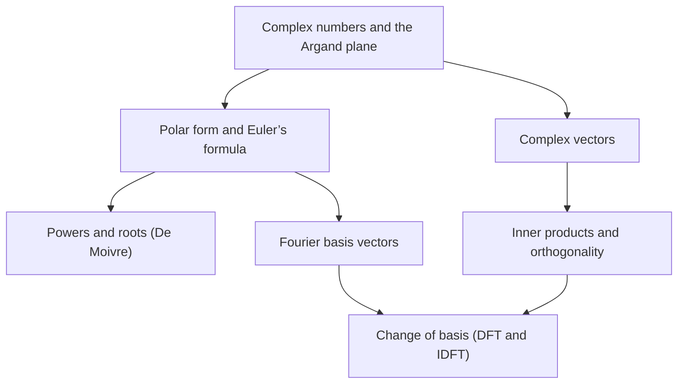
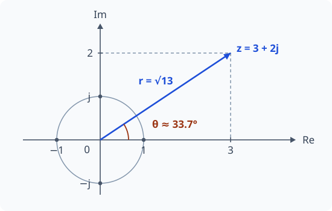
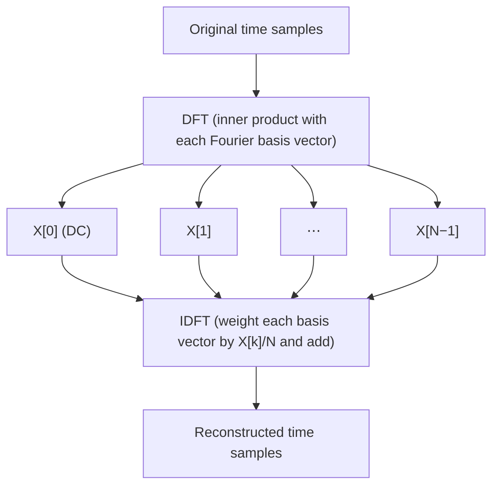

# Chapter 8A — Complex Numbers & the DFT
### SC1004 / CX1104 Linear Algebra for Computing · Part 2 · Complete Study Guide

> **Three layers, one topic.**
> Every concept in this guide is explained three times, on purpose:
>
> | Layer | Icon | What it gives you |
> |---|---|---|
> | **Explain like I'm 5** | 🧸 | A picture and a story. No symbols. Read this first, always. |
> | **Step by step** | 🪜 | A numbered recipe you can follow mechanically in an exam. |
> | **Detailed** | 📚 | The real derivation, with the reasons behind each step. |
>
> If you are short on time: read only the 🧸 boxes and the 🪜 recipes, then do the
> [tutorial solutions](#part-v--tutorial-8a-full-solutions) and the [self-test](#part-vi--exam-kit).
> If you want the marks: read 📚 too, because that is where "why" lives, and "why"
> is what exam questions actually test.

**Companion files**

- [Linear_Algebra_C8A_Complete_Study_Guide.md](./Linear_Algebra_C8A_Complete_Study_Guide.md) — the full narration transcript of all 39 lecture videos (reference, not a study plan).
- [Study_Guide_C6-C8.md](../Study_Guide_C6-C8.md) — Chapters 6–8 at a glance.
- Source decks: `8A.1_ComplexNumbers.pdf`, `8A.2_DeMoivre.pdf`, `8A.3_DFT.pdf`, `8A.3.0_DFT_overview.pdf`; tutorial: `Tut8A_Ques.pdf`.

---

## Notation used in this guide

| Symbol | Meaning | Note |
|---|---|---|
| $j$ | the imaginary unit, $j^2=-1$ | Your tutorial PDF sometimes writes $i$. **Same thing.** Slides use $j$ because engineers reserve $i$ for current. |
| $z=a+bj$ | complex number: $a$ real part, $b$ imaginary part | $a=\operatorname{Re}z$, $b=\operatorname{Im}z$ |
| $\bar z$ | complex conjugate: $a-bj$ | also written $z^{*}$ in some books |
| $\lvert z\rvert$ | modulus (length) | $\lvert z\rvert=\sqrt{a^2+b^2}$ |
| $\angle z$, $\arg z$ | argument (angle) | radians, measured from the $+$real axis |
| $\mathbf z^{H}$ | conjugate transpose (Hermitian) | $\mathbf z^H=\overline{\mathbf z}^{\,\mathsf T}$ |
| $N$ | number of samples / length of the vector | |
| $W_N$ | the twiddle factor $e^{-j2\pi/N}$ | $W_N^{kn}=e^{-j\frac{2\pi}{N}kn}$ |
| $\mathbf W$ | the DFT (analysis) matrix | $\mathbf X=\mathbf W\mathbf x$ |
| $\mathbf W^H$ | the IDFT (synthesis) matrix | $\mathbf x=\frac1N\mathbf W^{H}\mathbf X$ |

**The one convention you must not mix up.** This course defines the complex inner product
with the **conjugate on the second argument**:

$$\langle \mathbf a,\mathbf b\rangle=\sum_{i=0}^{N-1}a_i\,\overline{b_i}=\mathbf b^{H}\mathbf a .$$

Some textbooks conjugate the *first* argument instead. Both are legal; they differ only by an
overall complex conjugate. **The slides, the DFT formula, and the projection formula in this
course are all consistent with conjugate-on-the-second.** If you copy a formula from another
book and your phase comes out negated, that is why. See [§ 3.4](#34-the-inner-product--why-the-second-vector-must-be-conjugated)
for the full story.

---

## How to use this guide (a 4-pass plan)

1. **Pass 1 — story (30 min).** Read only [Part 0](#part-0--orientation-the-whole-chapter-in-one-page)
   and every 🧸 box in Parts I–IV. Do not touch a calculator. Goal: you can say out loud what a
   DFT *does*.
2. **Pass 2 — mechanics (2 h).** Read every 🪜 recipe. Re-do each one on blank paper with a
   different number (e.g. change $N=4$ to $N=6$, change $3e^{-j\pi/4}$ to $2e^{j\pi/3}$).
3. **Pass 3 — the real thing (2 h).** Read the 📚 derivations. You should be able to reproduce:
   the polar-multiplication rule, Euler from Taylor series, De Moivre by induction, the
   orthogonality of the Fourier basis, and $\mathbf W^H\mathbf W=N\mathbf I$.
4. **Pass 4 — exam (1 h).** [Part V](#part-v--tutorial-8a-full-solutions) tutorial solutions,
   [Part VI](#part-vi--exam-kit) recipe cards, mistake table, self-test. Mark yourself against
   the answers.

---
---

# Part 0 — Orientation: the whole chapter in one page

## 0.1 The story in five sentences

1. Some equations have **no real answer** ($x^2=-1$). So we invent one number, $j$, and get the
   **complex numbers** $\mathbb{C}$ — which turn out to be *points on a plane*, not a line.
2. On that plane, **multiplying** two numbers does something beautiful: lengths multiply and
   **angles add**. That single fact is worth more than every formula in the chapter.
3. Writing a complex number as $re^{j\theta}$ (length $r$, angle $\theta$) makes that rule
   obvious, and makes it trivial to take **powers** and **roots** (De Moivre).
4. A **signal** (a list of $N$ numbers) can be seen as one arrow in $N$-dimensional complex
   space. We ask: how much of this signal is a slow wiggle? A medium wiggle? A fast wiggle?
5. Because wiggles at different speeds are **perpendicular** to each other, answering that
   question is just an **inner product** — a dot product. That is the **DFT**: a change of
   basis from "one number per time slot" to "one number per wiggle speed".

The DFT takes time samples $x[n]$ and measures one Fourier component at a time,
$X[k]=\langle\mathbf x,\mathbf w_k\rangle=\sum_{n=0}^{N-1}x[n]e^{-j2\pi kn/N}$. The IDFT
combines the components to recover the time samples.

## 0.2 Why this is *linear algebra*, not a signals course

The DFT is presented in 8A.3.0 as a **change of basis** — the same idea you met in Chapter 4:

$$\mathbf x=\underbrace{[\mathbf b_1\ \cdots\ \mathbf b_N]}_{P}\,[\mathbf x]_{\mathcal B},
\qquad [\mathbf x]_{\mathcal B}=P^{-1}\mathbf x .$$

| Change-of-basis language | DFT language |
|---|---|
| basis vector $\mathbf b_k$ | Fourier basis vector $\mathbf w_k$, entries $e^{j\frac{2\pi}{N}kn}$ |
| synthesis matrix $P$ (basis vectors as columns) | $\mathbf W^{H}$, the **IDFT** matrix |
| coordinates $[\mathbf x]_{\mathcal B}$ | DFT coefficients $\mathbf X$ |
| analysis matrix $P^{-1}$ | $\mathbf W$, the **DFT** matrix |
| orthonormal basis $\Rightarrow P^{-1}=P^{H}$ (the Fourier basis is orthogonal only up to the scale $N$) | $\mathbf W^{H}\mathbf W=N\mathbf I\Rightarrow \mathbf W^{-1}=\frac1N\mathbf W^{H}$ |

**So:** everything you know about coordinates in a basis transfers immediately. The only new
ingredient is that the basis vectors are *complex*, so orthogonality needs a conjugate.

## 0.3 Chapter map — what you can do after each section

| Section | Content | You can… |
|---|---|---|
| **8A.1** | Complex numbers, Argand diagram, polar form, arithmetic, conjugate | convert between rectangular ⟷ polar in any quadrant; add/multiply/divide correctly; rationalise a complex denominator |
| **8A.2** | Euler's formula, exponential form, De Moivre, roots | prove $e^{j\theta}=\cos\theta+j\sin\theta$; compute $z^n$ and *all* $n$ values of $z^{1/n}$ |
| **8A.3.1** | Complex vectors, phasors, complex scaling | read $\mathbf z\in\mathbb C^N$ as a sampled rotating arrow; explain gain & phase shift |
| **8A.3.2** | Inner product, norm, orthogonality, projection | compute $\langle\mathbf a,\mathbf b\rangle$, $\lVert\mathbf b\rVert$, projections; explain why the 2nd term is conjugated |
| **8A.3.3** | Fourier basis, analysis & synthesis, $\mathbf W$ | build $\mathbf W$ for any $N$; compute $\mathbf X=\mathbf W\mathbf x$ and $\mathbf x=\frac1N\mathbf W^H\mathbf X$; interpret $\lvert X[k]\rvert$ and $\angle X[k]$ |

## 0.4 Prerequisite checklist (tick before starting 8A.3)

- [ ] Dot product $\mathbf u\cdot\mathbf v=\sum u_iv_i$; $\lVert\mathbf v\rVert=\sqrt{\mathbf v\cdot\mathbf v}$.
- [ ] Projection onto a line: $\operatorname{proj}_{\mathbf b}\mathbf v=\dfrac{\mathbf v\cdot\mathbf b}{\mathbf b\cdot\mathbf b}\mathbf b$.
- [ ] Orthogonal basis $\Rightarrow$ coordinates are projections: $c_j=\dfrac{\mathbf v\cdot\mathbf u_j}{\mathbf u_j\cdot\mathbf u_j}$.
- [ ] Matrix $\times$ vector $=$ weighted sum of **columns**: $A\mathbf x=\sum_k x_k\mathbf a_k$.
- [ ] Row $\times$ vector $=$ **inner product** with that row.
- [ ] Transpose, and conjugate transpose $A^H=\overline A^{\,\mathsf T}$.

If the last two are shaky, re-read them now — they are the entire DFT in disguise.

---
---

# Part I — 8A.1 Complex Numbers

## 1.1 Why we need $\mathbb{C}$ at all

> 🧸 **ELI5 — the number-line that ran out of room.**
> You know how numbers grew up: counting numbers $\mathbb{N}$ couldn't do $3-5$, so we got
> negatives $\mathbb{Z}$. Negatives couldn't do $1\div 2$ neatly, so we got fractions $\mathbb{Q}$.
> Fractions couldn't measure the diagonal of a square, so we got the reals $\mathbb{R}$.
> Each time, we **added the missing answers and kept all the old rules**.
> Now ask: what solves $x^2=-1$? Nothing on the real line — any real squared is $\ge 0$.
> So we add one new number, $j$, with $j^2=-1$, and suddenly *every* polynomial has *all* its
> answers. There is nothing left to add. $\mathbb{C}$ is the last stop.

### 📚 Detailed

**The number sets.** 
$$\mathbb{N}\subset\mathbb{Z}\subset\mathbb{Q}\subset\mathbb{R}\subset\mathbb{C}$$

| Set | Closed under $+,-,\times$? | Closed under $\div$ (nonzero)? | Closed under $\sqrt{\ }$? |
|---|---|---|---|
| $\mathbb{N}$ | only $+,\times$ | ✗ | ✗ |
| $\mathbb{Z}$ | ✓ | ✗ | ✗ |
| $\mathbb{Q}$ | ✓ | ✓ | ✗ ($\sqrt2$) |
| $\mathbb{R}$ | ✓ | ✓ | ✗ ($\sqrt{-1}$) |
| $\mathbb{C}$ | ✓ | ✓ | ✓ |

$\mathbb{C}$ is the only one in the list where **every** algebraic equation has a solution.

**Where the need shows up.** Solve $ax^2+bx+c=0$ with the quadratic formula:

$$x=\frac{-b\pm\sqrt{b^2-4ac}}{2a}.$$

Everything hinges on the **discriminant** $\Delta=b^2-4ac$:

| $\Delta$ | Roots |
|---|---|
| $\Delta>0$ | two distinct **real** roots |
| $\Delta=0$ | one **repeated real** root (the parabola just touches the axis) |
| $\Delta<0$ | two **complex conjugate** roots $p\pm qj$ |

> 🧸 **ELI5.** $\Delta$ answers "does the parabola cross the $x$-axis, kiss it, or miss it?"
> Miss it $\Rightarrow$ the answers live above/below the line, at the same height, mirrored.

**Worked micro-example.** $x^2+2x+5=0$: $\Delta=4-20=-16<0$, so
$$x=\frac{-2\pm\sqrt{-16}}{2}=\frac{-2\pm 4j}{2}=-1\pm 2j.$$
Check: $(-1+2j)^2+2(-1+2j)+5=(1-4j-4)+(-2+4j)+5=0$ ✓. The two roots are mirror images across the
real axis — a pattern you will see forever.

**Fundamental Theorem of Algebra (FTA).** Every polynomial of degree $n\ge 1$ with complex
coefficients has **exactly $n$ roots counted with multiplicity**, and factors completely:
$$p(z)=a_n(z-z_1)(z-z_2)\cdots(z-z_n).$$
Two consequences you should *use*, not just quote:

- "Degree 4, so there are 4 roots" — no exceptions, no "maybe none".
- If coefficients are **real**, roots come in **conjugate pairs**: $z$ is a root $\Rightarrow \bar z$ is a root.
  (Because $\overline{p(z)}=p(\bar z)$ when coefficients are real.)
  *This is why quadratics with $\Delta<0$ give $p\pm qj$.*

---

## 1.2 Rectangular (Cartesian) form and the Argand diagram

> 🧸 **ELI5 — a complex number is a treasure map.**
> "$3+2j$" means *go right 3, go up 2*. That is it. Draw an arrow from the origin to that spot,
> and you have a picture of the number. The horizontal axis is "normal numbers", the vertical
> axis is "imaginary numbers".

### 📚 Detailed

$$z=a+bj,\qquad a=\operatorname{Re}z\in\mathbb{R},\quad b=\operatorname{Im}z\in\mathbb{R},\quad j^2=-1.$$

- **Equality**: $a+bj=c+dj\iff a=c$ **and** $b=d$. One complex equation $=$ two real equations.
  (This is the workhorse for "find $a,b$" questions.)
- **Argand diagram**: horizontal $=$ real axis, vertical $=$ imaginary axis.
  $z$ is the point $(a,b)$, equivalently the arrow from $0$ to $(a,b)$.
- **Angles**: measured **in radians** from the **positive real axis**; anticlockwise is $+$, clockwise is $-$.
- Consequences: $j$ sits at $(0,1)$, i.e. $90^\circ$ up. $-1$ sits at $(-1,0)$. $-j$ at $(0,-1)$.

For $z=3+2j$, the modulus is $r=\sqrt{3^2+2^2}=\sqrt{13}\approx3.61$ and the argument is
$\theta=\tan^{-1}\!\left(\dfrac{2}{3}\right)\approx33.7^\circ$.

| Point on the unit circle | Argument measured from the positive real axis |
|---|---|
| $1$ | $0^\circ$ |
| $j$ | $90^\circ$ (quarter turn anticlockwise) |
| $-1$ | $180^\circ$ (half turn) |
| $-j$ | $270^\circ$ or $-90^\circ$ (quarter turn clockwise) |

**Three forms.** Every complex number can be written three ways; you must be fluent in all three:

| Form | Looks like | Best for |
|---|---|---|
| Rectangular / Cartesian | $a+bj$ | adding, subtracting |
| Polar (trigonometric) | $r(\cos\theta+j\sin\theta)=r\angle\theta$ | multiplying, dividing, *seeing* geometry |
| Complex exponential | $re^{j\theta}$ | powers, roots, DFT algebra |

---

## 1.3 Modulus, argument, and polar form

> 🧸 **ELI5 — length and direction.**
> Instead of "go right 3, up 2", say "walk 3.6 steps, facing 33.7°". Same arrow, different
> description. Length $=$ **modulus**, direction $=$ **argument**.

### 🪜 Recipe A — rectangular $\to$ polar

1. $r=\lvert z\rvert=\sqrt{a^2+b^2}$.
2. Find which quadrant the point $(a,b)$ is in using the **signs** of $a$ and $b$.
3. Compute $\theta$ using the quadrant rule in the table below (never blindly use $\arctan(b/a)$).
4. Write $z=r\angle\theta$ (degrees or radians — the course uses radians, and $2\pi$ per turn).

**Quadrant table** (this is where most marks are lost):

| Quadrant | signs $(a,b)$ | $\theta$ (principal, $-\pi<\theta\le\pi$) | Example |
|---|---|---|---|
| I | $(+,+)$ | $\arctan\!\big(\tfrac{b}{a}\big)$ | $1+j$: $45^\circ=\pi/4$ |
| II | $(-,+)$ | $\pi-\arctan\!\big(\tfrac{\lvert b\rvert}{\lvert a\rvert}\big)$ | $-1+j$: $135^\circ=3\pi/4$ |
| III | $(-,-)$ | $-\pi+\arctan\!\big(\tfrac{\lvert b\rvert}{\lvert a\rvert}\big)$ | $-1-j$: $-135^\circ=-3\pi/4$ |
| IV | $(+,-)$ | $\arctan\!\big(\tfrac{b}{a}\big)$ (negative) | $1-j$: $-45^\circ=-\pi/4$ |

> **Shortcut that never fails:** $\theta=\operatorname{atan2}(b,a)$, which is exactly the
> two-argument arctangent implemented in MATLAB/NumPy/your calculator's `atan2`. It knows the
> quadrant for you.

### 🪜 Recipe B — polar $\to$ rectangular

1. $a=r\cos\theta$.
2. $b=r\sin\theta$.
3. Write $a+bj$.

### 📚 Detailed — why $r=\sqrt{a^2+b^2}$ and $\tan\theta=b/a$

The arrow from $0$ to $(a,b)$ is the hypotenuse of a right triangle with legs $a$ and $b$.
Pythagoras gives $r^2=a^2+b^2$. The angle satisfies $\tan\theta=\frac{\text{opposite}}{\text{adjacent}}=\frac{b}{a}$.
Both are just trigonometry — but $\tan$ has period $\pi$, so it *cannot distinguish* quadrant
II from IV, or I from III. That is precisely why you must check signs separately.

**Polar form.**
$$z=r(\cos\theta+j\sin\theta)=r\angle\theta\qquad\text{(read: "}r\text{ at angle }\theta\text{")}$$

**Special case worth memorising: the unit circle.** $\lvert z\rvert=1$ means $z$ lives on the
circle of radius 1 about the origin; its equation is $\lvert z\rvert=1$, and every point on it is
$\cos\theta+j\sin\theta$ for some $\theta$.

**The four "compass points"** — you will use these a thousand times:

| $\theta$ | $e^{j\theta}$ | Rectangular |
|---|---|---|
| $0$ | $1$ | $1$ |
| $\pi/2$ | $j$ | $0+1j$ |
| $\pi$ | $-1$ | $-1+0j$ |
| $3\pi/2$ (or $-\pi/2$) | $-j$ | $0-1j$ |

> 🧸 **ELI5.** $1$ is "east". $j$ is "north". $-1$ is "west". $-j$ is "south".
> Multiplying by $j$ is a quarter turn anticlockwise. Do it four times and you're home: $j^4=1$.

### Example (four quadrants, the slide example)
Take $z=-2+j$ (quadrant II, same as the slide's $-2+1j$ example).
$r=\sqrt{4+1}=\sqrt5\approx2.236$. Reference angle $\arctan(1/2)\approx26.57^\circ$, so
$\theta=180^\circ-26.57^\circ=153.43^\circ\approx2.678$ rad.
$$z=\sqrt5\angle153.43^\circ .$$
Notice the *reference angle* (the acute angle to the nearest axis) is what your calculator gives
you; the quadrant decides whether you add/subtract from $180^\circ$.

---

## 1.4 Arithmetic in rectangular form

> 🧸 **ELI5 — three easy things and one trick.**
> **Add/subtract:** walk the arrows nose-to-tail (or just add the "right" parts and the "up" parts
> separately). **Multiply:** FOIL, then remember $j^2=-1$. **Divide:** don't — instead multiply top
> and bottom by the conjugate so the bottom becomes an ordinary real number. Then divide normally.

### 🪜 Recipe C — the four operations

1. **Add / subtract:** combine real with real, imaginary with imaginary.
   $$(a+bj)\pm(c+dj)=(a\pm c)+(b\pm d)j.$$
   *Geometrically:* vector addition on the Argand diagram (parallelogram).
2. **Multiply:** expand and use $j^2=-1$.
   $$(a+bj)(c+dj)=ac+adj+bcj+bdj^2=(ac-bd)+(ad+bc)j.$$
3. **Divide:** multiply numerator and denominator by the **conjugate of the denominator**.
   $$\frac{a+bj}{c+dj}=\frac{(a+bj)(c-dj)}{(c+dj)(c-dj)}=\frac{(ac+bd)+(bc-ad)j}{c^2+d^2}.$$
   The denominator $c^2+d^2=\lvert c+dj\rvert^2$ is **real and positive** — now it is an ordinary division.
4. **Powers of $j$:** cycle with period 4: $j^0=1,\ j^1=j,\ j^2=-1,\ j^3=-j,\ j^4=1,\dots$
   Reduce the exponent mod 4 first: $j^{2026}=j^{4\cdot506+2}=j^2=-1$.

**Useful special cases**

$$\frac{1}{j}=-j \qquad\text{(check: } j\cdot(-j)=-j^2=1\text{)}$$
$$\frac{1}{a+bj}=\frac{a-bj}{a^2+b^2}.$$

### 📚 Detailed — why rationalising works

The trick is the identity $z\bar z=\lvert z\rvert^2\in\mathbb{R}_{\ge0}$. Multiplying a complex
denominator by its conjugate is the exact analogue of "rationalise the denominator" with
$\sqrt2$: there you used $\sqrt2\cdot\sqrt2=2$; here you use $(c+dj)(c-dj)=c^2+d^2$.

Division therefore costs about twice the work of multiplication, but it is never "special" —
no new algebra, only one clever multiplication by 1 in disguise.

---

## 1.5 Arithmetic in polar form — the rule that changes everything

> 🧸 **ELI5 — the "dance" rule.**
> Two people spinning on a merry-go-round: if one is spinning at $30^\circ$ and the other at
> $20^\circ$, and you *combine* them, the result spins at $30^\circ+20^\circ$.
> And their "sizes" multiply. That is all multiplication does: **stretch, then turn**.

$$
\boxed{\;r_1\angle\theta_1\;\times\;r_2\angle\theta_2\;=\;(r_1r_2)\angle(\theta_1+\theta_2)\;}
$$

$$
\frac{r_1\angle\theta_1}{r_2\angle\theta_2}=\frac{r_1}{r_2}\angle(\theta_1-\theta_2),
\qquad
\frac{1}{r\angle\theta}=\frac1r\angle(-\theta).
$$

### 📚 Detailed — the proof (2 lines of trigonometry, 1 line of insight)

Write both in trigonometric polar and expand:

$$
\begin{aligned}
r_1(\cos\theta_1+j\sin\theta_1)\cdot r_2(\cos\theta_2+j\sin\theta_2)
&=r_1r_2\big[(\cos\theta_1\cos\theta_2-\sin\theta_1\sin\theta_2)\\
&\qquad + j(\sin\theta_1\cos\theta_2+\cos\theta_1\sin\theta_2)\big]\\
&=r_1r_2\big[\cos(\theta_1+\theta_2)+j\sin(\theta_1+\theta_2)\big].
\end{aligned}
$$

The two bracket groups **are** the angle-addition identities. So the "multiply moduli, add
arguments" rule is nothing but $\cos(A+B)$ and $\sin(A+B)$ wearing a disguise.

**Why this matters more than anything else in 8A.1.** In rectangular form, multiplication is
four multiplications and a sign trick; in polar form it is one multiplication and one addition.
Every later result — De Moivre, roots, the DFT's rotating phasors — is powered by this rule.

### 🪜 Recipe D — multiply/divide in polar (the fast path)

1. Convert everything to polar (Recipe A). **All angles in the same unit** (radians!).
2. Multiply moduli; add angles (or divide moduli; subtract angles).
3. If asked for rectangular form, convert back with Recipe B.
4. If the angle is outside $[-\pi,\pi]$ or $[0,2\pi)$, subtract/add $2\pi$ until it is in range.

**Worked micro-example.** $z_1=2\angle30^\circ$, $z_2=3\angle(-20^\circ)$.
$z_1z_2=6\angle10^\circ$; $\ z_1/z_2=\tfrac23\angle50^\circ$; $\ 1/z_1=0.5\angle(-30^\circ)$.

**Geometric meaning (say this in an exam and you get an interpretation mark):**

| Operation | Effect on the arrow |
|---|---|
| multiply by $r\angle\theta$ | stretch by $r$, rotate by $+\theta$ (anticlockwise) |
| divide by $r\angle\theta$ | shrink by $r$, rotate by $-\theta$ (clockwise) |
| multiply by $j$ | rotate $+90^\circ$, no stretch |
| multiply by $-1$ | rotate $180^\circ$ (point reflection) |
| conjugate $\bar z$ | mirror across the real axis, length unchanged |

---

## 1.6 The complex conjugate

> 🧸 **ELI5 — the shadow.**
> Flip the arrow across the horizontal axis. Same length, opposite angle. The magic: an arrow
> times its own shadow is always a plain positive number — the *squared length*.
> That's the tool that turns "complex" into "real" whenever you need a real answer.

### 📚 Detailed

$$\bar z=\overline{a+bj}=a-bj,\qquad \bar z=r\angle(-\theta)\ \text{ if } z=r\angle\theta.$$

**The three identities you must know:**

$$z\bar z=a^2+b^2=\lvert z\rvert^2 \qquad\text{(real, }\ge 0)$$
$$\operatorname{Re}z=\frac{z+\bar z}{2},\qquad \operatorname{Im}z=\frac{z-\bar z}{2j}.$$

**Algebraic properties** (all provable by "write it out", all used constantly):

| Property | Statement |
|---|---|
| involution | $\overline{\overline z}=z$ |
| additivity | $\overline{z_1+z_2}=\bar z_1+\bar z_2$ |
| multiplicativity | $\overline{z_1z_2}=\bar z_1\,\bar z_2$ |
| quotient | $\overline{\left(\dfrac{z_1}{z_2}\right)}=\dfrac{\bar z_1}{\bar z_2}$ |
| real test | $z\in\mathbb{R}\iff z=\bar z$ |
| pure imaginary test | $z\in j\mathbb{R}\iff z=-\bar z$ |
| modulus | $\lvert \bar z\rvert=\lvert z\rvert$, $\ \lvert z_1z_2\rvert=\lvert z_1\rvert\lvert z_2\rvert$ |
| argument | $\arg(\bar z)=-\arg z$, $\ \arg(z_1z_2)=\arg z_1+\arg z_2 \pmod{2\pi}$ |

**Why "converting complex to real" is the whole point.** Every time physics or engineering needs
a *measurable* number from a complex quantity, it uses $\lvert z\rvert^2=z\bar z$ (power,
intensity, energy) — and in 8A.3 exactly the same move gives you the complex norm.

---

## 1.7 Teaching examples for 8A.1 (do these before the tutorial)

**E1.** Write $z=1-j\sqrt3$ in polar and exponential form.
$r=\sqrt{1+3}=2$; quadrant IV; reference angle $\arctan(\sqrt3/1)=60^\circ$; so $\theta=-60^\circ=-\pi/3$.
$$z=2\angle(-60^\circ)=2\left(\cos\tfrac{\pi}{3}-j\sin\tfrac{\pi}{3}\right)=2e^{-j\pi/3}.$$

**E2.** Write $z=-3-4j$ in polar form.
$r=\sqrt{9+16}=5$; quadrant III; reference angle $\arctan(4/3)\approx53.13^\circ$; so
$\theta=-(180^\circ-53.13^\circ)=-126.87^\circ$ (equivalently $233.13^\circ$).
$$z=5\angle(-126.87^\circ).$$
*Sanity check:* a point in the third quadrant must have $\lvert\theta\rvert$ between $90^\circ$ and
$180^\circ$ ✓.

**E3.** Simplify $\dfrac{3+4j}{1-2j}$.
$$\frac{(3+4j)(1+2j)}{(1-2j)(1+2j)}=\frac{3+6j+4j+8j^2}{1+4}=\frac{-5+10j}{5}=-1+2j.$$
*Check:* $\lvert -1+2j\rvert=\sqrt5$ and $\lvert3+4j\rvert/\lvert1-2j\rvert=5/\sqrt5=\sqrt5$ ✓ — using
the modulus as a free error-detector is a real exam skill.

**E4.** Compute $j^{2027}$.
$2027=4\cdot506+3$, so $j^{2027}=j^3=-j$.

**E5.** Show that $\dfrac{1+j}{1-j}=j$.
$$\frac{(1+j)^2}{(1-j)(1+j)}=\frac{1+2j+j^2}{2}=\frac{2j}{2}=j.$$
Also note: $1+j=\sqrt2\angle45^\circ$, $1-j=\sqrt2\angle(-45^\circ)$, so the quotient is
$1\angle90^\circ=j$ ✓ — **polar form verifies rectangular work instantly.**

---

## 1.8 Pitfalls that cost marks (8A.1)

| ✗ Mistake | ✓ Fix |
|---|---|
| Using $\theta=\arctan(b/a)$ in quadrants II/III/IV | use the quadrant table, or `atan2(b,a)` |
| Mixing degrees and radians mid-question | convert everything to radians at the start |
| Writing $j^2=1$ | $j^2=-1$; so $bdj^2=-bd$ **subtracts** |
| $\lvert z_1+z_2\rvert=\lvert z_1\rvert+\lvert z_2\rvert$ | **false** in general (triangle *inequality*: $\le$) |
| $\arg(z_1z_2)=\arg z_1+\arg z_2$ "exactly" | true only *modulo* $2\pi$ — reduce at the end |
| Forgetting the conjugate on the denominator | $\frac{z_1}{z_2}=\frac{z_1\bar z_2}{\lvert z_2\rvert^2}$, always |
| Assuming $\sqrt{-4}=2j$ only | it is $\pm 2j$ — "square root" is multi-valued in $\mathbb{C}$ |

**Rapid drill.** In your head: $(-1+j)^2$, $\ \dfrac{2j}{1+j}$, $\ \lvert 3-4j\rvert$, $\ \arg(-1).$
*Answers:* $-2j$; $\ 1+j$; $\ 5$; $\ \pi$.

---
---

# Part II — 8A.2 Euler's Formula and De Moivre's Theorem

## 2.1 Euler's formula — the chapter's engine

> 🧸 **ELI5 — the spinning machine.**
> Imagine a wheel of radius 1. A point on it is described by one number: how far you've turned,
> $\theta$. Now, "turn by $\theta$" can be *computed* as $e^{j\theta}$ — an ordinary exponential
> whose input happens to be imaginary. That is genuinely surprising, and it is the most useful
> formula in engineering:
> $$\text{position on the unit circle at angle }\theta \;=\; e^{j\theta}.$$
> Multiply by $r$ and the circle becomes any circle; you have $re^{j\theta}$, length $r$, angle $\theta$.

$$\boxed{\,e^{j\theta}=\cos\theta+j\sin\theta\,}$$

Immediate consequences:

$$e^{-j\theta}=\cos\theta-j\sin\theta=\overline{e^{j\theta}}$$
$$\cos\theta=\frac{e^{j\theta}+e^{-j\theta}}{2},\qquad \sin\theta=\frac{e^{j\theta}-e^{-j\theta}}{2j}$$
$$e^{j\pi}=-1\quad(\text{Euler's identity}),\qquad e^{j2\pi}=1,\qquad e^{j\pi/2}=j,\qquad e^{-j\pi/2}=-j.$$

---

## 2.2 Where Euler's formula comes from (Taylor series)

> 🧸 **ELI5 — three recipes that turn out to be one recipe.**
> The exponential function and sine/cosine can both be written as infinite sums ("recipes").
> If you feed the exponential a *pretend* number $j\theta$, its sum splits neatly into exactly the
> sine recipe plus $j$ times the cosine recipe. Nobody designed that; it just happens. That is why
> the formula is considered beautiful.

### 📚 Detailed derivation (reproduce this in an exam)

Start from the three Maclaurin series:

$$
e^{x}=\sum_{n=0}^{\infty}\frac{x^n}{n!}=1+x+\frac{x^2}{2!}+\frac{x^3}{3!}+\cdots
$$
$$
\cos\theta=\sum_{n=0}^{\infty}\frac{(-1)^n\theta^{2n}}{(2n)!}=1-\frac{\theta^2}{2!}+\frac{\theta^4}{4!}-\cdots
$$
$$
\sin\theta=\sum_{n=0}^{\infty}\frac{(-1)^n\theta^{2n+1}}{(2n+1)!}=\theta-\frac{\theta^3}{3!}+\frac{\theta^5}{5!}-\cdots
$$

Substitute $x=j\theta$, and use the **period-4 cycle of $j$**
($j^0=1,\ j^1=j,\ j^2=-1,\ j^3=-j,\ j^4=1,\dots$):

$$
\begin{aligned}
e^{j\theta}
&=1+j\theta+\frac{(j\theta)^2}{2!}+\frac{(j\theta)^3}{3!}+\frac{(j\theta)^4}{4!}+\frac{(j\theta)^5}{5!}+\cdots\\[2pt]
&=1+j\theta-\frac{\theta^2}{2!}-j\frac{\theta^3}{3!}+\frac{\theta^4}{4!}+j\frac{\theta^5}{5!}-\cdots\\[2pt]
&=\underbrace{\left(1-\frac{\theta^2}{2!}+\frac{\theta^4}{4!}-\cdots\right)}_{\cos\theta}
+j\underbrace{\left(\theta-\frac{\theta^3}{3!}+\frac{\theta^5}{5!}-\cdots\right)}_{\sin\theta}\\[2pt]
&=\cos\theta+j\sin\theta .
\end{aligned}
$$

**The three things examiners look for:** (i) you know $j^2=-1$ splits the series into even and odd
powers; (ii) you *regroup* those powers; (iii) you recognise the two groups as $\cos$ and $\sin$.

**Sanity checks you can do in 5 seconds.**
$\theta=0$: $e^{0}=1=\cos0+j\sin0$ ✓.
$\theta=\pi$: $e^{j\pi}=-1+j0$ ✓ (the "most beautiful equation").
$\theta=\pi/2$: $e^{j\pi/2}=j$ ✓.

---

## 2.3 The identities you will actually use

> 🧸 **ELI5 — a dictionary between two languages.**
> "Wiggle language" ($\cos,\sin$) and "spin language" ($e^{j\theta}$) say the same things.
> Learn to translate both ways instantly; exam questions love to ask in one language and expect the other.

| # | Identity | Use it for |
|---|---|---|
| 1 | $e^{j\theta}=\cos\theta+j\sin\theta$ | polar $\leftrightarrow$ exponential |
| 2 | $\cos\theta=\frac{e^{j\theta}+e^{-j\theta}}{2}$ | turning a **cosine** into two spinning arrows |
| 3 | $\sin\theta=\frac{e^{j\theta}-e^{-j\theta}}{2j}$ | turning a **sine** into two spinning arrows |
| 4 | $e^{j(\theta+2\pi k)}=e^{j\theta}$ | why there are $n$ roots, not 1 |
| 5 | $\left(e^{j\theta}\right)^{n}=e^{jn\theta}$ | De Moivre, powers |
| 6 | $\overline{e^{j\theta}}=e^{-j\theta}$ | conjugate = negate the angle |
| 7 | $\cos^2\theta+\sin^2\theta=1$ | falls out of $\lvert e^{j\theta}\rvert=1$ |
| 8 | $\cos2\theta=\cos^2\theta-\sin^2\theta$, $\sin2\theta=2\sin\theta\cos\theta$ | falls out of $e^{j2\theta}=(e^{j\theta})^2$ |

**Identity 8 by itself is a great demonstration.** Expand $(e^{j\theta})^2=e^{j2\theta}$:
$$(\cos\theta+j\sin\theta)^2=(\cos^2\theta-\sin^2\theta)+j(2\sin\theta\cos\theta)$$
and equate real and imaginary parts. That is the double-angle formula, proved in one line.

**Identity 3 is the DFT's best friend.** It says a *real* sine is a difference of two *complex*
spinning arrows at frequencies $+\omega$ and $-\omega$ — which is exactly why a real signal has
DFT energy at both $k$ and $N-k$ (see [§ 4.11](#411-real-signals-and-conjugate-symmetry)).

### 🪜 Recipe E — convert between all three forms

1. **Rectangular → polar**: $r=\sqrt{a^2+b^2}$, quadrant-aware $\theta$ (Recipe A).
2. **Polar → exponential**: append $e^{j}$: $\ r\angle\theta=r e^{j\theta}$.
3. **Exponential → rectangular**: evaluate $\cos\theta$ and $\sin\theta$, then $r\cos\theta+j r\sin\theta$.
4. **Check**: $\lvert z\rvert=r$ and $\operatorname{Re}z=r\cos\theta$ must both hold.

---

## 2.4 De Moivre's Theorem — powers

> 🧸 **ELI5 — repeated stretching and turning.**
> If multiplying two arrows means "multiply lengths, add angles", then multiplying an arrow by
> *itself* $n$ times means "raise the length to the $n$, and turn $n$ times as far".
> That's the whole theorem.

$$\boxed{\;(r\angle\theta)^n=r^n\angle(n\theta)\;}\qquad
\left(r e^{j\theta}\right)^n=r^ne^{jn\theta}=r^n\big(\cos n\theta+j\sin n\theta\big)$$

Equivalently, with $r=1$:
$$\left(\cos\theta+j\sin\theta\right)^n=\cos n\theta+j\sin n\theta .$$

### 📚 Detailed — proof by induction (the "proper" version)

**Claim.** For every integer $n$, $(r\angle\theta)^n=r^n\angle(n\theta)$.

*Base case* $n=1$: trivial. $n=0$: $(r\angle\theta)^0=1=r^0\angle0$ ✓.

*Inductive step* (positive $n$). Assume true for $n=k$:
$$(r\angle\theta)^{k+1}=(r\angle\theta)^{k}(r\angle\theta)=r^k\angle(k\theta)\cdot r\angle\theta
=r^{k+1}\angle\big((k+1)\theta\big),$$
where the last equality is the multiplication rule (multiply moduli, add arguments). Hence true
for all $n\ge0$.

*Negative $n$.* Let $n=-m$ with $m>0$. Then
$$(r\angle\theta)^{-m}=\frac{1}{r^m\angle(m\theta)}=\frac{1}{r^m}\angle(-m\theta)=r^{-m}\angle(-m\theta).$$
So the theorem holds for **all integers** $n\in\mathbb{Z}$.

**Why use exponential form for the negative case?** Because $e^{j\theta}\cdot e^{j\phi}=e^{j(\theta+\phi)}$
is just the exponent law $(e^{a})^{n}=e^{an}$ you already know — no trigonometry, no case analysis.

### 🪜 Recipe F — compute $z^n$ in 4 steps

1. Convert $z$ to polar/exponential: $z=r e^{j\theta}$.
2. Power the modulus: $r^n$ (positive, real).
3. Multiply the angle: $n\theta$.
4. Reduce $n\theta$ modulo $2\pi$ into $(-\pi,\pi]$; convert back to rectangular if asked.

**Worked micro-example.** $z=1+j$. Then $z=\sqrt2 e^{j\pi/4}$.
$$z^{8}=(\sqrt2)^8 e^{j8\pi/4}=16\,e^{j2\pi}=16 .$$
Try doing that by hand in rectangular form — that's the point.

**Second micro-example.** $z=2\angle45^\circ$. Then $z^5=32\angle225^\circ=32\left(\cos225^\circ+j\sin225^\circ\right)=32\left(-\tfrac{\sqrt2}{2}-j\tfrac{\sqrt2}{2}\right)=-16\sqrt2-16\sqrt2\,j.$

**Geometric reading (the slide's "insight"):** as $n=1,2,3,\dots$ increases, $z^n$ traces a
**logarithmic spiral**: the length grows geometrically by factor $r$ each step, and the angle
advances by $\theta$ each step. If $r=1$, it is a circle; if $r<1$, it spirals inward to $0$.

---

## 2.5 Roots — the multi-valued part

> 🧸 **ELI5 — "what spins to here?"**
> If turning 3 times lands you at a point, then *any* of 3 starting angles could have been the
> right one: the point does not remember how many full turns you made along the way.
> So an $n$-th root has $n$ answers, and they are always evenly spaced around a circle — like
> $n$ people standing equally far apart on a round stage.

$$\boxed{\;z^{1/n}=\sqrt[n]{r}\;\angle\;\frac{\theta+2\pi k}{n},\qquad k=0,1,2,\dots,n-1\;}$$

**Two facts to state in words (interpretation marks):**

1. All $n$ roots have the **same modulus** $\sqrt[n]{r}$ — they lie on a circle of that radius.
2. They are **equally spaced** by $2\pi/n$ — they form a regular $n$-gon centred at the origin.

### 📚 Detailed — derivation

Let $w=\rho e^{j\phi}$ be an $n$-th root of $z=re^{j\theta}$, i.e. $w^n=z$.

$$
w^n=z \iff \rho^n e^{jn\phi}=r e^{j\theta}
\iff \begin{cases}\rho^n=r\\ n\phi=\theta+2\pi k\end{cases}
\iff \begin{cases}\rho=r^{1/n}\\ \phi=\dfrac{\theta+2\pi k}{n}\end{cases}
$$

Two things happen here, and both matter:

- **Moduli** are compared as positive reals: $\rho^n=r$ has exactly one positive solution.
- **Angles** are compared **modulo $2\pi$**, because $e^{j\phi}$ is $2\pi$-periodic. That is where
  the $+2\pi k$ comes from, and it is the *only* reason there are $n$ roots instead of one.

Only $k=0,1,\dots,n-1$ give distinct angles; $k=n$ reproduces $k=0$ (adds $2\pi$ to the angle).

> ⚠️ **Do not confuse this with De Moivre.** De Moivre gives $z^n$ (one answer). The root formula
> gives $z^{1/n}$ ($n$ answers). Same theorem; the multi-valuedness comes from the angle wrap-around.

### 🪜 Recipe G — find all $n$-th roots of $z$

1. Write $z=r e^{j\theta}$ with $\theta$ in $(-\pi,\pi]$ (any representative works — but be consistent).
2. Modulus of every root: $R=\sqrt[n]{r}$.
3. Base angle: $\phi_0=\theta/n$.
4. Add $2\pi/n$ repeatedly: $\phi_k=\phi_0+\dfrac{2\pi k}{n}$, $k=0,\dots,n-1$.
5. Write each root $R\angle\phi_k$; convert to rectangular only if asked.
6. **Check:** the $n$ roots should sum to $0$ (they are symmetric about the origin when $n\ge2$).

**Worked examples**

**(a) Cube roots of $8$.** $8=8e^{j0}$, so $R=\sqrt[3]{8}=2$, $\phi_k=\frac{0+2\pi k}{3}$:
$$2\angle0=2,\qquad 2\angle\tfrac{2\pi}{3}=-1+j\sqrt3,\qquad 2\angle\tfrac{4\pi}{3}=-1-j\sqrt3.$$
Three points on a circle of radius 2, $120^\circ$ apart. Sum $=2+(-1+j\sqrt3)+(-1-j\sqrt3)=0$ ✓.

**(b) Fourth roots of $-16$.** $-16=16e^{j\pi}$, so $R=\sqrt[4]{16}=2$, $\phi_k=\frac{\pi+2\pi k}{4}$,
i.e. $45^\circ,135^\circ,225^\circ,315^\circ$:
$$\sqrt2(1+j),\quad \sqrt2(-1+j),\quad \sqrt2(-1-j),\quad \sqrt2(1-j).$$
A square rotated by $45^\circ$ — which makes sense, because $-16$ points *west*, and the square's
corners must straddle the west direction.

**(c) The $n$-th roots of unity.** $z^{n}=1\Rightarrow z=e^{j2\pi k/n}$, $k=0,\dots,n-1$.
For $n=6$: $1,\ e^{j\pi/3},\ e^{j2\pi/3},\ -1,\ e^{j4\pi/3},\ e^{j5\pi/3}$ — a hexagon starting at
"east". **These are exactly the DFT's twiddle factors $W_N^{k}$** (up to the sign convention).
Remember this when you meet $\mathbf W$ in Part IV: the DFT matrix is built from roots of unity.

---

## 2.6 Teaching example — a full multi-step problem

**E6.** Let $z=1-\sqrt3\,j$. Find $z^{6}$ and the three cube roots of $z$, in rectangular form where possible.

*Step 1 — polar.* $r=\sqrt{1+3}=2$; quadrant IV; $\theta=-\pi/3$.
$$z=2e^{-j\pi/3}.$$

*Step 2 — power.* $z^6=2^6 e^{-j6\pi/3}=64e^{-j2\pi}=64.$
*(Notice: a real answer. That is not a coincidence — see the symmetry note below.)*

*Step 3 — cube roots.* $R=\sqrt[3]{2}$, base angle $=-\pi/9$, spacing $2\pi/3$:
$$z^{1/3}=\sqrt[3]{2}\,\angle\left(-\frac{\pi}{9}+\frac{2\pi k}{3}\right),\quad k=0,1,2$$
$$=\sqrt[3]{2}\angle(-20^\circ),\quad \sqrt[3]{2}\angle(100^\circ),\quad \sqrt[3]{2}\angle(220^\circ).$$

*Step 4 — rectangular (optional).* $\sqrt[3]{2}\approx1.26$:
$$1.26\left(\cos(-20^\circ)+j\sin(-20^\circ)\right)\approx1.184-0.431j,$$
and similarly for the other two.

*Step 5 — check.* Same modulus $1.26$ for all three ✓; $120^\circ$ apart ✓; sum $\approx0$ ✓.

**Why did $z^6$ come out real?** Because $6\theta=-2\pi$ is a whole number of turns. In general
$z^n$ is real $\iff n\theta$ is a multiple of $\pi$; it is positive real $\iff$ multiple of $2\pi$.

---

## 2.7 Pitfalls that cost marks (8A.2)

| ✗ Mistake | ✓ Fix |
|---|---|
| $e^{j\theta}=\cos\theta+j\sin\theta$ but $e^{-\theta}=\cos\theta-j\sin\theta$ | the second is wrong: $e^{-\theta}$ is real; you need $e^{-j\theta}$ |
| Writing $\sqrt{-4}=2j$ only | $\sqrt{-4}=\pm2j$; the root formula gives both |
| Using $\theta$ outside $(-\pi,\pi]$ and forgetting to reduce | always reduce at the end; $e^{j(\theta+2\pi)}=e^{j\theta}$ |
| $z^{1/n}$ "has $n$ roots" but you only write one | write all $k=0..n-1$ and say *"distinct angles"* |
| Applying De Moivre to $z^{1/n}$ directly as $r^{1/n}\angle(\theta/n)$ | that gives only the **principal** root |
| Degrees in the exponent | $e^{j45^\circ}$ is meaningless; convert to $\pi/4$ |
| Forgetting that $\lvert z^n\rvert = \lvert z\rvert^n$ | that identity is always true and is a free check |

---
---

# Part III — 8A.3.1-3.2 Complex Vectors and Inner Products

## 3.1 What a "complex vector" is

> 🧸 **ELI5 — a stack of arrows.**
> A real vector is a list of numbers, one per slot. A complex vector is the same list, except each
> slot holds a *spinning arrow* (a complex number: length + angle). In this chapter the slots are
> labelled $n=0,1,2,\dots,N-1$ and mean **time steps** (sample numbers).

### 📚 Detailed

Given $z\in\mathbb{C}$, let $\mathbf z\in\mathbb{C}^{N}$ be a column vector with $N$ complex entries:

$$\mathbf z=\begin{bmatrix}z_0\\z_1\\ \vdots \\ z_{N-1}\end{bmatrix},\qquad z_n\in\mathbb{C}.$$

**The canonical example (memorise it — it reappears everywhere).** With $\omega=\pi/2$,

$$z_n=1\cdot e^{j\omega n}=e^{j\frac{\pi}{2}n},\qquad n=0,1,2,3$$
$$\mathbf z=\begin{bmatrix}e^{j0}\\e^{j\pi/2}\\e^{j\pi}\\e^{j3\pi/2}\end{bmatrix}
=\begin{bmatrix}1\\j\\-1\\-j\end{bmatrix}.$$

**How it was generated (recursive view, as on the slide):**
$$z_{n+1}=z_n\cdot 1e^{j\frac{\pi}{2}},$$
i.e. each step you **multiply by a fixed complex number** — same length (1), angle $+\pi/2$.
That is a rotation by a quarter turn per sample.

**Read the entries as a sequence, not a set.** Order matters: $\mathbf z$ is a *signal*, index $n$
is time. Two vectors with the same numbers in a different order are different vectors.

---

## 3.2 Three ways to see a complex exponential

> 🧸 **ELI5 — the same dance, filmed from three angles.**
> Filming a spinning dancer from above: you see a circle. From the front: you see two shadows
> sliding up and down (a cosine and a sine). From the side of the room with a time axis: you see a
> corkscrew. All three films show the same dance.

### 📚 Detailed — the three views of $z_n=e^{j\omega n}$

| View | Axes | What you draw | What it shows |
|---|---|---|---|
| **1. Two real sequences** | $n$ (horizontal) vs value | stem plots of $\operatorname{Re}z_n=\cos\omega n$ and $\operatorname{Im}z_n=\sin\omega n$ | the signal as two ordinary real signals |
| **2. Phasor** | $\operatorname{Re}$ vs $\operatorname{Im}$ | one arrow per $n$ on the unit circle | pure rotation; $\omega$ is the **step angle** |
| **3. 3-D helix** | $n$ out of the page, $\operatorname{Re}$, $\operatorname{Im}$ | a corkscrew | time evolution and rotation at once |

**Slide example:** $\omega=\pi/2$, $n=0..12$. View 1 gives $\cos(\pi n/2)=1,0,-1,0,1,\dots$ and
$\sin(\pi n/2)=0,1,0,-1,0,\dots$ — two alternating real sequences. View 2 gives a point hopping
quarter-turns: east → north → west → south. View 3 gives a square helix.

**Direction of rotation — get this right, it's an exam favourite:**

| Signal | $\omega$ | Phasor motion |
|---|---|---|
| $x_1(t)=e^{j\omega t}$, $0<\omega\le\pi$ | positive | **anticlockwise** (counter-clockwise) |
| $x_2(t)=e^{-j\omega t}$, $-\pi\le-\omega<0$ | negative | **clockwise** |

> 🧸 **ELI5.** Positive frequency = spinning one way, negative frequency = spinning the other way.
> A "negative frequency" is not a mistake; it is what you need to build a real cosine out of two
> complex spins.

**Digital angular frequency.** In discrete time the step angle per sample is
$$\Omega=\frac{2\pi}{N}k\quad\text{(rad/sample)}.$$
The larger $k$, the faster the wiggle. Because angles wrap, $k$ and $k+N$ give the **same**
sequence — this is aliasing, see [§ 4.12](#412-aliasing-and-why-frequency-only-matters-up-to-pi).

---

## 3.3 Scaling a complex vector by a complex number

> 🧸 **ELI5 — turn up the volume and shift the timing.**
> Multiply every sample by the same complex number $\beta$: the whole signal gets **louder**
> (by $\lvert\beta\rvert$) and every spin gets **offset by the same angle** ($\angle\beta$).
> Nothing gets distorted — every sample is treated identically.

### 📚 Detailed — the slide's example

$$\mathbf b=\begin{bmatrix}1\\j\\-1\\-j\end{bmatrix},\qquad \beta=0.7071+j0.7071 .$$

*Step 1 — polarise $\beta$. * $\lvert\beta\rvert=\sqrt{0.5+0.5}=1$; $\angle\beta=45^\circ=\pi/4$. So
$\beta=1e^{j\pi/4}$.

*Step 2 — multiply each entry.* Already knowing $b_n=e^{j\frac{\pi}{2}n}$,
$$\beta b_n=e^{j\frac{\pi}{4}}\cdot e^{j\frac{\pi}{2}n}=e^{j\left(\frac{\pi}{2}n+\frac{\pi}{4}\right)}.$$
$$\beta\mathbf b=\begin{bmatrix}e^{j\pi/4}\\e^{j3\pi/4}\\e^{j5\pi/4}\\e^{j7\pi/4}\end{bmatrix}
=(1e^{j\pi/4})\begin{bmatrix}1\\j\\-1\\-j\end{bmatrix}.$$

*Step 3 — interpret.* $\lvert\beta\rvert=1$, so **no amplitude change**; every sample has been
**phase-shifted by $+\pi/4$**: the whole rotating sequence starts a quarter-turn-of-45° earlier.

**General rule (write this down):**

$$
\beta\,\mathbf z
\;=\;\underbrace{\lvert\beta\rvert}_{\text{gain}}\cdot
\underbrace{e^{j\angle\beta}}_{\text{phase shift}}\cdot\mathbf z
$$

- $\lvert\beta\rvert$ scales all magnitudes ("volume").
- $\angle\beta$ is added to all angles ("timing offset").
- Multiplying by $e^{j\theta}$ is a **pure rotation** — the single most used operation in the whole
  DFT derivation.

**Why this matters for the DFT.** The synthesis equation says exactly this:
$$x[n]=\frac1N\sum_k X[k]\,e^{j\frac{2\pi}{N}kn}.$$
Each term is "a rotating basis vector, scaled by the complex number $X[k]$". So $\lvert X[k]\rvert$
is that component's **volume** and $\angle X[k]$ is its **timing offset**.

---

## 3.4 The inner product — why the second vector must be conjugated

> 🧸 **ELI5 — "how much do these two agree?"**
> For real vectors, the dot product measures agreement: big and positive = pointing the same way;
> zero = perpendicular; negative = opposite. For complex vectors you want **the same idea**, but
> you also want *a vector's agreement with itself to be a real, positive length*.
> With plain multiplication that fails: $j\cdot j=-1$ (negative!). So we conjugate one side: $j\cdot\bar j=j(-j)=1$. That's the fix.

### 📚 Detailed — the definition

$$\boxed{\;\langle\mathbf a,\mathbf b\rangle=\sum_{i=0}^{N-1}a_i\,\overline{b_i}=\mathbf b^{H}\mathbf a\;}$$

where $\mathbf b^H=\overline{\mathbf b}^{\,\mathsf T}$ (conjugate **and** transpose), and
$\overline{b_i}$ is the $i$-th element of $\mathbf b$ conjugated.

**Immediate arithmetic.** With
$\mathbf a=\begin{bmatrix}1+j\\2-j\\3-j\\4+j\end{bmatrix}$ and $\mathbf b=\begin{bmatrix}1\\j\\-1\\-j\end{bmatrix}$:
$$\overline{\mathbf b}=\begin{bmatrix}1\\-j\\-1\\j\end{bmatrix},\qquad \mathbf b^{H}=[1,\ -j,\ -1,\ j]$$
$$
\begin{aligned}
\langle\mathbf a,\mathbf b\rangle
&=(1+j)(1)+(2-j)(-j)+(3-j)(-1)+(4+j)(j)\\
&=(1+j)+(-2j+j^2)+(-3+j)+(4j+j^2)\\
&=-4+4j .
\end{aligned}
$$
Interpretation: the components of $\mathbf a$ along $\mathbf b$ "mostly cancel" and leave a
rotated residual — $\mathbf a$ is not aligned with $\mathbf b$.

### Why the conjugate? (the argument the slide makes, fully spelled out)

We want a **norm** — a length — that behaves like the real one:

$$\lVert\mathbf b\rVert=\sqrt{\langle\mathbf b,\mathbf b\rangle}\quad\text{must be a non-negative real number.}$$

If we used $\sum b_i b_i$ ("no conjugate"), then for $\mathbf b=[1,j,-1,-j]$:
$$\textstyle\sum b_i^2=1+j^2+1+j^2=1-1+1-1=0 .$$
A nonzero vector with length $0$ — nonsense. With the conjugate:
$$\langle\mathbf b,\mathbf b\rangle=\sum b_i\overline{b_i}=\sum\lvert b_i\rvert^2=1+1+1+1=4,\qquad \lVert\mathbf b\rVert=2 .$$
Every term is $\lvert b_i\rvert^2\ge0$, so the sum is real and positive unless the vector is zero.
**That is the whole reason.** (This is the complex analogue of "a real square can't be negative".)

### Properties of this inner product

| Property | Statement | Comment |
|---|---|---|
| **Conjugate symmetry** | $\langle\mathbf a,\mathbf b\rangle=\overline{\langle\mathbf b,\mathbf a\rangle}$ | *not* plain symmetry — this is the key difference from $\mathbb{R}^n$ |
| **Linearity in the 2nd slot** | $\langle\mathbf a,\alpha\mathbf b+\beta\mathbf c\rangle=\alpha\langle\mathbf a,\mathbf b\rangle+\beta\langle\mathbf a,\mathbf c\rangle$ | because the conjugate sits on the 2nd slot, **no** conjugation appears here |
| **Antilinearity in the 1st slot** | $\langle\alpha\mathbf a,\mathbf b\rangle=\bar\alpha\langle\mathbf a,\mathbf b\rangle$ | conjugation appears here |
| **Positive definiteness** | $\langle\mathbf b,\mathbf b\rangle\ge0$, and $=0\iff\mathbf b=\mathbf 0$ | gives a genuine norm |
| **Zero test** | $\langle\mathbf a,\mathbf b\rangle=0$ $\Rightarrow$ orthogonal | "no agreement" |

> ⚠️ **Convention warning, one more time.** Many textbooks write
> $\langle\mathbf a,\mathbf b\rangle=\sum\bar a_ib_i=\mathbf a^H\mathbf b$ (conjugate on the
> **first** slot). That convention is the complex conjugate of ours:
> $\langle\mathbf a,\mathbf b\rangle_{\text{ours}}=\overline{\langle\mathbf b,\mathbf a\rangle_{\text{theirs}}}$.
> **Everything in this course — the projection formula, the DFT analysis equation, and the slide
> example above — uses conjugate-on-the-second.** If an answer differs from a friend's only by a
> sign in the angle, this is why.

**Matrix form is worth memorising separately:**

$$\langle\mathbf a,\mathbf b\rangle=\mathbf b^{H}\mathbf a
\qquad\Longleftrightarrow\qquad
\mathbf b^{H}\mathbf a=\begin{bmatrix}\bar b_0&\bar b_1&\cdots&\bar b_{N-1}\end{bmatrix}
\begin{bmatrix}a_0\\a_1\\ \vdots \\ a_{N-1}\end{bmatrix}.$$

This says: **row vector of conjugates times column vector**. In the DFT matrix $\mathbf W$, the
$k$-th row *is* $\mathbf w_k^H$, which is why $\mathbf X=\mathbf W\mathbf x$ computes one inner
product per row.

---

## 3.5 Norm, distance, orthogonality

> 🧸 **ELI5 — lengths and "at right angles".**
> Same as real vectors: length is the square root of the self-agreement; two arrows are
> perpendicular when they don't agree at all (inner product zero).

### 📚 Detailed

$$
\lVert\mathbf b\rVert=\sqrt{\langle\mathbf b,\mathbf b\rangle}
=\sqrt{\sum_{i=0}^{N-1}\lvert b_i\rvert^{2}}
\qquad\text{(always real, }\ge0)
$$

$$
d(\mathbf a,\mathbf b)=\lVert\mathbf a-\mathbf b\rVert
\qquad\text{(distance)}
$$

$$\mathbf a\perp\mathbf b\iff\langle\mathbf a,\mathbf b\rangle=0 .$$

**Unit vector:** $\hat{\mathbf b}=\mathbf b/\lVert\mathbf b\rVert$ has $\lVert\hat{\mathbf b}\rVert=1$
and points the same way.

**Two facts that are true in $\mathbb{C}^N$ exactly as in $\mathbb{R}^N$:**
- An orthogonal set of **nonzero** vectors is linearly independent (so it is a basis for its span).
- An **orthonormal** basis gives coordinates by pure projection:
  $\mathbf v=\sum_j\langle\mathbf v,\mathbf u_j\rangle\,\mathbf u_j$ when $\{\mathbf u_j\}$ is orthonormal.

**One fact that is *not* the same:** $\langle\mathbf a,\mathbf b\rangle$ and
$\langle\mathbf b,\mathbf a\rangle$ are conjugates, so "order matters" — but orthogonality is
symmetric because zero has zero conjugate.

**Worked micro-example.** $\mathbf b=[1,j,-1,-j]$, $\mathbf c=[1,-j,-1,j]=\overline{\mathbf b}$.
$$\langle\mathbf b,\mathbf c\rangle=\sum b_i\bar c_i = (1)(\bar 1)+(j)(\overline{-j})+(-1)(\overline{-1})+(-j)(\overline{j})
=1+j^2+1+j^2=1-1+1-1=0 .$$
So in this example $\mathbf b\perp\overline{\mathbf b}$ — a sequence can be orthogonal to its own
conjugate. This is not an accident of the numbers: the exact same mechanism
($\sum_n w_k[n]^2=\sum_n e^{j\frac{4\pi}{N}kn}=0$ whenever $2k\not\equiv0\pmod N$) is what makes
$\mathbf w_k\perp\mathbf w_{N-k}$ in [§ 4.5](#45-orthogonality-of-the-fourier-basis--the-proof-that-powers-everything).

---

## 3.6 Projection onto a complex direction

> 🧸 **ELI5 — the shadow, again.**
> Cast the shadow of arrow $\mathbf v$ onto the line through $\hat{\mathbf b}$. In the real world
> you need one number (how long the shadow is). In the complex world the shadow's *length* must be
> allowed to be complex — because the shadow can be **rotated** relative to $\mathbf b$.
> That complex number is the inner product, and it carries both **size** and **phase**.

### 📚 Detailed

$$\operatorname{proj}_{\mathbf b}\mathbf v=\langle\mathbf v,\hat{\mathbf b}\rangle\,\hat{\mathbf b}
\qquad\text{with}\qquad
\hat{\mathbf b}=\frac{\mathbf b}{\lVert\mathbf b\rVert}.$$

Equivalently (the form you'll actually compute with):

$$\operatorname{proj}_{\mathbf b}\mathbf v=\frac{\langle\mathbf v,\mathbf b\rangle}{\langle\mathbf b,\mathbf b\rangle}\,\mathbf b
=\frac{\langle\mathbf v,\mathbf b\rangle}{\lVert\mathbf b\rVert^{2}}\,\mathbf b .$$

**The slide's worked example, step by step.** Let
$\mathbf b=[1,j,-1,-j]^\mathsf T$, $N=4$, and $\mathbf v=(1e^{j\pi/4})\mathbf b$ (i.e. $\mathbf b$
scaled by $\beta=e^{j\pi/4}$).

*Step 1 — norm.* All entries have $\lvert b_i\rvert=1$ and there are $N$ of them:
$$\lVert\mathbf b\rVert^{2}=\langle\mathbf b,\mathbf b\rangle=\sum_{i}\lvert b_i\rvert^2=N=4,\qquad\lVert\mathbf b\rVert=2 .$$

*Step 2 — unit vector.* $\hat{\mathbf b}=\mathbf b/\sqrt{N}$.

*Step 3 — the inner product.*
$$\langle\mathbf v,\hat{\mathbf b}\rangle=\hat{\mathbf b}^{H}\mathbf v
=\frac{\mathbf b^{H}}{\sqrt N}\cdot e^{j\pi/4}\mathbf b
=e^{j\pi/4}\frac{\mathbf b^{H}\mathbf b}{\sqrt N}
=e^{j\pi/4}\frac{N}{\sqrt N}=\sqrt N\,e^{j\pi/4}=2e^{j\pi/4}.$$

*Step 4 — project.*
$$\operatorname{proj}_{\mathbf b}\mathbf v=\langle\mathbf v,\hat{\mathbf b}\rangle\hat{\mathbf b}
=2e^{j\pi/4}\cdot\frac{\mathbf b}{2}=e^{j\pi/4}\mathbf b=\mathbf v .$$

**Conclusion (the slide's, and a conceptual gem):** the projection **returns $\mathbf v$ exactly**.
No information lost.

### Why? — the "same direction" insight

$\mathbf v$ and $\mathbf b$ are two arrows **pointing the same way** in $\mathbb{C}^4$; they differ
only in length and starting angle. So the shadow is the object itself. In general:

$$\operatorname{proj}_{\mathbf b}\mathbf v=\mathbf v \iff \mathbf v=\beta\mathbf b\ \text{for some }\beta\in\mathbb{C}.$$

The coefficient $\langle\mathbf v,\hat{\mathbf b}\rangle$ **is** that $\beta$ (scaled): it reveals the
**magnitude and phase shift** needed to synthesise $\mathbf v$ out of $\hat{\mathbf b}$.

> 🧸 **ELI5.** If $\mathbf b$ is "wiggle pattern #1", then $\langle\mathbf v,\hat{\mathbf b}\rangle$
> answers: *"how loud, and with what timing, do I play pattern #1 to reproduce $\mathbf v$?"*
> Do that for **every** pattern and add them up — that's the DFT. Literally.

**This is the bridge to Fourier.** The slide states it as the *key insight*:

> The set of vectors $\mathbf b$ are **complex exponentials**, not arbitrary basis vectors. The
> Fourier transform decomposes the signal $\mathbf v$ into a sum of **scaled complex exponentials
> with different frequencies**.

---

## 3.7 Pitfalls that cost marks (Part III)

| ✗ Mistake | ✓ Fix |
|---|---|
| Forgetting the conjugate: $\sum a_ib_i$ | $\sum a_i\overline{b_i}$; conjugate the **second** vector |
| Norm of a complex vector $\sqrt{\sum b_i^2}$ | $\sqrt{\sum\lvert b_i\rvert^2}$; the first can be 0 or complex |
| Assuming $\langle\mathbf a,\mathbf b\rangle=\langle\mathbf b,\mathbf a\rangle$ | it is $\overline{\langle\mathbf b,\mathbf a\rangle}$ |
| Dividing the projection by $\lVert\mathbf b\rVert$ | divide by $\lVert\mathbf b\rVert^{2}$ |
| Thinking orthogonal $\Rightarrow$ real inner product | the inner product is a complex number; only its *value* is $0$ |
| Confusing $\lvert b_i\rvert$ and $b_i$ | $\lvert b_i\rvert=\sqrt{b_i\bar b_i}$ is the per-sample magnitude |

---
---

# Part IV — 8A.3.3 The Discrete Fourier Transform

## 4.1 Motivation: every signal is a chord

> 🧸 **ELI5 — the prism.**
> White light looks like one thing, but a prism splits it into a rainbow: so much red, so much
> green, so much blue. The DFT is a **prism for signals**: it takes a wiggly sequence and reports
> "this much slow wiggle, this much medium wiggle, this much fast wiggle".
> Each wiggle's report card has **two** numbers: how **loud** it is, and how **shifted** it is.

### 📚 Detailed — the continuous picture first

Any "reasonable" periodic signal can be written as a sum of cosines:

$$x(t)=\sum_{\omega}\lvert X(\omega)\rvert\cos\big(\omega t+\angle X(\omega)\big).$$

The slide's example (frequencies 5 Hz and 10 Hz):
$$x(t)=2\cos\!\left(2\pi\cdot5\,t-\tfrac{\pi}{4}\right)+1\cos\!\left(2\pi\cdot10\,t+\tfrac{\pi}{6}\right).$$

| Ingredient | Value | Meaning |
|---|---|---|
| 5 Hz term | $A=2,\ \ \phi=-\pi/4$ | slow wiggle: amplitude $2$, phase $-\pi/4$ |
| 10 Hz term | $A=1,\ \ \phi=+\pi/6$ | fast wiggle: amplitude $1$, phase $+\pi/6$ |

Two pictures summarise it, and they are just the list of **magnitudes** and **phases**:

- **Magnitude spectrum** $\lvert X(\omega)\rvert$: bar at $\omega=2\pi$ with height 2; bar at
  $\omega=20\pi$ with height 1.
- **Phase spectrum** $\angle X(\omega)$: bar at $2\pi$ with value $-\pi/4$; bar at $20\pi$ with $+\pi/6$.

> ⚠️ The slide warns: *this example uses a cosine basis, but the actual DFT uses a **complex
> exponential** basis.* Cosines are easier for humans; complex exponentials are easier for algebra
> (because multiplying them is easy — § 2.4). The price is that a real cosine shows up as **two**
> DFT coefficients, at $+k$ and $-k$ (i.e. $N-k$). See § 4.11.

---

## 4.2 Sampling: from continuous time to a vector

> 🧸 **ELI5 — a flipbook.**
> A photograph of a moving object is a still. A film is many stills per second. Sampling is the
> film: keep values only at times $nT$, throw the rest away.

### 📚 Detailed

Continuous signal $x(t)$ sampled every $T$ seconds gives the **discrete-time sequence**

$$x[n]=x(nT),\qquad n\in\mathbb{Z},\qquad T=\text{sampling period},\qquad f_s=\frac1T=\text{sampling rate}.$$

**The slide's example.** With $T=\frac1{50}$ s (i.e. $f_s=50$ Hz) and $n=1..100$ samples:

$$x(t)=2\cos\!\left(2\pi\cdot5\,t-\tfrac{\pi}{4}\right)+1\cos\!\left(2\pi\cdot10\,t+\tfrac{\pi}{6}\right)$$
$$\downarrow$$
$$x[n]=2\cos\!\left(0.2\pi n-\tfrac{\pi}{4}\right)+1\cos\!\left(0.4\pi n+\tfrac{\pi}{6}\right).$$

**Where $0.2\pi$ and $0.4\pi$ came from.** Substitute $t=nT$ with $T=\frac1{f_s}$:

$$2\pi f\,t\;\xrightarrow{\;t=nT\;}\;2\pi fTn=2\pi\frac{f}{f_s}\,n .$$

So the **normalised** (digital) angular frequency is
$$\Omega=2\pi\frac{f}{f_s}\quad\text{rad/sample},$$
and it is *unitless* — an angle turned **per sample**. Here $f_s=50$ Hz, and

| term | $f$ | $\Omega=2\pi f/f_s$ |
|---|---|---|
| slow | $5$ Hz | $2\pi(5/50)=0.2\pi$ ✓ |
| fast | $10$ Hz | $2\pi(10/50)=0.4\pi$ ✓ |

**Do not memorise the numbers — memorise the conversion $\Omega=2\pi f/f_s$.**

**Key consequence.** Time is now an **index** $n$, frequency is now an **index** $k$. Continuous
$\omega$ becomes $\Omega_k=\frac{2\pi}{N}k$. This is why the DFT is a finite matrix: both domains
are finite lists.

### 📚 The DTFT view (what the slide shows next)

The slide decomposes the 100-sample sequence into four complex exponentials. Using
$\cos\theta=\tfrac12(e^{j\theta}+e^{-j\theta})$:

$$
2\cos\!\left(0.2\pi n-\tfrac{\pi}{4}\right)
=\underbrace{1e^{j(0.2\pi n-\pi/4)}}_{(1)}+\underbrace{1e^{-j(0.2\pi n-\pi/4)}}_{(4)}
$$
$$
1\cos\!\left(0.4\pi n+\tfrac{\pi}{6}\right)
=\underbrace{0.5e^{j(0.4\pi n+\pi/6)}}_{(2)}+\underbrace{0.5e^{-j(0.4\pi n+\pi/6)}}_{(3)}
$$

The "negative-frequency" terms get rewritten as positive frequencies that are *past* the halfway
point: $e^{-j0.4\pi n}=e^{j(2\pi-0.4\pi)n}=e^{j1.6\pi n}$. That is exactly the $N-k$ phenomenon:
**negative frequency $=\ (N-k)$**. So this example has energy at four bins.

> 🧸 **ELI5.** A real cosine has no idea whether time runs forwards or backwards, so it shows up
> **twice** in the spectrum: once for each direction of spin. Two spins, opposite directions,
> always.

---

## 4.3 DFT as a change of basis (the 8A.3.0 idea)

> 🧸 **ELI5 — same address, different map.**
> "Turn left at the church" and "52.3°N, 4.9°E" describe the same place in two coordinate systems.
> A signal is also a place: its coordinates are "how much of wiggle #0, #1, #2…" instead of
> "value at time 0, 1, 2…". The DFT is the map-translation.

### 📚 Detailed — the change-of-basis machinery you already own

Basis $\mathcal B=\{\mathbf b_1,\dots,\mathbf b_N\}$ for $\mathbb{C}^N$; every $\mathbf x$ has a unique
coordinate vector $[\mathbf x]_{\mathcal B}=(c_1,\dots,c_N)$ with

$$\mathbf x=c_1\mathbf b_1+\cdots+c_N\mathbf b_N .$$

Pack the basis vectors as **columns** of $P_{\mathcal B}=[\mathbf b_1\ \cdots\ \mathbf b_N]$. Then

$$\mathbf x=P_{\mathcal B}\,[\mathbf x]_{\mathcal B},
\qquad
[\mathbf x]_{\mathcal B}=P_{\mathcal B}^{-1}\mathbf x .$$

*Synthesis* = "build the signal from coordinates" (multiply by $P$).
*Analysis* = "read off the coordinates" (multiply by $P^{-1}$).

**The DFT is this with one specific choice of $\mathcal B$:** the Fourier basis

$$\mathbf b_k=\mathbf w_k,\qquad w_k[n]=e^{j\frac{2\pi}{N}kn},\qquad n=0,\dots,N-1.$$

| General theory | DFT instance |
|---|---|
| $P_{\mathcal B}$ | $\mathbf W^{H}$ (basis vectors are its **columns**) |
| $[\mathbf x]_{\mathcal B}$ | $\mathbf X$ (the DFT coefficients) |
| $P_{\mathcal B}^{-1}$ | $\mathbf W$ (because $P$ is orthogonal up to scale) |
| $\mathbf x=P[\mathbf x]_{\mathcal B}$ | $\mathbf x=\frac1N\mathbf W^{H}\mathbf X$ — **synthesis / IDFT** |
| $[\mathbf x]_{\mathcal B}=P^{-1}\mathbf x$ | $\mathbf X=\mathbf W\mathbf x$ — **analysis / DFT** |

> 🧸 **ELI5.** Since the basis vectors are *perpendicular*, finding a coordinate needs no
> solving of equations — just take a dot product. That is the "orthonormal basis" shortcut from
> Chapter 6, applied to wiggles.

**Other members of the same family** (the slide lists them; knowing the names is worth marks):
DFT (complex exponential, complex), DCT (cosine, real), DST (sine, real), Walsh–Hadamard
($\pm1$ only — very cheap), Haar / wavelets (step-like, localised). Each is a change of basis
designed for a different job: compression, cheap computation, localisation.

---

## 4.4 The Fourier basis vectors and digital frequency

> 🧸 **ELI5 — the rulers.**
> Imagine $N$ rulers, one for each "wiggle speed". Ruler $k$ has notches at angles
> $0, \frac{2\pi k}{N}, 2\cdot\frac{2\pi k}{N},\dots$ — it turns $k$ steps of $\frac{2\pi}{N}$ per sample.
> Speed $k=0$ is a flat line; $k=1$ goes round once in $N$ samples; $k=N-1$ goes round $N-1$
> times — i.e. clockwise once (the same as "backwards once").

### 📚 Detailed

$$w_k[n]=e^{j\frac{2\pi}{N}kn}=\cos\!\left(\frac{2\pi kn}{N}\right)+j\sin\!\left(\frac{2\pi kn}{N}\right),
\qquad n,k=0,\dots,N-1$$

$$\text{digital angular frequency of }\mathbf w_k:\quad \Omega_k=\frac{2\pi}{N}k\ \ \text{(rad/sample)}$$

| $k$ | Name | Motion in one period of $N$ samples |
|---|---|---|
| $0$ | DC / constant | no rotation; all ones |
| $1$ | fundamental | one full anticlockwise turn |
| $k$ | $k$-th harmonic | $k$ full anticlockwise turns |
| $N/2$ | Nyquist | $N/2$ turns — alternating $+1,-1,+1,-1$ |
| $N-1$ | | $N-1$ turns anticlockwise = 1 turn **clockwise** |

**Example $N=8$** (the slide's example). $\frac{2\pi}{8}=\frac{\pi}{4}=45^\circ$ per sample.

$$
\mathbf w_1=\begin{bmatrix}1\\e^{j\pi/4}\\e^{j2\pi/4}\\e^{j3\pi/4}\\e^{j4\pi/4}\\e^{j5\pi/4}\\e^{j6\pi/4}\\e^{j7\pi/4}\end{bmatrix}
=\begin{bmatrix}1\angle0^\circ\\1\angle45^\circ\\1\angle90^\circ\\1\angle135^\circ\\1\angle180^\circ\\1\angle225^\circ\\1\angle270^\circ\\1\angle315^\circ\end{bmatrix},
\qquad
\mathbf w_2=\begin{bmatrix}1\angle0^\circ\\1\angle90^\circ\\1\angle180^\circ\\1\angle270^\circ\\1\angle360^\circ\\1\angle450^\circ\\1\angle540^\circ\\1\angle630^\circ\end{bmatrix}.
$$

Note every entry has $\lvert w_k[n]\rvert=1$: the basis vectors live on the unit circle. **That is
the second fact used to prove $\mathbf W^H\mathbf W=N\mathbf I$.**

**Two matrices, two directions — do not swap them:**

| Matrix | Entries | Rows/columns rotate | Role |
|---|---|---|---|
| $\mathbf W$ (DFT) | $W^{kn}_N=e^{-j\frac{2\pi}{N}kn}$ | rows rotate **clockwise** (minus sign) | analysis |
| $\mathbf W^{H}$ (IDFT) | $W^{-kn}_N=e^{+j\frac{2\pi}{N}kn}$ | columns rotate **anticlockwise** | synthesis |

> 🧸 **ELI5 — why the minus sign exists.** To *measure* a wiggle you must "un-spin" it back to a
> flat line; that means spinning the opposite way. To *create* it you spin the natural way.
> Measuring = clockwise; creating = anticlockwise. The minus sign in the DFT is just
> "un-spinning".

---

## 4.5 Orthogonality of the Fourier basis — the proof that powers everything

> 🧸 **ELI5 — the tuning forks.**
> Two tuning forks at different pitches do not resonate with each other: play fork A at fork B and
> B stays silent. The Fourier basis vectors are perfect tuning forks: any two different ones
> "cancel out" over a full period, and each one resonates perfectly with itself.

### 📚 Detailed — statement and proof

**Claim.** For $k,l\in\{0,\dots,N-1\}$,
$$\langle\mathbf w_k,\mathbf w_l\rangle=\sum_{n=0}^{N-1}w_k[n]\,\overline{w_l[n]}
=\sum_{n=0}^{N-1}e^{j\frac{2\pi}{N}(k-l)n}
=\begin{cases}N,&k=l\\[2pt]0,&k\neq l\end{cases}
=N\,\delta_{kl}.$$

*Proof.* Let $r=e^{j\frac{2\pi}{N}(k-l)}$ and $S=\sum_{n=0}^{N-1}r^n$.

- If $k=l$: $r=e^{0}=1$, so $S=\sum_{n=0}^{N-1}1=N$.
- If $k\neq l$: $r\neq1$ (because $0<\lvert k-l\rvert<N$), and the finite geometric series gives
$$S=\frac{1-r^{N}}{1-r}=\frac{1-e^{j2\pi(k-l)}}{1-r}=\frac{1-1}{1-r}=0,$$
using $e^{j2\pi m}=1$ for every integer $m$. $\blacksquare$

**Consequences — every single one is used in the DFT:**

1. **The basis is orthogonal** $\Rightarrow$ coordinates are independent: $X[k]$ is unaffected by
   all other $X[l]$. Change one coefficient and only that wiggle changes.
2. **Coordinates are pure projections**: $X[k]$ is just an inner product with $\mathbf w_k$
   (no matrix inversion needed conceptually).
3. **The inverse is trivial**: dividing by $N$ un-does the $N$ in the diagonal.
4. **Energy splits cleanly (Parseval)**: $\displaystyle\sum_{n=0}^{N-1}\lvert x[n]\rvert^2
   =\frac1N\sum_{k=0}^{N-1}\lvert X[k]\rvert^2$. Energy in time $=$ energy in frequency.

**Interpretation sentences (worth marks):**

> Because the basis is orthogonal, the contribution of each $\mathbf w_k$ is independent of the
> others; $\lvert X[k]\rvert$ tells us **how much** $\mathbf w_k$ contributes in magnitude, and
> $\angle X[k]$ tells us the **phase shift** required to align $\mathbf w_k$ with $\mathbf x$.

---

## 4.6 Analysis: the DFT equation and the matrix $\mathbf W$

> 🧸 **ELI5 — one row per tuning fork.**
> Build a matrix whose $k$-th row is "un-spin wiggle $k$ and add everything up". Multiply the
> signal by that matrix and out come all the loudness/phase report cards at once.

### 📚 Detailed — the equation

$$\boxed{\;X[k]=\sum_{n=0}^{N-1}x[n]\,e^{-j\frac{2\pi}{N}kn},\qquad k=0,\dots,N-1\;}$$

with the shorthand $W_N^{kn}=e^{-j\frac{2\pi}{N}kn}$. Matrix form:

$$\mathbf X=\mathbf W\mathbf x,\qquad
\mathbf W=\begin{bmatrix}
W_N^{0}&W_N^{0}&W_N^{0}&\cdots&W_N^{0}\\
W_N^{0}&W_N^{1}&W_N^{2}&\cdots&W_N^{N-1}\\
W_N^{0}&W_N^{2}&W_N^{4}&\cdots&W_N^{2(N-1)}\\
\vdots&\vdots&\vdots&\ddots&\vdots\\
W_N^{0}&W_N^{N-1}&W_N^{2(N-1)}&\cdots&W_N^{(N-1)(N-1)}
\end{bmatrix}
$$

Row index $k$ (frequency), column index $n$ (time). Entry $(k,n)=W_N^{kn}=e^{-j\frac{2\pi}{N}kn}$.
**Memorise the layout: row = frequency, column = time, exponent = $kn$.**

### Why $X[k]=\langle\mathbf x,\mathbf w_k\rangle$ — the two views are the same thing

Row $k$ of $\mathbf W$ is $\mathbf w_k^{H}$ (conjugates of the basis vector). So

$$\mathbf W\mathbf x\ \Big|_k=\ (\text{row }k)\cdot\mathbf x=\mathbf w_k^{H}\mathbf x
=\sum_n x[n]\,\overline{w_k[n]}=\sum_n x[n]e^{-j\frac{2\pi}{N}kn}=X[k].$$

> 🧸 **ELI5.** The matrix row *is* the tuning fork, and the multiply-and-add *is* "how much does
> this signal ring this fork?" One operation, two ways to say it.

### 🪜 Recipe H — compute an $N$-point DFT by hand

1. Write $N$ and the base angle $\theta_0=\frac{2\pi}{N}$.
2. Tabulate $e^{-j\theta_0 k}$ for $k=0..N-1$ using the unit circle (they are just $N$-th roots of
   unity, going **clockwise**).
3. Build $\mathbf W$: entry $(k,n)$ = that value raised to power $n$ (multiply angles). Equivalently
   use periodicity: $e^{-j\theta_0m}$ depends only on $m \bmod N$.
4. Compute each $X[k]$ as row $k$ dot $\mathbf x$.
5. Use **conjugate symmetry** to save work when $\mathbf x$ is real (do $k=1..N/2$ only).
6. Sanity checks: $X[0]=\sum_n x[n]$ (sum of all samples — a free check); and $X[0]$ must be real
   if $\mathbf x$ is real.

---

## 4.7 Synthesis: the IDFT

> 🧸 **ELI5 — the mixer.**
> You have the report cards: "slow wiggle at volume 5, medium at volume 2 with $30^\circ$ shift".
> Play all those wiggles at once, adding them sample by sample, and you get the original back.
> The $1/N$ is just the volume knob you must turn down because you added $N$ things up.

### 📚 Detailed

$$\boxed{\;x[n]=\frac1N\sum_{k=0}^{N-1}X[k]\,e^{j\frac{2\pi}{N}kn}
=\frac1N\sum_{k=0}^{N-1}X[k]\,W_N^{-kn},\qquad n=0,\dots,N-1\;}$$

Matrix form:
$$\mathbf x=\frac1N\mathbf W^{H}\mathbf X .$$

**Read it as a column combination.** $\mathbf W^H$ has the basis vectors as its **columns**, so

$$\mathbf x=\frac1N\Big(X[0]\mathbf w_0+X[1]\mathbf w_1+\cdots+X[N-1]\mathbf w_{N-1}\Big).$$

Each term is "a rotating arrow, scaled by the complex number $X[k]$" — magnitude $=$ volume,
angle $=$ timing. That is the synthesis interpretation, and it is exactly the change-of-basis
equation $\mathbf x=P[\mathbf x]_{\mathcal B}$ with $P=\mathbf W^H/N$.

### 🪜 Recipe I — compute an $N$-point IDFT by hand

1. Write $N$, base angle $\theta_0=\frac{2\pi}{N}$.
2. Build $\mathbf W^H$: entry $(n,k)=e^{+j\theta_0nk}$ — i.e. the **same table you built for $\mathbf W$,
   traversed anticlockwise, then transposed** (in practice: conjugate every entry of $\mathbf W$
   and transpose).
3. Multiply by $\mathbf X$ and divide every result by $N$.
4. Sanity checks: if $\mathbf x$ was real, the answer must be real (imaginary parts cancel);
   and $\frac1N\sum_k X[k]$ should equal $x[0]$.

> ⚠️ **The $1/N$ placement warning (from the slide).** Some software puts $1/N$ in the forward
> transform, some splits it as $1/\sqrt N$ on both sides. **This course puts it on the inverse.**
> If you use MATLAB/Python to check your hand work, remember `fft`/`ifft` follow the same
> convention as the course, but most textbook tables do too — check before you panic.

---

## 4.8 Why $\mathbf W^{H}\mathbf W=N\mathbf I$ (and where the $1/N$ comes from)

> 🧸 **ELI5 — undo by dividing.**
> Multiply by the matrix, then by its reverse, and you should be back where you started.
> You *almost* are — you get $N$ times your vector. So divide by $N$ and you're exactly home.

### 📚 Detailed

$$
\big(\mathbf W^{H}\mathbf W\big)_{kl}
=\sum_{n=0}^{N-1}\overline{W_N^{kn}}\,W_N^{ln}
=\sum_{n=0}^{N-1}e^{j\frac{2\pi}{N}kn}e^{-j\frac{2\pi}{N}ln}
=\sum_{n=0}^{N-1}e^{j\frac{2\pi}{N}(k-l)n}
=N\delta_{kl},
$$
by § 4.5. Hence $\mathbf W^{H}\mathbf W=N\mathbf I$, and therefore

$$\mathbf W^{-1}=\frac1N\mathbf W^{H}.$$

Check the round trip explicitly:
$$\mathbf x=\frac1N\mathbf W^{H}\mathbf X=\frac1N\mathbf W^{H}\mathbf W\mathbf x=\frac1N(N\mathbf I)\mathbf x=\mathbf x\ \checkmark$$

**The three facts that make this work** (the slide lists exactly these):
1. the columns of $\mathbf W$ are orthogonal;
2. every element of $\mathbf W$ has $\lvert\cdot\rvert=1$, so $\langle\mathbf w_k,\mathbf w_k\rangle$ is a
   sum of $N$ ones — no other scaling appears;
3. therefore $\mathbf w_k^{H}\mathbf w_l=N\delta_{kl}$.

**Unitary matrices.** Define $\mathbf U=\frac{1}{\sqrt N}\mathbf W$; then $\mathbf U^{H}\mathbf U=\mathbf I$,
i.e. $\mathbf U$ is **unitary** — the complex analogue of an orthogonal matrix. It preserves
lengths: $\lVert\mathbf U\mathbf x\rVert=\lVert\mathbf x\rVert$. That is Parseval's theorem in disguise.

---

## 4.9 Reading $X[k]$ — the two numbers that matter

> 🧸 **ELI5 — a report card per wiggle.**
> $\lvert X[k]\rvert$ = how loud; $\angle X[k]$ = how late/early. Big magnitude at small $k$ means
> "mostly slow variation"; big magnitude at large $k$ means "lots of fast detail".

### 📚 Detailed — the exact relation (worth memorising)

**Pure complex exponential input.** If $x[n]=A\,e^{j\left(\frac{2\pi}{N}k_0n+\phi\right)}$ then

$$X[k]=\begin{cases}A\,N\,e^{j\phi},&k=k_0\\[2pt]0,&k\neq k_0\end{cases}$$

*Why:* orthogonality (§ 4.5) — only the matching fork resonates, and it resonates $N$ times.

**Pure real cosine.** If $x[n]=A\cos\left(\frac{2\pi}{N}k_0n+\phi\right)$ then

$$X[k_0]=\frac{AN}{2}e^{j\phi},\qquad X[N-k_0]=\frac{AN}{2}e^{-j\phi},\qquad\text{all other }X[k]=0 .$$

*Why:* $\cos\theta=\frac12(e^{j\theta}+e^{-j\theta})$ gives two exponentials, at $+k_0$ and $-k_0$,
and $-k_0\equiv N-k_0$.

**Reading table:**

| You see in $\mathbf X$ | Conclusion |
|---|---|
| $X[0]\neq0$ | nonzero **average** (DC offset) |
| $\lvert X[k]\rvert$ large for small $k$ | slow, smooth variation |
| $\lvert X[k]\rvert$ large for $k\approx N/2$ | rapid alternation (near-Nyquist detail) |
| symmetric $\lvert X[k]\rvert=\lvert X[N-k]\rvert$ | signal is **real** (§ 4.11) |
| $\angle X[k]$ constant across $k$ | pure delay in time |

**The "gain/phase" reading of the synthesis equation** (the slide's yellow box):
> $X[k]$ represents the required **magnitude and angle** to scale the $k$-th column of $\mathbf W^{H}$
> so that the sum of all columns reproduces $\mathbf x$.

---

## 4.10 Full worked example — the 4-point DFT (course version)

> This is the worked example from the lecture slides. Treat it as the template for every DFT
> computation you will ever be asked to do by hand.

### The problem

Compute the 4-point DFT of $\mathbf x=[2,\ 3,\ -1,\ 1]^{\mathsf T}$.

### 🪜 Step-by-step

**Step 1 — write $N$ and the base angle.** $N=4$, $\theta_0=\frac{2\pi}{4}=\frac{\pi}{2}=90^\circ$.

**Step 2 — tabulate the powers of $W_4=e^{-j\pi/2}=-j$.**

| power | value | rectangular |
|---|---|---|
| $W_4^{0}$ | $e^{j0}$ | $1$ |
| $W_4^{1}$ | $e^{-j\pi/2}$ | $-j$ |
| $W_4^{2}$ | $e^{-j\pi}$ | $-1$ |
| $W_4^{3}$ | $e^{-j3\pi/2}$ | $+j$ |
| $W_4^{4}$ | $e^{-j2\pi}$ | $1$ (cycle repeats) |

**Step 3 — build $\mathbf W$.** Entry $(k,n)=W_4^{kn}$; use $kn \bmod 4$.

$$\mathbf W=\begin{bmatrix}
1&1&1&1\\
1&-j&-1&j\\
1&-1&1&-1\\
1&j&-1&-j
\end{bmatrix}$$

*(Check the pattern: row $k$ is row 1 with every angle multiplied by $k$. Row 2 alternates
$1,-1,1,-1$ because doubling the angle jumps by $180^\circ$.)*

**Step 4 — multiply, row by row.** Each row is an inner product:

$$
\begin{aligned}
X[0]&=2+3+(-1)+1=5 &&\text{(sum of samples — always)}\\
X[1]&=2(1)+3(-j)+(-1)(-1)+1(j)=2-3j+1+j=3-2j\\
X[2]&=2(1)+3(-1)+(-1)(1)+1(-1)=2-3-1-1=-3\\
X[3]&=2(1)+3(j)+(-1)(-1)+1(-j)=2+3j+1-j=3+2j
\end{aligned}
$$

$$\boxed{\mathbf X=\begin{bmatrix}5\\3-2j\\-3\\3+2j\end{bmatrix}}$$

**Step 5 — sanity checks.**
- $X[0]=5=2+3-1+1$ ✓ (sum of samples).
- Conjugate symmetry: $X[3]=3+2j=\overline{X[1]}$ ✓, and $X[2]=-3$ is **real** ✓ — this happens
  whenever $\mathbf x$ is real, and $N=4$ is even so bin $N/2=2$ must be real.
- Parseval: $\sum\lvert x[n]\rvert^2=4+9+1+1=15$; $\frac14\sum\lvert X[k]\rvert^2
  =\frac14\big(25+13+9+13\big)=15$ ✓

### The inverse (IDFT) recovers it

$$\mathbf x=\frac14\mathbf W^{H}\mathbf X,\qquad
\mathbf W^{H}=\begin{bmatrix}
1&1&1&1\\
1&j&-1&-j\\
1&-1&1&-1\\
1&-j&-1&j
\end{bmatrix}$$

$$
\begin{bmatrix}x[0]\\x[1]\\x[2]\\x[3]\end{bmatrix}
=\frac14\begin{bmatrix}
5+(3-2j)+(-3)+(3+2j)\\
5+j(3-2j)+3-j(3+2j)\\
5-(3-2j)+(-3)-(3+2j)\\
5-j(3-2j)+3+j(3+2j)
\end{bmatrix}
=\frac14\begin{bmatrix}8\\12\\-4\\4\end{bmatrix}
=\begin{bmatrix}2\\3\\-1\\1\end{bmatrix}\ \checkmark
$$

Let's spell out one row so nothing is mysterious:
$x[1]=\frac14\big[\underbrace{5}_{\text{from }X[0]}+\underbrace{j(3-2j)}_{2+3j}+\underbrace{(-1)(-3)}_{3}+\underbrace{(-j)(3+2j)}_{2-3j}\big]=\frac14(12)=3$ ✓.

### Three one-line examples that build intuition

| Signal $\mathbf x$ (length 4) | $\mathbf X$ | Lesson |
|---|---|---|
| $[1,0,0,0]$ (impulse) | $[1,1,1,1]$ | a click contains **every** frequency equally |
| $[1,1,1,1]$ (constant) | $[4,0,0,0]$ | a flat signal is **only** DC |
| $[1,0,-1,0]$ $=$ $\cos\frac{\pi n}{2}$ | $[0,2,0,2]$ | one cosine ⟹ two symmetric spikes |

*(Verify the first: $\mathbf W\mathbf x$ for $\mathbf x=[1,0,0,0]$ is column 0 of $\mathbf W$ = all ones ✓.
The third: matches the cosine rule with $A=1,k_0=1,\phi=0,N=4$, giving $\frac{AN}{2}=2$ at $k=1$ and $k=3$ ✓.)*

---

## 4.11 Real signals and conjugate symmetry

> 🧸 **ELI5 — the mirror.**
> A real signal spins both ways equally (it can't tell forward from backward), so its spectrum is
> **mirror-symmetric**: bin $k$ and bin $N-k$ are twins, equal in loudness, opposite in angle.

### 📚 Detailed

**Claim.** If $x[n]\in\mathbb{R}$ for all $n$, then
$$X[N-k]=\overline{X[k]},\qquad k=1,\dots,N-1 .$$

*Proof.*
$$X[N-k]=\sum_n x[n]e^{-j\frac{2\pi}{N}(N-k)n}=\sum_n x[n]e^{-j2\pi n}e^{j\frac{2\pi}{N}kn}
=\sum_n x[n]e^{j\frac{2\pi}{N}kn}=\overline{\sum_n x[n]e^{-j\frac{2\pi}{N}kn}}=\overline{X[k]},$$
using $e^{-j2\pi n}=1$ and $x[n]$ real (so it can pass through the conjugate). $\blacksquare$

**Consequences:**

| Fact | Meaning |
|---|---|
| $\lvert X[N-k]\rvert=\lvert X[k]\rvert$ | magnitude spectrum is **even** (mirror image) |
| $\angle X[N-k]=-\angle X[k]$ | phase spectrum is **odd** (anti-symmetric) |
| $X[0]$ and (if $N$ even) $X[N/2]$ are **real** | self-conjugate bins |
| only $N/2+1$ independent numbers | for real data, half the spectrum is redundant |

This is *the* reason mp3/JPEG-style compression is possible: for real data, about half of the
transform output is predictable, and much of the rest is small enough to throw away.

---

## 4.12 Aliasing, and why frequency only matters up to $\pi$

> 🧸 **ELI5 — the wagon wheel in old films.**
> A wheel spinning fast can look like it's spinning slowly backwards. The camera samples too
> rarely, so fast becomes slow — and even reverses. That is aliasing.

### 📚 Detailed

Because the basis is periodic in $k$ with period $N$:
$$e^{-j\frac{2\pi}{N}(k+N)n}=e^{-j\frac{2\pi}{N}kn}\cdot e^{-j2\pi n}=e^{-j\frac{2\pi}{N}kn}.$$

So $\mathbf w_{k+N}=\mathbf w_k$, hence $X[k]$ is **periodic with period $N$**. There are only $N$
distinct frequencies, $k=0,\dots,N-1$.

**Digital frequency range.** $\Omega_k=\frac{2\pi}{N}k$, so as $k$ goes $0\to N-1$, $\Omega$ goes
$0\to 2\pi$. But $\Omega$ and $\Omega-2\pi$ are the same physical wiggle, so the **unique** band is
$$-\pi<\Omega\le\pi\qquad\text{(or }0\le\Omega<2\pi\text{)}.$$
The top distinguishable speed is $\Omega=\pi$ (alternating $+1,-1$, i.e. $k=N/2$), called the
**Nyquist frequency**.

**Consequences:**

- Frequencies above $f_s/2$ (Hz) cannot be represented: they **fold back** and masquerade as low
  frequencies. To avoid it, filter *before* sampling (anti-alias filter).
- Resolution: two sinusoids closer than one bin $\Delta f=\frac{f_s}{N}$ Hz cannot be separated.
  Want finer resolution? **Observe longer** (bigger $N$), not sample faster.

---

## 4.13 Cost: why nobody multiplies an $N\times N$ matrix

> 🧸 **ELI5 — don't do the obvious thing.**
> Multiplying by the full matrix costs $N^2$ multiply-adds. But the matrix is stuffed with
> repetitions (the same roots of unity over and over), so a clever bookkeeping scheme reuses work
> and costs only about $N\log_2N$. For $N=1{,}000{,}000$ that is the difference between hours and
> a blink.

### 📚 Detailed

| Method | Complex multiply-adds (order) | $N=1024$ |
|---|---|---|
| Direct matrix–vector ($\mathbf X=\mathbf W\mathbf x$) | $N^2$ | $1{,}048{,}576$ |
| **FFT** (Cooley–Tukey, radix-2) | $\tfrac N2\log_2N$ | $5{,}120$ |
| Speed-up | $\dfrac{2N}{\log_2N}$ | $\approx 205\times$ |

The FFT computes **exactly the same $X[k]$** — it is a fast *algorithm*, not a different transform.
It exploits $W_N^{kn}$ periodicity and symmetry ($W_N^{k+N/2}=-W_N^{k}$). This is why the DFT is
practical for audio, images, Wi-Fi (OFDM), MRI, and solving PDEs numerically.

---

## 4.14 Pitfalls that cost marks (Part IV)

| ✗ Mistake | ✓ Fix |
|---|---|
| Sign error: using $e^{+j}$ in the analysis equation | analysis = $e^{-j\frac{2\pi}{N}kn}$; synthesis = $e^{+j}$ |
| Putting $1/N$ in the forward DFT | **this course**: $1/N$ on the **inverse** only |
| Forgetting to divide by $N$ in the IDFT | $\mathbf x=\frac1N\mathbf W^H\mathbf X$ |
| Indexing from $1$ | indices run $n,k=0,\dots,N-1$ |
| Writing $W_N^{kn}$ with a stray $N$ in the exponent | $W_N^{kn}=e^{-j2\pi kn/N}$ — $N$ is the *base*, $kn$ the power |
| Forgetting bins are periodic $X[k]=X[k+N]$ | reduce exponents mod $N$ when computing by hand |
| Expecting $X[k]$ real for real $x$ | only $X[0]$ (and $X[N/2]$) must be real; others are conjugate pairs |
| Confusing $\lvert X[k]\rvert$ with amplitude | for a pure exponential, amplitude $=\lvert X[k]\rvert/N$; for a cosine, $\lvert X[k]\rvert/(N/2)$ |
| Treating $\angle X[k]$ as a delay in seconds | it is a phase in radians; convert with $\Delta t=\phi/\omega$ if needed |

---
---

# Part V — Tutorial 8A full solutions

> Source: `Tut8A_Ques.pdf` (Tutorial 8A, Complex Numbers + DFT). Every question is solved
> below with the full working you should write in an exam — not just the answer.
> The tutorial uses $i$; this guide uses $j$ (same number).

---

## Q1 — Complex arithmetic, then convert

**Question.** Evaluate
$$z=(2-i)^2+\frac{7-4i}{2+i}-\frac{1}{1+i}$$
and give the result in **rectangular** and **complex exponential** form.

### Solution

**Term 1.** Expand, using $i^2=-1$:
$$(2-i)^2=4-4i+i^2=4-4i-1=3-4i .$$

**Term 2.** Multiply top and bottom by the conjugate of $2+i$, namely $2-i$:
$$\frac{7-4i}{2+i}=\frac{(7-4i)(2-i)}{(2+i)(2-i)}=\frac{14-7i-8i+4i^2}{4+1}=\frac{14-15i-4}{5}=\frac{10-15i}{5}=2-3i .$$

**Term 3.** Same trick with $1-i$:
$$\frac{1}{1+i}=\frac{1-i}{(1+i)(1-i)}=\frac{1-i}{1+1}=\frac12-\frac12 i .$$

**Combine.**
$$z=(3-4i)+(2-3i)-\left(\tfrac12-\tfrac12 i\right)=\left(3+2-\tfrac12\right)+\left(-4-3+\tfrac12\right)i=\frac92-\frac{13}{2}i .$$

$$\boxed{\,z=\frac92-\frac{13}{2}j=4.5-6.5j\,}$$

**Complex exponential form.**

*Modulus:* $\lvert z\rvert=\sqrt{\left(\frac92\right)^2+\left(\frac{13}{2}\right)^2}
=\frac{\sqrt{81+169}}{2}=\frac{\sqrt{250}}{2}=\frac{5\sqrt{10}}{2}\approx7.906.$

*Argument:* quadrant IV (positive real, negative imaginary), so
$$\theta=\arctan\!\left(\frac{-6.5}{4.5}\right)=\arctan(-1.4444)\approx-55.30^\circ=-0.965\ \text{rad}.$$

$$\boxed{\,z\approx7.906\,e^{-j0.965}\,}\qquad\text{or}\qquad z\approx7.906\angle(-55.30^\circ)$$

**Checks.** $\lvert z\rvert$ must exceed both $\lvert 4.5\rvert$ and $\lvert 6.5\rvert$ ✓;
$4.5=7.906\cos(-55.3^\circ)=7.906(0.5695)=4.50$ ✓; $-6.5=7.906\sin(-55.3^\circ)$ ✓.

> **Marking notes.** (i) You must rationalise both fractions — leaving $\frac{1}{1+i}$ as is loses
> method marks. (ii) The quadrant must be justified by *signs*, not by trusting the calculator:
> a calculator returning $-55.3^\circ$ is right here only because the point is in quadrant IV.

---

## Q2 — Roots of a quadratic as a parameter varies

**Question.** Given $y=-2x^2+3x-c$ with $c\in\mathbb{R}$:
**(a)** find $c$ so there is exactly one repeated root; **(b)** for $c=-2$, find the roots;
**(c)** as $c\to+\infty$, are the roots repeated/complex/real? **(d)** as $c\to-\infty$?

### Solution

Write it in standard form $-2x^2+3x-c=0$ and use
$$\Delta=b^2-4ac=3^2-4(-2)(-c)=9-8c .$$

**(a) One repeated root** $\iff \Delta=0$:
$$9-8c=0\ \Longrightarrow\ c=\frac98 .$$
The repeated root is $x=-\dfrac{b}{2a}=-\dfrac{3}{2(-2)}=\dfrac34$.
*Check:* $-2\left(\frac{9}{16}\right)+3\left(\frac34\right)-\frac98=-\frac98+\frac{18}{8}-\frac98=0$ ✓.

**(b) $c=-2$:** the equation is $-2x^2+3x+2=0$, i.e. $2x^2-3x-2=0$.
$$\Delta=9-4(2)(-2)=9+16=25,\qquad x=\frac{3\pm5}{4}=2\ \text{or}\ -\frac12 .$$
*Factorised check:* $2x^2-3x-2=(2x+1)(x-2)$ ✓.

**(c) $c\to+\infty$:** $\Delta=9-8c\to-\infty<0$, so the roots form a **complex conjugate pair**
$(p\pm qj)$. *Picture:* the parabola opens downward (coefficient $-2$) and is pushed further and
further down, so it never touches the $x$-axis.

**(d) $c\to-\infty$:** $\Delta=9-8c\to+\infty>0$, so there are **two distinct real roots**.
*Picture:* the parabola is lifted up, so it cuts the axis twice.

$$\boxed{\text{(a) }c=\tfrac98,\quad\text{(b) }x=2,\,-\tfrac12,\quad\text{(c) complex pair},\quad\text{(d) two distinct real}}$$

> **Marking notes.** Always *name* the discriminant before using it; that is where the marks sit.
> For (c)/(d), state both the sign of $\Delta$ **and** the geometric picture.

---

## Q3 — Power of a conjugate

**Question.** Evaluate $z^4$ given $z=\overline{(1+2i)}$.

### Solution

**Step 1 — take the conjugate first.** $\overline{1+2i}=1-2i$. (This is a classic trap: forgetting
the bar changes the sign of the answer's imaginary part.)

**Step 2 — square twice (fastest by hand).**
$$(1-2i)^2=1-4i+4i^2=1-4i-4=-3-4i$$
$$z^4=(-3-4i)^2=9+24i+16i^2=9+24i-16=-7+24i .$$

**Alternative (polar — shows the geometry).** $\lvert z\rvert=\sqrt5$, $\theta=-63.435^\circ$:
$$z^4=\left(\sqrt5\right)^4\angle\left(4\times(-63.435^\circ)\right)=25\angle(-253.74^\circ)=25\angle106.26^\circ .$$
And $25\angle106.26^\circ=25\left(\cos106.26^\circ+j\sin106.26^\circ\right)=25(-0.28+0.96j)=-7+24j$ ✓.

$$\boxed{\,z^4=-7+24j\,}$$

**Checks.** $\lvert z^4\rvert=\sqrt{49+576}=\sqrt{625}=25=\left(\sqrt5\right)^4$ ✓ — the modulus
identity $\lvert z^n\rvert=\lvert z\rvert^n$ caught nothing wrong here, so the arithmetic is sound.

---

## Q4 — Solve for $a$ and $b$

**Question.** Find the values of $a,b$ for $(a-bi)^2(3+5i)=\overline{(-6-24i)}$.

### Solution

**Step 1 — evaluate the right side.** $\overline{-6-24i}=-6+24i$.

**Step 2 — isolate the square.**
$$(a-bi)^2=\frac{-6+24i}{3+5i}=\frac{(-6+24i)(3-5i)}{(3+5i)(3-5i)}=\frac{-18+30i+72i-120i^2}{9+25}=\frac{-18+102i+120}{34}=\frac{102+102i}{34}=3+3i .$$

**Step 3 — take square roots.** $3+3i$ has modulus $3\sqrt2$ and argument $45^\circ=\pi/4$, so
$$a-bi=\pm\sqrt{3\sqrt2}\;e^{j\pi/8}=\pm\,2.0598\left(\cos22.5^\circ+j\sin22.5^\circ\right)=\pm(1.9030+0.7882j).$$

**Step 4 — match real and imaginary parts.** With $a-bi=\pm(1.9030+0.7882j)$:
$$a=\pm1.9030,\qquad -b=\pm0.7882\ \Rightarrow\ b=\mp0.7882 .$$

$$\boxed{\,(a,b)=(1.903,\,-0.788)\ \text{ or }\ (a,b)=(-1.903,\,0.788)\,}$$

In exact form, using $\cos\frac{\pi}{8}=\frac{\sqrt{2+\sqrt2}}{2}$ and $\sin\frac{\pi}{8}=\frac{\sqrt{2-\sqrt2}}{2}$:
$$a=\pm\,3^{1/2}2^{1/4}\frac{\sqrt{2+\sqrt2}}{2},\qquad b=\mp\,3^{1/2}2^{1/4}\frac{\sqrt{2-\sqrt2}}{2}.$$

**Checks.** $\lvert a-bi\rvert^2=a^2+b^2=3.6212+0.6213=4.2425=\lvert3+3i\rvert$ ✓ — and indeed
$\lvert3+3i\rvert=3\sqrt2=4.2426$. Since a complex equation is **two** real equations, exactly two
solutions in $(a,b)$ is expected (a quadratic in $a-bi$).

> **Marking notes.** Don't forget the $\pm$; a square root of a complex number is two numbers.
> Also note $(a-bi)$ is the *conjugate* of $a+bi$ — the question is deliberately written to make
> you handle one extra conjugation.

---

## Q5 — DFT and IDFT with $N=4$

### Q5(a) — Forward DFT of $\mathbf x=[2,0,0,3]^{\mathsf T}$

**Step 1.** $N=4$, so $\frac{2\pi}{N}=\frac{\pi}{2}$ and
$$X[k]=\sum_{n=0}^{3}x[n]e^{-j\frac{\pi}{2}kn}=2\cdot e^{0}+0+0+3e^{-j\frac{\pi}{2}k\cdot3}=2+3e^{-j\frac{3\pi k}{2}} .$$

**Step 2 — evaluate for each $k$, reducing angles mod $2\pi$.**

| $k$ | $e^{-j\frac{3\pi k}{2}}$ | $X[k]=2+3(\cdot)$ |
|---|---|---|
| $0$ | $e^{0}=1$ | $2+3=5$ |
| $1$ | $e^{-j3\pi/2}=+j$ | $2+3j$ |
| $2$ | $e^{-j3\pi}=-1$ | $2-3=-1$ |
| $3$ | $e^{-j9\pi/2}=e^{-j\pi/2}=-j$ | $2-3j$ |

$$\boxed{\mathbf X=\begin{bmatrix}5\\2+3j\\-1\\2-3j\end{bmatrix}}$$

**Checks.** $X[0]=5=2+0+0+3$ ✓ (sum of samples). $X[3]=\overline{X[1]}$ ✓ and $X[2]$ real ✓
(real signal, $N$ even).

**Matrix cross-check** with $\mathbf W$ from § 4.10:
$$X[1]=2(1)+0+0+3(W_4^{3})=2+3(j)=2+3j\ \checkmark$$

### Q5(b) — IDFT of $\mathbf X=N\begin{bmatrix}0\\3e^{-j\pi/4}\\0\\0\end{bmatrix}$

**Step 1 — note the factor $N$.** With $N=4$,
$\mathbf X=[0,\ 12e^{-j\pi/4},\ 0,\ 0]^{\mathsf T}$. The $N$ is there *precisely to cancel the $1/N$*.

**Step 2 — apply the synthesis equation.** Only $k=1$ survives:
$$x[n]=\frac1N\sum_{k=0}^{3}X[k]e^{j\frac{2\pi}{4}kn}
=\frac14\cdot 4\cdot 3e^{-j\pi/4}\,e^{j\frac{\pi}{2}n}
=3e^{j\left(\frac{\pi}{2}n-\frac{\pi}{4}\right)},\qquad n=0,1,2,3 .$$

**Step 3 — evaluate.**

| $n$ | angle $\frac{\pi}{2}n-\frac{\pi}{4}$ | $x[n]$ | rectangular |
|---|---|---|---|
| $0$ | $-\pi/4$ | $3e^{-j\pi/4}$ | $2.121-2.121j$ |
| $1$ | $+\pi/4$ | $3e^{j\pi/4}$ | $2.121+2.121j$ |
| $2$ | $+3\pi/4$ | $3e^{j3\pi/4}$ | $-2.121+2.121j$ |
| $3$ | $+5\pi/4$ | $3e^{j5\pi/4}$ | $-2.121-2.121j$ |

**Step 4 — "by inspection".** The sequence is a **single complex exponential** whose angle advances
by $\frac{\pi}{2}$ per sample, starting at $-\frac{\pi}{4}$:
$$\boxed{\,x[n]=3e^{j\left(\frac{\pi}{2}n-\frac{\pi}{4}\right)}=3\cos\!\left(\frac{\pi n}{2}-\frac{\pi}{4}\right)+j\,3\sin\!\left(\frac{\pi n}{2}-\frac{\pi}{4}\right)\,}$$
Amplitude $=3$, digital frequency $\Omega=\pi/2$ rad/sample, phase offset $-\pi/4$.

**How you "see" this without work.** $X$ has a single nonzero entry at $k=1$ with value $Ne^{j\phi}$.
A single nonzero bin at index $k_0$ means "pure exponential at frequency $k_0$", and the bin's phase
$\phi$ is the signal's phase offset; the $N$ cancels the $1/N$. So the answer must be
$x[n]=3e^{j(\frac{2\pi}{N}n+\phi)}$ with $\phi=-\pi/4$. This is the fastest route to full marks.

### Q5(c) — What changes when $X=N\begin{bmatrix}2\\3e^{-j\pi/4}\\0\\0\end{bmatrix}$

Now **two** bins are nonzero: $k=0$ ($X[0]=8$) and $k=1$ ($X[1]=12e^{-j\pi/4}$).

$$x[n]=\frac14\left[X[0]e^{j0}+X[1]e^{j\frac{\pi}{2}n}\right]
=\frac14\left[8+12e^{j\left(\frac{\pi}{2}n-\frac{\pi}{4}\right)}\right]
=2+3e^{j\left(\frac{\pi}{2}n-\frac{\pi}{4}\right)} .$$

$$\boxed{\,x[n]=2+3e^{j\left(\frac{\pi}{2}n-\frac{\pi}{4}\right)}\,}$$

| $n$ | $x[n]$ | rectangular |
|---|---|---|
| $0$ | $2+3e^{-j\pi/4}$ | $4.121-2.121j$ |
| $1$ | $2+3e^{j\pi/4}$ | $4.121+2.121j$ |
| $2$ | $2+3e^{j3\pi/4}$ | $-0.121+2.121j$ |
| $3$ | $2+3e^{j5\pi/4}$ | $-0.121-2.121j$ |

**The lesson (state this in words).** $k=0$ is the **DC** term — it is constant, so it adds the same
complex offset (here $2$) to every sample and shifts the whole sequence up.
$\lvert X[0]\rvert/N$ **is** the average value of the signal. Compare with 5(b): same wiggle, lifted.

---

## Q6 — Building intuition for the $N=16$ DFT

### Q6(a) — Describe the analysis matrix $\mathbf W$

For $N=16$, $\mathbf W$ is a $16\times16$ matrix with

$$W[k,n]=e^{-j\frac{2\pi}{16}kn}=W_{16}^{kn},\qquad k,n=0,\dots,15.$$

Say all of:

1. **Size:** $16\times16$ (square, so it can be inverted).
2. **Entries:** complex, each of modulus $1$ — they are points on the unit circle at multiples of
   $\frac{2\pi}{16}=22.5^\circ$.
3. **Rows:** row $k$ is the conjugate of the $k$-th harmonic exponential — it rotates **clockwise**
   at $-\frac{2\pi}{16}k$ rad/sample. Row $0$ is all ones (DC).
4. **Columns:** column $n$ lists $e^{-j\frac{2\pi}{16}kn}$ over $k$ — i.e. the "un-spin" of sample $n$.
5. **Orthogonality:** $\mathbf w_k^H\mathbf w_l=16\,\delta_{kl}$, hence $\mathbf W^{H}\mathbf W=16\mathbf I$,
   so $\mathbf W$ is invertible with $\mathbf W^{-1}=\frac1{16}\mathbf W^{H}$.
6. **Periodicity:** $W[k+16,n]=W[k,n]$; the first row and the "row 16" would be identical.

### Q6(b) — The $k$-th row, and its first four terms

The $k$-th row (as a row vector, i.e. conjugated) is
$$\mathbf w_k^{H}=\left[\,1,\ \ e^{-j\frac{2\pi}{16}k},\ \ e^{-j\frac{4\pi}{16}k},\ \ e^{-j\frac{6\pi}{16}k},\ \dots,\ e^{-j\frac{30\pi}{16}k}\,\right].$$

With $k$ general, the **first four terms** ($n=0,1,2,3$) are:

$$\boxed{\,1,\quad e^{-j\frac{\pi}{8}k},\quad e^{-j\frac{\pi}{4}k},\quad e^{-j\frac{3\pi}{8}k}\,}$$

For example, $k=1$: $1,\ 1\angle(-22.5^\circ),\ 1\angle(-45^\circ),\ 1\angle(-67.5^\circ)$;
for $k=2$: $1,\ 1\angle(-45^\circ),\ 1\angle(-90^\circ),\ 1\angle(-135^\circ)$.

**General term / closed form:** the $n$-th entry of row $k$ is $e^{-j\frac{2\pi}{16}kn}$, so the row is
the geometric sequence with ratio $e^{-j\frac{2\pi}{16}k}$ — a clockwise rotation by $22.5k$ degrees
per step.

### Q6(c) — Relationship between row $k$ and $X(k)$, and its interpretation

$$X[k]=(\text{row }k)\cdot\mathbf x=\sum_{n=0}^{15}x[n]e^{-j\frac{2\pi}{16}kn}=\langle\mathbf x,\mathbf w_k\rangle .$$

**Interpretation.** $X[k]$ is the **inner product** of the signal with the $k$-th harmonic — the
"how much does my signal ring this tuning fork" number. Because the rows are mutually orthogonal,
each $X[k]$ is independent of the others: it measures only the component of $\mathbf x$ along
$\mathbf w_k$. Its magnitude is that component's size (times $N$) and its angle is the phase shift
needed to line $\mathbf w_k$ up with $\mathbf x$.

### Q6(d) — $x[n]=3e^{j\left(\frac{2\pi}{16}n+\frac{\pi}{3}\right)}$

**Step 1 — recognise the shape.** Rewrite:
$$x[n]=3e^{j\frac{\pi}{3}}\,e^{j\frac{2\pi}{16}n}=\left(3e^{j\pi/3}\right)\mathbf w_1[n]$$
with $\mathbf w_1[n]=e^{j\frac{2\pi}{16}n}$ — precisely the $k=1$ basis vector.

**Step 2 — use orthogonality.** $X[k]=\sum_n x[n]e^{-j\frac{2\pi}{16}kn}
=3e^{j\pi/3}\sum_n e^{j\frac{2\pi}{16}(1-k)n}$. The sum is $16$ when $k=1$ and $0$ otherwise.

$$\boxed{\,X[1]=48e^{j\pi/3}=48\angle60^\circ,\qquad X[k]=0\ \text{for }k\neq1\,}$$

**Interpretation.** A single complex exponential contains exactly **one** frequency. The value
$48=3\times16$ is (amplitude)$\times N$ — remember the DFT does not normalise; the $1/N$ lives in
the IDFT. The angle $\pi/3$ is preserved exactly.

### Q6(e) — $x[n]=3\sin\left(\frac{2\pi}{16}n+\frac{\pi}{3}\right)$ — and how it differs

**Step 1 — convert sine to exponentials** (Identity 3 of § 2.3):
$$\sin\theta=\frac{e^{j\theta}-e^{-j\theta}}{2j}\ \Longrightarrow\
x[n]=\frac{3}{2j}\left[e^{j\left(\frac{2\pi}{16}n+\frac{\pi}{3}\right)}-e^{-j\left(\frac{2\pi}{16}n+\frac{\pi}{3}\right)}\right].$$

**Step 2 — identify the two frequencies.**
- First term: frequency $k=1$, coefficient $\frac{3}{2j}e^{j\pi/3}$.
- Second term: frequency $-1\equiv15$, coefficient $-\frac{3}{2j}e^{-j\pi/3}$.

**Step 3 — apply orthogonality** (each exponential contributes $16$ at its own bin):
$$X[1]=16\cdot\frac{3}{2j}e^{j\pi/3}=\frac{24}{j}e^{j\pi/3}=24e^{j(\pi/3-\pi/2)}=24e^{-j\pi/6}=24\angle(-30^\circ),$$
$$X[15]=16\cdot\left(-\frac{3}{2j}\right)e^{-j\pi/3}=24j\,e^{-j\pi/3}=24e^{j(\pi/2-\pi/3)}=24e^{j\pi/6}=24\angle30^\circ .$$

$$\boxed{\,X[1]=24e^{-j\pi/6},\qquad X[15]=24e^{j\pi/6},\qquad X[k]=0\ \text{otherwise}\,}$$

**Step 4 — compare with 6(d).** This is the part the examiner actually wants:

| | 6(d) complex exponential | 6(e) sine |
|---|---|---|
| Nonzero bins | **one** ($k=1$) | **two** ($k=1$ and $k=15$) |
| Magnitude | $48$ | $24$ each (half of $48$) |
| Phase | $+60^\circ$ | $-30^\circ$ and $+30^\circ$ |
| Symmetry | none needed | $X[15]=\overline{X[1]}$ ✓ |
| Why | one spinning arrow | a sine is **two** counter-spinning arrows |
| Reality | $x[n]$ complex | $x[n]$ real ⟹ conjugate-symmetric spectrum |

**The one-sentence answer:** a complex exponential is a *single* spinning arrow (one bin); a real
sine is *two* arrows spinning in opposite directions of equal size (two conjugate bins), and the
$1/j$ factor rotates both by $-90^\circ$, which is why the phases moved from $\pm60^\circ$ to
$\mp30^\circ$.

---

## Exam presentation checklist for Part V-style questions

1. Write the **formula** you are using before substituting (method marks).
2. Keep $j$ visible in every line; never silently absorb a negative sign.
3. When a bin index appears, say **which** $k$ it is and why it is the only surviving one.
4. Finish with a **one-sentence interpretation** — "this means the signal is ..." — because
   "suggest the equation by inspection" questions are marked on interpretation.
5. Use the free checks: $X[0]=\sum x[n]$; conjugate symmetry; $\lvert z^n\rvert=\lvert z\rvert^n$;
   Parseval.

---
---

# Part VI — Exam kit

## 6.1 Recipe cards — "if they ask X, do Y"

| Question wording | What to do | Section |
|---|---|---|
| "Give $z$ in rectangular and exponential form" | do the rectangular arithmetic, **then** polarise (separate step, separate marks) | [1.3](#13-modulus-argument-and-polar-form) |
| "Find $c$ for one repeated root" | set $\Delta=b^2-4ac=0$; root is $-b/2a$ | [1.1](#11-why-we-need-mathbbc-at-all) |
| "Evaluate $z^n$" | polarise first, then De Moivre; reduce angle mod $2\pi$ | [2.4](#24-de-moivres-theorem--powers) |
| "Find all $n$-th roots" | $R=\sqrt[n]{r}$, angles $(\theta+2\pi k)/n$, $k=0..n-1$; **state** equal spacing | [2.5](#25-roots--the-multi-valued-part) |
| "Show that… is orthogonal / verify orthonormal" | compute $\langle,\rangle$ with **conjugate on the 2nd**; get $0$/$N$ | [3.4](#34-the-inner-product--why-the-second-vector-must-be-conjugated) |
| "Find the projection of $\mathbf v$ onto $\mathbf b$" | $\dfrac{\langle\mathbf v,\mathbf b\rangle}{\langle\mathbf b,\mathbf b\rangle}\mathbf b$ | [3.6](#36-projection-onto-a-complex-direction) |
| "Describe $\mathbf W$" | size, entry formula, modulus 1, rows = harmonics (clockwise), $\mathbf W^H\mathbf W=N\mathbf I$ | [4.6](#46-analysis-the-dft-equation-and-the-matrix-mathbf-w) |
| "Find the DFT coefficients" | $\mathbf X=\mathbf W\mathbf x$ or $X[k]=\sum x[n]e^{-j2\pi kn/N}$ | [4.6](#46-analysis-the-dft-equation-and-the-matrix-mathbf-w) |
| "Find $\mathbf x$ via the IDFT" | $\mathbf x=\frac1N\mathbf W^H\mathbf X$; if $X=N[\cdots]$ the $N$ cancels | [4.7](#47-synthesis-the-idft) |
| "Suggest the equation of $x[n]$ by inspection" | one nonzero bin $k_0$: $x[n]=(\lvert X[k_0]\rvert/N)e^{j(2\pi k_0n/N+\angle X[k_0])}$; add DC if $X[0]\ne0$ | [4.9](#49-reading-xk--the-two-numbers-that-matter) |
| "How does this differ from a cosine/sine case?" | real ⟹ two symmetric bins, half amplitude each, conjugate phases | [4.11](#411-real-signals-and-conjugate-symmetry) |

## 6.2 The mistake table (learn these eight lines)

| # | Wrong | Right |
|---|---|---|
| 1 | $\theta=\arctan(b/a)$ everywhere | quadrant-aware $\theta$ (or `atan2`) |
| 2 | $\langle\mathbf a,\mathbf b\rangle=\sum a_ib_i$ | $\sum a_i\overline{b_i}$ |
| 3 | $\lVert\mathbf b\rVert=\sqrt{\sum b_i^2}$ | $\sqrt{\sum\lvert b_i\rvert^2}$ |
| 4 | $\mathbf x=\mathbf W^H\mathbf X$ | $\mathbf x=\frac1N\mathbf W^H\mathbf X$ |
| 5 | $+j$ in the analysis equation | $-j$ in analysis, $+j$ in synthesis |
| 6 | $z^{1/n}=r^{1/n}\angle(\theta/n)$ (one root) | add $\frac{2\pi k}{n}$, $k=0..n-1$ |
| 7 | amplitude $=\lvert X[k]\rvert$ | amplitude $=\lvert X[k]\rvert/N$ (exp.) or $\lvert X[k]\rvert/(N/2)$ (cos/sin) |
| 8 | "$X[k]$ must be real" | only $X[0]$ and $X[N/2]$ are forced real for real $\mathbf x$ |

## 6.3 Formula sheet

### Complex numbers (8A.1)

| Concept | Formula |
|---|---|
| Rectangular | $z=a+bj$, $j^2=-1$ |
| Modulus | $\lvert z\rvert=\sqrt{a^2+b^2}$ |
| Polar | $z=r(\cos\theta+j\sin\theta)=r\angle\theta$ |
| Rect $\to$ polar | $r=\sqrt{a^2+b^2}$, $\theta$ by quadrant (or `atan2`) |
| Polar $\to$ rect | $a=r\cos\theta$, $b=r\sin\theta$ |
| Multiply (rect) | $(ac-bd)+(ad+bc)j$ |
| Divide (rect) | $\dfrac{z_1}{z_2}=\dfrac{z_1\bar z_2}{\lvert z_2\rvert^2}$ |
| Multiply (polar) | $r_1r_2\angle(\theta_1+\theta_2)$ |
| Divide (polar) | $\dfrac{r_1}{r_2}\angle(\theta_1-\theta_2)$ |
| Conjugate | $\bar z=a-bj=r\angle(-\theta)$; $z\bar z=\lvert z\rvert^2$ |
| Real/imag extraction | $\operatorname{Re}z=\frac{z+\bar z}{2}$, $\operatorname{Im}z=\frac{z-\bar z}{2j}$ |
| Discriminant | $\Delta=b^2-4ac$; $<0\Rightarrow$ conjugate pair |
| FTA | degree $n$ ⟹ exactly $n$ roots (with multiplicity) |

### Euler & De Moivre (8A.2)

| Concept | Formula |
|---|---|
| Euler | $e^{j\theta}=\cos\theta+j\sin\theta$ |
| Negative | $e^{-j\theta}=\cos\theta-j\sin\theta$ |
| Inverse relations | $\cos\theta=\frac{e^{j\theta}+e^{-j\theta}}{2}$, $\sin\theta=\frac{e^{j\theta}-e^{-j\theta}}{2j}$ |
| Landmarks | $e^{j\pi}=-1$, $e^{j\pi/2}=j$, $e^{j2\pi}=1$ |
| Exponential form | $z=re^{j\theta}$ |
| Periodic angle | $e^{j(\theta+2\pi k)}=e^{j\theta}$ |
| **De Moivre** | $(re^{j\theta})^n=r^ne^{jn\theta}$ for all $n\in\mathbb{Z}$ |
| **Roots** | $z^{1/n}=\sqrt[n]{r}\,e^{j\frac{\theta+2\pi k}{n}}$, $k=0,\dots,n-1$ |
| Root geometry | same modulus $\sqrt[n]r$, spaced $\frac{2\pi}{n}$, sum $=0$ |

### Complex vectors & inner product (8A.3.1–2)

| Concept | Formula |
|---|---|
| Complex vector | $\mathbf z\in\mathbb{C}^N$ |
| Conjugate transpose | $\mathbf z^H=\overline{\mathbf z}^{\,\mathsf T}$ |
| **Inner product** | $\langle\mathbf a,\mathbf b\rangle=\sum a_i\overline{b_i}=\mathbf b^H\mathbf a$ |
| Conjugate symmetry | $\langle\mathbf a,\mathbf b\rangle=\overline{\langle\mathbf b,\mathbf a\rangle}$ |
| Norm | $\lVert\mathbf b\rVert=\sqrt{\langle\mathbf b,\mathbf b\rangle}=\sqrt{\sum\lvert b_i\rvert^2}$ |
| Orthogonality | $\langle\mathbf a,\mathbf b\rangle=0$ |
| Unit vector | $\hat{\mathbf b}=\mathbf b/\lVert\mathbf b\rVert$ |
| Projection | $\operatorname{proj}_{\mathbf b}\mathbf v=\dfrac{\langle\mathbf v,\mathbf b\rangle}{\langle\mathbf b,\mathbf b\rangle}\mathbf b=\langle\mathbf v,\hat{\mathbf b}\rangle\hat{\mathbf b}$ |
| Orthonormal coordinates | $\mathbf v=\sum_j\langle\mathbf v,\mathbf u_j\rangle\mathbf u_j$ |
| Phasor | $z_n=e^{j\omega n}$; $\omega>0$ anticlockwise, $\omega<0$ clockwise |
| Complex scaling | $\beta\mathbf z$: gain $\lvert\beta\rvert$, phase shift $\angle\beta$ |

### DFT (8A.3.3)

| Concept | Formula |
|---|---|
| Twiddle | $W_N^{kn}=e^{-j\frac{2\pi}{N}kn}$ |
| **Analysis (DFT)** | $X[k]=\sum_{n=0}^{N-1}x[n]e^{-j\frac{2\pi}{N}kn}$, $\ \mathbf X=\mathbf W\mathbf x$ |
| **Synthesis (IDFT)** | $x[n]=\frac1N\sum_{k=0}^{N-1}X[k]e^{j\frac{2\pi}{N}kn}$, $\ \mathbf x=\frac1N\mathbf W^H\mathbf X$ |
| Inverse relation | $\mathbf W^{-1}=\frac1N\mathbf W^H$; $\mathbf W^H\mathbf W=N\mathbf I$ |
| Orthogonality | $\sum_n e^{j\frac{2\pi}{N}(k-l)n}=N\delta_{kl}$ |
| Digital frequency | $\Omega_k=\frac{2\pi}{N}k$ rad/sample; $\Omega=2\pi f/f_s$ |
| Bin spacing | $\Delta f=f_s/N$ Hz |
| Pure exponential | $x[n]=Ae^{j(2\pi k_0n/N+\phi)}\Rightarrow X[k_0]=ANe^{j\phi}$, else $0$ |
| Cosine | $x[n]=A\cos(2\pi k_0n/N+\phi)\Rightarrow X[k_0]=\frac{AN}{2}e^{j\phi},\ X[N-k_0]=\frac{AN}{2}e^{-j\phi}$ |
| Conjugate symmetry | $x$ real $\Rightarrow X[N-k]=\overline{X[k]}$ |
| Parseval | $\sum_n\lvert x[n]\rvert^2=\frac1N\sum_k\lvert X[k]\rvert^2$ |
| Cost | direct $N^2$; FFT $\tfrac N2\log_2N$ |

## 6.4 Self-test (25 questions — no calculator for 1–15)

**A. Complex arithmetic**

1. $\lvert3-4j\rvert=$ ?
2. $\arg(-1+\sqrt3\,j)=$ ? (in radians and degrees)
3. $(2+3j)(1-4j)=$ ?
4. $\dfrac{5+j}{2-j}=$ ? (rectangular)
5. $\dfrac{1}{3-4j}=$ ?
6. $j^{99}=$ ?
7. Write $-1+\sqrt3 j$ in exponential form.
8. $(1+j)^6=$ ?
9. $\overline{(-2+5j)}+\overline{(3-j)}=$ ?
10. Is $2-3j$ a root of $x^2-4x+13$? Which other root must exist?

**B. Euler / De Moivre**

11. Find all cube roots of $-27$.
12. Solve $z^4=16$ (all four).
13. Find all cube roots of $8j$.
14. Simplify $e^{j\pi/3}\cdot e^{-j5\pi/6}$.
15. Express $\cos\theta$ in terms of exponentials.

**C. Complex vectors**

16. $\lVert[2,\ 1-j]\rVert=$ ?
17. $\langle[1,j],[j,1]\rangle=$ ? Are they orthogonal?
18. Project $\mathbf v=[1,0]$ onto $\mathbf b=[1,j]$ in $\mathbb{C}^2$.
19. Give $\hat{\mathbf b}$ for $\mathbf b=[1,j,-1,-j]$ ($N=4$).

**D. DFT**

20. Compute the 2-point DFT of $[3,5]$.
21. Compute the 4-point DFT of $[1,1,1,1]$ and of $[1,-1,1,-1]$.
22. IDFT: $N=4$, $\mathbf X=[2,\ 2j,\ 0,\ -2j]$. Find $\mathbf x$.
23. $N=8$, $x$ real, $X[5]=3+4j$. Give $X[3]$.
24. $N=8$, $k=2$: what is $\Omega_2$ in rad/sample? And $f_s=8000$ Hz, $N=8$: what is the bin spacing?
25. A pure exponential gives $X[3]=40$ with $N=20$. What is its amplitude and phase?

---

### Answers

**A.**

1. $5$.
2. $120^\circ=2\pi/3$ (quadrant II: $\pi-\arctan(\sqrt3)=\pi-\pi/3$).
3. $2-8j+3j-12j^2=2-5j+12=14-5j$.
4. $\dfrac{(5+j)(2+j)}{5}=\dfrac{10+5j+2j+j^2}{5}=\dfrac{9+7j}{5}=1.8+1.4j$.
5. $\dfrac{3+4j}{25}=0.12+0.16j$.
6. $99=4\cdot24+3\Rightarrow j^3=-j$.
7. $r=2$, $\theta=2\pi/3$: $\;2e^{j2\pi/3}$.
8. $1+j=\sqrt2e^{j\pi/4}\Rightarrow(\sqrt2)^6e^{j6\pi/4}=8e^{j3\pi/2}=-8j$.
9. $(-2-5j)+(3+j)=1-4j$.
10. Substitute: $(2-3j)^2-4(2-3j)+13=(-5-12j)-(8-12j)+13=0$ ✓ — yes, it is a root. With real
    coefficients the other root must be the conjugate $2+3j$.

**B.**

11. $-27=27e^{j\pi}$: $R=3$, angles $\frac{\pi+2\pi k}{3}=60^\circ,180^\circ,300^\circ$.
    $z=3\angle60^\circ=\frac32+\frac{3\sqrt3}{2}j$, $\ z=-3$, $\ z=3\angle300^\circ=\frac32-\frac{3\sqrt3}{2}j$.
12. $16e^{j0}$: $R=2$, angles $0^\circ,90^\circ,180^\circ,270^\circ\Rightarrow 2,\ 2j,\ -2,\ -2j$.
13. $8j=8e^{j\pi/2}$: $R=2$, angles $\frac{\pi/2+2\pi k}{3}=30^\circ,150^\circ,270^\circ$.
    $z=\sqrt3+j$, $\ z=-\sqrt3+j$, $\ z=-2j$.
14. $e^{j(\pi/3-5\pi/6)}=e^{-j\pi/2}=-j$.
15. $\cos\theta=\frac{e^{j\theta}+e^{-j\theta}}{2}$.

**C.**

16. $\sqrt{4+\lvert1-j\rvert^2}=\sqrt{4+2}=\sqrt6$.
17. $\langle\mathbf a,\mathbf b\rangle=1\cdot\overline{j}+j\cdot\overline{1}=-j+j=0$ — **orthogonal**.
18. $\langle\mathbf v,\mathbf b\rangle=1\cdot1+0\cdot(-j)=1$; $\langle\mathbf b,\mathbf b\rangle=1+1=2$;
    $\operatorname{proj}=\frac12[1,j]^{\mathsf T}$.
19. $\lVert\mathbf b\rVert=\sqrt4=2\Rightarrow\hat{\mathbf b}=\frac12[1,j,-1,-j]^{\mathsf T}$.

**D.**

20. $\mathbf W_2=\begin{bmatrix}1&1\\1&-1\end{bmatrix}$: $\mathbf X=[3+5,\ 3-5]=[8,-2]$.
21. Constant $[1,1,1,1]\to[4,0,0,0]$. Alternating $[1,-1,1,-1]$ is $\mathbf w_2$ for $N=4$, so
    $\mathbf X=[0,0,4,0]$.
22. $x[n]=\frac14\left(2+2je^{j\frac{\pi}{2}n}-2je^{j\frac{3\pi}{2}n}\right)$:
    $x[0]=\frac14(2+2j-2j)=0.5$; $x[1]=\frac14(2-2-2)=-0.5$; $x[2]=\frac14(2-2j+2j)=0.5$;
    $x[3]=\frac14(2+2+2)=1.5$. So $\mathbf x=[0.5,-0.5,0.5,1.5]^{\mathsf T}$.
    *(Note it came out real — as it must, because $X[3]=\overline{X[1]}$.)*
23. $N-k=8-5=3\Rightarrow X[3]=\overline{X[5]}=3-4j$.
24. $\Omega_2=\frac{2\pi}{8}\cdot2=\frac{\pi}{2}$ rad/sample; $\Delta f=\frac{8000}{8}=1000$ Hz.
25. $\lvert X[3]\rvert=AN=20A=40\Rightarrow A=2$; phase $=\angle X[3]=0$.

---

## 6.5 Three-day plan (if the exam is close)

**Day 1 — 8A.1 + 8A.2 (2.5 h)**
- 40 min: 🧸 + 🪜 of Parts I and II; write the three forms and the quadrant table from memory.
- 40 min: E1–E6 and the rapid drills; mark yourself.
- 40 min: Tutorial Q1–Q4 (Part V) with a timer, 10 min each.
- 30 min: self-test A and B.

**Day 2 — 8A.3 (2.5 h)**
- 30 min: § 3.1–3.3, including the three views and complex scaling.
- 40 min: § 3.4–3.6; be able to *explain* why the conjugate is needed.
- 40 min: § 4.1–4.8; build $\mathbf W$ for $N=4$ and $N=8$ from scratch.
- 40 min: § 4.10 worked example, then Q5(a) again with no notes.

**Day 3 — DFT fluency + exam (2 h)**
- 30 min: § 4.9–4.13 (interpretation, symmetry, aliasing).
- 40 min: Tutorial Q5, Q6 written out in full exam style.
- 30 min: self-test C, D; then the mistake table out loud.
- 20 min: read the one-page card below twice.

## 6.6 The one-page card (print this)

| Complex numbers | Formula or rule |
|---|---|
| Three forms | $z=a+bj=r\angle\theta=re^{j\theta}$, with $j^2=-1$ |
| Modulus and argument | $r=\sqrt{a^2+b^2}$. For $z\ne0$, use the correct quadrant or $\operatorname{atan2}(b,a)$ for $\theta$. |
| Multiply in polar form | Multiply moduli and add angles. $r_1r_2\angle(\theta_1+\theta_2)$ |
| Divide in polar form | Divide moduli and subtract angles. $\dfrac{r_1}{r_2}\angle(\theta_1-\theta_2)$ |
| Divide in rectangular form | Multiply numerator and denominator by the denominator’s conjugate. $\dfrac{z_1}{z_2}=\dfrac{z_1\bar z_2}{z_2\bar z_2}$ |
| Conjugate | $\bar z=a-bj=r\angle(-\theta)$, so $z\bar z=\lvert z\rvert^2$ is real. |

| Euler and De Moivre | Formula or rule |
|---|---|
| Euler’s formula | $e^{j\theta}=\cos\theta+j\sin\theta$ |
| Cosine and sine | $\cos\theta=\dfrac{e^{j\theta}+e^{-j\theta}}{2}$, $\quad\sin\theta=\dfrac{e^{j\theta}-e^{-j\theta}}{2j}$ |
| Integer powers of $z\ne0$ | $(re^{j\theta})^n=r^n e^{jn\theta}$ for $n\in\mathbb Z$. |
| Roots of $z\ne0$ | $r^{1/n}\angle\!\left(\dfrac{\theta+2\pi k}{n}\right)$ for $k=0,\ldots,n-1$. The $n$ roots are equally spaced. |

| Complex vectors | Formula or rule |
|---|---|
| Inner product | $\langle\mathbf a,\mathbf b\rangle=\sum_i a_i\bar b_i=\mathbf b^H\mathbf a$. Conjugate the **second** argument. |
| Norm | $\lVert\mathbf b\rVert=\sqrt{\sum_i\lvert b_i\rvert^2}$ |
| Orthogonality | $\mathbf a\perp\mathbf b\iff\langle\mathbf a,\mathbf b\rangle=0$ |
| Projection onto $\mathbf b\ne\mathbf 0$ | $\operatorname{proj}_{\mathbf b}\mathbf v=\dfrac{\langle\mathbf v,\mathbf b\rangle}{\langle\mathbf b,\mathbf b\rangle}\mathbf b$ |
| Scaling by $\beta$ | Gain $\lvert\beta\rvert$, phase shift $\angle\beta$ for $\beta\ne0$. |

| DFT | Formula or rule |
|---|---|
| Basis | $w_k[n]=e^{j2\pi kn/N}$, $\quad\Omega_k=\dfrac{2\pi k}{N}$ rad/sample |
| Basis orthogonality | $\displaystyle\sum_{n=0}^{N-1}e^{j2\pi(k-\ell)n/N}=N\delta_{k\ell}$ |
| Analysis | $X[k]=\displaystyle\sum_{n=0}^{N-1}x[n]e^{-j2\pi kn/N}$, $\quad\mathbf X=\mathbf W\mathbf x$ |
| Synthesis | $x[n]=\dfrac1N\displaystyle\sum_{k=0}^{N-1}X[k]e^{j2\pi kn/N}$, $\quad\mathbf x=\dfrac1N\mathbf W^H\mathbf X$ |
| Matrix inverse | $\mathbf W^{-1}=\dfrac1N\mathbf W^H$, $\quad\mathbf W^H\mathbf W=N\mathbf I$ |
| Complex exponential | For $x[n]=Ae^{j(2\pi k_0 n/N+\phi)}$, $X[k_0]=ANe^{j\phi}$ and the other bins are zero. |
| Cosine with distinct bins | For $x[n]=A\cos(2\pi k_0 n/N+\phi)$ and $0<k_0<N/2$, $X[k_0]=\dfrac{AN}{2}e^{j\phi}$ and $X[N-k_0]=\dfrac{AN}{2}e^{-j\phi}$. |
| Real signal | $X[(-k)\bmod N]=\overline{X[k]}$. The DC bin $X[0]$ is real, as is $X[N/2]$ when $N$ is even. |
| Parseval | $\displaystyle\sum_{n=0}^{N-1}\lvert x[n]\rvert^2=\dfrac1N\displaystyle\sum_{k=0}^{N-1}\lvert X[k]\rvert^2$ |
| Checks | $X[0]=\sum_{n=0}^{N-1}x[n]$. The spectrum repeats every $N$ bins, so use $k=0,\ldots,N-1$. |

---

## 6.7 Concepts you must be able to explain in one sentence

| Concept | One-sentence answer |
|---|---|
| Why $\mathbb{C}$? | So that every polynomial has all its roots; $\mathbb{C}$ is the smallest field closed under square roots. |
| Why does polar multiplication add angles? | Because it *is* the identity $\cos(A+B)$ and $\sin(A+B)$ in disguise. |
| Why is Euler's formula true? | The Taylor series of $e^{j\theta}$ splits into the even-power terms ($\cos\theta$) and odd-power terms ($j\sin\theta$). |
| Why are there $n$ roots? | Because angles are only defined mod $2\pi$, so $n$ different starting angles land on the same point. |
| Why conjugate in the inner product? | So that $\langle\mathbf b,\mathbf b\rangle=\sum\lvert b_i\rvert^2$ is a real, non-negative squared length. |
| What is the DFT, geometrically? | A change of coordinates from "value at each time slot" to "how loud and what phase at each wiggle speed". |
| Why is the Fourier basis orthogonal? | It is a geometric series of $N$-th roots of unity: $\sum r^n$ vanishes unless $r=1$. |
| Where does $1/N$ come from? | Orthogonality gives $\mathbf W^H\mathbf W=N\mathbf I$, so the inverse must carry $1/N$. |
| Why does a real signal have symmetric spectrum? | A real signal is made of equal amounts of $+f$ and $-f$ spin; $\cos\theta=\frac12(e^{j\theta}+e^{-j\theta})$. |
| Why does aliasing happen? | $e^{j2\pi(k+N)n/N}=e^{j2\pi kn/N}$: sampling cannot distinguish frequencies $N$ bins apart. |

---

## 6.8 Where each topic sits in the lecture series

| Guide section | Lecture videos | Deck |
|---|---|---|
| [Part 0](#part-0--orientation-the-whole-chapter-in-one-page), [§ 4.3](#43-dft-as-a-change-of-basis-the-8a30-idea) | V-8A.0, V-8A.3.0 | `8A.0_Overview.pdf`, `8A.3.0_DFT_overview.pdf` |
| [Part I](#part-i--8a1-complex-numbers) | V-8A.1 (12 videos, ≈67 min) | `8A.1_ComplexNumbers.pdf` |
| [Part II](#part-ii--8a2-eulers-formula-and-de-moivres-theorem) | V-8A.2 (8 videos, ≈58 min) | `8A.2_DeMoivre.pdf` |
| [Part III](#part-iii--8a31-32-complex-vectors-and-inner-products) + [Part IV](#part-iv--8a33-the-discrete-fourier-transform) | V-8A.3 (15 videos, ≈116 min) | `8A.3_DFT.pdf` |
| [Part V](#part-v--tutorial-8a-full-solutions) | Week 11 recording (Q5, Q6) | `Tut8A_Ques.pdf` |

---

*End of guide. If you can reproduce the bare formula sheet from memory, derive the orthogonality
identity in three lines, and solve Q5/Q6 unaided, you are ready.*
