# Linear Algebra — C8A Complete Study Guide (Chapter 8A: Complex Numbers & DFT)

> 📘 **Looking to study rather than transcribe?** Use [C8A_Study_Guide.md](./C8A_Study_Guide.md):
> the same syllabus written as a teaching guide (ELI5 → step-by-step → detailed derivations), with
> full Tutorial 8A solutions. This file below is the verbatim lecture-record: ideal for checking
> "did the lecturer actually say this?".

> A complete conversion of the **entire Chapter 8A video series** — all **39 lecture videos** (Sections 8A.0 – 8A.3, plus the Week 11 lecture recording) of **Part 2** of the course — into a single study guide.
>
> **What's inside:** Every slide state from every video (shown as an image) with the **full voice-over narration** spoken while it was on screen, plus transcribed/reconstructed slide content. In this chapter many slides are repeated page views with progressive annotation, so consecutive states of the same page are **grouped** into one entry (the fullest view is shown).
>
> **Course:** Linear Algebra for Computing (CX1104 / SC1004) — **Part 2, Chapter 8A**.
>
> **Source videos (C8A)** — all from the Part 2 playlists *“P2, Ch8A (Complex Numbers)”* and *“P2, Tut8A (ComplexNumbers+DFT)”*:
>
> | Unit | Section | Videos | Duration | Slides |
> |---|---|---|---|---|
> | V-8A.0 | 8A.0 More Reference Materials (overview) | 1 | 1.4 min | 3 |
> | V-8A.1 | 8A.1 Complex Numbers — Introduction & Arithmetic | 12 | 67.0 min | 126 |
> | V-8A.2 | 8A.2 Euler's Formula and De Moivre's Theorem | 8 | 58.2 min | 128 |
> | V-8A.3.0 | 8A.3.0 DFT overview (incl. change-of-basis revision) | 2 | 12.1 min | 13 |
> | V-8A.3 | 8A.3 Complex vectors, Inner Product and the DFT | 15 | 116.1 min | 276 |
> | V-LECTURE-W11 | Week 11 lecture recording — DFT + tutorial Q5, Q6 | 1 | 60.1 min | 152 |
> | **Total** | **8A.0 – 8A.3** | **39** | **≈ 5 h 15 min** | **698** |
>
> Slide images live in the `Linear_Algebra_C8A_Study_Guide_assets/slides/` folder next to this file.

---

## Table of Contents

1. [V-8A.0 — 8A.0 Overview and reference materials](#v-8a0--8a0-overview-and-reference-materials)
2. [V-8A.1 — 8A.1 Complex Numbers: Introduction and Arithmetic](#v-8a1--8a1-complex-numbers-introduction-and-arithmetic)
3. [V-8A.2 — 8A.2 Euler's Formula and De Moivre's Theorem](#v-8a2--8a2-eulers-formula-and-de-moivres-theorem)
4. [V-8A.3.0 — 8A.3.0 DFT Overview and Change of Basis Revision](#v-8a30--8a30-dft-overview-and-change-of-basis-revision)
5. [V-8A.3 — 8A.3 Complex Vectors, Inner Product and the DFT](#v-8a3--8a3-complex-vectors-inner-product-and-the-dft)
6. [V-LECTURE-W11 — Week 11 lecture recording (DFT + tutorial Q5, Q6)](#v-lecture-w11--week-11-lecture-recording-dft--tutorial-q5-q6)
7. [Formula Sheet / Quick Reference](#-formula-sheet--quick-reference)
8. [Appendix: How This Guide Was Built](#-appendix-how-this-guide-was-built)

---

## V-8A.0 — 8A.0 Overview and Reference Materials

> **Videos (1):** `8A 0` (1.4 min) — decks: `8A.0_Overview.pdf`, `8A.0_MoreReference_Materials.pdf`

### 🎬 Slide 1 — Title: *Complex Numbers — Overview of this chapter*

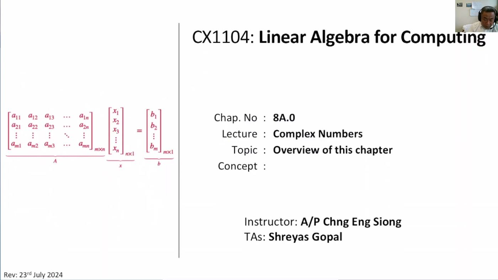

**Content — title card:** *Chap. No: 8A.0 · Lecture: Complex Numbers · Topic: Overview of this chapter.*

- The chapter covers: **8A.1** complex numbers, arithmetic and Euler's formula; **8A.2** De Moivre's theorem and roots; **8A.3** complex vectors, inner products and the **Discrete Fourier Transform (DFT)**.

> 🎙️ **Narration:** *"We'll come back to linear algebra for computing. This is chapter 8a.0. In this chapter we are going to talk about complex numbers. We'll present the overview of"*

---

### 🎬 Slide 2 — Content outline of Chapter 8A

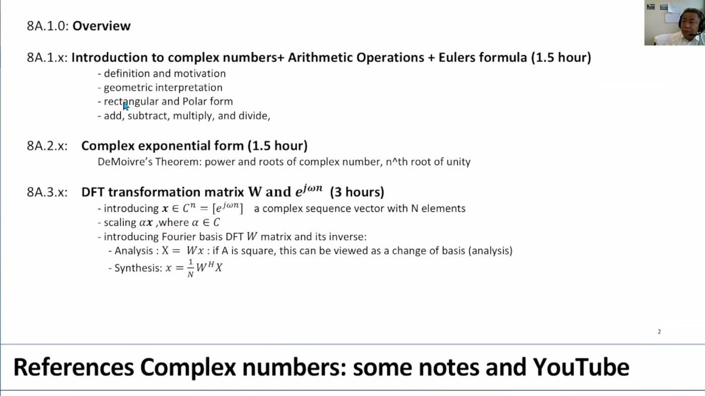

**Content — Chapter 8A outline:**

- **8A.1.0** Overview;
- **8A.1.x** Introduction to complex numbers + arithmetic operations + Euler's formula (1.5 hour): definition and motivation, number sets, rectangular/polar/exponential forms;
- **8A.2.x** De Moivre's theorem, powers and roots (1 hour);
- **8A.3.x** Complex vectors, inner product, orthogonal complex basis, decomposing into sinusoids, the **DFT** (2 hours).

> 🎙️ **Narration:** *"this chapter specifically in 8a.1. We'll discuss introduction to complex numbers, aromatic operations, Euler's formula. Take about one and a half hours in 8a.2. We'll extend it to complex exponential form, 30xnr, one and a half hours and finally we'll take three hours for discrete Fourier transform. We can examine discrete Fourier transform from a linear algebra perspective and this is what we'll do in 8a.3. In the following slide I will give you some"*

---

### 🎬 Slide 3 — References — complex numbers

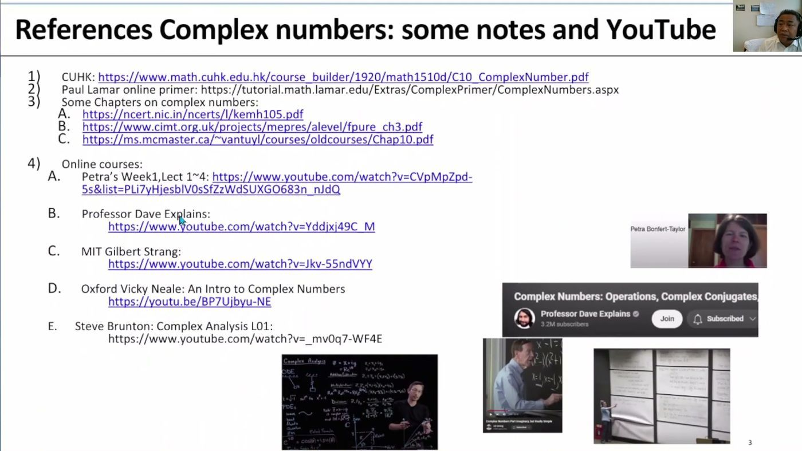

**Content — Reference materials listed on the deck:**

- Notes and YouTube links on complex numbers (CUHK notes and others);
- Visualisations of addition/subtraction/multiplication on the Argand diagram;
- Euler equation pages; rotating phasor animations;
- DFT references (incl. the DFT matrix and its orthonormality);
- Aliasing (the “wagon wheel” effect) for intuition about sampling.

> 🎙️ **Narration:** *"references of complex numbers that may be useful for you. One two three are some lecture notes from CUHK, Polyma and some universities from India, UK as as well as Canada. In link number four, I give you YouTube online courses from Petra. This is Petra, Professor Dave explains MIT Oxford as well as Steve Brunton. I particularly like Steve Brunton and Petra's courses but you can choose any that you see fit."*

---
## V-8A.1 — 8A.1 Complex Numbers: Introduction and Arithmetic

> **Videos (12):** 8A.1 pg1~4, pg5, pg6, pg7~8, pg9~11, pg12~15, pg16, pg17~19, pg20~22, pg23, pg24, pg25~28 (67.0 min) — deck: `8A.1_ComplexNumbers.pdf` (31 pages)
>
> *This section has many repeated views of the same slide page (progressive annotation and on-screen reference material); consecutive views are grouped below and the fullest view is shown.*

### 🎬 Slide 1 — CX1104: Linear Algebra for Computing Instructor: A/P Chng Eng Siong TA: Shreyas Gopal Rev: 23rdJuly 2024 Chap.

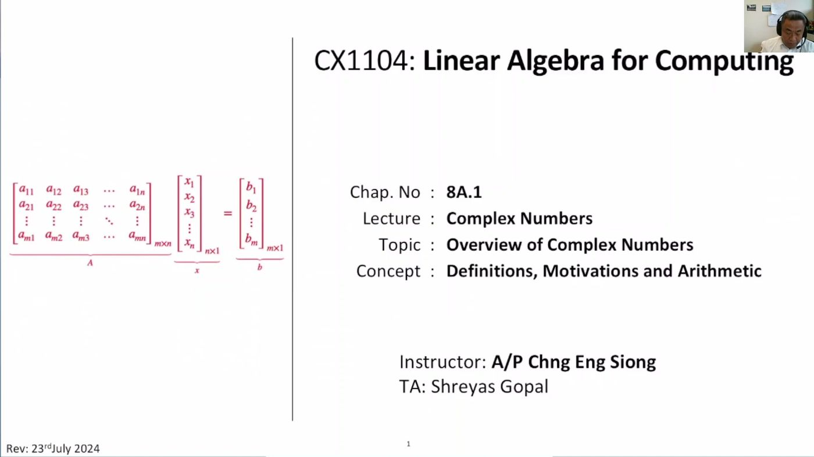

**Deck page — 8A.1_ComplexNumbers.pdf, p. 1:**

> CX1104: Linear Algebra for Computing Instructor: A/P Chng Eng Siong TA: Shreyas Gopal Rev: 23rdJuly 2024 Chap. No : 8A.1 Lecture : Complex Numbers Topic : Overview of Complex Numbers Concept : Definitions, Motivations and Arithmetic 1

> 🎙️ **Narration:** *"We'll come back, this is 8.8.1, we'll present the overview of complex numbers, definition, motivations and aromatic."*

---

### 🎬 Slide 2 — Content: Complex Numbers 2 8A.1: Introduction to complex numbers+ Arithmetic Operations (1.5 hour) 8A.1.1 - De

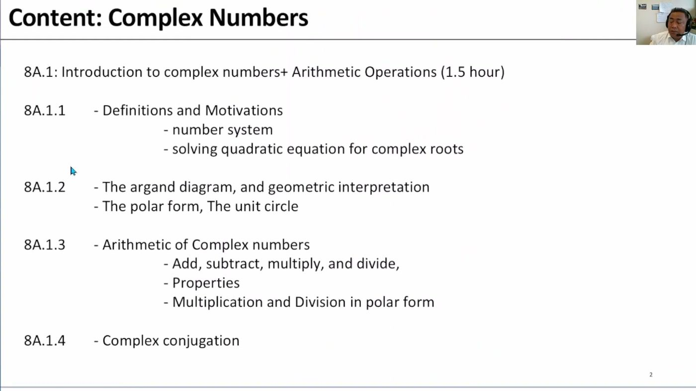

**Deck page — 8A.1_ComplexNumbers.pdf, p. 2:**

> Content: Complex Numbers 2 8A.1: Introduction to complex numbers+ Arithmetic Operations (1.5 hour) 8A.1.1 - Definitions and Motivations - number system - solving quadratic equation for complex roots 8A.1.2 - The argand diagram, and geometric interpretation - The polar form, The unit circle 8A.1.3 - Arithmetic of Complex numbers - Add, subtract, multiply, and divide, - Properties - Multiplication and Division in polar form 8A.1.4 - Complex conjugation

> 🎙️ **Narration:** *"The chapter is divided into four subsections in 8.8.1, we have definitions and motivations in 8.8.1.2, we have Argon diagram, geometric interpretation, polar form, unit circles 8.8.1.3, aromatic and 8.8.1.4 complex conjugation. Let's begin with 8.1.1. Now we want to introduce the complex numbers and to"*

---

### 🎬 Slide 3 — A.1.1 - Definitions and Motivations: Number sets

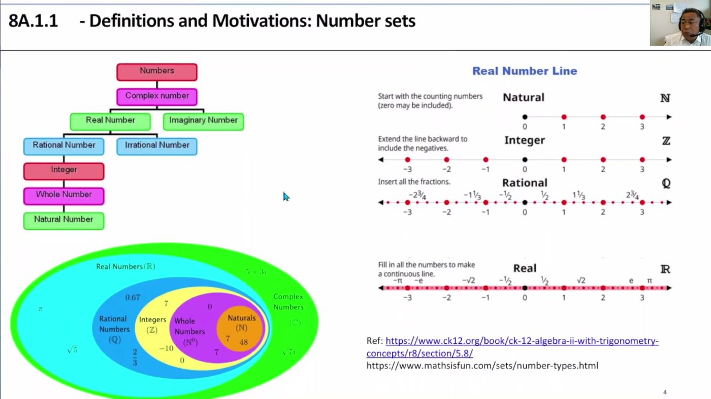

**Deck page — 8A.1_ComplexNumbers.pdf, p. 4:**

> 8A.1.1 - Definitions and Motivations: Number sets 4 Ref: https://www.ck12.org/book/ck-12-algebra-ii-with-trigonometry- concepts/r8/section/5.8/ https://www.mathsisfun.com/sets/number-types.html

> 🎙️ **Narration:** *"introduce the complex numbers we want to study the various number systems. The simplest number system that we know from birth is of course the natural number and why is the natural number? The natural numbers are nothing but 1, 2, 3 and up"*

---

### 🎬 Slide 4 — On-screen reference / annotated frames

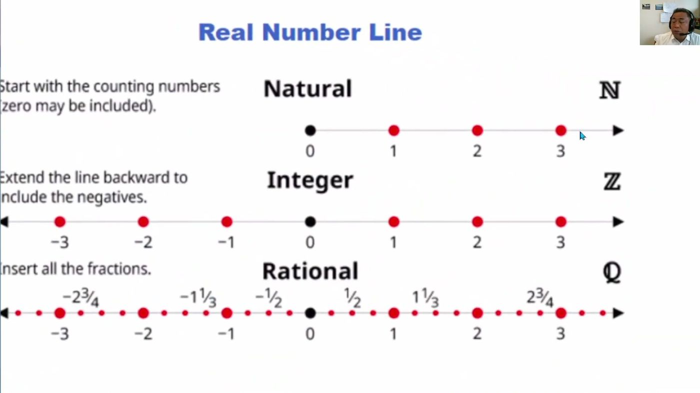

**Frames without a deck page:** the screen shows reference material (web page, video, or handwritten annotation) — the narration below explains what is being discussed.

> 🎙️ **Narration:** *"infinity. We use the stylistic n to represent the set of all natural numbers. 0 does not belong to the set of natural number. When we include 0 with the natural number, we call it the whole number. And where is the whole number? If you look at it from this view, the natural number as a set in a Venn diagram and the whole number is this purple color where we have zero and including the set of natural number"*

---

### 🎬 Slide 5 — A.1.1 - Definitions and Motivations: Number sets

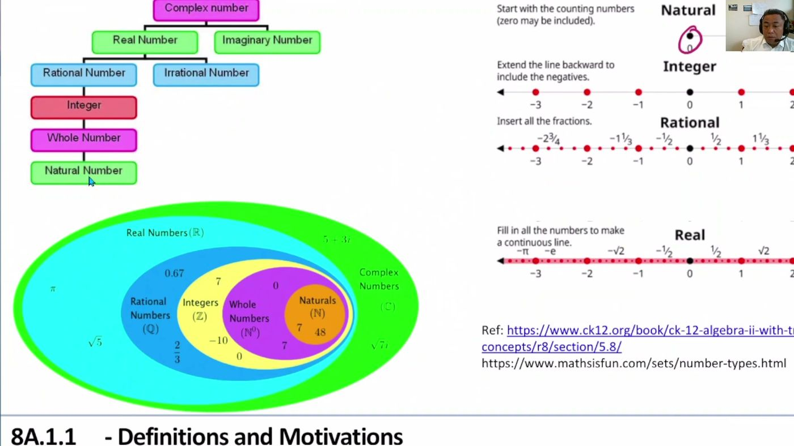

**Deck page — 8A.1_ComplexNumbers.pdf, p. 4:**

> 8A.1.1 - Definitions and Motivations: Number sets 4 Ref: https://www.ck12.org/book/ck-12-algebra-ii-with-trigonometry- concepts/r8/section/5.8/ https://www.mathsisfun.com/sets/number-types.html

> 🎙️ **Narration:** *"within it. You can also view it from this, the natural number is below the set of whole numbers and on top the whole numbers is set of integers. So what is that? Well the set of integers basically extends the number line from the"*

---

### 🎬 Slides 6–7 — On-screen reference / annotated frames

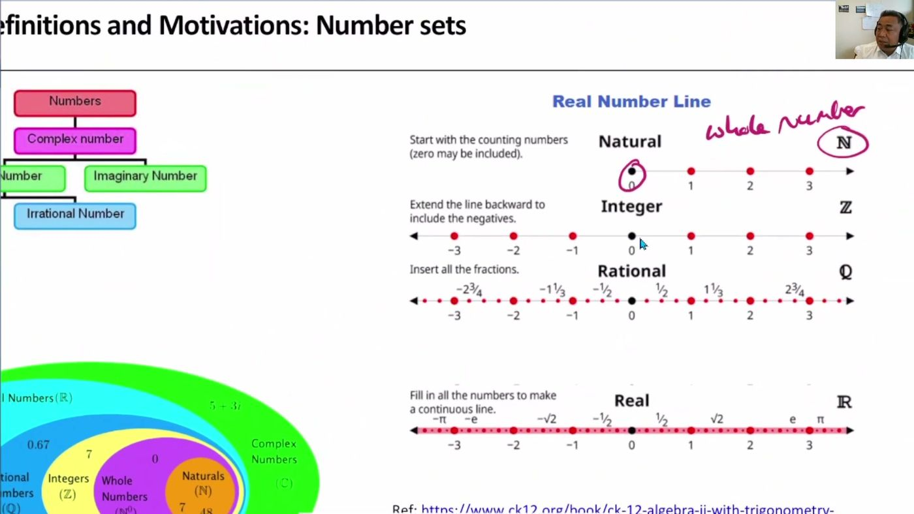

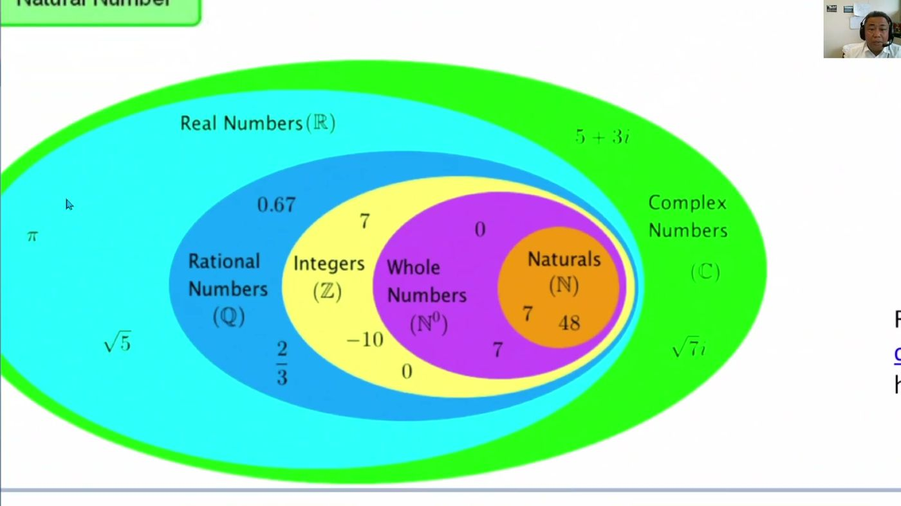

**Frames without a deck page:** the screen shows reference material (web page, video, or handwritten annotation) — the narration below explains what is being discussed.

> 🎙️ **Narration:** *"right-hand side which is positive numbers with the zero to the negative side minus one minus two minus three and until infinity and we use the notation the stylistic z to represent the set of all integers. We of course know that as we progress we we need more numbers in the number systems and we introduce fractions. We call fractions rational because the word rational or the word ratio comes from the word rational or the other way around whichever you prefer. So we have now ratios we have halves one one third two two thirds and of course it includes the negative ratios as well negative one one third. So where's the rational? Rational is here it is a bigger set than integers so it's as a bigger circle and all these are rational because 0.67 is actually 67 divided by 100 and q represents the set of all rational numbers. Now if you want to"*

---

### 🎬 Slide 8 — A.1.1 - Definitions and Motivations: Why need for complex numbers

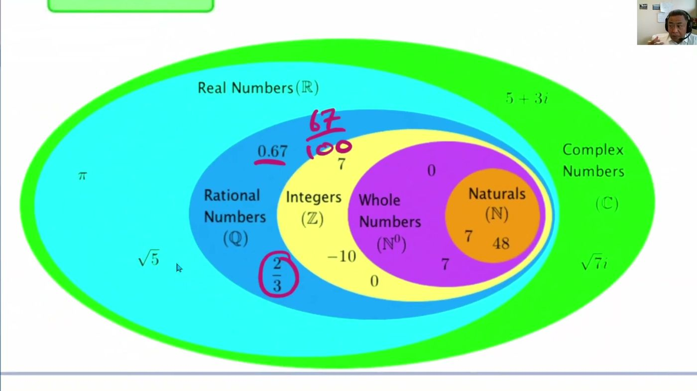

**Deck page — 8A.1_ComplexNumbers.pdf, p. 7:**

> 8A.1.1 - Definitions and Motivations: Why need for complex numbers 7 Ref:https://cyberspacesystem.blogspot.com/2012/03/complex-numbers-quadratic-formula.html Introduce To have complex solutions!

> 🎙️ **Narration:** *"have other numbers, they realize that square root of 2 cannot be represented as a rational number of pi or square root of 5 and to do that we extend the rational numbers to the real numbers."*

---

### 🎬 Slide 9 — Relevant References for this section 1) U. of surrey course notes on complex numbers https://www.surrey.ac.uk/

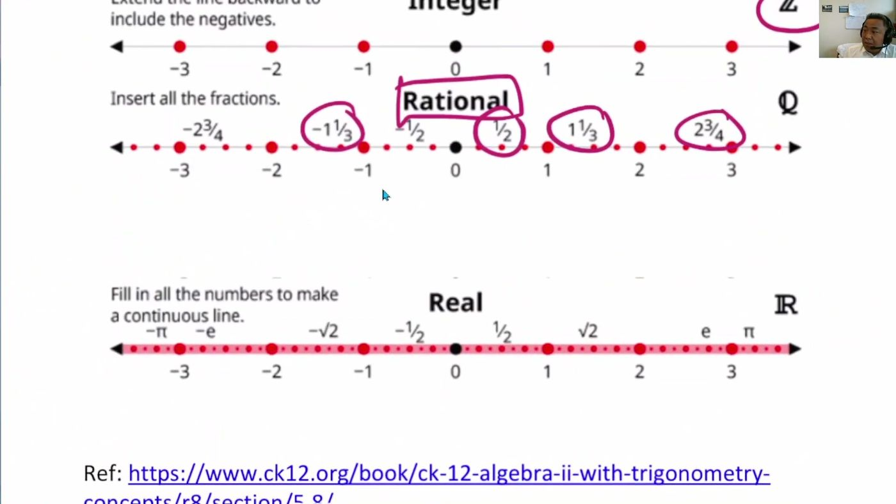

**Deck page — 8A.1_ComplexNumbers.pdf, p. 29:**

> 29 Relevant References for this section 1) U. of surrey course notes on complex numbers https://www.surrey.ac.uk/sites/default/files/2021-07/10.1-introduction-to-complex-numbers.pdf 2) Beginner’s guide: https://www.matrix.edu.au/beginners-guide-maths-extension-2/introduction-to-complex-numbers/ 3) Online book: UC Davis https://math.libretexts.org/Bookshelves/Linear_Algebra/Book:_Linear_Algebra_(Schilling_Nachtergaele_and_Lankham)/02:_Introduction_to_Complex_Numbers 4) Petra’s Bonfert Taylor complex analysis videos: Lect1~4 https://www.youtube.com/watch?v=CVpMpZpd-5s&list=PLi7yHjesblV0sSfZzWdSUXGO683n_nJdQ&index=1

> 🎙️ **Narration:** *"So, if you see that this is a line with all these dots representing the element of the set of Q, then there are spaces in between these dots."*

---

### 🎬 Slide 10 — On-screen reference / annotated frames

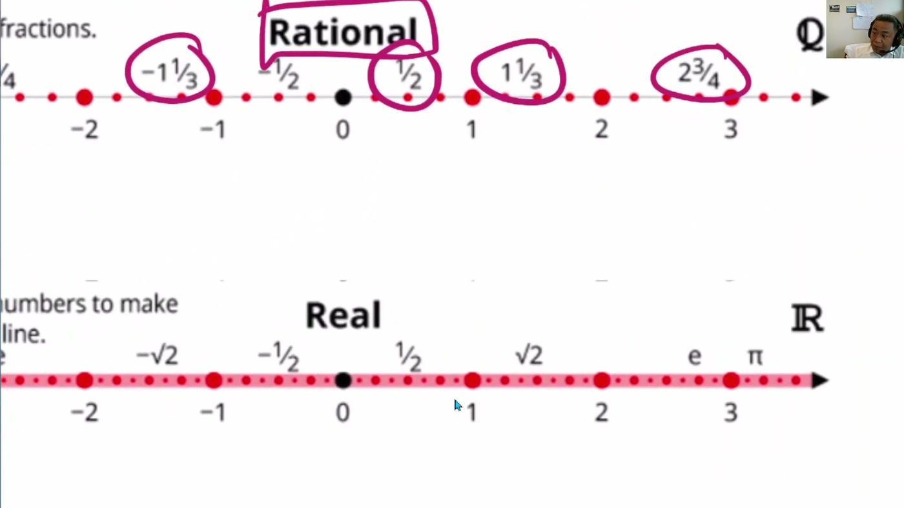

**Frames without a deck page:** the screen shows reference material (web page, video, or handwritten annotation) — the narration below explains what is being discussed.

> 🎙️ **Narration:** *"So what happened is that the real work helped to fill up all these spaces. And so what we see is that root 2 is included here. So the shaded pink represents that there is no space in between any numbers at all. that we have the real number system. Well by the time we have reached the real"*

---

### 🎬 Slide 11 — A.1.2 Example: Visualizing the complex roots https://youtu.be/5g80j17w0CE?si=HMWc-l8HekEjptxg c=8 c=9 c=9.5 Ro

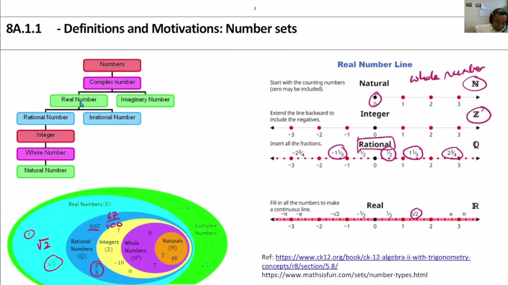

**Deck page — 8A.1_ComplexNumbers.pdf, p. 16:**

> 8A.1.2 Example: Visualizing the complex roots https://youtu.be/5g80j17w0CE?si=HMWc-l8HekEjptxg c=8 c=9 c=9.5 Roots are complex numbersRoots at real values = 2, 4 Roots at real value = 3 3+j0.707, 3-j0.7072, 4 Im(z) Im(z) Im(z) Re(z) Re(z) Re(z) 16

> 🎙️ **Narration:** *"number we are here and what we can now do is that we are going to introduce the complex numbers and the complex numbers consist of real numbers and imaginary numbers. So later on you realize that square root of minus one is defined as I and numbers such as 7I or I7 or 7I, these are complex or sorry are imaginary numbers and to get complex numbers we have a plus i7 for example where a is a real number and or a plus i b and b is also a real number. So then we now have these number systems that we know today. Thank you."*

---

### 🎬 Slides 12–13 — A.1.1 - Definitions and Motivations: Number sets

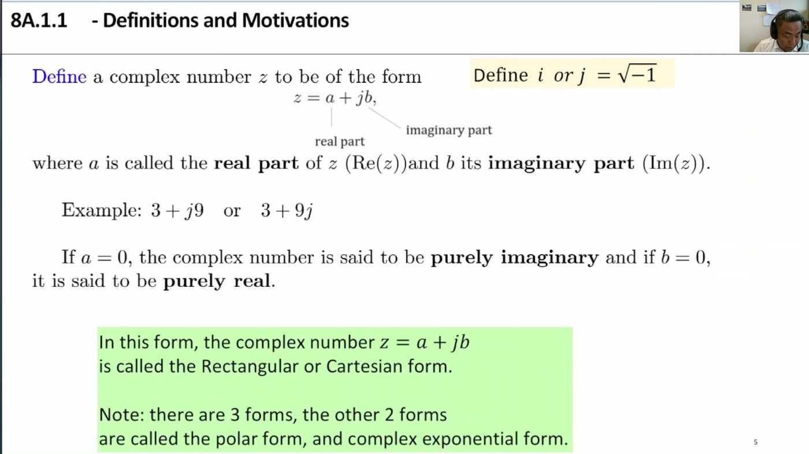

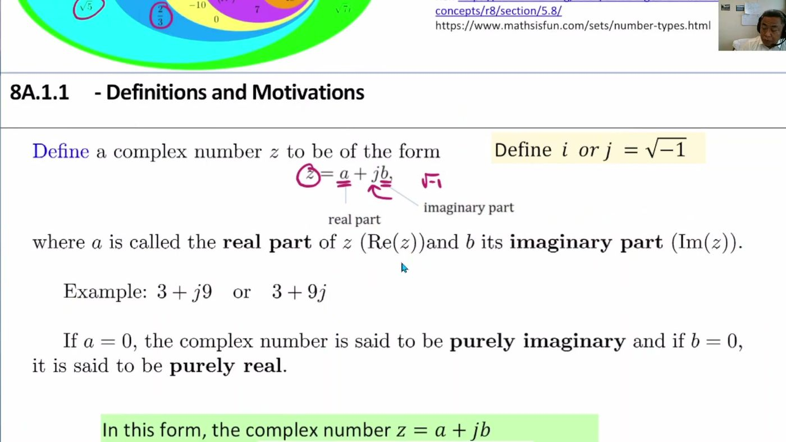

**Deck page — 8A.1_ComplexNumbers.pdf, p. 4:**

> 8A.1.1 - Definitions and Motivations: Number sets 4 Ref: https://www.ck12.org/book/ck-12-algebra-ii-with-trigonometry- concepts/r8/section/5.8/ https://www.mathsisfun.com/sets/number-types.html

> 🎙️ **Narration:** *"In this slide, we'll define what a complex number is. A complex number C has the form of A plus JB, where Z is the complex numbers, A is the real part, B is the imaginary part, and J is defined as the square root of minus 1. We use the notation real of Z to get A imaginary of Z to get B. So for example, if we have 3 plus J9, or we can also write it as 3 plus 9 J, it doesn't matter whether we put J in front of the real or 9, sorry the real in front of the J, it doesn't matter. Now if the real part, A part is zero, then we only have a imaginary, purely imaginary number. So the complex number is purely imaginary. If we have b as 0, then we have a purely real number. The other terminology that you have to know is that when z, the complex number is represented as a plus jb, we call it the rectangular or the Cartesian form of a complex numbers. There are two other forms that we will study. They are the polar form as well as the complex exponential form."*

---

### 🎬 Slide 14 — A.1.1 - Definitions and Motivations D In this form, the complex number is called the Rectangular or Cartesian 

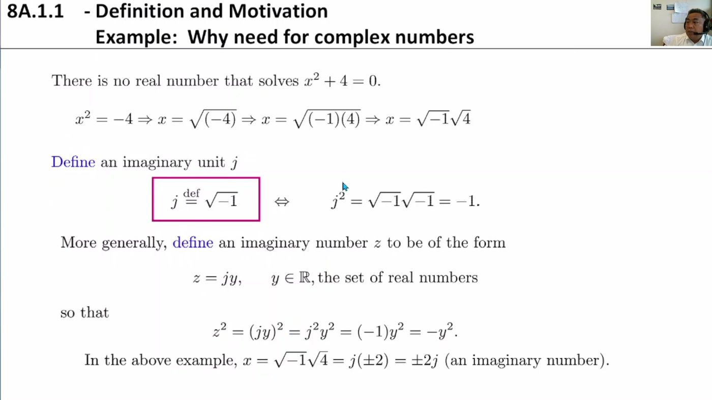

**Deck page — 8A.1_ComplexNumbers.pdf, p. 5:**

> 8A.1.1 - Definitions and Motivations D In this form, the complex number is called the Rectangular or Cartesian form. Note: there are 3 forms, the other 2 forms are called the polar form, and complex exponential form. 5

> 🎙️ **Narration:** *"In this slide, we will talk about why we need complex numbers. Let's start with an example first. Let's start with a simpler example than this one. We have x square"*

---

### 🎬 Slides 15–16 — On-screen reference / annotated frames

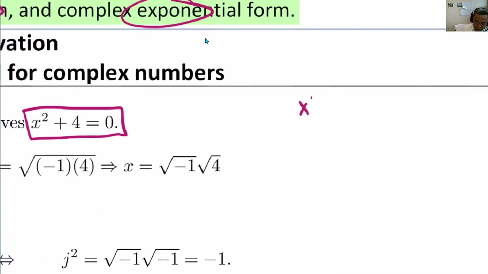

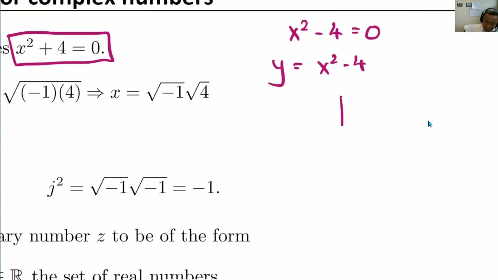

**Frames without a deck page:** the screen shows reference material (web page, video, or handwritten annotation) — the narration below explains what is being discussed.

> 🎙️ **Narration:** *"minus 4 equals to 0. So what we are trying to do is we are trying to find a value of x such that this equation on the left hand side is also equal to 0. What can we do? Well we can say let x equals to x square minus 4, this equation and then we begin to plot. This is x and this is y and then we plot of course for the value of x when x is 0 so y is minus 4. So minus 4 is here and we have one point here. Now when x is 1 then the answer is it is at minus 3. So this is minus 3 is here and when x is minus 1 minus 1 times square is also So, this was plus one, so it is here. So when x is equals to two, which is two square, then we have two square, which is four minus four is zero, and the other side is also minus two times minus two is also four, and now we can plot this parabola, and this parabola is actually y equals to x square minus four."*

---

### 🎬 Slides 17–18 — A.1.2 - definition and motivation The unit circle in the complex plane. The unit circle (in pink) is the circl

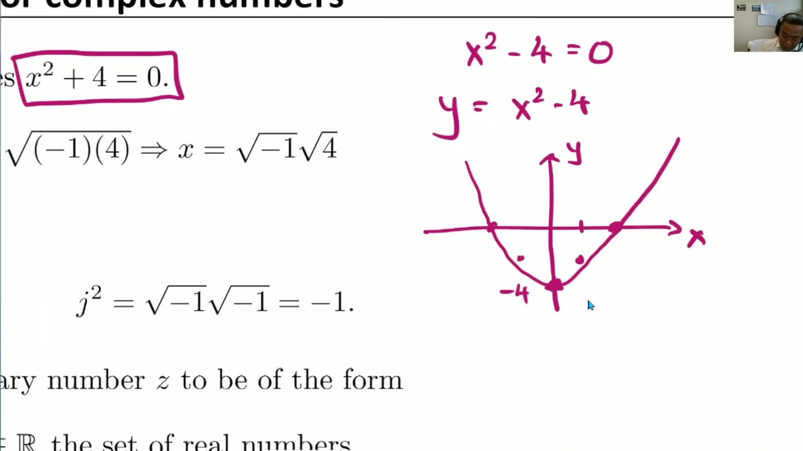

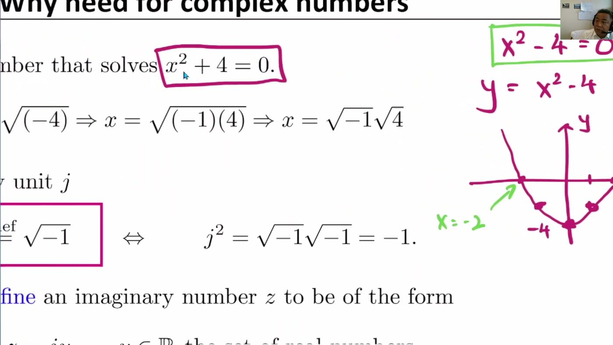

**Deck page — 8A.1_ComplexNumbers.pdf, p. 15:**

> 8A.1.2 - definition and motivation The unit circle in the complex plane. The unit circle (in pink) is the circle of radius 1 centered at 0. It include all complex numbers of absolute value 1, so it has the equation |z| = 1 Real AXIS Imaginary Axis Im(z) Re(z) - + 0

> 🎙️ **Narration:** *"Sorry about this. Okay, so you realize that when you give you an equation like this, you can set it to y and then you can then plot x versus y or y versus x. Now, so what is the condition when this y is equals to zero? So this is the two points over here that we are interested in when x is equals to two and when x equals to minus two. So we call this the the solution of the equation or the roots So this equation such that y is equal to 0. All right, so we realize that to solve for this equation, then x can be equal to plus or minus, crossing the horizontal axis. Okay, we know how to solve for x squared minus four. What about x squared plus four? Then you realize that when we solve for x squared plus four,"*

---

### 🎬 Slides 19–20 — Content: Complex Numbers 2 8A.1: Introduction to complex numbers+ Arithmetic Operations (1.5 hour) 8A.1.1 - De

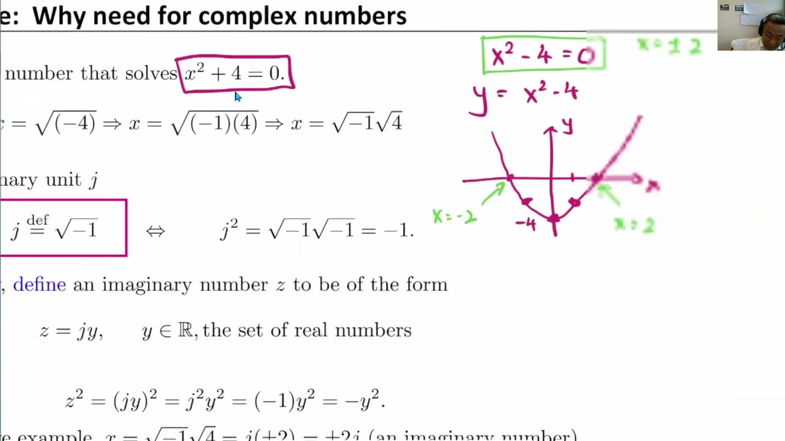

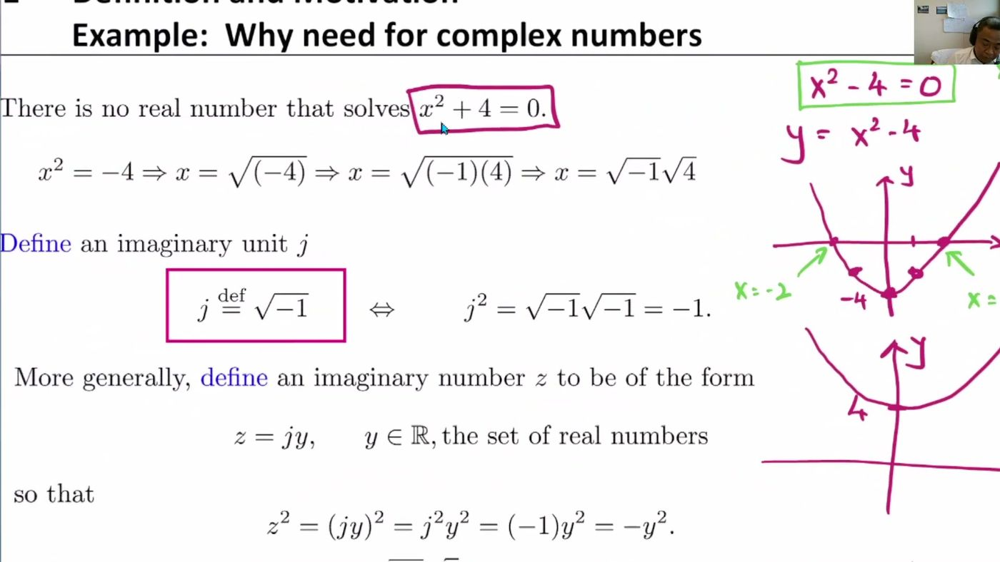

**Deck page — 8A.1_ComplexNumbers.pdf, p. 2:**

> Content: Complex Numbers 2 8A.1: Introduction to complex numbers+ Arithmetic Operations (1.5 hour) 8A.1.1 - Definitions and Motivations - number system - solving quadratic equation for complex roots 8A.1.2 - The argand diagram, and geometric interpretation - The polar form, The unit circle 8A.1.3 - Arithmetic of Complex numbers - Add, subtract, multiply, and divide, - Properties - Multiplication and Division in polar form 8A.1.4 - Complex conjugation

> 🎙️ **Narration:** *"now we draw this curve. And you realize that, well, when x is 0, y is already 4. So you realize that the curves, this is y is equal to x square plus 4. Because when x is 0, y is already 4. This is x and this is y. So this curve has just moved up by the change of this constant over here. And now it does not cross the horizontal axis. There is no x such that y will be equals to zero. So this is the condition here. Basically when we try for to solve x square plus four equals to zero, we move the four to the right hand side. So it's x square equals to minus four and now when we stick the square root on the left and right hand side, we got x equals to square root of minus four and we did not know or we do not know how to solve this."*

---

### 🎬 Slides 21–22 — On-screen reference / annotated frames

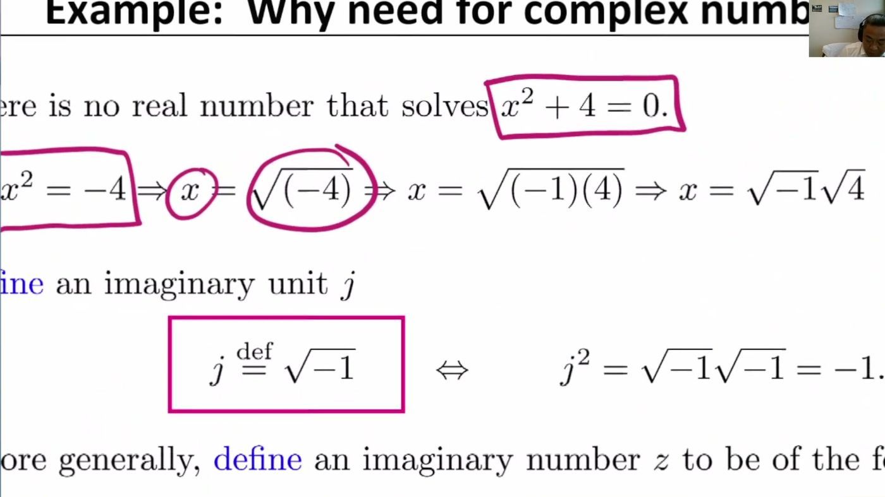

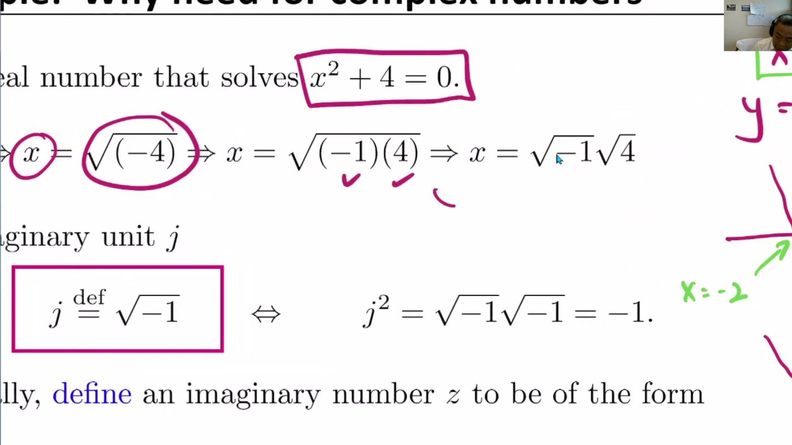

**Frames without a deck page:** the screen shows reference material (web page, video, or handwritten annotation) — the narration below explains what is being discussed.

> 🎙️ **Narration:** *"Well, let's progress. Minus 4 is equals to minus 1 times 4. Right? So nothing changed. The radical, the square root sign is outside still. By the law of exponent, we can bring this into two parts. We have this. And remember, we have defined that square root of minus 1 to be j. So is j and square root of 4 is"*

---

### 🎬 Slide 23 — Content: Complex Numbers 2 8A.1: Introduction to complex numbers+ Arithmetic Operations (1.5 hour) 8A.1.1 - De

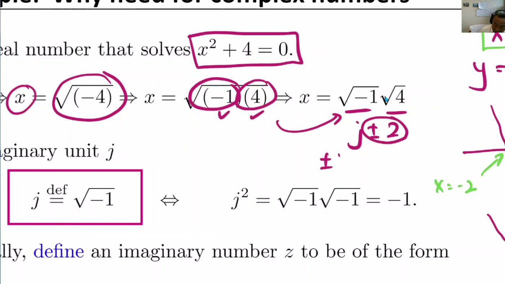

**Deck page — 8A.1_ComplexNumbers.pdf, p. 2:**

> Content: Complex Numbers 2 8A.1: Introduction to complex numbers+ Arithmetic Operations (1.5 hour) 8A.1.1 - Definitions and Motivations - number system - solving quadratic equation for complex roots 8A.1.2 - The argand diagram, and geometric interpretation - The polar form, The unit circle 8A.1.3 - Arithmetic of Complex numbers - Add, subtract, multiply, and divide, - Properties - Multiplication and Division in polar form 8A.1.4 - Complex conjugation

> 🎙️ **Narration:** *"plus minus 2. So the answer is plus and minus 2j is the answer. Okay, so look here. We can solve if we admit the use of imaginary numbers then the x squared equals to minus 4 has two solutions which are imaginary numbers, purely imaginary numbers plus and minus 2j. Please remember that j is a definition, right? We define j to be square root of minus one and we use the law of exponent to manipulate it like this. So if j is square root of minus one, what is j squared? Well, j squared is square root of minus one times square of minus one, so this is minus one. So we realize that we can actually, through some multiplication, convert a purely imaginary number to a real number again. this is one way. Alright, what about when z is equals to jy? Well when z equals to jy what is z square? So basically we have jy bracket square, we can move the square into inside this jy. So it's jy, j squared times y squared and j squared as we have known now which is minus 1, so which is minus 1 times y squared, which is this solution over here. Okay so you'll learn how to do some of this manipulation"*

---

### 🎬 Slides 24–28 — On-screen reference / annotated frames

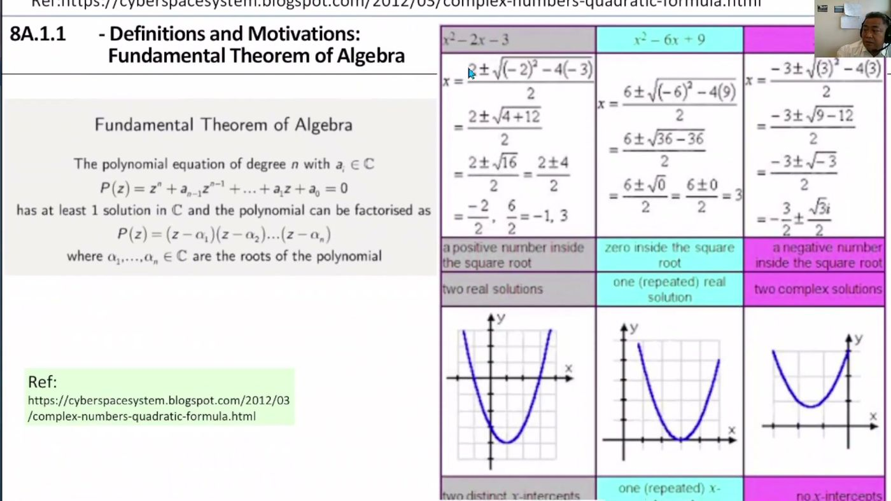

**Frames without a deck page:** the screen shows reference material (web page, video, or handwritten annotation) — the narration below explains what is being discussed.

> 🎙️ **Narration:** *"later on but this is one motivation why we need complex numbers. For polynomials sometimes when we want to solve for the roots of the equations, we can't solve them because there is no real number that will solve this equation correctly. Thank you. Let's continue with the question of why do we need complex numbers by examining this quadratic equation which is ax squared plus bx plus c equals to zero. So basically again we want to find x such that the left hand side is equals to zero. In our previous example we have x squared plus 4 so we have the quadratic term but we do not have the x term. So now if we introduce the x term here which is b the constant b times x then the solution which we have studied in high school is this x equals to minus b plus minus square root of b square minus 4c divided by 2a. By plugging the constants in front of this x squared and x as well as c we can find the x that solves the left-hand side such that the left-hand side equation will be equals to zero. We call this let's examine this square root of b squared minus 4ac. There are three different realizations of the value b squared minus 4ac. When b squared minus 4ac is greater than zero then we have plus and minus so we have two solutions. When b squared minus 4ac equals to zero we only have one real solution because is minus b plus and minus zero divided by 2a. So x will have only one real solution. Now when b squared minus 4ac is negative, then we have the complex solution. Okay, so this is what we know in high school. We are using this. The fundamental theorem of algebra tells us that when we have a quadratic equations, we will have two solutions. If we have polynomial or degree n, we have n roots, that means n axis that we'll solve for this equation. So let us study the general quadratic equations. So we have x squared minus 2x minus 3, and when we solve for the x, then we realize that this radical contains a positive number, and therefore in example we have 16, we have 2 plus and minus square root of 16, which is 2 plus minus 4 and then we find that minus 1 and 3 are solutions and when we plot the equation one crosses at minus 1 and the other side is 3. So this is two real solutions very similar to x squared minus 4. Now we change the equation a little bit. Well basically is that you see that we are going to move these curves upwards and it only touches the horizontal axis in one point. So this is a single solution. We call it a repeated solution. Let's plug in the values and see what happens. Basically in the square root we have these terms such that they become equal 36 minus 36 equals to 0. So we only have 6 plus and minus square root of 0 which is 0 and therefore the answer is only 3. So there's only one x that will solve this solution. We call it a repeated solution. Okay, so it is still it's called repeated sometimes. And of course we have already realized that hey when we have certain values of the constant such that this square root sine becomes negative then we do not know how to solve them. Okay, and of course in the last lecture we already saw that we can plug"*

---

### 🎬 Slide 29 — Content: Complex Numbers 2 8A.1: Introduction to complex numbers+ Arithmetic Operations (1.5 hour) 8A.1.1 - De

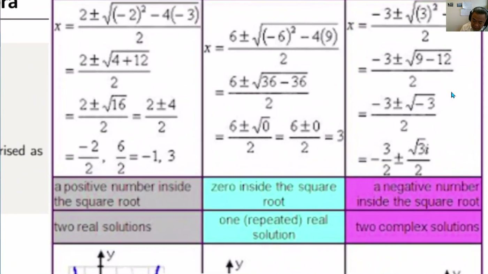

**Deck page — 8A.1_ComplexNumbers.pdf, p. 2:**

> Content: Complex Numbers 2 8A.1: Introduction to complex numbers+ Arithmetic Operations (1.5 hour) 8A.1.1 - Definitions and Motivations - number system - solving quadratic equation for complex roots 8A.1.2 - The argand diagram, and geometric interpretation - The polar form, The unit circle 8A.1.3 - Arithmetic of Complex numbers - Add, subtract, multiply, and divide, - Properties - Multiplication and Division in polar form 8A.1.4 - Complex conjugation

> 🎙️ **Narration:** *"in here which is square root of minus one multiplied by three which is square root of minus one square root of three and then which is equals to j three okay"*

---

### 🎬 Slide 30 — On-screen reference / annotated frames

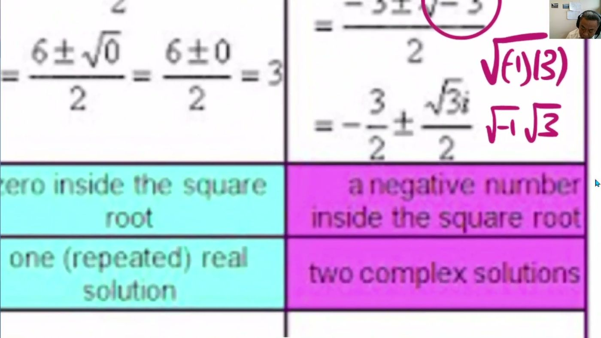

**Frames without a deck page:** the screen shows reference material (web page, video, or handwritten annotation) — the narration below explains what is being discussed.

> 🎙️ **Narration:** *"so square root of three I mean square root of three j sometimes we call j as i as well now then we have an imaginary root but when you plot you actually cannot see where is the root. Later on we'll give you examples of how we can actually see where the root is in the imaginary axis. Alright, so let's revise this. The fundamental theorem of"*

---

### 🎬 Slide 31 — Content: Complex Numbers 2 8A.1: Introduction to complex numbers+ Arithmetic Operations (1.5 hour) 8A.1.1 - De

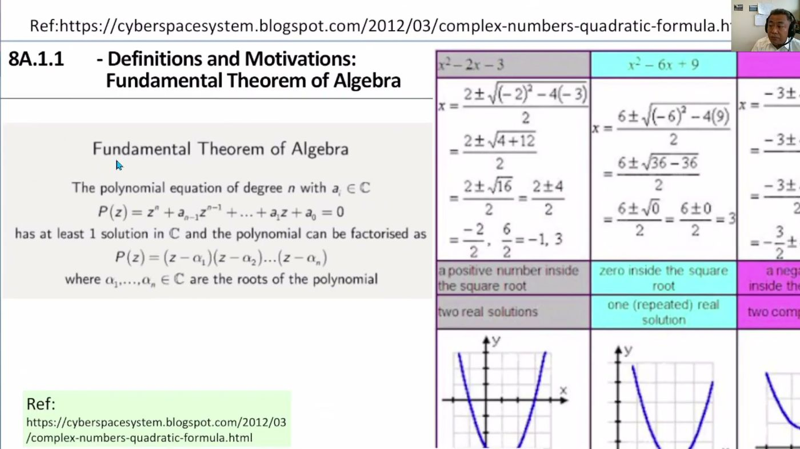

**Deck page — 8A.1_ComplexNumbers.pdf, p. 2:**

> Content: Complex Numbers 2 8A.1: Introduction to complex numbers+ Arithmetic Operations (1.5 hour) 8A.1.1 - Definitions and Motivations - number system - solving quadratic equation for complex roots 8A.1.2 - The argand diagram, and geometric interpretation - The polar form, The unit circle 8A.1.3 - Arithmetic of Complex numbers - Add, subtract, multiply, and divide, - Properties - Multiplication and Division in polar form 8A.1.4 - Complex conjugation

> 🎙️ **Narration:** *"algebra says that when we have a polynomial of degree n and be factorized into this and then there are n number of such that this equation will become equals to zero. We call this the solutions or the roots of the polynomial. If you're interested to visualize the roots of the"*

---

### 🎬 Slide 32 — On-screen reference / annotated frames

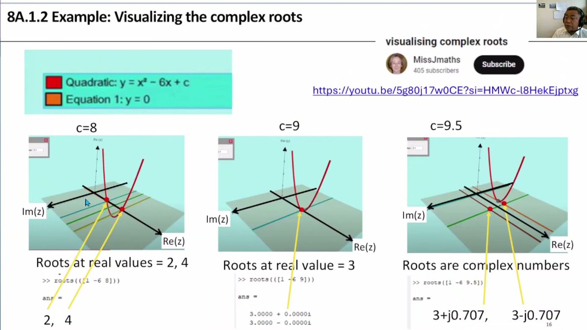

**Frames without a deck page:** the screen shows reference material (web page, video, or handwritten annotation) — the narration below explains what is being discussed.

> 🎙️ **Narration:** *"solution, you can go to slide number 16 where I will explain or I will use the link here by Ms. J.Math to show you where are the roots of the equation such that the roots are, has imaginary solutions."*

---

### 🎬 Slide 33 — A.1.1 - Definitions and Motivations: Why need for complex numbers

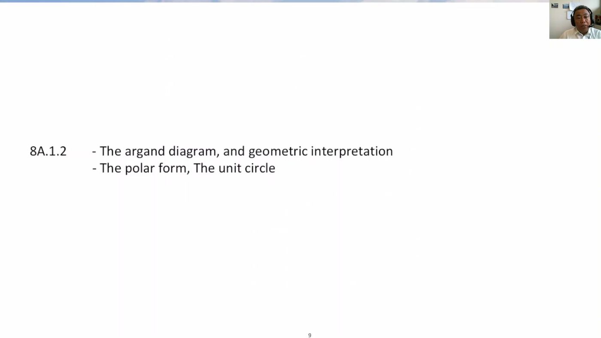

**Deck page — 8A.1_ComplexNumbers.pdf, p. 7:**

> 8A.1.1 - Definitions and Motivations: Why need for complex numbers 7 Ref:https://cyberspacesystem.blogspot.com/2012/03/complex-numbers-quadratic-formula.html Introduce To have complex solutions!

> 🎙️ **Narration:** *"Welcome back. In this chapter 8.8.1.2, we will introduce the Argan diagram which allows us to represent complex numbers geometrically in the complex plane. We also introduce what is the polar form of a complex numbers as well as what the unit circle is a term commonly used in complex numbers literature. We have"*

---

### 🎬 Slide 34 — On-screen reference / annotated frames

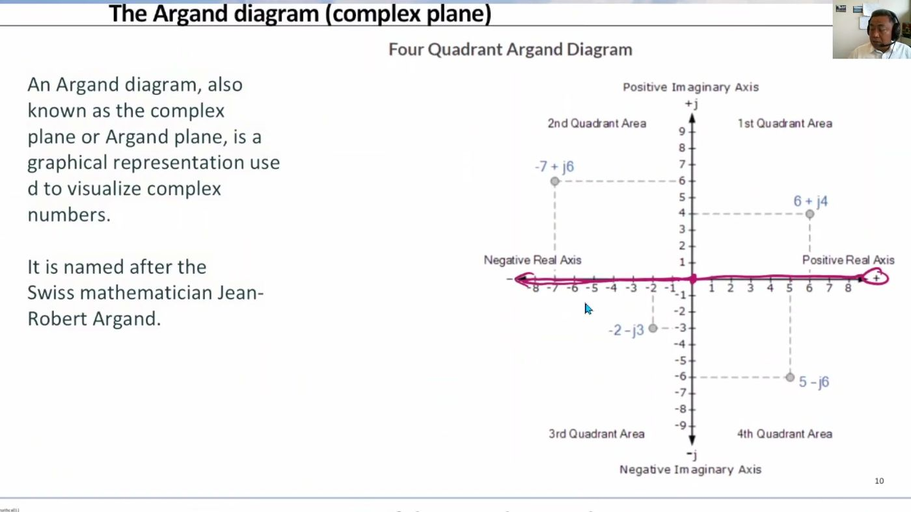

**Frames without a deck page:** the screen shows reference material (web page, video, or handwritten annotation) — the narration below explains what is being discussed.

> 🎙️ **Narration:** *"this line along the horizontal axis and we call this the real number line. In the middle we have the origin and as the number grows larger positively the numbers are put position more and more towards the right hand side till infinity, positive infinity and of course numbers growing more and more towards negative values it moves along the left towards negative infinity and this line is the real number line. Now if this is the real number line where is the imaginary number line? It is the line perpendicular to the real number line. It also has the origin sitting at the middle. So as the imaginary number grows more and more positive then we have actually the imaginary number growing larger and larger upwards in this upward fashion. So we have 1j here, 2j, 3j and 4j and so on, growing larger and larger, growing more and more positive values and when it grows more and more negative value, this is minus 1j, minus 2j and so on and again it also grows towards"*

---

### 🎬 Slide 35 — A.1.1 - Definitions and Motivations: Fundamental Theorem of Algebra

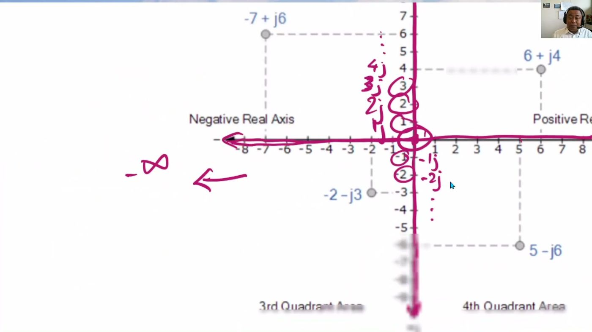

**Deck page — 8A.1_ComplexNumbers.pdf, p. 8:**

> 8A.1.1 - Definitions and Motivations: Fundamental Theorem of Algebra 8 Ref: https://cyberspacesystem.blogspot.com/2012/03 /complex-numbers-quadratic-formula.html

> 🎙️ **Narration:** *(transition frames — the explanation continues on the next slide)*

---

### 🎬 Slides 36–38 — On-screen reference / annotated frames

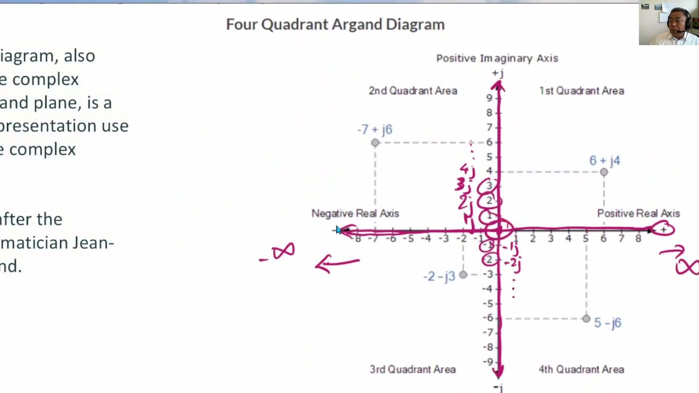

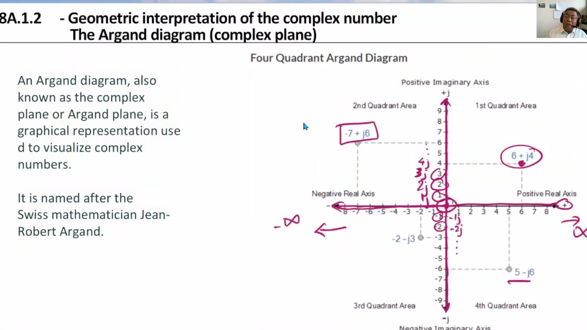

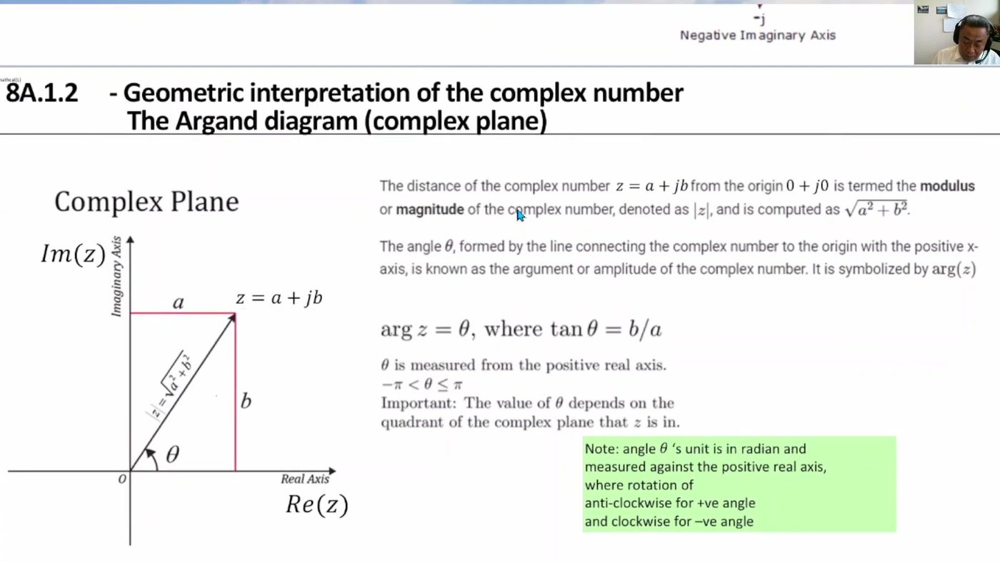

**Frames without a deck page:** the screen shows reference material (web page, video, or handwritten annotation) — the narration below explains what is being discussed.

> 🎙️ **Narration:** *"negative infinity. So you can also visualize these two axes as positive real axes and imaginary axes and it allows us then to visualize the complex numbers on the plane. So now let's see some examples of imaginary numbers on this plane. This is 6 plus j4. What it means is that you move along the real axis by six units and four units upwards because it's plus J4. So this point is six plus J4. What about five minus J6? Similarly, because it's positive five, you move along the real axis by five units and then because it's minus J6, you move downwards along the vertical axis by six units. So this is 5 minus j6. Let's have one more example. Minus 7 plus j6 means you move along the real axis by seven unit towards the left because it's minus 7 and positive 6 upwards by six unit. So these are three examples of the complex numbers on the complex plane. We now continue to introduce some notations that is convenient for us when we want to represent complex numbers on the complex plane. This z equals to a plus jb is the complex numbers represented as in the rectangular form. We have another form which is called a polar form. To represent complex numbers in the polar form we need the magnitude and the angle okay so where's the magnitude and angle well let's have this complex number a plus jb basically it means move a along the real axis and move b along the complex axis now to get the same point we can represent this as z is equals to magnitude of z, angle theta. What are we talking about? Basically it says that we're going to have complex numbers that have the magnitude."*

---

### 🎬 Slides 39–40 — A.1.1 - Definitions and Motivations: Fundamental Theorem of Algebra

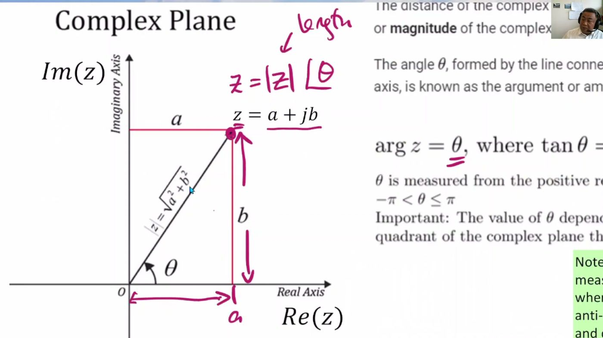

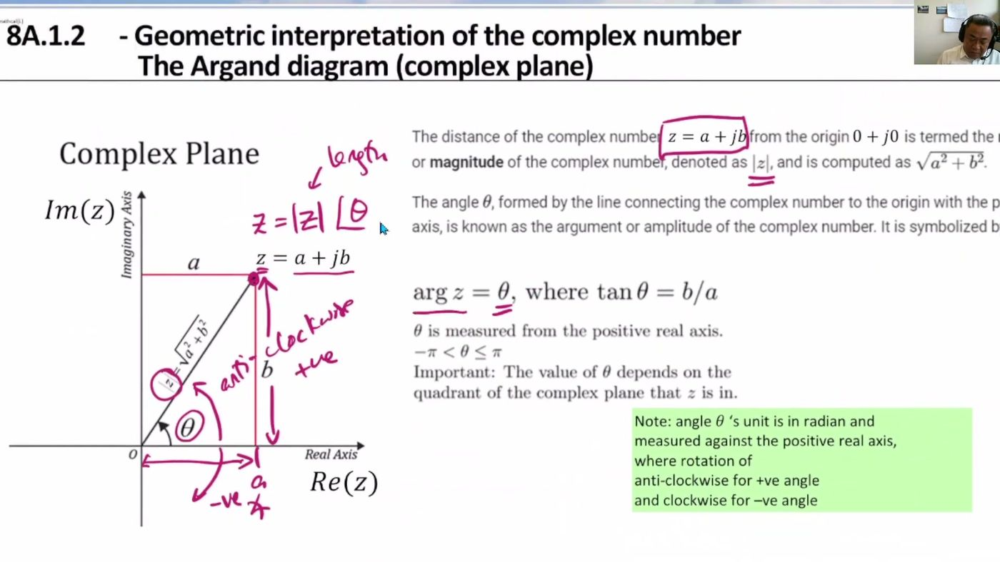

**Deck page — 8A.1_ComplexNumbers.pdf, p. 8:**

> 8A.1.1 - Definitions and Motivations: Fundamental Theorem of Algebra 8 Ref: https://cyberspacesystem.blogspot.com/2012/03 /complex-numbers-quadratic-formula.html

> 🎙️ **Narration:** *"Magnitude here means the length, with length this value and with angle theta. So what does, how to calculate the magnitude? Well this is the right angle triangle and by Pythagoras theorem we know that this length the hypotenuse is square root of a square plus b square so this is the modulus of the complex numbers. What about theta? Theta is the anger that is made with respect to the positive real axis so we take the positive real axis and if the anger of the this line is make anti-clockwise then by convention we call this the positive anger and if anger moves clockwise then this is negative anger okay we call this the argument of C to denote the anger theta. Anger theta is tangent theta equals to b over a because it's opposite over the adjacent tangent theta is b over a so we can calculate theta by using arc tangent implying theta equals to arc tangent of b now theta is measured with respect to the positive real axis and theta will restrict to less or equals to pi greater than minus pi. Okay and theta is typically measured in radians and not in degree in our course."*

---

### 🎬 Slide 41 — On-screen reference / annotated frames

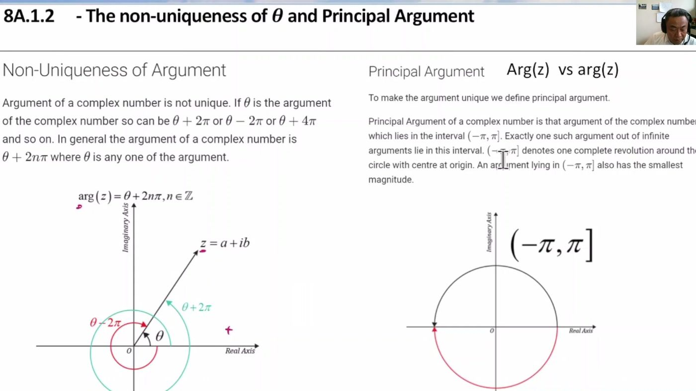

**Frames without a deck page:** the screen shows reference material (web page, video, or handwritten annotation) — the narration below explains what is being discussed.

> 🎙️ **Narration:** *"In this slide we'll discuss the non-uniqueness of theta. What is theta? Well, we have seen in the last few slides that C can be represented in the rectangular form as well as the polar form which is the magnitude and the angle theta."*

---

### 🎬 Slide 42 — A.1.2 Example: Visualizing the complex roots https://youtu.be/5g80j17w0CE?si=HMWc-l8HekEjptxg c=8 c=9 c=9.5 Ro

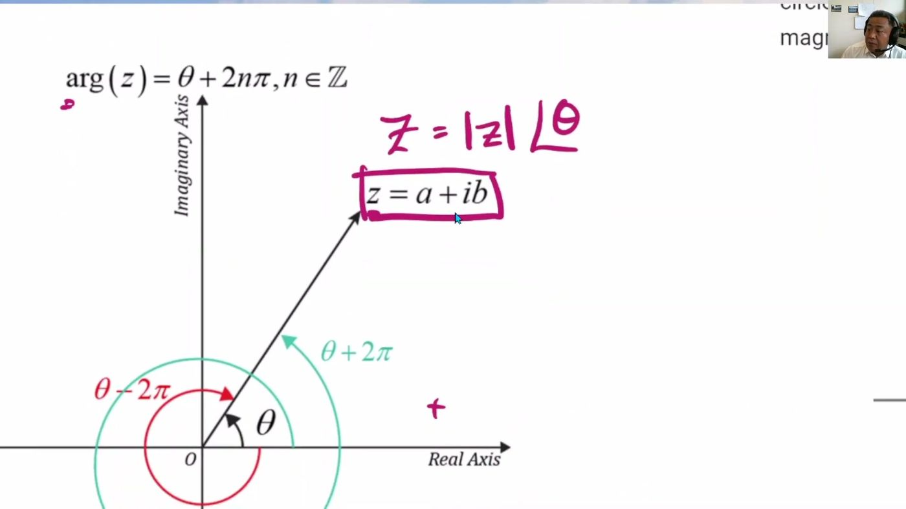

**Deck page — 8A.1_ComplexNumbers.pdf, p. 16:**

> 8A.1.2 Example: Visualizing the complex roots https://youtu.be/5g80j17w0CE?si=HMWc-l8HekEjptxg c=8 c=9 c=9.5 Roots are complex numbersRoots at real values = 2, 4 Roots at real value = 3 3+j0.707, 3-j0.7072, 4 Im(z) Im(z) Im(z) Re(z) Re(z) Re(z) 16

> 🎙️ **Narration:** *"So we are talking about this theta here. Now let's have this point which is sitting at with magnitude z and angle theta over here. Why is this not unique? Basically is that if we add a 2 pi to theta, we are still back at the same angle. Or if we go theta minus"*

---

### 🎬 Slide 43 — Content: Complex Numbers 2 8A.1: Introduction to complex numbers+ Arithmetic Operations (1.5 hour) 8A.1.1 - De

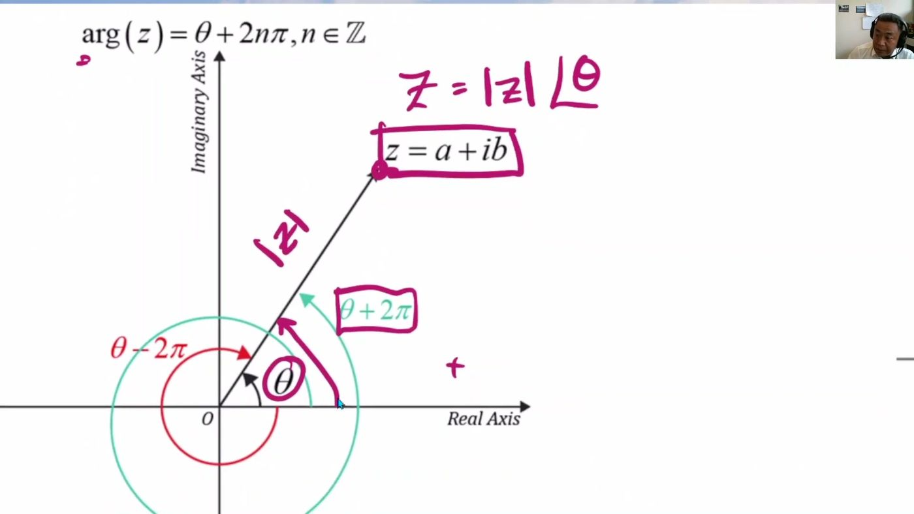

**Deck page — 8A.1_ComplexNumbers.pdf, p. 2:**

> Content: Complex Numbers 2 8A.1: Introduction to complex numbers+ Arithmetic Operations (1.5 hour) 8A.1.1 - Definitions and Motivations - number system - solving quadratic equation for complex roots 8A.1.2 - The argand diagram, and geometric interpretation - The polar form, The unit circle 8A.1.3 - Arithmetic of Complex numbers - Add, subtract, multiply, and divide, - Properties - Multiplication and Division in polar form 8A.1.4 - Complex conjugation

> 🎙️ **Narration:** *"2 pi because 2 pi is a complete circle we are still back in the same angle theta. So in fact z equals to magnitude of z theta plus 2 pi is the same point as theta minus 2 pi and it's the same"*

---

### 🎬 Slide 44 — A.1.2 - Geometric interpretation of the complex number The Argand diagram (complex plane) An Argand diagram, a

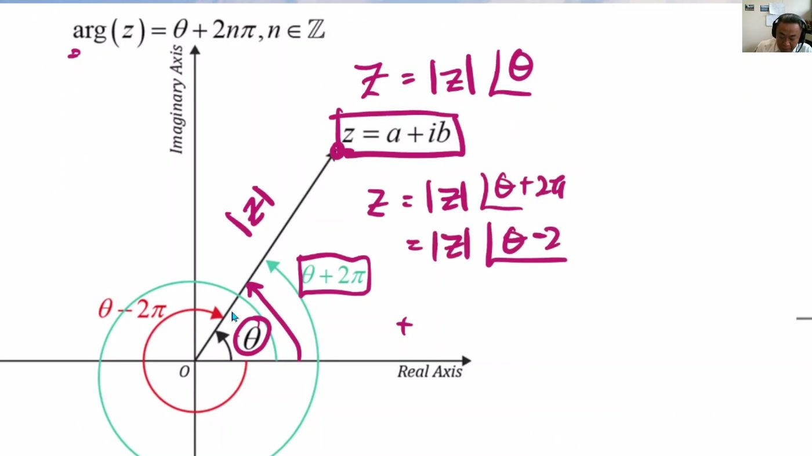

**Deck page — 8A.1_ComplexNumbers.pdf, p. 10:**

> 8A.1.2 - Geometric interpretation of the complex number The Argand diagram (complex plane) An Argand diagram, also known as the complex plane or Argand plane, is a graphical representation use d to visualize complex numbers. It is named after the Swiss mathematician Jean- Robert Argand. 10

> 🎙️ **Narration:** *"point as theta plus 2 pi n where n is any integer. So this shows that actually the complex number"*

---

### 🎬 Slides 45–46 — Relevant References for this section 1) U. of surrey course notes on complex numbers https://www.surrey.ac.uk/

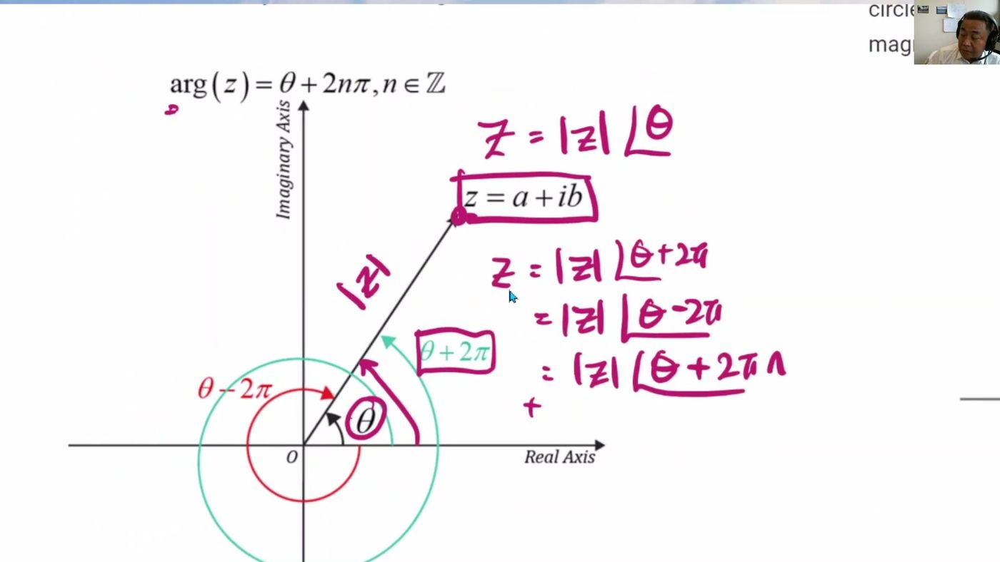

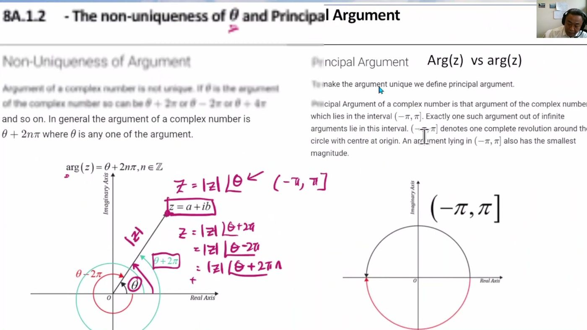

**Deck page — 8A.1_ComplexNumbers.pdf, p. 29:**

> 29 Relevant References for this section 1) U. of surrey course notes on complex numbers https://www.surrey.ac.uk/sites/default/files/2021-07/10.1-introduction-to-complex-numbers.pdf 2) Beginner’s guide: https://www.matrix.edu.au/beginners-guide-maths-extension-2/introduction-to-complex-numbers/ 3) Online book: UC Davis https://math.libretexts.org/Bookshelves/Linear_Algebra/Book:_Linear_Algebra_(Schilling_Nachtergaele_and_Lankham)/02:_Introduction_to_Complex_Numbers 4) Petra’s Bonfert Taylor complex analysis videos: Lect1~4 https://www.youtube.com/watch?v=CVpMpZpd-5s&list=PLi7yHjesblV0sSfZzWdSUXGO683n_nJdQ&index=1

> 🎙️ **Narration:** *"using polar notation can have many different forms and when we use theta to be in the range of minus pi to pi then basically we are expressing theta as the principal argument okay and we use the capital A to denote that the theta is within minus pi to positive pi this is as opposed to using the small a to denote that we can actually put theta in any of these theta plus 2n pi form because theta plus 2n pi form lands exactly at the same angle with respect to the real axis anyway."*

---

### 🎬 Slides 47–48 — On-screen reference / annotated frames

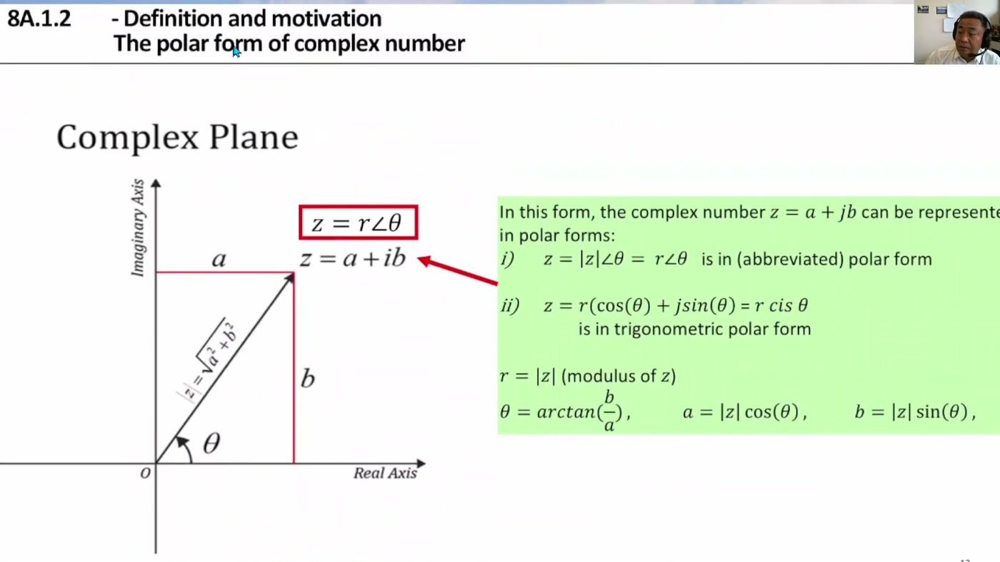

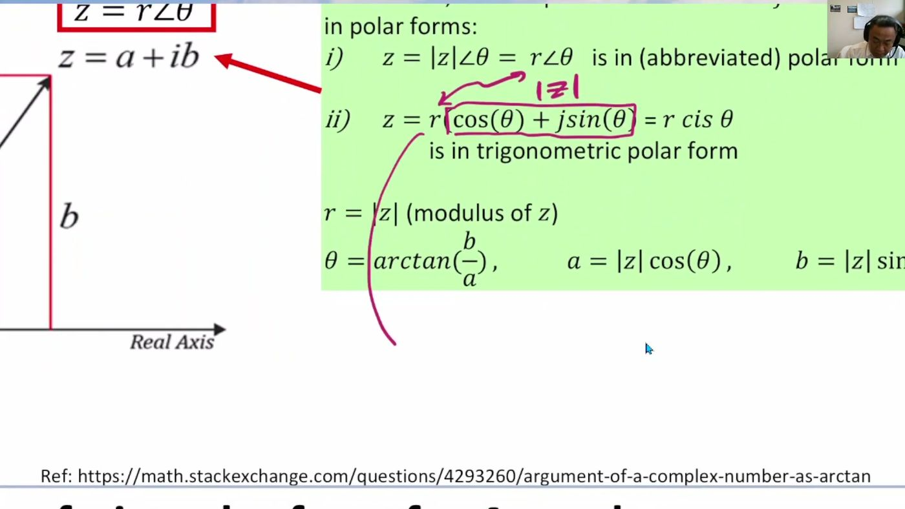

**Frames without a deck page:** the screen shows reference material (web page, video, or handwritten annotation) — the narration below explains what is being discussed.

> 🎙️ **Narration:** *"So we now summarize the representation of complex numbers in the polar form. so we use this notation z equals to r-angar theta and we have an this form is called abbreviated polar form we can also express this in a trigonometric polar form what do we mean well r is the magnitude and what is this guy over here cosine theta plus j sine theta well you realize that r cosine theta is equals to a plus r j sine theta is equals to plus jb so z is equals to a plus jb and the real value a can be extracted from the trigonometric polyform by r cosine theta because look if this is equals to r which is the magnitude of this factor r cosine theta is this point here a and r sine theta is b so we call this form the trigonometric"*

---

### 🎬 Slide 49 — A.1.2 - Geometric interpretation of the complex number The Argand diagram (complex plane) An Argand diagram, a

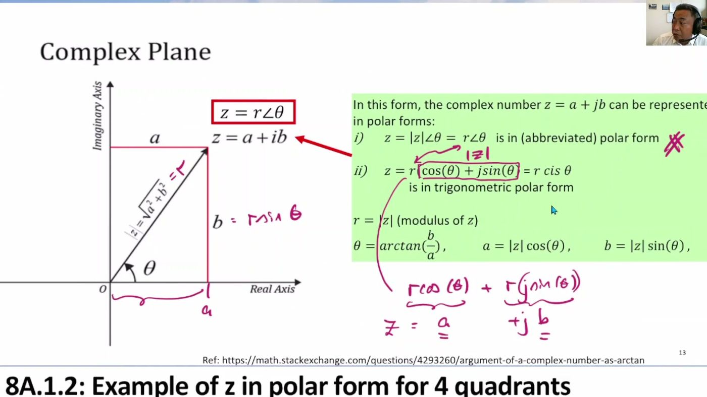

**Deck page — 8A.1_ComplexNumbers.pdf, p. 10:**

> 8A.1.2 - Geometric interpretation of the complex number The Argand diagram (complex plane) An Argand diagram, also known as the complex plane or Argand plane, is a graphical representation use d to visualize complex numbers. It is named after the Swiss mathematician Jean- Robert Argand. 10

> 🎙️ **Narration:** *"polyform and r anger theta is the abbreviated polyform here r is is absolute of z which is is the modulus of z which is also the length of z. We now show you some"*

---

### 🎬 Slide 50 — A.1.2 - Geometric interpretation of the complex number The Argand diagram (complex plane) Note: angle ‘s unit 

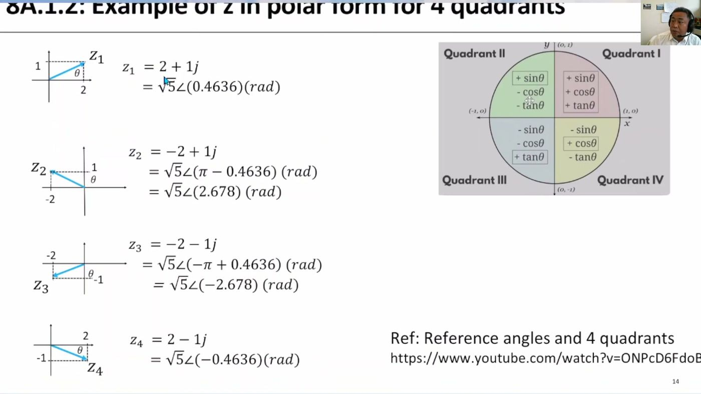

**Deck page — 8A.1_ComplexNumbers.pdf, p. 11:**

> 8A.1.2 - Geometric interpretation of the complex number The Argand diagram (complex plane) Note: angle ‘s unit is in radian and measured against the positive real axis, where rotation of anti-clockwise for +ve angle and clockwise for –ve angle \mathcal{L} 11

> 🎙️ **Narration:** *"examples. So I'm going to put z1, z2, z3 and z4. Four possible numbers in"*

---

### 🎬 Slides 51–53 — On-screen reference / annotated frames

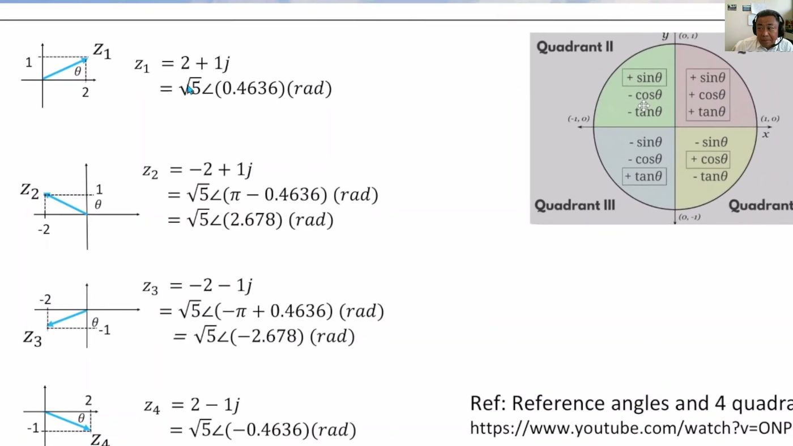

**Frames without a deck page:** the screen shows reference material (web page, video, or handwritten annotation) — the narration below explains what is being discussed.

> 🎙️ **Narration:** *"this four quadrant. Z1 is in the first quadrant because 2 plus 1j means moving along 2 and 1 along the imaginary axis. Z2 is on the second quadrant because it is minus 2 along the real axis plus 1j along the imaginary axis. Minus 2 minus 1 is minus 2 along the real axis minus 1 along the imaginary axis and the last one 2 minus 1j is moving 2 along the positive real axis and minus 1 along the imaginary axis. So these are four numbers and in fact the coefficients along the real imaginary are the same, have the same magnitude although different size. So because they are 2 plus 1j the magnitude is the same because it is 2 square plus 1 square root. This is the magnitude the modulus of the complex number. So it's all square root of 5. So notice that all the values of the modulus is the same. The difference of course is the angle. Now angle remember should be from 0 to pi up to minus pi. Okay, so the angle can be from 0 to positive pi or 0 to negative pi. If it is towards the positive angles, then we are making clockwise, sorry anti-clockwise along the real axis. So 0.46 radian is here. About the second example, still we are making anti-clockwise. So this is still from 0 to pi radian. So this is 2.678 radian. and when we are at the third quadrant we are doing this so it is minus 2.678"*

---

### 🎬 Slide 54 — A.1.2 - Geometric interpretation of the complex number The Argand diagram (complex plane) Note: angle ‘s unit 

**Deck page — 8A.1_ComplexNumbers.pdf, p. 11:**

> 8A.1.2 - Geometric interpretation of the complex number The Argand diagram (complex plane) Note: angle ‘s unit is in radian and measured against the positive real axis, where rotation of anti-clockwise for +ve angle and clockwise for –ve angle \mathcal{L} 11

> 🎙️ **Narration:** *"radian and on the fourth example we are moving by a small angle so it is minus"*

---

### 🎬 Slides 55–56 — On-screen reference / annotated frames

**Frames without a deck page:** the screen shows reference material (web page, video, or handwritten annotation) — the narration below explains what is being discussed.

> 🎙️ **Narration:** *"0.463 radian. So these four examples show you how to put these four numbers in rectangle form as well as in polar form. In the last slide, I will share with you what we mean by the unit circle. Basically you have the real axis and the imaginary axis. You have the origin here and you draw a circle of length one. So this length is one. So let us identify why this is a perfect circle. Well if"*

---

### 🎬 Slides 57–58 — A.1.2 - definition and motivation The unit circle in the complex plane. The unit circle (in pink) is the circl

**Deck page — 8A.1_ComplexNumbers.pdf, p. 15:**

> 8A.1.2 - definition and motivation The unit circle in the complex plane. The unit circle (in pink) is the circle of radius 1 centered at 0. It include all complex numbers of absolute value 1, so it has the equation |z| = 1 Real AXIS Imaginary Axis Im(z) Re(z) - + 0

> 🎙️ **Narration:** *"you move along the real axis you stop at 1. So this point is 1 plus 0j. If you move up it's 0 plus 1j. If you move left it is minus 1 plus 0j and if you move down it's 0 minus j and the radius along"*

---

### 🎬 Slides 59–61 — On-screen reference / annotated frames

**Frames without a deck page:** the screen shows reference material (web page, video, or handwritten annotation) — the narration below explains what is being discussed.

> 🎙️ **Narration:** *"this circle is 1. So the word unit means unit length. So the circle has a unit length of 1 centered at origin and all the numbers along this pink pink dot what do you call this circumference is the set of values on the unit circle. So the unit circle in pink is a circle radius one and when we say the complex numbers on the unit circles we're saying that all the complex numbers They have absolute value of 1 with angle theta from 0 to 2 pi."*

---

### 🎬 Slides 62–67 — A.1.2 - Definition and motivation The polar form of complex number In this form, the complex number can be rep

**Deck page — 8A.1_ComplexNumbers.pdf, p. 13:**

> 8A.1.2 - Definition and motivation The polar form of complex number In this form, the complex number can be represented in polar forms: is in (abbreviated) polar form = is in trigonometric polar form (modulus of ) 13 Ref: https://math.stackexchange.com/questions/4293260/argument-of-a-complex-number-as-arctan

> 🎙️ **Narration:** *"This slide shows you how to visualize the complex roots. Please watch the video using this video link here. I will now try to explain where given the quadratic equation x square minus 6x plus c where c is being varied. In this first example we have c is equals to 8 and how you should view this graph is that this is the real part of z or I should say this is x and x is moving from the origin towards more and more positive value and this vertical line is y and y is equals to x square minus 6x plus 8 in this example and you will see that this red curve touches the horizontal axis in two points and these are the roots of the equation, the values of x that makes y equals to zero and the roots are 2 and 4. So at this point is 2 and at this point is positive 4. Now so this is the real number line and this the other black line which is perpendicular to the real number line is the imaginary values. Okay what we see here is that there are two real roots solving this quadratic equation. As we increase c from 8 to 9, we see observed that the curve is moving up until that there is only one point, a single point touching the real number line. So the root is now 3, it's a repeated root. So plugging in 3 will solve for 3 squared minus 6"*

---

### 🎬 Slides 68–69 — A.1.2: Example of z in polar form for 4 quadrants

**Deck page — 8A.1_ComplexNumbers.pdf, p. 14:**

> 8A.1.2: Example of z in polar form for 4 quadrants 14 Ref: Reference angles and 4 quadrants https://www.youtube.com/watch?v=ONPcD6FdoBI -2 1 -1 -2 -1 2 1 2

> 🎙️ **Narration:** *"times 3 plus 9 will be equals to 0. We basically have this curve touching the vertical axis with at vertical axis y equals to 0 at this point when x is equals to 3. As you make C larger what happens is that the curves goes up and then you can solve for the roots of the this quadratic equation if we are use complex numbers and these are the two complex numbers that will satisfy this quadratic equation. So this tree remains here and we have plus j0.707"*

---

### 🎬 Slide 70 — On-screen reference / annotated frames

**Frames without a deck page:** the screen shows reference material (web page, video, or handwritten annotation) — the narration below explains what is being discussed.

> 🎙️ **Narration:** *"and minus j0.707. So where are they? Basically at this point we have two"*

---

### 🎬 Slides 71–72 — Relevant References for this section 1) U. of surrey course notes on complex numbers https://www.surrey.ac.uk/

**Deck page — 8A.1_ComplexNumbers.pdf, p. 29:**

> 29 Relevant References for this section 1) U. of surrey course notes on complex numbers https://www.surrey.ac.uk/sites/default/files/2021-07/10.1-introduction-to-complex-numbers.pdf 2) Beginner’s guide: https://www.matrix.edu.au/beginners-guide-maths-extension-2/introduction-to-complex-numbers/ 3) Online book: UC Davis https://math.libretexts.org/Bookshelves/Linear_Algebra/Book:_Linear_Algebra_(Schilling_Nachtergaele_and_Lankham)/02:_Introduction_to_Complex_Numbers 4) Petra’s Bonfert Taylor complex analysis videos: Lect1~4 https://www.youtube.com/watch?v=CVpMpZpd-5s&list=PLi7yHjesblV0sSfZzWdSUXGO683n_nJdQ&index=1

> 🎙️ **Narration:** *"solutions and these two solutions are on the complex plane and they are sitting at the real value 3 and plus j 0.707 and at this point we have minus j 0.707. So this we now see that if we visualize the solutions on a complex plane then we can see that there are two solutions which will satisfy this"*

---

### 🎬 Slide 73 — On-screen reference / annotated frames

**Frames without a deck page:** the screen shows reference material (web page, video, or handwritten annotation) — the narration below explains what is being discussed.

> 🎙️ **Narration:** *"equation. So please watch this video and you'll be able to appreciate where is the quadratic solution in the complex plane. Thank you."*

---

### 🎬 Slides 74–75 — A.1.2: Example of z in polar form for 4 quadrants

**Deck page — 8A.1_ComplexNumbers.pdf, p. 14:**

> 8A.1.2: Example of z in polar form for 4 quadrants 14 Ref: Reference angles and 4 quadrants https://www.youtube.com/watch?v=ONPcD6FdoBI -2 1 -1 -2 -1 2 1 2

> 🎙️ **Narration:** *"This is 8A.1.3, Aromatic of Complex Numbers. Here we will study addition, subtraction, multiplication and division first. Now, first we understand what is equality. When we say a complex number Z1 is equals to Z2, what we are saying is that the real part are equal. So A belongs to Z1, the real part of Z1. one, c belongs to the real part of z2, they are equal as well as b and d. The b is the imaginary part of z1 and d is the imaginary part of z2. So only when all these four numbers are equal, then we say z1 is equals to z2. We now study some aromatic operations. The addition first, in here we're going to use i to represent square root of minus one instead of j. So please get used to the notation changes sometimes. Sometimes i is used as square root of minus one, sometimes it's j. Here we say that z1 is equals to x1"*

---

### 🎬 Slides 76–82 — A.1.2 - definition and motivation The unit circle in the complex plane. The unit circle (in pink) is the circl

**Deck page — 8A.1_ComplexNumbers.pdf, p. 15:**

> 8A.1.2 - definition and motivation The unit circle in the complex plane. The unit circle (in pink) is the circle of radius 1 centered at 0. It include all complex numbers of absolute value 1, so it has the equation |z| = 1 Real AXIS Imaginary Axis Im(z) Re(z) - + 0

> 🎙️ **Narration:** *"plus iy1 and we say z2 is equals to x2 plus iy2. Now when we want to add z1 and z2 together the real part must add so it's x1 plus x2 and I will put in front and the imaginary part at independently y1 plus i2. Similarly for subtraction z1 minus z2 we are subtracting the real part x1 minus x2 plus i y1 minus y2. So addition and subtraction behave in this way. What about multiplication and division. Well let's try z1 times z2. So this dot is not the dot product. This is the multiplication symbol for complex numbers or sometimes we just write as z1 z2. And we don't use the dot. Well we'll put z1 here and we'll put z2 here and now we open up the brace such that we can cross multiply the term together which is x1 times x2 minus y1 times y2 because it's i times i is i squared which is minus 1 y1 times y2 we then have x1 times y2 so it's x1 times y2 with the i in front and now we have IY1 times X2. So this is the real part and this is the imaginary part after I've collected the terms together. It looks like it's quite difficult to perform multiplication in the rectangular domain. Later on we'll say we'll show you that it's actually simpler in the polar notation to perform multiplication. What about division? Well we have Z1 divided by Z2 is X1 plus IY1 divided by x2 plus iy2. You can work it out and this is the answer and again you realize that actually it is quite difficult to derive this equation in a rectangular form. We'll show you that it's actually simpler in the polar notation. Now if you all want to try to derive this equation then the idea is this. We multiply x2 minus iy2 over x2 minus iy2. Since this is the same at the numerator and denominator, you realize that this is value 1. Now when you cross multiply, you'll get this result. I'll now show you what addition and subtraction means in the complex plane. This is vector addition and this is the complex plane. this is the real axis and the imaginary axis and we have z1 plus z2. So z1 is 3"*

---

### 🎬 Slides 83–86 — A.1.2 Example: Visualizing the complex roots https://youtu.be/5g80j17w0CE?si=HMWc-l8HekEjptxg c=8 c=9 c=9.5 Ro

**Deck page — 8A.1_ComplexNumbers.pdf, p. 16:**

> 8A.1.2 Example: Visualizing the complex roots https://youtu.be/5g80j17w0CE?si=HMWc-l8HekEjptxg c=8 c=9 c=9.5 Roots are complex numbersRoots at real values = 2, 4 Roots at real value = 3 3+j0.707, 3-j0.7072, 4 Im(z) Im(z) Im(z) Re(z) Re(z) Re(z) 16

> 🎙️ **Narration:** *"plus 1j so it's 3 along the real 1 along the imaginary positive, z2 is 1 plus 2j 1 along the real 2 along the imaginary. When we add together of course you can say that 3 plus 1 is 4 and 2 plus 1j is 3j which is this number. How is this done graphically, geometrically. Basically we take this vector of z2 and we move into here. So this whole vector is moved to the tip for addition and the resultant vector is z1 plus z2. What about vector subtraction? Here we are doing z1 minus z2 over here. So what is minus z2? Well if we have z2 as 1 plus 2j minus z2 becomes the vector opposite to itself. So we basically flip this till the other way round. It is minus 1 minus 2j. Now we take this vector and then we add this vector to the tip of z1. So z1 plus minus z2 which is z1 minus z2 and this is the resultant vector over here. So vector addition is simply taking the other vector and putting it to the tip. Vector subtraction first flip the vector that is being subtracted from z2 to become minus z2 and then moving this minus z2 to the tip of z1. So there is the interpretation of addition and vector subtraction. Thank you. In this slide, we are going to talk about properties of complex numbers for examining the commutative law, associative law and distributive law. We will not prove this. To prove this, what you do is that you write Z1 and Z2 in the rectangular form and perform these operations and then you'll realize that the answers comes out to be the same on the left hand side or the right hand side, whether you do Z1 plus z2 or z2 plus z1. So competitive law holds for complex numbers for addition, as well as multiplication. Whether you put z1 multiplied by z2 or z2 multiplied by z1, it is the same. What about associative law? Associative law treats the bracket to do addition first. So z1 plus bracket z2 plus z3. Well if we add z2 plus z3 first then add to z1. Does it matter? Answer is no. You can do z1 plus z2 first and then add the final answer to z3. The answer is the same associative law holds for addition as well as multiplication. In multiplication here the example is that z2 is multiplied with z3 first. This answer is then multiplied with z1. it doesn't really matter we can do z1 multiplied by z2 first and then multiply by z3. So the brackets does not matter for multiplications for complex numbers. Finally for distribution we have the bracket holding up z2 plus z3 and we have z1 multiplying this solution. Well it doesn't really matter we can open up the bracket and we have z1 multiplied by z2 plus z1 multiplied by c3. So this is the distributive law. Again we do not need to prove it, we are just going to use this law that's given to us. If you really want to prove it, basically you put the expression in rectangular form from the left-hand side and you work it out and you compare it against brute force on the right-hand side, you will see that the answers are the same and therefore these three laws holds. We'll now go through some examples when dealing with"*

---

### 🎬 Slide 87 — On-screen reference / annotated frames

**Frames without a deck page:** the screen shows reference material (web page, video, or handwritten annotation) — the narration below explains what is being discussed.

> 🎙️ **Narration:** *"square root of minus one. Now remember that we have defined the square root of minus one as j, j equals to square root of minus one. And what is then minus j? Well minus j is minus one times j. So this is the idea what is minus j. It is a real number multiplied by the imaginary square root of minus one. Or you can put j and then minus one is the same or you just simply put s minus j. It doesn't really matter this is just a definition of how we treat minus j. Now what about j squared? j squared remember is nothing but j times j so j times j is"*

---

### 🎬 Slide 88 — Relevant References for this section 1) U. of surrey course notes on complex numbers https://www.surrey.ac.uk/

**Deck page — 8A.1_ComplexNumbers.pdf, p. 29:**

> 29 Relevant References for this section 1) U. of surrey course notes on complex numbers https://www.surrey.ac.uk/sites/default/files/2021-07/10.1-introduction-to-complex-numbers.pdf 2) Beginner’s guide: https://www.matrix.edu.au/beginners-guide-maths-extension-2/introduction-to-complex-numbers/ 3) Online book: UC Davis https://math.libretexts.org/Bookshelves/Linear_Algebra/Book:_Linear_Algebra_(Schilling_Nachtergaele_and_Lankham)/02:_Introduction_to_Complex_Numbers 4) Petra’s Bonfert Taylor complex analysis videos: Lect1~4 https://www.youtube.com/watch?v=CVpMpZpd-5s&list=PLi7yHjesblV0sSfZzWdSUXGO683n_nJdQ&index=1

> 🎙️ **Narration:** *"equals to j squared. What is square root of minus one times square root of minus one and the answer is of course it is minus one. So this is how we're going to work out j squared. What about j cube? j cube is nothing but j times j squared. Since we already know that j squared is minus one, then it is nothing but j times minus one, which is minus j. And now what about j4? j4 is j squared"*

---

### 🎬 Slides 89–93 — A.1.2 Example: Visualizing the complex roots https://youtu.be/5g80j17w0CE?si=HMWc-l8HekEjptxg c=8 c=9 c=9.5 Ro

**Deck page — 8A.1_ComplexNumbers.pdf, p. 16:**

> 8A.1.2 Example: Visualizing the complex roots https://youtu.be/5g80j17w0CE?si=HMWc-l8HekEjptxg c=8 c=9 c=9.5 Roots are complex numbersRoots at real values = 2, 4 Roots at real value = 3 3+j0.707, 3-j0.7072, 4 Im(z) Im(z) Im(z) Re(z) Re(z) Re(z) 16

> 🎙️ **Narration:** *"multiplied by j squared. So it's minus one which is j squared, multiply by minus one which is one. Now you can continue to work out what is j5, j6 and so on by following the process. About division, so basically is we have 1 over j. 1 over j can be denoted as this j to the exponent of minus one. So how do we get 1 over j is minus j. Well, we do it this way. 1 over j times j times j. So you have j and what is j squared? j squared is minus 1. So multiplied by minus 1 minus 1 is minus j divided by plus 1 is equals to minus j. So this is how you"*

---

### 🎬 Slides 94–95 — On-screen reference / annotated frames

**Frames without a deck page:** the screen shows reference material (web page, video, or handwritten annotation) — the narration below explains what is being discussed.

> 🎙️ **Narration:** *"work out that 1 over j is minus j. Okay so this is the process and what about 1 over j square. Same 1 over j square is j to exponent of minus 2 and you realize"*

---

### 🎬 Slides 96–97 — A.1.2 Example: Visualizing the complex roots https://youtu.be/5g80j17w0CE?si=HMWc-l8HekEjptxg c=8 c=9 c=9.5 Ro

**Deck page — 8A.1_ComplexNumbers.pdf, p. 16:**

> 8A.1.2 Example: Visualizing the complex roots https://youtu.be/5g80j17w0CE?si=HMWc-l8HekEjptxg c=8 c=9 c=9.5 Roots are complex numbersRoots at real values = 2, 4 Roots at real value = 3 3+j0.707, 3-j0.7072, 4 Im(z) Im(z) Im(z) Re(z) Re(z) Re(z) 16

> 🎙️ **Narration:** *"that j square is equals to 1 over minus 1. So 1 over minus 1 is of course minus 1. If you forget how to prove this is nothing but 1 over minus 1 times minus one minus one is minus one on the top and one below and therefore the answer is minus one. Okay that's the idea. You can continue to do this for one over j3, one over j4 and so on. Let's continue. x is the real number and j is the square of"*

---

### 🎬 Slides 98–101 — Content: Complex Numbers 2 8A.1: Introduction to complex numbers+ Arithmetic Operations (1.5 hour) 8A.1.1 - De

**Deck page — 8A.1_ComplexNumbers.pdf, p. 2:**

> Content: Complex Numbers 2 8A.1: Introduction to complex numbers+ Arithmetic Operations (1.5 hour) 8A.1.1 - Definitions and Motivations - number system - solving quadratic equation for complex roots 8A.1.2 - The argand diagram, and geometric interpretation - The polar form, The unit circle 8A.1.3 - Arithmetic of Complex numbers - Add, subtract, multiply, and divide, - Properties - Multiplication and Division in polar form 8A.1.4 - Complex conjugation

> 🎙️ **Narration:** *"minus one. So minus j times x is the same as minus x times j. Or we simply put minus jx. So that's the idea. And now we have square root of minus x. So you must be very careful when you are dealing with this. Square root of minus x square is basically this square root of minus x times square root of minus x. So because you have square root and you have you power it twice. So basically you would line up with minus x. That's the idea. To prove we are going to do it this way. Square root of minus x is equals to square root of minus 1 times square root of x. So square root of minus x square is equals to square root of minus 1 square of x times square root of minus 1 square of x. square root of minus one times square root of minus one is minus one. square root of x times square root of x is x. so the answer is minus x. so this is also how you can solve this by brute force. now please be very careful when"*

---

### 🎬 Slides 102–103 — On-screen reference / annotated frames

**Frames without a deck page:** the screen shows reference material (web page, video, or handwritten annotation) — the narration below explains what is being discussed.

> 🎙️ **Narration:** *"you have square root of when you have this and then you think that you could remove the minus sign. there's a no-no. remember that when we are dealing with square root of negative value, we have to treat it like this. Okay, so square root of minus x must be treated as square root of x times square root of minus 1, which is square root of x times j. So we must always write this prior to before any manipulation. In the next slide, we'll show you some examples. These are really self-explanatory, I will not go through with them. but I think maybe the take-home message is this, we have square root of minus nine we're going to deal with it by breaking minus nine into nine times minus one and then we can break it into two parts so this is defined as j and then square root of nine should be plus m minus three so it's square root of minus nine"*

---

### 🎬 Slide 104 — Content: Complex Numbers 2 8A.1: Introduction to complex numbers+ Arithmetic Operations (1.5 hour) 8A.1.1 - De

**Deck page — 8A.1_ComplexNumbers.pdf, p. 2:**

> Content: Complex Numbers 2 8A.1: Introduction to complex numbers+ Arithmetic Operations (1.5 hour) 8A.1.1 - Definitions and Motivations - number system - solving quadratic equation for complex roots 8A.1.2 - The argand diagram, and geometric interpretation - The polar form, The unit circle 8A.1.3 - Arithmetic of Complex numbers - Add, subtract, multiply, and divide, - Properties - Multiplication and Division in polar form 8A.1.4 - Complex conjugation

> 🎙️ **Narration:** *"is plus minus 3j. Okay, so you see why this is so using the most children again later on as well. So the rest of the examples are just a repeat of these simple examples. Thank you."*

---

### 🎬 Slides 105–107 — On-screen reference / annotated frames

**Frames without a deck page:** the screen shows reference material (web page, video, or handwritten annotation) — the narration below explains what is being discussed.

> 🎙️ **Narration:** *"This is 8A.1.3 multiplication of complex numbers in the polar form. Let us have two complex numbers, Z1 and Z2, represented in the trigonometric polar form where R1 and theta 1 represents the modulus and argument of Z1 and R2 and theta 2 represents the modulus and argument of Z2 respectively. We want to multiply z1 and z2. Taking this form, we simply perform the cross product of all these terms. R1 and R2 is brought out and we have cosine theta1 plus j sine theta2 multiplying by cosine theta2 plus j sine theta2. We collect the terms, R1 and R2 brings out and now we cross multiply all these cosine and j sine theta's together. we get this expression. If you remember the angle sum formula of cosine, you realize that this is simply this equation over here and we can now reduce cosine alpha cosine beta minus sine alpha sine beta as cosine bracket alpha plus beta. So this is what we get for the real part. For the imaginary part, after we have collected together we realize that this imaginary part is the sum of angles for the sine terms. So this expression can be found here which is this sine alpha cos beta plus cosine alpha sine beta is sine bracket alpha plus beta which is exactly this term. What we now realize is that if we want to perform products of complex numbers we can of course do it in this long and complicated manner by expanding each terms together. However, we now realize that we can simply remember this formula which is that the modulus multiplies and the angle adds when we multiply z1 and z2 together. What is it graphically? Graphically, it looks like this. We have z1 over here which is r1 theta 1, we have z2 over here which is r2 theta 2 and when we multiply z1 and z2 the magnitude is z1 times z2, the magnitude is r1 times r2 sorry and the angle is added okay so simply if you actually want to see it in the polar form abbreviated then this is even simpler the magnitude of z1 and z2 are multiplied the angles are added that's it thank you This slide discusses division in polar form. The division of complex numbers in polar form can be very easily performed. Let's show how is this done. Let's begin with z1 and z2 given by this expression here. z1 is equals to r1 the modulus cosine theta1 the argument plus j sine theta1 the argument for z1. Similarly z2 has the modulus r2 and argument theta2. We want to perform z1 divided by z2. So we simply put the expression for z1 on top as numerator and the expression for z2 in the numerator denominator. Well we bring r1 over z1 outside so now what we have is this cosine theta1 plus j sin theta1 divided by cosine theta2 plus j sin theta2. So we're going to manipulate this and it will be resultant as this expression here. Why is this so? Well let's now examine what are we trying to do here. It is 1 divided by cosine theta 2 plus j psi theta 2. I'm talking about the expression of the denominator here. When we're going to use this trick, multiplying cosine theta 2 minus j psi theta 2 divided by itself. So basically this expression is one, so we are changing nothing on the denominator."*

---

### 🎬 Slide 108 — Content: Complex Numbers 2 8A.1: Introduction to complex numbers+ Arithmetic Operations (1.5 hour) 8A.1.1 - De

**Deck page — 8A.1_ComplexNumbers.pdf, p. 2:**

> Content: Complex Numbers 2 8A.1: Introduction to complex numbers+ Arithmetic Operations (1.5 hour) 8A.1.1 - Definitions and Motivations - number system - solving quadratic equation for complex roots 8A.1.2 - The argand diagram, and geometric interpretation - The polar form, The unit circle 8A.1.3 - Arithmetic of Complex numbers - Add, subtract, multiply, and divide, - Properties - Multiplication and Division in polar form 8A.1.4 - Complex conjugation

> 🎙️ **Narration:** *"Alright so we will get cosine theta 2 minus j sine theta 2 on the top, but what why does this one"*

---

### 🎬 Slides 109–114 — On-screen reference / annotated frames

**Frames without a deck page:** the screen shows reference material (web page, video, or handwritten annotation) — the narration below explains what is being discussed.

> 🎙️ **Narration:** *"becomes one as you will see. Well let's see cosine theta 2 minus j sine theta 2 divided by So cosine theta 2 times cosine theta 2 is cosine theta 2 square. So we have minus j times cosine and we have plus j sine times cosine. So this cancels us and then we have now minus j square sine theta 2 square. So this expression is actually cosine square theta 2 minus minus sorry minus j square is minus 1. So it's plus sine squared theta 2. So this is one. So hence we now show that 1 over cosine 2 plus j sine theta 2 is actually equals to this expression here. Alright now what we can then do is that we are going to open up this bracket and perform cross multiplication of all these terms here. So it's cosine theta 1 times cosine theta 2. It's cosine theta 1 cosine theta 2. Then the sign is plus j minus j so it's minus j squared minus j squared becomes plus so it's sine theta 1 times sine theta 2. So this is the real part and the imaginary part you can also do it by yourself. You get this expression here. Now you look at this cosine theta 1 cosine theta 2 plus sine theta 1 sine theta 2. This is this expression here. It is the difference of the angle for cosine and then similarly sine theta cosine theta one cosine theta two minus cosine theta one sine theta two. This is the difference angle for this guy for the sine term. So in short the"*

---

### 🎬 Slide 115 — Relevant References for this section 1) U. of surrey course notes on complex numbers https://www.surrey.ac.uk/

**Deck page — 8A.1_ComplexNumbers.pdf, p. 29:**

> 29 Relevant References for this section 1) U. of surrey course notes on complex numbers https://www.surrey.ac.uk/sites/default/files/2021-07/10.1-introduction-to-complex-numbers.pdf 2) Beginner’s guide: https://www.matrix.edu.au/beginners-guide-maths-extension-2/introduction-to-complex-numbers/ 3) Online book: UC Davis https://math.libretexts.org/Bookshelves/Linear_Algebra/Book:_Linear_Algebra_(Schilling_Nachtergaele_and_Lankham)/02:_Introduction_to_Complex_Numbers 4) Petra’s Bonfert Taylor complex analysis videos: Lect1~4 https://www.youtube.com/watch?v=CVpMpZpd-5s&list=PLi7yHjesblV0sSfZzWdSUXGO683n_nJdQ&index=1

> 🎙️ **Narration:** *"division of two complex numbers can be easily performed by observing that the modulus device and the angle subtracts. So the modulus device, the angle subtract. This is the summary of how I remember things. Z1 divided by Z2, the modulus device, the angle subtracts. That's all. Thank you."*

---

### 🎬 Slides 116–119 — On-screen reference / annotated frames

**Frames without a deck page:** the screen shows reference material (web page, video, or handwritten annotation) — the narration below explains what is being discussed.

> 🎙️ **Narration:** *"This is 8A.1.4 complex conjugation. In complex conjugation, the complex conjugation is an operation. It operates on a complex number. So example, we are given Z is A plus JB. The complex conjugate of Z is denoted by Z with a bar on top. This bar on top indicates that we are taking the complex conjugate of z. What changes? Well, you now see that complex conjugation is nothing more than the changing of the sign. For example, the original sign of the imaginary plot is plus jb. Now it becomes minus jb. So let's have another example. If we are given that z is originally a minus jb, then the sign originally minus is now changed to plus. So complex conjugation simply changes the sign of the imaginary part. What about these two bars on top? It means that we take z complex conjugate twice and if we complex conjugate twice, we get back z. We will now show some results of complex conjugation operation. So if z is equals to a plus jb and the complex conjugate of z is therefore a minus jb. Now we're going to add these two together. Well what you realize is that when we add z and its complex conjugate, the real part adds becomes 2a and the imaginary part cancels. So z plus z conjugate is 2a or we can call it the 2 times the real part of z, since the real part of z is a. Similarly, z minus z bar. Let's see what we can do with this. So I write z equals to a plus jb minus z bar is equals to a minus jb. So a minus a becomes zero. And now plus jb minus minus means plus. So it's two jb. b. Therefore the answer is that z minus z bar is equals to 2jb is 2j times the imaginary part of b and the imaginary part of b is sorry imaginary imaginary part of z is b. In this last operation z multiplying by z conjugate well if we write it in rectangular form we are going to do the cross multiplication of all these terms will get a square plus b square. You try it by yourself, you basically realize that the imaginary part cancels. If you actually do this in the polar form, it is much easier to understand. Let this represent z. And of course z bar is simply the same modulus but with a negative theta, where theta is the argument of z. So if we observe this and remember what happens in the multiplication in polar form, the modulus will now multiply with each other. So we have r, modulus square, and theta will add, but since theta add with minus theta, it becomes zero. So basically this converts a complex number, two complex numbers into a real number, because there is no imaginary part. So what is r square? r square is simply a square plus b square, as we know in the"*

---

### 🎬 Slide 120 — Relevant References for this section 1) U. of surrey course notes on complex numbers https://www.surrey.ac.uk/

**Deck page — 8A.1_ComplexNumbers.pdf, p. 29:**

> 29 Relevant References for this section 1) U. of surrey course notes on complex numbers https://www.surrey.ac.uk/sites/default/files/2021-07/10.1-introduction-to-complex-numbers.pdf 2) Beginner’s guide: https://www.matrix.edu.au/beginners-guide-maths-extension-2/introduction-to-complex-numbers/ 3) Online book: UC Davis https://math.libretexts.org/Bookshelves/Linear_Algebra/Book:_Linear_Algebra_(Schilling_Nachtergaele_and_Lankham)/02:_Introduction_to_Complex_Numbers 4) Petra’s Bonfert Taylor complex analysis videos: Lect1~4 https://www.youtube.com/watch?v=CVpMpZpd-5s&list=PLi7yHjesblV0sSfZzWdSUXGO683n_nJdQ&index=1

> 🎙️ **Narration:** *"Pythagoras theorem. Finally, let us try this operation, z1 times z2 bar, we say that it is equals to z1 bar times z2 bar. How do you prove this? Well, simply you use the polar form"*

---

### 🎬 Slide 121 — On-screen reference / annotated frames

**Frames without a deck page:** the screen shows reference material (web page, video, or handwritten annotation) — the narration below explains what is being discussed.

> 🎙️ **Narration:** *"because it's easier to take multiplication in the polar form. So it's r1, angle theta 1 for z1, r2, angle theta 2 for z2. All of them is conjugated. r1 times r2 brings it out since they are multiplying the theta 1 at zoteta 2. The complex conjugate of this value simply changes the theta so minus this theta so this is z1 times z2 complex conjugate if we do it individually then we will now write r1 angle theta 1 bar indicating that this is z1 bar and the second term is r2 angle theta 2 bar indicating this is z2 bar we first convert"*

---

### 🎬 Slide 122 — Relevant References for this section 1) U. of surrey course notes on complex numbers https://www.surrey.ac.uk/

**Deck page — 8A.1_ComplexNumbers.pdf, p. 29:**

> 29 Relevant References for this section 1) U. of surrey course notes on complex numbers https://www.surrey.ac.uk/sites/default/files/2021-07/10.1-introduction-to-complex-numbers.pdf 2) Beginner’s guide: https://www.matrix.edu.au/beginners-guide-maths-extension-2/introduction-to-complex-numbers/ 3) Online book: UC Davis https://math.libretexts.org/Bookshelves/Linear_Algebra/Book:_Linear_Algebra_(Schilling_Nachtergaele_and_Lankham)/02:_Introduction_to_Complex_Numbers 4) Petra’s Bonfert Taylor complex analysis videos: Lect1~4 https://www.youtube.com/watch?v=CVpMpZpd-5s&list=PLi7yHjesblV0sSfZzWdSUXGO683n_nJdQ&index=1

> 🎙️ **Narration:** *"We first remove the complex conjugate by putting the complex conjugate operation or realizing the complex conjugate operation. So theta 1 becomes minus theta sorry theta 1 becomes minus theta 1 for the complex conjugation. The magnitude remains unchanged. This is the same. The complex conjugate realizes minus theta 2 for R2. We now can multiply R1 multiplied by R2, the modulus multiplies, the angle adds minus theta 1, adding with minus theta 2 is minus theta 1 minus theta 2. We bring the minus sign out and then we have this and this is"*

---

### 🎬 Slide 123 — A.1.2 Example: Visualizing the complex roots https://youtu.be/5g80j17w0CE?si=HMWc-l8HekEjptxg c=8 c=9 c=9.5 Ro

**Deck page — 8A.1_ComplexNumbers.pdf, p. 16:**

> 8A.1.2 Example: Visualizing the complex roots https://youtu.be/5g80j17w0CE?si=HMWc-l8HekEjptxg c=8 c=9 c=9.5 Roots are complex numbersRoots at real values = 2, 4 Roots at real value = 3 3+j0.707, 3-j0.7072, 4 Im(z) Im(z) Im(z) Re(z) Re(z) Re(z) 16

> 🎙️ **Narration:** *"exactly the same as this on the green side and we see that Z1 Z2 bar is equals to zero and bar times z to the power. We now continue with the complex conjugation,"*

---

### 🎬 Slide 124 — Relevant References for this section 1) U. of surrey course notes on complex numbers https://www.surrey.ac.uk/

**Deck page — 8A.1_ComplexNumbers.pdf, p. 29:**

> 29 Relevant References for this section 1) U. of surrey course notes on complex numbers https://www.surrey.ac.uk/sites/default/files/2021-07/10.1-introduction-to-complex-numbers.pdf 2) Beginner’s guide: https://www.matrix.edu.au/beginners-guide-maths-extension-2/introduction-to-complex-numbers/ 3) Online book: UC Davis https://math.libretexts.org/Bookshelves/Linear_Algebra/Book:_Linear_Algebra_(Schilling_Nachtergaele_and_Lankham)/02:_Introduction_to_Complex_Numbers 4) Petra’s Bonfert Taylor complex analysis videos: Lect1~4 https://www.youtube.com/watch?v=CVpMpZpd-5s&list=PLi7yHjesblV0sSfZzWdSUXGO683n_nJdQ&index=1

> 🎙️ **Narration:** *"the geometric interpretation of complex conjugation. If we are given z equals to six plus j four, the complex conjugate of z simply changes the sign here from plus becomes negative. What you will realize is that it is nothing but projecting this phasor, this phasor or this factor across the horizontal plane to the other side. So this is one interpretation of complex conjugation. The length of the vector remains the change but we are flipping the vector across the horizontal plane. The other way to think about complex conjugation is to consider the angle. Remember that if this is C and we have the length and the angle then Z bar is simply the same length but the angle is now negative. So what does the negative angle mean? Well here is the positive angle theta and here is the negative angle theta. So basically it is also telling us the same story that the phasor or the vector actually flips across the horizontal axis by the same"*

---

### 🎬 Slides 125–126 — On-screen reference / annotated frames

**Frames without a deck page:** the screen shows reference material (web page, video, or handwritten annotation) — the narration below explains what is being discussed.

> 🎙️ **Narration:** *"amount of and lastly we have some concrete example of z1 and z2 and And now we are going to do some operations on z1 and z2 first multiplying with each other followed by the complex conjugate. That's the first example. As well as complex conjugating z1 multiplying complex conjugation of z2. Concretely, you can actually do this in rectangular form as well. Or you prefer polar form, it doesn't matter. If you open up this operation, 4 plus 3i multiplied by 2 plus 5i, which is z1 and z2, then you will get minus 7 plus 26i. The complex conjugate of this factor changes only the sign at the imaginary part, so she's here. All right now, z1 bar multiplied by z2 bar, so what we realize is that to do this, we we take Z1 and perform complex conjugate. So on top is Z1, four plus three i. So Z1 bar means four minus three i. We are taking the complex conjugate of Z1. What about here? This guy is Z2 bar. We take Z2, which is two plus five i. We perform complex conjugate, which is two minus five i. You open up the bracket, and then you result in this. You notice that this is equals to this because as we seen in the last example, Z1, Z2 complex conjugate is same as Z1 complex conjugate times Z2 complex conjugate. So this is the identity that we have used and we have shown that actually it also work. All right, you can try the different other identities. You will see that the complex conjugate distributes in this following manner through these operations. With that, thank you."*

---
## V-8A.2 — 8A.2 Euler's Formula and De Moivre's Theorem

> **Videos (8):** 8A.2 pg1~4, pg5~6, pg7, pg8, pg9~11, pg12, pg13~16, pg17~18 (58.2 min) — deck: `8A.2_DeMoivre.pdf` (22 pages)
>
> *Repeated views of the same page are grouped; the fullest view is shown.*

### 🎬 Slide 1 — CX1104: Linear Algebra for Computing Instructor: A/P Chng Eng Siong TA: Shreyas Gopal Rev: 23rd Jul 2024 Chap.

**Deck page — 8A.2_DeMoivre.pdf, p. 1:**

> CX1104: Linear Algebra for Computing Instructor: A/P Chng Eng Siong TA: Shreyas Gopal Rev: 23rd Jul 2024 Chap. No : 8A.2 Lecture : Complex Numbers Topic : Complex Exponential Form and DeMoivre theorem Concept : , where 1

> 🎙️ **Narration:** *"This is CX1104 linear algebra for computing chapter 8a.2. In this chapter, we'll continue with complex numbers in the exponential form as well as the DeMorphs theorem. So let's begin. First, let's revise what the exponential form looks like."*

---

### 🎬 Slides 2–6 — On-screen reference / annotated frames

**Frames without a deck page:** the screen shows reference material (web page, video, or handwritten annotation) — the narration below explains what is being discussed.

> 🎙️ **Narration:** *"5 to the exponent of 3 looks like this. 5 is the base, 3 is the exponent. 5 to the exponent of 3 means 5 multiplied by 5 multiplied by 5 three times. So the exponent tells us how many times we are repeating this multiplication and this number is 125. So 125 is the exponential form, sorry 125 is what you get when you do 5 to the exponent of 3. So this is how we should say it. All we can say alternatively as the third power of five. So what we are saying is that we are doing the third power of the base five. Conventionally you might see people disdain it as five to the power of three to say the above but this is not very very accurate and I asked the perplexity why is this so? Perplexity is a large language model and when I gave him the expression a to the power of n, the perplexity answer was oh okay it means in English a and n are given and this symbol a to the power of n is what I've just mentioned but he also say a to the nth power which is actually a much more accurate expression of what a to the power n is. So 2 to the power of 3 or 2 to the third power okay then when I ask him hey the word power also mean the entire expression right this 5 to the exponent of 3 is 1 to 5 so 1 to 5 is actually the 5 to the exponent of 3. So he says yes I'm actually correct. A to the exponent of n is a more precise way to describe this term. Okay it's called the base and it's the exponent or sometimes also called the index. A to the power of n is the means the entire expression is called the power. So he says that it is common now usage to say A to the power of n but it is not the technically precise way to say. Okay, so with that we can now go to the next slide to discuss the complex exponential form. Now Euler shows us that the complex number a plus jb where a is cos theta and b is sin theta can be expressed as this exponential form where the base is E and the exponent is J theta. So it's complex exponential. The exponential in this exponential form is complex. So J theta is the exponent. So let's see all these terms here. Where is theta? Where is cos theta? Where is sin theta? So let's see the original representation that we familiar with. Z is the complex number given by a real number A and imaginary number I B, A plus I B and this is the rectangular form remember and then we also remember that we could have written it as R-Angle theta where R is the modulus and theta is the angle made with the real axis. So this is theta, the angle of z, where z is this phasor, this vector and theta is the angle made with respect anti-clockwise to the real axis. Now what about z or sr? r is equals to the modulus of z, the length of the vector. So in the right angle triangle, we use Pythagoras theorem. A is one side and B is the other side, and this is right angle. Then the hypotenuse is the length of this vector is square root of a square plus b square. So this is r equals to this. Now once we have this, then if we use the Euler's formula to say that ej theta equals to cos theta plus g sin theta, then finally we can actually write the complex number in the third form which is what's showing now which is this which is the modulus times cosine theta plus g sin theta because isn't cosine theta plus g sin theta exactly what ej theta is by all this formula. So this is what we are trying to say here. We replace cos theta plus G sine theta with the complex exponential form EJ theta. And now we have this basically four ways to write it, the complex number. And we'll realize that the complex exponential form is a very nice way to write complex numbers because it allows us to manipulate it very easily. Okay, in the next few slides, I will then go through how to derive EJ theta is equal to cos theta plus g psi theta. Let's derive the Euler's formula. The Euler's formula is given by ej theta is equals to cos theta plus j sin theta. The approach to derive the Euler's formula is this. We use Taylor expansion to represent ej theta as well as cos theta and j sin theta and then we will see that the left-hand side of the Taylor's expansion equals to the right-hand side. What is the Taylor expansion? the other Taylor series for these three expressions. Without a proof, we'll just state the results of sine x. So sine x is an infinite series where sine x is when represented as the Taylor expansion is x. So whatever x is here, minus x to the power of 3 divided by 3 factorial plus x to the power of 5 divided by 5 factorial and so on. Cosine x is this expression over here. So it is actually one, but you can think of it as x0 because x to the power or x to the exponent of 0 is 1 minus x to the exponent of 2 divided by 2 factorial plus x exponent of 4 to the exponent of 4 divided by 4 factorial. So you see that the cosine has even terms of the function of polynomials, while sine has odd terms. And this is reassuring because cosine is an even function and sine is an odd function. Now when you perform the Taylor expansion of EX, so this should be known to you."*

---

### 🎬 Slides 7–11 — A.2.1 - Euler’s Formula to represent complex numbers Euler’s formula: Using above, we can re-write (the comple

**Deck page — 8A.2_DeMoivre.pdf, p. 4:**

> 8A.2.1 - Euler’s Formula to represent complex numbers Euler’s formula: Using above, we can re-write (the complex number) in the following forms: // polar form // complex exponential form 4

> 🎙️ **Narration:** *"The short form notation of E to the exponent of X is this X to the exponent of K divided by k factorial, sum it to infinity. So when k equals to zero, then we have one. When k equals one is x divided by one factorial, which is one, then x k, where k is two is x two to the power two factorial, x three over three factorial and so on. You realize that the sine and cosine basically fuels up when they are added together fuels this thing up. There's a little bit of things missing and what you realize is that when we plug in x equals to ix. So instead of plugging in x, we are plugging in i where i is of course root of minus 1 into the expression and then we remember that i i squared is equals to minus one and then i cubed is minus i and i4 equals to one and so on. And when we plug it in, what we will realize is this. You plug in e to the exponent of ix over here and then now you substitute into this form for all four. So you have now instead of x, you now put ix, you put now ix here and you put ix square here, you put ix cube here and so on. What you will realize is that when you also use the identity i squared equals to minus one, i cube"*

---

### 🎬 Slides 12–16 — A.2.1 - Proof : Deriving Euler formula through Taylor Series 1) Brunton: https://www.youtube.com/watch?v=H0Zbg

**Deck page — 8A.2_DeMoivre.pdf, p. 5:**

> 8A.2.1 - Proof : Deriving Euler formula through Taylor Series 1) Brunton: https://www.youtube.com/watch?v=H0Zbg_CqMCs 2) https://mathsathawthorn.pbworks.com/f/De+Moivre%27s+Theorem+and+my+favourite+piece+of+maths.pdf Lets plug into above 5

> 🎙️ **Narration:** *"equals to minus i, i4 equals to one, you get this expression. We then open up the brackets of ix squared to become minus x squared because i i squared becomes real number and the positive sign becomes a negative. i cubed becomes minus i so we have minus i here. i4 becomes real again so that's actually the i to the power of 4 becomes 1 so it is x4. So you realize that we have real terms in the even powers of x and imaginary terms in the odd powers of x. You collect them up together, so this becomes the even terms and all this becomes the odd term. You realize that, hey, isn't this cosine of x? And here when you bring the i out, isn't this the sine of x? And this is how you derive the complex exponential form of Ej theta of the Euler's formula Ej theta to be cosine theta plus g sine theta using Taylor series expansion. For a detailed description first of course you may want to review what is the Taylor series about. So I give you two lectures on Taylor series and Taylor series is learned in calculus so we're not going to repeat here but the idea of Taylor series is that Taylor series expand a function about a base point X using this identity or this equation over here okay a function f of X is approximated by this expression over here. Now once you have understood what"*

---

### 🎬 Slide 17 — On-screen reference / annotated frames

**Frames without a deck page:** the screen shows reference material (web page, video, or handwritten annotation) — the narration below explains what is being discussed.

> 🎙️ **Narration:** *"the Taylor series is, then I will suggest you read Brunton, where I use his results over here to show you why EIX is equals to cosine X plus i sine X. With that, thank you."*

---

### 🎬 Slide 18 — A.2.1) References: Deriving the Euler’s formula from Taylor Series: from Taylor Series to Euler’s formula 1B) 

**Deck page — 8A.2_DeMoivre.pdf, p. 6:**

> 8A.2.1) References: Deriving the Euler’s formula from Taylor Series: from Taylor Series to Euler’s formula 1B) Brunton’s Taylor Series https://youtu.be/ebfOSDj4j3I? si=dZwrBXAssVJDBKT9 1C) Brunton’s Taylor Series of Euler’s formula https://www.youtube.com/watch?v=H0Zbg_CqMCs 1A) Blue 1 brown: Taylor Series: https://www.youtube.com/watch?v=3d6DsjIBzJ4 6

> 🎙️ **Narration:** *(transition frames — the explanation continues on the next slide)*

---

### 🎬 Slides 19–21 — On-screen reference / annotated frames

**Frames without a deck page:** the screen shows reference material (web page, video, or handwritten annotation) — the narration below explains what is being discussed.

> 🎙️ **Narration:** *"In this slide, we're going to introduce the Euler's identity. This is the Euler's identity over here and it is particularly important because all the or at least one two three four five of the most important numbers in our number system is represented here in this very short equation. E is 2.71828 blah blah blah and it's known as the Euler's number and we have the number pi here, we have i here which is root of minus 1, we have 1 and we have 0. So how many numbers do we have? 1, 2, 3, 4, 5. 5 important numbers and all together when they are just added on the left hand side by this expression we get number zero. This is very strange. First of course, let's try to see whether why this is true. EI pi is cosine of pi plus I sine of pi and cos of pi, of course when you plug in the calculator, you get minus one and plus I sine of pi is of course zero. So we get minus one on the left hand side. And minus one plus one the second term over here of this identity of course is zero. So we see that this is Euler's identity and it is very beautiful. We now move on to other identity. So what about E minus j theta? Well this is actually Ej minus theta. There's no difference. So what we are trying to do here is that we're saying that instead of plugging in positive theta, we are plugging in negative theta. So what we would now have is on the left hand side, cosine minus theta plus j sine of minus theta. But cosine is an even function, so whenever I mean cosine minus theta is equals to cosine theta. So we get this expression. While j minus theta is actually an odd function. So the plus becomes minus. So what you realize is that when you write e minus j theta, you're actually doing ej minus theta and you'll get cosine theta minus j sin theta. So this is a second identity. The third one is well when we now have ej theta plus e minus j theta, you realize that we have two cosine theta and why is this so? Let's make some space. Ej theta equals to cosine theta plus j psi theta. E minus j theta equals to cosine theta minus j psi theta. So when you"*

---

### 🎬 Slide 22 — A.2.1 - Proof : Deriving Euler formula through Taylor Series 1) Brunton: https://www.youtube.com/watch?v=H0Zbg

**Deck page — 8A.2_DeMoivre.pdf, p. 5:**

> 8A.2.1 - Proof : Deriving Euler formula through Taylor Series 1) Brunton: https://www.youtube.com/watch?v=H0Zbg_CqMCs 2) https://mathsathawthorn.pbworks.com/f/De+Moivre%27s+Theorem+and+my+favourite+piece+of+maths.pdf Lets plug into above 5

> 🎙️ **Narration:** *"add them together, the cosine term becomes 2 cosine theta and the imaginary term is 0."*

---

### 🎬 Slides 23–26 — On-screen reference / annotated frames

**Frames without a deck page:** the screen shows reference material (web page, video, or handwritten annotation) — the narration below explains what is being discussed.

> 🎙️ **Narration:** *"So this is why we get this expression here, 2 cosine theta. When you do ej theta minus e minus j theta, you'll realize that the real part cancels and then you have 2 j sine theta. So these are all the identities you can derive once you remember what is ej theta and e minus j theta. What about if you so you realize that we are always playing with E j theta or E minus j theta. What happens when you put a number a real number in front so you basically just treat this real number and put it outside the bracket you replace E j theta with this expression that we remember is the definition of E minus j theta and then you expand it out. Well when you expand it out you realize that hey with respect to z it is the actually the complex conjugate of z okay. So let's see what we're talking about here. If z is equals to a plus jb and equals to let's say r e j theta then what is z bar? z bar is e minus jb, it's equals to r e minus j theta. So in fact, when you see it as a graph,"*

---

### 🎬 Slide 27 — A.2.1) References: Deriving the Euler’s formula from Taylor Series: from Taylor Series to Euler’s formula 1B) 

**Deck page — 8A.2_DeMoivre.pdf, p. 6:**

> 8A.2.1) References: Deriving the Euler’s formula from Taylor Series: from Taylor Series to Euler’s formula 1B) Brunton’s Taylor Series https://youtu.be/ebfOSDj4j3I? si=dZwrBXAssVJDBKT9 1C) Brunton’s Taylor Series of Euler’s formula https://www.youtube.com/watch?v=H0Zbg_CqMCs 1A) Blue 1 brown: Taylor Series: https://www.youtube.com/watch?v=3d6DsjIBzJ4 6

> 🎙️ **Narration:** *"if this is z, this will be theta, and then this will be minus theta. This guy, this point here is z bar. So the conjugate of z is the factor that is reflected across the real axis to the other side. Positive theta becomes negative theta and we can see it also in"*

---

### 🎬 Slides 28–29 — IIT Guwati https://youtu.be/08gUkfymPec Time: 7:35 (geometric interpretation of z1*z2) Time: 11:20 (deriving z

**Deck page — 8A.2_DeMoivre.pdf, p. 20:**

> IIT Guwati https://youtu.be/08gUkfymPec Time: 7:35 (geometric interpretation of z1*z2) Time: 11:20 (deriving z^n by mathematical induction) for positive integer n Time: 15:50 (now consider for n=0, and n = -ve values) -> in deriving for 1/z , suggest we use complex exponential form instead of e(j\theta) = cos(theta)+jsin(theta) Time: 20:10~27:50) DeMoivre formula is valid for any integer n -> now some examples including 1/z, and z^(1/4) 20

> 🎙️ **Narration:** *"this form as well. So the positive theta becomes a negative theta. Alright at the last one you can work it out by yourself. We have ej pi and we want to extract the real part of it. So the real part of what this expression is of course Ej pi over 4. So cos pi over 4 plus j sin pi over 4. You realize that okay cos pi over 4 is 1 over root 2 and then plus j 1 over root 2. Since we are interested in the real part, we are only extracting 1 over root 2 and that's the answer. So in this slide we go through these various equations and these various identities."*

---

### 🎬 Slide 30 — On-screen reference / annotated frames

**Frames without a deck page:** the screen shows reference material (web page, video, or handwritten annotation) — the narration below explains what is being discussed.

> 🎙️ **Narration:** *"Thank you."*

---

### 🎬 Slide 31 — A.2.1) References: Deriving the Euler’s formula from Taylor Series: from Taylor Series to Euler’s formula 1B) 

**Deck page — 8A.2_DeMoivre.pdf, p. 6:**

> 8A.2.1) References: Deriving the Euler’s formula from Taylor Series: from Taylor Series to Euler’s formula 1B) Brunton’s Taylor Series https://youtu.be/ebfOSDj4j3I? si=dZwrBXAssVJDBKT9 1C) Brunton’s Taylor Series of Euler’s formula https://www.youtube.com/watch?v=H0Zbg_CqMCs 1A) Blue 1 brown: Taylor Series: https://www.youtube.com/watch?v=3d6DsjIBzJ4 6

> 🎙️ **Narration:** *"Let's continue with 8a.2.1 where we'll introduce some more rules and identities of exponents for complex numbers. We're given two complex numbers"*

---

### 🎬 Slide 32 — IIT Guwati https://youtu.be/08gUkfymPec Time: 7:35 (geometric interpretation of z1*z2) Time: 11:20 (deriving z

**Deck page — 8A.2_DeMoivre.pdf, p. 20:**

> IIT Guwati https://youtu.be/08gUkfymPec Time: 7:35 (geometric interpretation of z1*z2) Time: 11:20 (deriving z^n by mathematical induction) for positive integer n Time: 15:50 (now consider for n=0, and n = -ve values) -> in deriving for 1/z , suggest we use complex exponential form instead of e(j\theta) = cos(theta)+jsin(theta) Time: 20:10~27:50) DeMoivre formula is valid for any integer n -> now some examples including 1/z, and z^(1/4) 20

> 🎙️ **Narration:** *"ej theta and ej psi. We're multiplying these complex numbers together and of"*

---

### 🎬 Slide 33 — On-screen reference / annotated frames

**Frames without a deck page:** the screen shows reference material (web page, video, or handwritten annotation) — the narration below explains what is being discussed.

> 🎙️ **Narration:** *(transition frames — the explanation continues on the next slide)*

---

### 🎬 Slide 34 — IIT Guwati https://youtu.be/08gUkfymPec Time: 7:35 (geometric interpretation of z1*z2) Time: 11:20 (deriving z

**Deck page — 8A.2_DeMoivre.pdf, p. 20:**

> IIT Guwati https://youtu.be/08gUkfymPec Time: 7:35 (geometric interpretation of z1*z2) Time: 11:20 (deriving z^n by mathematical induction) for positive integer n Time: 15:50 (now consider for n=0, and n = -ve values) -> in deriving for 1/z , suggest we use complex exponential form instead of e(j\theta) = cos(theta)+jsin(theta) Time: 20:10~27:50) DeMoivre formula is valid for any integer n -> now some examples including 1/z, and z^(1/4) 20

> 🎙️ **Narration:** *"course you could have represented this number as a plus jb and this number as C plus JD and then you could have done the multiplication in rectangular form. But in complex numbers it's so much easier. We have the exponents are going to be added together when these two values are multiplied together. The base is still E. So we are going to write"*

---

### 🎬 Slides 35–36 — On-screen reference / annotated frames

**Frames without a deck page:** the screen shows reference material (web page, video, or handwritten annotation) — the narration below explains what is being discussed.

> 🎙️ **Narration:** *"this is when we are multiplying two complex numbers, the exponents will add. And how did we prove it in the last lecture? Well, you first have to write Ej theta as cosine theta plus j sine theta, and Ej psi as cosine psi plus j sine psi. And then when we multiply them together, then you collect the term cosine theta cosine psi and then the complex numbers are going to be multiplied together to form real j and j is j squared so we have minus psi theta psi psi"*

---

### 🎬 Slide 37 — IIT Guwati https://youtu.be/08gUkfymPec Time: 7:35 (geometric interpretation of z1*z2) Time: 11:20 (deriving z

**Deck page — 8A.2_DeMoivre.pdf, p. 20:**

> IIT Guwati https://youtu.be/08gUkfymPec Time: 7:35 (geometric interpretation of z1*z2) Time: 11:20 (deriving z^n by mathematical induction) for positive integer n Time: 15:50 (now consider for n=0, and n = -ve values) -> in deriving for 1/z , suggest we use complex exponential form instead of e(j\theta) = cos(theta)+jsin(theta) Time: 20:10~27:50) DeMoivre formula is valid for any integer n -> now some examples including 1/z, and z^(1/4) 20

> 🎙️ **Narration:** *"and then we have the first expression over here and then we are going to collect the the imaginary terms which is j psi theta multiplying by cosine psi and then we have this term here plus j psi psi cosine theta. Now this term cosine theta"*

---

### 🎬 Slides 38–40 — On-screen reference / annotated frames

**Frames without a deck page:** the screen shows reference material (web page, video, or handwritten annotation) — the narration below explains what is being discussed.

> 🎙️ **Narration:** *"cosine psi minus psi theta psi psi this is cosine theta plus psi. What about the second term? Well, we bring the j out and then we have sine theta cosine psi plus sine psi cosine theta. This is sine theta plus sine. So look up your sum of trigonometric identities and you'll get this and of course once you recognize the in this form isn't this Ej theta plus sine. So the take-home message is this in the complex exponential when we are multiplying complex exponentials together the angles will add okay and then what about when you have division all right now let's let's do the division well we're going to"*

---

### 🎬 Slides 41–42 — A.2.1 - Euler’s formula: - complex exponential form: - some properties and identities - redoing multiplication

**Deck page — 8A.2_DeMoivre.pdf, p. 2:**

> 8A.2.1 - Euler’s formula: - complex exponential form: - some properties and identities - redoing multiplication and division 8A.2.2 - DeMoivre Theorem: - power of z: 8A.2.3 - roots of z: 2

> 🎙️ **Narration:** *"write Ej theta divided by Ej psi as this and then what we remember is that Well, we want to divide by complex number. The denominator cannot be complex. So what we do is that we're going to multiply top and bottom by the conjugate of this Ej psi, which is psi psi divided by cosine psi minus j psi psi. When we multiply this number by its complex conjugate will get a real number at the bottom that you'll see soon. Let's continue in the numerator we open up this cosine theta plus j sine theta multiplying by this term cosine psi minus j sine psi. When we open it up we have cosine theta cosine psi then we have j and j squared which is minus one so minus one and minus become plus so we have sine theta sine psi so we have the first term here and now let's collect the imaginary term which is j psi theta cosine psi and we have minus j psi psi minus j psi psi multiplying by cosine theta so the numerator is here. The denominator on the other hand is cosine psi cosine psi so it's cosine squared psi plus j squared plus j squared. So it becomes minus, so plus j squared becomes plus j times minus j becomes plus sine squared psi. So the imaginary part goes away and the denominator, this expression of course is equals to 1. So we are left with the"*

---

### 🎬 Slide 43 — A.2.1) References: Deriving the Euler’s formula from Taylor Series: from Taylor Series to Euler’s formula 1B) 

**Deck page — 8A.2_DeMoivre.pdf, p. 6:**

> 8A.2.1) References: Deriving the Euler’s formula from Taylor Series: from Taylor Series to Euler’s formula 1B) Brunton’s Taylor Series https://youtu.be/ebfOSDj4j3I? si=dZwrBXAssVJDBKT9 1C) Brunton’s Taylor Series of Euler’s formula https://www.youtube.com/watch?v=H0Zbg_CqMCs 1A) Blue 1 brown: Taylor Series: https://www.youtube.com/watch?v=3d6DsjIBzJ4 6

> 🎙️ **Narration:** *"top expression and then we remember the identities of trigonometric at some angle cosine theta cosine psi plus psi theta sine psi this reduces to cosine theta minus psi and what about the bottom one is plus j so the sine theta cosine psi minus cosine theta minus sine is j sine theta minus psi and of course this reduces to Ej theta minus psi so the division in complex exponential is very easily realized by saying that the angles of the numerator is subtracted to the angles of the denominator."*

---

### 🎬 Slides 44–53 — On-screen reference / annotated frames

**Frames without a deck page:** the screen shows reference material (web page, video, or handwritten annotation) — the narration below explains what is being discussed.

> 🎙️ **Narration:** *"Okay and then the rest of the expression follows. If the numerator is one and the denominator is e to the power c then it reduces to e to the power minus c and also if we multiplying ej theta times one, then sorry Ej theta times is complex conjugate E minus j theta, then the angle theta plus minus theta becomes zero, so E minus j zero equals to one. All right, so the rest of the identities follows, what about Ez to the power of two j? Well, we will do it as e to the power z times e to the power j to pi. Now j to pi is one so this reduces to ez. What about ex plus iy? So this is ex times eiy and ex is a real number. Eiy is cosine of y plus g sine of y. And then we can open it up and then we can collect the real terms ex times cosine of y as the real term. ex plus i sine y is the imaginary term. All right, so with that I think you can figure out that some of the questions involved. When we are doing multiplication, you'll be better off to do in complex exponential form, remembering that the angle is adding and if it's division the angle is subtracting. With that, thank you very much. This is 8A.2.2. We'll continue with the introduction of D Morph's theorem. D Morph's theorem is used to calculate z exponentiating with n, where n is an integer. We'll begin with a proof of D Morph's theorem. The complex numbers can be represented in rectangular form like this, cosine x plus i sine x. and when we want to exponentiate to an integer value of n, DeMauve's theorem states that this is the final result and the index or the exponent n can be introduced into this equation where originally it was cosine x now it becomes cosine nx and originally it was sine x it becomes sine nx. DeMauve's theorem also can be stated in another expression in complex exponential form. Now let us have a complex number represented with the modulus r and the angle theta and this is the real part of the z and this is the imaginary part of the z and this is z is equals to r e j theta. Well when we have z in this form complex exponential form the most theorem tells us that we can put this exponent n where n again is only an integer into the original form such that the modulus becomes exponentiating by n and the anger is multiplied by n so this is the form that we are interested in and it is actually the same as the previous form. The only difference is that r was 1 here and that is why the r remains as 1 without exponentiating by n. Let us prove in this proof I follow Eddie Wu's video. This is the link. You can take a look and there are simple signs and math also trying to explain the same thing. I I took a snapshot of Eddy's proof here and this is how he goes about the proof de Moff's theorem. RTP required to prove that cosine n plus i sine cosine theta plus i sine theta bracket n is equals to this form and the proof begins with only the whole number starting from 0 and the positive integers 1 to infinity. So let's first test that when we substitute n equals to 0 here as well as 0 here. Well anything to the power or non-zero value to the power of 0 is 1. So the left-hand side is simply 1 and when we substitute to the right-hand side well we have cosine of 0 which is 1 and sine of 0 which is 0 so it is 1 plus zero i. So the left hand side equals to the right hand side when n is equals to zero. So this is easy and now we want to use induction to prove for different values of n positive n. We first assume that this is true cosine theta plus i sine theta k. We just assume that we can simply put the exponent k into this angle for the cosine as well as a sine and we want to prove this by induction that hey if we already have cosine k theta plus i sine k theta and we want to increase k by one so is it are we going to get this formula over here that this k plus one will move into these angles within the cosine as well as the sine. So let's write down that on the left hand side"*

---

### 🎬 Slides 54–57 — On-screen reference / annotated frames

**Frames without a deck page:** the screen shows reference material (web page, video, or handwritten annotation) — the narration below explains what is being discussed.

> 🎙️ **Narration:** *"we are going to have cosine theta plus i sine theta bracket k plus one and we can of course break this k plus one exponent into two parts. One part is k and the other part is one. So when we multiply the base is the same so the exponent add and well we are going to take this cosine theta plus i sin theta to the power of k and we use this assumption okay so we take the assumption and we put it down and now we are basically opening up the brackets so all the terms are going to be multiplied with each other the cosine theta is going to be multiplied by cosine k So that's it, the first term here. Then what about the other term? What about i sine theta and i sine theta? So we have i squared sine theta times sine k theta. So this is the orange term over here. The green term is all the imaginary term, which is i sine theta cos k theta, i sine theta cos k theta as well as i sine k theta cos theta i sine k theta cos theta so we collect the real terms which is the orange to one side and the green to the other side then we use the trigonometric identity to say cos theta plus k theta equals to this expression so as this identity sine theta plus k theta equals to this expression over here and this is what we need we we basically now can collect the theta to be k plus 1 theta and theta plus k theta be k plus 1 theta that's required. So it basically shows that this is true when we are exponentiating by n we'll get this n pushing it into the angles within the cosine and sine. Now this this slide only proves"*

---

### 🎬 Slide 58 — A.2.1 - Euler’s formula: - complex exponential form: - some properties and identities - redoing multiplication

**Deck page — 8A.2_DeMoivre.pdf, p. 2:**

> 8A.2.1 - Euler’s formula: - complex exponential form: - some properties and identities - redoing multiplication and division 8A.2.2 - DeMoivre Theorem: - power of z: 8A.2.3 - roots of z: 2

> 🎙️ **Narration:** *"that we are doing it for positive values of n. The next slide shows how we can"*

---

### 🎬 Slide 59 — A.2.2- Proof: DeMoivre Theorem … …

**Deck page — 8A.2_DeMoivre.pdf, p. 10:**

> 8A.2.2- Proof: DeMoivre Theorem … … Ref: https://en.wikipedia.org/wiki/De_Moivre%27s_formula# 10

> 🎙️ **Narration:** *"also say that it is also true when n becomes minus 1 minus 2 and so on. Let's"*

---

### 🎬 Slides 60–69 — On-screen reference / annotated frames

**Frames without a deck page:** the screen shows reference material (web page, video, or handwritten annotation) — the narration below explains what is being discussed.

> 🎙️ **Narration:** *"proceed. Right, so let's begin. We have z is still cosine theta plus i sine theta. What is z minus 1? So it's basically z minus 1 as you know is 1 over z. So we just put z terms at the denominator. Now we typically don't like things in the denominator to be complex. So to make it real, we multiply by these terms conjugate. So it's cosine theta plus i sin theta, cosine theta minus i sin theta. So this term is the conjugate of this term. But since we are having numerator and the denominator to be the same. So this expression is actually one. So something multiplied by one changes nothing. But what it allows us to do is to deal with the denominator and make him real. So cosine theta times cosine theta is cos square theta. I sine theta times I sine theta is I squared sine theta. There's a minus sign here. So I squared is minus one. So this guy becomes plus. So cosine squared theta plus sine squared theta is one. So the denominator is one. The numerator of course is whatever this is which is cosine theta minus i sine theta. Alright so we know that 1 over z is equals to cosine theta minus i sine theta if the original z is cosine theta plus i sine theta. So actually by reciprocating what we get is we are getting the conjugate of z. Now the other thing to remember is if we introduce minus theta instead of theta nothing changed with cosine theta because cosine theta is equals to cosine of minus theta since this is cosine right this is the cosine graph and this is theta so this is theta and this is minus theta then nothing changes here okay the same value for cosine cosine or positive theta is the same as cosine minus theta. What about sine? Well sine is a different monster, sine is an odd function that looks like this. So if this is theta and this is minus theta this value is is equal to the negative, this is y, and this will be negative y. So the sign is an odd function when we go along the positive axis theta, we get let's say positive y until pi over 2. And then if we transfer towards the left-hand side to bridge minus theta, we'll also get y but in the negative y value. Okay so with that understanding, what we are wanting to do is that we want to introduce theta and we want to change it to minus theta and minus theta of course get the value of negative so the this sign here must be changed to positive such that this expression is equals to this expression. Now when we do that what happened? Hey if you look at this and and you think of this as this some variable called this phi, then it's cos phi plus i sin phi. And then isn't this exactly allowing us again to use the most theorem for positive index of n. And then we are just inserting n into the index for the cosine and the So this basically shows that yes is true. We can now extend n equals 2 not only from 0, 1, 2. We also can extend minus 1, minus 2 and then apply the DeMorphs theorem. Okay, so with that, that's it. We next will show some example. Thank you. find Z to the power of n and I took this from Patrick GMT and this is the link where you can watch him explain this the same thing as well. He gives us Z in this form so this is a rectangular expression root 2 plus root 2i to the power of 5. So n is equals to 5 and this is a rectangular form. It's nice if you"*

---

### 🎬 Slide 70 — On-screen reference / annotated frames

**Frames without a deck page:** the screen shows reference material (web page, video, or handwritten annotation) — the narration below explains what is being discussed.

> 🎙️ **Narration:** *"go and draw a picture of this z first in the Cartesian coordinate. So this is the real part of z and this is the imaginary part of z and this of course is the real number root 2 here along the real axis and root 2 also along the imaginary axis. Alright then of course we want to express it in the polar form so we can calculate the modulus and the modulus is nothing but the hypotenuse the length of this vector which is the Pythagoras theorem root 2 square along here and plus root 2 square along here square root so the answer of the modulus is 2. And what about theta? Well basically tangent theta equals to"*

---

### 🎬 Slide 71 — IIT Guwati https://youtu.be/08gUkfymPec Time: 7:35 (geometric interpretation of z1*z2) Time: 11:20 (deriving z

**Deck page — 8A.2_DeMoivre.pdf, p. 20:**

> IIT Guwati https://youtu.be/08gUkfymPec Time: 7:35 (geometric interpretation of z1*z2) Time: 11:20 (deriving z^n by mathematical induction) for positive integer n Time: 15:50 (now consider for n=0, and n = -ve values) -> in deriving for 1/z , suggest we use complex exponential form instead of e(j\theta) = cos(theta)+jsin(theta) Time: 20:10~27:50) DeMoivre formula is valid for any integer n -> now some examples including 1/z, and z^(1/4) 20

> 🎙️ **Narration:** *"opposite, so this value the opposite over the adjacent. So this is opposite and this is the adjacent and tangent theta is equals 2 because these values are the same is equals to 1 and arc tangent is pi over 4. Okay so this is in radian. So we"*

---

### 🎬 Slides 72–73 — On-screen reference / annotated frames

**Frames without a deck page:** the screen shows reference material (web page, video, or handwritten annotation) — the narration below explains what is being discussed.

> 🎙️ **Narration:** *"we now can write the expression as 2 E j pi over 4. That's how I like to write this to the modulus theta is this but of course you can write it in as well as the polar form in the trigonometric polar form. So two is the same as two, Ej theta is made to become cosine pi over 4 plus j psi pi over 4 here and this whole thing bracket the two comes now. So this expression is this expression. He uses i, i uses j but it's the same thing. Okay so learn how to interchange i and j for complex numbers."*

---

### 🎬 Slide 74 — IIT Guwati https://youtu.be/08gUkfymPec Time: 7:35 (geometric interpretation of z1*z2) Time: 11:20 (deriving z

**Deck page — 8A.2_DeMoivre.pdf, p. 20:**

> IIT Guwati https://youtu.be/08gUkfymPec Time: 7:35 (geometric interpretation of z1*z2) Time: 11:20 (deriving z^n by mathematical induction) for positive integer n Time: 15:50 (now consider for n=0, and n = -ve values) -> in deriving for 1/z , suggest we use complex exponential form instead of e(j\theta) = cos(theta)+jsin(theta) Time: 20:10~27:50) DeMoivre formula is valid for any integer n -> now some examples including 1/z, and z^(1/4) 20

> 🎙️ **Narration:** *(transition frames — the explanation continues on the next slide)*

---

### 🎬 Slides 75–77 — On-screen reference / annotated frames

**Frames without a deck page:** the screen shows reference material (web page, video, or handwritten annotation) — the narration below explains what is being discussed.

> 🎙️ **Narration:** *"Now remember that we now get this form and we say that we want to exponentiate by integer 5. So what we do is that we move remember we use this equation over here on this z n is rn where z equals to r. So n is being pushed into exponential with r and n is also being pushed into the angles of cosine and sine. So that's it. So the originality was pi over four here and we are now pushing the five into the angle as well as the modulus. That's all about DeMauw's theorem and now to the power 5 is 32 and the angle you can now work it out and simplified it. This is actually the answer but if we want it to instead of the polar form with cosine and sine, we want it to be in rectangular form, you'll be"*

---

### 🎬 Slides 78–79 — A.2.2 DeMoivre Theorem Example 1: , where Example: https://www.youtube.com/watch?v=Srdh05cICiE 13 Insight: you

**Deck page — 8A.2_DeMoivre.pdf, p. 13:**

> 8A.2.2 DeMoivre Theorem Example 1: , where Example: https://www.youtube.com/watch?v=Srdh05cICiE 13 Insight: you can think of a vector starting at and growing at a rate of length*2, and angle rotating anti-clockwise at 45 (degrees) = rad with each step, where step =1..5.

> 🎙️ **Narration:** *"this answer over here. Okay and it's nice to draw what is this value in the Cartesian coordinate again. Okay, so this is an example of the Morph theorem by Patrick GMT."*

---

### 🎬 Slide 80 — On-screen reference / annotated frames

**Frames without a deck page:** the screen shows reference material (web page, video, or handwritten annotation) — the narration below explains what is being discussed.

> 🎙️ **Narration:** *"we will now go into 8a.2.3, we are going to take the roots of a complex number."*

---

### 🎬 Slide 81 — A.2.3- Proof: DeMoivre Theorem extension to root https://www.youtube.com/watch?v=27BnukijSdQ 15 A modest exten

**Deck page — 8A.2_DeMoivre.pdf, p. 15:**

> 8A.2.3- Proof: DeMoivre Theorem extension to root https://www.youtube.com/watch?v=27BnukijSdQ 15 A modest extension of the version of de Moivre's formula can be used to find the n-th roots of a complex number for a non-zero integer n. (This is equivalent to raising to a power of 1 / n) for The roots of a number is multivalued. E.g, given , what is ? are the two solutions. Then by DeMoivre theorem, we can use it to find the values of

> 🎙️ **Narration:** *"So if z is the complex number, then this expression z, exponentiating by 1 over n, and n is an integer, this is taking the nth root of z. Okay, and we can also take the negative and root of z to the power negative 1 over n to reciprocate. So we'll see what we're trying to do here. But maybe as a first start, let's try to"*

---

### 🎬 Slides 82–84 — On-screen reference / annotated frames

**Frames without a deck page:** the screen shows reference material (web page, video, or handwritten annotation) — the narration below explains what is being discussed.

> 🎙️ **Narration:** *"take this number and then isn't this the square root of z and let's have a very simple expression for z is equals to nothing but 4 plus j0. So this is square root of 4 plus j0 and this is square root of 4 and then we have answer plus and minus 2. So you realize that taking square root will give us two values if we are interested in the entire range of the real number. So we can have positive values as well as negative values because minus 2 times square is equal to 4. So we now maybe begin to appreciate later on why the roots have a multi-valued over here. Okay let's begin. The idea of"*

---

### 🎬 Slide 85 — A.2.3- Proof: DeMoivre Theorem extension to root https://www.youtube.com/watch?v=27BnukijSdQ 15 A modest exten

**Deck page — 8A.2_DeMoivre.pdf, p. 15:**

> 8A.2.3- Proof: DeMoivre Theorem extension to root https://www.youtube.com/watch?v=27BnukijSdQ 15 A modest extension of the version of de Moivre's formula can be used to find the n-th roots of a complex number for a non-zero integer n. (This is equivalent to raising to a power of 1 / n) for The roots of a number is multivalued. E.g, given , what is ? are the two solutions. Then by DeMoivre theorem, we can use it to find the values of

> 🎙️ **Narration:** *"taking the n-th root, we again make use of the most theorem by extending it to"*

---

### 🎬 Slides 86–87 — On-screen reference / annotated frames

**Frames without a deck page:** the screen shows reference material (web page, video, or handwritten annotation) — the narration below explains what is being discussed.

> 🎙️ **Narration:** *"find the nth root. Okay, so let's retain our expression for z in the polar form, complex exponential form, r e j theta, and we want to take the kth root, okay, or the nth root. Okay, so the nth root is basically saying take z and then find the values of w1, okay, actually it's w0, w1, w2 until wn minus one. You'll realize that there are n solutions for this root by the fundamental theorem of algebra. If the expression has a power of n, then there's n root. So how do we take this? Again we put the value of C in the polar coordinate of the complex exponential form here and we're exponential by 1 over n. You will see that actually it looks very much like the DeMos theorem. The 1 over n is shift into the individual term over here as well as here. So the modulus is exponentian by 1 over n for the root and the angle is actually theta divided by n but then you realize that hey we want to have k equals to 0, 2, n minus 1 to get the all the n's root. Okay and now if you do not like it in complex exponential form, some books will show you to you in the polar form. So this becomes here, there's no change. And this of course is by Euler's identity, Ej theta becomes cosine theta plus j sine theta. and because this in expression is being used, so this expression and this expression remains."*

---

### 🎬 Slide 88 — A.2.2 DeMoivre Theorem Example 1: , where Example: https://www.youtube.com/watch?v=Srdh05cICiE 13 Insight: you

**Deck page — 8A.2_DeMoivre.pdf, p. 13:**

> 8A.2.2 DeMoivre Theorem Example 1: , where Example: https://www.youtube.com/watch?v=Srdh05cICiE 13 Insight: you can think of a vector starting at and growing at a rate of length*2, and angle rotating anti-clockwise at 45 (degrees) = rad with each step, where step =1..5.

> 🎙️ **Narration:** *"Now k goes from 0 to m minus 1. So this is how we use DeMau's theorem to find the end root. Okay but in the next few slides we'll show you some proof. Alright I again took this from"*

---

### 🎬 Slides 89–90 — On-screen reference / annotated frames

**Frames without a deck page:** the screen shows reference material (web page, video, or handwritten annotation) — the narration below explains what is being discussed.

> 🎙️ **Narration:** *"this video link called Andrew McCarty. He explained it very well and now I would show it to you and explain it as well. Right first we have Z in this form. R E J theta and R E J theta is in the rectangular form. That's it. And we say that the DeMoss theorem when we find the N root, basically again all we are doing is that we are taking theta plus 2k pi divided by n, for cosine and same theta plus 2k pi divided by n and then k goes from 0 to n minus 1. Alright this is"*

---

### 🎬 Slide 91 — A.2.2 DeMoivre Theorem Example 1: , where Example: https://www.youtube.com/watch?v=Srdh05cICiE 13 Insight: you

**Deck page — 8A.2_DeMoivre.pdf, p. 13:**

> 8A.2.2 DeMoivre Theorem Example 1: , where Example: https://www.youtube.com/watch?v=Srdh05cICiE 13 Insight: you can think of a vector starting at and growing at a rate of length*2, and angle rotating anti-clockwise at 45 (degrees) = rad with each step, where step =1..5.

> 🎙️ **Narration:** *"the fractional powers of DeMau's theorem. So the question is if we have z equals"*

---

### 🎬 Slides 92–95 — On-screen reference / annotated frames

**Frames without a deck page:** the screen shows reference material (web page, video, or handwritten annotation) — the narration below explains what is being discussed.

> 🎙️ **Narration:** *"to this value, what is the nth root of z? The first idea is that hey, this guy need to satisfy z to the power 1 and exponential thing by n. So what we are saying is that these guys will cancel and we'll get back z. So we want this to satisfy so that hey at least we get back what we want from the root. So if z is nth root, then this is the nth root. When we're exponential by n, we should get back z. That's what we think we want. Alright, so let's see what how we proceed. We let, so this is a length and we say that let the solution or one of the root looks like a row. This is a row, p, okay, the Greek p looks like a row and theta. And we say that, hey, if this is one of the root and when we exponentiating by n then by Dmos theorem the row becomes row n because we are exponentiating by n. The cosine theta becomes later on you realize the n goes in and becomes n theta right so this is the expression from the root exponentiating by n so this is row n cosine n theta"*

---

### 🎬 Slides 96–98 — A.2.3- Proof: DeMoivre Theorem extension to root https://www.youtube.com/watch?v=27BnukijSdQ 15 A modest exten

**Deck page — 8A.2_DeMoivre.pdf, p. 15:**

> 8A.2.3- Proof: DeMoivre Theorem extension to root https://www.youtube.com/watch?v=27BnukijSdQ 15 A modest extension of the version of de Moivre's formula can be used to find the n-th roots of a complex number for a non-zero integer n. (This is equivalent to raising to a power of 1 / n) for The roots of a number is multivalued. E.g, given , what is ? are the two solutions. Then by DeMoivre theorem, we can use it to find the values of

> 🎙️ **Narration:** *"plus i sine and theta. But hey, we know what z is. We know what z is. Where's z? z was r cosine phi plus i sine phi. So we can now identify the terms r is rho n. phi is n theta. Okay, and with that, Since this is given to us, we now know how to find rho and theta. So this is given. So rho n is equals to r, therefore rho is equals to n root of r. So r is a real number, so we can take the n root. It's a positive real number, right? Because"*

---

### 🎬 Slides 99–100 — On-screen reference / annotated frames

**Frames without a deck page:** the screen shows reference material (web page, video, or handwritten annotation) — the narration below explains what is being discussed.

> 🎙️ **Narration:** *"which is a modulus. What about phi? Okay, phi is given to us because phi is from the original z. Now we have n theta equals to phi. So where is this k, 2k pi coming from? Remember that when we have phi and we have 2k pi plus 2 pi or 4 pi or 8 pi, it is the same z. Okay, let me explain. So if z, z is equals to r, exponential thing j phi, isn't this the same as r e j phi plus 2 pi? Because nothing changed when we add 2 pi to this phi. Because if let's say this"*

---

### 🎬 Slide 101 — A.2.3- Proof: DeMoivre Theorem extension to root https://www.youtube.com/watch?v=27BnukijSdQ 15 A modest exten

**Deck page — 8A.2_DeMoivre.pdf, p. 15:**

> 8A.2.3- Proof: DeMoivre Theorem extension to root https://www.youtube.com/watch?v=27BnukijSdQ 15 A modest extension of the version of de Moivre's formula can be used to find the n-th roots of a complex number for a non-zero integer n. (This is equivalent to raising to a power of 1 / n) for The roots of a number is multivalued. E.g, given , what is ? are the two solutions. Then by DeMoivre theorem, we can use it to find the values of

> 🎙️ **Narration:** *"is r and this is phi then what what is phi plus 2 pi this is phi plus 2 pi we just add 2 pi to phi we get back the same point of z so z is equals to r e j phi is equals to r e j phi plus 2 pi"*

---

### 🎬 Slides 102–111 — On-screen reference / annotated frames

**Frames without a deck page:** the screen shows reference material (web page, video, or handwritten annotation) — the narration below explains what is being discussed.

> 🎙️ **Narration:** *"or in fact equals to r ej phi plus 2k where k is integer pi. Okay, so since now we get n theta equals to phi plus 2k pi, so theta is equals to phi plus 2k pi divided by n. So this is the expression that we want and let's see the expression again. expression is here let's erase this rubbish and this is the expression that we want okay Let us have an example using the demorph theorem for roots z to the power of 1 over n. This is the given z, 4j. So we draw z here. This is the real axis and this is the imaginary axis and this is the vector representing z equals to 4j. Basically it means that it is the vector going from the origin with unit length 4 in the imaginary axis into the imaginary axis. Now we can then write it in the polar notation or the complex exponential notation for ej pi over 2. We want to find the root of z and there will be two solutions. We use the D Morph theorem of of the root and then what we remember is that the modulus would be 1 over 2, 4n equals 2, and the angle with theta plus 2 pi k, k equals to 0 and 1 because there are two solutions divided by n, where n is 2 in our example. Right, so simply the easiest way to solve this problem is to use in the polar notation substituting this value, 4 is the modulus of z, pi over 2 is the anchor, so what we do is that, see, 4 over j is the anchor, theta equals to pi over 2. Remember we are always using our examples using radians and not s-degree. Right, so we now want to substitute for k equals zero and k equals to one so the only thing is changing is here when k equals to zero this pi over two divided by two is pi over four for anchor four root two is two so this is the first solution the second solution is pi over two plus two pi because k is one and therefore it becomes pi over 2 plus 4 pi, then we have 4 pi plus pi is 5 pi divided by 4. There's the theta and this is"*

---

### 🎬 Slides 112–121 — On-screen reference / annotated frames

**Frames without a deck page:** the screen shows reference material (web page, video, or handwritten annotation) — the narration below explains what is being discussed.

> 🎙️ **Narration:** *"the angle. We now sketch. This is the first solution. Modulus is 2, angle is pi over 4. The second solution is also modulus 2, angle is 5 pi divided by 4. So the take-home message is this. The solutions of the roots will have the same modulus. So note this is 2, the length is 2, and the length is 2 here. And the position of the solutions would be in the radius of 2. So this is the radius of 2. And then what happens is that you will find that the position of the solution will be distributed equally. So in here when there is two solutions, one will be at one point of the radius of the circle and the other point will be already opposite. You can see solutions of three four and you'll be x the distribution of the solution will be on equal distance around the radius of the modulus of the solution. So with that this is the first example. We'll now go to the second example. Here we make it slightly difficult. Now we have Z and we have 1 over 3 but now we have a negative. So we introduced two difficulties here and let's proceed on how to solve this. First instead of solving for minus 1 over 3, we solve for Z to power to the 1 over 3. So it's cube root and then once we have found that then we evaluating the reciprocal one over the cube root All right, so when z equals we always put this kind of notation the complex exponential notation z equals r e j v and Then we substitute the the nth root Notation so z1 nth root is the radius with one end root and the phi plus 2 pi k divided by n to get the n solution by k equals to 0 to m minus 1. Now our problem is this 1 plus j. So let's go and show where is 1 plus j. This is 1 and this is j. So this is z, so this is theta, so the length is of course root 2 because one side is 1, so it's 1 square plus the other side is 1 square square root, so it's square root of 2. The theta is very nice because it is nothing but pi over 4 because the opposite is 1 and the hypotenuse, sorry the adjacent is 1. Alright so it's pi over 4 radian and now we're going to substitute. Now when we are given that we want n equals to 3, then we have"*

---

### 🎬 Slide 122 — A.2.1 - Proof : Deriving Euler formula through Taylor Series 1) Brunton: https://www.youtube.com/watch?v=H0Zbg

**Deck page — 8A.2_DeMoivre.pdf, p. 5:**

> 8A.2.1 - Proof : Deriving Euler formula through Taylor Series 1) Brunton: https://www.youtube.com/watch?v=H0Zbg_CqMCs 2) https://mathsathawthorn.pbworks.com/f/De+Moivre%27s+Theorem+and+my+favourite+piece+of+maths.pdf Lets plug into above 5

> 🎙️ **Narration:** *"three solutions. So you can substitute for k equals to 0, k equals to 1, and k equals to 2 over here. So let's substitute for k equals to 0 first. So it's root 2 to the power of 1 over 3, and the angle is pi over 4 divided by 3. So you can work it out. This is our first solution. k equals to 1, the only thing change is here, the length is the same, so the only thing change is the angle theta, so you substitute k equals to 1, you get 2 pi plus phi, phi is pi over 4 then everything divided by 3, you get 9 pi over 412."*

---

### 🎬 Slides 123–128 — On-screen reference / annotated frames

**Frames without a deck page:** the screen shows reference material (web page, video, or handwritten annotation) — the narration below explains what is being discussed.

> 🎙️ **Narration:** *"The last one k equals to 2, again your 2 pi k, k is 2 becomes 4 pi, so it's phi plus 4 pi divided by 3, working out is 17 pi divided by 12. So we now have three solutions and because this is nothing but z to the power 1 over 3, we haven't got 1 over z, 1 to the power 3 yet, which is what we want. This is the problem we want. So what we need to do is we divide each of these solutions, take reciprocal of it, 1 over w0, 1 over w1, 1 over w2. you can work it out this is the answer. So I plot w0 minus 1, w1 minus 1, w2 minus 1. So what you'll take home is that the length is the same for these three roots. This position of the roots is sitting on a circle of the same radius in this case 0.89 and the three points are distributed equally in the circle. So that's how you identify whether you get it right or wrong. Of course you have to get the first one right and then you can determine the other two very quickly. Okay so this is the detailed example of the working. It's not very hard but it can be tricky. With that thank you."*

---
## V-8A.3.0 — 8A.3.0 DFT Overview and Change-of-Basis Revision

> **Videos (2):** `8A 3 0 pg1 3` (7.0 min) · `8A 3 0 pg4 7` (5.1 min) — deck: `8A.3.0_DFT_overview.pdf` (8 pages)

### 🎬 Slide 1 — Title: *DFT overview — read this first!*

**Content — title card:** *Chap. No: 8A.3.0 · Lecture: Complex Numbers · Concept: DFT overview (read this first!)*

> 🎙️ **Narration:** *"Welcome back, this is Linear Algebra CX1104. In this particular sub-chapter, I'm going to introduce the DFT as an overview and you should look at these few slides before looking at DFT and we are going to introduce DFT, discrete Fourier transform, as a change of basis. Now the following slides will"*

---

### 🎬 Slide 2 — Content of section 8A.3.0 / 8A.3 (change of basis reminders)

**Content — Chapter content.**

- **8A.3.0** DFT overview (read this first!), with a **revision of change of basis**;
- **8A.3** complex vectors and the DFT: complex vector definitions, inner product, orthogonal complex bases, analysis/synthesis matrices.
- The plan: build the DFT as a **change of basis** — from the standard basis to the **Fourier (complex exponential) basis**.

> 🎙️ **Narration:** *"first review what is a change of basis shows you different types of change of basis and finally show you that DFT is actually a particular example of a change of basis. So what is a change of basis? Well let's read. A vector can be"*

---

### 🎬 Slides 3–5 — Revision: what is a change of basis?

**Content — 8A.3.0a: Revision: What is Change of Basis?**

- $\mathop{P}\limits_{\mathcal B\leftarrow \mathcal C}$ is the **change-of-basis matrix** from basis $\mathcal C$ to basis $\mathcal B$; its **columns are the $\mathcal B$-coordinates of the $\mathcal C$ basis vectors**.
- If $\mathbf x = c_1\mathbf c_1 + \cdots + c_n\mathbf c_n$ then $[\mathbf x]_{\mathcal C} = (c_1,\dots,c_n)$ and $\mathbf x = P_{\mathcal C}[\mathbf x]_{\mathcal C}$ where $P_{\mathcal C} = [\,\mathbf c_1 \cdots \mathbf c_n\,]$.
- So changing basis = multiplying coordinates by a matrix; **the DFT is exactly such a matrix** — a change to a sinusoidal (complex exponential) basis.

> 🎙️ **Narration:** *"represented using different basis. Here the vector we are talking about you can think of it as this vector minus 4 1 which is R2 and typically we don't right standard but when we are extended basically inblades that using the standard E1, E2 basis. A change of basis allow you to represent the same vector here minus 4 1 is the vector we are interested in using another called system. So basically for example if you are talking about latitude and longitude you can also talk about as a grid system or for example if you talk about centimeter versus meter or kilometers versus miles, you're using a different kind of what you call that unit and therefore with different unit then you basically can represent the same point or vector in another system. The change of basis formula is this the xO is equals to Ax0. So the O represents one basis and NEO represents the same vector in the NEO basis and A is the change of basis matrix. Okay now let's have a concrete example here using this which is in three blue and one brown. So let's begin with this vector which is minus 4 1 using the standard basis. In the basis this dark point represents the origin and then we're going minus 4 to along the horizontal coordinate 1 2 3 4 and then we have 1 going up so this is the factor that we are interested in this is the black factor it shows you that we are going minus 4 along E1 and 1 along E2 where E1 represents what call that the horizontal axis, the unit vector along the horizontal axis, and e2 represents the vector along the vertical axis. Now we can reach the same point by traveling in another way, and here we are going to use the b basis traveling minus 1 along the first vector, sorry, the first basis of B and then two, positive two along the second basis of B. This matrix is the B basis and this is the vector in the B basis. So, so what does minus one means in the B basis? It means minus, if B1 is this arrow here minus b1 is this solid arrow here. So why is minus b1 in this direction? It is two units along the left of E and one unit down. But actually which I should be telling you about this factor. b1 basically means traveling two units along E1 and one unit up. So this is when we say B1 it means this vector minus B1 of course is the opposite direction and what about 2 multiplying by the second vector? The second vector is B2 which is minus 1 1. So this is minus 1 so this is B2 but we are going to do 2b2 therefore it goes 1b2 2b2. So you realize that the same point which is this point over here can be reached by representing it as minus 4 1 in the standard basis or minus 1 2 which is in the"*

---

### 🎬 Slide 6 — Basis change — matrix form and the DFT idea

**Content — matrix form:**
$$\mathbf x = \underbrace{[\,\mathbf b_1\ \cdots\ \mathbf b_n\,]}_{P_{\mathcal B}}\,[\mathbf x]_{\mathcal B}, \qquad [\mathbf x]_{\mathcal B} = P_{\mathcal B}^{-1}\mathbf x.$$

- For the DFT the basis vectors are the complex exponentials $\mathbf w_k = e^{j(2\pi/N)kn}$; the **synthesis** matrix $P$ and the **analysis** matrix $P^{-1}$ become the *inverse DFT* and *DFT* matrices (with a $1/N$ factor convention).

> 🎙️ **Narration:** *"b basis. The interesting thing of course is that the origin is common to all basis. Therefore Remember this formula, the standard basis coordinates is represented by the vector in B coordinate, multiplying by the change of basis matrix. And each of these columns here represents B1 and B2 in the standard basis. Please watch tribrouille and moinbrow for the detailed description and remember this formula."*

---

### 🎬 Slide 7 — Basis change — different bases for the same space

**Content — 8A.3.0a: Revision.**

- A vector space has **infinitely many bases**; the same vector $\mathbf x$ has different coordinate vectors in different bases.
- Examples of different types of change of basis: standard basis $\to$ a non-orthogonal basis; standard basis $\to$ an **orthogonal / orthonormal** basis; and the **DFT basis**.

> 🎙️ **Narration:** *"So therefore now let's talk about what is the change of basis matrix. This matrix B can be any square matrix and it has of course to have the appropriate dimension the original dimension of this vector. So for example this is two the change of basis will be 2 by 2. In addition to it being square, this matrix need to be invertible. Okay, so and therefore at once you can feel many values, therefore you have an infinite basis. In the next slides we will talk about what are the possible types of change of basis matrix."*

---

### 🎬 Slides 8–9 — Content page of the 8A.3.0 deck

**Content:** *8A.3.0a: Revision — Change of Basis · 8A.3.0b: Examples of different types of change of basis.*

- The section reviews 8.3-style basis change before applying it to complex/sinusoidal bases.

> 🎙️ **Narration:** *"This is page 4 of 8.8.3.0. In the previous slide, we show you that the change of matrix basis is square and as long as it is a square matrix that is invertible, it can be a basis, change of matrix basis. Therefore, there's infinitely many basis for a given vector space. There are many many types of change of matrix basis. The DFT is the most, one of the most important one. That's why we are studying it. And the DFT basis is actually a basis in which the columns are sequences of complex exponential. We'll show you what a sequence of complex exponential is in the next lecture. There are other types of change of matrix basis. They are discrete cosine transform, the wash-hardermart, the Ha, covenant-loop and waveflat. Here basically tells you what to expect for different kinds. In the DFT matrix, the matrix is not only orthogonal, the basis functions, which is the columns of the matrix are complex exponential. The discrete cosine transform are also orthogonal. The matrix is orthogonal and each column is actually a sequence representing the cosine wave. For discrete sine, you have each column as a sine wave and the wash-harden mat is plus and minus one values and the hard transform is stepwise, step-like scaling and wavelet kind of functions. I'll show you examples of these so that you have a sense in the next slide. In the DFT, the sequence looks like"*

---

### 🎬 Slide 10 — 8A.3.0b — different types of change of basis

**Content — Different types of change of basis.**

- There are **infinitely many bases** for a vector space. Two important practical cases:
  1. change from the standard basis to another basis (e.g. the columns of an invertible matrix);
  2. change to an **orthonormal** basis — where the inverse is just the transpose (or conjugate transpose in the complex case).
- The DFT uses the second case: the Fourier basis is (up to scaling) **orthogonal** in the complex inner product.

> 🎙️ **Narration:** *"this and if you look at it carefully, they are they can be represented as complex exponential that is going to be rotating. Note that these are complex numbers over here. So the DFT is a complex matrix for its change of basis. You have the DCT, the DCT, each of these sequences is actually a sequence of that is forming a cosine wave and this sequence we are only taking the cosine therefore it is pure real number matrix and the ha the wash hard amount the sequences are only plus and minus one because actually it's very easy to do one multiplication of one or minus one hence this hard amount wash matrix is used for certain specific transform for ease of computation okay so there"*

---

### 🎬 Slide 11 — Change of basis revision (continued)

- Recap of the relation $[\mathbf x]_{\mathcal C} = \mathop{P}\limits_{\mathcal C\leftarrow\mathcal B}[\mathbf x]_{\mathcal B}$ with $\mathop{P}\limits_{\mathcal C\leftarrow\mathcal B} = \big[\,[\mathbf b_1]_{\mathcal C}\ \cdots\ [\mathbf b_n]_{\mathcal C}\,\big]$.
- The next lectures apply this machinery with the **complex exponential basis**.

> 🎙️ **Narration:** *"different kind of basis and you'll see that as long as this matrix is square and correct to the number of elements of the vector space we're interested in and as well as being invertible, they are all examples of change of basis matrix and each one of them have a particular reason why they exist. Now in the DFT as"*

---

### 🎬 Slides 12–13 — Worked basis-change example (on the blackboard view)

- The lecture works a small basis-change example numerically, then generalises to the DFT.

> 🎙️ **Narration:** *"change of matrix basis the DFT matrix W we typically call W which is a square matrix and if we are interested in Rn then this W matrix is a square m by n matrix which has complex values in the elements and the elements are these values. E as in the natural exponential e minus j which is a complex number square root of minus 1, 2 pi k n divided by n and then you understand what is k and n here. Alright so in the DFT the W matrix is first set up to be the complex matrix. The x-standard is the vector that we are interested in in time and this is the x-DFT that we are interested to calculate. So if we set up in this form w multiplied by x-standard equals to x-DFT, therefore since w is invertible, we can multiply the w minus 1 on both sides. So therefore x-standard is equals to w minus 1 x dft. If you don't realize that due to the property of the w, then the inverse of the view has a very special form, it's 1 over n, wh and wh is the conjugate transpose of w. Okay, so we'll understand this more later on. but in this last two slides, we're basically sharing with you that if you view the DFT as a change of basis, then all we are trying to understand is what are the columns of W, what the columns of W mean and therefore we cannot interpret what does the element of X DFT means. Thank you. There are some references, please have a look at them about the change of basis."*

---
## V-8A.3 — 8A.3 Complex Vectors, Inner Product and the DFT

> **Videos (15):** 8A.3 pg1~3, pg4~5, pg6, pg7~8, pg9, pg10, pg11~12, pg13~14, pg15~16, pg17, pg18, pg19, pg20, pg21, pg22 (116.1 min) — deck: `8A.3_DFT.pdf` (39 pages)
>
> *This is the DFT lecture: many frames are animated/annotated repeats of the same page, so they are grouped and the fullest view is shown.*

### 🎬 Slide 1 — CX1104: Linear Algebra for Computing Instructor: A/P Chng Eng Siong TA: Shreyas Gopal Rev: 23rdJuly 2024 Chap.

**Deck page — 8A.3_DFT.pdf, p. 1:**

> CX1104: Linear Algebra for Computing Instructor: A/P Chng Eng Siong TA: Shreyas Gopal Rev: 23rdJuly 2024 Chap. No : 8A.3 Lecture : Complex Numbers Topic : DFT Concept : Understanding complex vectors and DFT Analysis and Synthesis equations 1 Last updated: 10 Dec 2025

> 🎙️ **Narration:** *"This is 8a.3, we continue with complex numbers and now we are trying to understand discrete Fourier transform. The concepts that we are going to deal with is to understand what is our complex vectors as opposed to complex numbers and then we'll use complex vectors to understand discrete Fourier transform the analysis and synthesis equations. Right, the chapter is broken"*

---

### 🎬 Slide 2 — Content 2 8A.3.0: DFT overview (read this first!) 8A.3: Complex vectors and DFT 8A.3.1 - Complex vector - defi

**Deck page — 8A.3_DFT.pdf, p. 2:**

> Content 2 8A.3.0: DFT overview (read this first!) 8A.3: Complex vectors and DFT 8A.3.1 - Complex vector - definition - examples, visualization - scaling by a complex number 8A.3.2 Inner product and Inverse of complex matrixes 8A.3.3 - Motivation: Decomposing a signal into sum of sinusoids - DFT is orthogonal decomposition - The analysis and synthesis equations of DFT - Example

> 🎙️ **Narration:** *"now into 8A.3.1 where we talk about complex vectors first and then we'll introduce inner products and finally DFT. Let's begin with complex vectors. If Z"*

---

### 🎬 Slides 3–12 — A.3.1: Complex vectors: definitions 3 Given 𝑧𝑧 ∈ 𝒞𝒞, let 𝒛𝒛 ∈ 𝒞𝒞𝑁𝑁 denote a column vector with N complex numbe

**Deck page — 8A.3_DFT.pdf, p. 3:**

> 8A.3.1: Complex vectors: definitions 3 Given 𝑧𝑧 ∈ 𝒞𝒞, let 𝒛𝒛 ∈ 𝒞𝒞𝑁𝑁 denote a column vector with N complex numbers. Example: 𝒛𝒛 ∈ 𝒞𝒞4 with elements 𝑧𝑧𝑛𝑛+1 = 𝑧𝑧𝑛𝑛 1𝑒𝑒 𝑗𝑗𝑗𝑗 2 , and 𝑧𝑧0 = 1 Alternatively, 𝑧𝑧𝑛𝑛 = 1𝑒𝑒 𝑗𝑗𝑗𝑗 2 𝑛𝑛, 𝑛𝑛 = 0. . 3 𝒛𝒛 = 𝑧𝑧0 𝑧𝑧1 𝑧𝑧2 𝑧𝑧3 = 1𝑒𝑒 𝑗𝑗𝑗𝑗 2 0 1𝑒𝑒 𝑗𝑗𝑗𝑗 2 1 1𝑒𝑒 𝑗𝑗𝑗𝑗 2 2 1𝑒𝑒 𝑗𝑗𝑗𝑗 2 3 = 1 𝑗𝑗 −1 −𝑗𝑗 See: 8A.1.2 Multiplication in polar form Note: multiplication of complex number means length multiplies and angles add. Re(z) Im(z) 𝑧𝑧𝑜𝑜 1-1 -j +j𝑧𝑧1 𝑧𝑧2 𝑧𝑧3 Geometrically: 𝑧𝑧𝑛𝑛 is a complex phasor rotating anti-clockwise at each step by 𝜋𝜋 2 radian per step.

> 🎙️ **Narration:** *"belongs to the complex numbers, so we use this notation Z, it's an element of the set where this symbol C stands for the set of complex numbers. Then we use a bozi to represent a vector of complex numbers. So you know that if you have this one, two, three, let's say v is this, then v is a real vector with three elements. That's how we denote it. And now we are using almost the same notation. We use exponent n on top of the set C to say that c is a column vector with n complex numbers. That's all. So as an example, z4, z is an element of c4 is basically a vector like this. We have z0, z1, z2, z3 where these are all complex numbers Now if we examine each of these complex numbers and in this example we say that the elements have these values, Zn plus 1 is Zn multiplied by 1 Ej pi over 2. So basically it is iterating from 0 to 3 and then when you plug in this equation you get these four numbers. So this is a very famous factor, they all have unit length one and then if you examine where they are in the unit circle, we begin with z0 is one. So what is one? One is simply one e j zero or you prefer one plus j zero. So you can write it in rectangular form, complex exponential form or simply one and you ignore the imaginary. I always prefer to write my complex numbers in complex exponential form because it shows me the modulus, the length, as well as the angle immediately. So let us see where is z0. This is z0, this point exactly this point here. The long this horizontal axis is the real part of z, the real image real line and the vertical line of course is the imaginary axis and that red thing is the circle, the unit circle. It radius one. So we move along the real axis by one, we get this point. There's no imaginary part. So this is z0. What about z1? Well, you work it out when we have z0, sorry we have z1, z1 is simply z0 times one ej pi over 2. So one times one ej pi over 2 is 1EJ pi over 2. 1EJ pi over 2 is nothing but a radius 1 with angle pi over 2. So this is the point. So you see from Z0 it moves here. So basically you realize that the second number is a rotation along the same unit circle rotating anti-clockwise by 90 degrees. Okay and what about the third number? Well you plug in the equation again z2 equals to z1 times 1 ej pi over 2. So let's work it out together. z2 is equals to z1 which is 1 ej pi over 2 and then multiply by 1 ej pi over 2 again. What do we get? Well remember when we multiply in complex exponential it's really easy it is the modulus multiplied by the modulus. the modulus is 1 so it's even easier and then we have Ej pi over 2 the angle plus so pi over 2 plus pi over 2 becomes pi so 1E j pi is where so it is here we move by pi anti-clockwise angle 1 so this is actually minus 1 plus j 0 if you are interested in the rectangular form. And then let's try z3 now. So if you have z3 which is 1 Ej Pi multiplied by 1 Ej Pi by 2. What do we get? Again we get 1 Ej 1.5 Pi and you realize that then we are moving again by 90 degrees from Z2 we are learning here this is Z3. So in short to summarize we basically use this equation over here generate a sequence of four numbers from 0 to 3 and this is the four numbers and when we represent in rectangular form it is 1j-1-j it shows you these four numbers and they are four numbers on the unit circle but the key idea is that you are seeing a sequence from z0 rotating anti-clockwise with the same radius and each step we are moving by pi over two radian and then we are talking about each step so therefore we say pi over two radian per sample or per step and so this is a very important factor that we are going to use for DFT. So please learn how to construct this vector and understand why each of these elements behave or is the value that it is representing. Thank you."*

---

### 🎬 Slide 13 — 𝑊𝑊 is the Analysis matrix, also commonly known as the Fourier matrix or the DFT matrix. Each row of 𝑊𝑊 represe

**Deck page — 8A.3_DFT.pdf, p. 21:**

> 𝑊𝑊 is the Analysis matrix, also commonly known as the Fourier matrix or the DFT matrix. Each row of 𝑊𝑊 represents the 𝑘𝑘𝑡𝑡𝑡 harmonic complex exponential sequence. Visually, the rows of W are rotating clockwise (when no aliasing occurs) because its digital frequency at the k-thcolumn is −2𝜋𝜋 𝑁𝑁 𝑘𝑘 (rad/sample) . Example below is for N = 8 not e 𝑊𝑊 = Fig on bottom left representing the 𝑊𝑊 matrix in polar coordinates to visualize the complex exponential rotation. The circle is the unit circle. Note the –ve sign in the complex exponential, this makes the sequence rotates clockwise. This is different to the synthesis matrix 𝑊𝑊𝐻𝐻 whose columns are rotating anti-clockwise. 8A.3.3) Visualizing the W matrix as rotating phasors Ref: https://en.wikipedi a.org/wiki/DFT_ma trix -ve radian/sample rotating clockwise 21 𝑤𝑤𝑛𝑛 = 𝑒𝑒−𝑗𝑗2𝜋𝜋 𝑁𝑁 𝑛𝑛 𝑛𝑛 = 0. . (𝑁𝑁 − 1) 𝑘𝑘 = 0. . (𝑁𝑁 − 1) 𝑘𝑘 = 0. . (𝑁𝑁 − 1) 𝑛𝑛 = 0. . (𝑁𝑁 − 1) 𝑊𝑊8 1𝑛𝑛 = 𝑤𝑤0, 𝑤𝑤1 , 𝑤𝑤2, 𝑤𝑤3, … , 𝑤𝑤7 = [ 1∠ − 𝜋𝜋 4 0 , 1∠ − 𝜋𝜋 4 1 , 1∠ − 𝜋𝜋 4 2 , 1∠ − 𝜋𝜋 4 3 , … , 1∠ − 𝜋𝜋 4 7 ] Row 1 of W 𝑊𝑊8 7𝑛𝑛 = 1∠ − 𝜋𝜋 4 7.0 , 1∠ − 𝜋𝜋 4 7.1 , 1∠ − 𝜋𝜋 4 7.2 , 1∠ − 𝜋𝜋 4 7.3 , … , 1∠(− 𝜋𝜋 4 7.7) Row 7 of W (Angle − 7 4 𝜋𝜋 𝑠𝑠𝑅𝑅𝑐𝑐𝑒𝑒 𝑅𝑅𝑠𝑠 𝜋𝜋 4), see that row 1 and row 7 are rotating same frequency BUT opposite directions = 1∠ 𝜋𝜋 4 1.0 , 1∠ 𝜋𝜋 4 1.1 , 1∠ 𝜋𝜋 4 2 , 1∠ 𝜋𝜋 4 3 , … , 1∠( 𝜋𝜋 4 7) 𝑊𝑊 =

> 🎙️ **Narration:** *"In page 3, we see that z is a complex vector with four elements and they have these four elements. And we also could see this in the 2D plane where z0 is here, z1 here, z2 and z3 here. What we realize is that at each step, they are moving by pi over 2 radian per sample as we move from z0 to z1, z1 to z2. The length remains as one because the original vector has length one and we are multiplying by one ej pi over two. Now let's visualize this in three dimensions."*

---

### 🎬 Slides 14–15 — A.3.1: Complex vectors: definitions 3 Given 𝑧𝑧 ∈ 𝒞𝒞, let 𝒛𝒛 ∈ 𝒞𝒞𝑁𝑁 denote a column vector with N complex numbe

**Deck page — 8A.3_DFT.pdf, p. 3:**

> 8A.3.1: Complex vectors: definitions 3 Given 𝑧𝑧 ∈ 𝒞𝒞, let 𝒛𝒛 ∈ 𝒞𝒞𝑁𝑁 denote a column vector with N complex numbers. Example: 𝒛𝒛 ∈ 𝒞𝒞4 with elements 𝑧𝑧𝑛𝑛+1 = 𝑧𝑧𝑛𝑛 1𝑒𝑒 𝑗𝑗𝑗𝑗 2 , and 𝑧𝑧0 = 1 Alternatively, 𝑧𝑧𝑛𝑛 = 1𝑒𝑒 𝑗𝑗𝑗𝑗 2 𝑛𝑛, 𝑛𝑛 = 0. . 3 𝒛𝒛 = 𝑧𝑧0 𝑧𝑧1 𝑧𝑧2 𝑧𝑧3 = 1𝑒𝑒 𝑗𝑗𝑗𝑗 2 0 1𝑒𝑒 𝑗𝑗𝑗𝑗 2 1 1𝑒𝑒 𝑗𝑗𝑗𝑗 2 2 1𝑒𝑒 𝑗𝑗𝑗𝑗 2 3 = 1 𝑗𝑗 −1 −𝑗𝑗 See: 8A.1.2 Multiplication in polar form Note: multiplication of complex number means length multiplies and angles add. Re(z) Im(z) 𝑧𝑧𝑜𝑜 1-1 -j +j𝑧𝑧1 𝑧𝑧2 𝑧𝑧3 Geometrically: 𝑧𝑧𝑛𝑛 is a complex phasor rotating anti-clockwise at each step by 𝜋𝜋 2 radian per step.

> 🎙️ **Narration:** *"So this is again the 2d plane. This is z0, z1, z2 and z3, where this is the horizontal axis, which is the real axis and this is the imaginary axis. So why do I keep on telling you that it is a step or it is a sample? Let us now sketch this in a 3D axis. This is the real axis here. This is the imaginary axis here. And now coming out here is time or I should say sample. So we have sample 0, sample 1, sample 2, sample 3, sample 4, sample 5 and so on. So now we can see that n is also increasing. So where is this n? Well"*

---

### 🎬 Slides 16–18 — On-screen reference / annotated frames

**Frames without a deck page:** the screen shows reference material (web page, video, or handwritten annotation) — the narration below explains what is being discussed.

> 🎙️ **Narration:** *"it is because we have this z, n here is 1ej omega n, 1ej pi over 2n and then you realize that when we have z0, then we have actually 1ej pi over 2 times 0, which is 1ej0, which is 1. z1 is 1ej pi over 2 times 1, which is exactly what we want. z2 is 1ej pi over 2 times 2, which is 1ej pi. So you realize that, oh,"*

---

### 🎬 Slide 19 — A.3.1: complex vectors - visualization 4 Given 𝜔𝜔 = 𝜋𝜋 2 , 𝑧𝑧 = 1𝑒𝑒𝑗𝑗𝜔𝜔, 3 views of the complex sequence: 𝑧𝑧𝑛𝑛

**Deck page — 8A.3_DFT.pdf, p. 4:**

> 8A.3.1: complex vectors - visualization 4 Given 𝜔𝜔 = 𝜋𝜋 2 , 𝑧𝑧 = 1𝑒𝑒𝑗𝑗𝜔𝜔, 3 views of the complex sequence: 𝑧𝑧𝑛𝑛 = 1𝑒𝑒𝑗𝑗𝜔𝜔𝑛𝑛 = 1𝑒𝑒𝑗𝑗𝜋𝜋 2𝑛𝑛, 𝑛𝑛 = 0. . 12 Matlab code plotting the above

> 🎙️ **Narration:** *"okay, we could have represented the sequence in this form and we would have gotten the same four numbers. So we now understand that we need the extra variable n to show it to you as a sequence. Now let's see the sequence"*

---

### 🎬 Slide 20 — A.3.1: rotating complex exponentials: more examples YouTubeLink: https://youtu.be/K_C7htSXORY?si=i_Z5mtR_8aZaH

**Deck page — 8A.3_DFT.pdf, p. 5:**

> 8A.3.1: rotating complex exponentials: more examples YouTubeLink: https://youtu.be/K_C7htSXORY?si=i_Z5mtR_8aZaHo2V 𝑥𝑥1 𝑡𝑡 = 𝑒𝑒𝑗𝑗(𝜔𝜔)𝑡𝑡 For 𝜔𝜔 = 0. . +𝜋𝜋, as 𝑡𝑡 increases then the phasor (green dot) rotates anticlockwise. 𝑥𝑥2 𝑡𝑡 = 𝑒𝑒𝑗𝑗(−𝜔𝜔)𝑡𝑡 For above, given −𝜔𝜔 is between 0. . −𝜋𝜋, and as 𝑡𝑡 increases, then the phasor (green dot) rotates clockwise. 5

> 🎙️ **Narration:** *"in 3D, I plot the dotted line. The dotted line is 1 E j omega t, where t is real. Okay, the difference is the red one, all these red dots here, this is 1 E j omega n, N, where N is integers. So the blue represents the continuous time and the red dots represents only the integer time, simple N equals to 0, 1, 2. So if we actually zoom in and fire out all the points of this complex exponential during integer time, then the first one is here. This is 1 Ej0. The second one is here. This is 1 Ej pi over 2 times 1. The third one is here. 1 Ej pi over 2 times 2. And the fourth one is here, which is 1 Ej 1.5 pi. And then of course, you can keep on increasing the values of n and you can see that the complex exponential is rotating anti-clockwise and coming out into this axis here. Finally of course you can"*

---

### 🎬 Slides 21–26 — On-screen reference / annotated frames

**Frames without a deck page:** the screen shows reference material (web page, video, or handwritten annotation) — the narration below explains what is being discussed.

> 🎙️ **Narration:** *"also plot the real part and the imaginary part. So this is nothing but the real part of 1 e j omega n where these are the red dots are and the blue dots. Let me write blue equations for you. The blue one is the real part of 1 E j omega t. Okay? Where t now is the real, what do you call it? Along this axis, the real simple time n. Now what is real 1 E j omega n? It's of course real part of 1 cosine omega n plus j psi omega n. So by taking the real, we are ignoring this guy. So we are plotting cosine omega n. And then in the bottom, we are taking the imaginary of cosine omega n plus j psi omega n. So we are only taking the imaginary part. So this is the side. Okay so if how do we relate the real part and the imaginary part to the 3D diagram. Okay that's an interesting thing. You should watch this video by Dave Doren, where he will show you rotating phases. You will plot Ej omega t and you'll plot that this is the imaginary axis. This is the real axis and then why is it the real axis? Because hey, this is the real axis right? And this guy is the imaginary axis and what we are plotting is the point, the green point which is, what is this? The green point is this guy and by tracking the green point as it moves along the circle as it's rotating, we are plotting the cosine because we are only extracting the real part how the green thing the green point is projected onto the real line. You'll see that as it moves from here to here to here it becomes smaller and smaller along the real. So"*

---

### 🎬 Slides 27–31 — A.3.1: rotating complex exponentials: more examples YouTubeLink: https://youtu.be/K_C7htSXORY?si=i_Z5mtR_8aZaH

**Deck page — 8A.3_DFT.pdf, p. 5:**

> 8A.3.1: rotating complex exponentials: more examples YouTubeLink: https://youtu.be/K_C7htSXORY?si=i_Z5mtR_8aZaHo2V 𝑥𝑥1 𝑡𝑡 = 𝑒𝑒𝑗𝑗(𝜔𝜔)𝑡𝑡 For 𝜔𝜔 = 0. . +𝜋𝜋, as 𝑡𝑡 increases then the phasor (green dot) rotates anticlockwise. 𝑥𝑥2 𝑡𝑡 = 𝑒𝑒𝑗𝑗(−𝜔𝜔)𝑡𝑡 For above, given −𝜔𝜔 is between 0. . −𝜋𝜋, and as 𝑡𝑡 increases, then the phasor (green dot) rotates clockwise. 5

> 🎙️ **Narration:** *"take a look at this David Durant's complex exponential visualization and you'll be able to appreciate that when we are talking about complex exponential we are actually talking about a phaser that is rotating and when omega is from zero to pi and as time increases the the green dot is rotating anti-clockwise. However when omega is between zero and minus pi then it is rotating clockwise as time increases. So compare and contrast the two. So I hope that you guys can take a look at this figure and interpret 2D plane, the 3D plane as well as the rail versus the imaginary axis and seeing it all in action in David Doran's complex exponential visualization in this YouTube link here. Thank you."*

---

### 🎬 Slides 32–33 — On-screen reference / annotated frames

**Frames without a deck page:** the screen shows reference material (web page, video, or handwritten annotation) — the narration below explains what is being discussed.

> 🎙️ **Narration:** *"In this slide, we are going to understand what a scalar can do to a vector, a complex scalar. So this is a complex number and we are going to multiply this complex number by a complex vector B. So if B is given by this, 1j-1-j, so this is belong to complex 4 and beta belongs to the complex number, then we can multiply a complex number to a complex vector and what will we get? Well let's see. So we have the complex number here. This is I've given you in rectangular form, of course then you can convert into the polar form and"*

---

### 🎬 Slide 34 — A.3.1: rotating complex exponentials: more examples YouTubeLink: https://youtu.be/K_C7htSXORY?si=i_Z5mtR_8aZaH

**Deck page — 8A.3_DFT.pdf, p. 5:**

> 8A.3.1: rotating complex exponentials: more examples YouTubeLink: https://youtu.be/K_C7htSXORY?si=i_Z5mtR_8aZaHo2V 𝑥𝑥1 𝑡𝑡 = 𝑒𝑒𝑗𝑗(𝜔𝜔)𝑡𝑡 For 𝜔𝜔 = 0. . +𝜋𝜋, as 𝑡𝑡 increases then the phasor (green dot) rotates anticlockwise. 𝑥𝑥2 𝑡𝑡 = 𝑒𝑒𝑗𝑗(−𝜔𝜔)𝑡𝑡 For above, given −𝜔𝜔 is between 0. . −𝜋𝜋, and as 𝑡𝑡 increases, then the phasor (green dot) rotates clockwise. 5

> 🎙️ **Narration:** *"let's revise. So basically we have the real part which is 0.707 and then we have the imaginary part which is 0.707j and then we see that actually the length is 1 and then the angle is, the angle over here is pi over 4. So what we get in polar form is"*

---

### 🎬 Slides 35–40 — A.3.1: complex vector scaled by a complex number 6 𝒃𝒃 = 1 𝑗𝑗 −1 −𝑗𝑗 , and 𝛽𝛽 = 0.7071 + 𝑗𝑗𝑗.7071, what is 𝛽𝛽𝒃𝒃

**Deck page — 8A.3_DFT.pdf, p. 6:**

> 8A.3.1: complex vector scaled by a complex number 6 𝒃𝒃 = 1 𝑗𝑗 −1 −𝑗𝑗 , and 𝛽𝛽 = 0.7071 + 𝑗𝑗𝑗.7071, what is 𝛽𝛽𝒃𝒃? Ans: 𝛽𝛽 = 0.7071 + 𝑗𝑗𝑗.7𝑗71𝑗𝑗 = 1𝑒𝑒 𝑗𝑗𝑗𝑗 4 the input sequence is scaled by 1, and phase shifted by + 𝑗𝑗𝜋𝜋 4 . 𝛽𝛽𝒃𝒃 = (1e 𝑗𝑗𝑗𝑗 4 ) 1 𝑗𝑗 −1 −𝑗𝑗 = (1e 𝑗𝑗𝑗𝑗 4 ) 1𝑒𝑒 𝑗𝑗𝑗𝑗 2 0 1𝑒𝑒 𝑗𝑗𝑗𝑗 2 1 1𝑒𝑒 𝑗𝑗𝑗𝑗 2 2 1𝑒𝑒 𝑗𝑗𝑗𝑗 2 3 = 1𝑒𝑒 𝑗𝑗𝑗𝑗𝑗 4 1𝑒𝑒 𝑗𝑗𝑗𝑗𝑗 4 1𝑒𝑒 𝑗𝑗𝑗𝑗𝑗 4 1𝑒𝑒 𝑗𝑗𝑗𝑗𝑗 4 Note: easier to view multiplication in the complex exponential form. Conclusion: since 𝛽𝛽 = 1, the operation 𝛽𝛽𝒃𝒃 simply phase-shifted the original vector 𝒃𝒃 by j 𝜋𝜋 4

> 🎙️ **Narration:** *"the modulus is 1 and the angle is pi over 4. Now when we are dealing with a complex number multiplying by a complex vector, we are actually dealing with complex number multiplying by complex numbers. So we always prefer to deal with this in complex exponential form because it's the easiest to because all we are doing is multiplying the modulus and then we are adding the anger. So this is very easy. The first one is pi over 4 plus 0 is pi over 4 for the anger. The modulus is 1. So the second modulus is also 1 but the anger is pi over 4 plus pi over 2 then we get 3 quarter pi. Pi over the third one is pi over 4 plus pi then we get pi over 4 and then the last one is 1.5 pi plus pi over 4 we get this. So it is important to show you what is beta times B. This is the first element of beta times B. So this is C0, C1, C2 and C3 of belonging to beta times B. They are still sitting on the unit circle but they are basically all phase shifted by pi over 4. And where is the pi over 4 from? It comes from the beta. So the entire sequence is not is a phase shifted version of B that's all"*

---

### 🎬 Slides 41–46 — On-screen reference / annotated frames

**Frames without a deck page:** the screen shows reference material (web page, video, or handwritten annotation) — the narration below explains what is being discussed.

> 🎙️ **Narration:** *"right and now we again plot in 3D and we again plot in real-end versus imaginary and you can appreciate but maybe the way to appreciate this this beta times B is is in this form it is to compare the original 2D. Let's see this is the original 2D here. These four numbers sitting on these four places and they are going to be rotated anti-clockwise. So now the four numbers are here and the scalar multiplication because the modulus is one so the magnitude didn't change but the angle has allowed every of these points to be added by pi over 4. So your interpretation now of beta times b is very clear. We change the original vector b by some modulus of beta as well as some angle of beta. Thank you. And this will be very useful as we explore DFT later on. Thank you."*

---

### 🎬 Slide 47 — A.3.1: complex vector scaled by a complex number 6 𝒃𝒃 = 1 𝑗𝑗 −1 −𝑗𝑗 , and 𝛽𝛽 = 0.7071 + 𝑗𝑗𝑗.7071, what is 𝛽𝛽𝒃𝒃

**Deck page — 8A.3_DFT.pdf, p. 6:**

> 8A.3.1: complex vector scaled by a complex number 6 𝒃𝒃 = 1 𝑗𝑗 −1 −𝑗𝑗 , and 𝛽𝛽 = 0.7071 + 𝑗𝑗𝑗.7071, what is 𝛽𝛽𝒃𝒃? Ans: 𝛽𝛽 = 0.7071 + 𝑗𝑗𝑗.7𝑗71𝑗𝑗 = 1𝑒𝑒 𝑗𝑗𝑗𝑗 4 the input sequence is scaled by 1, and phase shifted by + 𝑗𝑗𝜋𝜋 4 . 𝛽𝛽𝒃𝒃 = (1e 𝑗𝑗𝑗𝑗 4 ) 1 𝑗𝑗 −1 −𝑗𝑗 = (1e 𝑗𝑗𝑗𝑗 4 ) 1𝑒𝑒 𝑗𝑗𝑗𝑗 2 0 1𝑒𝑒 𝑗𝑗𝑗𝑗 2 1 1𝑒𝑒 𝑗𝑗𝑗𝑗 2 2 1𝑒𝑒 𝑗𝑗𝑗𝑗 2 3 = 1𝑒𝑒 𝑗𝑗𝑗𝑗𝑗 4 1𝑒𝑒 𝑗𝑗𝑗𝑗𝑗 4 1𝑒𝑒 𝑗𝑗𝑗𝑗𝑗 4 1𝑒𝑒 𝑗𝑗𝑗𝑗𝑗 4 Note: easier to view multiplication in the complex exponential form. Conclusion: since 𝛽𝛽 = 1, the operation 𝛽𝛽𝒃𝒃 simply phase-shifted the original vector 𝒃𝒃 by j 𝜋𝜋 4

> 🎙️ **Narration:** *"Welcome back. We're now going to talk about inner products and inverse of complex matrices. What does inner product refuse? Well, let us have a vector v and then we now know how to add vectors with each other v1 and v2. They are assuming their vectors and we know how to add them. We also know how to multiply a scalar with a vector. What else can we do with vectors. Well we need to know the relationship between let's say two vectors V and W and we want to know the angle between these two vectors. To do that we use something called the inner product and we use this notation the angle bracket with two entries and outcomes a number and this number is called a few and these numbers can be complex or real and if it is real then we have an in a real inner product. If it's complex, we call it a complex inner product function."*

---

### 🎬 Slides 48–49 — On-screen reference / annotated frames

**Frames without a deck page:** the screen shows reference material (web page, video, or handwritten annotation) — the narration below explains what is being discussed.

> 🎙️ **Narration:** *"Right. To understand this inner product, first we review what is a real inner product and then we compare its difference between to the complex inner product. The most common real inner product that we all study is a.b. Well, what does a.b do for us is b transpose a and this outcomes a number. And this number when a and b are real, this number is also real. And what are the properties of this inner product? Well, a.b comes out a real number and what about b.a equals to a transpose b. It actually comes out with the same number. So a.b and b.a they are symmetrical. So this is the first property of what is required of an inner product. That when we do this x comma y and y comma x for inner products, they are the same. Now, we have a second requirement that needs to be satisfied for real inner product, which is the linearity in the first argument. What does linearity in the first argument means? So now we have a more complicated form."*

---

### 🎬 Slide 50 — A.3.1: complex vector scaled by a complex number 6 𝒃𝒃 = 1 𝑗𝑗 −1 −𝑗𝑗 , and 𝛽𝛽 = 0.7071 + 𝑗𝑗𝑗.7071, what is 𝛽𝛽𝒃𝒃

**Deck page — 8A.3_DFT.pdf, p. 6:**

> 8A.3.1: complex vector scaled by a complex number 6 𝒃𝒃 = 1 𝑗𝑗 −1 −𝑗𝑗 , and 𝛽𝛽 = 0.7071 + 𝑗𝑗𝑗.7071, what is 𝛽𝛽𝒃𝒃? Ans: 𝛽𝛽 = 0.7071 + 𝑗𝑗𝑗.7𝑗71𝑗𝑗 = 1𝑒𝑒 𝑗𝑗𝑗𝑗 4 the input sequence is scaled by 1, and phase shifted by + 𝑗𝑗𝜋𝜋 4 . 𝛽𝛽𝒃𝒃 = (1e 𝑗𝑗𝑗𝑗 4 ) 1 𝑗𝑗 −1 −𝑗𝑗 = (1e 𝑗𝑗𝑗𝑗 4 ) 1𝑒𝑒 𝑗𝑗𝑗𝑗 2 0 1𝑒𝑒 𝑗𝑗𝑗𝑗 2 1 1𝑒𝑒 𝑗𝑗𝑗𝑗 2 2 1𝑒𝑒 𝑗𝑗𝑗𝑗 2 3 = 1𝑒𝑒 𝑗𝑗𝑗𝑗𝑗 4 1𝑒𝑒 𝑗𝑗𝑗𝑗𝑗 4 1𝑒𝑒 𝑗𝑗𝑗𝑗𝑗 4 1𝑒𝑒 𝑗𝑗𝑗𝑗𝑗 4 Note: easier to view multiplication in the complex exponential form. Conclusion: since 𝛽𝛽 = 1, the operation 𝛽𝛽𝒃𝒃 simply phase-shifted the original vector 𝒃𝒃 by j 𝜋𝜋 4

> 🎙️ **Narration:** *"We have x, y and z and we have a scalar a. And this scalar a belongs to f and here now we are talking about real inner product. A belongs to the real and X, Y, Z all belongs to let's say Rn. So if we have a scalar for example 3X plus Y and these are in a product with Z then it is the same as 3x comma z in a product plus y comma z. And this is the same as 3x comma z plus y comma z."*

---

### 🎬 Slide 51 — Content 2 8A.3.0: DFT overview (read this first!) 8A.3: Complex vectors and DFT 8A.3.1 - Complex vector - defi

**Deck page — 8A.3_DFT.pdf, p. 2:**

> Content 2 8A.3.0: DFT overview (read this first!) 8A.3: Complex vectors and DFT 8A.3.1 - Complex vector - definition - examples, visualization - scaling by a complex number 8A.3.2 Inner product and Inverse of complex matrixes 8A.3.3 - Motivation: Decomposing a signal into sum of sinusoids - DFT is orthogonal decomposition - The analysis and synthesis equations of DFT - Example

> 🎙️ **Narration:** *(transition frames — the explanation continues on the next slide)*

---

### 🎬 Slides 52–55 — On-screen reference / annotated frames

**Frames without a deck page:** the screen shows reference material (web page, video, or handwritten annotation) — the narration below explains what is being discussed.

> 🎙️ **Narration:** *"And you realize that if we are using the dot product 3x transpose z plus y transpose, I shouldn't say it should be the other way around, it should be z transpose x plus z transpose y. Now you'll realize that if you substitute as the dot product, then this property of linearity in the first argument is satisfied when you try to do it as 3x plus y dotting will see. Okay, you can prove to yourself that this will be true and when this is true, which is called linearity in the first slot of the first argument where you can break the complicated first argument into its simpler components. Now, the other two requirements of real inner"*

---

### 🎬 Slide 56 — A.3.2: Example 2: Inner product of complex vectors: Introduction Canonical inner product of complex vectors < 

**Deck page — 8A.3_DFT.pdf, p. 10:**

> 8A.3.2: Example 2: Inner product of complex vectors: Introduction Canonical inner product of complex vectors < 𝒂𝒂, 𝒃𝒃 > = ∑𝑖𝑖=0 𝑁𝑁−1 𝑅𝑅𝑖𝑖𝑏𝑏𝑖𝑖 = 𝒃𝒃𝑯𝑯 𝒂𝒂 Where 𝒂𝒂, 𝒃𝒃 ∈ 𝑪𝑪𝑵𝑵 𝒃𝒃𝑯𝑯 represents conjugate transpose of 𝒃𝒃 𝑏𝑏𝑖𝑖 represents the 𝒃𝒃′𝑠𝑠 𝑖𝑖𝑡𝑡𝑡 element conjugated, 𝑅𝑅𝑖𝑖 represents the 𝑖𝑖𝑡𝑡𝑡 element in vectors 𝒂𝒂 What is < 𝒂𝒂, 𝒃𝒃 > and 𝒃𝒃 ? For complex vectors Why 2nd term is conjugated for complex inner product? Note Norm (b) must be a real number = 𝒃𝒃 = < 𝒃𝒃, 𝒃𝒃 > = 𝒃𝒃𝑯𝑯𝒃𝒃 = ∑𝑖𝑖=0 𝑁𝑁−1 𝑏𝑏𝑖𝑖𝑏𝑏𝑖𝑖 To achieve this for complex vectors, the second entry needs to be conjugated when calculating inner product to ensure that the result is real such that 𝒃𝒃 = < 𝒃𝒃, 𝒃𝒃 > = 𝒃𝒃𝑯𝑯𝒃𝒃 will produce a real number. 10 Example: Find ||𝒃𝒃|| < 𝒃𝒃, 𝒃𝒃 > = � 𝑖𝑖=0 𝑁𝑁−1 𝑏𝑏𝑖𝑖𝑏𝑏𝑖𝑖 = (1(1)) + (𝑗𝑗(−𝑗𝑗)) + (−1)(−1) + (−𝑗𝑗)(𝑗𝑗) = 1 − 𝑗𝑗2 + 1 – 𝑗𝑗2 = 4 Therefore, ||𝒃𝒃|| = < 𝒃𝒃, 𝒃𝒃 > = 4 Example: 𝒂𝒂 = 1 + 𝑗𝑗 2 − 𝑗𝑗 3 − 1𝑗𝑗 4 + 1𝑗𝑗 , 𝒃𝒃= 1 +𝑗𝑗 −1 −𝑗𝑗 , �𝒃𝒃 = 1 −𝑗𝑗 −1 +𝑗𝑗 , < 𝒂𝒂, 𝒃𝒃 > = 1 + 𝑗𝑗 1 + 2 − 𝑗𝑗 −𝑗𝑗 + 3 − 1𝑗𝑗 −1 + 4 + 1𝑗𝑗 +𝑗𝑗 = 1 + 𝑗𝑗 + −2𝑗𝑗 + 𝑗𝑗2 + −3 + 𝑗𝑗 + 4𝑗𝑗 + 𝑗𝑗2 = −4 + 4𝑗𝑗 = 𝒃𝒃𝑯𝑯 𝒂𝒂 𝒃𝒃𝑯𝑯 = [1, −𝑗𝑗, −1, 𝑗𝑗 ] matrix/vector multiplication

> 🎙️ **Narration:** *"product is this, non-negative definite means that when we send x an inner product with itself,"*

---

### 🎬 Slide 57 — On-screen reference / annotated frames

**Frames without a deck page:** the screen shows reference material (web page, video, or handwritten annotation) — the narration below explains what is being discussed.

> 🎙️ **Narration:** *"it must be a real number that is positive or equals to zero. And the last condition is that"*

---

### 🎬 Slides 58–59 — A.3.2: Example 2: Inner product of complex vectors: Introduction Canonical inner product of complex vectors < 

**Deck page — 8A.3_DFT.pdf, p. 10:**

> 8A.3.2: Example 2: Inner product of complex vectors: Introduction Canonical inner product of complex vectors < 𝒂𝒂, 𝒃𝒃 > = ∑𝑖𝑖=0 𝑁𝑁−1 𝑅𝑅𝑖𝑖𝑏𝑏𝑖𝑖 = 𝒃𝒃𝑯𝑯 𝒂𝒂 Where 𝒂𝒂, 𝒃𝒃 ∈ 𝑪𝑪𝑵𝑵 𝒃𝒃𝑯𝑯 represents conjugate transpose of 𝒃𝒃 𝑏𝑏𝑖𝑖 represents the 𝒃𝒃′𝑠𝑠 𝑖𝑖𝑡𝑡𝑡 element conjugated, 𝑅𝑅𝑖𝑖 represents the 𝑖𝑖𝑡𝑡𝑡 element in vectors 𝒂𝒂 What is < 𝒂𝒂, 𝒃𝒃 > and 𝒃𝒃 ? For complex vectors Why 2nd term is conjugated for complex inner product? Note Norm (b) must be a real number = 𝒃𝒃 = < 𝒃𝒃, 𝒃𝒃 > = 𝒃𝒃𝑯𝑯𝒃𝒃 = ∑𝑖𝑖=0 𝑁𝑁−1 𝑏𝑏𝑖𝑖𝑏𝑏𝑖𝑖 To achieve this for complex vectors, the second entry needs to be conjugated when calculating inner product to ensure that the result is real such that 𝒃𝒃 = < 𝒃𝒃, 𝒃𝒃 > = 𝒃𝒃𝑯𝑯𝒃𝒃 will produce a real number. 10 Example: Find ||𝒃𝒃|| < 𝒃𝒃, 𝒃𝒃 > = � 𝑖𝑖=0 𝑁𝑁−1 𝑏𝑏𝑖𝑖𝑏𝑏𝑖𝑖 = (1(1)) + (𝑗𝑗(−𝑗𝑗)) + (−1)(−1) + (−𝑗𝑗)(𝑗𝑗) = 1 − 𝑗𝑗2 + 1 – 𝑗𝑗2 = 4 Therefore, ||𝒃𝒃|| = < 𝒃𝒃, 𝒃𝒃 > = 4 Example: 𝒂𝒂 = 1 + 𝑗𝑗 2 − 𝑗𝑗 3 − 1𝑗𝑗 4 + 1𝑗𝑗 , 𝒃𝒃= 1 +𝑗𝑗 −1 −𝑗𝑗 , �𝒃𝒃 = 1 −𝑗𝑗 −1 +𝑗𝑗 , < 𝒂𝒂, 𝒃𝒃 > = 1 + 𝑗𝑗 1 + 2 − 𝑗𝑗 −𝑗𝑗 + 3 − 1𝑗𝑗 −1 + 4 + 1𝑗𝑗 +𝑗𝑗 = 1 + 𝑗𝑗 + −2𝑗𝑗 + 𝑗𝑗2 + −3 + 𝑗𝑗 + 4𝑗𝑗 + 𝑗𝑗2 = −4 + 4𝑗𝑗 = 𝒃𝒃𝑯𝑯 𝒂𝒂 𝒃𝒃𝑯𝑯 = [1, −𝑗𝑗, −1, 𝑗𝑗 ] matrix/vector multiplication

> 🎙️ **Narration:** *"the positiveness saying that this can be only equals to zero when we send the zero vector in and when we do this the inner product always giving us positive number allows us to use norm so really the norm of x is typically defined as the square root of the inner product The square root of the inner product of the same element, since this is always positive, then we can take the square root equals to 0 only when x is the zero vector. So the norm is defined as the length and the length must be greater or equal to 0."*

---

### 🎬 Slide 60 — On-screen reference / annotated frames

**Frames without a deck page:** the screen shows reference material (web page, video, or handwritten annotation) — the narration below explains what is being discussed.

> 🎙️ **Narration:** *"Now we have figured out what the real inner product is and we realized that these four properties are being satisfied by the dot product. What about the complex in our product? What changes? Well, we realize that, hey, real inner product means we are defining this operation of v times v over the real field."*

---

### 🎬 Slide 61 — A.3.2: Example 2: Inner product of complex vectors: Introduction Canonical inner product of complex vectors < 

**Deck page — 8A.3_DFT.pdf, p. 10:**

> 8A.3.2: Example 2: Inner product of complex vectors: Introduction Canonical inner product of complex vectors < 𝒂𝒂, 𝒃𝒃 > = ∑𝑖𝑖=0 𝑁𝑁−1 𝑅𝑅𝑖𝑖𝑏𝑏𝑖𝑖 = 𝒃𝒃𝑯𝑯 𝒂𝒂 Where 𝒂𝒂, 𝒃𝒃 ∈ 𝑪𝑪𝑵𝑵 𝒃𝒃𝑯𝑯 represents conjugate transpose of 𝒃𝒃 𝑏𝑏𝑖𝑖 represents the 𝒃𝒃′𝑠𝑠 𝑖𝑖𝑡𝑡𝑡 element conjugated, 𝑅𝑅𝑖𝑖 represents the 𝑖𝑖𝑡𝑡𝑡 element in vectors 𝒂𝒂 What is < 𝒂𝒂, 𝒃𝒃 > and 𝒃𝒃 ? For complex vectors Why 2nd term is conjugated for complex inner product? Note Norm (b) must be a real number = 𝒃𝒃 = < 𝒃𝒃, 𝒃𝒃 > = 𝒃𝒃𝑯𝑯𝒃𝒃 = ∑𝑖𝑖=0 𝑁𝑁−1 𝑏𝑏𝑖𝑖𝑏𝑏𝑖𝑖 To achieve this for complex vectors, the second entry needs to be conjugated when calculating inner product to ensure that the result is real such that 𝒃𝒃 = < 𝒃𝒃, 𝒃𝒃 > = 𝒃𝒃𝑯𝑯𝒃𝒃 will produce a real number. 10 Example: Find ||𝒃𝒃|| < 𝒃𝒃, 𝒃𝒃 > = � 𝑖𝑖=0 𝑁𝑁−1 𝑏𝑏𝑖𝑖𝑏𝑏𝑖𝑖 = (1(1)) + (𝑗𝑗(−𝑗𝑗)) + (−1)(−1) + (−𝑗𝑗)(𝑗𝑗) = 1 − 𝑗𝑗2 + 1 – 𝑗𝑗2 = 4 Therefore, ||𝒃𝒃|| = < 𝒃𝒃, 𝒃𝒃 > = 4 Example: 𝒂𝒂 = 1 + 𝑗𝑗 2 − 𝑗𝑗 3 − 1𝑗𝑗 4 + 1𝑗𝑗 , 𝒃𝒃= 1 +𝑗𝑗 −1 −𝑗𝑗 , �𝒃𝒃 = 1 −𝑗𝑗 −1 +𝑗𝑗 , < 𝒂𝒂, 𝒃𝒃 > = 1 + 𝑗𝑗 1 + 2 − 𝑗𝑗 −𝑗𝑗 + 3 − 1𝑗𝑗 −1 + 4 + 1𝑗𝑗 +𝑗𝑗 = 1 + 𝑗𝑗 + −2𝑗𝑗 + 𝑗𝑗2 + −3 + 𝑗𝑗 + 4𝑗𝑗 + 𝑗𝑗2 = −4 + 4𝑗𝑗 = 𝒃𝒃𝑯𝑯 𝒂𝒂 𝒃𝒃𝑯𝑯 = [1, −𝑗𝑗, −1, 𝑗𝑗 ] matrix/vector multiplication

> 🎙️ **Narration:** *"What does over the real field means? All right, let's go and take a look here. Where's the real number that is going to help us change things? or the becoming of the complex number. So only the scalar A is required. You see in"*

---

### 🎬 Slides 62–70 — On-screen reference / annotated frames

**Frames without a deck page:** the screen shows reference material (web page, video, or handwritten annotation) — the narration below explains what is being discussed.

> 🎙️ **Narration:** *"the real inner product, the scalar A belongs to the real. In the complex inner product, the scalar A belongs to the complex number. X and Y are of vectors and of course typically these vectors are now CN. Okay, so we are going to see what are the four conditions that are needed to define that this is a proper complex inner product. So the four of them are the first requirement is called conjugate symmetry. It means that when we take the inner product of x and y, then it must be equals to the conjugate of y comma x. Now this is different to the real inner product, the real inner product is x comma y equals y comma x. It basically means that the output number is real. There's no such thing as the real, if there's only a real part, the conjugate of the real part is still the same real part. So the real inner product is symmetrical while the complex inner product requires that the inner product produce a number for x comma y inner product and when we take y comma x, this number needs to be contributed for them to be equal to each other. So we call it the conjugate symmetry. Now the rest in fact of the other key requirements of inner product is the same which is still linearity in the first argument, same as the real inner product, non-negative definite meaning that when we send the same factor into the inner product we'll get a number that is real and must be greater or equals to zero. And the last one is that it must be equals to zero only when we send the zero vector in. So this shows us, this defines what the real inner product and the complex inner products key requirements are. You can take a look at Wikipedia as well as this stack exchange which discusses the difference between the product and inner product. Thank you. Let's discuss now, what does the inner product reviews? Typically, we tell you that it reviews the anger between the two vectors, but actually it reveals something even more. Inner product tells us how much one vector is pointing in the direction of another vector. Okay, and let's discuss this with orthogonal projection. Please review 6.2.2 and we are talk using the real inner product example here to discuss. We're going to project vector V onto a line called B. And in 6.2.2, this is the equation that was derived, which is the dot product or the inner product between V and B. And it is divided by the norm of B square. And this comes a scalar and then we are going to multiply this scalar by B and we will get the projection of V onto B. What is this graphically? Let this be the vector V"*

---

### 🎬 Slide 71 — A.3.2: Example 2: Inner product of complex vectors: Introduction Canonical inner product of complex vectors < 

**Deck page — 8A.3_DFT.pdf, p. 10:**

> 8A.3.2: Example 2: Inner product of complex vectors: Introduction Canonical inner product of complex vectors < 𝒂𝒂, 𝒃𝒃 > = ∑𝑖𝑖=0 𝑁𝑁−1 𝑅𝑅𝑖𝑖𝑏𝑏𝑖𝑖 = 𝒃𝒃𝑯𝑯 𝒂𝒂 Where 𝒂𝒂, 𝒃𝒃 ∈ 𝑪𝑪𝑵𝑵 𝒃𝒃𝑯𝑯 represents conjugate transpose of 𝒃𝒃 𝑏𝑏𝑖𝑖 represents the 𝒃𝒃′𝑠𝑠 𝑖𝑖𝑡𝑡𝑡 element conjugated, 𝑅𝑅𝑖𝑖 represents the 𝑖𝑖𝑡𝑡𝑡 element in vectors 𝒂𝒂 What is < 𝒂𝒂, 𝒃𝒃 > and 𝒃𝒃 ? For complex vectors Why 2nd term is conjugated for complex inner product? Note Norm (b) must be a real number = 𝒃𝒃 = < 𝒃𝒃, 𝒃𝒃 > = 𝒃𝒃𝑯𝑯𝒃𝒃 = ∑𝑖𝑖=0 𝑁𝑁−1 𝑏𝑏𝑖𝑖𝑏𝑏𝑖𝑖 To achieve this for complex vectors, the second entry needs to be conjugated when calculating inner product to ensure that the result is real such that 𝒃𝒃 = < 𝒃𝒃, 𝒃𝒃 > = 𝒃𝒃𝑯𝑯𝒃𝒃 will produce a real number. 10 Example: Find ||𝒃𝒃|| < 𝒃𝒃, 𝒃𝒃 > = � 𝑖𝑖=0 𝑁𝑁−1 𝑏𝑏𝑖𝑖𝑏𝑏𝑖𝑖 = (1(1)) + (𝑗𝑗(−𝑗𝑗)) + (−1)(−1) + (−𝑗𝑗)(𝑗𝑗) = 1 − 𝑗𝑗2 + 1 – 𝑗𝑗2 = 4 Therefore, ||𝒃𝒃|| = < 𝒃𝒃, 𝒃𝒃 > = 4 Example: 𝒂𝒂 = 1 + 𝑗𝑗 2 − 𝑗𝑗 3 − 1𝑗𝑗 4 + 1𝑗𝑗 , 𝒃𝒃= 1 +𝑗𝑗 −1 −𝑗𝑗 , �𝒃𝒃 = 1 −𝑗𝑗 −1 +𝑗𝑗 , < 𝒂𝒂, 𝒃𝒃 > = 1 + 𝑗𝑗 1 + 2 − 𝑗𝑗 −𝑗𝑗 + 3 − 1𝑗𝑗 −1 + 4 + 1𝑗𝑗 +𝑗𝑗 = 1 + 𝑗𝑗 + −2𝑗𝑗 + 𝑗𝑗2 + −3 + 𝑗𝑗 + 4𝑗𝑗 + 𝑗𝑗2 = −4 + 4𝑗𝑗 = 𝒃𝒃𝑯𝑯 𝒂𝒂 𝒃𝒃𝑯𝑯 = [1, −𝑗𝑗, −1, 𝑗𝑗 ] matrix/vector multiplication

> 🎙️ **Narration:** *"which is the red in color and let this be the vector B, the blue in color. The projection of V onto this line, the best that we can do is to get the error vector that is orthogonal to B such that it forms a right angle triangle. And when you see a right angle triangle, you realize that this is the best that we can do because if we stretch it longer, then the error becomes bigger and bigger and and bigger as we transfer further and further away from this point of the red angle where the base is here. Similarly if we make it shorter then again the error e becomes longer and longer. So the idea is that in orthogonal projection we realize that the error e must be orthogonal to b. The line that we are going to project phi on two. And we derive this equation, which is what we have on the top."*

---

### 🎬 Slides 72–74 — On-screen reference / annotated frames

**Frames without a deck page:** the screen shows reference material (web page, video, or handwritten annotation) — the narration below explains what is being discussed.

> 🎙️ **Narration:** *"Now we're going to write this in another way, b over the norm of b square. Well, we are going to break the norm into two parts. So this is b square. Now, b over the norm of b is called the unit length factor of B in the direction. So B hat is the unit length factor of B in the direction of B. Unit length means that the length of this factor is 1. That's all. So we can actually now use B hat, right, because this is B over norm of B. This is B over norm of B. So basically we just change our notation to say that hey we are dealing with unit length factors instead. So this guy is v hat and this operation v hat transpose v isn't this notation. So we can now change this very complicated expression"*

---

### 🎬 Slide 75 — A.3.2: Inner products definitions Here, field 𝐹𝐹 is the set of real or complex numbers If 𝐹𝐹 = 𝑅𝑅𝑒𝑒𝑅𝑅𝑅𝑅 , then

**Deck page — 8A.3_DFT.pdf, p. 8:**

> 8A.3.2: Inner products definitions Here, field 𝐹𝐹 is the set of real or complex numbers If 𝐹𝐹 = 𝑅𝑅𝑒𝑒𝑅𝑅𝑅𝑅 , then the familiar dot product is the special case of inner product. 1) https://proofwiki.org/wiki/Definition:Inner_Product 2) https://math.stackexchange.com/questions/476738/diffe rence-between-dot-product-and-inner-product field field 8

> 🎙️ **Narration:** *"here into something simpler. Now, so this is V inner-producing with B-head. This is what we're trying to let you understand now. This inner product gives you a scalar and this is the scalar that is required to multiply by B-head to give you this point. So where is B-head? I guess"*

---

### 🎬 Slides 76–79 — A.3.2: What does inner product reveal? Example 1: orthogonal projection in real vector space 𝑃𝑃𝑃𝑃𝑃𝑃𝑗𝑗𝒃𝒃𝒗𝒗 = < 

**Deck page — 8A.3_DFT.pdf, p. 9:**

> 8A.3.2: What does inner product reveal? Example 1: orthogonal projection in real vector space 𝑃𝑃𝑃𝑃𝑃𝑃𝑗𝑗𝒃𝒃𝒗𝒗 = < 𝒗𝒗, �𝒃𝒃 > �𝒃𝒃 < 𝒗𝒗, �𝒃𝒃 > =�𝒃𝒃𝑻𝑻𝒗𝒗 = ∑𝑖𝑖=0 𝑁𝑁−1 𝑣𝑣𝑖𝑖 �𝑏𝑏𝑖𝑖 Where �𝒃𝒃 = 𝒃𝒃 |𝒃𝒃 |, �𝒃𝒃𝑻𝑻 = transpose of �𝒃𝒃 and |𝒃𝒃 | = norm(𝒃𝒃) = length (𝒃𝒃) = 𝒃𝒃𝑻𝑻𝒃𝒃 https://en.wikibooks.org/wiki/Linear_Algebra/Orthogonal_Projection_Onto_a_Line https://math.stackexchange.com/questions/988886/what-does-inner-product-actually-mean Orthognal projection: (6.2.2) 𝑃𝑃𝑃𝑃𝑃𝑃𝑗𝑗𝒃𝒃𝒗𝒗 = 𝒗𝒗. 𝒃𝒃 𝒃𝒃 2 𝒃𝒃 �𝑏𝑏 = a unit length vector in the direction of b 9

> 🎙️ **Narration:** *"b hat is something close to here and this is b hat and b hat has unit length okay. b hat is a unit length vector in the same direction as b and then we are going to multiply this vector by a scalar this is the scalar and then this b hat will grow and then we'll reach this point. So the take-home message is this. Inner product not only reviews the anger between two vectors, it can be used when we project one vector onto the other vector and this out comes a scalar. This scalar tells us how much is needed such that we will bring the B-hat to become this point over here. Okay so this in fact is discussed very succinctly in this mad stack exchange question. Okay, please read carefully. Now what happens when v and b are orthogonal? Then we know that the inner product would be zero. So this also tells us that actually if the two vectors f and e are orthogonal then the basically means that when we project one vector onto the other there's"*

---

### 🎬 Slide 80 — On-screen reference / annotated frames

**Frames without a deck page:** the screen shows reference material (web page, video, or handwritten annotation) — the narration below explains what is being discussed.

> 🎙️ **Narration:** *"nothing we can do and we land up we basically multiply zero by the other vector so basically we are not even trying to move along that direction so I'll give you an example so let's see why"*

---

### 🎬 Slide 81 — A.3.2: What does inner product reveal? Example 1: orthogonal projection in real vector space 𝑃𝑃𝑃𝑃𝑃𝑃𝑗𝑗𝒃𝒃𝒗𝒗 = < 

**Deck page — 8A.3_DFT.pdf, p. 9:**

> 8A.3.2: What does inner product reveal? Example 1: orthogonal projection in real vector space 𝑃𝑃𝑃𝑃𝑃𝑃𝑗𝑗𝒃𝒃𝒗𝒗 = < 𝒗𝒗, �𝒃𝒃 > �𝒃𝒃 < 𝒗𝒗, �𝒃𝒃 > =�𝒃𝒃𝑻𝑻𝒗𝒗 = ∑𝑖𝑖=0 𝑁𝑁−1 𝑣𝑣𝑖𝑖 �𝑏𝑏𝑖𝑖 Where �𝒃𝒃 = 𝒃𝒃 |𝒃𝒃 |, �𝒃𝒃𝑻𝑻 = transpose of �𝒃𝒃 and |𝒃𝒃 | = norm(𝒃𝒃) = length (𝒃𝒃) = 𝒃𝒃𝑻𝑻𝒃𝒃 https://en.wikibooks.org/wiki/Linear_Algebra/Orthogonal_Projection_Onto_a_Line https://math.stackexchange.com/questions/988886/what-does-inner-product-actually-mean Orthognal projection: (6.2.2) 𝑃𝑃𝑃𝑃𝑃𝑃𝑗𝑗𝒃𝒃𝒗𝒗 = 𝒗𝒗. 𝒃𝒃 𝒃𝒃 2 𝒃𝒃 �𝑏𝑏 = a unit length vector in the direction of b 9

> 🎙️ **Narration:** *"and y is orthogonal to b and therefore when we try to project y onto b, we get"*

---

### 🎬 Slides 82–86 — On-screen reference / annotated frames

**Frames without a deck page:** the screen shows reference material (web page, video, or handwritten annotation) — the narration below explains what is being discussed.

> 🎙️ **Narration:** *"the zero vector. Better not to move away from the origin. That's the idea. So with that, we have used this example to explain orthogonal projection and in a next example, we are going to move from the real vector space into the complex vector. Thank you. This is 8A.3.2. Example 2 will now introduce the inner product of two complex vectors. A and B are complex vectors and this is the inner product of A and B as well as calculating the the norm of B of a complex vector. Now, this is the canonical representation of inner product for complex vector. So generically we write it as a and b, they are cn, complex vectors with n elements, these are anchor brackets, and to calculate it we use this formula. It looks very much like the dot product except that the second element the b must be complex conjugated. Notationally wise we use bh. bh represents the conjugate transpose of b, or sometimes called the Hermitian."*

---

### 🎬 Slide 87 — A.3.2: What does inner product reveal? Example 1: orthogonal projection in real vector space 𝑃𝑃𝑃𝑃𝑃𝑃𝑗𝑗𝒃𝒃𝒗𝒗 = < 

**Deck page — 8A.3_DFT.pdf, p. 9:**

> 8A.3.2: What does inner product reveal? Example 1: orthogonal projection in real vector space 𝑃𝑃𝑃𝑃𝑃𝑃𝑗𝑗𝒃𝒃𝒗𝒗 = < 𝒗𝒗, �𝒃𝒃 > �𝒃𝒃 < 𝒗𝒗, �𝒃𝒃 > =�𝒃𝒃𝑻𝑻𝒗𝒗 = ∑𝑖𝑖=0 𝑁𝑁−1 𝑣𝑣𝑖𝑖 �𝑏𝑏𝑖𝑖 Where �𝒃𝒃 = 𝒃𝒃 |𝒃𝒃 |, �𝒃𝒃𝑻𝑻 = transpose of �𝒃𝒃 and |𝒃𝒃 | = norm(𝒃𝒃) = length (𝒃𝒃) = 𝒃𝒃𝑻𝑻𝒃𝒃 https://en.wikibooks.org/wiki/Linear_Algebra/Orthogonal_Projection_Onto_a_Line https://math.stackexchange.com/questions/988886/what-does-inner-product-actually-mean Orthognal projection: (6.2.2) 𝑃𝑃𝑃𝑃𝑃𝑃𝑗𝑗𝒃𝒃𝒗𝒗 = 𝒗𝒗. 𝒃𝒃 𝒃𝒃 2 𝒃𝒃 �𝑏𝑏 = a unit length vector in the direction of b 9

> 🎙️ **Narration:** *"is the short form, short hand notation of this expression. bi bar represents the i-th element conjugated of b. ai remains the same, so it's ai times conjugate of bi for all, we multiply and we sum for all elements. This is the definition of a comma b where a and b are complex factors and this is the definition of"*

---

### 🎬 Slide 88 — On-screen reference / annotated frames

**Frames without a deck page:** the screen shows reference material (web page, video, or handwritten annotation) — the narration below explains what is being discussed.

> 🎙️ **Narration:** *"the inner product. Let's have some example. A is these four elements 1 plus j, 2 minus j, 3 minus j, 4 plus j. B is 1, j minus 1 minus j. So one is the conjugate of B. Same column vector, one is remain the same, the complex numbers are conjugated. Remember if a plus b is c, z conjugate is a minus jb. That's all. So a plus jb becomes a minus jb. The real part remains the same, the imaginary part is has the sine inverted. So this, can you see only the sine of the complex numbers is inverted? and what about BH? BH is conjugate, so we first perform conjugate and when we transpose a column vector becomes a row vector. So it's conjugate transpose. So"*

---

### 🎬 Slides 89–90 — A.3.2: What does inner product reveal? Example 1: orthogonal projection in real vector space 𝑃𝑃𝑃𝑃𝑃𝑃𝑗𝑗𝒃𝒃𝒗𝒗 = < 

**Deck page — 8A.3_DFT.pdf, p. 9:**

> 8A.3.2: What does inner product reveal? Example 1: orthogonal projection in real vector space 𝑃𝑃𝑃𝑃𝑃𝑃𝑗𝑗𝒃𝒃𝒗𝒗 = < 𝒗𝒗, �𝒃𝒃 > �𝒃𝒃 < 𝒗𝒗, �𝒃𝒃 > =�𝒃𝒃𝑻𝑻𝒗𝒗 = ∑𝑖𝑖=0 𝑁𝑁−1 𝑣𝑣𝑖𝑖 �𝑏𝑏𝑖𝑖 Where �𝒃𝒃 = 𝒃𝒃 |𝒃𝒃 |, �𝒃𝒃𝑻𝑻 = transpose of �𝒃𝒃 and |𝒃𝒃 | = norm(𝒃𝒃) = length (𝒃𝒃) = 𝒃𝒃𝑻𝑻𝒃𝒃 https://en.wikibooks.org/wiki/Linear_Algebra/Orthogonal_Projection_Onto_a_Line https://math.stackexchange.com/questions/988886/what-does-inner-product-actually-mean Orthognal projection: (6.2.2) 𝑃𝑃𝑃𝑃𝑃𝑃𝑗𝑗𝒃𝒃𝒗𝒗 = 𝒗𝒗. 𝒃𝒃 𝒃𝒃 2 𝒃𝒃 �𝑏𝑏 = a unit length vector in the direction of b 9

> 🎙️ **Narration:** *"BH looks like this. So what is BH? B is simply this vector multiplying by the original vector 1 plus j minus 1 minus j. So it is a 1 by 4 multiplying by a 4 by 1 and we'll get a scalar at the end. So never mind let's proceed. What is inner"*

---

### 🎬 Slides 91–92 — On-screen reference / annotated frames

**Frames without a deck page:** the screen shows reference material (web page, video, or handwritten annotation) — the narration below explains what is being discussed.

> 🎙️ **Narration:** *"product of a common b? Well we take each of these elements of a put it here and then we take the conjugate of elements of B. So I use a different color now, green, 1 becomes here, j becomes minus j, minus 1 becomes minus 1, and minus j becomes plus j. You work out this and the answer is minus 4 plus 4j. You can also do it the other way round."*

---

### 🎬 Slides 93–94 — A.3.2: What does inner product reveal? Example 1: orthogonal projection in real vector space 𝑃𝑃𝑃𝑃𝑃𝑃𝑗𝑗𝒃𝒃𝒗𝒗 = < 

**Deck page — 8A.3_DFT.pdf, p. 9:**

> 8A.3.2: What does inner product reveal? Example 1: orthogonal projection in real vector space 𝑃𝑃𝑃𝑃𝑃𝑃𝑗𝑗𝒃𝒃𝒗𝒗 = < 𝒗𝒗, �𝒃𝒃 > �𝒃𝒃 < 𝒗𝒗, �𝒃𝒃 > =�𝒃𝒃𝑻𝑻𝒗𝒗 = ∑𝑖𝑖=0 𝑁𝑁−1 𝑣𝑣𝑖𝑖 �𝑏𝑏𝑖𝑖 Where �𝒃𝒃 = 𝒃𝒃 |𝒃𝒃 |, �𝒃𝒃𝑻𝑻 = transpose of �𝒃𝒃 and |𝒃𝒃 | = norm(𝒃𝒃) = length (𝒃𝒃) = 𝒃𝒃𝑻𝑻𝒃𝒃 https://en.wikibooks.org/wiki/Linear_Algebra/Orthogonal_Projection_Onto_a_Line https://math.stackexchange.com/questions/988886/what-does-inner-product-actually-mean Orthognal projection: (6.2.2) 𝑃𝑃𝑃𝑃𝑃𝑃𝑗𝑗𝒃𝒃𝒗𝒗 = 𝒗𝒗. 𝒃𝒃 𝒃𝒃 2 𝒃𝒃 �𝑏𝑏 = a unit length vector in the direction of b 9

> 🎙️ **Narration:** *"you can write it as BHA. So it is BHA is 1 minus j minus 1 and j and A is 1 plus j 2 minus j 3 minus j and 4 plus j. Remember this is a 1 by 4 matrix. This is a 4 by 1 vector, the answer is one by one, a scalar. And the scalar is minus four plus 4j. So when we multiply or when we perform inner product of two complex vector, typically outcomes a complex number. So this is the inner product. Let's discuss what a norm is. Well, when we want to find a norm, a norm must be a non-negative real number, I should say non-negative. It can be zero only when the vector B is the zero vector. So norm of B is defined as the square root of the inner product of these two vectors, the same vector B and B. I color this in red so that I want to show you that the second entry must be her mission or conjugate transpose before we multiply by b, taking the square root. So this is the definition of the inner product again, and this is how you calculate the norm of b. Okay, so why do we want the second entry? We call this the second entry to be conjugate transpose. And the reason is that it must produce a real number, this guy inside it. So let's try to find the norm of b."*

---

### 🎬 Slides 95–100 — A.3.2: Example 2: Inner product of complex vectors: Introduction Canonical inner product of complex vectors < 

**Deck page — 8A.3_DFT.pdf, p. 10:**

> 8A.3.2: Example 2: Inner product of complex vectors: Introduction Canonical inner product of complex vectors < 𝒂𝒂, 𝒃𝒃 > = ∑𝑖𝑖=0 𝑁𝑁−1 𝑅𝑅𝑖𝑖𝑏𝑏𝑖𝑖 = 𝒃𝒃𝑯𝑯 𝒂𝒂 Where 𝒂𝒂, 𝒃𝒃 ∈ 𝑪𝑪𝑵𝑵 𝒃𝒃𝑯𝑯 represents conjugate transpose of 𝒃𝒃 𝑏𝑏𝑖𝑖 represents the 𝒃𝒃′𝑠𝑠 𝑖𝑖𝑡𝑡𝑡 element conjugated, 𝑅𝑅𝑖𝑖 represents the 𝑖𝑖𝑡𝑡𝑡 element in vectors 𝒂𝒂 What is < 𝒂𝒂, 𝒃𝒃 > and 𝒃𝒃 ? For complex vectors Why 2nd term is conjugated for complex inner product? Note Norm (b) must be a real number = 𝒃𝒃 = < 𝒃𝒃, 𝒃𝒃 > = 𝒃𝒃𝑯𝑯𝒃𝒃 = ∑𝑖𝑖=0 𝑁𝑁−1 𝑏𝑏𝑖𝑖𝑏𝑏𝑖𝑖 To achieve this for complex vectors, the second entry needs to be conjugated when calculating inner product to ensure that the result is real such that 𝒃𝒃 = < 𝒃𝒃, 𝒃𝒃 > = 𝒃𝒃𝑯𝑯𝒃𝒃 will produce a real number. 10 Example: Find ||𝒃𝒃|| < 𝒃𝒃, 𝒃𝒃 > = � 𝑖𝑖=0 𝑁𝑁−1 𝑏𝑏𝑖𝑖𝑏𝑏𝑖𝑖 = (1(1)) + (𝑗𝑗(−𝑗𝑗)) + (−1)(−1) + (−𝑗𝑗)(𝑗𝑗) = 1 − 𝑗𝑗2 + 1 – 𝑗𝑗2 = 4 Therefore, ||𝒃𝒃|| = < 𝒃𝒃, 𝒃𝒃 > = 4 Example: 𝒂𝒂 = 1 + 𝑗𝑗 2 − 𝑗𝑗 3 − 1𝑗𝑗 4 + 1𝑗𝑗 , 𝒃𝒃= 1 +𝑗𝑗 −1 −𝑗𝑗 , �𝒃𝒃 = 1 −𝑗𝑗 −1 +𝑗𝑗 , < 𝒂𝒂, 𝒃𝒃 > = 1 + 𝑗𝑗 1 + 2 − 𝑗𝑗 −𝑗𝑗 + 3 − 1𝑗𝑗 −1 + 4 + 1𝑗𝑗 +𝑗𝑗 = 1 + 𝑗𝑗 + −2𝑗𝑗 + 𝑗𝑗2 + −3 + 𝑗𝑗 + 4𝑗𝑗 + 𝑗𝑗2 = −4 + 4𝑗𝑗 = 𝒃𝒃𝑯𝑯 𝒂𝒂 𝒃𝒃𝑯𝑯 = [1, −𝑗𝑗, −1, 𝑗𝑗 ] matrix/vector multiplication

> 🎙️ **Narration:** *"b. Alright, we substitute what b is. So this is b and we also can substitute each element conjugated which is this guy. So we plug in this and this into this equation and we outcomes a real number 4. So it's surprising right? Now typically we multiply a complex vector by another complex vector. We assume that a complex number would come out. But because we multiply by the conjugate for each element then only the real value comes out. Okay, so this is the one, this is maybe the real reason why when we perform inner product the second entry is conjugated. So the other thing that you have to take home with is that the elements of B, each of these elements here have length one and because we have length one then outcomes each of these elements when we multiplying by its conjugate will still have length one. So it's one plus one plus one plus one four times because the length of this vector is four. So it's square root of four and actually square root of n where n represents this is the four numbers. But this only happens because the elements of B has length one for each of these elements. Okay so with that we're going to continue to discuss about the projection of V onto B and you'll realize that we need to introduce this operation V in a product with B hat and B hat. So with that I'll see you in the next lecture. Let's continue with this example. We are projecting V onto B where V and B are now complex vectors. And we still can use this equation, which is the inner product of V to B hat multiplying by B hat. What is B hat? How is it related to B? Remember, B hat is the unit length vector pointing in the direction of V. So this is B. To get B, we need to find the norm of B."*

---

### 🎬 Slide 101 — 𝑊𝑊 is the Analysis matrix, also commonly known as the Fourier matrix or the DFT matrix. Each row of 𝑊𝑊 represe

**Deck page — 8A.3_DFT.pdf, p. 21:**

> 𝑊𝑊 is the Analysis matrix, also commonly known as the Fourier matrix or the DFT matrix. Each row of 𝑊𝑊 represents the 𝑘𝑘𝑡𝑡𝑡 harmonic complex exponential sequence. Visually, the rows of W are rotating clockwise (when no aliasing occurs) because its digital frequency at the k-thcolumn is −2𝜋𝜋 𝑁𝑁 𝑘𝑘 (rad/sample) . Example below is for N = 8 not e 𝑊𝑊 = Fig on bottom left representing the 𝑊𝑊 matrix in polar coordinates to visualize the complex exponential rotation. The circle is the unit circle. Note the –ve sign in the complex exponential, this makes the sequence rotates clockwise. This is different to the synthesis matrix 𝑊𝑊𝐻𝐻 whose columns are rotating anti-clockwise. 8A.3.3) Visualizing the W matrix as rotating phasors Ref: https://en.wikipedi a.org/wiki/DFT_ma trix -ve radian/sample rotating clockwise 21 𝑤𝑤𝑛𝑛 = 𝑒𝑒−𝑗𝑗2𝜋𝜋 𝑁𝑁 𝑛𝑛 𝑛𝑛 = 0. . (𝑁𝑁 − 1) 𝑘𝑘 = 0. . (𝑁𝑁 − 1) 𝑘𝑘 = 0. . (𝑁𝑁 − 1) 𝑛𝑛 = 0. . (𝑁𝑁 − 1) 𝑊𝑊8 1𝑛𝑛 = 𝑤𝑤0, 𝑤𝑤1 , 𝑤𝑤2, 𝑤𝑤3, … , 𝑤𝑤7 = [ 1∠ − 𝜋𝜋 4 0 , 1∠ − 𝜋𝜋 4 1 , 1∠ − 𝜋𝜋 4 2 , 1∠ − 𝜋𝜋 4 3 , … , 1∠ − 𝜋𝜋 4 7 ] Row 1 of W 𝑊𝑊8 7𝑛𝑛 = 1∠ − 𝜋𝜋 4 7.0 , 1∠ − 𝜋𝜋 4 7.1 , 1∠ − 𝜋𝜋 4 7.2 , 1∠ − 𝜋𝜋 4 7.3 , … , 1∠(− 𝜋𝜋 4 7.7) Row 7 of W (Angle − 7 4 𝜋𝜋 𝑠𝑠𝑅𝑅𝑐𝑐𝑒𝑒 𝑅𝑅𝑠𝑠 𝜋𝜋 4), see that row 1 and row 7 are rotating same frequency BUT opposite directions = 1∠ 𝜋𝜋 4 1.0 , 1∠ 𝜋𝜋 4 1.1 , 1∠ 𝜋𝜋 4 2 , 1∠ 𝜋𝜋 4 3 , … , 1∠( 𝜋𝜋 4 7) 𝑊𝑊 =

> 🎙️ **Narration:** *"And remember in the last lecture, we have already seen that every element of B has length one. And to find the norm of B, we perform the square root of the inner product between these two vectors. And because each has the length of one, and one of them is conjugate of each other, we get back n inside, and we get square root of n. So this is the norm of B. Therefore, B hat is nothing but B over the norm of B, which is this"*

---

### 🎬 Slides 102–109 — A.3.2: Example 2: Inner product of complex vectors: Introduction Canonical inner product of complex vectors < 

**Deck page — 8A.3_DFT.pdf, p. 10:**

> 8A.3.2: Example 2: Inner product of complex vectors: Introduction Canonical inner product of complex vectors < 𝒂𝒂, 𝒃𝒃 > = ∑𝑖𝑖=0 𝑁𝑁−1 𝑅𝑅𝑖𝑖𝑏𝑏𝑖𝑖 = 𝒃𝒃𝑯𝑯 𝒂𝒂 Where 𝒂𝒂, 𝒃𝒃 ∈ 𝑪𝑪𝑵𝑵 𝒃𝒃𝑯𝑯 represents conjugate transpose of 𝒃𝒃 𝑏𝑏𝑖𝑖 represents the 𝒃𝒃′𝑠𝑠 𝑖𝑖𝑡𝑡𝑡 element conjugated, 𝑅𝑅𝑖𝑖 represents the 𝑖𝑖𝑡𝑡𝑡 element in vectors 𝒂𝒂 What is < 𝒂𝒂, 𝒃𝒃 > and 𝒃𝒃 ? For complex vectors Why 2nd term is conjugated for complex inner product? Note Norm (b) must be a real number = 𝒃𝒃 = < 𝒃𝒃, 𝒃𝒃 > = 𝒃𝒃𝑯𝑯𝒃𝒃 = ∑𝑖𝑖=0 𝑁𝑁−1 𝑏𝑏𝑖𝑖𝑏𝑏𝑖𝑖 To achieve this for complex vectors, the second entry needs to be conjugated when calculating inner product to ensure that the result is real such that 𝒃𝒃 = < 𝒃𝒃, 𝒃𝒃 > = 𝒃𝒃𝑯𝑯𝒃𝒃 will produce a real number. 10 Example: Find ||𝒃𝒃|| < 𝒃𝒃, 𝒃𝒃 > = � 𝑖𝑖=0 𝑁𝑁−1 𝑏𝑏𝑖𝑖𝑏𝑏𝑖𝑖 = (1(1)) + (𝑗𝑗(−𝑗𝑗)) + (−1)(−1) + (−𝑗𝑗)(𝑗𝑗) = 1 − 𝑗𝑗2 + 1 – 𝑗𝑗2 = 4 Therefore, ||𝒃𝒃|| = < 𝒃𝒃, 𝒃𝒃 > = 4 Example: 𝒂𝒂 = 1 + 𝑗𝑗 2 − 𝑗𝑗 3 − 1𝑗𝑗 4 + 1𝑗𝑗 , 𝒃𝒃= 1 +𝑗𝑗 −1 −𝑗𝑗 , �𝒃𝒃 = 1 −𝑗𝑗 −1 +𝑗𝑗 , < 𝒂𝒂, 𝒃𝒃 > = 1 + 𝑗𝑗 1 + 2 − 𝑗𝑗 −𝑗𝑗 + 3 − 1𝑗𝑗 −1 + 4 + 1𝑗𝑗 +𝑗𝑗 = 1 + 𝑗𝑗 + −2𝑗𝑗 + 𝑗𝑗2 + −3 + 𝑗𝑗 + 4𝑗𝑗 + 𝑗𝑗2 = −4 + 4𝑗𝑗 = 𝒃𝒃𝑯𝑯 𝒂𝒂 𝒃𝒃𝑯𝑯 = [1, −𝑗𝑗, −1, 𝑗𝑗 ] matrix/vector multiplication

> 🎙️ **Narration:** *"expression here. So we have found B hat. Now let's find the inner product of V comma B hat. Okay, well, let's remind ourselves what B is first. B is this 1j minus 1 minus j. it is a sequence of vectors that is rotating anti-clockwise and each time it is moving by pi over 2. What is V given to us? V is also a complex vector with four elements and in fact it is exactly the same as B except that it is being scaled by 1 Ej pi over 4 and remember in our previous lecture we show that when beta 1EJ pi over 4 is multiplying by B, we are actually getting a phase shifted version of B. So this is the phase shifted version. The four points are here compared to B, which is the four points are here. So this is B, visualizing the four points of C4 in the 2D complex plane as opposed to Z which is also the four points. Sorry this is V which is the four point but now phase shifted by"*

---

### 🎬 Slide 110 — A.3.2: Example 2: Inner product of complex vectors: Given 𝒃𝒃 and 𝒗𝒗 ∈ 𝑪𝑪𝟒𝟒, where 𝒃𝒃= 1 𝑗𝑗 −1 −𝑗𝑗 , 𝑁𝑁 = 4, 𝐯𝐯

**Deck page — 8A.3_DFT.pdf, p. 11:**

> 8A.3.2: Example 2: Inner product of complex vectors: Given 𝒃𝒃 and 𝒗𝒗 ∈ 𝑪𝑪𝟒𝟒, where 𝒃𝒃= 1 𝑗𝑗 −1 −𝑗𝑗 , 𝑁𝑁 = 4, 𝐯𝐯 = (1e𝑗𝑗𝑗𝑗 4 ) 1 𝑗𝑗 −1 −𝑗𝑗 = 1e𝑗𝑗𝑗𝑗 4 𝒃𝒃 11 𝒃𝒃𝑯𝑯 = [1, −𝑗𝑗, −1, 𝑗𝑗 ] 𝑃𝑃𝑃𝑃𝑃𝑃𝑗𝑗𝒃𝒃𝒗𝒗 = < 𝒗𝒗, �𝒃𝒃 > �𝒃𝒃 Find: < 𝒗𝒗, �𝒃𝒃 > = �𝒃𝒃𝐻𝐻 𝒗𝒗 = 𝒃𝒃 𝑁𝑁 𝐻𝐻 𝒗𝒗 = 𝒃𝒃𝑯𝑯 𝑁𝑁 1e 𝑗𝑗𝑗𝑗 4 𝒃𝒃, // Note: 𝒃𝒃𝑯𝑯𝒃𝒃 = 𝑵𝑵 = 𝑁𝑁 𝑁𝑁 1e 𝑗𝑗𝑗𝑗 4 = 𝑁𝑁 𝑁𝑁 1e 𝑗𝑗𝑗𝑗 4 �𝒃𝒃 = 𝑁𝑁 𝑁𝑁 1e 𝑗𝑗𝑗𝑗 4 𝒃𝒃 𝑵𝑵 = 1e 𝑗𝑗𝑗𝑗 4 𝒃𝒃 Conclusions: Projecting 𝒗𝒗 onto 𝒃𝒃 has no loss of information! Why: we can think of vectors 𝒗𝒗 and 𝒃𝒃 are vectors in 𝐶𝐶𝑁𝑁 and these 2 vectors have the same direction but different length! Hence, when we use 𝒃𝒃 to represent 𝒗𝒗 , we only need to find the correct scaling < 𝒗𝒗, �𝒃𝒃 > to scale �𝒃𝒃 𝑡𝑡𝑃𝑃 𝒗𝒗 Lets find �𝒃𝒃 , the unit vector pointing in direction of b first. �𝒃𝒃 = 𝒃𝒃 𝒃𝒃 Because b’s element all has length == 1, and it has N elements, then 𝒃𝒃 = < 𝒃𝒃, 𝒃𝒃 >= 𝒃𝒃𝑯𝑯𝒃𝒃 = 𝑵𝑵. Therefore, �𝒃𝒃 = 𝒃𝒃 𝒃𝒃 = 𝒃𝒃 𝑵𝑵 And 𝑃𝑃𝑃𝑃𝑃𝑃𝑗𝑗𝒃𝒃𝒗𝒗 = < 𝒗𝒗, �𝒃𝒃 > �𝒃𝒃 Find 𝑃𝑃𝑃𝑃𝑃𝑃𝑗𝑗𝒃𝒃𝒗𝒗 = < 𝒗𝒗, �𝒃𝒃 > �𝒃𝒃

> 🎙️ **Narration:** *(transition frames — the explanation continues on the next slide)*

---

### 🎬 Slide 111 — On-screen reference / annotated frames

**Frames without a deck page:** the screen shows reference material (web page, video, or handwritten annotation) — the narration below explains what is being discussed.

> 🎙️ **Narration:** *"45 degrees. Let's plug in the equation. We need to calculate this expression. For"*

---

### 🎬 Slide 112 — A.3.2: Example 2: Inner product of complex vectors: Introduction Canonical inner product of complex vectors < 

**Deck page — 8A.3_DFT.pdf, p. 10:**

> 8A.3.2: Example 2: Inner product of complex vectors: Introduction Canonical inner product of complex vectors < 𝒂𝒂, 𝒃𝒃 > = ∑𝑖𝑖=0 𝑁𝑁−1 𝑅𝑅𝑖𝑖𝑏𝑏𝑖𝑖 = 𝒃𝒃𝑯𝑯 𝒂𝒂 Where 𝒂𝒂, 𝒃𝒃 ∈ 𝑪𝑪𝑵𝑵 𝒃𝒃𝑯𝑯 represents conjugate transpose of 𝒃𝒃 𝑏𝑏𝑖𝑖 represents the 𝒃𝒃′𝑠𝑠 𝑖𝑖𝑡𝑡𝑡 element conjugated, 𝑅𝑅𝑖𝑖 represents the 𝑖𝑖𝑡𝑡𝑡 element in vectors 𝒂𝒂 What is < 𝒂𝒂, 𝒃𝒃 > and 𝒃𝒃 ? For complex vectors Why 2nd term is conjugated for complex inner product? Note Norm (b) must be a real number = 𝒃𝒃 = < 𝒃𝒃, 𝒃𝒃 > = 𝒃𝒃𝑯𝑯𝒃𝒃 = ∑𝑖𝑖=0 𝑁𝑁−1 𝑏𝑏𝑖𝑖𝑏𝑏𝑖𝑖 To achieve this for complex vectors, the second entry needs to be conjugated when calculating inner product to ensure that the result is real such that 𝒃𝒃 = < 𝒃𝒃, 𝒃𝒃 > = 𝒃𝒃𝑯𝑯𝒃𝒃 will produce a real number. 10 Example: Find ||𝒃𝒃|| < 𝒃𝒃, 𝒃𝒃 > = � 𝑖𝑖=0 𝑁𝑁−1 𝑏𝑏𝑖𝑖𝑏𝑏𝑖𝑖 = (1(1)) + (𝑗𝑗(−𝑗𝑗)) + (−1)(−1) + (−𝑗𝑗)(𝑗𝑗) = 1 − 𝑗𝑗2 + 1 – 𝑗𝑗2 = 4 Therefore, ||𝒃𝒃|| = < 𝒃𝒃, 𝒃𝒃 > = 4 Example: 𝒂𝒂 = 1 + 𝑗𝑗 2 − 𝑗𝑗 3 − 1𝑗𝑗 4 + 1𝑗𝑗 , 𝒃𝒃= 1 +𝑗𝑗 −1 −𝑗𝑗 , �𝒃𝒃 = 1 −𝑗𝑗 −1 +𝑗𝑗 , < 𝒂𝒂, 𝒃𝒃 > = 1 + 𝑗𝑗 1 + 2 − 𝑗𝑗 −𝑗𝑗 + 3 − 1𝑗𝑗 −1 + 4 + 1𝑗𝑗 +𝑗𝑗 = 1 + 𝑗𝑗 + −2𝑗𝑗 + 𝑗𝑗2 + −3 + 𝑗𝑗 + 4𝑗𝑗 + 𝑗𝑗2 = −4 + 4𝑗𝑗 = 𝒃𝒃𝑯𝑯 𝒂𝒂 𝒃𝒃𝑯𝑯 = [1, −𝑗𝑗, −1, 𝑗𝑗 ] matrix/vector multiplication

> 🎙️ **Narration:** *"that we have to calculate this inner product and remember that when we expand the inner product, the second entry is conjugate transpose multiplying by the first entry. We substitute b hat and b hat, we have seen it to be this expression b over the square"*

---

### 🎬 Slides 113–117 — A.3.2: Example 2: Inner product of complex vectors: Given 𝒃𝒃 and 𝒗𝒗 ∈ 𝑪𝑪𝟒𝟒, where 𝒃𝒃= 1 𝑗𝑗 −1 −𝑗𝑗 , 𝑁𝑁 = 4, 𝐯𝐯

**Deck page — 8A.3_DFT.pdf, p. 11:**

> 8A.3.2: Example 2: Inner product of complex vectors: Given 𝒃𝒃 and 𝒗𝒗 ∈ 𝑪𝑪𝟒𝟒, where 𝒃𝒃= 1 𝑗𝑗 −1 −𝑗𝑗 , 𝑁𝑁 = 4, 𝐯𝐯 = (1e𝑗𝑗𝑗𝑗 4 ) 1 𝑗𝑗 −1 −𝑗𝑗 = 1e𝑗𝑗𝑗𝑗 4 𝒃𝒃 11 𝒃𝒃𝑯𝑯 = [1, −𝑗𝑗, −1, 𝑗𝑗 ] 𝑃𝑃𝑃𝑃𝑃𝑃𝑗𝑗𝒃𝒃𝒗𝒗 = < 𝒗𝒗, �𝒃𝒃 > �𝒃𝒃 Find: < 𝒗𝒗, �𝒃𝒃 > = �𝒃𝒃𝐻𝐻 𝒗𝒗 = 𝒃𝒃 𝑁𝑁 𝐻𝐻 𝒗𝒗 = 𝒃𝒃𝑯𝑯 𝑁𝑁 1e 𝑗𝑗𝑗𝑗 4 𝒃𝒃, // Note: 𝒃𝒃𝑯𝑯𝒃𝒃 = 𝑵𝑵 = 𝑁𝑁 𝑁𝑁 1e 𝑗𝑗𝑗𝑗 4 = 𝑁𝑁 𝑁𝑁 1e 𝑗𝑗𝑗𝑗 4 �𝒃𝒃 = 𝑁𝑁 𝑁𝑁 1e 𝑗𝑗𝑗𝑗 4 𝒃𝒃 𝑵𝑵 = 1e 𝑗𝑗𝑗𝑗 4 𝒃𝒃 Conclusions: Projecting 𝒗𝒗 onto 𝒃𝒃 has no loss of information! Why: we can think of vectors 𝒗𝒗 and 𝒃𝒃 are vectors in 𝐶𝐶𝑁𝑁 and these 2 vectors have the same direction but different length! Hence, when we use 𝒃𝒃 to represent 𝒗𝒗 , we only need to find the correct scaling < 𝒗𝒗, �𝒃𝒃 > to scale �𝒃𝒃 𝑡𝑡𝑃𝑃 𝒗𝒗 Lets find �𝒃𝒃 , the unit vector pointing in direction of b first. �𝒃𝒃 = 𝒃𝒃 𝒃𝒃 Because b’s element all has length == 1, and it has N elements, then 𝒃𝒃 = < 𝒃𝒃, 𝒃𝒃 >= 𝒃𝒃𝑯𝑯𝒃𝒃 = 𝑵𝑵. Therefore, �𝒃𝒃 = 𝒃𝒃 𝒃𝒃 = 𝒃𝒃 𝑵𝑵 And 𝑃𝑃𝑃𝑃𝑃𝑃𝑗𝑗𝒃𝒃𝒗𝒗 = < 𝒗𝒗, �𝒃𝒃 > �𝒃𝒃 Find 𝑃𝑃𝑃𝑃𝑃𝑃𝑗𝑗𝒃𝒃𝒗𝒗 = < 𝒗𝒗, �𝒃𝒃 > �𝒃𝒃

> 🎙️ **Narration:** *"root of n. So this expression is b hat and we have to perform the Hermitian, means that the column vector becomes the row vector and each entry is complex conjugated. We can bring the h in into b, so we have bh. H bringing into a scalar doesn't affect, so we have this. v, now we express it as the scaled version times b, which is what's given to us. This is v, scaled version times b. Well, then we have to perform bh and b. What is bh and b? Remember in the previous slide, we show that the norm of php equals to square root of n, php is actually the square root of norm, sorry, the norm square, which is n. Now we start to shuffle all these values around. Php becomes n, square root of n remains and the scalar remains. The b is argon. So the inner product of v and b hat is a scalar. and this scalar will tell us how much to scale B hat by to get back V. So see, the scalar is put here, multiplying by B hat to get the projection of V onto B. Let's substitute"*

---

### 🎬 Slide 118 — A.3.1: complex vector scaled by a complex number 6 𝒃𝒃 = 1 𝑗𝑗 −1 −𝑗𝑗 , and 𝛽𝛽 = 0.7071 + 𝑗𝑗𝑗.7071, what is 𝛽𝛽𝒃𝒃

**Deck page — 8A.3_DFT.pdf, p. 6:**

> 8A.3.1: complex vector scaled by a complex number 6 𝒃𝒃 = 1 𝑗𝑗 −1 −𝑗𝑗 , and 𝛽𝛽 = 0.7071 + 𝑗𝑗𝑗.7071, what is 𝛽𝛽𝒃𝒃? Ans: 𝛽𝛽 = 0.7071 + 𝑗𝑗𝑗.7𝑗71𝑗𝑗 = 1𝑒𝑒 𝑗𝑗𝑗𝑗 4 the input sequence is scaled by 1, and phase shifted by + 𝑗𝑗𝜋𝜋 4 . 𝛽𝛽𝒃𝒃 = (1e 𝑗𝑗𝑗𝑗 4 ) 1 𝑗𝑗 −1 −𝑗𝑗 = (1e 𝑗𝑗𝑗𝑗 4 ) 1𝑒𝑒 𝑗𝑗𝑗𝑗 2 0 1𝑒𝑒 𝑗𝑗𝑗𝑗 2 1 1𝑒𝑒 𝑗𝑗𝑗𝑗 2 2 1𝑒𝑒 𝑗𝑗𝑗𝑗 2 3 = 1𝑒𝑒 𝑗𝑗𝑗𝑗𝑗 4 1𝑒𝑒 𝑗𝑗𝑗𝑗𝑗 4 1𝑒𝑒 𝑗𝑗𝑗𝑗𝑗 4 1𝑒𝑒 𝑗𝑗𝑗𝑗𝑗 4 Note: easier to view multiplication in the complex exponential form. Conclusion: since 𝛽𝛽 = 1, the operation 𝛽𝛽𝒃𝒃 simply phase-shifted the original vector 𝒃𝒃 by j 𝜋𝜋 4

> 🎙️ **Narration:** *"this. So this is the scalar we found. This is B hat and remember why it's B hat? We found"*

---

### 🎬 Slides 119–120 — On-screen reference / annotated frames

**Frames without a deck page:** the screen shows reference material (web page, video, or handwritten annotation) — the narration below explains what is being discussed.

> 🎙️ **Narration:** *"that B hat is B over root n and now we start to simplify again n divided by root n times through n, of course the n cancels. And we get back a scalar multiplying by b. And voila, this scalar is exactly the same scalar as we have defined for v. v equals to the scalar times b, the same scalar times b. So the conclusion is projection of v onto b loses nothing. We can find the correct scalar to approximate to use to multiply B by to get back V."*

---

### 🎬 Slide 121 — A.3.1: complex vectors - visualization 4 Given 𝜔𝜔 = 𝜋𝜋 2 , 𝑧𝑧 = 1𝑒𝑒𝑗𝑗𝜔𝜔, 3 views of the complex sequence: 𝑧𝑧𝑛𝑛

**Deck page — 8A.3_DFT.pdf, p. 4:**

> 8A.3.1: complex vectors - visualization 4 Given 𝜔𝜔 = 𝜋𝜋 2 , 𝑧𝑧 = 1𝑒𝑒𝑗𝑗𝜔𝜔, 3 views of the complex sequence: 𝑧𝑧𝑛𝑛 = 1𝑒𝑒𝑗𝑗𝜔𝜔𝑛𝑛 = 1𝑒𝑒𝑗𝑗𝜋𝜋 2𝑛𝑛, 𝑛𝑛 = 0. . 12 Matlab code plotting the above

> 🎙️ **Narration:** *"So why is this so? Conceptually, V and B are having the same direction. They just have different magnitude. So even though they are phase shifted, it's okay. Conceptually, V and B are a point in the space, they are in the same direction in the CN space. All we need to do is to find the correct value to multiply B hat such that we can get back V. So imagine that the yellow is a vector called V and B hat actually have the same direction, just different length. We just need to find the correct length. And finally, we're going to introduce Fourier transform. The key inside of Fourier transforms are the set of B's are complex exponentials, they're not any kind of random basis, they just have different rotating frequencies and because they have different rotating frequencies, we can decompose in the circuit, we can decompose the any signals that we want into this scale complex exponential and then we can look at the scale and now we can interpret that whole V has different, let's say, energy with different phase at a different frequency. Thank you."*

---

### 🎬 Slide 122 — A.3.1: Complex vectors: definitions 3 Given 𝑧𝑧 ∈ 𝒞𝒞, let 𝒛𝒛 ∈ 𝒞𝒞𝑁𝑁 denote a column vector with N complex numbe

**Deck page — 8A.3_DFT.pdf, p. 3:**

> 8A.3.1: Complex vectors: definitions 3 Given 𝑧𝑧 ∈ 𝒞𝒞, let 𝒛𝒛 ∈ 𝒞𝒞𝑁𝑁 denote a column vector with N complex numbers. Example: 𝒛𝒛 ∈ 𝒞𝒞4 with elements 𝑧𝑧𝑛𝑛+1 = 𝑧𝑧𝑛𝑛 1𝑒𝑒 𝑗𝑗𝑗𝑗 2 , and 𝑧𝑧0 = 1 Alternatively, 𝑧𝑧𝑛𝑛 = 1𝑒𝑒 𝑗𝑗𝑗𝑗 2 𝑛𝑛, 𝑛𝑛 = 0. . 3 𝒛𝒛 = 𝑧𝑧0 𝑧𝑧1 𝑧𝑧2 𝑧𝑧3 = 1𝑒𝑒 𝑗𝑗𝑗𝑗 2 0 1𝑒𝑒 𝑗𝑗𝑗𝑗 2 1 1𝑒𝑒 𝑗𝑗𝑗𝑗 2 2 1𝑒𝑒 𝑗𝑗𝑗𝑗 2 3 = 1 𝑗𝑗 −1 −𝑗𝑗 See: 8A.1.2 Multiplication in polar form Note: multiplication of complex number means length multiplies and angles add. Re(z) Im(z) 𝑧𝑧𝑜𝑜 1-1 -j +j𝑧𝑧1 𝑧𝑧2 𝑧𝑧3 Geometrically: 𝑧𝑧𝑛𝑛 is a complex phasor rotating anti-clockwise at each step by 𝜋𝜋 2 radian per step.

> 🎙️ **Narration:** *"This is chapter 8.3.3. We're going to motivate DFT by decomposing a signal into some of sino-sides, which is what basically Fourier transform is doing. It's decomposing a signal into some of complex exponentials. We then show that actually DFT can be recognized as an octogonal decomposition in linear algebra subject. Finally, we show the analysis and synthesis equations and give one example. Let's motivate."*

---

### 🎬 Slide 123 — A.3.1: complex vector scaled by a complex number 6 𝒃𝒃 = 1 𝑗𝑗 −1 −𝑗𝑗 , and 𝛽𝛽 = 0.7071 + 𝑗𝑗𝑗.7071, what is 𝛽𝛽𝒃𝒃

**Deck page — 8A.3_DFT.pdf, p. 6:**

> 8A.3.1: complex vector scaled by a complex number 6 𝒃𝒃 = 1 𝑗𝑗 −1 −𝑗𝑗 , and 𝛽𝛽 = 0.7071 + 𝑗𝑗𝑗.7071, what is 𝛽𝛽𝒃𝒃? Ans: 𝛽𝛽 = 0.7071 + 𝑗𝑗𝑗.7𝑗71𝑗𝑗 = 1𝑒𝑒 𝑗𝑗𝑗𝑗 4 the input sequence is scaled by 1, and phase shifted by + 𝑗𝑗𝜋𝜋 4 . 𝛽𝛽𝒃𝒃 = (1e 𝑗𝑗𝑗𝑗 4 ) 1 𝑗𝑗 −1 −𝑗𝑗 = (1e 𝑗𝑗𝑗𝑗 4 ) 1𝑒𝑒 𝑗𝑗𝑗𝑗 2 0 1𝑒𝑒 𝑗𝑗𝑗𝑗 2 1 1𝑒𝑒 𝑗𝑗𝑗𝑗 2 2 1𝑒𝑒 𝑗𝑗𝑗𝑗 2 3 = 1𝑒𝑒 𝑗𝑗𝑗𝑗𝑗 4 1𝑒𝑒 𝑗𝑗𝑗𝑗𝑗 4 1𝑒𝑒 𝑗𝑗𝑗𝑗𝑗 4 1𝑒𝑒 𝑗𝑗𝑗𝑗𝑗 4 Note: easier to view multiplication in the complex exponential form. Conclusion: since 𝛽𝛽 = 1, the operation 𝛽𝛽𝒃𝒃 simply phase-shifted the original vector 𝒃𝒃 by j 𝜋𝜋 4

> 🎙️ **Narration:** *(transition frames — the explanation continues on the next slide)*

---

### 🎬 Slide 124 — On-screen reference / annotated frames

**Frames without a deck page:** the screen shows reference material (web page, video, or handwritten annotation) — the narration below explains what is being discussed.

> 🎙️ **Narration:** *"Assume that we have a signal called x of t and here this is continuous time and in this particular example x of t is described by a sum of complex or a sum of cosine width with frequency omega and phase shift at that particular frequency, scaled by a magnitude. And in time, this is that rate"*

---

### 🎬 Slide 125 — A.3.1: complex vector scaled by a complex number 6 𝒃𝒃 = 1 𝑗𝑗 −1 −𝑗𝑗 , and 𝛽𝛽 = 0.7071 + 𝑗𝑗𝑗.7071, what is 𝛽𝛽𝒃𝒃

**Deck page — 8A.3_DFT.pdf, p. 6:**

> 8A.3.1: complex vector scaled by a complex number 6 𝒃𝒃 = 1 𝑗𝑗 −1 −𝑗𝑗 , and 𝛽𝛽 = 0.7071 + 𝑗𝑗𝑗.7071, what is 𝛽𝛽𝒃𝒃? Ans: 𝛽𝛽 = 0.7071 + 𝑗𝑗𝑗.7𝑗71𝑗𝑗 = 1𝑒𝑒 𝑗𝑗𝑗𝑗 4 the input sequence is scaled by 1, and phase shifted by + 𝑗𝑗𝜋𝜋 4 . 𝛽𝛽𝒃𝒃 = (1e 𝑗𝑗𝑗𝑗 4 ) 1 𝑗𝑗 −1 −𝑗𝑗 = (1e 𝑗𝑗𝑗𝑗 4 ) 1𝑒𝑒 𝑗𝑗𝑗𝑗 2 0 1𝑒𝑒 𝑗𝑗𝑗𝑗 2 1 1𝑒𝑒 𝑗𝑗𝑗𝑗 2 2 1𝑒𝑒 𝑗𝑗𝑗𝑗 2 3 = 1𝑒𝑒 𝑗𝑗𝑗𝑗𝑗 4 1𝑒𝑒 𝑗𝑗𝑗𝑗𝑗 4 1𝑒𝑒 𝑗𝑗𝑗𝑗𝑗 4 1𝑒𝑒 𝑗𝑗𝑗𝑗𝑗 4 Note: easier to view multiplication in the complex exponential form. Conclusion: since 𝛽𝛽 = 1, the operation 𝛽𝛽𝒃𝒃 simply phase-shifted the original vector 𝒃𝒃 by j 𝜋𝜋 4

> 🎙️ **Narration:** *"graph that we are showing, the signal of interest, and it is composed of two cosine width one here, and the other one, a smaller one with amplitude one. And you see the x of t is equals to f1t plus 2 plus f2t. This is called time representation because in the horizontal axis we have time and in the vertical axis we have the signal's amplitude. So basically we have an array of numbers describing this signal and if it's continuous time of course we can't really remember all the points. Now this"*

---

### 🎬 Slides 126–128 — A.3.2: Example 2: Inner product of complex vectors: Given 𝒃𝒃 and 𝒗𝒗 ∈ 𝑪𝑪𝟒𝟒, where 𝒃𝒃= 1 𝑗𝑗 −1 −𝑗𝑗 , 𝑁𝑁 = 4, 𝐯𝐯

**Deck page — 8A.3_DFT.pdf, p. 11:**

> 8A.3.2: Example 2: Inner product of complex vectors: Given 𝒃𝒃 and 𝒗𝒗 ∈ 𝑪𝑪𝟒𝟒, where 𝒃𝒃= 1 𝑗𝑗 −1 −𝑗𝑗 , 𝑁𝑁 = 4, 𝐯𝐯 = (1e𝑗𝑗𝑗𝑗 4 ) 1 𝑗𝑗 −1 −𝑗𝑗 = 1e𝑗𝑗𝑗𝑗 4 𝒃𝒃 11 𝒃𝒃𝑯𝑯 = [1, −𝑗𝑗, −1, 𝑗𝑗 ] 𝑃𝑃𝑃𝑃𝑃𝑃𝑗𝑗𝒃𝒃𝒗𝒗 = < 𝒗𝒗, �𝒃𝒃 > �𝒃𝒃 Find: < 𝒗𝒗, �𝒃𝒃 > = �𝒃𝒃𝐻𝐻 𝒗𝒗 = 𝒃𝒃 𝑁𝑁 𝐻𝐻 𝒗𝒗 = 𝒃𝒃𝑯𝑯 𝑁𝑁 1e 𝑗𝑗𝑗𝑗 4 𝒃𝒃, // Note: 𝒃𝒃𝑯𝑯𝒃𝒃 = 𝑵𝑵 = 𝑁𝑁 𝑁𝑁 1e 𝑗𝑗𝑗𝑗 4 = 𝑁𝑁 𝑁𝑁 1e 𝑗𝑗𝑗𝑗 4 �𝒃𝒃 = 𝑁𝑁 𝑁𝑁 1e 𝑗𝑗𝑗𝑗 4 𝒃𝒃 𝑵𝑵 = 1e 𝑗𝑗𝑗𝑗 4 𝒃𝒃 Conclusions: Projecting 𝒗𝒗 onto 𝒃𝒃 has no loss of information! Why: we can think of vectors 𝒗𝒗 and 𝒃𝒃 are vectors in 𝐶𝐶𝑁𝑁 and these 2 vectors have the same direction but different length! Hence, when we use 𝒃𝒃 to represent 𝒗𝒗 , we only need to find the correct scaling < 𝒗𝒗, �𝒃𝒃 > to scale �𝒃𝒃 𝑡𝑡𝑃𝑃 𝒗𝒗 Lets find �𝒃𝒃 , the unit vector pointing in direction of b first. �𝒃𝒃 = 𝒃𝒃 𝒃𝒃 Because b’s element all has length == 1, and it has N elements, then 𝒃𝒃 = < 𝒃𝒃, 𝒃𝒃 >= 𝒃𝒃𝑯𝑯𝒃𝒃 = 𝑵𝑵. Therefore, �𝒃𝒃 = 𝒃𝒃 𝒃𝒃 = 𝒃𝒃 𝑵𝑵 And 𝑃𝑃𝑃𝑃𝑃𝑃𝑗𝑗𝒃𝒃𝒗𝒗 = < 𝒗𝒗, �𝒃𝒃 > �𝒃𝒃 Find 𝑃𝑃𝑃𝑃𝑃𝑃𝑗𝑗𝒃𝒃𝒗𝒗 = < 𝒗𝒗, �𝒃𝒃 > �𝒃𝒃

> 🎙️ **Narration:** *"is continuous time signal representation. How is it like to represent in the frequency domain. What does it mean when we say we want to represent the signal in the frequency domain, which is basically what Fourier transform is doing? Well first you have to recognize that these two blue dots can be sketched in this way in a three-dimensional plane, where now we have time in this axis, the amplitude in this vertical axis, and now we have one more axis stretching out which is called the frequency and we now also can realize of course that hey we can visualize these two blue dotted lines as two separate signals one at one frequency called omega one and the other one at omega two all right which is exactly what xt is one of six signal is at five omega equals to five and the other one is omega equals to 10. Now, when we say that we want to represent a signal in the frequency domain, what do we mean? Look at these two spectrum. The word spectrum means basically the horizontal axis is the frequency and the y axis is one is a magnitude spectrum and one is a phase. So what does this magnitude spectrum reveals to us. It says that, hey, at omega 1 equals to 2 pi 5, there is a cosine wave with Mt2. And there is a cosine wave at omega equals to 10, with Mt1. The magnitude spectrum reveals what the red line can be broken down into. There is two cosine waves different frequency with different amplitude but as you know, the amplitude alone is not enough. We need the phase as well because look in the equation describing x of t, we have 2 cosine 2 pi 5 t"*

---

### 🎬 Slide 129 — A.3.1: complex vector scaled by a complex number 6 𝒃𝒃 = 1 𝑗𝑗 −1 −𝑗𝑗 , and 𝛽𝛽 = 0.7071 + 𝑗𝑗𝑗.7071, what is 𝛽𝛽𝒃𝒃

**Deck page — 8A.3_DFT.pdf, p. 6:**

> 8A.3.1: complex vector scaled by a complex number 6 𝒃𝒃 = 1 𝑗𝑗 −1 −𝑗𝑗 , and 𝛽𝛽 = 0.7071 + 𝑗𝑗𝑗.7071, what is 𝛽𝛽𝒃𝒃? Ans: 𝛽𝛽 = 0.7071 + 𝑗𝑗𝑗.7𝑗71𝑗𝑗 = 1𝑒𝑒 𝑗𝑗𝑗𝑗 4 the input sequence is scaled by 1, and phase shifted by + 𝑗𝑗𝜋𝜋 4 . 𝛽𝛽𝒃𝒃 = (1e 𝑗𝑗𝑗𝑗 4 ) 1 𝑗𝑗 −1 −𝑗𝑗 = (1e 𝑗𝑗𝑗𝑗 4 ) 1𝑒𝑒 𝑗𝑗𝑗𝑗 2 0 1𝑒𝑒 𝑗𝑗𝑗𝑗 2 1 1𝑒𝑒 𝑗𝑗𝑗𝑗 2 2 1𝑒𝑒 𝑗𝑗𝑗𝑗 2 3 = 1𝑒𝑒 𝑗𝑗𝑗𝑗𝑗 4 1𝑒𝑒 𝑗𝑗𝑗𝑗𝑗 4 1𝑒𝑒 𝑗𝑗𝑗𝑗𝑗 4 1𝑒𝑒 𝑗𝑗𝑗𝑗𝑗 4 Note: easier to view multiplication in the complex exponential form. Conclusion: since 𝛽𝛽 = 1, the operation 𝛽𝛽𝒃𝒃 simply phase-shifted the original vector 𝒃𝒃 by j 𝜋𝜋 4

> 🎙️ **Narration:** *"minus pi over 4. So we need the frequency, we need the amplitude and we need the phase."*

---

### 🎬 Slides 130–132 — On-screen reference / annotated frames

**Frames without a deck page:** the screen shows reference material (web page, video, or handwritten annotation) — the narration below explains what is being discussed.

> 🎙️ **Narration:** *"So you see that at this point we have the frequency, the magnitude as well as the phase which is minus pi over 4. 4 omega equals to 2 pi 5 and omega equals to 2 pi 10. We have amplitudes 1 and the phase is plus pi over 6. So you'll see realize that in the phase spectrum, the horizontal axis is frequency, the vertical axis is phase and in the magnitude spectrum, the horizontal axis is frequency and the vertical axis is magnitude of the cosine at that particular frequency. So with that, with this understanding, basically is we are given a rate line or a signal representing in time, we want to actually generate this and this figure, the magnitude and the phase spectrum. This process is called Fourier transform, converting representation in time into representation in frequency. Thank you. In this slide we will talk about sampling. Basically, sampling converts a continuous time"*

---

### 🎬 Slide 133 — A.3.2: Example 2: Inner product of complex vectors: Given 𝒃𝒃 and 𝒗𝒗 ∈ 𝑪𝑪𝟒𝟒, where 𝒃𝒃= 1 𝑗𝑗 −1 −𝑗𝑗 , 𝑁𝑁 = 4, 𝐯𝐯

**Deck page — 8A.3_DFT.pdf, p. 11:**

> 8A.3.2: Example 2: Inner product of complex vectors: Given 𝒃𝒃 and 𝒗𝒗 ∈ 𝑪𝑪𝟒𝟒, where 𝒃𝒃= 1 𝑗𝑗 −1 −𝑗𝑗 , 𝑁𝑁 = 4, 𝐯𝐯 = (1e𝑗𝑗𝑗𝑗 4 ) 1 𝑗𝑗 −1 −𝑗𝑗 = 1e𝑗𝑗𝑗𝑗 4 𝒃𝒃 11 𝒃𝒃𝑯𝑯 = [1, −𝑗𝑗, −1, 𝑗𝑗 ] 𝑃𝑃𝑃𝑃𝑃𝑃𝑗𝑗𝒃𝒃𝒗𝒗 = < 𝒗𝒗, �𝒃𝒃 > �𝒃𝒃 Find: < 𝒗𝒗, �𝒃𝒃 > = �𝒃𝒃𝐻𝐻 𝒗𝒗 = 𝒃𝒃 𝑁𝑁 𝐻𝐻 𝒗𝒗 = 𝒃𝒃𝑯𝑯 𝑁𝑁 1e 𝑗𝑗𝑗𝑗 4 𝒃𝒃, // Note: 𝒃𝒃𝑯𝑯𝒃𝒃 = 𝑵𝑵 = 𝑁𝑁 𝑁𝑁 1e 𝑗𝑗𝑗𝑗 4 = 𝑁𝑁 𝑁𝑁 1e 𝑗𝑗𝑗𝑗 4 �𝒃𝒃 = 𝑁𝑁 𝑁𝑁 1e 𝑗𝑗𝑗𝑗 4 𝒃𝒃 𝑵𝑵 = 1e 𝑗𝑗𝑗𝑗 4 𝒃𝒃 Conclusions: Projecting 𝒗𝒗 onto 𝒃𝒃 has no loss of information! Why: we can think of vectors 𝒗𝒗 and 𝒃𝒃 are vectors in 𝐶𝐶𝑁𝑁 and these 2 vectors have the same direction but different length! Hence, when we use 𝒃𝒃 to represent 𝒗𝒗 , we only need to find the correct scaling < 𝒗𝒗, �𝒃𝒃 > to scale �𝒃𝒃 𝑡𝑡𝑃𝑃 𝒗𝒗 Lets find �𝒃𝒃 , the unit vector pointing in direction of b first. �𝒃𝒃 = 𝒃𝒃 𝒃𝒃 Because b’s element all has length == 1, and it has N elements, then 𝒃𝒃 = < 𝒃𝒃, 𝒃𝒃 >= 𝒃𝒃𝑯𝑯𝒃𝒃 = 𝑵𝑵. Therefore, �𝒃𝒃 = 𝒃𝒃 𝒃𝒃 = 𝒃𝒃 𝑵𝑵 And 𝑃𝑃𝑃𝑃𝑃𝑃𝑗𝑗𝒃𝒃𝒗𝒗 = < 𝒗𝒗, �𝒃𝒃 > �𝒃𝒃 Find 𝑃𝑃𝑃𝑃𝑃𝑃𝑗𝑗𝒃𝒃𝒗𝒗 = < 𝒗𝒗, �𝒃𝒃 > �𝒃𝒃

> 🎙️ **Narration:** *"signal as what we have here in this red line where the horizontal axis is time, continuous"*

---

### 🎬 Slide 134 — On-screen reference / annotated frames

**Frames without a deck page:** the screen shows reference material (web page, video, or handwritten annotation) — the narration below explains what is being discussed.

> 🎙️ **Narration:** *"time and then we want to convert it into a sequence of numbers representing this red line and we do it via sampling. In the third year course you will do signals and systems and you will learn sampling in more detail but basically today we'll just very quickly gloss through what sampling does. Alright, let's say we have a"*

---

### 🎬 Slide 135 — A.3.2: Example 2: Inner product of complex vectors: Given 𝒃𝒃 and 𝒗𝒗 ∈ 𝑪𝑪𝟒𝟒, where 𝒃𝒃= 1 𝑗𝑗 −1 −𝑗𝑗 , 𝑁𝑁 = 4, 𝐯𝐯

**Deck page — 8A.3_DFT.pdf, p. 11:**

> 8A.3.2: Example 2: Inner product of complex vectors: Given 𝒃𝒃 and 𝒗𝒗 ∈ 𝑪𝑪𝟒𝟒, where 𝒃𝒃= 1 𝑗𝑗 −1 −𝑗𝑗 , 𝑁𝑁 = 4, 𝐯𝐯 = (1e𝑗𝑗𝑗𝑗 4 ) 1 𝑗𝑗 −1 −𝑗𝑗 = 1e𝑗𝑗𝑗𝑗 4 𝒃𝒃 11 𝒃𝒃𝑯𝑯 = [1, −𝑗𝑗, −1, 𝑗𝑗 ] 𝑃𝑃𝑃𝑃𝑃𝑃𝑗𝑗𝒃𝒃𝒗𝒗 = < 𝒗𝒗, �𝒃𝒃 > �𝒃𝒃 Find: < 𝒗𝒗, �𝒃𝒃 > = �𝒃𝒃𝐻𝐻 𝒗𝒗 = 𝒃𝒃 𝑁𝑁 𝐻𝐻 𝒗𝒗 = 𝒃𝒃𝑯𝑯 𝑁𝑁 1e 𝑗𝑗𝑗𝑗 4 𝒃𝒃, // Note: 𝒃𝒃𝑯𝑯𝒃𝒃 = 𝑵𝑵 = 𝑁𝑁 𝑁𝑁 1e 𝑗𝑗𝑗𝑗 4 = 𝑁𝑁 𝑁𝑁 1e 𝑗𝑗𝑗𝑗 4 �𝒃𝒃 = 𝑁𝑁 𝑁𝑁 1e 𝑗𝑗𝑗𝑗 4 𝒃𝒃 𝑵𝑵 = 1e 𝑗𝑗𝑗𝑗 4 𝒃𝒃 Conclusions: Projecting 𝒗𝒗 onto 𝒃𝒃 has no loss of information! Why: we can think of vectors 𝒗𝒗 and 𝒃𝒃 are vectors in 𝐶𝐶𝑁𝑁 and these 2 vectors have the same direction but different length! Hence, when we use 𝒃𝒃 to represent 𝒗𝒗 , we only need to find the correct scaling < 𝒗𝒗, �𝒃𝒃 > to scale �𝒃𝒃 𝑡𝑡𝑃𝑃 𝒗𝒗 Lets find �𝒃𝒃 , the unit vector pointing in direction of b first. �𝒃𝒃 = 𝒃𝒃 𝒃𝒃 Because b’s element all has length == 1, and it has N elements, then 𝒃𝒃 = < 𝒃𝒃, 𝒃𝒃 >= 𝒃𝒃𝑯𝑯𝒃𝒃 = 𝑵𝑵. Therefore, �𝒃𝒃 = 𝒃𝒃 𝒃𝒃 = 𝒃𝒃 𝑵𝑵 And 𝑃𝑃𝑃𝑃𝑃𝑃𝑗𝑗𝒃𝒃𝒗𝒗 = < 𝒗𝒗, �𝒃𝒃 > �𝒃𝒃 Find 𝑃𝑃𝑃𝑃𝑃𝑃𝑗𝑗𝒃𝒃𝒗𝒗 = < 𝒗𝒗, �𝒃𝒃 > �𝒃𝒃

> 🎙️ **Narration:** *"signal x of t is given by 2 cosine 2 pi 5 t minus pi over 4 plus 1 cosine this equation here. T is real and then what we then do is that we can substitute any values of t from 0 to infinity and then we'll calculate this 2 cosine and this one cosine and we can plot this red line for all t. Now as you know we can never remember all points in the horizontal axis. If you want to save in the hard disk, we need to sample these points and we need one ties. What does sampling mean? Well for example I'm going to use a sampling of one sample number per, so one over 50 that means in one second I'm going to sample 50 times. So if you zoom in now, you realize that the point between this circle and this circle along the horizontal axis, this is 1.50 of a second. Okay, and therefore in in one second, I would have 50 samples. So this horizontal bar here represents that what am I going to see from this blue dot blue"*

---

### 🎬 Slide 136 — A.3.2 Conclusions: 1) When we project a complex vector 𝒗𝒗 to another complex vector 𝒃𝒃 such that both 𝒗𝒗 and 𝒃

**Deck page — 8A.3_DFT.pdf, p. 12:**

> 8A.3.2 Conclusions: 1) When we project a complex vector 𝒗𝒗 to another complex vector 𝒃𝒃 such that both 𝒗𝒗 and 𝒃𝒃 are rotating at the same frequency (but has different phase), We still can get back the same vector 𝒗𝒗. Conceptually: vectors 𝒗𝒗 and 𝒃𝒃 have the same direction in 𝐶𝐶𝑁𝑁vector space. - The inner product of 𝒗𝒗 with �𝒃𝒃 will reveal the magnitude and phase-shift that’s required to construct (synthesize) the vector 𝒗𝒗 from �𝒃𝒃 2) Key-insight of Fourier Transform: the set of vectors 𝒃𝒃 are complex exponentials and not arbitrary basis. Fourier transform decompose the original signal 𝒗𝒗 into sum of scaled complex exponentials with different frequencies. Red = �𝑏𝑏 Yellow = 𝒗𝒗 12

> 🎙️ **Narration:** *"dashed line which is the original signal of the rate. So even though I am not remembering all the points, sampling theorem tells me that as long as I can sample fast enough and I can reconstruct the rate line perfectly. Okay but let's not bother about that. So what we realize is that hey we're going to"*

---

### 🎬 Slide 137 — Content 2 8A.3.0: DFT overview (read this first!) 8A.3: Complex vectors and DFT 8A.3.1 - Complex vector - defi

**Deck page — 8A.3_DFT.pdf, p. 2:**

> Content 2 8A.3.0: DFT overview (read this first!) 8A.3: Complex vectors and DFT 8A.3.1 - Complex vector - definition - examples, visualization - scaling by a complex number 8A.3.2 Inner product and Inverse of complex matrixes 8A.3.3 - Motivation: Decomposing a signal into sum of sinusoids - DFT is orthogonal decomposition - The analysis and synthesis equations of DFT - Example

> 🎙️ **Narration:** *"choose capital T to be 1 over 50 and small n of course starts from 0 until infinity as integer numbers. So this is an integer number and therefore now I can plug in different n and capital T is constant so what basically I'm doing is that I'm taking points at discrete time. Now so we are basically changing"*

---

### 🎬 Slides 138–139 — A3.3: Motivation: Fourier Transform Decomposing a signal into sum of sinusoids ∠𝑋𝑋(𝜔𝜔) |𝑋𝑋 𝜔𝜔 | 𝑥𝑥 𝑡𝑡 = 2 cos 

**Deck page — 8A.3_DFT.pdf, p. 14:**

> 8A3.3: Motivation: Fourier Transform Decomposing a signal into sum of sinusoids ∠𝑋𝑋(𝜔𝜔) |𝑋𝑋 𝜔𝜔 | 𝑥𝑥 𝑡𝑡 = 2 cos 2𝜋𝜋𝜋𝑡𝑡 − 𝜋𝜋 4 +1 cos 2𝜋𝜋1𝑗𝑡𝑡 + 𝜋𝜋 6 + Sinusoids with frequency 𝜔𝜔 Input Magnitude spectrum Phase spectrum 𝑥𝑥 𝑡𝑡 = � 𝜔𝜔 |𝑋𝑋 𝜔𝜔 |cos(𝜔𝜔𝑡𝑡 + ∠𝑋𝑋(𝜔𝜔)) − 𝜋𝜋 4 + 𝜋𝜋 6 2 1 Warning: the spectrum in this example is based on cosine, but in actual DFT, it is based on complex exponentials = Note: here frequency 𝜔𝜔 is continuous. Unit = radian/sec 14

> 🎙️ **Narration:** *"small t into capital NT so you're going to plug in this equation which is n over 50 is replaced with by t or t is being replaced by n over 50 where n is now an integer value from 0, 1, 2 until infinity. Right, so now when we go from this figure to this figure we are called we are saying that this is a sampling in time by this 1 over 50th of a second for big T. The horizontal axis is still time because I still remembers how time looked like because by putting different ends I know where am I in the horizontal time. But you realize that if I drop time and I just remember the sequence then"*

---

### 🎬 Slides 140–141 — On-screen reference / annotated frames

**Frames without a deck page:** the screen shows reference material (web page, video, or handwritten annotation) — the narration below explains what is being discussed.

> 🎙️ **Narration:** *"basically I'm just remembering it as a sequence of numbers. I have no more concept of time and this is what happened in the this step when I convert a discrete time signal into a discrete sequence of numbers. So if you look at"*

---

### 🎬 Slides 142–143 — A3.3: Motivation: Fourier Transform Decomposing a signal into sum of sinusoids ∠𝑋𝑋(𝜔𝜔) |𝑋𝑋 𝜔𝜔 | 𝑥𝑥 𝑡𝑡 = 2 cos 

**Deck page — 8A.3_DFT.pdf, p. 14:**

> 8A3.3: Motivation: Fourier Transform Decomposing a signal into sum of sinusoids ∠𝑋𝑋(𝜔𝜔) |𝑋𝑋 𝜔𝜔 | 𝑥𝑥 𝑡𝑡 = 2 cos 2𝜋𝜋𝜋𝑡𝑡 − 𝜋𝜋 4 +1 cos 2𝜋𝜋1𝑗𝑡𝑡 + 𝜋𝜋 6 + Sinusoids with frequency 𝜔𝜔 Input Magnitude spectrum Phase spectrum 𝑥𝑥 𝑡𝑡 = � 𝜔𝜔 |𝑋𝑋 𝜔𝜔 |cos(𝜔𝜔𝑡𝑡 + ∠𝑋𝑋(𝜔𝜔)) − 𝜋𝜋 4 + 𝜋𝜋 6 2 1 Warning: the spectrum in this example is based on cosine, but in actual DFT, it is based on complex exponentials = Note: here frequency 𝜔𝜔 is continuous. Unit = radian/sec 14

> 🎙️ **Narration:** *"this carefully then what I did was I simply dropped time and by putting the 50 inside, I get 2 pi 5 divided by 50. Let's try 2 pi 5 divided by 50 is equals to pi over 5, which is equals to 0.2 pi. So now I have I have subsumed 2 pi 5 over 50 into this expression here. And now I have a discrete time sequence and this is a discrete frequency. So the first line represents this first line but no more concept of time. The second line 0.4 pi so let's work it out. 2 pi 10 becomes 20 pi divided by 50 so this is 0.4 pi so the second cosine has 0.4 pi as is omega. So the first cosine has 0.2 pi"*

---

### 🎬 Slide 144 — On-screen reference / annotated frames

**Frames without a deck page:** the screen shows reference material (web page, video, or handwritten annotation) — the narration below explains what is being discussed.

> 🎙️ **Narration:** *"the second cosine has 0.45 and now we have a discrete time signal, a"*

---

### 🎬 Slides 145–146 — A3.3: Motivation: Fourier Transform Decomposing a signal into sum of sinusoids ∠𝑋𝑋(𝜔𝜔) |𝑋𝑋 𝜔𝜔 | 𝑥𝑥 𝑡𝑡 = 2 cos 

**Deck page — 8A.3_DFT.pdf, p. 14:**

> 8A3.3: Motivation: Fourier Transform Decomposing a signal into sum of sinusoids ∠𝑋𝑋(𝜔𝜔) |𝑋𝑋 𝜔𝜔 | 𝑥𝑥 𝑡𝑡 = 2 cos 2𝜋𝜋𝜋𝑡𝑡 − 𝜋𝜋 4 +1 cos 2𝜋𝜋1𝑗𝑡𝑡 + 𝜋𝜋 6 + Sinusoids with frequency 𝜔𝜔 Input Magnitude spectrum Phase spectrum 𝑥𝑥 𝑡𝑡 = � 𝜔𝜔 |𝑋𝑋 𝜔𝜔 |cos(𝜔𝜔𝑡𝑡 + ∠𝑋𝑋(𝜔𝜔)) − 𝜋𝜋 4 + 𝜋𝜋 6 2 1 Warning: the spectrum in this example is based on cosine, but in actual DFT, it is based on complex exponentials = Note: here frequency 𝜔𝜔 is continuous. Unit = radian/sec 14

> 🎙️ **Narration:** *"sample discrete time signal. This guy is actually representing the original time sequence in this manner. So we now are in a position to send this sequence of numbers into Fourier transform because as you know the computer can only take in numbers and numbers that are separated by a fixed amount of time. And in fact, we don't even care about concept of time. We just take this sequence of numbers and then we can do analysis with it. So what will discrete time Fourier transform on x of n review?"*

---

### 🎬 Slide 147 — A3.3: Example – sampling 𝑥𝑥 𝑛𝑛𝑛𝑛 = 2 cos 2𝜋𝜋𝜋 𝑛𝑛 𝜋𝑗 − 𝜋𝜋 4 +1 cos 2𝜋𝜋1𝑗 𝑛𝑛 𝜋𝑗 + 𝜋𝜋 6 𝑛𝑛 = 1 50 , 𝑛𝑛 ∈ Z 𝑥𝑥 𝑛𝑛 

**Deck page — 8A.3_DFT.pdf, p. 15:**

> 8A3.3: Example – sampling 𝑥𝑥 𝑛𝑛𝑛𝑛 = 2 cos 2𝜋𝜋𝜋 𝑛𝑛 𝜋𝑗 − 𝜋𝜋 4 +1 cos 2𝜋𝜋1𝑗 𝑛𝑛 𝜋𝑗 + 𝜋𝜋 6 𝑛𝑛 = 1 50 , 𝑛𝑛 ∈ Z 𝑥𝑥 𝑛𝑛 = 2 cos 0.2𝜋𝜋𝑛𝑛 − 𝜋𝜋 4 +1 cos 0.4𝜋𝜋𝑛𝑛 + 𝜋𝜋 6 Discrete time signal – time is now represented as sample index x[n] = Extracted 100 samples Continuous time Sampled version at time step 𝑛𝑛 = 1 50 𝑥𝑥 𝑡𝑡 = 2 cos 2𝜋𝜋𝜋𝑡𝑡 − 𝜋𝜋 4 +1 cos 2𝜋𝜋1𝑗𝑡𝑡 + 𝜋𝜋 6 T Code= plot_DFT_example3.m 15

> 🎙️ **Narration:** *(transition frames — the explanation continues on the next slide)*

---

### 🎬 Slide 148 — On-screen reference / annotated frames

**Frames without a deck page:** the screen shows reference material (web page, video, or handwritten annotation) — the narration below explains what is being discussed.

> 🎙️ **Narration:** *"We take this sequence and let's say we take 100 samples of it. So there's 100 samples and we perform"*

---

### 🎬 Slide 149 — A3.3: Example – sampling 𝑥𝑥 𝑛𝑛𝑛𝑛 = 2 cos 2𝜋𝜋𝜋 𝑛𝑛 𝜋𝑗 − 𝜋𝜋 4 +1 cos 2𝜋𝜋1𝑗 𝑛𝑛 𝜋𝑗 + 𝜋𝜋 6 𝑛𝑛 = 1 50 , 𝑛𝑛 ∈ Z 𝑥𝑥 𝑛𝑛 

**Deck page — 8A.3_DFT.pdf, p. 15:**

> 8A3.3: Example – sampling 𝑥𝑥 𝑛𝑛𝑛𝑛 = 2 cos 2𝜋𝜋𝜋 𝑛𝑛 𝜋𝑗 − 𝜋𝜋 4 +1 cos 2𝜋𝜋1𝑗 𝑛𝑛 𝜋𝑗 + 𝜋𝜋 6 𝑛𝑛 = 1 50 , 𝑛𝑛 ∈ Z 𝑥𝑥 𝑛𝑛 = 2 cos 0.2𝜋𝜋𝑛𝑛 − 𝜋𝜋 4 +1 cos 0.4𝜋𝜋𝑛𝑛 + 𝜋𝜋 6 Discrete time signal – time is now represented as sample index x[n] = Extracted 100 samples Continuous time Sampled version at time step 𝑛𝑛 = 1 50 𝑥𝑥 𝑡𝑡 = 2 cos 2𝜋𝜋𝜋𝑡𝑡 − 𝜋𝜋 4 +1 cos 2𝜋𝜋1𝑗𝑡𝑡 + 𝜋𝜋 6 T Code= plot_DFT_example3.m 15

> 🎙️ **Narration:** *"Fourier transform. And remember we need the magnitude spectrum and we need the phase spectrum."*

---

### 🎬 Slide 150 — On-screen reference / annotated frames

**Frames without a deck page:** the screen shows reference material (web page, video, or handwritten annotation) — the narration below explains what is being discussed.

> 🎙️ **Narration:** *"And the horizontal axis is frequency. And the frequency here is omega in radian per sample. And then basically what we hope to see is we want to see high values for when it shows that there is a signal of interest there. And it shows that, hey, at 0.2 pi, because along the horizontal axis is 0.2 pi, there is a magnitude 1. And at 0.4 pi, there is a magnitude 0.5. Oh, that's"*

---

### 🎬 Slide 151 — A.3.1: complex vector scaled by a complex number 6 𝒃𝒃 = 1 𝑗𝑗 −1 −𝑗𝑗 , and 𝛽𝛽 = 0.7071 + 𝑗𝑗𝑗.7071, what is 𝛽𝛽𝒃𝒃

**Deck page — 8A.3_DFT.pdf, p. 6:**

> 8A.3.1: complex vector scaled by a complex number 6 𝒃𝒃 = 1 𝑗𝑗 −1 −𝑗𝑗 , and 𝛽𝛽 = 0.7071 + 𝑗𝑗𝑗.7071, what is 𝛽𝛽𝒃𝒃? Ans: 𝛽𝛽 = 0.7071 + 𝑗𝑗𝑗.7𝑗71𝑗𝑗 = 1𝑒𝑒 𝑗𝑗𝑗𝑗 4 the input sequence is scaled by 1, and phase shifted by + 𝑗𝑗𝜋𝜋 4 . 𝛽𝛽𝒃𝒃 = (1e 𝑗𝑗𝑗𝑗 4 ) 1 𝑗𝑗 −1 −𝑗𝑗 = (1e 𝑗𝑗𝑗𝑗 4 ) 1𝑒𝑒 𝑗𝑗𝑗𝑗 2 0 1𝑒𝑒 𝑗𝑗𝑗𝑗 2 1 1𝑒𝑒 𝑗𝑗𝑗𝑗 2 2 1𝑒𝑒 𝑗𝑗𝑗𝑗 2 3 = 1𝑒𝑒 𝑗𝑗𝑗𝑗𝑗 4 1𝑒𝑒 𝑗𝑗𝑗𝑗𝑗 4 1𝑒𝑒 𝑗𝑗𝑗𝑗𝑗 4 1𝑒𝑒 𝑗𝑗𝑗𝑗𝑗 4 Note: easier to view multiplication in the complex exponential form. Conclusion: since 𝛽𝛽 = 1, the operation 𝛽𝛽𝒃𝒃 simply phase-shifted the original vector 𝒃𝒃 by j 𝜋𝜋 4

> 🎙️ **Narration:** *"very, very close to what our original signal is. Remember, our signal is was this, and we have a cosine as 0.2 pi and a cosine as 0.4 pi. The amplitude is 2 and 1 but"*

---

### 🎬 Slides 152–155 — On-screen reference / annotated frames

**Frames without a deck page:** the screen shows reference material (web page, video, or handwritten annotation) — the narration below explains what is being discussed.

> 🎙️ **Narration:** *"this amplitude is 1 and a half and the other one is half. So we are losing some information and the reason is this. Fourier transform does not decompose into cosine, it decomposes into complex exponential. So you'll see that at 1.6 pi radian and at 1.8 there is also some other magnitudes. So we see that our red line decomposes into four complex exponential at this four frequency with this four magnitude as well as the corresponding phase here. Now let's go and keep all these values together. We have an empty T of 1 as 0.2 pi and and we face off minus pi over 4. So the first one checks out. The second one is 0.5 mt2 and at 0.4 pi, so this is 0.5 mt2, 0.4 pi radian and the face is pi over 6. Pi over 6 is approximately 0.52. Okay the second one"*

---

### 🎬 Slide 156 — A3.3: Example – sampling 𝑥𝑥 𝑛𝑛𝑛𝑛 = 2 cos 2𝜋𝜋𝜋 𝑛𝑛 𝜋𝑗 − 𝜋𝜋 4 +1 cos 2𝜋𝜋1𝑗 𝑛𝑛 𝜋𝑗 + 𝜋𝜋 6 𝑛𝑛 = 1 50 , 𝑛𝑛 ∈ Z 𝑥𝑥 𝑛𝑛 

**Deck page — 8A.3_DFT.pdf, p. 15:**

> 8A3.3: Example – sampling 𝑥𝑥 𝑛𝑛𝑛𝑛 = 2 cos 2𝜋𝜋𝜋 𝑛𝑛 𝜋𝑗 − 𝜋𝜋 4 +1 cos 2𝜋𝜋1𝑗 𝑛𝑛 𝜋𝑗 + 𝜋𝜋 6 𝑛𝑛 = 1 50 , 𝑛𝑛 ∈ Z 𝑥𝑥 𝑛𝑛 = 2 cos 0.2𝜋𝜋𝑛𝑛 − 𝜋𝜋 4 +1 cos 0.4𝜋𝜋𝑛𝑛 + 𝜋𝜋 6 Discrete time signal – time is now represented as sample index x[n] = Extracted 100 samples Continuous time Sampled version at time step 𝑛𝑛 = 1 50 𝑥𝑥 𝑡𝑡 = 2 cos 2𝜋𝜋𝜋𝑡𝑡 − 𝜋𝜋 4 +1 cos 2𝜋𝜋1𝑗𝑡𝑡 + 𝜋𝜋 6 T Code= plot_DFT_example3.m 15

> 🎙️ **Narration:** *"checks out and the third one, okay, who's the third guy? The third guy is sitting at 1.6 pi which is here with amplitude 0.5 and the phase is minus 0.5 so it's minus pi over 6. So this checks out but what's all this doing? We realize that 1.65, 1.6 pi is equivalent to minus 0.4 pi okay because well why do we say that okay let's let's hold the thought 1.6 pi is"*

---

### 🎬 Slide 157 — On-screen reference / annotated frames

**Frames without a deck page:** the screen shows reference material (web page, video, or handwritten annotation) — the narration below explains what is being discussed.

> 🎙️ **Narration:** *(transition frames — the explanation continues on the next slide)*

---

### 🎬 Slides 158–162 — A3.3: Example – sampling 𝑥𝑥 𝑛𝑛𝑛𝑛 = 2 cos 2𝜋𝜋𝜋 𝑛𝑛 𝜋𝑗 − 𝜋𝜋 4 +1 cos 2𝜋𝜋1𝑗 𝑛𝑛 𝜋𝑗 + 𝜋𝜋 6 𝑛𝑛 = 1 50 , 𝑛𝑛 ∈ Z 𝑥𝑥 𝑛𝑛 

**Deck page — 8A.3_DFT.pdf, p. 15:**

> 8A3.3: Example – sampling 𝑥𝑥 𝑛𝑛𝑛𝑛 = 2 cos 2𝜋𝜋𝜋 𝑛𝑛 𝜋𝑗 − 𝜋𝜋 4 +1 cos 2𝜋𝜋1𝑗 𝑛𝑛 𝜋𝑗 + 𝜋𝜋 6 𝑛𝑛 = 1 50 , 𝑛𝑛 ∈ Z 𝑥𝑥 𝑛𝑛 = 2 cos 0.2𝜋𝜋𝑛𝑛 − 𝜋𝜋 4 +1 cos 0.4𝜋𝜋𝑛𝑛 + 𝜋𝜋 6 Discrete time signal – time is now represented as sample index x[n] = Extracted 100 samples Continuous time Sampled version at time step 𝑛𝑛 = 1 50 𝑥𝑥 𝑡𝑡 = 2 cos 2𝜋𝜋𝜋𝑡𝑡 − 𝜋𝜋 4 +1 cos 2𝜋𝜋1𝑗𝑡𝑡 + 𝜋𝜋 6 T Code= plot_DFT_example3.m 15

> 🎙️ **Narration:** *"equivalent to 0.4 pi because you can think of it as 1.6 pi is rotating anti-clockwise by 1.6 pi angle but this is equivalent to 0.4 pi rotating anti sorry clockwise direction. So one is a positive, positive angle is rotating anticlockwise, negative angle is rotating clockwise, so they are reaching the same point over here. So that's why I can convert 1.6 pi to minus 0.4 pi. Now there's a minus here and a minus here, we bring the minus outside and then now we are adding. So this expression here and this expression on top are the same. Okay let's do the last one. This is one magnitude at 1.8 pi with phase of pi over 4. Pi over 4 is 0.78. Okay again I will convert this 1.8 pi into negative angle. So 2 pi minus 1.8 is minus 0.2 pi. The angle remains the same. I bring the minus sign out. Now the plus becomes the minus. Okay so what have I just done? I've shown you that if I take these hundred numbers and I perform Fourier transform on this, it reviews the magnitude and the phase spectrum. The magnitude here and the phase here and I can then for each of these value that is non-zero I can I can write the equation representing what it means as complex exponential the magnitude with the frequency as well as the phase. Now remember that I should add all this up."*

---

### 🎬 Slide 163 — A3.3: Discrete Time Fourier Transform reveals how x[n] is decomposed to complex exponentials 100 samples of Di

**Deck page — 8A.3_DFT.pdf, p. 16:**

> 8A3.3: Discrete Time Fourier Transform reveals how x[n] is decomposed to complex exponentials 100 samples of Discrete Time sequence FT 4 𝑐𝑐𝑃𝑃𝑐𝑐𝑐𝑐𝑅𝑅𝑒𝑒𝑥𝑥 𝑒𝑒𝑥𝑥𝑐𝑐𝑃𝑃𝑛𝑛𝑒𝑒𝑛𝑛𝑡𝑡𝑖𝑖𝑅𝑅𝑅𝑅𝑠𝑠 (1) 1𝑒𝑒𝑗𝑗(0.2𝜋𝜋𝑛𝑛−𝜋𝜋 4) (2) 0.𝜋𝑒𝑒𝑗𝑗(0.4𝜋𝜋𝑛𝑛+𝑗𝑗 6) (3) 0.𝜋𝑒𝑒𝑗𝑗(1.6𝜋𝜋𝑛𝑛−𝑗𝑗 6) = 0.𝜋𝑒𝑒𝑗𝑗(−0.4𝜋𝜋𝑛𝑛−𝑗𝑗 6) = 0.𝜋𝑒𝑒−𝑗𝑗(0.4𝜋𝜋𝑛𝑛+𝑗𝑗 6) (4) 1𝑒𝑒𝑗𝑗(1.8𝜋𝜋𝑛𝑛+𝑗𝑗 4) = 1𝑒𝑒𝑗𝑗(−0.2𝜋𝜋𝑛𝑛+𝑗𝑗 4) = 1𝑒𝑒−𝑗𝑗(0.2𝜋𝜋𝑛𝑛− 𝑗𝑗 4) Note: 2 cos 0.2𝜋𝜋𝑛𝑛 − 𝜋𝜋 4 = 1𝑒𝑒𝑗𝑗(0.2𝜋𝜋𝑛𝑛−𝑗𝑗 4) + 1𝑒𝑒−𝑗𝑗(0.2𝜋𝜋𝑛𝑛− 𝑗𝑗 4) And : 1 cos 0.4𝜋𝜋𝑛𝑛 + 𝜋𝜋 6 = 0.𝜋𝑒𝑒𝑗𝑗(0.4𝜋𝜋𝑛𝑛+𝑗𝑗 6) + 0.𝜋𝑒𝑒−𝑗𝑗(0.4𝜋𝜋𝑛𝑛+𝑗𝑗 6) Note: here frequency 𝜔𝜔 is for discrete time, unit = radian/sample 16

> 🎙️ **Narration:** *(transition frames — the explanation continues on the next slide)*

---

### 🎬 Slide 164 — On-screen reference / annotated frames

**Frames without a deck page:** the screen shows reference material (web page, video, or handwritten annotation) — the narration below explains what is being discussed.

> 🎙️ **Narration:** *"When I add all this up, you realize that basically I can collect 0.2 pi and this minus 0.2 pi together."*

---

### 🎬 Slides 165–166 — A3.3: Discrete Time Fourier Transform reveals how x[n] is decomposed to complex exponentials 100 samples of Di

**Deck page — 8A.3_DFT.pdf, p. 16:**

> 8A3.3: Discrete Time Fourier Transform reveals how x[n] is decomposed to complex exponentials 100 samples of Discrete Time sequence FT 4 𝑐𝑐𝑃𝑃𝑐𝑐𝑐𝑐𝑅𝑅𝑒𝑒𝑥𝑥 𝑒𝑒𝑥𝑥𝑐𝑐𝑃𝑃𝑛𝑛𝑒𝑒𝑛𝑛𝑡𝑡𝑖𝑖𝑅𝑅𝑅𝑅𝑠𝑠 (1) 1𝑒𝑒𝑗𝑗(0.2𝜋𝜋𝑛𝑛−𝜋𝜋 4) (2) 0.𝜋𝑒𝑒𝑗𝑗(0.4𝜋𝜋𝑛𝑛+𝑗𝑗 6) (3) 0.𝜋𝑒𝑒𝑗𝑗(1.6𝜋𝜋𝑛𝑛−𝑗𝑗 6) = 0.𝜋𝑒𝑒𝑗𝑗(−0.4𝜋𝜋𝑛𝑛−𝑗𝑗 6) = 0.𝜋𝑒𝑒−𝑗𝑗(0.4𝜋𝜋𝑛𝑛+𝑗𝑗 6) (4) 1𝑒𝑒𝑗𝑗(1.8𝜋𝜋𝑛𝑛+𝑗𝑗 4) = 1𝑒𝑒𝑗𝑗(−0.2𝜋𝜋𝑛𝑛+𝑗𝑗 4) = 1𝑒𝑒−𝑗𝑗(0.2𝜋𝜋𝑛𝑛− 𝑗𝑗 4) Note: 2 cos 0.2𝜋𝜋𝑛𝑛 − 𝜋𝜋 4 = 1𝑒𝑒𝑗𝑗(0.2𝜋𝜋𝑛𝑛−𝑗𝑗 4) + 1𝑒𝑒−𝑗𝑗(0.2𝜋𝜋𝑛𝑛− 𝑗𝑗 4) And : 1 cos 0.4𝜋𝜋𝑛𝑛 + 𝜋𝜋 6 = 0.𝜋𝑒𝑒𝑗𝑗(0.4𝜋𝜋𝑛𝑛+𝑗𝑗 6) + 0.𝜋𝑒𝑒−𝑗𝑗(0.4𝜋𝜋𝑛𝑛+𝑗𝑗 6) Note: here frequency 𝜔𝜔 is for discrete time, unit = radian/sample 16

> 🎙️ **Narration:** *"So this term and this term can be collected together and it will give me 2 cosine 0.2 pi and minus pi over 4. And what about the other one? This term 0.5 at 0.4 pi radian with this phase shift for pi over 6, as well as this other guy, 0.5 minus 0.4 pi plus pi over 6. I can collect this term as well. And it will reveal that, hey, I have one cosine at this frequency phase shift for pi over 6. So the take-home message is this."*

---

### 🎬 Slides 167–168 — A3.3: Example – sampling 𝑥𝑥 𝑛𝑛𝑛𝑛 = 2 cos 2𝜋𝜋𝜋 𝑛𝑛 𝜋𝑗 − 𝜋𝜋 4 +1 cos 2𝜋𝜋1𝑗 𝑛𝑛 𝜋𝑗 + 𝜋𝜋 6 𝑛𝑛 = 1 50 , 𝑛𝑛 ∈ Z 𝑥𝑥 𝑛𝑛 

**Deck page — 8A.3_DFT.pdf, p. 15:**

> 8A3.3: Example – sampling 𝑥𝑥 𝑛𝑛𝑛𝑛 = 2 cos 2𝜋𝜋𝜋 𝑛𝑛 𝜋𝑗 − 𝜋𝜋 4 +1 cos 2𝜋𝜋1𝑗 𝑛𝑛 𝜋𝑗 + 𝜋𝜋 6 𝑛𝑛 = 1 50 , 𝑛𝑛 ∈ Z 𝑥𝑥 𝑛𝑛 = 2 cos 0.2𝜋𝜋𝑛𝑛 − 𝜋𝜋 4 +1 cos 0.4𝜋𝜋𝑛𝑛 + 𝜋𝜋 6 Discrete time signal – time is now represented as sample index x[n] = Extracted 100 samples Continuous time Sampled version at time step 𝑛𝑛 = 1 50 𝑥𝑥 𝑡𝑡 = 2 cos 2𝜋𝜋𝜋𝑡𝑡 − 𝜋𝜋 4 +1 cos 2𝜋𝜋1𝑗𝑡𝑡 + 𝜋𝜋 6 T Code= plot_DFT_example3.m 15

> 🎙️ **Narration:** *"to deal with Fourier transform using the computer, we normally first take the time representation in continuous time and we sample it. So this is a discrete time, and then we throw away the T, so we have a discrete sequence. We take this discrete sequence, and because we know how to do it, and we get this expression, we now want to see whether we can generate expression using the Fourier representation of the magnitude and phase spectrum. So when we do the decomposition, we get this representation. And here I show you that the non-zero entries are then expressed as each of these equations of complex exponential of different magnitude at that frequency with the phase. We add all of them up and we show that hey,"*

---

### 🎬 Slide 169 — A3.3: Discrete Time Fourier Transform reveals how x[n] is decomposed to complex exponentials 100 samples of Di

**Deck page — 8A.3_DFT.pdf, p. 16:**

> 8A3.3: Discrete Time Fourier Transform reveals how x[n] is decomposed to complex exponentials 100 samples of Discrete Time sequence FT 4 𝑐𝑐𝑃𝑃𝑐𝑐𝑐𝑐𝑅𝑅𝑒𝑒𝑥𝑥 𝑒𝑒𝑥𝑥𝑐𝑐𝑃𝑃𝑛𝑛𝑒𝑒𝑛𝑛𝑡𝑡𝑖𝑖𝑅𝑅𝑅𝑅𝑠𝑠 (1) 1𝑒𝑒𝑗𝑗(0.2𝜋𝜋𝑛𝑛−𝜋𝜋 4) (2) 0.𝜋𝑒𝑒𝑗𝑗(0.4𝜋𝜋𝑛𝑛+𝑗𝑗 6) (3) 0.𝜋𝑒𝑒𝑗𝑗(1.6𝜋𝜋𝑛𝑛−𝑗𝑗 6) = 0.𝜋𝑒𝑒𝑗𝑗(−0.4𝜋𝜋𝑛𝑛−𝑗𝑗 6) = 0.𝜋𝑒𝑒−𝑗𝑗(0.4𝜋𝜋𝑛𝑛+𝑗𝑗 6) (4) 1𝑒𝑒𝑗𝑗(1.8𝜋𝜋𝑛𝑛+𝑗𝑗 4) = 1𝑒𝑒𝑗𝑗(−0.2𝜋𝜋𝑛𝑛+𝑗𝑗 4) = 1𝑒𝑒−𝑗𝑗(0.2𝜋𝜋𝑛𝑛− 𝑗𝑗 4) Note: 2 cos 0.2𝜋𝜋𝑛𝑛 − 𝜋𝜋 4 = 1𝑒𝑒𝑗𝑗(0.2𝜋𝜋𝑛𝑛−𝑗𝑗 4) + 1𝑒𝑒−𝑗𝑗(0.2𝜋𝜋𝑛𝑛− 𝑗𝑗 4) And : 1 cos 0.4𝜋𝜋𝑛𝑛 + 𝜋𝜋 6 = 0.𝜋𝑒𝑒𝑗𝑗(0.4𝜋𝜋𝑛𝑛+𝑗𝑗 6) + 0.𝜋𝑒𝑒−𝑗𝑗(0.4𝜋𝜋𝑛𝑛+𝑗𝑗 6) Note: here frequency 𝜔𝜔 is for discrete time, unit = radian/sample 16

> 🎙️ **Narration:** *"we get back the two cosine waves at that particular frequency with the correct magnetio and phase and shows that Fourier transform allow us to represent the original information with no loss. Okay in the next few slides I will talk"*

---

### 🎬 Slides 170–171 — On-screen reference / annotated frames

**Frames without a deck page:** the screen shows reference material (web page, video, or handwritten annotation) — the narration below explains what is being discussed.

> 🎙️ **Narration:** *"about how it does it. Thank you. In this slide we are going to view DFT, the script Fourier transform as orthogonal decomposition. Let's first review orthogonal decomposition where we"*

---

### 🎬 Slides 172–173 — A3.3: Discrete Time Fourier Transform reveals how x[n] is decomposed to complex exponentials 100 samples of Di

**Deck page — 8A.3_DFT.pdf, p. 16:**

> 8A3.3: Discrete Time Fourier Transform reveals how x[n] is decomposed to complex exponentials 100 samples of Discrete Time sequence FT 4 𝑐𝑐𝑃𝑃𝑐𝑐𝑐𝑐𝑅𝑅𝑒𝑒𝑥𝑥 𝑒𝑒𝑥𝑥𝑐𝑐𝑃𝑃𝑛𝑛𝑒𝑒𝑛𝑛𝑡𝑡𝑖𝑖𝑅𝑅𝑅𝑅𝑠𝑠 (1) 1𝑒𝑒𝑗𝑗(0.2𝜋𝜋𝑛𝑛−𝜋𝜋 4) (2) 0.𝜋𝑒𝑒𝑗𝑗(0.4𝜋𝜋𝑛𝑛+𝑗𝑗 6) (3) 0.𝜋𝑒𝑒𝑗𝑗(1.6𝜋𝜋𝑛𝑛−𝑗𝑗 6) = 0.𝜋𝑒𝑒𝑗𝑗(−0.4𝜋𝜋𝑛𝑛−𝑗𝑗 6) = 0.𝜋𝑒𝑒−𝑗𝑗(0.4𝜋𝜋𝑛𝑛+𝑗𝑗 6) (4) 1𝑒𝑒𝑗𝑗(1.8𝜋𝜋𝑛𝑛+𝑗𝑗 4) = 1𝑒𝑒𝑗𝑗(−0.2𝜋𝜋𝑛𝑛+𝑗𝑗 4) = 1𝑒𝑒−𝑗𝑗(0.2𝜋𝜋𝑛𝑛− 𝑗𝑗 4) Note: 2 cos 0.2𝜋𝜋𝑛𝑛 − 𝜋𝜋 4 = 1𝑒𝑒𝑗𝑗(0.2𝜋𝜋𝑛𝑛−𝑗𝑗 4) + 1𝑒𝑒−𝑗𝑗(0.2𝜋𝜋𝑛𝑛− 𝑗𝑗 4) And : 1 cos 0.4𝜋𝜋𝑛𝑛 + 𝜋𝜋 6 = 0.𝜋𝑒𝑒𝑗𝑗(0.4𝜋𝜋𝑛𝑛+𝑗𝑗 6) + 0.𝜋𝑒𝑒−𝑗𝑗(0.4𝜋𝜋𝑛𝑛+𝑗𝑗 6) Note: here frequency 𝜔𝜔 is for discrete time, unit = radian/sample 16

> 🎙️ **Narration:** *"introduce it in 6.2.3. Now this was theorem 5 and first we have a set of orthogonal vectors. Remember, orthogonal basically means that u1 is is orthogonal to U2 and of course Uj is orthogonal to Uk when j is not equal to k. Basically the inner product between all these factors are zeros. And remember that when we have an orthogonal basis, remember the word basis means that the set of factors that spans the space. Now when we have an orthogonal basis, we can find the linear combination very easily, where y, the input of Rn, when we deal with it in 6.3, can be decomposed into scalar multiplications of u1, u2 up to up to up in this form. And the coefficients can be found very easily and it is simply the inner product of y to u divided by the norm of uj squared. So this is basically uj the norm squared or in the past, we had it as uj.uj. Okay, the proof is below. Basically, when the left hand side is dotting with u1, everything else here goes to zero, because we're given that the u's are orthogonal. So if we dot with u1 on the left hand side, and we dot with u1 on the right hand side, all this goes to zero. So we have c1 u1 dot u1. And therefore c1 is equals to y dot u1. Then you bring this"*

---

### 🎬 Slide 174 — On-screen reference / annotated frames

**Frames without a deck page:** the screen shows reference material (web page, video, or handwritten annotation) — the narration below explains what is being discussed.

> 🎙️ **Narration:** *"guy down to here u1 dot u1. So that's the proof. Now what's the take home message? It is that we learned in the previous chapter that we can decompose y into scale multiplications"*

---

### 🎬 Slide 175 — A3.3: Discrete Time Fourier Transform reveals how x[n] is decomposed to complex exponentials 100 samples of Di

**Deck page — 8A.3_DFT.pdf, p. 16:**

> 8A3.3: Discrete Time Fourier Transform reveals how x[n] is decomposed to complex exponentials 100 samples of Discrete Time sequence FT 4 𝑐𝑐𝑃𝑃𝑐𝑐𝑐𝑐𝑅𝑅𝑒𝑒𝑥𝑥 𝑒𝑒𝑥𝑥𝑐𝑐𝑃𝑃𝑛𝑛𝑒𝑒𝑛𝑛𝑡𝑡𝑖𝑖𝑅𝑅𝑅𝑅𝑠𝑠 (1) 1𝑒𝑒𝑗𝑗(0.2𝜋𝜋𝑛𝑛−𝜋𝜋 4) (2) 0.𝜋𝑒𝑒𝑗𝑗(0.4𝜋𝜋𝑛𝑛+𝑗𝑗 6) (3) 0.𝜋𝑒𝑒𝑗𝑗(1.6𝜋𝜋𝑛𝑛−𝑗𝑗 6) = 0.𝜋𝑒𝑒𝑗𝑗(−0.4𝜋𝜋𝑛𝑛−𝑗𝑗 6) = 0.𝜋𝑒𝑒−𝑗𝑗(0.4𝜋𝜋𝑛𝑛+𝑗𝑗 6) (4) 1𝑒𝑒𝑗𝑗(1.8𝜋𝜋𝑛𝑛+𝑗𝑗 4) = 1𝑒𝑒𝑗𝑗(−0.2𝜋𝜋𝑛𝑛+𝑗𝑗 4) = 1𝑒𝑒−𝑗𝑗(0.2𝜋𝜋𝑛𝑛− 𝑗𝑗 4) Note: 2 cos 0.2𝜋𝜋𝑛𝑛 − 𝜋𝜋 4 = 1𝑒𝑒𝑗𝑗(0.2𝜋𝜋𝑛𝑛−𝑗𝑗 4) + 1𝑒𝑒−𝑗𝑗(0.2𝜋𝜋𝑛𝑛− 𝑗𝑗 4) And : 1 cos 0.4𝜋𝜋𝑛𝑛 + 𝜋𝜋 6 = 0.𝜋𝑒𝑒𝑗𝑗(0.4𝜋𝜋𝑛𝑛+𝑗𝑗 6) + 0.𝜋𝑒𝑒−𝑗𝑗(0.4𝜋𝜋𝑛𝑛+𝑗𝑗 6) Note: here frequency 𝜔𝜔 is for discrete time, unit = radian/sample 16

> 🎙️ **Narration:** *"of the basis. And now Furia says that he's going to tell us what kind of basis we use. And he told us that we can use complex exponentials. And complex exponentials of different frequencies are also orthogonal. And then when we realize it from this way, we understand discrete Fourier transform as orthogonal decomposition. What is the different"*

---

### 🎬 Slide 176 — A.3.1: complex vector scaled by a complex number 6 𝒃𝒃 = 1 𝑗𝑗 −1 −𝑗𝑗 , and 𝛽𝛽 = 0.7071 + 𝑗𝑗𝑗.7071, what is 𝛽𝛽𝒃𝒃

**Deck page — 8A.3_DFT.pdf, p. 6:**

> 8A.3.1: complex vector scaled by a complex number 6 𝒃𝒃 = 1 𝑗𝑗 −1 −𝑗𝑗 , and 𝛽𝛽 = 0.7071 + 𝑗𝑗𝑗.7071, what is 𝛽𝛽𝒃𝒃? Ans: 𝛽𝛽 = 0.7071 + 𝑗𝑗𝑗.7𝑗71𝑗𝑗 = 1𝑒𝑒 𝑗𝑗𝑗𝑗 4 the input sequence is scaled by 1, and phase shifted by + 𝑗𝑗𝜋𝜋 4 . 𝛽𝛽𝒃𝒃 = (1e 𝑗𝑗𝑗𝑗 4 ) 1 𝑗𝑗 −1 −𝑗𝑗 = (1e 𝑗𝑗𝑗𝑗 4 ) 1𝑒𝑒 𝑗𝑗𝑗𝑗 2 0 1𝑒𝑒 𝑗𝑗𝑗𝑗 2 1 1𝑒𝑒 𝑗𝑗𝑗𝑗 2 2 1𝑒𝑒 𝑗𝑗𝑗𝑗 2 3 = 1𝑒𝑒 𝑗𝑗𝑗𝑗𝑗 4 1𝑒𝑒 𝑗𝑗𝑗𝑗𝑗 4 1𝑒𝑒 𝑗𝑗𝑗𝑗𝑗 4 1𝑒𝑒 𝑗𝑗𝑗𝑗𝑗 4 Note: easier to view multiplication in the complex exponential form. Conclusion: since 𝛽𝛽 = 1, the operation 𝛽𝛽𝒃𝒃 simply phase-shifted the original vector 𝒃𝒃 by j 𝜋𝜋 4

> 🎙️ **Narration:** *(transition frames — the explanation continues on the next slide)*

---

### 🎬 Slides 177–182 — A3.3: Discrete Time Fourier Transform reveals how x[n] is decomposed to complex exponentials 100 samples of Di

**Deck page — 8A.3_DFT.pdf, p. 16:**

> 8A3.3: Discrete Time Fourier Transform reveals how x[n] is decomposed to complex exponentials 100 samples of Discrete Time sequence FT 4 𝑐𝑐𝑃𝑃𝑐𝑐𝑐𝑐𝑅𝑅𝑒𝑒𝑥𝑥 𝑒𝑒𝑥𝑥𝑐𝑐𝑃𝑃𝑛𝑛𝑒𝑒𝑛𝑛𝑡𝑡𝑖𝑖𝑅𝑅𝑅𝑅𝑠𝑠 (1) 1𝑒𝑒𝑗𝑗(0.2𝜋𝜋𝑛𝑛−𝜋𝜋 4) (2) 0.𝜋𝑒𝑒𝑗𝑗(0.4𝜋𝜋𝑛𝑛+𝑗𝑗 6) (3) 0.𝜋𝑒𝑒𝑗𝑗(1.6𝜋𝜋𝑛𝑛−𝑗𝑗 6) = 0.𝜋𝑒𝑒𝑗𝑗(−0.4𝜋𝜋𝑛𝑛−𝑗𝑗 6) = 0.𝜋𝑒𝑒−𝑗𝑗(0.4𝜋𝜋𝑛𝑛+𝑗𝑗 6) (4) 1𝑒𝑒𝑗𝑗(1.8𝜋𝜋𝑛𝑛+𝑗𝑗 4) = 1𝑒𝑒𝑗𝑗(−0.2𝜋𝜋𝑛𝑛+𝑗𝑗 4) = 1𝑒𝑒−𝑗𝑗(0.2𝜋𝜋𝑛𝑛− 𝑗𝑗 4) Note: 2 cos 0.2𝜋𝜋𝑛𝑛 − 𝜋𝜋 4 = 1𝑒𝑒𝑗𝑗(0.2𝜋𝜋𝑛𝑛−𝑗𝑗 4) + 1𝑒𝑒−𝑗𝑗(0.2𝜋𝜋𝑛𝑛− 𝑗𝑗 4) And : 1 cos 0.4𝜋𝜋𝑛𝑛 + 𝜋𝜋 6 = 0.𝜋𝑒𝑒𝑗𝑗(0.4𝜋𝜋𝑛𝑛+𝑗𝑗 6) + 0.𝜋𝑒𝑒−𝑗𝑗(0.4𝜋𝜋𝑛𝑛+𝑗𝑗 6) Note: here frequency 𝜔𝜔 is for discrete time, unit = radian/sample 16

> 🎙️ **Narration:** *"thing that we need to know of more things that we need to know between discrete Fourier transform and orthogonal decomposition is this. It is that in the DFT representation, the DFT coefficients, the C's are complex numbers and the U, this use guys here they are also complex factors of n dimension and when we are multiplying C's, Cj's with U we have to evaluate Cj as magnitude and phase. The magnitude tells us how much we can change Uj by and the phase tells us how much phase shift we need to introduce to Uj. Okay so in the next Next slide we will go into this detail. Thank you. In this slide, we'll introduce the DFT synthesis equation. So DFT basically converts the time representation. So X is a time representation. So typically we say X of n and then we are given a vector. And each of these elements is a vector representing the sequence X in time. And n goes this way. equals to zero to n minus one for the last term and therefore x belongs to Rn. A vector of n elements. Okay, so this x is representing a vector. I mean if you want to refer to the back then it was the y that we are talking about here. But now I would like to introduce you to the notations typically used in most books for DFT. So X is the vector in time, the vector of interest. And we can construct X by the Fourier basis. So this is the Fourier basis. Later on we'll see what is this, where X is the Fourier coefficients. So this big X here is representing this CJ is here."*

---

### 🎬 Slides 183–184 — A3.3: Example – sampling 𝑥𝑥 𝑛𝑛𝑛𝑛 = 2 cos 2𝜋𝜋𝜋 𝑛𝑛 𝜋𝑗 − 𝜋𝜋 4 +1 cos 2𝜋𝜋1𝑗 𝑛𝑛 𝜋𝑗 + 𝜋𝜋 6 𝑛𝑛 = 1 50 , 𝑛𝑛 ∈ Z 𝑥𝑥 𝑛𝑛 

**Deck page — 8A.3_DFT.pdf, p. 15:**

> 8A3.3: Example – sampling 𝑥𝑥 𝑛𝑛𝑛𝑛 = 2 cos 2𝜋𝜋𝜋 𝑛𝑛 𝜋𝑗 − 𝜋𝜋 4 +1 cos 2𝜋𝜋1𝑗 𝑛𝑛 𝜋𝑗 + 𝜋𝜋 6 𝑛𝑛 = 1 50 , 𝑛𝑛 ∈ Z 𝑥𝑥 𝑛𝑛 = 2 cos 0.2𝜋𝜋𝑛𝑛 − 𝜋𝜋 4 +1 cos 0.4𝜋𝜋𝑛𝑛 + 𝜋𝜋 6 Discrete time signal – time is now represented as sample index x[n] = Extracted 100 samples Continuous time Sampled version at time step 𝑛𝑛 = 1 50 𝑥𝑥 𝑡𝑡 = 2 cos 2𝜋𝜋𝜋𝑡𝑡 − 𝜋𝜋 4 +1 cos 2𝜋𝜋1𝑗𝑡𝑡 + 𝜋𝜋 6 T Code= plot_DFT_example3.m 15

> 🎙️ **Narration:** *"Now in the DFT literature, the small x represents time and the same x but now in capital represents the frequency coefficients. Okay so let's see what the DFT synthesis equation does for us. Basically DFT synthesis means to construct represents the signal of interest in time as a sum of scale phase shifted orthogonal complement exponential vectors. So I'm going to tell you I color coded it the green represents the sequence in time, the blue represents the coefficients, the DFT coefficients and the yellow represents the Fourier basis, the orthogonal complex exponential vectors. So this is"*

---

### 🎬 Slides 185–186 — A3.3: Discrete Time Fourier Transform reveals how x[n] is decomposed to complex exponentials 100 samples of Di

**Deck page — 8A.3_DFT.pdf, p. 16:**

> 8A3.3: Discrete Time Fourier Transform reveals how x[n] is decomposed to complex exponentials 100 samples of Discrete Time sequence FT 4 𝑐𝑐𝑃𝑃𝑐𝑐𝑐𝑐𝑅𝑅𝑒𝑒𝑥𝑥 𝑒𝑒𝑥𝑥𝑐𝑐𝑃𝑃𝑛𝑛𝑒𝑒𝑛𝑛𝑡𝑡𝑖𝑖𝑅𝑅𝑅𝑅𝑠𝑠 (1) 1𝑒𝑒𝑗𝑗(0.2𝜋𝜋𝑛𝑛−𝜋𝜋 4) (2) 0.𝜋𝑒𝑒𝑗𝑗(0.4𝜋𝜋𝑛𝑛+𝑗𝑗 6) (3) 0.𝜋𝑒𝑒𝑗𝑗(1.6𝜋𝜋𝑛𝑛−𝑗𝑗 6) = 0.𝜋𝑒𝑒𝑗𝑗(−0.4𝜋𝜋𝑛𝑛−𝑗𝑗 6) = 0.𝜋𝑒𝑒−𝑗𝑗(0.4𝜋𝜋𝑛𝑛+𝑗𝑗 6) (4) 1𝑒𝑒𝑗𝑗(1.8𝜋𝜋𝑛𝑛+𝑗𝑗 4) = 1𝑒𝑒𝑗𝑗(−0.2𝜋𝜋𝑛𝑛+𝑗𝑗 4) = 1𝑒𝑒−𝑗𝑗(0.2𝜋𝜋𝑛𝑛− 𝑗𝑗 4) Note: 2 cos 0.2𝜋𝜋𝑛𝑛 − 𝜋𝜋 4 = 1𝑒𝑒𝑗𝑗(0.2𝜋𝜋𝑛𝑛−𝑗𝑗 4) + 1𝑒𝑒−𝑗𝑗(0.2𝜋𝜋𝑛𝑛− 𝑗𝑗 4) And : 1 cos 0.4𝜋𝜋𝑛𝑛 + 𝜋𝜋 6 = 0.𝜋𝑒𝑒𝑗𝑗(0.4𝜋𝜋𝑛𝑛+𝑗𝑗 6) + 0.𝜋𝑒𝑒−𝑗𝑗(0.4𝜋𝜋𝑛𝑛+𝑗𝑗 6) Note: here frequency 𝜔𝜔 is for discrete time, unit = radian/sample 16

> 🎙️ **Narration:** *"the typical equations that one will give you in a book. So the green vector time. The yellow vector, the yellow is the Fourier basis. The blue is the DFT coefficients. How do you how do you interpret x of little n? Here is the time index. Time as in discrete time. From 0 to n minus 1 because we are dealing with finite dimensional vector of length n. And remember we start with index zero so your n in n minus one. The blue represents the DFT coefficients and also the k goes from zero to n minus one. Now x of n typically is rn meaning that all elements is real. x of k belongs to cn because each element is complex number. Now what about the W's? Later on you will see that the W is a"*

---

### 🎬 Slide 187 — . 𝟑𝟑. 𝟑𝟑 𝐃𝐃𝐃𝐃𝐃𝐃 is orthogonal decompositon 17 Review: Interpretations: 1) The basis is orthogonal, hence the c

**Deck page — 8A.3_DFT.pdf, p. 17:**

> 𝟖𝟖𝟖𝟖. 𝟑𝟑. 𝟑𝟑 𝐃𝐃𝐃𝐃𝐃𝐃 is orthogonal decompositon 17 Review: Interpretations: 1) The basis is orthogonal, hence the contribution of each 𝒖𝒖𝑗𝑗=𝟏𝟏..𝒑𝒑 is independent of other 𝒖𝒖𝑗𝑗=𝟏𝟏..𝒑𝒑 . 2) Therefore, |𝑐𝑐𝑗𝑗| tells us how much 𝒖𝒖𝑗𝑗 contributes to 𝒚𝒚 in terms of magnitude. 3) In the DFT representation, we will have DFT coefficients 𝑐𝑐𝑗𝑗 ∈ 𝐶𝐶 and Fourier basis 𝒖𝒖𝑗𝑗 ∈ 𝐶𝐶𝑁𝑁, there the value of ∠𝑐𝑐𝑗𝑗 tells us how much phase shift is required of 𝒖𝒖𝑗𝑗 to phase-align to 𝑦𝑦.

> 🎙️ **Narration:** *"matrix. So this big thing is the W matrix. This factor here is xk from k equals to 0 to n minus 1. So capital X0, X1, and n minus 1."*

---

### 🎬 Slides 188–193 — On-screen reference / annotated frames

**Frames without a deck page:** the screen shows reference material (web page, video, or handwritten annotation) — the narration below explains what is being discussed.

> 🎙️ **Narration:** *"What about Xn? So this is small x0 small x1 until small xn minus 1. So you realize that actually the DFT, the inverse DFT equation here represents X as the DFT coefficients scaling this IDFT matrix called WH. There's a 1 over n here so don't forget about this and this is actually the we can think of it as the orthogonal decomposition. Basically because you are decomposing this vector as scale version of these columns multiplied by these entries over here, which is matrix vector multiplication. Now let's study carefully what Wn-kn means. Wn n here, this n is the number of elements in xn and xk. So we use the big n to denote how many dimensions we are talking about. This minus kn here is this, there's a kn here. So where's the minus sign? The minus sign is introduced twice here, so it becomes plus. Okay, so later on you will see what we are talking about. So this KN represents this KN. So it is a complex exponential of mt2 1 with this frequency together. Okay now when we fill up this matrix we are filling it up in this way along the what do you call that as we go down along the rows remember on the left hand side we have a vector going from x0 x1 x2 so this is a long time discrete time so here we also talked about discrete time here a long time going down and what about on the right hand side The k's, the x of these are indexing k's and since k go from 0 to 1, so therefore we are also viewing these matrix from the horizontal directions as along k's and later on you will realize that the word k is for discrete frequency the harmonic, the kth harmonic we use the term. And the first column is is the cave equals to zero. The second column is k equals to one and until k equals to n minus one. Okay so now we have this DFT at synthesis representation. Let's just memorize this first and now let's repeat what we understand. In"*

---

### 🎬 Slides 194–196 — . 𝟑𝟑. 𝟑𝟑 𝐃𝐃𝐃𝐃𝐃𝐃 is orthogonal decompositon 17 Review: Interpretations: 1) The basis is orthogonal, hence the c

**Deck page — 8A.3_DFT.pdf, p. 17:**

> 𝟖𝟖𝟖𝟖. 𝟑𝟑. 𝟑𝟑 𝐃𝐃𝐃𝐃𝐃𝐃 is orthogonal decompositon 17 Review: Interpretations: 1) The basis is orthogonal, hence the contribution of each 𝒖𝒖𝑗𝑗=𝟏𝟏..𝒑𝒑 is independent of other 𝒖𝒖𝑗𝑗=𝟏𝟏..𝒑𝒑 . 2) Therefore, |𝑐𝑐𝑗𝑗| tells us how much 𝒖𝒖𝑗𝑗 contributes to 𝒚𝒚 in terms of magnitude. 3) In the DFT representation, we will have DFT coefficients 𝑐𝑐𝑗𝑗 ∈ 𝐶𝐶 and Fourier basis 𝒖𝒖𝑗𝑗 ∈ 𝐶𝐶𝑁𝑁, there the value of ∠𝑐𝑐𝑗𝑗 tells us how much phase shift is required of 𝒖𝒖𝑗𝑗 to phase-align to 𝑦𝑦.

> 🎙️ **Narration:** *"In the synthesis equation, we are representing the time vector as linear combinations of the Fourier basis. The Fourier basis is this guy, which are complex exponential vectors. And they are being scaled by the big X, which represents how we can scale each of this column by. And since these guys, the basis vectors are orthogonal to each other, our understanding is exactly the same as theorem 5 here. So let's finish the description. Why do we"*

---

### 🎬 Slides 197–198 — . 𝟑𝟑. 𝟑𝟑 Introducing DFT Synthesis equation, 𝑥𝑥 = 1 𝑁𝑁 𝑾𝑾𝐻𝐻 𝑿𝑿 18 Let 𝑥𝑥 ∈ 𝑅𝑅𝑁𝑁 be signal vector Let 𝑋𝑋 ∈ 𝐶𝐶𝑁𝑁

**Deck page — 8A.3_DFT.pdf, p. 18:**

> 𝟖𝟖𝟖𝟖. 𝟑𝟑. 𝟑𝟑 Introducing DFT Synthesis equation, 𝑥𝑥 = 1 𝑁𝑁 𝑾𝑾𝐻𝐻 𝑿𝑿 18 Let 𝑥𝑥 ∈ 𝑅𝑅𝑁𝑁 be signal vector Let 𝑋𝑋 ∈ 𝐶𝐶𝑁𝑁 be DFT coefficients vector Let 𝑊𝑊 ∈ 𝐶𝐶𝑁𝑁𝑁𝑁𝑁𝑁 be DFT matrix, and 𝑊𝑊𝐻𝐻 ∈ 𝐶𝐶𝑁𝑁𝑁𝑁𝑁𝑁 be IDFT matrix where 𝑊𝑊𝐻𝐻 is conjugate transpose of 𝑊𝑊 𝑛𝑛, 𝑘𝑘 = 0. . 𝑁𝑁 − 1𝑘𝑘 = 0 IDFT Matrix 𝑾𝑾𝐻𝐻 = 𝑊𝑊𝑁𝑁 −𝑘𝑘𝑛𝑛 DFT coeff 𝑿𝑿Signal vector 𝒙𝒙 𝑘𝑘 = 0. . (𝑁𝑁 − 1) 𝑘𝑘=0..(𝑁𝑁−1) 𝑛𝑛=0..(𝑁𝑁−1) DFT Synthesis equation: representing 𝑥𝑥 𝑛𝑛 as sum of scaled+phase-shifted orthogonal complex exponentials vectors This scaling makes 1 𝑁𝑁 𝑾𝑾𝐻𝐻 𝑾𝑾 = 𝑰𝑰 , hence 𝒙𝒙 = 1 𝑁𝑁 𝑾𝑾𝐻𝐻 𝑿𝑿 = 1 𝑁𝑁 𝑾𝑾𝐻𝐻 𝑾𝑾𝒙𝒙 = 𝐼𝐼𝒙𝒙 = 𝒙𝒙 𝑛𝑛 = 0. . (𝑁𝑁 − 1) Signal vector 𝒙𝒙 = 𝟏𝟏 𝑵𝑵 𝑾𝑾𝑯𝑯𝑿𝑿 Warning: the place of scaling (1/N) is not uniform. But in DFT, 1/N is placed in the inverse DFT equation 𝑋𝑋[𝑘𝑘] represents the required |.| and ∠ to scaled columns of 𝑊𝑊𝐻𝐻 to represent 𝒙𝒙

> 🎙️ **Narration:** *"need 1 over n? The reason why we need 1 over n is because we are going to introduce the w matrix."*

---

### 🎬 Slide 199 — On-screen reference / annotated frames

**Frames without a deck page:** the screen shows reference material (web page, video, or handwritten annotation) — the narration below explains what is being discussed.

> 🎙️ **Narration:** *"we have just introduced the WH matrix and the WH matrix is a matrix, the"*

---

### 🎬 Slide 200 — . 𝟑𝟑. 𝟑𝟑 Introducing DFT Synthesis equation, 𝑥𝑥 = 1 𝑁𝑁 𝑾𝑾𝐻𝐻 𝑿𝑿 18 Let 𝑥𝑥 ∈ 𝑅𝑅𝑁𝑁 be signal vector Let 𝑋𝑋 ∈ 𝐶𝐶𝑁𝑁

**Deck page — 8A.3_DFT.pdf, p. 18:**

> 𝟖𝟖𝟖𝟖. 𝟑𝟑. 𝟑𝟑 Introducing DFT Synthesis equation, 𝑥𝑥 = 1 𝑁𝑁 𝑾𝑾𝐻𝐻 𝑿𝑿 18 Let 𝑥𝑥 ∈ 𝑅𝑅𝑁𝑁 be signal vector Let 𝑋𝑋 ∈ 𝐶𝐶𝑁𝑁 be DFT coefficients vector Let 𝑊𝑊 ∈ 𝐶𝐶𝑁𝑁𝑁𝑁𝑁𝑁 be DFT matrix, and 𝑊𝑊𝐻𝐻 ∈ 𝐶𝐶𝑁𝑁𝑁𝑁𝑁𝑁 be IDFT matrix where 𝑊𝑊𝐻𝐻 is conjugate transpose of 𝑊𝑊 𝑛𝑛, 𝑘𝑘 = 0. . 𝑁𝑁 − 1𝑘𝑘 = 0 IDFT Matrix 𝑾𝑾𝐻𝐻 = 𝑊𝑊𝑁𝑁 −𝑘𝑘𝑛𝑛 DFT coeff 𝑿𝑿Signal vector 𝒙𝒙 𝑘𝑘 = 0. . (𝑁𝑁 − 1) 𝑘𝑘=0..(𝑁𝑁−1) 𝑛𝑛=0..(𝑁𝑁−1) DFT Synthesis equation: representing 𝑥𝑥 𝑛𝑛 as sum of scaled+phase-shifted orthogonal complex exponentials vectors This scaling makes 1 𝑁𝑁 𝑾𝑾𝐻𝐻 𝑾𝑾 = 𝑰𝑰 , hence 𝒙𝒙 = 1 𝑁𝑁 𝑾𝑾𝐻𝐻 𝑿𝑿 = 1 𝑁𝑁 𝑾𝑾𝐻𝐻 𝑾𝑾𝒙𝒙 = 𝐼𝐼𝒙𝒙 = 𝒙𝒙 𝑛𝑛 = 0. . (𝑁𝑁 − 1) Signal vector 𝒙𝒙 = 𝟏𝟏 𝑵𝑵 𝑾𝑾𝑯𝑯𝑿𝑿 Warning: the place of scaling (1/N) is not uniform. But in DFT, 1/N is placed in the inverse DFT equation 𝑋𝑋[𝑘𝑘] represents the required |.| and ∠ to scaled columns of 𝑊𝑊𝐻𝐻 to represent 𝒙𝒙

> 🎙️ **Narration:** *"DF inverse DFT matrix and W and WH when they multiply together they are"*

---

### 🎬 Slide 201 — . 𝟑𝟑. 𝟑𝟑 𝐃𝐃𝐃𝐃𝐃𝐃 is orthogonal decompositon 17 Review: Interpretations: 1) The basis is orthogonal, hence the c

**Deck page — 8A.3_DFT.pdf, p. 17:**

> 𝟖𝟖𝟖𝟖. 𝟑𝟑. 𝟑𝟑 𝐃𝐃𝐃𝐃𝐃𝐃 is orthogonal decompositon 17 Review: Interpretations: 1) The basis is orthogonal, hence the contribution of each 𝒖𝒖𝑗𝑗=𝟏𝟏..𝒑𝒑 is independent of other 𝒖𝒖𝑗𝑗=𝟏𝟏..𝒑𝒑 . 2) Therefore, |𝑐𝑐𝑗𝑗| tells us how much 𝒖𝒖𝑗𝑗 contributes to 𝒚𝒚 in terms of magnitude. 3) In the DFT representation, we will have DFT coefficients 𝑐𝑐𝑗𝑗 ∈ 𝐶𝐶 and Fourier basis 𝒖𝒖𝑗𝑗 ∈ 𝐶𝐶𝑁𝑁, there the value of ∠𝑐𝑐𝑗𝑗 tells us how much phase shift is required of 𝒖𝒖𝑗𝑗 to phase-align to 𝑦𝑦.

> 🎙️ **Narration:** *"orthogonal but their norm is n. So we need the 1 over n to remove or to denormalize this such that we get i here. I will give you an example. What is the"*

---

### 🎬 Slides 202–208 — . 𝟑𝟑. 𝟑𝟑 Introducing DFT Synthesis equation, 𝑥𝑥 = 1 𝑁𝑁 𝑾𝑾𝐻𝐻 𝑿𝑿 18 Let 𝑥𝑥 ∈ 𝑅𝑅𝑁𝑁 be signal vector Let 𝑋𝑋 ∈ 𝐶𝐶𝑁𝑁

**Deck page — 8A.3_DFT.pdf, p. 18:**

> 𝟖𝟖𝟖𝟖. 𝟑𝟑. 𝟑𝟑 Introducing DFT Synthesis equation, 𝑥𝑥 = 1 𝑁𝑁 𝑾𝑾𝐻𝐻 𝑿𝑿 18 Let 𝑥𝑥 ∈ 𝑅𝑅𝑁𝑁 be signal vector Let 𝑋𝑋 ∈ 𝐶𝐶𝑁𝑁 be DFT coefficients vector Let 𝑊𝑊 ∈ 𝐶𝐶𝑁𝑁𝑁𝑁𝑁𝑁 be DFT matrix, and 𝑊𝑊𝐻𝐻 ∈ 𝐶𝐶𝑁𝑁𝑁𝑁𝑁𝑁 be IDFT matrix where 𝑊𝑊𝐻𝐻 is conjugate transpose of 𝑊𝑊 𝑛𝑛, 𝑘𝑘 = 0. . 𝑁𝑁 − 1𝑘𝑘 = 0 IDFT Matrix 𝑾𝑾𝐻𝐻 = 𝑊𝑊𝑁𝑁 −𝑘𝑘𝑛𝑛 DFT coeff 𝑿𝑿Signal vector 𝒙𝒙 𝑘𝑘 = 0. . (𝑁𝑁 − 1) 𝑘𝑘=0..(𝑁𝑁−1) 𝑛𝑛=0..(𝑁𝑁−1) DFT Synthesis equation: representing 𝑥𝑥 𝑛𝑛 as sum of scaled+phase-shifted orthogonal complex exponentials vectors This scaling makes 1 𝑁𝑁 𝑾𝑾𝐻𝐻 𝑾𝑾 = 𝑰𝑰 , hence 𝒙𝒙 = 1 𝑁𝑁 𝑾𝑾𝐻𝐻 𝑿𝑿 = 1 𝑁𝑁 𝑾𝑾𝐻𝐻 𝑾𝑾𝒙𝒙 = 𝐼𝐼𝒙𝒙 = 𝒙𝒙 𝑛𝑛 = 0. . (𝑁𝑁 − 1) Signal vector 𝒙𝒙 = 𝟏𝟏 𝑵𝑵 𝑾𝑾𝑯𝑯𝑿𝑿 Warning: the place of scaling (1/N) is not uniform. But in DFT, 1/N is placed in the inverse DFT equation 𝑋𝑋[𝑘𝑘] represents the required |.| and ∠ to scaled columns of 𝑊𝑊𝐻𝐻 to represent 𝒙𝒙

> 🎙️ **Narration:** *"first column or the ones inner-producing with all the ones? And you realize that if there are n element of them you'll get n here. So this column when we are performing inner product to itself will get n. The second column when we are inner product with himself will also get n. So that's why we need to divide by 1 over n such that w h and w will get a matrix that is n in the diagonal and then to make it identity we are dividing by 1 over n here. So this is the reason that we're introducing this scaling. So I haven't tell you what is W yet, but if I've introduced WH into this form, the answer of W will become clear. W is the complex conjugate of WH. I should say complex conjugate transpose of WH is conjugate transpose of W. So with that, let's proceed. In this recording, we are going to interpret what the columns of this WH means. We told you that in the discrete Fourier transform synthesis, these DFT coefficients are scaling by each of these columns. So it is important for you to understand what each of these columns represents and why it can reconstruct the signal vector X. Now, we remember that Wn to the power of minus kn is defined to be this equation. Let us fix one of the k's first. We're going to use k equals to 1 and we are going to vary n for capital N equals to 8, so a vector of 8 dimension. So what is this element then? It is 2 pi divided by 8 times k equals to 1, varying n equals to 0 to 7. 2 pi divided by 8 is pi over 4 is equal to 0.25 pi. Since we are multiplying by 1, it's always 1, and n is varying. So we are varying n here, so n goes from 0, 1 until n equals to 7. And so this is the vector. And what does this vector looks like to you? It is basically a vector, a complex exponential that is going to rotate as n is increased. So how is it rotating? So let's plot. So this first row here is plotting for this vector and in the two-dimension you can see where are the points landing and if you count there are eight points but actually in the three-dimensional plot we can exactly see how is it rotating and"*

---

### 🎬 Slides 209–210 — On-screen reference / annotated frames

**Frames without a deck page:** the screen shows reference material (web page, video, or handwritten annotation) — the narration below explains what is being discussed.

> 🎙️ **Narration:** *"it is a magnitude one vector a complex exponential rotating anti-clockwise direction. S n goes from 0 to 7. So let's count the point. This is x0, x1, x2, x3, x4, x5, x6, x7. And the x8 will go back to the same point here. Right, so you can see this in three dimensions. It is very nice. And of course in two dimensions, it is just sitting on the complex plane. Over here, we are plotting the real versus the imaginary across time. So the take home, the first column now we"*

---

### 🎬 Slides 211–212 — . 𝟑𝟑. 𝟑𝟑 Introducing DFT Synthesis equation, 𝑥𝑥 = 1 𝑁𝑁 𝑾𝑾𝐻𝐻 𝑿𝑿 18 Let 𝑥𝑥 ∈ 𝑅𝑅𝑁𝑁 be signal vector Let 𝑋𝑋 ∈ 𝐶𝐶𝑁𝑁

**Deck page — 8A.3_DFT.pdf, p. 18:**

> 𝟖𝟖𝟖𝟖. 𝟑𝟑. 𝟑𝟑 Introducing DFT Synthesis equation, 𝑥𝑥 = 1 𝑁𝑁 𝑾𝑾𝐻𝐻 𝑿𝑿 18 Let 𝑥𝑥 ∈ 𝑅𝑅𝑁𝑁 be signal vector Let 𝑋𝑋 ∈ 𝐶𝐶𝑁𝑁 be DFT coefficients vector Let 𝑊𝑊 ∈ 𝐶𝐶𝑁𝑁𝑁𝑁𝑁𝑁 be DFT matrix, and 𝑊𝑊𝐻𝐻 ∈ 𝐶𝐶𝑁𝑁𝑁𝑁𝑁𝑁 be IDFT matrix where 𝑊𝑊𝐻𝐻 is conjugate transpose of 𝑊𝑊 𝑛𝑛, 𝑘𝑘 = 0. . 𝑁𝑁 − 1𝑘𝑘 = 0 IDFT Matrix 𝑾𝑾𝐻𝐻 = 𝑊𝑊𝑁𝑁 −𝑘𝑘𝑛𝑛 DFT coeff 𝑿𝑿Signal vector 𝒙𝒙 𝑘𝑘 = 0. . (𝑁𝑁 − 1) 𝑘𝑘=0..(𝑁𝑁−1) 𝑛𝑛=0..(𝑁𝑁−1) DFT Synthesis equation: representing 𝑥𝑥 𝑛𝑛 as sum of scaled+phase-shifted orthogonal complex exponentials vectors This scaling makes 1 𝑁𝑁 𝑾𝑾𝐻𝐻 𝑾𝑾 = 𝑰𝑰 , hence 𝒙𝒙 = 1 𝑁𝑁 𝑾𝑾𝐻𝐻 𝑿𝑿 = 1 𝑁𝑁 𝑾𝑾𝐻𝐻 𝑾𝑾𝒙𝒙 = 𝐼𝐼𝒙𝒙 = 𝒙𝒙 𝑛𝑛 = 0. . (𝑁𝑁 − 1) Signal vector 𝒙𝒙 = 𝟏𝟏 𝑵𝑵 𝑾𝑾𝑯𝑯𝑿𝑿 Warning: the place of scaling (1/N) is not uniform. But in DFT, 1/N is placed in the inverse DFT equation 𝑋𝑋[𝑘𝑘] represents the required |.| and ∠ to scaled columns of 𝑊𝑊𝐻𝐻 to represent 𝒙𝒙

> 🎙️ **Narration:** *"understand. The first column vector of the W matrix here, this the first column represents a complex exponential rotating one complete cycle using n-sample. Now what about the second guy? So let's see. We substitute k equals to 2 now."*

---

### 🎬 Slide 213 — . 𝟑𝟑. 𝟑𝟑 𝐃𝐃𝐃𝐃𝐃𝐃 is orthogonal decompositon 17 Review: Interpretations: 1) The basis is orthogonal, hence the c

**Deck page — 8A.3_DFT.pdf, p. 17:**

> 𝟖𝟖𝟖𝟖. 𝟑𝟑. 𝟑𝟑 𝐃𝐃𝐃𝐃𝐃𝐃 is orthogonal decompositon 17 Review: Interpretations: 1) The basis is orthogonal, hence the contribution of each 𝒖𝒖𝑗𝑗=𝟏𝟏..𝒑𝒑 is independent of other 𝒖𝒖𝑗𝑗=𝟏𝟏..𝒑𝒑 . 2) Therefore, |𝑐𝑐𝑗𝑗| tells us how much 𝒖𝒖𝑗𝑗 contributes to 𝒚𝒚 in terms of magnitude. 3) In the DFT representation, we will have DFT coefficients 𝑐𝑐𝑗𝑗 ∈ 𝐶𝐶 and Fourier basis 𝒖𝒖𝑗𝑗 ∈ 𝐶𝐶𝑁𝑁, there the value of ∠𝑐𝑐𝑗𝑗 tells us how much phase shift is required of 𝒖𝒖𝑗𝑗 to phase-align to 𝑦𝑦.

> 🎙️ **Narration:** *(transition frames — the explanation continues on the next slide)*

---

### 🎬 Slides 214–223 — . 𝟑𝟑. 𝟑𝟑 Introducing DFT Synthesis equation, 𝑥𝑥 = 1 𝑁𝑁 𝑾𝑾𝐻𝐻 𝑿𝑿 18 Let 𝑥𝑥 ∈ 𝑅𝑅𝑁𝑁 be signal vector Let 𝑋𝑋 ∈ 𝐶𝐶𝑁𝑁

**Deck page — 8A.3_DFT.pdf, p. 18:**

> 𝟖𝟖𝟖𝟖. 𝟑𝟑. 𝟑𝟑 Introducing DFT Synthesis equation, 𝑥𝑥 = 1 𝑁𝑁 𝑾𝑾𝐻𝐻 𝑿𝑿 18 Let 𝑥𝑥 ∈ 𝑅𝑅𝑁𝑁 be signal vector Let 𝑋𝑋 ∈ 𝐶𝐶𝑁𝑁 be DFT coefficients vector Let 𝑊𝑊 ∈ 𝐶𝐶𝑁𝑁𝑁𝑁𝑁𝑁 be DFT matrix, and 𝑊𝑊𝐻𝐻 ∈ 𝐶𝐶𝑁𝑁𝑁𝑁𝑁𝑁 be IDFT matrix where 𝑊𝑊𝐻𝐻 is conjugate transpose of 𝑊𝑊 𝑛𝑛, 𝑘𝑘 = 0. . 𝑁𝑁 − 1𝑘𝑘 = 0 IDFT Matrix 𝑾𝑾𝐻𝐻 = 𝑊𝑊𝑁𝑁 −𝑘𝑘𝑛𝑛 DFT coeff 𝑿𝑿Signal vector 𝒙𝒙 𝑘𝑘 = 0. . (𝑁𝑁 − 1) 𝑘𝑘=0..(𝑁𝑁−1) 𝑛𝑛=0..(𝑁𝑁−1) DFT Synthesis equation: representing 𝑥𝑥 𝑛𝑛 as sum of scaled+phase-shifted orthogonal complex exponentials vectors This scaling makes 1 𝑁𝑁 𝑾𝑾𝐻𝐻 𝑾𝑾 = 𝑰𝑰 , hence 𝒙𝒙 = 1 𝑁𝑁 𝑾𝑾𝐻𝐻 𝑿𝑿 = 1 𝑁𝑁 𝑾𝑾𝐻𝐻 𝑾𝑾𝒙𝒙 = 𝐼𝐼𝒙𝒙 = 𝒙𝒙 𝑛𝑛 = 0. . (𝑁𝑁 − 1) Signal vector 𝒙𝒙 = 𝟏𝟏 𝑵𝑵 𝑾𝑾𝑯𝑯𝑿𝑿 Warning: the place of scaling (1/N) is not uniform. But in DFT, 1/N is placed in the inverse DFT equation 𝑋𝑋[𝑘𝑘] represents the required |.| and ∠ to scaled columns of 𝑊𝑊𝐻𝐻 to represent 𝒙𝒙

> 🎙️ **Narration:** *"k equals to 2 and we substitute into w8 minus k, k is 2 and later n. And of course we are now, we put it into the equation 2 pi over 8 times 2 times n equals to 0 to 7. So we work this out. 2 pi divided by 8 times 2 is of course 0.5 pi. So n is varying so we fix the 0.5 pi and then we are changing n here. And now you also think hey isn't this also another complex exponential vector with magnitude 1 and the rotation is you're also rotating and it should be rotating also anticlockwise but it is different to the first one because actually it's rotating faster. At each step it is moving by 0.4.5 pi. So let's see this figure shows that this is the first point and this is the second point and at each step he is rotating by pi over 2, 0.5 pi. So this is the figure of the second column of the IDFT matrix. This vector here shows that in n step he actually moved two rounds. Okay, so that's what we are seeing that this is a second harmonic because if this is the first harmonic, he used n step to move one round. Here it is twice faster, we see the second harmonic And then if you now understand this concept, then when we use k equals to 3 here, this is moving even faster. It's moving the third harmonic. So let's go back. So I've shown you k equals to 1, the first column, k equals to 2, the second column, and then of course you can go up to k equals to 7, the last column. And as you are moving, you are moving faster and faster. k equals to zero. Why is it all one? Well, if you actually substitute into this equation over here, and when you set k equals to zero, so zero multiplied by n, so of course this is zero, and any value of n doesn't matter because it will end up with zero, and therefore ej0 is one. so it doesn't matter what n is, you'll get one. And hence the first column is all one. So remember I will always use index from zero. So this is the zero column, first column, second column until n minus one column. And now we can interpret the WH matrix. The WH matrix consists of complex exponential rotating at different harmonics. This is the zero harmonic, one first harmonic, second harmonic up to the n minus one harmonic. The zero harmonic is all ones because when k equals to one, sorry when k equals to zero, when we substitute in the equation, all these entries will become one. k equals to one is the most interesting one because when k equals to one it takes n sample to complete one cycle. Okay, k equals to two takes n sample to complete two cycles and so on and so forth. Okay, so with that understanding, we now can appreciate the WH matrix. Thank you. This slide introduces the DFT equation. The DFT equation basically is to calculate the DFT coefficient x and we does it by left multiplying the time vector, the signal vector x by the"*

---

### 🎬 Slide 224 — On-screen reference / annotated frames

**Frames without a deck page:** the screen shows reference material (web page, video, or handwritten annotation) — the narration below explains what is being discussed.

> 🎙️ **Narration:** *"DFT matrix W. You will see the notation or this equation often in textbooks where xk is the element wise coefficient of x where k is equals to 0 to n minus 1 and this is the form that everyone will show you xn is the element wise factor of the time signal from n equals to 0 to n minus 1 and w a subscript nkn is the DFT matrix. Now what you realize is that the element wise of WnKn is e to the power minus j2 pi m Kn, where this is the Kn and you realize that the minus is defined here and now you compare it with the equation two"*

---

### 🎬 Slide 225 — A.3.1: complex vector scaled by a complex number 6 𝒃𝒃 = 1 𝑗𝑗 −1 −𝑗𝑗 , and 𝛽𝛽 = 0.7071 + 𝑗𝑗𝑗.7071, what is 𝛽𝛽𝒃𝒃

**Deck page — 8A.3_DFT.pdf, p. 6:**

> 8A.3.1: complex vector scaled by a complex number 6 𝒃𝒃 = 1 𝑗𝑗 −1 −𝑗𝑗 , and 𝛽𝛽 = 0.7071 + 𝑗𝑗𝑗.7071, what is 𝛽𝛽𝒃𝒃? Ans: 𝛽𝛽 = 0.7071 + 𝑗𝑗𝑗.7𝑗71𝑗𝑗 = 1𝑒𝑒 𝑗𝑗𝑗𝑗 4 the input sequence is scaled by 1, and phase shifted by + 𝑗𝑗𝜋𝜋 4 . 𝛽𝛽𝒃𝒃 = (1e 𝑗𝑗𝑗𝑗 4 ) 1 𝑗𝑗 −1 −𝑗𝑗 = (1e 𝑗𝑗𝑗𝑗 4 ) 1𝑒𝑒 𝑗𝑗𝑗𝑗 2 0 1𝑒𝑒 𝑗𝑗𝑗𝑗 2 1 1𝑒𝑒 𝑗𝑗𝑗𝑗 2 2 1𝑒𝑒 𝑗𝑗𝑗𝑗 2 3 = 1𝑒𝑒 𝑗𝑗𝑗𝑗𝑗 4 1𝑒𝑒 𝑗𝑗𝑗𝑗𝑗 4 1𝑒𝑒 𝑗𝑗𝑗𝑗𝑗 4 1𝑒𝑒 𝑗𝑗𝑗𝑗𝑗 4 Note: easier to view multiplication in the complex exponential form. Conclusion: since 𝛽𝛽 = 1, the operation 𝛽𝛽𝒃𝒃 simply phase-shifted the original vector 𝒃𝒃 by j 𝜋𝜋 4

> 🎙️ **Narration:** *"page before. Here Wn minus Kn that's why the minus disappear. So in brief the difference between in DFT analysis and synthesis equation is this. In the synthesis equation, we are trying to get back our vector x, the time sequence from the frequency representation x left multiplying by the inverse DFT matrix scaling by 1 over n. In the analysis equation, we are trying"*

---

### 🎬 Slides 226–229 — On-screen reference / annotated frames

**Frames without a deck page:** the screen shows reference material (web page, video, or handwritten annotation) — the narration below explains what is being discussed.

> 🎙️ **Narration:** *"to get the frequency representation, capital X, given that we are sending the time sequence vector X and left multiplying by the DFT matrix. There is no 1 over n here and more importantly the DFT matrix W and WH is differ by this negative sign here in each of these elements. negative sign as you know will introduce the complex conjugate element in every w. So let's now look at the w matrix, the DFT w matrix. Each of these elements now have a negative value. So this is one big difference between w and wh. Let us now study this equation from this representation for element wise to a vector matrix representation. Again I have color coded it. The blue is to represent the frequency representation. The yellow represents the DFT matrix. The green represents the time vector. Here we see the representation of the frequency representation in vector form. K goes from 0 to m minus 1 so as we are going down each row we are increasing k so this is index k from 0 to m minus 1 so therefore along this big matrix we're also going along k here as we are going down the"*

---

### 🎬 Slide 230 — The complex exponential at digital angular frequency Ω = 2𝜋𝜋 𝑁𝑁 𝑘𝑘 ( 𝑟𝑟𝑟𝑟𝑟𝑟 𝑠𝑠𝑟𝑟𝑠𝑠𝑠𝑠𝑠𝑠𝑠𝑠) Note: WN −𝑘𝑘𝑛𝑛 = 𝑒𝑒𝑗

**Deck page — 8A.3_DFT.pdf, p. 19:**

> The complex exponential at digital angular frequency Ω = 2𝜋𝜋 𝑁𝑁 𝑘𝑘 ( 𝑟𝑟𝑟𝑟𝑟𝑟 𝑠𝑠𝑟𝑟𝑠𝑠𝑠𝑠𝑠𝑠𝑠𝑠) Note: WN −𝑘𝑘𝑛𝑛 = 𝑒𝑒𝑗𝑗2𝜋𝜋 𝑁𝑁 𝑘𝑘𝑛𝑛, 𝑛𝑛, 𝑘𝑘 = 0. . (𝑁𝑁 − 1) WN 𝑘𝑘𝑛𝑛 = 𝑒𝑒−𝑗𝑗2𝜋𝜋 𝑁𝑁 𝑘𝑘𝑛𝑛, 𝑛𝑛, 𝑘𝑘 = 0. . (𝑁𝑁 − 1) 𝑊𝑊8 −1𝑛𝑛 = 𝑒𝑒𝑗𝑗2𝜋𝜋 8 (1)𝑛𝑛 𝑊𝑊8 −2𝑛𝑛 = 𝑒𝑒𝑗𝑗2𝜋𝜋 8 (2)𝑛𝑛 𝑊𝑊8 −3𝑛𝑛 = 𝑒𝑒𝑗𝑗2𝜋𝜋 8 (3)𝑛𝑛 8A.3.3 The Fourier Basis: columns of 𝑊𝑊𝐻𝐻 = WN −𝑘𝑘𝑛𝑛 : Example N = 8 The columns of the Synthesis Equation of 𝑊𝑊𝐻𝐻 𝑊𝑊8 −1𝑛𝑛 = 1∠𝑗.2𝜋𝜋𝜋 0 1∠𝑗.2𝜋𝜋𝜋 1 1∠𝑗.2𝜋𝜋𝜋 2 1∠𝑗.2𝜋𝜋𝜋 3 1∠𝑗.2𝜋𝜋𝜋 4 1∠𝑗.2𝜋𝜋𝜋 𝜋 1∠𝑗.2𝜋𝜋𝜋 6 1∠𝑗.2𝜋𝜋𝜋 7 𝑊𝑊8 −2𝑛𝑛 = 1∠𝑗.𝜋𝜋𝜋 0 1∠𝑗.𝜋𝜋𝜋 1 1∠𝑗.𝜋𝜋𝜋 2 1∠𝑗.𝜋𝜋𝜋 3 1∠𝑗.𝜋𝜋𝜋 4 1∠𝑗.𝜋𝜋𝜋 𝜋 1∠𝑗.𝜋𝜋𝜋 6 1∠𝑗.𝜋𝜋𝜋 7 𝑛𝑛 = 0. . (𝑁𝑁 − 1) 𝑛𝑛=0..(𝑁𝑁−1)

> 🎙️ **Narration:** *"rows and what about this vector this is of course the time vector time goes from x small x 0 to x and minus one. What about this W matrix? Now we insert this element or this element WkN, we substitute different k and different n and then we get, we get, what do you get? Well the difference is that there is a minus sign here. So as we are going down the rules, we are changing k's. As we are moving along the column, we are changing n because now you must be thinking this DFT matrix the horizontal row this row is going to multiply by this column to get the first element so this element is the inner product of this row well I should be the multiplying of this row and this"*

---

### 🎬 Slide 231 — On-screen reference / annotated frames

**Frames without a deck page:** the screen shows reference material (web page, video, or handwritten annotation) — the narration below explains what is being discussed.

> 🎙️ **Narration:** *"column the second entry is this row multiplying by this column and you realize that this operation, this xk can be thought of as the inner product of the small x factor with column k of wh. Now go and look at the wh, so let's look at this column, let's say w, the column, this column, column 1 of wh"*

---

### 🎬 Slide 232 — . 𝟑𝟑. 𝟑𝟑 Introducing DFT Synthesis equation, 𝑥𝑥 = 1 𝑁𝑁 𝑾𝑾𝐻𝐻 𝑿𝑿 18 Let 𝑥𝑥 ∈ 𝑅𝑅𝑁𝑁 be signal vector Let 𝑋𝑋 ∈ 𝐶𝐶𝑁𝑁

**Deck page — 8A.3_DFT.pdf, p. 18:**

> 𝟖𝟖𝟖𝟖. 𝟑𝟑. 𝟑𝟑 Introducing DFT Synthesis equation, 𝑥𝑥 = 1 𝑁𝑁 𝑾𝑾𝐻𝐻 𝑿𝑿 18 Let 𝑥𝑥 ∈ 𝑅𝑅𝑁𝑁 be signal vector Let 𝑋𝑋 ∈ 𝐶𝐶𝑁𝑁 be DFT coefficients vector Let 𝑊𝑊 ∈ 𝐶𝐶𝑁𝑁𝑁𝑁𝑁𝑁 be DFT matrix, and 𝑊𝑊𝐻𝐻 ∈ 𝐶𝐶𝑁𝑁𝑁𝑁𝑁𝑁 be IDFT matrix where 𝑊𝑊𝐻𝐻 is conjugate transpose of 𝑊𝑊 𝑛𝑛, 𝑘𝑘 = 0. . 𝑁𝑁 − 1𝑘𝑘 = 0 IDFT Matrix 𝑾𝑾𝐻𝐻 = 𝑊𝑊𝑁𝑁 −𝑘𝑘𝑛𝑛 DFT coeff 𝑿𝑿Signal vector 𝒙𝒙 𝑘𝑘 = 0. . (𝑁𝑁 − 1) 𝑘𝑘=0..(𝑁𝑁−1) 𝑛𝑛=0..(𝑁𝑁−1) DFT Synthesis equation: representing 𝑥𝑥 𝑛𝑛 as sum of scaled+phase-shifted orthogonal complex exponentials vectors This scaling makes 1 𝑁𝑁 𝑾𝑾𝐻𝐻 𝑾𝑾 = 𝑰𝑰 , hence 𝒙𝒙 = 1 𝑁𝑁 𝑾𝑾𝐻𝐻 𝑿𝑿 = 1 𝑁𝑁 𝑾𝑾𝐻𝐻 𝑾𝑾𝒙𝒙 = 𝐼𝐼𝒙𝒙 = 𝒙𝒙 𝑛𝑛 = 0. . (𝑁𝑁 − 1) Signal vector 𝒙𝒙 = 𝟏𝟏 𝑵𝑵 𝑾𝑾𝑯𝑯𝑿𝑿 Warning: the place of scaling (1/N) is not uniform. But in DFT, 1/N is placed in the inverse DFT equation 𝑋𝑋[𝑘𝑘] represents the required |.| and ∠ to scaled columns of 𝑊𝑊𝐻𝐻 to represent 𝒙𝒙

> 🎙️ **Narration:** *"And when we want to perform the inner product with this column, we have to transpose this column and conjugate it. So we put all the minus sign. Now you look"*

---

### 🎬 Slide 233 — On-screen reference / annotated frames

**Frames without a deck page:** the screen shows reference material (web page, video, or handwritten annotation) — the narration below explains what is being discussed.

> 🎙️ **Narration:** *"at this column, it's exactly column 1 of WH that is transpose and conjugated. So"*

---

### 🎬 Slide 234 — The complex exponential at digital angular frequency Ω = 2𝜋𝜋 𝑁𝑁 𝑘𝑘 ( 𝑟𝑟𝑟𝑟𝑟𝑟 𝑠𝑠𝑟𝑟𝑠𝑠𝑠𝑠𝑠𝑠𝑠𝑠) Note: WN −𝑘𝑘𝑛𝑛 = 𝑒𝑒𝑗

**Deck page — 8A.3_DFT.pdf, p. 19:**

> The complex exponential at digital angular frequency Ω = 2𝜋𝜋 𝑁𝑁 𝑘𝑘 ( 𝑟𝑟𝑟𝑟𝑟𝑟 𝑠𝑠𝑟𝑟𝑠𝑠𝑠𝑠𝑠𝑠𝑠𝑠) Note: WN −𝑘𝑘𝑛𝑛 = 𝑒𝑒𝑗𝑗2𝜋𝜋 𝑁𝑁 𝑘𝑘𝑛𝑛, 𝑛𝑛, 𝑘𝑘 = 0. . (𝑁𝑁 − 1) WN 𝑘𝑘𝑛𝑛 = 𝑒𝑒−𝑗𝑗2𝜋𝜋 𝑁𝑁 𝑘𝑘𝑛𝑛, 𝑛𝑛, 𝑘𝑘 = 0. . (𝑁𝑁 − 1) 𝑊𝑊8 −1𝑛𝑛 = 𝑒𝑒𝑗𝑗2𝜋𝜋 8 (1)𝑛𝑛 𝑊𝑊8 −2𝑛𝑛 = 𝑒𝑒𝑗𝑗2𝜋𝜋 8 (2)𝑛𝑛 𝑊𝑊8 −3𝑛𝑛 = 𝑒𝑒𝑗𝑗2𝜋𝜋 8 (3)𝑛𝑛 8A.3.3 The Fourier Basis: columns of 𝑊𝑊𝐻𝐻 = WN −𝑘𝑘𝑛𝑛 : Example N = 8 The columns of the Synthesis Equation of 𝑊𝑊𝐻𝐻 𝑊𝑊8 −1𝑛𝑛 = 1∠𝑗.2𝜋𝜋𝜋 0 1∠𝑗.2𝜋𝜋𝜋 1 1∠𝑗.2𝜋𝜋𝜋 2 1∠𝑗.2𝜋𝜋𝜋 3 1∠𝑗.2𝜋𝜋𝜋 4 1∠𝑗.2𝜋𝜋𝜋 𝜋 1∠𝑗.2𝜋𝜋𝜋 6 1∠𝑗.2𝜋𝜋𝜋 7 𝑊𝑊8 −2𝑛𝑛 = 1∠𝑗.𝜋𝜋𝜋 0 1∠𝑗.𝜋𝜋𝜋 1 1∠𝑗.𝜋𝜋𝜋 2 1∠𝑗.𝜋𝜋𝜋 3 1∠𝑗.𝜋𝜋𝜋 4 1∠𝑗.𝜋𝜋𝜋 𝜋 1∠𝑗.𝜋𝜋𝜋 6 1∠𝑗.𝜋𝜋𝜋 7 𝑛𝑛 = 0. . (𝑁𝑁 − 1) 𝑛𝑛=0..(𝑁𝑁−1)

> 🎙️ **Narration:** *"the relationship between WH and W is very close to inverse. Let's see"*

---

### 🎬 Slide 235 — On-screen reference / annotated frames

**Frames without a deck page:** the screen shows reference material (web page, video, or handwritten annotation) — the narration below explains what is being discussed.

> 🎙️ **Narration:** *"Why do I see that? WH times W is N times I. What is N? N is the constant and what is I? I is of course the identity and zero. What is the size of this I? The dimension is N by N matrix. So WH and W is almost an inverse of each other. And why is this so? Well, first is, we told you that we told you that the columns of W are orthogonal. So when they are orthogonal, of course, it will produce all these zeros that are, that when we try to inner product different columns together. But when we try to inner product by itself, since each element of W has magnitude one, when we try to perform this inner product by its own column when j equals to k, you get a value n and this is why the diagonal of this element is n. So if you really want to put it this way then we should do it this way as each of this n of each of this type element in the diagonal is value n when we multiply wh by w. Okay so this is the property when the w's have orthogonal columns"*

---

### 🎬 Slide 236 — A.3.1: complex vector scaled by a complex number 6 𝒃𝒃 = 1 𝑗𝑗 −1 −𝑗𝑗 , and 𝛽𝛽 = 0.7071 + 𝑗𝑗𝑗.7071, what is 𝛽𝛽𝒃𝒃

**Deck page — 8A.3_DFT.pdf, p. 6:**

> 8A.3.1: complex vector scaled by a complex number 6 𝒃𝒃 = 1 𝑗𝑗 −1 −𝑗𝑗 , and 𝛽𝛽 = 0.7071 + 𝑗𝑗𝑗.7071, what is 𝛽𝛽𝒃𝒃? Ans: 𝛽𝛽 = 0.7071 + 𝑗𝑗𝑗.7𝑗71𝑗𝑗 = 1𝑒𝑒 𝑗𝑗𝑗𝑗 4 the input sequence is scaled by 1, and phase shifted by + 𝑗𝑗𝜋𝜋 4 . 𝛽𝛽𝒃𝒃 = (1e 𝑗𝑗𝑗𝑗 4 ) 1 𝑗𝑗 −1 −𝑗𝑗 = (1e 𝑗𝑗𝑗𝑗 4 ) 1𝑒𝑒 𝑗𝑗𝑗𝑗 2 0 1𝑒𝑒 𝑗𝑗𝑗𝑗 2 1 1𝑒𝑒 𝑗𝑗𝑗𝑗 2 2 1𝑒𝑒 𝑗𝑗𝑗𝑗 2 3 = 1𝑒𝑒 𝑗𝑗𝑗𝑗𝑗 4 1𝑒𝑒 𝑗𝑗𝑗𝑗𝑗 4 1𝑒𝑒 𝑗𝑗𝑗𝑗𝑗 4 1𝑒𝑒 𝑗𝑗𝑗𝑗𝑗 4 Note: easier to view multiplication in the complex exponential form. Conclusion: since 𝛽𝛽 = 1, the operation 𝛽𝛽𝒃𝒃 simply phase-shifted the original vector 𝒃𝒃 by j 𝜋𝜋 4

> 🎙️ **Narration:** *"and the elements of W all has magnitude one. So you look at this, all the elements have"*

---

### 🎬 Slides 237–238 — On-screen reference / annotated frames

**Frames without a deck page:** the screen shows reference material (web page, video, or handwritten annotation) — the narration below explains what is being discussed.

> 🎙️ **Narration:** *"magnitude one. This is one and then the only difference is that the value of the phase in each of these elements is changing. We're almost done. So maybe let's just very quickly regret what we are doing. This is the important slide for the DFT analysis equation. In the DFT analysis basically we are given we are giving to the system x the time sequence the discrete time sequence as a vector this is Rn we are left multiplying this by a w which is a n by n complex matrix and then outcomes the DFT coefficients and typically we call it the big x and this vector is complex and its dimension n. So this is the DFT coefficients on the left and this is how we calculate it when we multiply the left multiply the matrix by this vector. This is the compact representation that you find in most books and I've color-coded yellow, green and blue for you to see them in the three different"*

---

### 🎬 Slide 239 — . 𝟑𝟑. 𝟑𝟑 Introducing DFT Synthesis equation, 𝑥𝑥 = 1 𝑁𝑁 𝑾𝑾𝐻𝐻 𝑿𝑿 18 Let 𝑥𝑥 ∈ 𝑅𝑅𝑁𝑁 be signal vector Let 𝑋𝑋 ∈ 𝐶𝐶𝑁𝑁

**Deck page — 8A.3_DFT.pdf, p. 18:**

> 𝟖𝟖𝟖𝟖. 𝟑𝟑. 𝟑𝟑 Introducing DFT Synthesis equation, 𝑥𝑥 = 1 𝑁𝑁 𝑾𝑾𝐻𝐻 𝑿𝑿 18 Let 𝑥𝑥 ∈ 𝑅𝑅𝑁𝑁 be signal vector Let 𝑋𝑋 ∈ 𝐶𝐶𝑁𝑁 be DFT coefficients vector Let 𝑊𝑊 ∈ 𝐶𝐶𝑁𝑁𝑁𝑁𝑁𝑁 be DFT matrix, and 𝑊𝑊𝐻𝐻 ∈ 𝐶𝐶𝑁𝑁𝑁𝑁𝑁𝑁 be IDFT matrix where 𝑊𝑊𝐻𝐻 is conjugate transpose of 𝑊𝑊 𝑛𝑛, 𝑘𝑘 = 0. . 𝑁𝑁 − 1𝑘𝑘 = 0 IDFT Matrix 𝑾𝑾𝐻𝐻 = 𝑊𝑊𝑁𝑁 −𝑘𝑘𝑛𝑛 DFT coeff 𝑿𝑿Signal vector 𝒙𝒙 𝑘𝑘 = 0. . (𝑁𝑁 − 1) 𝑘𝑘=0..(𝑁𝑁−1) 𝑛𝑛=0..(𝑁𝑁−1) DFT Synthesis equation: representing 𝑥𝑥 𝑛𝑛 as sum of scaled+phase-shifted orthogonal complex exponentials vectors This scaling makes 1 𝑁𝑁 𝑾𝑾𝐻𝐻 𝑾𝑾 = 𝑰𝑰 , hence 𝒙𝒙 = 1 𝑁𝑁 𝑾𝑾𝐻𝐻 𝑿𝑿 = 1 𝑁𝑁 𝑾𝑾𝐻𝐻 𝑾𝑾𝒙𝒙 = 𝐼𝐼𝒙𝒙 = 𝒙𝒙 𝑛𝑛 = 0. . (𝑁𝑁 − 1) Signal vector 𝒙𝒙 = 𝟏𝟏 𝑵𝑵 𝑾𝑾𝑯𝑯𝑿𝑿 Warning: the place of scaling (1/N) is not uniform. But in DFT, 1/N is placed in the inverse DFT equation 𝑋𝑋[𝑘𝑘] represents the required |.| and ∠ to scaled columns of 𝑊𝑊𝐻𝐻 to represent 𝒙𝒙

> 🎙️ **Narration:** *"forms. What is important now is to interpret what the roles of W is doing"*

---

### 🎬 Slide 240 — The complex exponential at digital angular frequency Ω = 2𝜋𝜋 𝑁𝑁 𝑘𝑘 ( 𝑟𝑟𝑟𝑟𝑟𝑟 𝑠𝑠𝑟𝑟𝑠𝑠𝑠𝑠𝑠𝑠𝑠𝑠) Note: WN −𝑘𝑘𝑛𝑛 = 𝑒𝑒𝑗

**Deck page — 8A.3_DFT.pdf, p. 19:**

> The complex exponential at digital angular frequency Ω = 2𝜋𝜋 𝑁𝑁 𝑘𝑘 ( 𝑟𝑟𝑟𝑟𝑟𝑟 𝑠𝑠𝑟𝑟𝑠𝑠𝑠𝑠𝑠𝑠𝑠𝑠) Note: WN −𝑘𝑘𝑛𝑛 = 𝑒𝑒𝑗𝑗2𝜋𝜋 𝑁𝑁 𝑘𝑘𝑛𝑛, 𝑛𝑛, 𝑘𝑘 = 0. . (𝑁𝑁 − 1) WN 𝑘𝑘𝑛𝑛 = 𝑒𝑒−𝑗𝑗2𝜋𝜋 𝑁𝑁 𝑘𝑘𝑛𝑛, 𝑛𝑛, 𝑘𝑘 = 0. . (𝑁𝑁 − 1) 𝑊𝑊8 −1𝑛𝑛 = 𝑒𝑒𝑗𝑗2𝜋𝜋 8 (1)𝑛𝑛 𝑊𝑊8 −2𝑛𝑛 = 𝑒𝑒𝑗𝑗2𝜋𝜋 8 (2)𝑛𝑛 𝑊𝑊8 −3𝑛𝑛 = 𝑒𝑒𝑗𝑗2𝜋𝜋 8 (3)𝑛𝑛 8A.3.3 The Fourier Basis: columns of 𝑊𝑊𝐻𝐻 = WN −𝑘𝑘𝑛𝑛 : Example N = 8 The columns of the Synthesis Equation of 𝑊𝑊𝐻𝐻 𝑊𝑊8 −1𝑛𝑛 = 1∠𝑗.2𝜋𝜋𝜋 0 1∠𝑗.2𝜋𝜋𝜋 1 1∠𝑗.2𝜋𝜋𝜋 2 1∠𝑗.2𝜋𝜋𝜋 3 1∠𝑗.2𝜋𝜋𝜋 4 1∠𝑗.2𝜋𝜋𝜋 𝜋 1∠𝑗.2𝜋𝜋𝜋 6 1∠𝑗.2𝜋𝜋𝜋 7 𝑊𝑊8 −2𝑛𝑛 = 1∠𝑗.𝜋𝜋𝜋 0 1∠𝑗.𝜋𝜋𝜋 1 1∠𝑗.𝜋𝜋𝜋 2 1∠𝑗.𝜋𝜋𝜋 3 1∠𝑗.𝜋𝜋𝜋 4 1∠𝑗.𝜋𝜋𝜋 𝜋 1∠𝑗.𝜋𝜋𝜋 6 1∠𝑗.𝜋𝜋𝜋 7 𝑛𝑛 = 0. . (𝑁𝑁 − 1) 𝑛𝑛=0..(𝑁𝑁−1)

> 🎙️ **Narration:** *"because you realize that to get the first element or the second element or the cave element to get this k equals to 1, we are multiplying this factor with this factor. We are inner-producing this factor with this factor. We are dot product this factor with this. That's what we are doing. So in the next slide, we'll show you what does this factor look. Thank you."*

---

### 🎬 Slides 241–243 — . 𝟑𝟑. 𝟑𝟑 Introducing DFT Synthesis equation, 𝑥𝑥 = 1 𝑁𝑁 𝑾𝑾𝐻𝐻 𝑿𝑿 18 Let 𝑥𝑥 ∈ 𝑅𝑅𝑁𝑁 be signal vector Let 𝑋𝑋 ∈ 𝐶𝐶𝑁𝑁

**Deck page — 8A.3_DFT.pdf, p. 18:**

> 𝟖𝟖𝟖𝟖. 𝟑𝟑. 𝟑𝟑 Introducing DFT Synthesis equation, 𝑥𝑥 = 1 𝑁𝑁 𝑾𝑾𝐻𝐻 𝑿𝑿 18 Let 𝑥𝑥 ∈ 𝑅𝑅𝑁𝑁 be signal vector Let 𝑋𝑋 ∈ 𝐶𝐶𝑁𝑁 be DFT coefficients vector Let 𝑊𝑊 ∈ 𝐶𝐶𝑁𝑁𝑁𝑁𝑁𝑁 be DFT matrix, and 𝑊𝑊𝐻𝐻 ∈ 𝐶𝐶𝑁𝑁𝑁𝑁𝑁𝑁 be IDFT matrix where 𝑊𝑊𝐻𝐻 is conjugate transpose of 𝑊𝑊 𝑛𝑛, 𝑘𝑘 = 0. . 𝑁𝑁 − 1𝑘𝑘 = 0 IDFT Matrix 𝑾𝑾𝐻𝐻 = 𝑊𝑊𝑁𝑁 −𝑘𝑘𝑛𝑛 DFT coeff 𝑿𝑿Signal vector 𝒙𝒙 𝑘𝑘 = 0. . (𝑁𝑁 − 1) 𝑘𝑘=0..(𝑁𝑁−1) 𝑛𝑛=0..(𝑁𝑁−1) DFT Synthesis equation: representing 𝑥𝑥 𝑛𝑛 as sum of scaled+phase-shifted orthogonal complex exponentials vectors This scaling makes 1 𝑁𝑁 𝑾𝑾𝐻𝐻 𝑾𝑾 = 𝑰𝑰 , hence 𝒙𝒙 = 1 𝑁𝑁 𝑾𝑾𝐻𝐻 𝑿𝑿 = 1 𝑁𝑁 𝑾𝑾𝐻𝐻 𝑾𝑾𝒙𝒙 = 𝐼𝐼𝒙𝒙 = 𝒙𝒙 𝑛𝑛 = 0. . (𝑁𝑁 − 1) Signal vector 𝒙𝒙 = 𝟏𝟏 𝑵𝑵 𝑾𝑾𝑯𝑯𝑿𝑿 Warning: the place of scaling (1/N) is not uniform. But in DFT, 1/N is placed in the inverse DFT equation 𝑋𝑋[𝑘𝑘] represents the required |.| and ∠ to scaled columns of 𝑊𝑊𝐻𝐻 to represent 𝒙𝒙

> 🎙️ **Narration:** *"We'll now continue to visualize this W matrix. The W matrix is an n by n complex matrix. Each of these elements have amplitude 1 and but different phase. There's a negative sign here as defined by this equation we have. So if we plug in different k's and different n. So k is going down the rows and n is going across the columns from 0 to n minus 1. Let's plug in and if we are going to represent w as e minus j 2 pi over n then you realize that as we change, as we, what do you call that? As we substitute different k's and n, we can see it in this form. So w0 basically means"*

---

### 🎬 Slide 244 — A.3.3 The DFT Analysis Equation and DFT Matrix W 20 DFT Analysis equation: Finding 𝑋𝑋 𝑘𝑘 , the DFT coefficient

**Deck page — 8A.3_DFT.pdf, p. 20:**

> 8A.3.3 The DFT Analysis Equation and DFT Matrix W 20 DFT Analysis equation: Finding 𝑋𝑋 𝑘𝑘 , the DFT coefficients. 𝑘𝑘=0..(𝑁𝑁−1) DFT coeff 𝑿𝑿 DFT Matrix 𝑾𝑾 = 𝑊𝑊𝑁𝑁 𝑘𝑘𝑛𝑛 Signal vector 𝒙𝒙 𝑛𝑛 = 0. . (𝑁𝑁 − 1) 𝑛𝑛=0..(𝑁𝑁−1) 𝑘𝑘 = 0. . (𝑁𝑁 − 1) DFT coeff 𝑿𝑿 = 𝑾𝑾 𝒙𝒙 𝑾𝑾 is the DFT matrix Note: 𝑾𝑾𝑯𝑯𝑾𝑾 = 𝑁𝑁𝑰𝑰 𝑰𝑰 = 𝐢𝐢𝐢𝐢𝐢𝐢𝐢𝐢𝐢𝐢𝐢𝐢𝐢𝐢𝐢𝐢 𝐦𝐦𝐦𝐦𝐢𝐢𝐦𝐦𝐢𝐢𝐦𝐦 Because: 1) Columns of W are orthogonal 2) Each element of W has |.| = 1 3) Therefore 𝑤𝑤𝑗𝑗 𝐻𝐻𝑤𝑤𝑘𝑘 = N (when 𝑗𝑗 == 𝑘𝑘) and 𝑤𝑤𝑗𝑗 𝐻𝐻𝑤𝑤𝑘𝑘 = 0 (when 𝑗𝑗 ≠ 𝑘𝑘 ) Note: 𝑾𝑾𝑯𝑯 is the conjugate transpose of 𝑾𝑾

> 🎙️ **Narration:** *(transition frames — the explanation continues on the next slide)*

---

### 🎬 Slide 245 — A3.3: Discrete Time Fourier Transform reveals how x[n] is decomposed to complex exponentials 100 samples of Di

**Deck page — 8A.3_DFT.pdf, p. 16:**

> 8A3.3: Discrete Time Fourier Transform reveals how x[n] is decomposed to complex exponentials 100 samples of Discrete Time sequence FT 4 𝑐𝑐𝑃𝑃𝑐𝑐𝑐𝑐𝑅𝑅𝑒𝑒𝑥𝑥 𝑒𝑒𝑥𝑥𝑐𝑐𝑃𝑃𝑛𝑛𝑒𝑒𝑛𝑛𝑡𝑡𝑖𝑖𝑅𝑅𝑅𝑅𝑠𝑠 (1) 1𝑒𝑒𝑗𝑗(0.2𝜋𝜋𝑛𝑛−𝜋𝜋 4) (2) 0.𝜋𝑒𝑒𝑗𝑗(0.4𝜋𝜋𝑛𝑛+𝑗𝑗 6) (3) 0.𝜋𝑒𝑒𝑗𝑗(1.6𝜋𝜋𝑛𝑛−𝑗𝑗 6) = 0.𝜋𝑒𝑒𝑗𝑗(−0.4𝜋𝜋𝑛𝑛−𝑗𝑗 6) = 0.𝜋𝑒𝑒−𝑗𝑗(0.4𝜋𝜋𝑛𝑛+𝑗𝑗 6) (4) 1𝑒𝑒𝑗𝑗(1.8𝜋𝜋𝑛𝑛+𝑗𝑗 4) = 1𝑒𝑒𝑗𝑗(−0.2𝜋𝜋𝑛𝑛+𝑗𝑗 4) = 1𝑒𝑒−𝑗𝑗(0.2𝜋𝜋𝑛𝑛− 𝑗𝑗 4) Note: 2 cos 0.2𝜋𝜋𝑛𝑛 − 𝜋𝜋 4 = 1𝑒𝑒𝑗𝑗(0.2𝜋𝜋𝑛𝑛−𝑗𝑗 4) + 1𝑒𝑒−𝑗𝑗(0.2𝜋𝜋𝑛𝑛− 𝑗𝑗 4) And : 1 cos 0.4𝜋𝜋𝑛𝑛 + 𝜋𝜋 6 = 0.𝜋𝑒𝑒𝑗𝑗(0.4𝜋𝜋𝑛𝑛+𝑗𝑗 6) + 0.𝜋𝑒𝑒−𝑗𝑗(0.4𝜋𝜋𝑛𝑛+𝑗𝑗 6) Note: here frequency 𝜔𝜔 is for discrete time, unit = radian/sample 16

> 🎙️ **Narration:** *"we are substituting W as E minus j2 pi over n and we are substituting different values. We just call it n, so there's no more k and n here because we collapse them together. Now you can see then very clearly that this matrix has this kind of elements and this is very special because it is actually also symmetrical. Additionally, I hope that when you look at the W matrix, you are going to"*

---

### 🎬 Slide 246 — . 𝟑𝟑. 𝟑𝟑 Introducing DFT Synthesis equation, 𝑥𝑥 = 1 𝑁𝑁 𝑾𝑾𝐻𝐻 𝑿𝑿 18 Let 𝑥𝑥 ∈ 𝑅𝑅𝑁𝑁 be signal vector Let 𝑋𝑋 ∈ 𝐶𝐶𝑁𝑁

**Deck page — 8A.3_DFT.pdf, p. 18:**

> 𝟖𝟖𝟖𝟖. 𝟑𝟑. 𝟑𝟑 Introducing DFT Synthesis equation, 𝑥𝑥 = 1 𝑁𝑁 𝑾𝑾𝐻𝐻 𝑿𝑿 18 Let 𝑥𝑥 ∈ 𝑅𝑅𝑁𝑁 be signal vector Let 𝑋𝑋 ∈ 𝐶𝐶𝑁𝑁 be DFT coefficients vector Let 𝑊𝑊 ∈ 𝐶𝐶𝑁𝑁𝑁𝑁𝑁𝑁 be DFT matrix, and 𝑊𝑊𝐻𝐻 ∈ 𝐶𝐶𝑁𝑁𝑁𝑁𝑁𝑁 be IDFT matrix where 𝑊𝑊𝐻𝐻 is conjugate transpose of 𝑊𝑊 𝑛𝑛, 𝑘𝑘 = 0. . 𝑁𝑁 − 1𝑘𝑘 = 0 IDFT Matrix 𝑾𝑾𝐻𝐻 = 𝑊𝑊𝑁𝑁 −𝑘𝑘𝑛𝑛 DFT coeff 𝑿𝑿Signal vector 𝒙𝒙 𝑘𝑘 = 0. . (𝑁𝑁 − 1) 𝑘𝑘=0..(𝑁𝑁−1) 𝑛𝑛=0..(𝑁𝑁−1) DFT Synthesis equation: representing 𝑥𝑥 𝑛𝑛 as sum of scaled+phase-shifted orthogonal complex exponentials vectors This scaling makes 1 𝑁𝑁 𝑾𝑾𝐻𝐻 𝑾𝑾 = 𝑰𝑰 , hence 𝒙𝒙 = 1 𝑁𝑁 𝑾𝑾𝐻𝐻 𝑿𝑿 = 1 𝑁𝑁 𝑾𝑾𝐻𝐻 𝑾𝑾𝒙𝒙 = 𝐼𝐼𝒙𝒙 = 𝒙𝒙 𝑛𝑛 = 0. . (𝑁𝑁 − 1) Signal vector 𝒙𝒙 = 𝟏𝟏 𝑵𝑵 𝑾𝑾𝑯𝑯𝑿𝑿 Warning: the place of scaling (1/N) is not uniform. But in DFT, 1/N is placed in the inverse DFT equation 𝑋𝑋[𝑘𝑘] represents the required |.| and ∠ to scaled columns of 𝑊𝑊𝐻𝐻 to represent 𝒙𝒙

> 🎙️ **Narration:** *"study it from the perspective of how each row is behaving because as you"*

---

### 🎬 Slide 247 — A.3.3 The DFT Analysis Equation and DFT Matrix W 20 DFT Analysis equation: Finding 𝑋𝑋 𝑘𝑘 , the DFT coefficient

**Deck page — 8A.3_DFT.pdf, p. 20:**

> 8A.3.3 The DFT Analysis Equation and DFT Matrix W 20 DFT Analysis equation: Finding 𝑋𝑋 𝑘𝑘 , the DFT coefficients. 𝑘𝑘=0..(𝑁𝑁−1) DFT coeff 𝑿𝑿 DFT Matrix 𝑾𝑾 = 𝑊𝑊𝑁𝑁 𝑘𝑘𝑛𝑛 Signal vector 𝒙𝒙 𝑛𝑛 = 0. . (𝑁𝑁 − 1) 𝑛𝑛=0..(𝑁𝑁−1) 𝑘𝑘 = 0. . (𝑁𝑁 − 1) DFT coeff 𝑿𝑿 = 𝑾𝑾 𝒙𝒙 𝑾𝑾 is the DFT matrix Note: 𝑾𝑾𝑯𝑯𝑾𝑾 = 𝑁𝑁𝑰𝑰 𝑰𝑰 = 𝐢𝐢𝐢𝐢𝐢𝐢𝐢𝐢𝐢𝐢𝐢𝐢𝐢𝐢𝐢𝐢 𝐦𝐦𝐦𝐦𝐢𝐢𝐦𝐦𝐢𝐢𝐦𝐦 Because: 1) Columns of W are orthogonal 2) Each element of W has |.| = 1 3) Therefore 𝑤𝑤𝑗𝑗 𝐻𝐻𝑤𝑤𝑘𝑘 = N (when 𝑗𝑗 == 𝑘𝑘) and 𝑤𝑤𝑗𝑗 𝐻𝐻𝑤𝑤𝑘𝑘 = 0 (when 𝑗𝑗 ≠ 𝑘𝑘 ) Note: 𝑾𝑾𝑯𝑯 is the conjugate transpose of 𝑾𝑾

> 🎙️ **Narration:** *"saw in the last slide, it is to get this element, let's say the x1 element, we are multiplying this row vector with this column. Therefore, it is how this row is behaving with respect to this column that is producing x1. Now, we look at the"*

---

### 🎬 Slide 248 — A.3.0b Different types of change of basis 4 There are infinitely many basis for a given vector space, Hence an

**Deck page — 8A.3.0_DFT_overview.pdf, p. 4:**

> 8A.3.0b Different types of change of basis 4 There are infinitely many basis for a given vector space, Hence any square invertible matrix can be a change of basis matrix. In this section, we introduce one of the most important change of basis, using the DFT (discrete fourier transform) matrix. DFT : The DFT basis is a basis in which the columns in the change of coordinate matrix are sequences of complex exponentials. Other types of change of basis: 1) Discrete Cosine Transform 2) Walsh-Hadamard Transform 3) Haar Transform Matrix 4) Karhunen-Loève Transform (KLT) Matrix 5) Wavelet Transform Matrix Examples of popular basis

> 🎙️ **Narration:** *"first row and it goes from x0, 1, 2, 3 and basically what it is, now I'm"*

---

### 🎬 Slide 249 — 𝑊𝑊 is the Analysis matrix, also commonly known as the Fourier matrix or the DFT matrix. Each row of 𝑊𝑊 represe

**Deck page — 8A.3_DFT.pdf, p. 21:**

> 𝑊𝑊 is the Analysis matrix, also commonly known as the Fourier matrix or the DFT matrix. Each row of 𝑊𝑊 represents the 𝑘𝑘𝑡𝑡𝑡 harmonic complex exponential sequence. Visually, the rows of W are rotating clockwise (when no aliasing occurs) because its digital frequency at the k-thcolumn is −2𝜋𝜋 𝑁𝑁 𝑘𝑘 (rad/sample) . Example below is for N = 8 not e 𝑊𝑊 = Fig on bottom left representing the 𝑊𝑊 matrix in polar coordinates to visualize the complex exponential rotation. The circle is the unit circle. Note the –ve sign in the complex exponential, this makes the sequence rotates clockwise. This is different to the synthesis matrix 𝑊𝑊𝐻𝐻 whose columns are rotating anti-clockwise. 8A.3.3) Visualizing the W matrix as rotating phasors Ref: https://en.wikipedi a.org/wiki/DFT_ma trix -ve radian/sample rotating clockwise 21 𝑤𝑤𝑛𝑛 = 𝑒𝑒−𝑗𝑗2𝜋𝜋 𝑁𝑁 𝑛𝑛 𝑛𝑛 = 0. . (𝑁𝑁 − 1) 𝑘𝑘 = 0. . (𝑁𝑁 − 1) 𝑘𝑘 = 0. . (𝑁𝑁 − 1) 𝑛𝑛 = 0. . (𝑁𝑁 − 1) 𝑊𝑊8 1𝑛𝑛 = 𝑤𝑤0, 𝑤𝑤1 , 𝑤𝑤2, 𝑤𝑤3, … , 𝑤𝑤7 = [ 1∠ − 𝜋𝜋 4 0 , 1∠ − 𝜋𝜋 4 1 , 1∠ − 𝜋𝜋 4 2 , 1∠ − 𝜋𝜋 4 3 , … , 1∠ − 𝜋𝜋 4 7 ] Row 1 of W 𝑊𝑊8 7𝑛𝑛 = 1∠ − 𝜋𝜋 4 7.0 , 1∠ − 𝜋𝜋 4 7.1 , 1∠ − 𝜋𝜋 4 7.2 , 1∠ − 𝜋𝜋 4 7.3 , … , 1∠(− 𝜋𝜋 4 7.7) Row 7 of W (Angle − 7 4 𝜋𝜋 𝑠𝑠𝑅𝑅𝑐𝑐𝑒𝑒 𝑅𝑅𝑠𝑠 𝜋𝜋 4), see that row 1 and row 7 are rotating same frequency BUT opposite directions = 1∠ 𝜋𝜋 4 1.0 , 1∠ 𝜋𝜋 4 1.1 , 1∠ 𝜋𝜋 4 2 , 1∠ 𝜋𝜋 4 3 , … , 1∠( 𝜋𝜋 4 7) 𝑊𝑊 =

> 🎙️ **Narration:** *"going to plot for you. First, I'll show you the element from this notation and I will now give you the values at each of these elements and you will see that"*

---

### 🎬 Slide 250 — A.3.3 The DFT Analysis Equation and DFT Matrix W 20 DFT Analysis equation: Finding 𝑋𝑋 𝑘𝑘 , the DFT coefficient

**Deck page — 8A.3_DFT.pdf, p. 20:**

> 8A.3.3 The DFT Analysis Equation and DFT Matrix W 20 DFT Analysis equation: Finding 𝑋𝑋 𝑘𝑘 , the DFT coefficients. 𝑘𝑘=0..(𝑁𝑁−1) DFT coeff 𝑿𝑿 DFT Matrix 𝑾𝑾 = 𝑊𝑊𝑁𝑁 𝑘𝑘𝑛𝑛 Signal vector 𝒙𝒙 𝑛𝑛 = 0. . (𝑁𝑁 − 1) 𝑛𝑛=0..(𝑁𝑁−1) 𝑘𝑘 = 0. . (𝑁𝑁 − 1) DFT coeff 𝑿𝑿 = 𝑾𝑾 𝒙𝒙 𝑾𝑾 is the DFT matrix Note: 𝑾𝑾𝑯𝑯𝑾𝑾 = 𝑁𝑁𝑰𝑰 𝑰𝑰 = 𝐢𝐢𝐢𝐢𝐢𝐢𝐢𝐢𝐢𝐢𝐢𝐢𝐢𝐢𝐢𝐢 𝐦𝐦𝐦𝐦𝐢𝐢𝐦𝐦𝐢𝐢𝐦𝐦 Because: 1) Columns of W are orthogonal 2) Each element of W has |.| = 1 3) Therefore 𝑤𝑤𝑗𝑗 𝐻𝐻𝑤𝑤𝑘𝑘 = N (when 𝑗𝑗 == 𝑘𝑘) and 𝑤𝑤𝑗𝑗 𝐻𝐻𝑤𝑤𝑘𝑘 = 0 (when 𝑗𝑗 ≠ 𝑘𝑘 ) Note: 𝑾𝑾𝑯𝑯 is the conjugate transpose of 𝑾𝑾

> 🎙️ **Narration:** *"actually the magnitude is 1 for everybody and the phase is going from 0 times pi over 4 radian to 1 times pi over 4, 2 times pi over 4 with a negative sign in front. And as you know by now, this is a rotating phasor. Let's work out why is this so."*

---

### 🎬 Slides 251–253 — 𝑊𝑊 is the Analysis matrix, also commonly known as the Fourier matrix or the DFT matrix. Each row of 𝑊𝑊 represe

**Deck page — 8A.3_DFT.pdf, p. 21:**

> 𝑊𝑊 is the Analysis matrix, also commonly known as the Fourier matrix or the DFT matrix. Each row of 𝑊𝑊 represents the 𝑘𝑘𝑡𝑡𝑡 harmonic complex exponential sequence. Visually, the rows of W are rotating clockwise (when no aliasing occurs) because its digital frequency at the k-thcolumn is −2𝜋𝜋 𝑁𝑁 𝑘𝑘 (rad/sample) . Example below is for N = 8 not e 𝑊𝑊 = Fig on bottom left representing the 𝑊𝑊 matrix in polar coordinates to visualize the complex exponential rotation. The circle is the unit circle. Note the –ve sign in the complex exponential, this makes the sequence rotates clockwise. This is different to the synthesis matrix 𝑊𝑊𝐻𝐻 whose columns are rotating anti-clockwise. 8A.3.3) Visualizing the W matrix as rotating phasors Ref: https://en.wikipedi a.org/wiki/DFT_ma trix -ve radian/sample rotating clockwise 21 𝑤𝑤𝑛𝑛 = 𝑒𝑒−𝑗𝑗2𝜋𝜋 𝑁𝑁 𝑛𝑛 𝑛𝑛 = 0. . (𝑁𝑁 − 1) 𝑘𝑘 = 0. . (𝑁𝑁 − 1) 𝑘𝑘 = 0. . (𝑁𝑁 − 1) 𝑛𝑛 = 0. . (𝑁𝑁 − 1) 𝑊𝑊8 1𝑛𝑛 = 𝑤𝑤0, 𝑤𝑤1 , 𝑤𝑤2, 𝑤𝑤3, … , 𝑤𝑤7 = [ 1∠ − 𝜋𝜋 4 0 , 1∠ − 𝜋𝜋 4 1 , 1∠ − 𝜋𝜋 4 2 , 1∠ − 𝜋𝜋 4 3 , … , 1∠ − 𝜋𝜋 4 7 ] Row 1 of W 𝑊𝑊8 7𝑛𝑛 = 1∠ − 𝜋𝜋 4 7.0 , 1∠ − 𝜋𝜋 4 7.1 , 1∠ − 𝜋𝜋 4 7.2 , 1∠ − 𝜋𝜋 4 7.3 , … , 1∠(− 𝜋𝜋 4 7.7) Row 7 of W (Angle − 7 4 𝜋𝜋 𝑠𝑠𝑅𝑅𝑐𝑐𝑒𝑒 𝑅𝑅𝑠𝑠 𝜋𝜋 4), see that row 1 and row 7 are rotating same frequency BUT opposite directions = 1∠ 𝜋𝜋 4 1.0 , 1∠ 𝜋𝜋 4 1.1 , 1∠ 𝜋𝜋 4 2 , 1∠ 𝜋𝜋 4 3 , … , 1∠( 𝜋𝜋 4 7) 𝑊𝑊 =

> 🎙️ **Narration:** *"Let's substitute here capital N equals to 8 because this is what we are playing with in this matrix. Minus 2 pi over 8 and here we are talking about k equals to 1 here. The first the k equals 1 rho of W and therefore this is minus pi over 4. And now we are modifying by little n equals to 0 to n minus 1. So this guy goes from 0 to n minus 1. So therefore that's why we have all these elements of n. We're seeing n is varying across each element in this row vector. And of course when you plot this, how does it look like? So I will show it in a different way now. In the diagram below, this is the corresponding phase diagram of each of the elements. And where am I drawing here? I'm drawing the unit circle. The horizontal axis is the real axis. This is the imaginary and of course this is number one and here is minus one and here is j and here is minus j. And I'm"*

---

### 🎬 Slide 254 — . 𝟑𝟑. 𝟑𝟑 Introducing DFT Synthesis equation, 𝑥𝑥 = 1 𝑁𝑁 𝑾𝑾𝐻𝐻 𝑿𝑿 18 Let 𝑥𝑥 ∈ 𝑅𝑅𝑁𝑁 be signal vector Let 𝑋𝑋 ∈ 𝐶𝐶𝑁𝑁

**Deck page — 8A.3_DFT.pdf, p. 18:**

> 𝟖𝟖𝟖𝟖. 𝟑𝟑. 𝟑𝟑 Introducing DFT Synthesis equation, 𝑥𝑥 = 1 𝑁𝑁 𝑾𝑾𝐻𝐻 𝑿𝑿 18 Let 𝑥𝑥 ∈ 𝑅𝑅𝑁𝑁 be signal vector Let 𝑋𝑋 ∈ 𝐶𝐶𝑁𝑁 be DFT coefficients vector Let 𝑊𝑊 ∈ 𝐶𝐶𝑁𝑁𝑁𝑁𝑁𝑁 be DFT matrix, and 𝑊𝑊𝐻𝐻 ∈ 𝐶𝐶𝑁𝑁𝑁𝑁𝑁𝑁 be IDFT matrix where 𝑊𝑊𝐻𝐻 is conjugate transpose of 𝑊𝑊 𝑛𝑛, 𝑘𝑘 = 0. . 𝑁𝑁 − 1𝑘𝑘 = 0 IDFT Matrix 𝑾𝑾𝐻𝐻 = 𝑊𝑊𝑁𝑁 −𝑘𝑘𝑛𝑛 DFT coeff 𝑿𝑿Signal vector 𝒙𝒙 𝑘𝑘 = 0. . (𝑁𝑁 − 1) 𝑘𝑘=0..(𝑁𝑁−1) 𝑛𝑛=0..(𝑁𝑁−1) DFT Synthesis equation: representing 𝑥𝑥 𝑛𝑛 as sum of scaled+phase-shifted orthogonal complex exponentials vectors This scaling makes 1 𝑁𝑁 𝑾𝑾𝐻𝐻 𝑾𝑾 = 𝑰𝑰 , hence 𝒙𝒙 = 1 𝑁𝑁 𝑾𝑾𝐻𝐻 𝑿𝑿 = 1 𝑁𝑁 𝑾𝑾𝐻𝐻 𝑾𝑾𝒙𝒙 = 𝐼𝐼𝒙𝒙 = 𝒙𝒙 𝑛𝑛 = 0. . (𝑁𝑁 − 1) Signal vector 𝒙𝒙 = 𝟏𝟏 𝑵𝑵 𝑾𝑾𝑯𝑯𝑿𝑿 Warning: the place of scaling (1/N) is not uniform. But in DFT, 1/N is placed in the inverse DFT equation 𝑋𝑋[𝑘𝑘] represents the required |.| and ∠ to scaled columns of 𝑊𝑊𝐻𝐻 to represent 𝒙𝒙

> 🎙️ **Narration:** *"drawing for you, let's say an arrow like this, then this is Magnetic 1, Angle 0. So you see that the first row is all Magnetic 1, Angle 0. The second one is a phaser that is rotating clockwise and at each step is rotating by pi over 4 because you see here is 0 degrees here is clockwise by minus pi over 4. The second step another minus pi over 4. So where do we see this? We see"*

---

### 🎬 Slides 255–256 — 𝑊𝑊 is the Analysis matrix, also commonly known as the Fourier matrix or the DFT matrix. Each row of 𝑊𝑊 represe

**Deck page — 8A.3_DFT.pdf, p. 21:**

> 𝑊𝑊 is the Analysis matrix, also commonly known as the Fourier matrix or the DFT matrix. Each row of 𝑊𝑊 represents the 𝑘𝑘𝑡𝑡𝑡 harmonic complex exponential sequence. Visually, the rows of W are rotating clockwise (when no aliasing occurs) because its digital frequency at the k-thcolumn is −2𝜋𝜋 𝑁𝑁 𝑘𝑘 (rad/sample) . Example below is for N = 8 not e 𝑊𝑊 = Fig on bottom left representing the 𝑊𝑊 matrix in polar coordinates to visualize the complex exponential rotation. The circle is the unit circle. Note the –ve sign in the complex exponential, this makes the sequence rotates clockwise. This is different to the synthesis matrix 𝑊𝑊𝐻𝐻 whose columns are rotating anti-clockwise. 8A.3.3) Visualizing the W matrix as rotating phasors Ref: https://en.wikipedi a.org/wiki/DFT_ma trix -ve radian/sample rotating clockwise 21 𝑤𝑤𝑛𝑛 = 𝑒𝑒−𝑗𝑗2𝜋𝜋 𝑁𝑁 𝑛𝑛 𝑛𝑛 = 0. . (𝑁𝑁 − 1) 𝑘𝑘 = 0. . (𝑁𝑁 − 1) 𝑘𝑘 = 0. . (𝑁𝑁 − 1) 𝑛𝑛 = 0. . (𝑁𝑁 − 1) 𝑊𝑊8 1𝑛𝑛 = 𝑤𝑤0, 𝑤𝑤1 , 𝑤𝑤2, 𝑤𝑤3, … , 𝑤𝑤7 = [ 1∠ − 𝜋𝜋 4 0 , 1∠ − 𝜋𝜋 4 1 , 1∠ − 𝜋𝜋 4 2 , 1∠ − 𝜋𝜋 4 3 , … , 1∠ − 𝜋𝜋 4 7 ] Row 1 of W 𝑊𝑊8 7𝑛𝑛 = 1∠ − 𝜋𝜋 4 7.0 , 1∠ − 𝜋𝜋 4 7.1 , 1∠ − 𝜋𝜋 4 7.2 , 1∠ − 𝜋𝜋 4 7.3 , … , 1∠(− 𝜋𝜋 4 7.7) Row 7 of W (Angle − 7 4 𝜋𝜋 𝑠𝑠𝑅𝑅𝑐𝑐𝑒𝑒 𝑅𝑅𝑠𝑠 𝜋𝜋 4), see that row 1 and row 7 are rotating same frequency BUT opposite directions = 1∠ 𝜋𝜋 4 1.0 , 1∠ 𝜋𝜋 4 1.1 , 1∠ 𝜋𝜋 4 2 , 1∠ 𝜋𝜋 4 3 , … , 1∠( 𝜋𝜋 4 7) 𝑊𝑊 =

> 🎙️ **Narration:** *"this here. The first element angle 0. The second element minus pi over 4. The third element minus pi over 4 times 2 which is minus pi over 2 and so on and and so forth. So you can see visually that the phasor is rotating clockwise at each step by now. I'm going to ask you this question so pay attention. If I want you to draw W87n, then of course you are going to put here the same minus pi over 4 because this is what? this is 2 pi over n. 2 pi over n is equals to pi over 8. Sorry, pi over 4 here. So pi over 4 is here. Here we have k equals to 7, n equals to 0. So we are substituting these values here to produce this guy so if you compare the coefficient the first one is 0 second one 7 14 21 so can you see 0 7 14 21 and so on now it's actually very instructive for us to convert it into positive anger here is we have negative anger negative angles goes down remember. Here is let's say theta negative theta. We can also reach this point by saying it's 2 pi minus theta. So you realize that minus 7 pi over 4 is the same as plus pi over 4 because let's see where is minus 7 pi"*

---

### 🎬 Slides 257–261 — A.3.3 The DFT Analysis Equation and DFT Matrix W 20 DFT Analysis equation: Finding 𝑋𝑋 𝑘𝑘 , the DFT coefficient

**Deck page — 8A.3_DFT.pdf, p. 20:**

> 8A.3.3 The DFT Analysis Equation and DFT Matrix W 20 DFT Analysis equation: Finding 𝑋𝑋 𝑘𝑘 , the DFT coefficients. 𝑘𝑘=0..(𝑁𝑁−1) DFT coeff 𝑿𝑿 DFT Matrix 𝑾𝑾 = 𝑊𝑊𝑁𝑁 𝑘𝑘𝑛𝑛 Signal vector 𝒙𝒙 𝑛𝑛 = 0. . (𝑁𝑁 − 1) 𝑛𝑛=0..(𝑁𝑁−1) 𝑘𝑘 = 0. . (𝑁𝑁 − 1) DFT coeff 𝑿𝑿 = 𝑾𝑾 𝒙𝒙 𝑾𝑾 is the DFT matrix Note: 𝑾𝑾𝑯𝑯𝑾𝑾 = 𝑁𝑁𝑰𝑰 𝑰𝑰 = 𝐢𝐢𝐢𝐢𝐢𝐢𝐢𝐢𝐢𝐢𝐢𝐢𝐢𝐢𝐢𝐢 𝐦𝐦𝐦𝐦𝐢𝐢𝐦𝐦𝐢𝐢𝐦𝐦 Because: 1) Columns of W are orthogonal 2) Each element of W has |.| = 1 3) Therefore 𝑤𝑤𝑗𝑗 𝐻𝐻𝑤𝑤𝑘𝑘 = N (when 𝑗𝑗 == 𝑘𝑘) and 𝑤𝑤𝑗𝑗 𝐻𝐻𝑤𝑤𝑘𝑘 = 0 (when 𝑗𝑗 ≠ 𝑘𝑘 ) Note: 𝑾𝑾𝑯𝑯 is the conjugate transpose of 𝑾𝑾

> 🎙️ **Narration:** *"over 4. This is minus 7 pi over 4. This is pi over 4 because when they add together, you get... so we can convert a negative angle to a positive angle. And when you convert for each of these elements, then something very strange happens. You will see that, hey, isn't this very very similar to W81N compared to W87N. There is a small difference. What's the difference? Here, he is rotating anti-clockwise by each step as compared to the first element, sorry k equals to one element, where he is rotating clockwise at every step. So you compare this red bar, red box with the blue box and you'll see that actually they are the same frequency the difference is that they are rotating at the opposite direction and in fact it is because of exactly because of this in fact every element is complex conjugate of each other and that is why later on you'll realize that when we are trying to get a real number we're always adding the complex conjugate factors of W together. Okay this is quite deep and it shows you why for example"*

---

### 🎬 Slide 262 — . 𝟑𝟑. 𝟑𝟑 Introducing DFT Synthesis equation, 𝑥𝑥 = 1 𝑁𝑁 𝑾𝑾𝐻𝐻 𝑿𝑿 18 Let 𝑥𝑥 ∈ 𝑅𝑅𝑁𝑁 be signal vector Let 𝑋𝑋 ∈ 𝐶𝐶𝑁𝑁

**Deck page — 8A.3_DFT.pdf, p. 18:**

> 𝟖𝟖𝟖𝟖. 𝟑𝟑. 𝟑𝟑 Introducing DFT Synthesis equation, 𝑥𝑥 = 1 𝑁𝑁 𝑾𝑾𝐻𝐻 𝑿𝑿 18 Let 𝑥𝑥 ∈ 𝑅𝑅𝑁𝑁 be signal vector Let 𝑋𝑋 ∈ 𝐶𝐶𝑁𝑁 be DFT coefficients vector Let 𝑊𝑊 ∈ 𝐶𝐶𝑁𝑁𝑁𝑁𝑁𝑁 be DFT matrix, and 𝑊𝑊𝐻𝐻 ∈ 𝐶𝐶𝑁𝑁𝑁𝑁𝑁𝑁 be IDFT matrix where 𝑊𝑊𝐻𝐻 is conjugate transpose of 𝑊𝑊 𝑛𝑛, 𝑘𝑘 = 0. . 𝑁𝑁 − 1𝑘𝑘 = 0 IDFT Matrix 𝑾𝑾𝐻𝐻 = 𝑊𝑊𝑁𝑁 −𝑘𝑘𝑛𝑛 DFT coeff 𝑿𝑿Signal vector 𝒙𝒙 𝑘𝑘 = 0. . (𝑁𝑁 − 1) 𝑘𝑘=0..(𝑁𝑁−1) 𝑛𝑛=0..(𝑁𝑁−1) DFT Synthesis equation: representing 𝑥𝑥 𝑛𝑛 as sum of scaled+phase-shifted orthogonal complex exponentials vectors This scaling makes 1 𝑁𝑁 𝑾𝑾𝐻𝐻 𝑾𝑾 = 𝑰𝑰 , hence 𝒙𝒙 = 1 𝑁𝑁 𝑾𝑾𝐻𝐻 𝑿𝑿 = 1 𝑁𝑁 𝑾𝑾𝐻𝐻 𝑾𝑾𝒙𝒙 = 𝐼𝐼𝒙𝒙 = 𝒙𝒙 𝑛𝑛 = 0. . (𝑁𝑁 − 1) Signal vector 𝒙𝒙 = 𝟏𝟏 𝑵𝑵 𝑾𝑾𝑯𝑯𝑿𝑿 Warning: the place of scaling (1/N) is not uniform. But in DFT, 1/N is placed in the inverse DFT equation 𝑋𝑋[𝑘𝑘] represents the required |.| and ∠ to scaled columns of 𝑊𝑊𝐻𝐻 to represent 𝒙𝒙

> 🎙️ **Narration:** *"let's remember this Ej theta equals to cos theta plus j psi theta E minus j theta equals to cos theta minus j psi theta. These guys and these guys are complex conjugate each other in rectangular form. In the polar form, there's a minus sign here. When we add some numbers with"*

---

### 🎬 Slides 263–264 — A.3.3 The DFT Analysis Equation and DFT Matrix W 20 DFT Analysis equation: Finding 𝑋𝑋 𝑘𝑘 , the DFT coefficient

**Deck page — 8A.3_DFT.pdf, p. 20:**

> 8A.3.3 The DFT Analysis Equation and DFT Matrix W 20 DFT Analysis equation: Finding 𝑋𝑋 𝑘𝑘 , the DFT coefficients. 𝑘𝑘=0..(𝑁𝑁−1) DFT coeff 𝑿𝑿 DFT Matrix 𝑾𝑾 = 𝑊𝑊𝑁𝑁 𝑘𝑘𝑛𝑛 Signal vector 𝒙𝒙 𝑛𝑛 = 0. . (𝑁𝑁 − 1) 𝑛𝑛=0..(𝑁𝑁−1) 𝑘𝑘 = 0. . (𝑁𝑁 − 1) DFT coeff 𝑿𝑿 = 𝑾𝑾 𝒙𝒙 𝑾𝑾 is the DFT matrix Note: 𝑾𝑾𝑯𝑯𝑾𝑾 = 𝑁𝑁𝑰𝑰 𝑰𝑰 = 𝐢𝐢𝐢𝐢𝐢𝐢𝐢𝐢𝐢𝐢𝐢𝐢𝐢𝐢𝐢𝐢 𝐦𝐦𝐦𝐦𝐢𝐢𝐦𝐦𝐢𝐢𝐦𝐦 Because: 1) Columns of W are orthogonal 2) Each element of W has |.| = 1 3) Therefore 𝑤𝑤𝑗𝑗 𝐻𝐻𝑤𝑤𝑘𝑘 = N (when 𝑗𝑗 == 𝑘𝑘) and 𝑤𝑤𝑗𝑗 𝐻𝐻𝑤𝑤𝑘𝑘 = 0 (when 𝑗𝑗 ≠ 𝑘𝑘 ) Note: 𝑾𝑾𝑯𝑯 is the conjugate transpose of 𝑾𝑾

> 🎙️ **Narration:** *"its complex conjugate, outcomes only the real value. Okay, and this is why in our previous example, we're adding, if you go through our examples before, we're adding"*

---

### 🎬 Slide 265 — On-screen reference / annotated frames

**Frames without a deck page:** the screen shows reference material (web page, video, or handwritten annotation) — the narration below explains what is being discussed.

> 🎙️ **Narration:** *"this guy with his complex conjugate to get the cosine. This guy plus this guy complex conjugate to get the cosine at different frequency. So with that in the next slide we'll show you one final example of how to calculate DFT. Thank you."*

---

### 🎬 Slides 266–267 — A.3.3 The DFT Analysis Equation and DFT Matrix W 20 DFT Analysis equation: Finding 𝑋𝑋 𝑘𝑘 , the DFT coefficient

**Deck page — 8A.3_DFT.pdf, p. 20:**

> 8A.3.3 The DFT Analysis Equation and DFT Matrix W 20 DFT Analysis equation: Finding 𝑋𝑋 𝑘𝑘 , the DFT coefficients. 𝑘𝑘=0..(𝑁𝑁−1) DFT coeff 𝑿𝑿 DFT Matrix 𝑾𝑾 = 𝑊𝑊𝑁𝑁 𝑘𝑘𝑛𝑛 Signal vector 𝒙𝒙 𝑛𝑛 = 0. . (𝑁𝑁 − 1) 𝑛𝑛=0..(𝑁𝑁−1) 𝑘𝑘 = 0. . (𝑁𝑁 − 1) DFT coeff 𝑿𝑿 = 𝑾𝑾 𝒙𝒙 𝑾𝑾 is the DFT matrix Note: 𝑾𝑾𝑯𝑯𝑾𝑾 = 𝑁𝑁𝑰𝑰 𝑰𝑰 = 𝐢𝐢𝐢𝐢𝐢𝐢𝐢𝐢𝐢𝐢𝐢𝐢𝐢𝐢𝐢𝐢 𝐦𝐦𝐦𝐦𝐢𝐢𝐦𝐦𝐢𝐢𝐦𝐦 Because: 1) Columns of W are orthogonal 2) Each element of W has |.| = 1 3) Therefore 𝑤𝑤𝑗𝑗 𝐻𝐻𝑤𝑤𝑘𝑘 = N (when 𝑗𝑗 == 𝑘𝑘) and 𝑤𝑤𝑗𝑗 𝐻𝐻𝑤𝑤𝑘𝑘 = 0 (when 𝑗𝑗 ≠ 𝑘𝑘 ) Note: 𝑾𝑾𝑯𝑯 is the conjugate transpose of 𝑾𝑾

> 🎙️ **Narration:** *"We'll come back. This is 8A 3.3. We're going to work on some examples for the DFT calculation as well as the IDFT. DFT, when we say the DFT of the signal, we're asking you to do analysis, Fourier analysis. When we ask you to perform IDFT, the I stand for inverse, we're asking you to perform synthesis. Let us see first the DFT, where this is the DFT coefficient. This is the W matrix,"*

---

### 🎬 Slide 268 — A3.3: Discrete Time Fourier Transform reveals how x[n] is decomposed to complex exponentials 100 samples of Di

**Deck page — 8A.3_DFT.pdf, p. 16:**

> 8A3.3: Discrete Time Fourier Transform reveals how x[n] is decomposed to complex exponentials 100 samples of Discrete Time sequence FT 4 𝑐𝑐𝑃𝑃𝑐𝑐𝑐𝑐𝑅𝑅𝑒𝑒𝑥𝑥 𝑒𝑒𝑥𝑥𝑐𝑐𝑃𝑃𝑛𝑛𝑒𝑒𝑛𝑛𝑡𝑡𝑖𝑖𝑅𝑅𝑅𝑅𝑠𝑠 (1) 1𝑒𝑒𝑗𝑗(0.2𝜋𝜋𝑛𝑛−𝜋𝜋 4) (2) 0.𝜋𝑒𝑒𝑗𝑗(0.4𝜋𝜋𝑛𝑛+𝑗𝑗 6) (3) 0.𝜋𝑒𝑒𝑗𝑗(1.6𝜋𝜋𝑛𝑛−𝑗𝑗 6) = 0.𝜋𝑒𝑒𝑗𝑗(−0.4𝜋𝜋𝑛𝑛−𝑗𝑗 6) = 0.𝜋𝑒𝑒−𝑗𝑗(0.4𝜋𝜋𝑛𝑛+𝑗𝑗 6) (4) 1𝑒𝑒𝑗𝑗(1.8𝜋𝜋𝑛𝑛+𝑗𝑗 4) = 1𝑒𝑒𝑗𝑗(−0.2𝜋𝜋𝑛𝑛+𝑗𝑗 4) = 1𝑒𝑒−𝑗𝑗(0.2𝜋𝜋𝑛𝑛− 𝑗𝑗 4) Note: 2 cos 0.2𝜋𝜋𝑛𝑛 − 𝜋𝜋 4 = 1𝑒𝑒𝑗𝑗(0.2𝜋𝜋𝑛𝑛−𝑗𝑗 4) + 1𝑒𝑒−𝑗𝑗(0.2𝜋𝜋𝑛𝑛− 𝑗𝑗 4) And : 1 cos 0.4𝜋𝜋𝑛𝑛 + 𝜋𝜋 6 = 0.𝜋𝑒𝑒𝑗𝑗(0.4𝜋𝜋𝑛𝑛+𝑗𝑗 6) + 0.𝜋𝑒𝑒−𝑗𝑗(0.4𝜋𝜋𝑛𝑛+𝑗𝑗 6) Note: here frequency 𝜔𝜔 is for discrete time, unit = radian/sample 16

> 🎙️ **Narration:** *"this is the signal of interest X, and here we're using 4 points, so n is 4, and the DFT matrix W is 4 by 4 complex. You'll notice that in the DFT matrix, it looks like this, you fill up and you compare with our previous example here, and you"*

---

### 🎬 Slide 269 — A.3.3 The DFT Analysis Equation and DFT Matrix W 20 DFT Analysis equation: Finding 𝑋𝑋 𝑘𝑘 , the DFT coefficient

**Deck page — 8A.3_DFT.pdf, p. 20:**

> 8A.3.3 The DFT Analysis Equation and DFT Matrix W 20 DFT Analysis equation: Finding 𝑋𝑋 𝑘𝑘 , the DFT coefficients. 𝑘𝑘=0..(𝑁𝑁−1) DFT coeff 𝑿𝑿 DFT Matrix 𝑾𝑾 = 𝑊𝑊𝑁𝑁 𝑘𝑘𝑛𝑛 Signal vector 𝒙𝒙 𝑛𝑛 = 0. . (𝑁𝑁 − 1) 𝑛𝑛=0..(𝑁𝑁−1) 𝑘𝑘 = 0. . (𝑁𝑁 − 1) DFT coeff 𝑿𝑿 = 𝑾𝑾 𝒙𝒙 𝑾𝑾 is the DFT matrix Note: 𝑾𝑾𝑯𝑯𝑾𝑾 = 𝑁𝑁𝑰𝑰 𝑰𝑰 = 𝐢𝐢𝐢𝐢𝐢𝐢𝐢𝐢𝐢𝐢𝐢𝐢𝐢𝐢𝐢𝐢 𝐦𝐦𝐦𝐦𝐢𝐢𝐦𝐦𝐢𝐢𝐦𝐦 Because: 1) Columns of W are orthogonal 2) Each element of W has |.| = 1 3) Therefore 𝑤𝑤𝑗𝑗 𝐻𝐻𝑤𝑤𝑘𝑘 = N (when 𝑗𝑗 == 𝑘𝑘) and 𝑤𝑤𝑗𝑗 𝐻𝐻𝑤𝑤𝑘𝑘 = 0 (when 𝑗𝑗 ≠ 𝑘𝑘 ) Note: 𝑾𝑾𝑯𝑯 is the conjugate transpose of 𝑾𝑾

> 🎙️ **Narration:** *"remember that in all the elements, it is there's a negative sign for the angle."*

---

### 🎬 Slides 270–271 — On-screen reference / annotated frames

**Frames without a deck page:** the screen shows reference material (web page, video, or handwritten annotation) — the narration below explains what is being discussed.

> 🎙️ **Narration:** *"You look at this, there's a negative sign in all the angles, and you will fill out these values according to that table we have. Now, you can then evaluate each of these elements simply by performing row vector multiplying by the column vector. And in this example, we give you the signal vector x of n, and there are four elements in it, and we can give you in this way 3 1 2 3 minus 1 1. And then we ask you to perform analysis. And then outcomes, this is capital X, 0, this is X1, this is X2, and this is X3. The capital letters stand for the frequency representation, the small x stands for the time representation. This is just brute force matrix vector multiplication. Now the inverse"*

---

### 🎬 Slides 272–275 — 𝑊𝑊 is the Analysis matrix, also commonly known as the Fourier matrix or the DFT matrix. Each row of 𝑊𝑊 represe

**Deck page — 8A.3_DFT.pdf, p. 21:**

> 𝑊𝑊 is the Analysis matrix, also commonly known as the Fourier matrix or the DFT matrix. Each row of 𝑊𝑊 represents the 𝑘𝑘𝑡𝑡𝑡 harmonic complex exponential sequence. Visually, the rows of W are rotating clockwise (when no aliasing occurs) because its digital frequency at the k-thcolumn is −2𝜋𝜋 𝑁𝑁 𝑘𝑘 (rad/sample) . Example below is for N = 8 not e 𝑊𝑊 = Fig on bottom left representing the 𝑊𝑊 matrix in polar coordinates to visualize the complex exponential rotation. The circle is the unit circle. Note the –ve sign in the complex exponential, this makes the sequence rotates clockwise. This is different to the synthesis matrix 𝑊𝑊𝐻𝐻 whose columns are rotating anti-clockwise. 8A.3.3) Visualizing the W matrix as rotating phasors Ref: https://en.wikipedi a.org/wiki/DFT_ma trix -ve radian/sample rotating clockwise 21 𝑤𝑤𝑛𝑛 = 𝑒𝑒−𝑗𝑗2𝜋𝜋 𝑁𝑁 𝑛𝑛 𝑛𝑛 = 0. . (𝑁𝑁 − 1) 𝑘𝑘 = 0. . (𝑁𝑁 − 1) 𝑘𝑘 = 0. . (𝑁𝑁 − 1) 𝑛𝑛 = 0. . (𝑁𝑁 − 1) 𝑊𝑊8 1𝑛𝑛 = 𝑤𝑤0, 𝑤𝑤1 , 𝑤𝑤2, 𝑤𝑤3, … , 𝑤𝑤7 = [ 1∠ − 𝜋𝜋 4 0 , 1∠ − 𝜋𝜋 4 1 , 1∠ − 𝜋𝜋 4 2 , 1∠ − 𝜋𝜋 4 3 , … , 1∠ − 𝜋𝜋 4 7 ] Row 1 of W 𝑊𝑊8 7𝑛𝑛 = 1∠ − 𝜋𝜋 4 7.0 , 1∠ − 𝜋𝜋 4 7.1 , 1∠ − 𝜋𝜋 4 7.2 , 1∠ − 𝜋𝜋 4 7.3 , … , 1∠(− 𝜋𝜋 4 7.7) Row 7 of W (Angle − 7 4 𝜋𝜋 𝑠𝑠𝑅𝑅𝑐𝑐𝑒𝑒 𝑅𝑅𝑠𝑠 𝜋𝜋 4), see that row 1 and row 7 are rotating same frequency BUT opposite directions = 1∠ 𝜋𝜋 4 1.0 , 1∠ 𝜋𝜋 4 1.1 , 1∠ 𝜋𝜋 4 2 , 1∠ 𝜋𝜋 4 3 , … , 1∠( 𝜋𝜋 4 7) 𝑊𝑊 =

> 🎙️ **Narration:** *"DFT basically takes this vector, this vector here, and sends it to here, and this is the WH matrix. And this is 1 over n. So it's 1 over n times WH multiplied by this matrix. You do again the brute force, you get back the original number here. Now study these two matrix carefully. Some students will get this wrong. Remember the W matrix has a negative sign here and the WH matrix is the conjugate of it so it has no negative sign. In fact all the entries are the same except one is the conjugate of the other. Remember I told you it's conjugate transpose but because W matrix is symmetrical the transpose did nothing. But anyway study this carefully between w and wh. So in exam questions, increased questions, trying to do this might be a pain. So you have to do a lot of practices to get the IDFT and the"*

---

### 🎬 Slide 276 — On-screen reference / annotated frames

**Frames without a deck page:** the screen shows reference material (web page, video, or handwritten annotation) — the narration below explains what is being discussed.

> 🎙️ **Narration:** *"DFT examples correct. Okay, so if you ever end up, you'll find that when you perform the DFT of x, you'll get a sequence of numbers. You perform IDFT, you'll get back the same sequence. The difference between these two equations is not only the negative signs that we have here, which is also the 1 over n in the IDFT process. Remember the IDFT is the synthesis process. The DFT is the analysis process. So with that, thank you."*

---
## V-LECTURE-W11 — Week 11 lecture recording (DFT + tutorial Q5, Q6)

> **Videos (1):** `LA Week11.1 DFT (TutQ 5,6)` (60.1 min) — live Zoom lecture going through the DFT material and tutorial questions 5 and 6.
>
> *This is a screen recording of a live session: the frames are grouped into blocks and the full narration of each block is given.*

### 🎬 Slides 1–10 — On-screen reference / annotated frames

**Frames without a deck page:** the screen shows reference material (web page, video, or handwritten annotation) — the narration below explains what is being discussed.

> 🎙️ **Narration:** *"LA DFT, we will do DFT and today is week 11. The date is 28th of October, 2024 Monday. And we are doing tutorial DFT question number five and question number six. And then we are done with DFT. Okay, let's flesh out the questions today. I guess someone hasn't unmilled, so I need to mute some of your... Okay, thanks. Alright, okay, we'll just wait for... Okay, I'm going to ask you one more time if you're... Yes, you guys can hear me, good. Right, may I start? Everybody? Great. Thank you. Okay, let's see the questions first. We'll come back. So the questions is this. This is the Tutorial 8a Questions. I'm going to answer Question 5a, 5b, 5c first. And the questions basically are the standard questions that we would ask for DFT. So 5a is a question called analysis, DFT analysis. And it's analysis because we are asked to find the big x, given that we have the small x. And you realize that this is the problem that we are being asked to find. 2003 and then therefore what is W? And W is the DFT matrix and let's see the sizes first. Our input is 4 by 1, our DFT matrix is 4 by 4 and therefore our output is 4 by 1. Now, the other thing that you have to note is that the input is a real vector and the"*

---

### 🎬 Slides 11–20 — On-screen reference / annotated frames

**Frames without a deck page:** the screen shows reference material (web page, video, or handwritten annotation) — the narration below explains what is being discussed.

> 🎙️ **Narration:** *"output is a complex vector. And the reason why it's complex is because the W matrix is complex. So the only unknown that we have here is W. So let's carry on and then find out what we can write about W. x is equal to and the tabu you realize is I'm going to write this equation and you must memorize this 2 pi over nk n and this is 2 0 0 3 as usual and let's be very clear about the notation this is small x 0 small x 1 and here is small x3 and this little bracket here is n running from 0 to n minus 1 and our capital N is equals to 4 because our input is a 4 element vector. If this is the W matrix, so now I've given you more information on what is the W matrix and the new matrix looks like this. So the only unknown now is k and n because big n is already given which is 4 and the only unknown is little k and n. So where am I going to run k and where I am going to run n? So the key idea is this n, the little n is running from top to bottom, small n is running. Therefore, this matrix W must be running n equals to 0 to n minus 1 along the, what do you call that? For each row, we are running values from n because it's 0. And let's see what x is. Okay, so this is big x 0, big x 1, big x 2, and big x 3, big x. And here is the index k. So therefore k is running from 0 to n minus 1 as the row of w is is progressing. So now we know how k and n should be put in. Once we have done that, then now we can write our matrix. So let's start with k equals to 0 first. So this is e minus j 2 pi over, and our big n is 4, a is 0 because we are running at the first row and n is 0. So let's complete the entire first row first. E minus j 2 pi over 4 k is 0. n is what? E minus j 2 pi over 4 is pi over 2. k is still 0 and it's 2. The last one E minus j 2 pi over 2 pi over 2, 0, 3. So we have done the first row of the W matrix. And then now do the second row. E minus j, so here is k equals to 1 pi over 2. Okay, let's simplify. 2 pi over 4 is pi over 2. k is 1, n is 0. second one, E minus j, 2 pi over 4, k is 1 and is 1. E minus j, 2 pi over 4, k is 1 and is 2, E minus j, pi over 2, 0, 3. And then you can complete the rest, right guys? I don't think I need to do this."*

---

### 🎬 Slides 21–30 — On-screen reference / annotated frames

**Frames without a deck page:** the screen shows reference material (web page, video, or handwritten annotation) — the narration below explains what is being discussed.

> 🎙️ **Narration:** *"and we are done for W. Now let's let's substitute the values and calculate this this matrix. So let's let's fill up this value e minus j to the power of 0 because 0 times anything 0 is 1. Here is e to the power of minus j times 0 again which is 1. 1, 1. So this number is very easy to feel, the first row. Now the second row is the most exciting row because the first element of the second row or k equals to 1 row is e to the power minus 0. So still what? You think it's not very exciting but here is the most exciting part. E minus j, 2 pi over 4 is pi over 2. So this chi is actually e minus j pi over 2. What is e minus j pi over 2? It's the same as 1 angle minus pi over 2. So I want you to draw a circle now. And this is the real value and this is the imaginary value. And tell me where is e minus j pi over 2? Or I prefer this. The absolute value is 1 because this is one exponential. angle is minus pi over 2. So isn't it here this vector the green vector going down unit is 1 actually when we are going along the imaginary the unit is here is minus j so this vector is actually minus j can you see guys yes now if you you can see this, then realize that the second element is minus j. Now you compare to the first element is 1. Where is 1? I'm going to draw for you. This is 1. The original vector is here. So this is 1. 1 is the blue guy is here. The green guy is minus j. Now I'm going to draw the red guy for you. Where do you think the red guy is? So let's see the equation again. E minus j 2 pi 2 times 2 is 4 so it's minus pi so it is E minus j pi. What is E minus j pi? It is 1 angle minus pi so let's draw in 1 angle minus pi. So I have to have a different color oops I have no more color. Let me find a color. Let's find orange. So this guy is 1"*

---

### 🎬 Slides 31–40 — On-screen reference / annotated frames

**Frames without a deck page:** the screen shows reference material (web page, video, or handwritten annotation) — the narration below explains what is being discussed.

> 🎙️ **Narration:** *"angle minus pi. So y minus pi means that it rotates clockwise. Rotates anti clockwise plus pi. So actually it is also equals to 1 angle pi. Doesn't matter. It is also equals to guess guys. I'm going to write this is 1 minus pi, 1 angle pi, which is also equals to minus 1 plus j0, right? Because the blue is 1, this guy is minus j, this guy is minus 1, this guy is plus j. So it is actually minus 1, so it is equals to minus 1. So I'll erase all this now and I'll write minus 1. So where do you think the last guy is? So you already see a pattern. We begin with the blue, we are moving from here to here, we are moving by pi over 2 radian per sample minus pi over 2. So we are moving clockwise here to here same. So every step we are moving by minus pi over 2. Can you see the blue to the green minus pi over 2. The green to the orange minus pi over 2. So the last one, and I guess you should be able to guess it by now, we move here, it should be plus 1, plus j. Okay, now let's not get the head of ourselves. Let's go and see our equation. This is E minus pi over 2 times 3. This is 1. So this is e-j pi over 2 times 1 times 3 equals to e-3 over 2 is 1.5 pi minus j 1.5 pi. Minus j 1.5 pi. Yeah, we are rotating 1.5 pi to reach here and we have reached the next blue guy. So now we can see the four numbers 1 minus j minus 1 plus j as this row. So this is the row k equals to 1 of the W matrix and the W matrix is the DFT matrix. Okay now so it took us what 10 minutes to fill up this guy in the exams you have no chance to take time in this and fill up this guy. So I'm going to teach you something easier to memorize. And then we'll fill up this guy very quickly. So once we have this, then we can fill up the next row, which is, so you realize that the first column is all one. This guy is the most interesting guy. The next one, one. What do you think this value is? It's 1 become minus j minus 1. Now we are taking 1 to minus 1. That's how we actually see the change. So instead of taking one step at 90 degrees, I'm taking one step at 180 degrees, because this is k equals to 2. So if I take another 180 degrees, it is plus 1 again. Another one minus 1. Okay, what about the last row? The last row, so this guy is taking 90 degrees. So it's one step. This guy is taking two steps. This guy, the last row is taking three steps. So it's one plus j. Then what do you think happened? It takes three steps again. So it will become minus one minus j. So this is how you draw the W matrix. And once you have drawn the W matrix, then you are going to put the elements"*

---

### 🎬 Slides 41–50 — On-screen reference / annotated frames

**Frames without a deck page:** the screen shows reference material (web page, video, or handwritten annotation) — the narration below explains what is being discussed.

> 🎙️ **Narration:** *"two zero zero three here, zero zero three here. So this is W, this is small x, and now we can find the big x. And the idea is very simple now. We just need the first element, which is nonzero times this guy. So I'm going to write down two times one, one, one, one. So this is a matrix factor multiplication. The non-zero elements here is multiplying by the first column. The second one is zero, so it's multiplying by this, we don't care. The third element is multiplying by this column and the fourth one is plus, I should write in read now 3 so it's this 3 times this guy which is 1j minus 1 minus j and now of course you can just add up the value so let's do it 2 times 1 is 2 plus 3 2 plus 3j, 2 minus 3 and 2 minus 3j. And of course the answer is 5, 2 plus 3j minus 1, 2 minus 3j. Okay, did I get it right? 5, 2 plus 3j minus 1, 2 minus 3j. Okay, so this is question 5a. So let's look at the question again. The question is very very short. It just says I give you a vector 2003 transpose which is this guy. 2003 transpose. I'm asked to find the DFT coefficient which is that big X we are interested in. So this guy is a DFT coefficient. And n equals to 4. So n equals to 4 basically means that the x element has four elements and the W matrix is a 4 by 4 matrix. So the unknown is the W matrix and we fuel it up. Once we fuel it up, then we are doing matrix vector multiplication. That's all. We are doing DFT already. Okay, so I'm going to... So this is the DFT matrix. I will now show you some slides which are prepared. So in the lecture, this is the slide that you you should be looking at page 20. Here's the generic DFT matrix. It is a n by n matrix. You'll see that I'm writing K is running around here, N is running around here. And for different K and N, these values comes up. The thing to remember is that the elements of W is E minus, okay? Minus is a keyword, minus J, 2 pi over N, KN. Once you have this memorized, you can fill out the matrix. Actually, I mean if you want to go and memorize this, of course that's if it is the question is four point then it's the same. This is the DFT matrix. So when you recognize DFT matrix, stay it as rows in the DFTW matrix. This is all one as the first row, 1 minus j minus 1j as a rotating phasor. I repeat with my rotating phaser, hope it's got as a rotating phaser clockwise. Now I'm going to"*

---

### 🎬 Slides 51–60 — On-screen reference / annotated frames

**Frames without a deck page:** the screen shows reference material (web page, video, or handwritten annotation) — the narration below explains what is being discussed.

> 🎙️ **Narration:** *"show you some MATLAB code to run, okay, so that you can visualize. Let's see if I can run my MATLAB code. Okay, I'm going to use n equals to 4 first and I'll run my MATLAB code. I'm producing a unit circle and the phaser. So when it is running like this, the phaser, it means that the The amplitude is 1, 1 along the real axis. So how to interpret this circle? Let me draw for you again. This, this is my real axis. This is my imaginary axis. I will draw a circle. So let's fill up the number first. This is 1. This is 2. This is minus 1. This is minus 2. So this is the real line. is j, this is minus j. I will draw the circle for you now. This is called the unit circle. Now if I want to draw a phaser and I'm going to draw a phaser using blue, this line, sorry this phaser is, let's call it z, is equals to, you can write it as one because this is only one or you can write it as plus j0. You can also write it as polar form 1, angle 0, or you can write it as 1, ej0. All three representations represent this same phase. In fact, you can also write 1, ej, 2 pi. This is 1, ej, 2 pi times k. It doesn't matter because when you're rotating by 2 pi, you are still back into the same point. So these are the all the ways you can draw this phasor in the complex plane. So I'm drawing this circle and this phasor. Okay, there's one of y'all who whose whose mic is turned on. Can y'all turn it off, please? Okay, and then now you can see all one one one one one. What about this guy? The second row of the W matrix is one and when you come down right, what are we"*

---

### 🎬 Slides 61–70 — On-screen reference / annotated frames

**Frames without a deck page:** the screen shows reference material (web page, video, or handwritten annotation) — the narration below explains what is being discussed.

> 🎙️ **Narration:** *"doing? So I'm now going to draw for you the second phasor and when we come down this is minus j right. So z is equals to coming down is minus j. It is pi over over 2 negative. So this is equals to 1 or I should write 1 angle minus pi over 2 or I can write 1e minus j pi over 2. All these three notations are the same, talking about the same vector minus j pi over 2 or 1 shorthand minus pi over 2. Minus means clockwise direction. So this is the second one. So the first one is 1, the second one is minus j, the third one is minus 1. Let's go and see this again. I'm going to use blue again. So this blue guy is pointing at minus 1. So this is equals to minus 1. It's equals to minus 1 plus j 0 is equals to 1. The length is 1. Angle is minus pi because I can rotate minus pi or I can say one angle pi doesn't matter whether I rotate positive way or the negative way I will still reach the same point which is minus one. So minus one is actually very hard to use to some students. So see this is minus one and finally we have plus j. So this is a very nice diagram showing you how we can interpret the the rows of the W matrix. Now this first row is the most interesting one and I'm now going to use a different n for you. Now I'm going to increase from n equals to 4 to 8. Please remember each step I'm making by pi over 2. Why pi over 2? Why am I moving by pi over to each step because it's 2 pi over 4 pi over 2 so that e minus j 2 pi over 4 k n, k is 1 right? You see? Here is the key number 2 pi over 4 means that if I'm using k equals 1, I'm moving by i over 2 radian per sample. What happens when I 2e-2pi over 8k is 1 and equals to 0 to n-1. Then you realize that I'm moving by pi over 4. How big is pi over 4? It's 45 degrees. Now let's see the first row, okay, as I change n equals to 8. What you will see is that as I increase my n, then my phasor is rotating"*

---

### 🎬 Slides 71–80 — On-screen reference / annotated frames

**Frames without a deck page:** the screen shows reference material (web page, video, or handwritten annotation) — the narration below explains what is being discussed.

> 🎙️ **Narration:** *"still clockwise, but now at 45 degrees. So only at two steps it makes 90 degrees. Just now in one step I already make 90 degrees. Now in two steps I will make 90 degrees. In one step I make 45 degrees. Let's increase n further. n equals to 16. Let's observe this. So you can see the phasor is rotating and in the 15th sample, 0 to 15, it almost makes it the whole round. At the 16th sample, you will sheet back exactly the first point. So the first row, k equals to 1 of the W matrix is the most exciting one. It tells us how many samples is required to make one complete revolution for the complex exponential. Okay, so this is the W matrix in a phasor, we are seeing it as a phase rotation for different places in the WJ, from the different places K and N. Right, so I know that I took a lot of time just to do the first question, but once you actually understand this, then the rest is really quite simple. Okay, now we're going to do the second question, which is the inverse of the DFT. Okay, so let's see the question first. So in question 5B, I am given big X equals to N, and I should write the S here, zero three E minus J pi over four zero zero. And I will ask to find small X. okay, we are I dfd. So let's write the equation first. Just we'll write two equations. Big x is equals to w small x. Therefore, w minus 1 big x equals to w minus 1. This becomes I equals to small x. What is w minus 1? It is equals to 1 over n w h or conjugate transpose. Therefore, small x is equals to 1 over n w h times big x. Oops, sorry I'm not displaying what I'm writing. I repeat. Let's start with the equation we know. This is the analysis equation. Big x is equals to wx. If the inverse of W can be found and it can be found because W is a square matrix and it has independent rows and columns, which is full rank. It's inverse axis. So we've left multiply by the equation with W minus 1. So it's W minus 1x, so W minus 1w becomes identity small x. So now we are left to find what is W minus 1. Without showing you the proof, I will tell you now that W minus 1 is 1 over N, WH. And WH is nothing but the conjugate transpose. So this is the conjugate transpose of W. And then we have this equation over here. So now I will show you what if you are short of time, what should you do? Okay, I repeat, if you are short of time, all you want to do right is this equation."*

---

### 🎬 Slides 81–90 — On-screen reference / annotated frames

**Frames without a deck page:** the screen shows reference material (web page, video, or handwritten annotation) — the narration below explains what is being discussed.

> 🎙️ **Narration:** *"x equals to 1 over n, w hx. This is x, small x, 1 over n, 1 over 4. This is the big x. So what is this matrix? This is conjugate transpose of the above matrix. This is above matrix is w. What is conjugate transpose? It means that you bring the rows as column. So all this one becomes all this one. This guy 1 minus j minus 1 j becomes this column 1 but is conjugate transpose. Transpose is easy. The row becomes the column. Conjugate means that the imaginary number is conjugated. minus j becomes plus j, minus 1 no change, j becomes minus j, so 1 j minus 1. So you realize that because the matrix is symmetric, actually it is nothing but just conjugating every element. So that's it, 4.DFT. Once you have this equation, all you're doing is to plug in our x and you have this matrix w and 1 4. Now let's try. Okay, so I'm just going to write this for you now. The small x which is small x0, small x1, small x2, small x3. So again n is running 0 to n minus 1. I'll write the IDFT matrix now. So it is 1 over n. Okay, our n is 4 in our question. I'll write the all the elements of the W matrix and now I'll write the big x. What is my big x again? What's my question? Which is 0, 3e minus j, 0, 3e minus j pi over 4. So it's 0, 3e minus j pi over 4. The rest is 0. Now, when we give you questions like this, with so many zeros sitting around, you realize that the first zero is scaling this guy. Oh, I forgot times n. There's a times n. Remember, the coefficients I'm giving you is n times this. So I put the n at the back. Now you realize that this n will cancel with this n. So the n is gone. This zero is multiplying with the first column. Useless. This false column is not used. which is nothing but I'm using this column scaling by this number. So the answer is 3e-j pi over 4 is number 1j-1-j. And of course you guys then go and open it up in polar notation and multiply together. That's it. This is the answer. So to perform IDFT, to perform DFT, all you need to do is to remember these two equations."*

---

### 🎬 Slides 91–100 — On-screen reference / annotated frames

**Frames without a deck page:** the screen shows reference material (web page, video, or handwritten annotation) — the narration below explains what is being discussed.

> 🎙️ **Narration:** *"At least for n equals to 4. This is the matrix W, this is the WH matrix. Any questions so far? Guys, okay, let me see my chat. Any questions guys? Can you share the MATLAB code? Yes, yes I can. Where the n on the right formula come from? Okay look at the question given x equals to n. Can you see the n there? Choke Hong? Is there a good way to remember the rows and columns of the view is k or n? Yes, there is. Okay, actually you don't really need to care because the matrix is actually symmetrical but let's say we care and if we care let's start with the DFT matrix first. Big X is equals to W small x. As we are naming this small x, we are running small n. So this is definitely n that is running along the downwards. Now, when you look at the Big X, we are actually taking this row, these elements along the rows, and we are actually inner-producing with this guy. So therefore, the elements along here must be called letter n in time. Is that clear, Inecious? And if this is time, therefore this must be frequency. Again, you know that this is frequency k, k, because on the left hand side, we are talking about big x, 0, 1, 2. So why do we call k the frequency, guys? Why do we call k the frequency? Let's see. Let's see this. Why? Where is k? It is E minus j 2 pi over m kn. So all these guys are k. I'm highlighting. All these guys are k. So all these guys are k. Now what is k equals to 1 means whose then the n is always running along the rows. It is scaling this guy. The next one I'll show you now. E minus j 2 pi over 2 times 2.0. E minus j 2 pi over, sorry, 2 pi over 4 times k is 2 times 1. So you notice that, that E minus j 2 pi over 4, this guy is the fundamental frequency. K is the harmonics. As I increase my row of K, I am making the vectors, the row vectors, rotating faster and faster. Okay? That's it. So we call it the K-harmonic. Therefore, each element of this big X is actually telling me the contribution, okay? Or how important is this frequency for different harmonics. The larger the value means that my X is more related to that frequency. That's the interpretation. W first, Benedict, W is always symmetrical because you look at this K and N, we swap around, doesn't matter, right? So K and N is definitely symmetrical. Okay, does that answer your question, Benedict? K and N. So going from different roles I think I think you better look at this this picture where is n running and where is k running this picture versus this picture this is the"*

---

### 🎬 Slides 101–110 — On-screen reference / annotated frames

**Frames without a deck page:** the screen shows reference material (web page, video, or handwritten annotation) — the narration below explains what is being discussed.

> 🎙️ **Narration:** *"IDFT 1 over n WH then this is the big X remember X the big X is always running different case along here therefore this guy must be K this is one way to remember it the other way is look in the left hand side this is small X x is always running from x equals to n equals to 0 to bm minus 1. Therefore, each of these rows of the WH must be also running time, because otherwise it doesn't make sense, right? On the left and right hand side. Okay, with that, I am done with question 5a and 5b. 5c, I think I've shown you the solution, right? Again, if you know how to do 5b, Then phi c is trivial, right guys? So let me write the question first. 5c, I am given xk and I'm given n and I'm given 2, 3e minus j pi over 400. So I'm given this and I'm asked to find small x via idft and again small x is equals to 1 over n wh2 3e minus j pi over 4 0 0 and we have n here this n came from this n and again we cancel and then all we are left to do is to find the first column column 0 of wh plus 3e minus j pi over 4 column 1 of the Buh and then you just construct the WH for column 0 and 1 because you can ignore the rest because the rest is 0. So don't go and write in this example 16 numbers right? Just write 4 numbers for column 0 and 4 numbers for column 1. So that's the trick. Is x always in a real space? Yeah no, here x is complex. Can you see? Yeah here in here x is complex and it does work. You see? The first column of WH is complex numbers. So actually I lie, I didn't lie but in some examples x and b and b complexes as well. What is the suggestion? x and b are inspection. This is the suggestion how to find x by inspection. We know the equation for inverse DFT and we know that most of the values are zero therefore we only need to construct the corresponding columns of WH. That's it. This is the final answer. And of course in the exams or in the quiz we will ask you to, we will give you some factors and ask you to compare and you have to tell us which is the answer right. Okay so now I'm done with question 5 ABC. questions guys. If none then I'm going to go to question 6. Alright question 6, let's discuss."*

---

### 🎬 Slides 111–120 — On-screen reference / annotated frames

**Frames without a deck page:** the screen shows reference material (web page, video, or handwritten annotation) — the narration below explains what is being discussed.

> 🎙️ **Narration:** *"And now it's 16 so let's always write and then we are going to describe w. So it means that x belong to C16 or R16 okay we allow the input to be complex or real and w is 16 by 16 and x is 16 by 1 and this is a complex vector so w is square 16 by 16 so that's the first thing we can tell about the view second thing we can tell about W guys anyone please help what do you write? Okay this is what I write. Okay so the second thing I wrote is the elements of W, element of W is equals to E minus J 2 pi over 16 Kn. This is the element of W matrix. Remember it's minus. What else am I right? The rows of K, the Kth row of the W matrix is used to compute capital back xk, rho k of w. I'm using the rho k of w. You look at the"*

---

### 🎬 Slides 121–130 — On-screen reference / annotated frames

**Frames without a deck page:** the screen shows reference material (web page, video, or handwritten annotation) — the narration below explains what is being discussed.

> 🎙️ **Narration:** *"matrix here and if you are looking at the matrix and you are seeing that this is the kth row, we are multiplying by the small x to give you the xk element. So So the xk element is the inner product of the rho k with the x, that's why the rho is interesting. We are viewing the rho k of w. See what it is. Okay, what else can we say? We can see many things. The fourth is because it's E minus j2 pi over nk n, therefore w is symmetrical. Why? Symmetrical? Because you swap k and n, doesn't matter. The elements will still be is commutative and then therefore the matrix still remain the same and KKN doesn't make difference and what is this inverse? Okay I never prove to you but actually the rows of W are orthogonal. Yeah I never prove you go and check it out. Each row is orthogonal and therefore six happen the inverse of of w is 1 over n w h and w h is what conjugate transpose this is 1 over n w bar which is the conjugate transpose so w bar it means conjugate of w transpose means the matrix is what is the rows become the column so h is the representation of this W bar transpose. And this is because of this property, the rows of W are orthogonal. Okay, what else? Ah, 7. The row 1 of W is what? Is a sequence of what? Rotating phasor of what? Empty tube equals to 1. What else? rotating clockwise or anticlockwise guys the first row of W is a phaser right we know it's a phaser it is going to rotate clockwise or anticlockwise by how many radian per second per sample by 2 pi over n radian per sample yeah capital N n guys, not small n must be capital N. Alright see we can understand so many properties now right? Okay now this is very difficult to understand but you have to do it by yourself. Rho n minus 1 of W is what a phasor rotating what guys? If the top is rotating clockwise the the row n minus 1 is rotating by 2 pi over n gradient. Now this is very strange right guys you think the first row is rotating clockwise the last row is rotating anti clockwise why let's go ahead right run our matlab again as usual okay you can see this is the matlab diagram the first row row 0 doesn't rotate the first row rotates clockwise in here is 16 right? So every time he's rotating, he's rotating a little bit, a little bit, a little bit. Let's look at the last row guys. Hey, he's rotating like the first row, k equals to 1, but he's rotating the opposite direction and he appears to be rotating anti-clockwise. Can you see? Nice, huh guys? Okay, so yeah, I'll release this MATLAB code and you guys"*

---

### 🎬 Slides 131–140 — On-screen reference / annotated frames

**Frames without a deck page:** the screen shows reference material (web page, video, or handwritten annotation) — the narration below explains what is being discussed.

> 🎙️ **Narration:** *"can play with. How's that? Alright, okay, and I'm done with 6a. So I have described to you the DFT matrix. I've also provided the equation to represent the kth row, right? Nothing else. I've also explained how is the kth row related to xk. I've done a lot. So we'll need the last two questions down guys question 6d small n equals to 3ej 2 pi over 16n plus pi over 3. All right guys please be careful with the brackets this j bracket everything here this is not the same as not the same, the same must be what it's not the same not the same okay please don't don't write this and expect us to interpret that this is okay is not so please write please put a big bracket so so what do you think xn is guys and then I told you that n n is 16 so I'm expecting to see this x0 equals to 3 Ej, what? The n is 0, right? So it's 0 plus pi over 3 and this guy is 3 Ej pi over 3. That's the first element. Second element 3 Ej. Now I can put 2 pi over 16, which is pi over 8 times 1 plus pi over 3. So you realize that this pi over 3 is always added to this guy. Now pi over 8 times 2. So the general equation is xn is equals to 3ej pi over 8 times n n plus pi over 3. Same equation as above. Oops, that's the idea. It is a vector of how many elements? A complex vector, right guys? This is a complex number. C, n. C and n is 16. Right, so I have a complex vector and this is very interesting because I know that this factor 2 pi over 16, ej2 pi over 16 is actually one of the row of the WH matrix. So therefore, how should I tell you this? I'll show you the answer. It's a bit hard to explain, Really? So this is the answer guys. If I have given you xn, if I have given you xn,"*

---

### 🎬 Slides 141–150 — On-screen reference / annotated frames

**Frames without a deck page:** the screen shows reference material (web page, video, or handwritten annotation) — the narration below explains what is being discussed.

> 🎙️ **Narration:** *"oops, if I have given you xn and I ask you to find x and I am asking you for a vector of 16 numbers, this is going to be very expensive to do. You have to construct xn like what I did. You have to find the W matrix which is a 16 by 16 matrix. By the time you filled up is like 10 minutes and then you have to multiply it's going to be so expensive. So we'll never do this right unless you are using MATLAB. So what should we do? We recognize that xn is a complex exponential exactly one of the column of the BH and we know that the columns of the BH is orthogonal and therefore when we are doing W multiplied by this guy only one number will come up. And the number is exactly at k equals to 1. That's the key idea. Because the rows of W are going to be orthogonal to x. Therefore, the only interesting row that we will multiply with this guy is the first row of W, which is the first column of WH. That's what I'm writing. And therefore now, I mean I'm just going to skip the rest and I'm going to tell you the answer, which is that only x1, the first row of W multiplying by my x will produce this number. And this is the answer x1. Okay and the rest of the values are 0. And how am I so sure? And it's because let's go and plug all the x0s to be 0 here. And if I construct the Buh, since this is all 0, it's all gone. The Buh, therefore the only interesting column of the Buh is the first element, k equals to 1, the first column, k equals to 1 column of the Buh is interesting. Again, n divides and it is 3Ej over 3 times the first column of the Buh. And then the first column of the VH. Voila is exactly my equation of Xn. Okay, that's the key. That's the answer. All right, now 6E, I will show, maybe I would record it and I will give to you because it's running late. In very brief, I will show you that 6E is a sine wave and a sine wave can be constructed as two complex exponentials. and these two complex exponential, since we have done one complex exponential, then it's simple to do two complex exponential. We'll find that only two elements are non-zero to find the big X, X1 and X15. And in fact they are very interesting. They are phases rotating at the opposite direction for the same radian per sample. That's the key idea. Okay with that I think I would I'll record this maybe one more time and I'll put it up in the Lecture sorry in the solutions again in the few days Now with that let me stop here and Ask your if you have any questions. Is there any penalty? Well, we prefer to but because it's MCQ Are guys so what happened is that? you have to select the answers from our MCQs for the quizzes and everything and the exams as well. Eben asked, is it because the rotation frequency is so large that it appears to run opposite? Yes, that's right. It's called aliasing effect. Anything else guys? Anyone? What will we be doing on Friday? We would begin Argan value and Argan vectors. Are there any practice papers? No. What do you need practice papers? You can do all the tutorials that will be your practice papers. Any shortcut to what? TFT? Yeah, the shortcut is this. I'll show you the shortcut. The shortcut is this. If it is a 4x4 matrix, a 4x4 problem, you need to memorize these two equations. That's the shortcut. If the elements are mostly zero, we are interested in only the corresponding columns. Let's take the shortcut. If I'm giving you n equals to 16, never draw this W matrix or sorry, W matrix or WH matrix. Impossible. Okay, who else? I'm answering all the questions now. For question 60, why is that the only first column of x have output? No, it's not the first column of x. In this question, the equation is a complex exponential rotating at 2 pi over 16 times"*

---

### 🎬 Slides 151–152 — On-screen reference / annotated frames

**Frames without a deck page:** the screen shows reference material (web page, video, or handwritten annotation) — the narration below explains what is being discussed.

> 🎙️ **Narration:** *"n. You will recognize this as actually one of the columns of, sorry, the one row of the W matrix. When we multiply, when we cross product this, we will exactly get the coefficients 3ej pi over 3. 3 comes out, pi over 3 comes out. This guy is cute. Okay, so here. And the rest of the rows of W are orthogonal to this guy. So when we try to inner product with this, outcomes 0. So that's what we're saying here. Okay, so this is the reason. Ben, does that answer your question? You have to try. Okay, you have to try. Try it by Try with N equals to 4 and you know what I'm talking about. Any other guys? Did I go very fast today or is it okay? Okay, it's definitely 5.30 now. We are running out of time."*

---
---

# 📐 Formula Sheet / Quick Reference (Chapter 8A — Complex Numbers & DFT)

## Complex Numbers — Basics (8A.1)

| Concept | Result |
|---|---|
| Rectangular form | $z = a + bj$ ($j^2 = -1$); $a = \operatorname{Re} z$, $b = \operatorname{Im} z$ |
| Conjugate | $\bar z = a - bj$; $\;z\bar z = a^2+b^2$ (real, non-negative) |
| Modulus | $\lvert z\rvert = \sqrt{a^2+b^2} = \sqrt{z\bar z}$ |
| Addition / subtraction | component-wise on the Argand diagram (vector addition) |
| Multiplication (rectangular) | $(a+bj)(c+dj) = (ac-bd) + (ad+bc)j$ |
| Division | $\dfrac{z_1}{z_2} = \dfrac{z_1\bar z_2}{z_2\bar z_2}$ (rationalise with the conjugate) |
| Polar form | $z = r(\cos\theta + j\sin\theta) = r\angle\theta$, with $r = \lvert z\rvert$, $\theta = \arg z$ |
| Multiplication (polar) | $r_1 r_2\angle(\theta_1+\theta_2)$ — moduli multiply, arguments add |
| Division (polar) | $\dfrac{r_1}{r_2}\angle(\theta_1-\theta_2)$ |
| Reciprocal (polar) | $\dfrac{1}{r}\angle(-\theta)$ |
| Fundamental Theorem of Algebra | every degree-$n$ polynomial has exactly $n$ complex roots (counting multiplicity) |
| Number sets | $\mathbb{N}\subset\mathbb{Z}\subset\mathbb{Q}\subset\mathbb{R}\subset\mathbb{C}$ |

## Euler's Formula and De Moivre (8A.2)

| Concept | Result |
|---|---|
| **Euler's formula** | $e^{j\theta} = \cos\theta + j\sin\theta$ |
| Negative angle | $e^{-j\theta} = \cos\theta - j\sin\theta$ |
| Cosine / sine from exponentials | $\cos\theta = \dfrac{e^{j\theta}+e^{-j\theta}}{2}$, $\;\sin\theta = \dfrac{e^{j\theta}-e^{-j\theta}}{2j}$ |
| Exponential form | $z = re^{j\theta}$ |
| Derivation | Taylor series of $e^{j\theta}$, $\cos\theta$, $\sin\theta$ (group real and imaginary terms) |
| **De Moivre's theorem** | $\big(r\angle\theta\big)^n = r^n\angle(n\theta)$, i.e. $z^n = r^ne^{jn\theta} = r^n(\cos n\theta + j\sin n\theta)$ |
| Roots | $z^{1/n} = \sqrt[n]{r}\;\angle\dfrac{\theta + 2\pi k}{n}$, $k = 0,1,\dots,n-1$ — $n$ distinct roots equally spaced on a circle of radius $\sqrt[n]{r}$ |
| Euler identity | $e^{j\pi} = -1$ |
| Rotating phasor | $e^{j\omega t}$: a unit vector rotating anticlockwise with angular frequency $\omega$ |

## Complex Vectors and Inner Products (8A.3)

| Concept | Result |
|---|---|
| Complex vector | $\mathbf z = (z_1,\dots,z_N) \in \mathbb{C}^N$ |
| Conjugate transpose (Hermitian) | $\mathbf z^{H} = \bar{\mathbf z}^{\mathsf T}$ |
| **Canonical inner product** | $\langle \mathbf a, \mathbf b\rangle = \sum_{n=0}^{N-1} \overline{a_n}\,b_n = \mathbf a^{H}\mathbf b$ |
| Norm | $\lVert\mathbf b\rVert = \sqrt{\langle \mathbf b,\mathbf b\rangle} = \sqrt{\mathbf b^{H}\mathbf b}$ (always real, $\ge 0$) |
| Orthogonality | $\langle \mathbf a,\mathbf b\rangle = 0$ |
| Why conjugate? | it makes $\lVert\mathbf b\rVert^2 = \sum\lvert b_n\rvert^2 \ge 0$ real and positive definite |
| Projection | $\operatorname{proj}_{\mathbf b}\mathbf v = \dfrac{\langle \mathbf v,\mathbf b\rangle}{\langle \mathbf b,\mathbf b\rangle}\,\mathbf b$ |
| Orthonormal complex basis | $\langle \mathbf u_i,\mathbf u_j\rangle = \delta_{ij}$ |

## The Discrete Fourier Transform (8A.3)

| Concept | Result |
|---|---|
| Basis vector (complex exponential) | $\mathbf w_k$ with entries $w_k[n] = e^{\,j\frac{2\pi}{N}kn}$, $n = 0,\dots,N-1$ |
| Digital angular frequency | $\Omega_k = \dfrac{2\pi}{N}k$ (rad/sample) |
| Orthogonality of the basis | $\sum_{n=0}^{N-1} e^{\,j\frac{2\pi}{N}(k-\ell)n} = N\,\delta_{k\ell}$ |
| **DFT (analysis)** | $X[k] = \sum_{n=0}^{N-1} x[n]\,e^{-j\frac{2\pi}{N}kn} = \langle \mathbf w_k,\mathbf x\rangle$ |
| **IDFT (synthesis)** | $x[n] = \dfrac{1}{N}\sum_{k=0}^{N-1} X[k]\,e^{\,j\frac{2\pi}{N}kn}$ |
| Matrix form | $\mathbf X = W\mathbf x$ (analysis / Fourier matrix), $\;\mathbf x = \dfrac1N W^{H}\mathbf X$ (synthesis) |
| DFT as a change of basis | the DFT is the coordinate vector of $\mathbf x$ in the **Fourier basis** — the same change-of-basis idea as in C4 §4.15 |
| Decomposing into sinusoids | $x[n]$ is written as a sum of harmonically related complex exponentials; $X[k]$ gives each sinusoid's complex amplitude |
| Aliasing | frequencies $k$ and $k+N$ give identical samples — the “wagon wheel” effect |
| Applications | compression (e.g. audio), spectral analysis, filtering, solving PDEs numerically |

---

# ✅ Appendix: How This Guide Was Built

This guide is a **complete conversion of the entire Chapter 8A video series** — all **39 lecture videos** (Sections 8A.0 – 8A.3 plus the Week 11 lecture recording) into Markdown:

- **Slides:** every distinct slide state from every video is embedded as an image (in `Linear_Algebra_C8A_Study_Guide_assets/slides/`). Because this chapter's videos repeatedly annotate the same page (and often switch to on-screen web pages or videos), consecutive views of the same page are **grouped into one entry**, with the fullest view shown.
- **Voice-over:** the full spoken narration is included under each entry (marked 🎙️), aligned to the frames that were on screen while it was spoken. Nothing from the audio is omitted.
- **Slide content:** for frames that match a page of the official deck, the clean text of that page (extracted from the course PDFs) is reproduced; for on-screen reference material the narration explains what is being discussed.
- **Sources:** the videos come from the **Part 2** playlists *“P2, Ch8A (Complex Numbers)”* and *“P2, Tut8A (ComplexNumbers+DFT)”*; the decks used for cross-checking are `8A.0_Overview.pdf`, `8A.1_ComplexNumbers.pdf`, `8A.2_DeMoivre.pdf`, `8A.3_DFT.pdf`, `8A.3.0_DFT_overview.pdf`.

**Course:** Linear Algebra for Computing (CX1104 / SC1004), Part 2 — Chapter 8A (*Complex Numbers & DFT*). Chapters in this part: C6 (*Orthogonality*), C7 (*Least Squares*), C8A (*Complex Numbers & DFT*), C8 (*Eigenvalues and Eigenvectors*).

*End of guide.*
