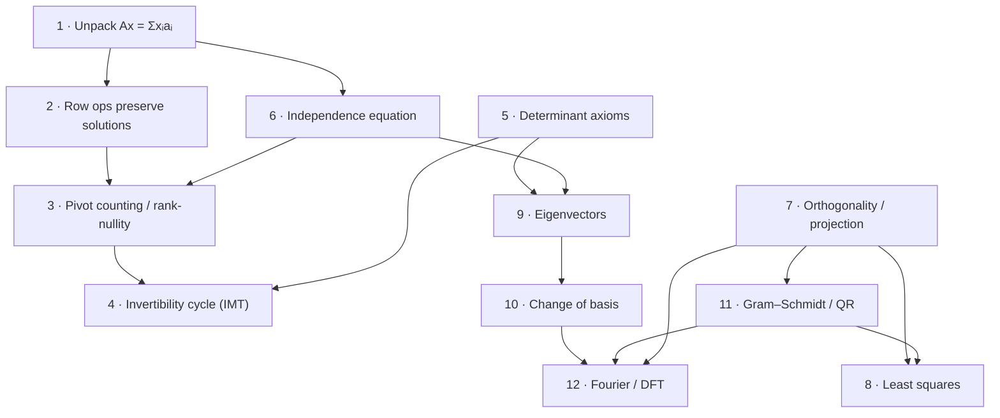

# SC1004 — Proof Branches: One Proof, Many Conclusions

> **Why this file exists.** [theorem_navigator.md](theorem_navigator.md) tells you *which theorem to use*. This file tells you *why one proof produces a whole family of conclusions* — so you can rebuild the course from a handful of proof moves instead of memorizing dozens of separate facts.
>
> **How to study it**
> 1. Learn the **10 proof moves** in §1. They repeat everywhere.
> 2. Read one **hub** at a time: the move → the proof skeleton → cover the branches and try to derive them yourself.
> 3. Do the **recall drill** at the end of each hub. Answers are collapsed.
> 4. When a question asks "what is this?", use the **reverse index** in §4.
> 5. For a one-page revision pass, use the **formula sheet** in §8.
>
> **Short on time?** Learn Hubs 1–4 and 7–9 first. They carry the main chains: existence/uniqueness, projection, and eigenvalues. Hubs 5, 6, 10–12 are the supporting branches.

---

## 0. The spine of the course

Three chains run through everything. If you remember these, most theorems are just a step in a chain.

```text
EXISTENCE / UNIQUENESS
unpack Ax = Σ x_i a_i
        ↓
row reduce [A | b]
        ↓
count pivots and free variables
        ↓
rank + nullity = n
        ↓
invertibility cycle (IMT)
        ↓
determinant ≠ 0  /  0 is not an eigenvalue

APPROXIMATION
dot product
        ↓
orthogonality
        ↓
projection onto a subspace
        ↓
best approximation
        ↓
normal equations / QR
        ↓
least squares

STRUCTURE
eigenvalues
        ↓
eigenvectors / eigenspaces
        ↓
eigenbasis
        ↓
diagonalization  A = PDP⁻¹
        ↓
powers Aᵏ and discrete dynamics
```

**Change of basis** is the glue between the first and third chains: every matrix is the same linear map written in some basis, and diagonalization is the special basis where that matrix becomes diagonal.

---

## 1. The 10 proof moves

These are the reusable moves. Most exam proofs are one of these moves plus a definition.

| # | Move | Template | What it unlocks |
|---|---|---|---|
| 1 | **Unpack the definition** | $A\mathbf x=x_1\mathbf a_1+\cdots+x_n\mathbf a_n$ | system ↔ vector ↔ matrix form; span; consistency |
| 2 | **Reverse the operation** | elementary row operations are invertible; multiply by $A^{-1}$ | solution-set preservation; $[A \mid I]\to[I \mid A^{-1}]$; IMT |
| 3 | **Count** | pivots vs free variables; dimensions | rank–nullity; basis recipes; $0/1/\infty$ solutions |
| 4 | **Dot with a clever vector** | dot with $\mathbf u_j$ to isolate $c_j$; dot the residual | orthogonal independence; projection coefficients; normal equations |
| 5 | **Expand a square** | $\lVert\mathbf u+t\mathbf v\rVert^2\ge0$; $\lVert\mathbf y-\mathbf v\rVert^2$ | Cauchy–Schwarz; triangle inequality; best approximation |
| 6 | **Compare dimensions** | $\operatorname{rank}+\operatorname{nullity}=n$; $\dim W+\dim W^\perp=n$ | existence vs uniqueness; orthogonal complements |
| 7 | **Induct** | Gram–Schmidt; distinct eigenvalues | orthogonal bases; independent eigenvectors |
| 8 | **Change basis** | $P^{-1}AP$ | diagonalization; similarity; DFT |
| 9 | **Argue by contradiction** | assume dependence, inconsistency, or non-diagonalizability | dependence tests; converse proofs |
| 10 | **Reduce to a scalar** | $\det(A-\lambda I)=0$; $A\mathbf x=\lambda\mathbf x$ | eigenvalues; determinant tests; dynamics |

---

## 2. The hubs

Each hub is one proof idea with its branches. The tree is the summary; the bullets explain each branch.

**Hub map**

- **Hub 1 — Unpack $A\mathbf x$:** one definition gives system/vector/matrix equivalence, span, consistency, and the standard matrix.
- **Hub 2 — Row operations:** one reversibility fact gives consistency, solution counts, bases for $N(A)$, $\operatorname{Col}A$, and the row space, and the inverse algorithm.
- **Hub 3 — Pivot counting:** one partition of the columns gives rank, nullity, existence, and uniqueness.
- **Hub 4 — Invertibility cycle:** one implication cycle gives the ten equivalent statements of the IMT.
- **Hub 5 — Determinant rules:** three axioms give all nine determinant properties, invertibility, volume, and the characteristic polynomial.
- **Hub 6 — Independence equation:** one homogeneous equation gives orthogonal independence, distinct-eigenvalue independence, dependence tests, and bases.
- **Hub 7 — Orthogonality:** two expansions give Cauchy–Schwarz, the triangle inequality, projections, decomposition, and best approximation.
- **Hub 8 — Least squares:** one residual-orthogonality condition gives the normal equations, the projection matrix, and uniqueness.
- **Hub 9 — Eigenvectors:** one eigenbasis gives diagonalization, powers, dynamics, trace/determinant formulas, and similarity invariants.
- **Hub 10 — Change of basis:** one conjugation formula gives coordinate conversion, similarity, and diagonalization as a basis change.
- **Hub 11 — Gram–Schmidt:** one projection-subtraction process gives orthogonal bases, QR, and stable least squares.
- **Hub 12 — Fourier basis:** one orthogonality calculation gives the DFT, IDFT, Parseval, and aliasing.

---

## Hub 1 — Unpack the definition: $A\mathbf x=\sum_i x_i\mathbf a_i$

> **The move.** A matrix–vector product is not a new operation. It is a **linear combination of the columns**, with the entries of $\mathbf x$ as the weights. Almost every statement about $A\mathbf x=\mathbf b$ is this sentence in disguise.

**Proof skeleton**

1. Write $A=[\mathbf a_1\ \cdots\ \mathbf a_n]$ and $\mathbf x=(x_1,\dots,x_n)$.
2. Then $A\mathbf x=x_1\mathbf a_1+\cdots+x_n\mathbf a_n$.
3. Read $A\mathbf x=\mathbf b$ as: "$\mathbf b$ is a linear combination of the columns of $A$."

**Formula card**

- $A\mathbf x=x_1\mathbf a_1+\cdots+x_n\mathbf a_n$
- $A\mathbf x=\mathbf b\iff\mathbf b\in\operatorname{Col}A$
- columns span $\mathbb R^m\iff$ pivot in every row
- $A(\mathbf u+\mathbf v)=A\mathbf u+A\mathbf v$, $\;A(c\mathbf u)=cA\mathbf u$
- $A=[\,T(\mathbf e_1)\ \cdots\ T(\mathbf e_n)\,]$
- $AB=[\,A\mathbf b_1\ \cdots\ A\mathbf b_p\,]$

```text
Ax = Σ xᵢ aᵢ
├── Ax = b  ⇔  vector equation  ⇔  augmented matrix
├── consistent  ⇔  b ∈ Col A
├── solvable for every b  ⇔  columns span Rᵐ
├── Ax = 0 nontrivial  ⇔  columns dependent
├── A(u+v) = Au + Av  and  A(cu) = cAu
├── standard matrix A = [T(e₁) … T(eₙ)]
└── columns of AB = A times columns of B
```

**Branches — what this one proof gives you**

- **System ↔ vector equation ↔ augmented matrix (Thm 1.1).** All three ask for the same weights $x_1,\dots,x_n$.
- **Consistency means membership.** $A\mathbf x=\mathbf b$ has a solution exactly when $\mathbf b\in\operatorname{Col}A$.
- **"For every $\mathbf b$" means spanning.** If every $\mathbf b\in\mathbb R^m$ is a combination of the columns, then the columns span $\mathbb R^m$ (and conversely).
- **Nontrivial nullspace means dependence.** $A\mathbf x=\mathbf 0$ with $\mathbf x\neq\mathbf 0$ is a nontrivial combination of the columns that equals $\mathbf 0$.
- **Linearity (Thm 1.3).** $A(\mathbf u+\mathbf v)=\sum(u_i+v_i)\mathbf a_i=A\mathbf u+A\mathbf v$, and similarly for scalars.
- **Standard matrix (Thm 1.7).** Since $\mathbf x=\sum x_j\mathbf e_j$, linearity gives $T(\mathbf x)=\sum x_jT(\mathbf e_j)$; so $A=[\,T(\mathbf e_1)\ \cdots\ T(\mathbf e_n)\,]$.
- **Columns of a product.** $AB=A[\mathbf b_1\ \cdots\ \mathbf b_p]=[A\mathbf b_1\ \cdots\ A\mathbf b_p]$.

**Feeds into:** Hub 2 (row reduction solves the combination problem), Hub 3 (rank counts independent columns), Hub 6 (independence is $A\mathbf x=\mathbf 0$), Hub 9 (eigenvectors are special $\mathbf x$).

<details>
<summary><strong>Recall drill — Hub 1</strong></summary>

1. Why is $A\mathbf x=\mathbf b$ consistent exactly when $\mathbf b\in\operatorname{Col}A$?
2. Why are the columns of $AB$ equal to $A$ times the columns of $B$?
3. Why is the standard matrix of $T$ built from the vectors $T(\mathbf e_j)$?

**Answers**

1. $A\mathbf x$ is by definition $x_1\mathbf a_1+\cdots+x_n\mathbf a_n$, so $A\mathbf x=\mathbf b$ says $\mathbf b$ is a combination of the columns.
2. Matrix multiplication acts column by column: the $j$-th column of $AB$ is $A$ times the $j$-th column of $B$.
3. $\mathbf x=x_1\mathbf e_1+\cdots+x_n\mathbf e_n$; by linearity, $T(\mathbf x)=x_1T(\mathbf e_1)+\cdots+x_nT(\mathbf e_n)$, which is $A\mathbf x$ for $A=[\,T(\mathbf e_1)\ \cdots\ T(\mathbf e_n)\,]$.

</details>

---

## Hub 2 — Row operations preserve the solution set

> **The move.** Every elementary row operation is **reversible**. Therefore row-equivalent augmented matrices have exactly the same solutions. Everything you read off the RREF is therefore a fact about the original system.

**Proof skeleton**

1. A row swap is its own inverse; scaling a row by $c\neq0$ is undone by scaling by $1/c$; adding a multiple of one row to another is undone by subtracting it.
2. Hence $[A \mid \mathbf b]$ and its RREF have the same solution set.
3. Read the RREF: pivots, free variables, and the augmented column tell you everything.

**Formula card**

- consistent $\iff$ no pivot in the augmented column
- no free variable $\Rightarrow$ exactly one solution; free variable $\Rightarrow$ infinitely many; augmented pivot $\Rightarrow$ none
- $\mathbf x=\mathbf p+\mathbf v_h$, $\;\mathbf v_h\in N(A)$
- $N(A)=\operatorname{Span}\{\text{free-variable vectors}\}$
- $\operatorname{Col}A=\operatorname{Span}\{\text{pivot columns of }A\}$
- $\operatorname{Row}A=\operatorname{Span}\{\text{nonzero rows of REF}\}$
- $[A\mid I]\longrightarrow[I\mid A^{-1}]$

```text
Row operations preserve solutions
├── consistency: is there a pivot in the augmented column?
├── 0 / 1 / ∞ solutions: are there free variables?
├── N(A) basis: one vector per free variable
├── Col(A) basis: pivot columns of A
├── Row(A) basis: nonzero rows of REF
├── rank = number of pivot columns
├── [A | I] → [I | A⁻¹]
└── A invertible ⇔ RREF(A) = I
```

**Branches — what this one proof gives you**

- **Consistency test.** A pivot in the augmented column gives a row $[0\ \cdots\ 0 \mid c]$ with $c\neq0$, which is impossible. No such pivot means the system is consistent.
- **Solution count.** No free variables $\Rightarrow$ exactly one solution. At least one free variable $\Rightarrow$ infinitely many. A pivot in the augmented column $\Rightarrow$ none.
- **Nullspace basis.** Set each free variable to $1$ (the others to $0$), solve for the pivot variables, and repeat. The resulting vectors are a basis of $N(A)$.
- **Column-space basis (Thm 4.6).** Row operations preserve the **dependence relations** among columns, though not the column space itself. The pivot columns of the RREF are independent, and every non-pivot column is a combination of them; the same relations hold among the columns of $A$. Hence the **pivot columns of $A$** form a basis for $\operatorname{Col}A$.
- **Row-space basis (Thm 4.7).** Row operations replace rows by linear combinations of rows, so the row space is unchanged. The nonzero rows of an echelon form are independent and span it.
- **Rank = number of pivots.** This is the bridge to Hub 3.
- **Inverse algorithm (Thm 2.3).** Row-reduce $[A \mid I]$. If the left block becomes $I$, the same operations have turned $I$ into $A^{-1}$.
- **Invertible ⇔ RREF $=I$.** If $A$ is invertible, $A\mathbf x=\mathbf 0$ has only $\mathbf x=\mathbf 0$, so there are no free variables and the RREF is $I$. Conversely, if the RREF is $I$, the algorithm above produces an inverse.

**Feeds into:** Hub 3 (count the pivots), Hub 4 (the invertibility cycle).

<details>
<summary><strong>Recall drill — Hub 2</strong></summary>

1. Why do elementary row operations not change the solution set?
2. Why does a pivot in the augmented column mean "no solution"?
3. Why can we use the pivot columns of $A$, not the RREF, as a basis for $\operatorname{Col}A$?

**Answers**

1. Each operation is reversible: swap, scale by a nonzero constant, and add a multiple of a row. Reversible operations cannot create or destroy solutions.
2. It corresponds to an equation $0=c$ with $c\neq0$.
3. Row operations preserve the linear dependence relations among the columns. The pivot columns of the RREF are independent and every other RREF column is a combination of them, so the corresponding columns of $A$ have the same properties. The actual column **vectors** differ, so you must take the pivot columns of $A$ itself.

</details>

---

## Hub 3 — Count the pivots: rank–nullity

> **The move.** In the RREF, every column is either a **pivot column** or a **free column**. Count them. That count gives the rank, the nullity, and the existence/uniqueness answers.

**Proof skeleton**

1. Row-reduce $A$ to RREF.
2. Pivot columns $\leftrightarrow$ independent directions in $\operatorname{Col}A$ (Hub 2).
3. Free columns $\leftrightarrow$ free variables $\leftrightarrow$ basis vectors of $N(A)$ (Hub 2).
4. The two types partition the $n$ columns.

**Formula card**

- $\operatorname{rank}A+\dim N(A)=n$
- $\operatorname{rank}A=\dim\operatorname{Col}A=\dim\operatorname{Row}A=\#\text{pivots}$
- $\dim N(A)=n-\operatorname{rank}A=\#\text{free variables}$
- $\operatorname{rank}A=m\iff A\mathbf x=\mathbf b$ is consistent for every $\mathbf b$
- $\operatorname{rank}A=n\iff$ at most one solution for every $\mathbf b$
- square $A$: $\operatorname{rank}A=n\iff A$ invertible

```text
Pivot count
├── rank A = # pivot columns = dim Col A = dim Row A
├── nullity = # free columns
├── rank A + nullity = n
├── rank A = n  ⇒ columns independent
├── rank A = m  ⇒ columns span Rᵐ
├── consistent for all b  ⇔  rank A = m
├── unique solution (if it exists)  ⇔  rank A = n
└── full rank vs rank deficient
```

**Branches — what this one proof gives you**

- **Rank Theorem (4.8).** $\operatorname{rank}A+\dim N(A)=n$, because pivots and free variables partition the $n$ columns.
- **Row rank = column rank.** Both equal the number of pivots; the row space has one basis vector per nonzero row of an echelon form.
- **Existence.** If $\operatorname{rank}A=m$, then $\dim\operatorname{Col}A=m$, so $\operatorname{Col}A=\mathbb R^m$ and every $\mathbf b$ is reachable.
- **Uniqueness.** If $\operatorname{rank}A=n$, there are no free variables, so a solution (when it exists) is unique.
- **Both at once.** For a square matrix, $\operatorname{rank}A=n$ gives existence and uniqueness, hence invertibility (Hub 4).
- **Full rank.** $\operatorname{rank}A=n$ means independent columns; $\operatorname{rank}A=m$ means spanning columns. For a square matrix these coincide.
- **Rank deficiency.** $\operatorname{rank}A<n$ means at least one free variable, so a solution is never unique when it exists.

**Feeds into:** Hub 4 (IMT), Hub 8 (uniqueness of least squares).

<details>
<summary><strong>Recall drill — Hub 3</strong></summary>

1. Why is $\operatorname{rank}A+\dim N(A)=n$?
2. Why does $\operatorname{rank}A=m$ guarantee a solution for every $\mathbf b$?
3. Why does $\operatorname{rank}A=n$ guarantee uniqueness but not existence?

**Answers**

1. The $n$ columns split into pivot columns and free columns. Pivot columns give a basis of $\operatorname{Col}A$; free columns give a basis of $N(A)$. So the counts add to $n$.
2. $\operatorname{Col}A$ is a subspace of $\mathbb R^m$ with dimension $m$, so it is all of $\mathbb R^m$.
3. No free variables means at most one solution. But the columns may still fail to span $\mathbb R^m$ if $m>n$, so some $\mathbf b$ may have no solution.

</details>

---

## Hub 4 — The invertibility cycle (IMT)

> **The move.** Prove a **cycle** of implications once. Then any one condition implies all the others. The engine is Hub 2: row reduction decides whether the nullspace is trivial.

**Proof skeleton**

1. If $A$ is invertible, multiply $A\mathbf x=\mathbf 0$ by $A^{-1}$ to get $\mathbf x=\mathbf 0$.
2. If $A\mathbf x=\mathbf 0$ has only the trivial solution, there are no free variables, so $A$ has $n$ pivots and RREF$(A)=I$.
3. If RREF$(A)=I$, the row operations that reduce $A$ to $I$ turn $I$ into a matrix $B$ with $BA=I$; so $A$ is invertible.
4. Close the cycle: invertible $\to$ trivial nullspace $\to$ RREF $=I$ $\to$ invertible.
5. Add the parallel statements (span, determinant, eigenvalues) by proving one arrow to each and one arrow back.

**Formula card**

- $A^{-1}A=AA^{-1}=I$
- $A\mathbf x=\mathbf b\;\Rightarrow\;\mathbf x=A^{-1}\mathbf b$
- $(AB)^{-1}=B^{-1}A^{-1}$, $\;(A^{\mathsf T})^{-1}=(A^{-1})^{\mathsf T}$
- $\det A\neq0\iff A$ invertible
- $\det(A^{-1})=1/\det A$
- $A$ invertible $\iff0$ is not an eigenvalue

```text
Invertibility cycle
├── Ax = b has the unique solution x = A⁻¹b
├── (AB)⁻¹ = B⁻¹A⁻¹,  (Aᵀ)⁻¹ = (A⁻¹)ᵀ
├── RREF(A) = I
├── n pivots
├── N(A) = {0}
├── columns independent / form a basis
├── columns span Rⁿ
├── rank A = n
├── det A ≠ 0
├── 0 is not an eigenvalue
└── Aᵀ is invertible
```

**Branches — what this one cycle gives you**

- **Unique solution (Thm 2.1).** $A(A^{-1}\mathbf b)=\mathbf b$ proves existence; if $A\mathbf u=\mathbf b$, multiply by $A^{-1}$ to get $\mathbf u=A^{-1}\mathbf b$, proving uniqueness.
- **Inverse laws (Thm 2.2).** Verify by multiplication: $(AB)(B^{-1}A^{-1})=I$ and $(B^{-1}A^{-1})(AB)=I$.
- **$\det A\neq0$.** $1=\det I=\det(AA^{-1})=\det A\det(A^{-1})$, so both factors are nonzero. Conversely, $\det A\neq0$ forces $n$ pivots (Hub 5).
- **$0$ is not an eigenvalue.** $A\mathbf x=0\cdot\mathbf x$ has a nontrivial solution exactly when $N(A)\neq\{\mathbf 0\}$; invertibility says this cannot happen.
- **Rank $n$ and bases.** Hub 3.
- **$A^{\mathsf T}$ invertible.** $(A^{\mathsf T})^{-1}=(A^{-1})^{\mathsf T}$.
- **$A^{\mathsf T}A$ invertible.** For square $A$, $\det(A^{\mathsf T}A)=(\det A)^2\neq0$.

**Feeds into:** Hub 5 (determinant test), Hub 9 ($0$ eigenvalue).

<details>
<summary><strong>Recall drill — Hub 4</strong></summary>

1. Why does invertibility force $A\mathbf x=\mathbf 0$ to have only the trivial solution?
2. How does "trivial nullspace" produce the inverse matrix?
3. Why is $\det(A^{-1})=1/\det A$?

**Answers**

1. Multiply both sides of $A\mathbf x=\mathbf 0$ by $A^{-1}$: $\mathbf x=A^{-1}\mathbf 0=\mathbf 0$.
2. No free variables means $n$ pivots, so RREF$(A)=I$. Row-reducing $[A \mid I]$ to $[I \mid B]$ gives $BA=I$; hence $B=A^{-1}$.
3. $1=\det I=\det(AA^{-1})=\det A\det(A^{-1})$.

</details>

---

## Hub 5 — Determinant from three rules

> **The move.** The determinant is the unique function of the rows that is (i) $1$ on $I$, (ii) **alternating** (a row swap flips the sign), and (iii) **linear in each row**. Every determinant property is a consequence of these three rules.

**Proof skeleton**

1. Use row operations to reduce $A$ to triangular form $U$.
2. Track the sign changes from row swaps and the scaling factors from row multiplications.
3. If you use only swaps and row replacements, $\det A=(-1)^r\prod u_{ii}$. If you also scale rows, divide out each scaling factor. In practice: multiply the diagonal, then fix the sign.

**Formula card**

- $2\times2$: $\det\begin{bmatrix}a&b\\c&d\end{bmatrix}=ad-bc$
- $\det I=1$; row swap $\Rightarrow$ sign flip; row replacement $\Rightarrow$ unchanged
- triangular: $\det A=a_{11}a_{22}\cdots a_{nn}$
- $\det(AB)=\det A\det B$
- $\det(A^{-1})=1/\det A$
- $\det(A^{\mathsf T})=\det A$
- $\det(A-\lambda I)=\prod_i(\lambda_i-\lambda)$
- area/volume $=\lvert\det A\rvert$

```text
Determinant axioms
├── det I = 1
├── row swap ⇒ sign flip
├── equal rows ⇒ det = 0
├── zero row ⇒ det = 0
├── row replacement ⇒ unchanged
├── triangular ⇒ product of diagonal
├── det(AB) = det A det B
├── det(A⁻¹) = 1/det A
├── det(Aᵀ) = det A
├── singular ⇔ det = 0
├── |det| = area/volume scale
├── det = product of eigenvalues
└── det(A − λI) = characteristic polynomial
```

**Branches — what these three rules give you**

- **Equal rows $\Rightarrow\det=0$.** Swap the equal rows: the matrix is unchanged, but the determinant flips sign, so $\det=-\det$.
- **Zero row $\Rightarrow\det=0$.** Linearity in that row with the zero scalar.
- **Row replacement is free.** Adding $c$ times row $i$ to row $j$ changes $\det$ by $c$ times a determinant with two equal rows, which is $0$.
- **Triangular matrices.** Expand along the diagonal, or row-reduce; only the diagonal product survives.
- **Product rule $\det(AB)=\det A\det B$.** If $A$ is singular, both sides are $0$. If $A$ is invertible, write $A$ as a product of elementary matrices; the rule holds for each elementary matrix and multiplies out.
- **Inverse.** $1=\det I=\det(AA^{-1})=\det A\det(A^{-1})$.
- **Transpose.** $\det(A^{\mathsf T})=\det A$; row and column operations have the same effect on the determinant.
- **Singular $\iff\det=0$.** Row-reduce to triangular form; a zero row appears exactly when there are fewer than $n$ pivots.
- **Area/volume (Thm 3.1–3.2).** The columns are the edges of the parallelepiped; the determinant is its signed volume, and a linear map $T_A$ scales every region by $\lvert\det A\rvert$.
- **Eigenvalue product.** $\det(A-\lambda I)=\prod_i(\lambda_i-\lambda)$; set $\lambda=0$.
- **Characteristic polynomial.** $\det(A-\lambda I)$ is the degree-$n$ polynomial whose roots are the eigenvalues (Hub 9).

**Feeds into:** Hub 4 (invertibility test), Hub 9 (eigenvalues).

<details>
<summary><strong>Recall drill — Hub 5</strong></summary>

1. Why must a matrix with two equal rows have determinant $0$?
2. How does the product rule follow from the three axioms?
3. Why does $\det A$ equal the product of the eigenvalues?

**Answers**

1. Swap the two equal rows. The matrix does not change, but the determinant changes sign. Hence $\det=-\det$, so $\det=0$.
2. If $A$ is singular, both sides are $0$. If $A$ is invertible, write $A$ as a product of elementary matrices. The rule is immediate for each elementary matrix (swap, scale, row replacement), and multiplicativity extends it to the product.
3. $\det(A-\lambda I)=\prod_i(\lambda_i-\lambda)$. Setting $\lambda=0$ gives $\det A=\prod_i\lambda_i$.

</details>

---

## Hub 6 — The independence equation

> **The move.** Independence is the statement that a homogeneous equation has **only the zero solution**:
> $$c_1\mathbf v_1+\cdots+c_p\mathbf v_p=\mathbf 0\ \Longrightarrow\ c_1=\cdots=c_p=0.$$
> To isolate a coefficient, **dot with a vector that kills the other terms**; to kill a term in an eigenvector relation, **apply $(A-\lambda I)$**.

**Proof skeleton**

1. Form the matrix $V=[\mathbf v_1\ \cdots\ \mathbf v_p]$. Independence means $V\mathbf c=\mathbf 0$ has only $\mathbf c=\mathbf 0$.
2. Row-reduce $V$: independent $\iff$ pivot in every column $\iff$ no free variables.
3. For special structure, use a shortcut: orthogonality or distinct eigenvalues.

**Formula card**

- $c_1\mathbf v_1+\cdots+c_p\mathbf v_p=\mathbf 0$
- independent $\iff c_1=\cdots=c_p=0$
- orthogonal nonzero: dot with $\mathbf v_j$ gives $c_j\lVert\mathbf v_j\rVert^2=0$, so $c_j=0$
- dependent: some $\mathbf v_j=\sum_{i<j}\alpha_i\mathbf v_i$
- $p>n\Rightarrow$ dependent
- basis $=$ independent $+$ spanning; $\dim V=$ number of vectors in any basis

```text
c₁v₁ + … + cₚvₚ = 0
├── independence ⇔ only the trivial solution
├── orthogonal nonzero ⇒ independent
├── distinct eigenvalues ⇒ independent
├── p > n ⇒ dependent
├── contains 0 ⇒ dependent
├── dependent ⇔ some vⱼ is a combination of earlier vectors
├── spanning set theorem: remove redundant vectors
└── basis = independent + spanning; dimension
```

**Branches — what this one equation gives you**

- **Independence test.** RREF of $[\mathbf v_1\ \cdots\ \mathbf v_p]$ has a pivot in every column.
- **Orthogonal nonzero $\Rightarrow$ independent.** Dot the relation with $\mathbf v_j$: every term vanishes except $c_j\lVert\mathbf v_j\rVert^2$, so $c_j=0$.
- **Distinct eigenvalues $\Rightarrow$ independent.** Induct on the number of eigenvectors. Apply $(A-\lambda_kI)$ to the relation to kill the last term, then use the induction hypothesis.
- **$p>n\Rightarrow$ dependent.** $V$ is $n\times p$ with more unknowns than equations, so there is a free variable.
- **Contains $\mathbf 0\Rightarrow$ dependent.** $1\cdot\mathbf 0+0\mathbf v_2+\cdots+0\mathbf v_p=\mathbf 0$ is a nontrivial relation.
- **Dependence characterization (Thm 4.4).** If the set is dependent and $\mathbf v_1\neq\mathbf 0$, take the largest $j$ with $c_j\neq0$ and solve the relation for $\mathbf v_j$; it is a combination of the preceding vectors.
- **Spanning Set Theorem (4.5).** If $\mathbf v_k$ is a combination of the other vectors, removing it does not change the span. Repeat until the remaining set is independent — that is a basis.
- **Basis and dimension.** A basis is independent + spanning; any two bases of the same space have the same size, which defines the dimension.

**Feeds into:** Hub 3 (rank counts independent columns), Hub 9 (eigenvectors), Hub 11 (Gram–Schmidt).

<details>
<summary><strong>Recall drill — Hub 6</strong></summary>

1. Why does dotting with $\mathbf v_j$ prove that an orthogonal nonzero set is independent?
2. Why are eigenvectors for distinct eigenvalues independent?
3. Why does dependence imply that some vector is a combination of the earlier ones?

**Answers**

1. In $c_1\mathbf v_1+\cdots+c_p\mathbf v_p=\mathbf 0$, dot with $\mathbf v_j$. Orthogonality kills every term except $c_j\lVert\mathbf v_j\rVert^2$. Since $\mathbf v_j\neq\mathbf 0$, $c_j=0$. Do this for every $j$.
2. Induct. Apply $A-\lambda_kI$ to the relation to kill $\mathbf v_k$; the remaining relation involves only the earlier eigenvectors. By induction their coefficients are $0$, and then $c_k=0$ as well.
3. Choose the largest index $j$ with $c_j\neq0$ and solve the dependence relation for $\mathbf v_j$ in terms of $\mathbf v_1,\dots,\mathbf v_{j-1}$.

</details>

---

## Hub 7 — Orthogonality: expand a square, then project

> **The move.** Two proofs do most of the work:
> 1. **Expand a square and use positivity:** $\lVert\mathbf u+t\mathbf v\rVert^2\ge0$ gives Cauchy–Schwarz; expanding $\lVert\mathbf u+\mathbf v\rVert^2$ gives the triangle inequality.
> 2. **Decompose and use Pythagoras:** choose $\hat{\mathbf y}\in W$ with $\mathbf y-\hat{\mathbf y}\perp W$; then every other $\mathbf v\in W$ is farther away.

**Proof skeleton**

1. Cauchy–Schwarz: $0\le\lVert\mathbf u-t\mathbf v\rVert^2$ for all $t$; choose $t=\frac{\mathbf u\cdot\mathbf v}{\lVert\mathbf v\rVert^2}$.
2. Triangle: $\lVert\mathbf u+\mathbf v\rVert^2=\lVert\mathbf u\rVert^2+2\mathbf u\cdot\mathbf v+\lVert\mathbf v\rVert^2\le(\lVert\mathbf u\rVert+\lVert\mathbf v\rVert)^2$.
3. Projection: require $\mathbf e=\mathbf u-k\mathbf a\perp\mathbf a$; solve $0=\mathbf a\cdot(\mathbf u-k\mathbf a)$ for $k$.
4. Best approximation: $\mathbf y-\mathbf v=(\mathbf y-\hat{\mathbf y})+(\hat{\mathbf y}-\mathbf v)$ with orthogonal terms.

**Formula card**

- $\lVert\mathbf v\rVert=\sqrt{\mathbf v\cdot\mathbf v}$, $\;d(\mathbf u,\mathbf v)=\lVert\mathbf u-\mathbf v\rVert$
- unit vector: $\hat{\mathbf u}=\mathbf v/\lVert\mathbf v\rVert$ for $\mathbf v\neq\mathbf 0$
- $\mathbf u\cdot\mathbf v=\sum_i u_iv_i=\mathbf u^{\mathsf T}\mathbf v$ (a scalar)
- outer product: $\mathbf u\mathbf v^{\mathsf T}$ is the $n\times n$ matrix with entries $u_iv_j$
- $\mathbf u\cdot\mathbf v=\lVert\mathbf u\rVert\lVert\mathbf v\rVert\cos\theta$
- Cauchy–Schwarz: $\lvert\mathbf u\cdot\mathbf v\rvert\le\lVert\mathbf u\rVert\lVert\mathbf v\rVert$
- triangle: $\lVert\mathbf u+\mathbf v\rVert\le\lVert\mathbf u\rVert+\lVert\mathbf v\rVert$
- $\operatorname{proj}_{\mathbf a}\mathbf u=\dfrac{\mathbf u\cdot\mathbf a}{\mathbf a\cdot\mathbf a}\mathbf a$
- $\hat{\mathbf y}=\sum_j\dfrac{\mathbf y\cdot\mathbf u_j}{\mathbf u_j\cdot\mathbf u_j}\mathbf u_j$
- $\operatorname{proj}_W\mathbf y=UU^{\mathsf T}\mathbf y$
- $\mathbf y=\hat{\mathbf y}+\mathbf z$, $\;\mathbf z\in W^\perp$
- $\lVert\mathbf y-\mathbf v\rVert^2=\lVert\mathbf y-\hat{\mathbf y}\rVert^2+\lVert\hat{\mathbf y}-\mathbf v\rVert^2$
- $U^{\mathsf T}U=I$

**Why $\hat{\mathbf y}=UU^{\mathsf T}\mathbf y$ works**

Let $U=[\mathbf u_1\ \cdots\ \mathbf u_p]$ have orthonormal columns.

1. $U^{\mathsf T}\mathbf y$ is the column vector of dot products:
$$U^{\mathsf T}\mathbf y=\begin{bmatrix}\mathbf u_1\cdot\mathbf y\\ \vdots\\ \mathbf u_p\cdot\mathbf y\end{bmatrix}.$$
2. Multiplying by $U$ rebuilds the combination:
$$U(U^{\mathsf T}\mathbf y)=(\mathbf u_1\cdot\mathbf y)\mathbf u_1+\cdots+(\mathbf u_p\cdot\mathbf y)\mathbf u_p.$$
3. Orthonormality makes the denominators disappear: the general orthogonal-basis formula is $\sum_j\dfrac{\mathbf y\cdot\mathbf u_j}{\mathbf u_j\cdot\mathbf u_j}\mathbf u_j$, and $\mathbf u_j\cdot\mathbf u_j=1$.
4. The residual is orthogonal to $W$:
$$U^{\mathsf T}(\mathbf y-UU^{\mathsf T}\mathbf y)=U^{\mathsf T}\mathbf y-(U^{\mathsf T}U)U^{\mathsf T}\mathbf y=U^{\mathsf T}\mathbf y-U^{\mathsf T}\mathbf y=\mathbf 0.$$
5. Hence $P=UU^{\mathsf T}$ is the projection matrix: $P^2=P$ and $P^{\mathsf T}=P$.

**Dimensions:** $U$ is $m\times p$, so $U^{\mathsf T}\mathbf y$ is $p\times1$ (coordinates in $W$), $U(U^{\mathsf T}\mathbf y)$ is $m\times1$ (the projected vector), and $UU^{\mathsf T}$ is $m\times m$. If $p<m$, then $UU^{\mathsf T}\neq I_m$; it projects onto the $p$-dimensional subspace $W=\operatorname{Col}U$.

```text
Expand a square / residual
├── Cauchy–Schwarz: |u·v| ≤ ||u|| ||v||
├── angle well-defined: |cos θ| ≤ 1
├── triangle inequality: ||u+v|| ≤ ||u|| + ||v||
├── Pythagoras: u ⊥ v ⇒ ||u+v||² = ||u||² + ||v||²
├── projection onto a line: proj_a u = (u·a)/(a·a) a
├── orthogonal decomposition: y = ŷ + z, z ∈ W⊥
├── projection with an orthogonal basis
├── best approximation: ŷ is closest
├── projection with an orthonormal basis: UUᵀy
├── UᵀU = I ⇔ orthonormal columns
├── distance to W = ||y − ŷ||
└── normal equations (feeds Hub 8)
```

**Branches — what these two moves give you**

- **Cauchy–Schwarz (3.2.4).** The course proves it from the angle form; the algebraic proof is the expansion above. It guarantees $\lvert\cos\theta\rvert\le1$, so the angle is well defined.
- **Triangle inequality (3.2.5).** Expand $\lVert\mathbf u+\mathbf v\rVert^2$ and bound the cross term by Cauchy–Schwarz.
- **Pythagoras.** If $\mathbf u\perp\mathbf v$, the cross term $2\mathbf u\cdot\mathbf v$ vanishes.
- **Projection onto a line (3.3.2).** The residual method gives $k=\frac{\mathbf u\cdot\mathbf a}{\lVert\mathbf a\rVert^2}$.
- **Orthogonal decomposition (Thm 5).** Every $\mathbf y$ splits uniquely as $\hat{\mathbf y}+\mathbf z$ with $\hat{\mathbf y}\in W$ and $\mathbf z\in W^\perp$.
- **Projection with an orthogonal basis (Thm 8).** Dot with each basis vector to isolate its coefficient: $\hat{\mathbf y}=\sum_j\frac{\mathbf y\cdot\mathbf u_j}{\mathbf u_j\cdot\mathbf u_j}\mathbf u_j$.
- **Best approximation (Thm 9).** Pythagoras gives $\lVert\mathbf y-\mathbf v\rVert^2=\lVert\mathbf y-\hat{\mathbf y}\rVert^2+\lVert\hat{\mathbf y}-\mathbf v\rVert^2$, which is minimized uniquely at $\mathbf v=\hat{\mathbf y}$.
- **Orthonormal projection (Thm 10).** With an orthonormal basis, the denominators are $1$, so $\operatorname{proj}_W\mathbf y=UU^{\mathsf T}\mathbf y$.
- **$U^{\mathsf T}U=I$ (Thm 6).** The $(i,j)$ entry of $U^{\mathsf T}U$ is $\mathbf u_i\cdot\mathbf u_j$; this is $\delta_{ij}$ exactly when the columns are orthonormal.
- **Distance to a subspace.** The shortest distance is the residual norm $\lVert\mathbf y-\hat{\mathbf y}\rVert$.
- **Normal equations.** When $W=\operatorname{Col}A$, the residual is orthogonal to every column: $A^{\mathsf T}(\mathbf b-A\hat{\mathbf x})=\mathbf 0$ (Hub 8).

**Feeds into:** Hub 8 (least squares), Hub 11 (Gram–Schmidt/QR), Hub 12 (Fourier basis).

<details>
<summary><strong>Recall drill — Hub 7</strong></summary>

1. Derive Cauchy–Schwarz from $\lVert\mathbf u-t\mathbf v\rVert^2\ge0$.
2. Derive the triangle inequality.
3. Why is the projection the closest point in $W$?

**Answers**

1. Expand: $\lVert\mathbf u-t\mathbf v\rVert^2=\lVert\mathbf u\rVert^2-2t(\mathbf u\cdot\mathbf v)+t^2\lVert\mathbf v\rVert^2$. Choose $t=\frac{\mathbf u\cdot\mathbf v}{\lVert\mathbf v\rVert^2}$ and simplify to $(\mathbf u\cdot\mathbf v)^2\le\lVert\mathbf u\rVert^2\lVert\mathbf v\rVert^2$.
2. $\lVert\mathbf u+\mathbf v\rVert^2=\lVert\mathbf u\rVert^2+2\mathbf u\cdot\mathbf v+\lVert\mathbf v\rVert^2\le\lVert\mathbf u\rVert^2+2\lVert\mathbf u\rVert\lVert\mathbf v\rVert+\lVert\mathbf v\rVert^2=(\lVert\mathbf u\rVert+\lVert\mathbf v\rVert)^2$.
3. For any $\mathbf v\in W$, write $\mathbf y-\mathbf v=(\mathbf y-\hat{\mathbf y})+(\hat{\mathbf y}-\mathbf v)$. The two terms are orthogonal, so Pythagoras gives $\lVert\mathbf y-\mathbf v\rVert^2=\lVert\mathbf y-\hat{\mathbf y}\rVert^2+\lVert\hat{\mathbf y}-\mathbf v\rVert^2\ge\lVert\mathbf y-\hat{\mathbf y}\rVert^2$, with equality only when $\mathbf v=\hat{\mathbf y}$.

</details>

---

## Hub 8 — Least squares: project the data onto the column space

> **The move.** When $A\mathbf x=\mathbf b$ has no exact solution, do not solve it. Replace $\mathbf b$ by its projection $\hat{\mathbf b}$ onto $\operatorname{Col}A$, and solve the solvable system $A\hat{\mathbf x}=\hat{\mathbf b}$. The residual $\mathbf b-A\hat{\mathbf x}$ is orthogonal to $\operatorname{Col}A$.

**Proof skeleton**

1. Let $\hat{\mathbf b}=\operatorname{proj}_{\operatorname{Col}A}\mathbf b$. Since $\hat{\mathbf b}\in\operatorname{Col}A$, there is an $\hat{\mathbf x}$ with $A\hat{\mathbf x}=\hat{\mathbf b}$.
2. The residual $\mathbf b-A\hat{\mathbf x}$ is orthogonal to every column of $A$.
3. Therefore $A^{\mathsf T}(\mathbf b-A\hat{\mathbf x})=\mathbf 0$, i.e. $A^{\mathsf T}A\hat{\mathbf x}=A^{\mathsf T}\mathbf b$.
4. If the columns of $A$ are independent, $A^{\mathsf T}A$ is invertible, so $\hat{\mathbf x}=(A^{\mathsf T}A)^{-1}A^{\mathsf T}\mathbf b$.

**Formula card**

- $\hat{\mathbf x}=\arg\min_{\mathbf x}\lVert\mathbf b-A\mathbf x\rVert$
- $A^{\mathsf T}A\hat{\mathbf x}=A^{\mathsf T}\mathbf b$
- $\hat{\mathbf x}=(A^{\mathsf T}A)^{-1}A^{\mathsf T}\mathbf b$
- $P=A(A^{\mathsf T}A)^{-1}A^{\mathsf T}$
- $\hat{\mathbf b}=P\mathbf b$, $\;\mathbf r=(I-P)\mathbf b$
- $P^2=P$, $\;P^{\mathsf T}=P$
- $A^{\mathsf T}\mathbf r=\mathbf 0$
- $\lVert\mathbf b\rVert^2=\lVert\hat{\mathbf b}\rVert^2+\lVert\mathbf r\rVert^2$
- $R\hat{\mathbf x}=Q^{\mathsf T}\mathbf b$

```text
Residual ⊥ Col A
├── normal equations: AᵀA x̂ = Aᵀb
├── LS solution always exists
├── unique ⇔ columns independent ⇔ AᵀA invertible
├── x̂ = (AᵀA)⁻¹Aᵀb
├── fitted value b̂ = Pb,  P = A(AᵀA)⁻¹Aᵀ
├── P² = P,  Pᵀ = P
├── I − P projects onto N(Aᵀ)
├── residual r = b − Ax̂,  Aᵀr = 0
├── ||b||² = ||b̂||² + ||r||²
├── QR route: R x̂ = Qᵀb
└── linear models: design matrix
```

**Branches — what this one projection gives you**

- **Normal equations (6.5.1).** Directly from residual orthogonality.
- **Existence.** The projection $\hat{\mathbf b}$ always exists, so a least-squares solution always exists (the normal equations are always consistent).
- **Uniqueness.** $A^{\mathsf T}A$ is invertible exactly when the columns of $A$ are independent: $N(A^{\mathsf T}A)=N(A)$ because $A^{\mathsf T}A\mathbf x=\mathbf 0\Rightarrow\lVert A\mathbf x\rVert^2=\mathbf x^{\mathsf T}A^{\mathsf T}A\mathbf x=0$.
- **Explicit formula.** Multiply the normal equations by $(A^{\mathsf T}A)^{-1}$.
- **Projection matrix.** $P=A(A^{\mathsf T}A)^{-1}A^{\mathsf T}$; check $P^2=P$ and $P^{\mathsf T}=P$.
- **Orthogonal complement.** $I-P$ projects onto $(\operatorname{Col}A)^\perp=N(A^{\mathsf T})$.
- **Residual and error.** $A^{\mathsf T}\mathbf r=\mathbf 0$; since $\hat{\mathbf b}\perp\mathbf r$, $\lVert\mathbf b\rVert^2=\lVert\hat{\mathbf b}\rVert^2+\lVert\mathbf r\rVert^2$.
- **QR route.** If $A=QR$, then $A^{\mathsf T}A=R^{\mathsf T}R$ and the normal equations reduce to $R\hat{\mathbf x}=Q^{\mathsf T}\mathbf b$ (Hub 11).
- **Linear models.** A model linear in its parameters has a design matrix $A$; the coefficients solve $A^{\mathsf T}A\boldsymbol\beta=A^{\mathsf T}\mathbf y$.

**Feeds into:** Hub 11 (QR implementation), applications such as regression.

<details>
<summary><strong>Recall drill — Hub 8</strong></summary>

1. Where does the normal equation come from?
2. Why is $A^{\mathsf T}A$ invertible exactly when the columns of $A$ are independent?
3. Why are $P^2=P$ and $P^{\mathsf T}=P$?

**Answers**

1. The residual $\mathbf b-A\hat{\mathbf x}$ is orthogonal to $\operatorname{Col}A$, hence to every column of $A$: $A^{\mathsf T}(\mathbf b-A\hat{\mathbf x})=\mathbf 0$.
2. $N(A^{\mathsf T}A)=N(A)$: if $A^{\mathsf T}A\mathbf x=\mathbf 0$, then $\lVert A\mathbf x\rVert^2=\mathbf x^{\mathsf T}A^{\mathsf T}A\mathbf x=0$, so $A\mathbf x=\mathbf 0$. Thus $A^{\mathsf T}A$ has a trivial nullspace exactly when $A$ has independent columns.
3. $P^2=A(A^{\mathsf T}A)^{-1}A^{\mathsf T}A(A^{\mathsf T}A)^{-1}A^{\mathsf T}=A(A^{\mathsf T}A)^{-1}A^{\mathsf T}=P$, and $P^{\mathsf T}=A(A^{\mathsf T}A)^{-1}A^{\mathsf T}=P$.

</details>

---

## Hub 9 — Eigenvectors: choose the basis that makes $A$ diagonal

> **The move.** An eigenvector is a direction that $A$ does not rotate. If you can find $n$ independent eigenvectors, use them as a basis; in that basis, $A$ is diagonal.

**Proof skeleton**

1. $\lambda$ is an eigenvalue $\iff\det(A-\lambda I)=0$ (Hub 5).
2. For each $\lambda$, the eigenvectors plus $\mathbf 0$ form $E_\lambda=N(A-\lambda I)$.
3. If $\mathbf v_1,\dots,\mathbf v_n$ are independent eigenvectors, set $P=[\mathbf v_1\ \cdots\ \mathbf v_n]$ and $D=\operatorname{diag}(\lambda_1,\dots,\lambda_n)$.
4. Then $AP=PD$, so $A=PDP^{-1}$.

**Formula card**

- $A\mathbf v=\lambda\mathbf v$, $\;\mathbf v\neq\mathbf 0$
- $\det(A-\lambda I)=0$
- $E_\lambda=N(A-\lambda I)$
- $1\le\dim E_\lambda\le$ algebraic multiplicity
- $A=PDP^{-1}$
- $A^k=PD^kP^{-1}$
- $\operatorname{tr}A=\sum_i\lambda_i$, $\;\det A=\prod_i\lambda_i$
- $A^{-1}$: eigenvalues $1/\lambda_i$; $A+cI$: eigenvalues $\lambda_i+c$; $A^k$: eigenvalues $\lambda_i^k$
- complex eigenvalues of a real matrix: $a\pm bj$

```text
Eigenvectors
├── λ eigenvalue ⇔ det(A − λI) = 0 ⇔ A − λI singular
├── eigenspace E_λ = N(A − λI)
├── 1 ≤ geometric multiplicity ≤ algebraic multiplicity
├── distinct eigenvalues ⇒ independent eigenvectors
├── diagonalizable ⇔ n independent eigenvectors ⇔ geo = alg
├── A = PDP⁻¹
├── Aᵏ = PDᵏP⁻¹
├── dynamics x_{k+1} = Ax_k
├── trace = Σλ,  det = Πλ
├── similar matrices share char poly/eigenvalues/det/trace
└── complex eigenvalues come in conjugate pairs
```

**Branches — what this one idea gives you**

- **Eigenvalue test.** $\lambda$ is an eigenvalue exactly when $A-\lambda I$ is singular.
- **Eigenspace.** $E_\lambda=N(A-\lambda I)$ is a subspace; its dimension is the geometric multiplicity.
- **Multiplicity bound.** $1\le\dim E_\lambda\le$ algebraic multiplicity.
- **Distinct eigenvalues $\Rightarrow$ independent.** Hub 6.
- **Diagonalization criterion.** $A$ is diagonalizable iff it has $n$ independent eigenvectors, equivalently geometric $=$ algebraic multiplicity for every eigenvalue.
- **Powers.** $A^k=PD^kP^{-1}$, and $D^k$ is diagonal with entries $\lambda_i^k$.
- **Dynamics.** $\mathbf x_{k+1}=A\mathbf x_k$ gives $\mathbf x_k=A^k\mathbf x_0$; eigenvectors with $\lvert\lambda\rvert<1$ decay, $\lvert\lambda\rvert>1$ grow.
- **Trace and determinant.** $\operatorname{tr}A=\sum_i\lambda_i$ and $\det A=\prod_i\lambda_i$ (with multiplicity).
- **Similarity invariants.** Similar matrices share the characteristic polynomial, eigenvalues, determinant, and trace.
- **Complex eigenvalues.** A real matrix has non-real eigenvalues in conjugate pairs $a\pm bj$; the geometry is rotation–scaling, and the matrix is not diagonalizable over $\mathbb R$.

**Feeds into:** Hub 10 (change of basis/similarity).

<details>
<summary><strong>Recall drill — Hub 9</strong></summary>

1. Why is $\lambda$ an eigenvalue exactly when $\det(A-\lambda I)=0$?
2. Why does having $n$ independent eigenvectors make $A$ diagonalizable?
3. Why is $A^k=PD^kP^{-1}$?

**Answers**

1. $A\mathbf x=\lambda\mathbf x$ with $\mathbf x\neq\mathbf 0$ is the same as $(A-\lambda I)\mathbf x=\mathbf 0$ having a nontrivial solution, which is the same as $A-\lambda I$ being singular, which is the same as $\det(A-\lambda I)=0$.
2. Put the eigenvectors as the columns of $P$. Then $AP=PD$ because each column satisfies $A\mathbf v_i=\lambda_i\mathbf v_i$. Since $P$ is invertible, $A=PDP^{-1}$.
3. $A^k=(PDP^{-1})^k=PD^kP^{-1}$, with the inner $P^{-1}P$ pairs cancelling.

</details>

---

## Hub 10 — Change of basis: the same map, different matrix

> **The move.** Coordinates are a choice. A vector is fixed, but its coordinate vector depends on the basis. A linear map is fixed, but its matrix depends on the basis. Changing basis conjugates the matrix: $A\mapsto P^{-1}AP$.

**Proof skeleton**

1. If $\mathcal B=\{\mathbf b_1,\dots,\mathbf b_n\}$, then $\mathbf x=P_{\mathcal B}[\mathbf x]_{\mathcal B}$ with $P_{\mathcal B}=[\mathbf b_1\ \cdots\ \mathbf b_n]$.
2. To convert $\mathcal B$-coordinates to $\mathcal C$-coordinates, go through the standard basis: $[\mathbf x]_{\mathcal C}=P_{\mathcal C}^{-1}P_{\mathcal B}[\mathbf x]_{\mathcal B}$.
3. The $\mathcal B$-matrix of $T$ is $[T]_{\mathcal B}=P_{\mathcal B}^{-1}AP_{\mathcal B}$.

**Formula card**

- $\mathbf x=P_{\mathcal B}[\mathbf x]_{\mathcal B}$
- $[\mathbf x]_{\mathcal C}=P_{\mathcal C\leftarrow\mathcal B}[\mathbf x]_{\mathcal B}$
- $P_{\mathcal C\leftarrow\mathcal B}=P_{\mathcal C}^{-1}P_{\mathcal B}$
- $[T]_{\mathcal B}=P_{\mathcal B}^{-1}AP_{\mathcal B}$
- $A=PBP^{-1}$ (similar)
- $\det(A-\lambda I)=\det(B-\lambda I)$

```text
Change of basis
├── x = P_B [x]_B
├── [x]_C = P_{C←B} [x]_B
├── P_{C←B} = P_C⁻¹ P_B
├── [T]_B = P_B⁻¹ A P_B
├── similar matrices = same T in two bases
├── diagonalization = change to an eigenbasis
├── standard matrix = basis of e₁, …, eₙ
└── DFT = change to the Fourier basis
```

**Branches — what this one idea gives you**

- **Coordinate conversion.** $[\mathbf x]_{\mathcal C}=P_{\mathcal C\leftarrow\mathcal B}[\mathbf x]_{\mathcal B}$.
- **Similarity.** If $A=PBP^{-1}$, then $A$ and $B$ represent the same linear map in two bases.
- **Similarity invariants.** Same characteristic polynomial, eigenvalues, determinant, and trace (Hub 9).
- **Diagonalization.** Choosing an eigenbasis makes the matrix diagonal: $D=P^{-1}AP$.
- **Standard matrix.** Choosing the standard basis recovers $A=[\,T(\mathbf e_1)\ \cdots\ T(\mathbf e_n)\,]$.
- **DFT.** Choosing the Fourier basis turns the DFT into coordinate extraction (Hub 12).

**Feeds into:** Hub 9 (diagonalization), Hub 12 (DFT).

<details>
<summary><strong>Recall drill — Hub 10</strong></summary>

1. Why is $\mathbf x=P_{\mathcal B}[\mathbf x]_{\mathcal B}$?
2. Why is the $\mathcal B$-matrix of $T$ equal to $P_{\mathcal B}^{-1}AP_{\mathcal B}$?
3. Why do similar matrices have the same characteristic polynomial?

**Answers**

1. If $[\mathbf x]_{\mathcal B}=(c_1,\dots,c_n)$, then $\mathbf x=c_1\mathbf b_1+\cdots+c_n\mathbf b_n=P_{\mathcal B}[\mathbf x]_{\mathcal B}$.
2. Take a $\mathcal B$-coordinate vector, convert to standard coordinates, apply $A$, then convert back to $\mathcal B$-coordinates. The composition is $P_{\mathcal B}^{-1}AP_{\mathcal B}$.
3. $\det(PBP^{-1}-\lambda I)=\det(P(B-\lambda I)P^{-1})=\det(P)\det(B-\lambda I)\det(P^{-1})=\det(B-\lambda I)$.

</details>

---

## Hub 11 — Gram–Schmidt: subtract the projections

> **The move.** Given a basis, make it orthogonal one vector at a time. For each new vector, subtract its projection onto every vector already produced. The spans are preserved at every step.

**Proof skeleton**

1. Set $\mathbf v_1=\mathbf x_1$.
2. For $j\ge2$, set $\mathbf v_j=\mathbf x_j-\sum_{i<j}\frac{\mathbf x_j\cdot\mathbf v_i}{\mathbf v_i\cdot\mathbf v_i}\mathbf v_i$.
3. Then $\mathbf v_j$ is orthogonal to $\mathbf v_1,\dots,\mathbf v_{j-1}$.
4. The spans $\operatorname{Span}\{\mathbf v_1,\dots,\mathbf v_j\}=\operatorname{Span}\{\mathbf x_1,\dots,\mathbf x_j\}$ are preserved, so the result is an orthogonal basis.
5. Normalize to get an orthonormal basis.

**Formula card**

- $\mathbf v_1=\mathbf x_1$
- $\mathbf v_j=\mathbf x_j-\sum_{i<j}\dfrac{\mathbf x_j\cdot\mathbf v_i}{\mathbf v_i\cdot\mathbf v_i}\mathbf v_i$
- $\mathbf q_j=\dfrac{\mathbf v_j}{\lVert\mathbf v_j\rVert}$
- $A=QR$
- $r_{ij}=\dfrac{\mathbf x_j\cdot\mathbf v_i}{\mathbf v_i\cdot\mathbf v_i}$ for $i<j$, $\;r_{jj}=\lVert\mathbf v_j\rVert$
- $Q^{\mathsf T}Q=I$
- $R\mathbf x=Q^{\mathsf T}\mathbf b$

```text
Gram–Schmidt
├── orthogonal basis of W
├── orthonormal basis
├── same nested spans
├── QR: A = QR
├── QᵀQ = I
├── projection = QQᵀy
├── solve R x = Qᵀ b
└── existence of orthonormal bases
```

**Branches — what this one process gives you**

- **Orthogonal basis.** The vectors $\mathbf v_j$ are pairwise orthogonal.
- **Orthonormal basis.** Normalize each $\mathbf q_j=\mathbf v_j/\lVert\mathbf v_j\rVert$.
- **Nested spans.** At every step the span of the first $j$ vectors is unchanged.
- **QR factorization.** With $A=[\mathbf x_1\ \cdots\ \mathbf x_n]$, set $Q=[\mathbf q_1\ \cdots\ \mathbf q_n]$ and form $R$ from the Gram–Schmidt coefficients; then $A=QR$.
- **$Q^{\mathsf T}Q=I$.** The columns of $Q$ are orthonormal.
- **Projection.** With an orthonormal basis, $\operatorname{proj}_W\mathbf y=QQ^{\mathsf T}\mathbf y$.
- **Least squares.** $A=QR$ turns the normal equations into $R\hat{\mathbf x}=Q^{\mathsf T}\mathbf b$ (Hub 8).
- **Existence.** Every finite-dimensional subspace with a basis has an orthonormal basis.

**Feeds into:** Hub 8 (QR least squares), Hub 12 (Fourier basis is an orthogonal basis).

<details>
<summary><strong>Recall drill — Hub 11</strong></summary>

1. Why is $\mathbf v_j$ orthogonal to all previous $\mathbf v_i$?
2. Why does Gram–Schmidt preserve the span at every step?
3. How do you get $A=QR$ from Gram–Schmidt?

**Answers**

1. Dot $\mathbf v_j$ with $\mathbf v_k$ for $k<j$. Every term in the sum is orthogonal to $\mathbf v_k$ except the $k$-th one, which is chosen to cancel $\mathbf x_j\cdot\mathbf v_k$.
2. Each $\mathbf v_j$ is $\mathbf x_j$ minus a combination of earlier $\mathbf v_i$'s, and each $\mathbf x_j$ is $\mathbf v_j$ plus a combination of earlier $\mathbf v_i$'s. So the spans agree step by step.
3. Set $\mathbf q_j=\mathbf v_j/\lVert\mathbf v_j\rVert$ and let $A=QR$; the entries of $R$ are the Gram–Schmidt coefficients, with $r_{jj}=\lVert\mathbf v_j\rVert$.

</details>

---

## Hub 12 — Fourier basis: orthogonality is all you need

> **The move.** The Fourier vectors $\mathbf w_k$ with $w_k[n]=e^{j2\pi kn/N}$ are orthogonal under the complex inner product. Therefore the DFT is just **coordinate extraction in an orthogonal basis** — no new theory is required.

**Proof skeleton**

1. Compute $\langle\mathbf w_k,\mathbf w_m\rangle=\sum_{n=0}^{N-1}e^{-j2\pi kn/N}e^{j2\pi mn/N}$.
2. The sum is a geometric series with ratio $e^{j2\pi(m-k)/N}$.
3. It equals $N$ when $k=m$ and $0$ otherwise.
4. Therefore $X[k]=\langle\mathbf w_k,\mathbf x\rangle$ and the inverse is the normalized sum.

**Formula card**

- $\mathbf w_k[n]=e^{j2\pi kn/N}$
- $\langle\mathbf w_k,\mathbf w_m\rangle=N\delta_{km}$
- $X[k]=\sum_{n=0}^{N-1}x[n]e^{-j2\pi kn/N}$
- $x[n]=\dfrac1N\sum_{k=0}^{N-1}X[k]e^{j2\pi kn/N}$
- $W_{kn}=e^{-j2\pi kn/N}$, $\;W^{-1}=\dfrac1N\overline W$
- $\sum_n\lvert x[n]\rvert^2=\dfrac1N\sum_k\lvert X[k]\rvert^2$
- $\mathbf w_{k+N}=\mathbf w_k$

```text
Fourier basis
├── orthogonal basis of Cᴺ
├── X[k] = <w_k, x>
├── IDFT = (1/N) Σ X[k] w_k
├── DFT matrix W,  W⁻¹ = (1/N) W̄
├── Parseval: energy preserved
├── aliasing: w_{k+N} = w_k
├── real input ⇒ conjugate-symmetric spectrum
└── DFT = change of basis
```

**Branches — what this one orthogonality gives you**

- **Orthogonal basis.** $\{\mathbf w_0,\dots,\mathbf w_{N-1}\}$ is orthogonal, and $\{\mathbf w_k/\sqrt N\}$ is orthonormal.
- **DFT.** $X[k]=\langle\mathbf w_k,\mathbf x\rangle$ are the coordinates of $\mathbf x$ in the Fourier basis.
- **IDFT.** Expand $\mathbf x$ in the orthogonal basis and divide by $N$: $x[n]=\frac1N\sum_kX[k]e^{j2\pi kn/N}$.
- **DFT matrix.** $W_{kn}=e^{-j2\pi kn/N}$ and $W^{-1}=\frac1N\overline W$.
- **Parseval.** Because the change of basis is orthogonal (up to scale), energy is preserved: $\sum_n\lvert x[n]\rvert^2=\frac1N\sum_k\lvert X[k]\rvert^2$.
- **Aliasing.** $\mathbf w_{k+N}=\mathbf w_k$, so frequencies $k$ and $k+N$ are indistinguishable from the samples.
- **Real input.** The spectrum is conjugate-symmetric: $X[N-k]=\overline{X[k]}$.
- **Change of basis.** The DFT is exactly the change-of-basis formula of Hub 10, with the Fourier basis as $\mathcal B$.

**Feeds into:** signal-processing applications; no new algebra.

<details>
<summary><strong>Recall drill — Hub 12</strong></summary>

1. Why is $\langle\mathbf w_k,\mathbf w_m\rangle=N\delta_{km}$?
2. Why is $X[k]=\sum_n e^{-j2\pi kn/N}x[n]$?
3. Why does Parseval hold?

**Answers**

1. The inner product is $\sum_{n=0}^{N-1}r^n$ with $r=e^{j2\pi(m-k)/N}$. If $k\neq m$, $r\neq1$ and $r^N=1$, so the geometric sum is $0$. If $k=m$, every term is $1$, so the sum is $N$.
2. By definition $\langle\mathbf w_k,\mathbf x\rangle=\sum_n\overline{w_k[n]}x[n]=\sum_ne^{-j2\pi kn/N}x[n]$.
3. Expand $\lVert\mathbf x\rVert^2$ in the orthogonal Fourier basis; cross terms vanish, and each coefficient contributes $N\lvert X[k]\rvert^2/N^2$, giving $\frac1N\sum_k\lvert X[k]\rvert^2$.

</details>

---

## 3. How the hubs connect



**Read the arrows as "feeds into", not "depends on".** For example, Hub 2 gives you the pivot count used in Hub 3, and Hub 5 gives you the determinant test used in Hub 4.

---

## 4. Reverse index: "what is what"

Use this when you meet a phrase and cannot remember which hub owns it.

| If the question mentions… | Go to |
|---|---|
| $A\mathbf x=\mathbf b$, vector equation, augmented matrix | Hub 1 |
| consistency, "for every $\mathbf b$", span | Hubs 1, 2, 3 |
| row reduction, RREF, pivots, free variables | Hub 2 |
| solution count (0, 1, ∞), general solution | Hubs 2, 3 |
| $N(A)$, nullspace, "only trivial solution" | Hubs 2, 3, 6 |
| $\operatorname{Col}A$, column space, pivot columns | Hubs 2, 3 |
| row space, nonzero rows of REF | Hub 2 |
| rank, nullity, rank theorem | Hub 3 |
| invertible, inverse, IMT | Hub 4 |
| determinant, area, volume, singularity | Hub 5 |
| independence, dependence, basis, dimension | Hubs 2, 3, 6 |
| orthogonal set, orthogonal basis, orthonormal | Hubs 6, 7, 11 |
| Cauchy–Schwarz, triangle inequality, angle | Hub 7 |
| projection, closest point, distance to a subspace | Hub 7 |
| orthogonal decomposition, $W^\perp$ | Hub 7 |
| normal equations, least squares, residual | Hubs 7, 8 |
| projection matrix $P$, $I-P$ | Hubs 7, 8 |
| $A^{\mathsf T}A$ invertible, unique least squares | Hubs 3, 8 |
| eigenvalues, eigenvectors, eigenspace | Hub 9 |
| diagonalizable, $A=PDP^{-1}$, $A^k$ | Hub 9 |
| trace/determinant from eigenvalues | Hub 9 |
| similar matrices, change of basis, $[T]_{\mathcal B}$ | Hub 10 |
| Gram–Schmidt, QR, orthonormal basis | Hub 11 |
| Fourier basis, DFT, IDFT, Parseval, aliasing | Hub 12 |
| complex eigenvalues, rotation–scaling | Hub 9 |
| standard matrix of $T$ | Hubs 1, 10 |

### Theorem-number index

| Theorem | Hub |
|---|---|
| 1.1 Three forms | 1 |
| 1.2 Four equivalents | 1, 3 |
| 1.3 Linearity of $A\mathbf x$ | 1 |
| 1.4 Solution-set structure | 2 |
| 1.5 $p>n\Rightarrow$ dependent | 6 |
| 1.6 Zero vector $\Rightarrow$ dependent | 6 |
| 1.7 Standard matrix | 1, 10 |
| 2.1 Unique solution | 4 |
| 2.2 Inverse laws | 4 |
| 2.3 Invertible $\iff$ RREF $=I$ | 2, 4 |
| 2.4 IMT | 4 |
| 3.1 Determinant as area/volume | 5 |
| 3.2 Scaling area/volume | 5 |
| Determinant properties | 5 |
| 4.1 Span is a subspace | 1, 3 |
| 4.3 Column space is a subspace | 1, 3 |
| 4.4 Dependence characterization | 6 |
| 4.5 Spanning Set Theorem | 6 |
| 4.6 Pivot columns basis $\operatorname{Col}A$ | 2, 3 |
| 4.7 Row spaces of row-equivalent matrices | 2 |
| 4.8 Rank Theorem | 3 |
| Change of basis | 10 |
| 3.2.1 Norm properties | 7 |
| 3.2.3 Dot-product properties | 7 |
| 3.2.4 Cauchy–Schwarz | 7 |
| 3.2.5 Triangle inequality | 7 |
| 3.3.1 Point–normal form | 7 |
| Thm 4 Orthogonal $\Rightarrow$ independent | 6, 7 |
| 3.3.2 Projection theorem | 7 |
| Thm 5 Orthogonal decomposition | 7 |
| Thm 8 Projection, orthogonal basis | 7 |
| Thm 9 Best approximation | 7, 8 |
| Thm 10 Projection, orthonormal basis | 7 |
| Thm 6 $U^{\mathsf T}U=I$ | 7 |
| Thm 11 Gram–Schmidt | 11 |
| QR factorization | 11 |
| 6.4.1 Best approximation | 7, 8 |
| 6.5.1 Normal equations | 8 |
| 9.1 Eigenvalue equation | 9 |
| 9.2 Eigenspaces | 9 |
| 9.3 Characteristic equation | 5, 9 |
| 9.4 Eigenvalue shortcuts | 9 |
| 9.5 Diagonalization | 9 |
| 9.6 Distinct eigenvalues | 6, 9 |
| 9.7 Similar matrices | 9, 10 |
| 9.8 Powers via diagonalization | 9 |
| 9.9 Eigenvectors of a transformation | 10 |
| 9.10 Change of basis | 10 |
| 9.11 Complex eigenvalues | 9 |
| 10.1–10.3 Complex arithmetic/Euler/roots | 12 |
| 10.4 Complex inner product | 7, 12 |
| 10.5 Fourier-basis orthogonality | 12 |
| 10.6 DFT/IDFT | 12 |
| 10.7 Aliasing and Parseval | 12 |

---

## 5. Reconstruction drills

Do these on a blank page. If you can reconstruct the skeleton, you own the hub.

1. **Rebuild Theorem 1.2.** Start from $A\mathbf x=\sum x_i\mathbf a_i$ and show that "solvable for every $\mathbf b$" is equivalent to "pivot in every row."
2. **Rebuild the rank theorem.** Explain why pivots plus free variables partition the columns.
3. **Rebuild the IMT cycle.** Prove invertible $\to$ trivial nullspace $\to$ RREF $=I$ $\to$ invertible, then attach determinant and eigenvalue equivalents.
4. **Derive all nine determinant properties** from the three axioms.
5. **Prove that orthogonal nonzero vectors are independent**, then prove that eigenvectors for distinct eigenvalues are independent.
6. **Derive Cauchy–Schwarz and the triangle inequality** from expansions, without quoting the angle formula.
7. **Derive the projection formula** by the residual method, then derive the best-approximation theorem by Pythagoras.
8. **Derive the normal equations** from residual orthogonality, and explain when the solution is unique.
9. **Prove the diagonalization criterion** and derive $A^k=PD^kP^{-1}$.
10. **Derive the change-of-basis formula** $[T]_{\mathcal B}=P_{\mathcal B}^{-1}AP_{\mathcal B}$.
11. **Derive Gram–Schmidt** and explain why the spans are preserved.
12. **Derive the DFT and IDFT** from Fourier-basis orthogonality, then derive Parseval.

---

## 6. A three-pass study plan

**Pass 1 — Learn the moves (30–40 min).**
Read §1 only. For each move, write one example from the course. Do not memorize theorems yet.

**Pass 2 — Learn the hubs (one sitting per 3 hubs).**
For each hub, read the move and skeleton, then cover the branches and try to state them. Check yourself against the bullets. Finish with the recall drill.

**Pass 3 — Reconstruct (exam week).**
Do §5 on a blank page. When you get stuck, use the reverse index in §4 to find the hub, then reread only that hub's skeleton.

> **The key habit:** when you meet a new theorem, ask *"which hub does this branch from?"* Most of the time it is one of the twelve above. That is what makes the course feel smaller.

---

## 7. Exam proof template

Most proofs in this course fit five lines:

1. **Restate the definition.** What exactly must you show?
2. **Pick one move** from §1.
3. **Apply the hypothesis** to the move.
4. **Do the algebra.**
5. **State the conclusion in the words of the question.**

### Worked example — orthogonal nonzero vectors are independent

**Claim.** If $\mathbf u_1,\dots,\mathbf u_p$ are nonzero and pairwise orthogonal, then they are linearly independent.

**Proof.** Suppose
$$c_1\mathbf u_1+\cdots+c_p\mathbf u_p=\mathbf 0.$$
Fix any $j$ and take the dot product of both sides with $\mathbf u_j$. Orthogonality kills every term except the $j$-th:
$$0=\mathbf 0\cdot\mathbf u_j=c_j(\mathbf u_j\cdot\mathbf u_j)=c_j\lVert\mathbf u_j\rVert^2.$$
Since $\mathbf u_j\neq\mathbf 0$, $\lVert\mathbf u_j\rVert^2\neq0$, so $c_j=0$. This holds for every $j$, hence the vectors are linearly independent. $\square$

Notice the structure: definition → move 4 (dot with a clever vector) → hypothesis ($\mathbf u_j\neq\mathbf 0$) → conclusion.

### Worked example — the projection coefficient

**Claim.** The projection of $\mathbf u$ onto the line spanned by $\mathbf a\neq\mathbf 0$ is $\dfrac{\mathbf u\cdot\mathbf a}{\mathbf a\cdot\mathbf a}\mathbf a$.

**Proof.** Any vector on the line has the form $k\mathbf a$. We need the residual $\mathbf u-k\mathbf a$ orthogonal to $\mathbf a$:
$$0=\mathbf a\cdot(\mathbf u-k\mathbf a)=\mathbf a\cdot\mathbf u-k\lVert\mathbf a\rVert^2.$$
Solving gives $k=\dfrac{\mathbf u\cdot\mathbf a}{\lVert\mathbf a\rVert^2}$. Uniqueness follows because two such decompositions differ by a vector that is both a multiple of $\mathbf a$ and orthogonal to it, hence must be $\mathbf 0$. $\square$

Notice the structure: definition → move 4/5 (residual orthogonality) → solve → uniqueness.

---

## 8. Formula sheet (quick reference)

### 8.1 Vectors, matrices, systems

- $A\mathbf x=x_1\mathbf a_1+\cdots+x_n\mathbf a_n$
- $A\mathbf x=\mathbf b$ consistent $\iff \mathbf b\in\operatorname{Col}A\iff \operatorname{rank}A=\operatorname{rank}[A\mid\mathbf b]$
- solvable for every $\mathbf b$ $\iff$ pivot in every row $\iff \operatorname{rank}A=m$
- unique (if it exists) $\iff$ no free variables $\iff \operatorname{rank}A=n$
- $\operatorname{rank}A+\dim N(A)=n$
- $\mathbf x=\mathbf p+\mathbf v_h$, $\;\mathbf v_h\in N(A)$
- $[A\mid I]\longrightarrow[I\mid A^{-1}]$
- $(AB)^{-1}=B^{-1}A^{-1}$, $\;(A^{\mathsf T})^{-1}=(A^{-1})^{\mathsf T}$
- $\det(AB)=\det A\det B$, $\;\det(A^{-1})=1/\det A$, $\;\det(A^{\mathsf T})=\det A$
- $\det A=\prod_i\lambda_i$, $\;\operatorname{tr}A=\sum_i\lambda_i$

### 8.2 Orthogonality and projection

- $\lVert\mathbf v\rVert=\sqrt{\mathbf v\cdot\mathbf v}$, $\;d(\mathbf u,\mathbf v)=\lVert\mathbf u-\mathbf v\rVert$
- unit vector: $\hat{\mathbf u}=\mathbf v/\lVert\mathbf v\rVert$ for $\mathbf v\neq\mathbf 0$
- $\mathbf u\cdot\mathbf v=\sum_i u_iv_i=\mathbf u^{\mathsf T}\mathbf v$ (a scalar)
- outer product: $\mathbf u\mathbf v^{\mathsf T}$ is the $n\times n$ matrix with entries $u_iv_j$
- $\mathbf u\cdot\mathbf v=\lVert\mathbf u\rVert\lVert\mathbf v\rVert\cos\theta$
- Cauchy–Schwarz: $\lvert\mathbf u\cdot\mathbf v\rvert\le\lVert\mathbf u\rVert\lVert\mathbf v\rVert$
- triangle: $\lVert\mathbf u+\mathbf v\rVert\le\lVert\mathbf u\rVert+\lVert\mathbf v\rVert$
- $\operatorname{proj}_{\mathbf a}\mathbf u=\dfrac{\mathbf u\cdot\mathbf a}{\mathbf a\cdot\mathbf a}\mathbf a$
- $\hat{\mathbf y}=\sum_j\dfrac{\mathbf y\cdot\mathbf u_j}{\mathbf u_j\cdot\mathbf u_j}\mathbf u_j$
- $\operatorname{proj}_W\mathbf y=UU^{\mathsf T}\mathbf y$ (orthonormal columns)
- $\mathbf y=\hat{\mathbf y}+\mathbf z$, $\;\hat{\mathbf y}\in W$, $\;\mathbf z\in W^\perp$
- $\lVert\mathbf y-\mathbf v\rVert^2=\lVert\mathbf y-\hat{\mathbf y}\rVert^2+\lVert\hat{\mathbf y}-\mathbf v\rVert^2$
- $U^{\mathsf T}U=I$; if square, $U^{-1}=U^{\mathsf T}$
- Gram–Schmidt: $\mathbf v_1=\mathbf x_1$, $\;\mathbf v_j=\mathbf x_j-\sum_{i<j}\dfrac{\mathbf x_j\cdot\mathbf v_i}{\mathbf v_i\cdot\mathbf v_i}\mathbf v_i$
- $A=QR$, $\;r_{ij}=\dfrac{\mathbf x_j\cdot\mathbf v_i}{\mathbf v_i\cdot\mathbf v_i}$ for $i<j$, $\;r_{jj}=\lVert\mathbf v_j\rVert$

### 8.3 Least squares

- $\hat{\mathbf x}=\arg\min_{\mathbf x}\lVert\mathbf b-A\mathbf x\rVert$
- $A^{\mathsf T}A\hat{\mathbf x}=A^{\mathsf T}\mathbf b$
- $\hat{\mathbf x}=(A^{\mathsf T}A)^{-1}A^{\mathsf T}\mathbf b$ (independent columns)
- $P=A(A^{\mathsf T}A)^{-1}A^{\mathsf T}$
- $\hat{\mathbf b}=P\mathbf b$, $\;\mathbf r=(I-P)\mathbf b$
- $P^2=P$, $\;P^{\mathsf T}=P$
- $A^{\mathsf T}\mathbf r=\mathbf 0$
- $\lVert\mathbf b\rVert^2=\lVert\hat{\mathbf b}\rVert^2+\lVert\mathbf r\rVert^2$
- $R\hat{\mathbf x}=Q^{\mathsf T}\mathbf b$

### 8.4 Eigenvalues and diagonalization

- $A\mathbf v=\lambda\mathbf v$, $\;\mathbf v\neq\mathbf 0$
- $\det(A-\lambda I)=0$
- $E_\lambda=N(A-\lambda I)$
- $1\le\dim E_\lambda\le$ algebraic multiplicity
- $A=PDP^{-1}$
- $A^k=PD^kP^{-1}$
- $A^{-1}$: eigenvalues $1/\lambda_i$; $\;A+cI$: eigenvalues $\lambda_i+c$; $\;A^k$: eigenvalues $\lambda_i^k$
- $\operatorname{tr}A=\sum_i\lambda_i$, $\;\det A=\prod_i\lambda_i$
- non-real eigenvalues of a real matrix: $a\pm bj$

### 8.5 Change of basis

- $\mathbf x=P_{\mathcal B}[\mathbf x]_{\mathcal B}$
- $[\mathbf x]_{\mathcal C}=P_{\mathcal C\leftarrow\mathcal B}[\mathbf x]_{\mathcal B}$
- $P_{\mathcal C\leftarrow\mathcal B}=P_{\mathcal C}^{-1}P_{\mathcal B}$
- $[T]_{\mathcal B}=P_{\mathcal B}^{-1}AP_{\mathcal B}$
- $A=PBP^{-1}$ (similar)
- $\det(A-\lambda I)=\det(B-\lambda I)$

### 8.6 Complex numbers and DFT

- $e^{j\theta}=\cos\theta+j\sin\theta$
- $z^n=r^n(\cos n\theta+j\sin n\theta)$ (De Moivre)
- $\langle\mathbf a,\mathbf b\rangle=\mathbf a^{H}\mathbf b$
- $\mathbf w_k[n]=e^{j2\pi kn/N}$
- $\langle\mathbf w_k,\mathbf w_m\rangle=N\delta_{km}$
- $X[k]=\sum_{n=0}^{N-1}x[n]e^{-j2\pi kn/N}$
- $x[n]=\dfrac1N\sum_{k=0}^{N-1}X[k]e^{j2\pi kn/N}$
- $W_{kn}=e^{-j2\pi kn/N}$, $\;W^{-1}=\dfrac1N\overline W$
- $\sum_n\lvert x[n]\rvert^2=\dfrac1N\sum_k\lvert X[k]\rvert^2$ (Parseval)
- $\mathbf w_{k+N}=\mathbf w_k$ (aliasing)

---

*Companion files: [theorem_navigator.md](theorem_navigator.md) for the goal/object lookup · [theorems.md](theorems.md) for full statements and proofs · [definitions.md](definitions.md) for terminology.*
