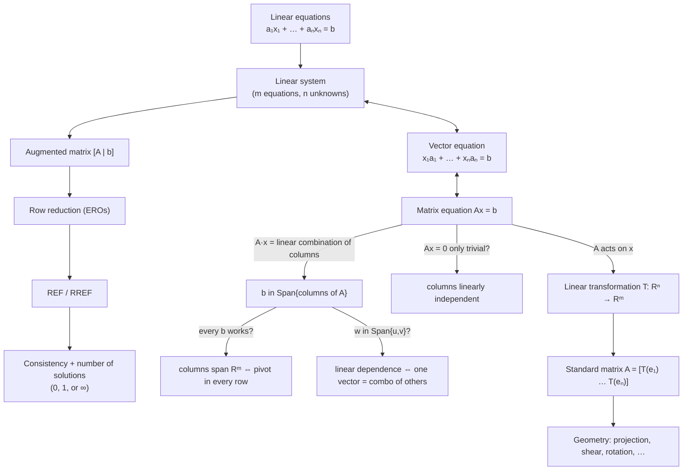

# SC1004 Linear Algebra — Theory & Theorems

> A complete reference for **all the theory and theorems** discussed in the SC1004 Linear Algebra video series — every key definition, every theorem, and the insights that tie the concepts together.
>
> **Sources:**
> - **C1 guide** — Chapter 1: *Systems of Linear Equations* (Sections 1.1 – 1.12) → `C1/Linear_Algebra_C1_Complete_Study_Guide.md`
> - **C0 guide** — Chapter: *Vectors* + Chapter: *Matrices* (Sections 1.1 – 2.3) → `C0/Linear_Algebra_Complete_Video_Study_Guide.md`
> - **C2 guide** — Chapter 2: *Matrix Algebra* (Sections 2.1 – 2.3) → `C2/Linear_Algebra_C2_Complete_Study_Guide.md`
> - **C3 guide** — Chapter 3: *Determinants* (Sections 3.1 – 3.3) → `C3/Linear_Algebra_C3_Complete_Study_Guide.md`
> - **C4 guide** — Chapter 4: *Vector Spaces* (Sections 4.1 – 4.15) → `C4/Linear_Algebra_C4_Complete_Study_Guide.md`
> - **C6 guide** — Chapter 6: *Orthogonality* (Sections 6.1.1 – 6.3.3) → `C6/Linear_Algebra_C6_Complete_Study_Guide.md`
> - **C7 guide** — Chapter 7: *Least Squares* (Sections 7.1.1 – 7.2.1) → `C7/Linear_Algebra_C7_Complete_Study_Guide.md`
> - **C8 guide** — Chapter 8: *Eigenvalues & Eigenvectors* (Sections 8.1.0 – 8.1.6) → `C8/Linear_Algebra_C8_Complete_Study_Guide.md`
> - **C8A guide** — Chapter 8A: *Complex Numbers & the DFT* (Sections 8A.0 – 8A.3) → `C8A/Linear_Algebra_C8A_Complete_Study_Guide.md`
>
> Each definition/theorem is cross-referenced to its source section/video so you can jump back for the full explanation and proof.

---

## Table of Contents

**Part I — Vectors**
- [Key Definitions & Concepts — Vectors](#key-definitions--concepts--vectors)
- Theorems:
  1. [Algebraic Properties of Vector Operations in ℝⁿ](#11-algebraic-properties-of-vector-operations-in-ℝ)
  2. [Zero Vector & Scalar Multiplication Theorems](#12-zero-vector--scalar-multiplication-theorems)
  3. [Norm (Length) Properties](#13-norm-length-properties)
  4. [Dot Product — Algebraic Properties](#14-dot-product--algebraic-properties)
  5. [Dot Product — Additional Properties](#15-dot-product--additional-properties)
  6. [Cauchy–Schwarz Inequality](#16-cauchy-schwarz-inequality)
  7. [Triangle Inequalities](#17-triangle-inequalities)

**Part II — Matrices**
- [Key Definitions & Concepts — Matrices](#key-definitions--concepts--matrices)
- Theorems & Properties:
  8. [Matrix Addition / Scalar Multiplication / Transpose Properties](#21-matrix-addition--scalar-multiplication--transpose-properties)
  9. [Matrix Multiplication Properties](#22-matrix-multiplication-properties)
  10. [Matrix–Vector Product as a Linear Combination](#23-matrixvector-product-as-a-linear-combination)
  11. [Inverse of a Matrix — Theorems](#24-inverse-of-a-matrix--theorems)

**Part III — Systems of Linear Equations (C1)**
- [Key Definitions & Concepts — Systems](#key-definitions--concepts--systems)
- Theorems:
  12. [Theorem 1.1 — $A\mathbf x = \mathbf b$ ↔ Vector Equation ↔ Augmented Matrix](#31-theorem-11--a-mathbf-x--mathbf-b--vector-equation--augmented-matrix)
  13. [Theorem 1.2 — Four Equivalent Statements](#32-theorem-12--four-equivalent-statements)
  14. [Theorem 1.3 — Linearity of $A\mathbf x$](#33-theorem-13--linearity-of-a-mathbf-x)
  15. [Theorem 1.4 — Solution Set of $A\mathbf x = \mathbf b$](#34-theorem-14--solution-set-of-a-mathbf-x--mathbf-b)
  16. [Theorem 1.5 — More Vectors than Entries ⇒ Dependent](#35-theorem-15--more-vectors-than-entries--dependent)
  17. [Theorem 1.6 — Zero Vector ⇒ Dependent](#36-theorem-16--zero-vector--dependent)
  18. [Theorem 1.7 — The Standard Matrix of a Linear Transformation](#37-theorem-17--the-standard-matrix-of-a-linear-transformation)

**Part IV — Matrix Algebra (C2)**
- [Key Definitions & Concepts — Matrix Algebra](#key-definitions--concepts--matrix-algebra)
- Theorems:
  19. [Theorem 2.1 — Unique Solution x = A⁻¹b](#41-theorem-21--unique-solution-x--a-b)
  20. [Theorem 2.2 — Properties of Invertible Matrices](#42-theorem-22--properties-of-invertible-matrices)
  21. [Theorem 2.3 — Invertible ⇔ Row Equivalent to I](#43-theorem-23--invertible--row-equivalent-to-i)
  22. [Theorem 2.4 — The Invertible Matrix Theorem](#44-theorem-24--the-invertible-matrix-theorem)
  23. [LU Factorization Facts](#45-lu-factorization-facts)

**Part V — Determinants (C3)**
- [Key Definitions & Concepts — Determinants](#key-definitions--concepts--determinants)
- Theorems:
  24. [Theorem 3.1 — Determinants as Area/Volume](#51-theorem-31--determinants-as-areavolume)
  25. [Theorem 3.2 — Linear Transformations Scale Area/Volume](#52-theorem-32--linear-transformations-scale-areavolume)
- [The Nine Properties of Determinants](#53-the-nine-properties-of-determinants)

**Part VI — Vector Spaces (C4)**
- [Key Definitions & Concepts — Vector Spaces](#key-definitions--concepts--vector-spaces)
- Theorems:
  26. [Theorem 4.1 — Span is a Subspace](#61-theorem-41--span-is-a-subspace)
  27. [N(A) is a Subspace of ℝⁿ](#62-na-is-a-subspace-of-ℝ)
  28. [Theorem 4.3 — C(A) is a Subspace of ℝᵐ](#63-theorem-43--ca-is-a-subspace-of-ℝ)
  29. [Theorem 4.4 — Linear Dependence Characterization](#64-theorem-44--linear-dependence-characterization)
  30. [Theorem 4.5 — The Spanning Set Theorem](#65-theorem-45--the-spanning-set-theorem)
  31. [Theorem 4.6 — Pivot Columns Form a Basis for C(A)](#66-theorem-46--pivot-columns-form-a-basis-for-ca)
  32. [Theorem 4.7 — Row Spaces of Row-Equivalent Matrices](#67-theorem-47--row-spaces-of-row-equivalent-matrices)
  33. [Theorem 4.8 — The Rank Theorem](#68-theorem-48--the-rank-theorem)
  34. [IMT Continued — Rank & Nullity for Invertible A](#69-imt-continued--rank--nullity-for-invertible-a)
  35. [Change of Basis Theorem](#610-change-of-basis-theorem)

**Part VII — Orthogonality (C6)**
- [Key Definitions & Concepts — Orthogonality](#key-definitions--concepts--orthogonality)
- Theorems:
  36. [Theorem 3.2.1 — Properties of the Norm](#71-theorem-321--properties-of-the-norm)
  37. [Theorem 3.2.3 — Algebraic Properties of the Dot Product](#72-theorem-323--algebraic-properties-of-the-dot-product)
  38. [Theorem 3.2.4 — Cauchy–Schwarz Inequality](#73-theorem-324--cauchyschwarz-inequality)
  39. [Theorem 3.2.5 — Triangle Inequality](#74-theorem-325--triangle-inequality)
  40. [Theorem 3.3.1 — Point–Normal Form of a Line/Plane](#75-theorem-331--pointnormal-form-of-a-lineplane)
  41. [Orthogonal Sets are Linearly Independent (Theorem 4)](#76-orthogonal-sets-are-linearly-independent-theorem-4)
  42. [Theorem 3.3.2 — Projection Theorem](#77-theorem-332--projection-theorem)
  43. [Theorem 5 — Orthogonal Decomposition Theorem](#78-theorem-5--orthogonal-decomposition-theorem)
  44. [Theorem 8 — Projection onto a Subspace (Orthogonal Basis)](#79-theorem-8--projection-onto-a-subspace-orthogonal-basis)
  45. [Theorem 9 — Best Approximation Theorem](#710-theorem-9--best-approximation-theorem)
  46. [Theorem 10 — Projection with an Orthonormal Basis](#711-theorem-10--projection-with-an-orthonormal-basis)
  47. [Theorem 6 — $U^{\\mathsf T}U = I$ ⇔ Orthonormal Columns](#712-theorem-6--umathsf-tu--i--orthonormal-columns)
  48. [Theorem 11 — The Gram–Schmidt Process](#713-theorem-11--the-gramschmidt-process)
  49. [QR Factorisation Theorem](#714-qr-factorisation-theorem)

**Part VIII — Least Squares (C7)**
- [Key Definitions & Concepts — Least Squares](#key-definitions--concepts--least-squares)
- Theorems:
  50. [Consistency of a Linear System](#81-consistency-of-a-linear-system)
  51. [Best Approximation Theorem](#82-best-approximation-theorem)
  52. [The Normal Equations](#83-the-normal-equations)
  53. [Projection Matrix Properties](#84-projection-matrix-properties)
  54. [Three Ways to Solve the Over-Determined System](#85-three-ways-to-solve-the-over-determined-system)
  55. [Least-Squares Error and the Residual](#86-least-squares-error-and-the-residual)
  56. [Linear Models (Least-Squares Fitting)](#87-linear-models-least-squares-fitting)

**Part IX — Eigenvalues and Eigenvectors (C8)**
- [Key Definitions & Concepts — Eigenvalues](#key-definitions--concepts--eigenvalues)
- Theorems:
  57. [The Eigenvalue Equation](#91-the-eigenvalue-equation)
  58. [Eigenspaces are Subspaces](#92-eigenspaces-are-subspaces)
  59. [The Characteristic Equation](#93-the-characteristic-equation)
  60. [Eigenvalues of Triangular / Diagonal / Power Matrices](#94-eigenvalues-of-triangular--diagonal--power-matrices)
  61. [The Diagonalization Theorem](#95-the-diagonalization-theorem)
  62. [Distinct Eigenvalues ⇒ Linearly Independent](#96-distinct-eigenvalues--linearly-independent)
  63. [Similar Matrices Share Eigenvalues](#97-similar-matrices-share-eigenvalues)
  64. [Powers of a Matrix via Diagonalization](#98-powers-of-a-matrix-via-diagonalization)
  65. [Eigenvectors of a Linear Transformation](#99-eigenvectors-of-a-linear-transformation)
  66. [Change of Basis and $\mathcal B$-Matrices](#910-change-of-basis-and-mathcal-b-matrices)
  67. [Complex Eigenvalues of a Real Matrix](#911-complex-eigenvalues-of-a-real-matrix)

**Part X — Complex Numbers and the DFT (C8A)**
- [Key Definitions & Concepts — Complex Numbers & DFT](#key-definitions--concepts--complex-numbers--dft)
- Theorems & Properties:
  68. [Arithmetic, Conjugate and Modulus](#101-arithmetic-conjugate-and-modulus)
  69. [Euler's Formula and De Moivre's Theorem](#102-eulers-formula-and-de-moivres-theorem)
  70. [Roots of a Complex Number](#103-roots-of-a-complex-number)
  71. [Complex Inner Product Properties](#104-complex-inner-product-properties)
  72. [Orthogonality of the Fourier Basis](#105-orthogonality-of-the-fourier-basis)
  73. [The DFT and IDFT (Change of Basis)](#106-the-dft-and-idft-change-of-basis)
  74. [Aliasing and Parseval](#107-aliasing-and-parseval)

**Also inside**
- [Big Picture — How All the Concepts Connect](#-big-picture--how-all-the-concepts-connect)

---

# Part I — Vectors

*(Source: C0 guide, Chapter 1 — Vectors)*

## Key Definitions & Concepts — Vectors

| Term | Meaning |
|---|---|
| **Scalar** | A quantity with only magnitude (e.g., temperature, mass, time, speed) |
| **Vector** | A quantity with **magnitude and direction** (e.g., force, velocity). Written $\mathbf v$ in print or $\vec v$ by hand |
| **Equal / equivalent vectors** | Same length **and** same direction ($\mathbf v = \mathbf w$); position doesn't matter (vectors are "free") |
| **Zero vector $\mathbf 0$** | Initial point = terminal point; length 0 |
| **Vector addition** | Parallelogram rule (common initial point) or triangle rule (head-to-tail); **commutative** |
| **$-\mathbf v$ (negative)** | Same length as $\mathbf v$, opposite direction |
| **$\mathbf w - \mathbf v$ (subtraction)** | $\mathbf w + (-\mathbf v)$ |
| **Scalar multiplication $k\mathbf v$** | Length becomes $|k|\,\|\mathbf v\|$; direction same if $k>0$, opposite if $k<0$ |
| **Parallel / collinear vectors** | One is a scalar multiple of the other (translating a vector doesn't change it) |
| **Components / coordinates** | $\mathbf v = (v_1, v_2, \dots, v_n)$ relative to coordinate axes; $\mathbf v = \overrightarrow{P_1P_2} = (x_2-x_1,\, y_2-y_1,\dots)$ |
| **$\mathbb{R}^n$** | The set of all ordered $n$-tuples of real numbers ($n$-dimensional space) |
| **Linear combination** | $\mathbf w = c_1\mathbf v_1 + c_2\mathbf v_2 + \cdots + c_p\mathbf v_p$ (the $c_i$ are the **weights**) |
| **Norm / length / magnitude** | $\|\mathbf v\| = \sqrt{v_1^2 + v_2^2 + \cdots + v_n^2}$ |
| **Unit vector** | A vector of norm 1; $\hat{\mathbf u} = \dfrac{\mathbf v}{\|\mathbf v\|}$ is the unit vector in $\mathbf v$'s direction (**normalizing**) |
| **Standard unit vectors** | $\mathbf i=(1,0,0),\ \mathbf j=(0,1,0),\ \mathbf k=(0,0,1)$; in $\mathbb{R}^n$: $\mathbf e_1,\dots,\mathbf e_n$ |
| **Distance** | $d(\mathbf u, \mathbf v) = \|\mathbf u - \mathbf v\| = \sqrt{(u_1-v_1)^2 + \cdots + (u_n-v_n)^2}$ |
| **Dot product (Euclidean inner product)** | $\mathbf u\cdot\mathbf v = \|\mathbf u\|\,\|\mathbf v\|\cos\theta = u_1v_1 + \cdots + u_nv_n$ — a **scalar** |
| **Orthogonal vectors** | $\mathbf u \cdot \mathbf v = 0$ (angle $90°$); an **orthogonal set** has every pair orthogonal |
| **Normal vector** | A nonzero vector orthogonal to a line/plane; used in the point-normal equation |

> 💡 **How to think about it:** The dot product is the bridge between *algebra* and *geometry* — with coordinates it is a simple sum of products, and it lets you compute **length** ($\|\mathbf v\|^2 = \mathbf v\cdot\mathbf v$), **distance**, **angles**, and **orthogonality** all from the same formula.

## 1.1 Algebraic Properties of Vector Operations in ℝⁿ

**Source:** C0 — Section 1.3 (Vectors in n-D space)

**Theorem.** If $\mathbf u$, $\mathbf v$ and $\mathbf w$ are vectors in $\mathbb{R}^n$, and if $k$ and $m$ are scalars, then:

1. $\mathbf u + \mathbf v = \mathbf v + \mathbf u$ *(commutativity of addition)*
2. $(\mathbf u + \mathbf v) + \mathbf w = \mathbf u + (\mathbf v + \mathbf w)$ *(associativity of addition)*
3. $\mathbf u + \mathbf 0 = \mathbf 0 + \mathbf u = \mathbf u$ *(additive identity)*
4. $\mathbf u + (-\mathbf u) = \mathbf 0$ *(additive inverse)*
5. $k(\mathbf u + \mathbf v) = k\mathbf u + k\mathbf v$ *(distributivity over vector addition)*
6. $(k + m)\mathbf u = k\mathbf u + m\mathbf u$ *(distributivity over scalar addition)*
7. $k(m\mathbf u) = (km)\mathbf u$ *(associativity of scalar multiplication)*
8. $1\mathbf u = \mathbf u$ *(multiplicative identity)*

> 📝 The proof of property 2 (associativity) is worked out in the video; the rest follow the same component-wise argument.

---

## 1.2 Zero Vector & Scalar Multiplication Theorems

**Source:** C0 — Section 1.3 (Vectors in n-D space, Part 4 of 4)

**Theorem.** If $\mathbf v$ is a vector in $\mathbb{R}^n$ and $k$ is a scalar, then:

1. $0\mathbf v = \mathbf 0$
2. $k\mathbf 0 = \mathbf 0$
3. $(-1)\mathbf v = -\mathbf v$

---

## 1.3 Norm (Length) Properties

**Source:** C0 — Section 1.4 (Norm to Distance in ℝⁿ)

**Definition.** $\|\mathbf v\| = \sqrt{v_1^2 + v_2^2 + \cdots + v_n^2}$.

**Theorem.** If $\mathbf v$ is a vector in $\mathbb{R}^n$ and $k$ is a scalar, then:

1. $\|\mathbf v\| \geq 0$ *(non-negativity)*
2. $\|\mathbf v\| = 0$ **if and only if** $\mathbf v = \mathbf 0$
3. $\|k\mathbf v\| = |k|\,\|\mathbf v\|$ *(homogeneity)*

> 📝 The proof of part 3 is worked out in the video: $\|k\mathbf v\| = \sqrt{k^2(v_1^2 + \cdots + v_n^2)} = |k|\,\|\mathbf v\|$.

---

## 1.4 Dot Product — Algebraic Properties

**Source:** C0 — Section 1.5 (Dot Product to Geometry in ℝⁿ)

**Theorem.** If $\mathbf u$, $\mathbf v$, $\mathbf w$ are vectors in $\mathbb{R}^n$ and $k$ is a scalar, then:

1. $\mathbf u \cdot \mathbf v = \mathbf v \cdot \mathbf u$ **[Symmetry]**
2. $\mathbf u \cdot (\mathbf v + \mathbf w) = \mathbf u \cdot \mathbf v + \mathbf u \cdot \mathbf w$ **[Distributive]**
3. $k(\mathbf u \cdot \mathbf v) = (k\mathbf u)\cdot \mathbf v$ **[Homogeneity]**
4. $\mathbf v \cdot \mathbf v > 0$ and $\mathbf v \cdot \mathbf v = 0$ iff $\mathbf v = \mathbf 0$ **[Positivity]**

**Corollary (norm from dot product):** $\mathbf v \cdot \mathbf v = v_1^2 + v_2^2 + \cdots + v_n^2 = \|\mathbf v\|^2$, so $\|\mathbf v\| = \sqrt{\mathbf v \cdot \mathbf v}$.

---

## 1.5 Dot Product — Additional Properties

**Source:** C0 — Section 1.5 (Algebraic Properties of the Dot Product, Part 2 of 2)

**Theorem.** If $\mathbf u$, $\mathbf v$, $\mathbf w$ are vectors in $\mathbb{R}^n$ and $k$ is a scalar, then:

1. $\mathbf 0 \cdot \mathbf v = \mathbf v \cdot \mathbf 0 = 0$
2. $(\mathbf u + \mathbf v)\cdot \mathbf w = \mathbf u \cdot \mathbf w + \mathbf v \cdot \mathbf w$
3. $\mathbf u \cdot (\mathbf v - \mathbf w) = \mathbf u \cdot \mathbf v - \mathbf u \cdot \mathbf w$
4. $(\mathbf u - \mathbf v)\cdot \mathbf w = \mathbf u \cdot \mathbf w - \mathbf v \cdot \mathbf w$
5. $\mathbf u \cdot (k\mathbf v) = k(\mathbf u \cdot \mathbf v)$

---

## 1.6 Cauchy–Schwarz Inequality

**Source:** C0 — Section 1.5 (Angles in ℝⁿ)

**Theorem (Cauchy–Schwarz Inequality).** If $\mathbf u = (u_1, u_2, \dots, u_n)$ and $\mathbf v = (v_1, v_2, \dots, v_n)$ are vectors in $\mathbb{R}^n$, then

$$|\mathbf u \cdot \mathbf v| \leq \|\mathbf u\|\,\|\mathbf v\|$$

or in component form,

$$\left|u_1v_1 + u_2v_2 + \cdots + u_nv_n\right| \leq \sqrt{u_1^2 + \cdots + u_n^2}\ \sqrt{v_1^2 + \cdots + v_n^2}$$

> 💡 This guarantees that $\dfrac{\mathbf u \cdot \mathbf v}{\|\mathbf u\|\,\|\mathbf v\|}$ (i.e., $\cos\theta$) lies between $-1$ and $+1$, so the angle $\theta$ between vectors is well defined.

---

## 1.7 Triangle Inequalities

**Source:** C0 — Section 1.5 (Geometry in ℝⁿ)

**Theorem.** If $\mathbf u$, $\mathbf v$, $\mathbf w$ are vectors in $\mathbb{R}^n$ and $k$ is a scalar, then:

1. $\|\mathbf u + \mathbf v\| \leq \|\mathbf u\| + \|\mathbf v\|$ **[Triangle inequality for vectors]**
2. $d(\mathbf u, \mathbf v) \leq d(\mathbf u, \mathbf w) + d(\mathbf w, \mathbf v)$ **[Triangle inequality for distances]**

> 📝 Proof of part 1 (worked out in the video): $\|\mathbf u+\mathbf v\|^2 = \|\mathbf u\|^2 + 2(\mathbf u\cdot\mathbf v) + \|\mathbf v\|^2 \leq \|\mathbf u\|^2 + 2|\mathbf u\cdot\mathbf v| + \|\mathbf v\|^2 \leq \|\mathbf u\|^2 + 2\|\mathbf u\|\|\mathbf v\| + \|\mathbf v\|^2 = (\|\mathbf u\|+\|\mathbf v\|)^2$; take square roots.

---

# Part II — Matrices

*(Source: C0 guide, Chapter 2 — Matrices)*

## Key Definitions & Concepts — Matrices

| Term | Meaning |
|---|---|
| **Matrix** | A rectangular array of numbers with $m$ **rows** and $n$ **columns** (size $m \times n$) |
| **Element $a_{ij}$** | The entry in row $i$, column $j$ |
| **Row / column vector** | A matrix with a single row / single column |
| **Square matrix of order $n$** | $m = n$; the elements $a_{11}, a_{22}, \dots, a_{nn}$ lie on the **main / leading diagonal** |
| **Trace** | $\operatorname{tr}(A) = a_{11} + a_{22} + \cdots + a_{nn}$ (sum of leading-diagonal elements) |
| **Diagonal matrix** | Non-zero entries appear only on the leading diagonal |
| **Unit / identity matrix $I$** | Diagonal matrix with all diagonal entries equal to 1; $IA = AI = A$ |
| **Transpose $A^T$** | Interchange rows and columns: $(A^T)_{ij} = a_{ji}$; $(A^T)^T = A$ |
| **Symmetric / skew-symmetric** | $A^T = A$ (so $a_{ij}=a_{ji}$) / $A^T = -A$ (so $a_{ij} = -a_{ji}$) |
| **Equality** | Same size and $a_{ij} = b_{ij}$ for all $i, j$ |
| **Addition / subtraction** | Element-wise: $(A \pm B)_{ij} = a_{ij} \pm b_{ij}$ (same size required) |
| **Scalar multiplication** | $(sA)_{ij} = s\,a_{ij}$; $(-1)B = -B$ |
| **Matrix multiplication** | $(AB)_{ij} = \sum_{k=1}^{r} a_{ik}b_{kj}$; requires #columns of $A$ = #rows of $B$; result is $m \times n$ |
| **Coefficient / augmented matrix** | $A$ from the coefficients of a system; $[A \mid \mathbf b]$ adds the right-hand side |
| **Determinant (2×2)** | $\det\begin{bmatrix} a & b \\ c & d \end{bmatrix} = ad - bc$ |
| **Inverse $A^{-1}$** | $AA^{-1} = A^{-1}A = I$; exists iff $\det(A) \neq 0$; if not, $A$ is **singular** |

> 💡 **How to think about it:** Matrix multiplication is *not* commutative ($AB \neq BA$ in general) and $AB = 0$ does **not** mean $A = 0$ or $B = 0$ — always check sizes and order. The transpose of a product **reverses** the order: $(AB)^T = B^TA^T$.

## 2.1 Matrix Addition / Scalar Multiplication / Transpose Properties

**Source:** C0 — Section 2.2 (Operation on Matrices)

Let $A, B, C$ be $m \times n$ matrices and $s, q$ be scalars:

- $A + B = B + A$ *(commutativity)*
- $A + (B + C) = (A + B) + C = A + B + C$ *(associativity)*
- $(s + q)A = sA + qA$
- $s(qA) = (sq)A$
- $s(A + B) = sA + sB$
- $(A + B)^T = A^T + B^T$
- $(sA)^T = sA^T$

---

## 2.2 Matrix Multiplication Properties

**Source:** C0 — Section 2.3 (Matrix multiplication and Inverse)

- $AB \neq BA$ **in general** (matrix multiplication is **not commutative**)
- $AB = 0$ does **not** imply $A = 0$ or $B = 0$
- $(kA)B = k(AB) = A(kB)$
- $A(BC) = (AB)C$ *(associativity)*
- $(A + B)C = AC + BC$ *(right distributivity)*
- $A(B + C) = AB + AC$ *(left distributivity)*
- $I_m A = A I_n = A$ *(identity)*
- $(AB)^T = B^T A^T$ *(transpose of a product — note the reversed order)*

---

## 2.3 Matrix–Vector Product as a Linear Combination

**Source:** C0 — Section 2.3 (Matrix Products as Linear Combinations)

**Theorem.** If $A$ is an $m \times n$ matrix with columns $\mathbf c_1, \mathbf c_2, \dots, \mathbf c_n$ and $\mathbf x = (x_1, x_2, \dots, x_n)^T$ is an $n \times 1$ column vector, then

$$A\mathbf x = x_1\mathbf c_1 + x_2\mathbf c_2 + \cdots + x_n\mathbf c_n$$

i.e., the product $A\mathbf x$ is a **linear combination of the column vectors of $A$** with the elements of $\mathbf x$ as coefficients.

---

## 2.4 Inverse of a Matrix — Theorems

**Source:** C0 — Section 2.3 (Matrix multiplication and Inverse)

**Definition.** If $A$ is a square matrix and there exists a matrix $B$ such that $AB = BA = I$, then $A$ is **invertible** and $B$ is its inverse, written $A^{-1}$. If no such matrix exists, $A$ is **singular**.

**Theorem (2×2 inverse formula).** The matrix $\begin{bmatrix} a & b \\ c & d \end{bmatrix}$ is invertible **if and only if** $ad - bc \neq 0$, in which case

$$A^{-1} = \frac{1}{ad-bc}\begin{bmatrix} d & -b \\ -c & a \end{bmatrix}$$

The quantity $ad - bc$ is the **determinant** of the $2\times2$ matrix, $\det(A) = |A|$.

**Theorem (inverse of a product).** If $A$ and $B$ are invertible matrices of the same size, then $AB$ is invertible and

$$(AB)^{-1} = B^{-1}A^{-1}$$

> 📝 Proof (worked out in the video): let $X = B^{-1}A^{-1}$; check $ABX = A(BB^{-1})A^{-1} = AA^{-1} = I$ and $XAB = B^{-1}(A^{-1}A)B = I$.

**Theorem (transpose of an inverse).** If $A$ is an invertible matrix, then $A^T$ is also invertible and

$$(A^T)^{-1} = (A^{-1})^T$$

---

# Part III — Systems of Linear Equations (C1)

*(Source: C1 guide, Chapter 1 — Systems of Linear Equations)*

## Key Definitions & Concepts — Systems

| Term | Meaning |
|---|---|
| **Linear equation** | $a_1x_1 + a_2x_2 + \cdots + a_nx_n = b$ with not all $a_i$ equal to 0 |
| **Linear system** | $m$ linear equations in $n$ unknowns $x_1, \dots, x_n$ |
| **Solution** | A tuple $(s_1, \dots, s_n)$ that makes every equation true |
| **Consistent / inconsistent** | has at least one solution / has no solution |
| **Homogeneous / nonhomogeneous** | $A\mathbf x = \mathbf 0$ / $A\mathbf x = \mathbf b$ with $\mathbf b \neq \mathbf 0$ |
| **Trivial / nontrivial solution** | $\mathbf x = \mathbf 0$ / a nonzero $\mathbf x$ (for homogeneous systems) |
| **Number of solutions** | A linear system has **0, 1, or infinitely many** solutions — no other possibility |
| **Elementary Row Operations (EROs)** | ① multiply a row by a nonzero constant; ② interchange two rows; ③ add a multiple of one row to another |
| **Row equivalent** | Two matrices related by a sequence of EROs |
| **Row Echelon Form (REF)** | Zero rows at the bottom; each pivot is to the right of the pivot above it |
| **Reduced Row Echelon Form (RREF)** | REF + every pivot is 1 with zeros elsewhere in its column |
| **Pivot / pivot position / pivot column** | First nonzero entry in a row / where it sits / its column |
| **Leading variable / free variable** | A variable with a pivot / a variable without a pivot (can take arbitrary values) |
| **Gaussian / Gauss–Jordan elimination** | EROs to reach REF (forward phase, **not unique**) / to reach RREF (forward + backward, **unique**) |
| **Linear combination of columns** | $x_1\mathbf a_1 + x_2\mathbf a_2 + \cdots + x_n\mathbf a_n$ |
| **Span** | $\operatorname{Span}\{\mathbf v_1, \dots, \mathbf v_p\}$ = set of all linear combinations; "spans $\mathbb{R}^m$" if it equals all of $\mathbb{R}^m$ |
| **Matrix equation $A\mathbf x = \mathbf b$** | Defined as the linear combination of columns: $A\mathbf x = x_1\mathbf a_1 + \cdots + x_n\mathbf a_n$ |
| **Linearly independent / dependent** | $c_1\mathbf v_1 + \cdots + c_p\mathbf v_p = \mathbf 0$ only when all $c_i = 0$ / when some $c_i \neq 0$ |
| **Linear transformation $T$** | $T: \mathbb{R}^n \to \mathbb{R}^m$ with $T(\mathbf u+\mathbf v) = T(\mathbf u) + T(\mathbf v)$ and $T(c\mathbf u) = cT(\mathbf u)$ |
| **Domain / codomain / image / range** | $\mathbb{R}^n$ / $\mathbb{R}^m$ / $T(\mathbf x)$ / the set of all images |
| **Standard matrix** | $A = [\,T(\mathbf e_1) \ \cdots \ T(\mathbf e_n)\,]$ so that $T(\mathbf x) = A\mathbf x$ |

> 💡 **How to think about it:** The whole chapter is really about **one** question — *does $A\mathbf x = \mathbf b$ have a solution, and is it unique?* Every topic (linear combination, span, independence, transformations) is just this question wearing a different hat. And **row reduction is the one algorithm** you use to answer it: from the RREF you read off consistency, the number of solutions, the leading/free variables, and the full parametric solution.

## 3.1 Theorem 1.1 — $A\mathbf x = \mathbf b$ ↔ Vector Equation ↔ Augmented Matrix

**Source:** C1 — Section 1.7 (The Matrix Equation $A\mathbf x = \mathbf b$)

**Theorem 1.1.** If $A$ is an $m \times n$ matrix, with columns $\mathbf a_1, \mathbf a_2, \dots, \mathbf a_n$, and $\mathbf b$ is in $\mathbb{R}^m$, then the matrix equation

$$A\mathbf x = \mathbf b$$

has the **same solution set** as the vector equation

$$x_1\mathbf a_1 + x_2\mathbf a_2 + \cdots + x_n\mathbf a_n = \mathbf b$$

which, in turn, has the same solution set as the system of linear equations whose augmented matrix is

$$\begin{bmatrix} \mathbf a_1 & \mathbf a_2 & \cdots & \mathbf a_n & \mathbf b \end{bmatrix}$$

---

## 3.2 Theorem 1.2 — Four Equivalent Statements

**Source:** C1 — Section 1.7 (The Matrix Equation $A\mathbf x = \mathbf b$)

**Theorem 1.2.** Let $A$ be an $m \times n$ matrix. Then the following statements are **logically equivalent** (for a particular $A$, either they are all true or all false):

- **a.** For each $\mathbf b$ in $\mathbb{R}^m$, the equation $A\mathbf x = \mathbf b$ has a solution.
- **b.** Each $\mathbf b$ in $\mathbb{R}^m$ is a linear combination of the columns of $A$.
- **c.** The columns of $A$ span $\mathbb{R}^m$.
- **d.** $A$ has a **pivot position in every row**.

---

## 3.3 Theorem 1.3 — Linearity of $A\mathbf x$

**Source:** C1 — Section 1.7 (The Matrix Equation $A\mathbf x = \mathbf b$)

**Theorem 1.3.** If $A$ is an $m \times n$ matrix, $\mathbf u$ and $\mathbf v$ are vectors in $\mathbb{R}^n$, and $c$ is a scalar, then:

- $A(\mathbf u + \mathbf v) = A\mathbf u + A\mathbf v$
- $A(c\mathbf u) = c(A\mathbf u)$

---

## 3.4 Theorem 1.4 — Solution Set of $A\mathbf x = \mathbf b$

**Source:** C1 — Section 1.8 (Solution Sets of Linear Systems — Nonhomogeneous)

**Theorem 1.4.** Suppose the equation $A\mathbf x = \mathbf b$ is **consistent** for some given $\mathbf b$, and let $\mathbf p$ be a solution. Then the solution set of $A\mathbf x = \mathbf b$ is the set of all vectors of the form

$$\mathbf w = \mathbf p + \mathbf v_h$$

where $\mathbf v_h$ is **any solution** of the homogeneous equation $A\mathbf x = \mathbf 0$.

> 💡 Equivalently: solution set of $A\mathbf x = \mathbf b$ = one particular solution $\mathbf p$ + the solution set of $A\mathbf x = \mathbf 0$ (a line/plane parallel to the homogeneous solution set, translated by $\mathbf p$).

---

## 3.5 Theorem 1.5 — More Vectors than Entries ⇒ Dependent

**Source:** C1 — Section 1.9 (Linear Independence — Characterization)

**Theorem 1.5.** If a set contains **more vectors than there are entries in each vector**, then the set is linearly dependent. That is, any set $\{\mathbf v_1, \dots, \mathbf v_p\}$ in $\mathbb{R}^n$ is linearly dependent if $p > n$.

> 📝 Proof: $A = [\mathbf v_1 \cdots \mathbf v_p]$ is $n \times p$; $A\mathbf x = \mathbf 0$ is $n$ equations in $p$ unknowns. Since $p > n$ there is a free variable ⇒ nontrivial solution ⇒ columns dependent.

---

## 3.6 Theorem 1.6 — Zero Vector ⇒ Dependent

**Source:** C1 — Section 1.9 (Linear Independence — Characterization)

**Theorem 1.6.** If a set $S = \{\mathbf v_1, \dots, \mathbf v_p\}$ in $\mathbb{R}^n$ contains the **zero vector**, then the set is linearly dependent.

> 📝 Proof: renumber so $\mathbf v_1 = \mathbf 0$; then $1\mathbf v_1 + 0\mathbf v_2 + \cdots + 0\mathbf v_p = \mathbf 0$ with a nonzero coefficient.

---

## 3.7 Theorem 1.7 — The Standard Matrix of a Linear Transformation

**Source:** C1 — Section 1.12 (The Matrix of a Linear Transformation)

**Theorem 1.7.** Let $T: \mathbb{R}^n \to \mathbb{R}^m$ be a linear transformation. Then there exists a **unique** matrix $A$ such that

$$T(\mathbf x) = A\mathbf x \quad \text{for all } \mathbf x \text{ in } \mathbb{R}^n.$$

In fact, $A$ is the $m \times n$ matrix whose $j$-th column is the vector $T(\mathbf e_j)$, where $\mathbf e_j$ is the $j$-th column of the identity matrix in $\mathbb{R}^n$:

$$A = \begin{bmatrix} T(\mathbf e_1) & T(\mathbf e_2) & \cdots & T(\mathbf e_n) \end{bmatrix}$$

$A$ is called the **standard matrix** for the linear transformation $T$.

> 💡 Key application (from the video): the standard matrix of a **counterclockwise rotation by angle $\phi$** about the origin is
> $$A = \begin{bmatrix} \cos\phi & -\sin\phi \\ \sin\phi & \cos\phi \end{bmatrix}$$

---

---

# Part IV — Matrix Algebra (C2)

*(Source: C2 guide, Chapter 2 — Matrix Algebra)*

## Key Definitions & Concepts — Matrix Algebra

| Term | Meaning |
|---|---|
| **Composition of transformations** | $A(B\mathbf x) = (AB)\mathbf x$ — the product $AB$ represents applying $B$ first, then $A$ |
| **Elementary matrix** | A matrix obtained by performing **one** elementary row operation on an identity matrix; multiplying $EA$ applies that ERO to $A$ |
| **Inverse of an elementary matrix** | The elementary matrix of the same type that transforms $E$ back into $I$ |
| **Permutation matrix** | The identity matrix with rows interchanged; used when row swaps are needed in elimination |
| **Unit lower triangular matrix $L$** | Lower triangular with 1's on the main diagonal |
| **Upper triangular matrix $U$** | All entries below the main diagonal are 0 (in echelon form) |
| **LU factorization** | $A = LU$ with $L$ unit lower triangular and $U$ upper triangular |
| **Forward substitution** | Solve $L\mathbf y = \mathbf b$ (easy since $L$ is lower triangular) |
| **Backward substitution** | Solve $U\mathbf x = \mathbf y$ (easy since $U$ is upper triangular) |

> 💡 **How to think about it:** The LU factorization is a **data analysis / efficiency tool** — instead of computing $A^{-1}$ (expensive) every time you solve $A\mathbf x = \mathbf b$ for many different $\mathbf b$'s, factorize $A = LU$ once and then solve two easy triangular systems each time.

## 4.1 Theorem 2.1 — Unique Solution x = A⁻¹b

**Source:** C2 — Section 2.2 (Inverse of a Matrix)

**Theorem 2.1.** If $A$ is an invertible $n \times n$ matrix, then for each $\mathbf b$ in $\mathbb{R}^n$, the equation $A\mathbf x = \mathbf b$ has the **unique** solution

$$\mathbf x = A^{-1}\mathbf b$$

> 📝 Proof: *Existence* — $A(A^{-1}\mathbf b) = (AA^{-1})\mathbf b = I\mathbf b = \mathbf b$. *Uniqueness* — if $A\mathbf u = \mathbf b$, multiply by $A^{-1}$: $\mathbf u = A^{-1}\mathbf b$.

## 4.2 Theorem 2.2 — Properties of Invertible Matrices

**Source:** C2 — Section 2.2 (Inverse of a Matrix)

**Theorem 2.2.**

1. If $A$ is invertible, then $A^{-1}$ is invertible and $(A^{-1})^{-1} = A$.
2. If $A$ and $B$ are $n \times n$ invertible matrices, then so is $AB$, and $(AB)^{-1} = B^{-1}A^{-1}$.
3. If $A$ is invertible, then so is $A^T$, and $(A^T)^{-1} = (A^{-1})^T$.

> 📝 Proof sketch: (2) show $AB(B^{-1}A^{-1}) = A(BB^{-1})A^{-1} = AA^{-1} = I$ (and similarly on the other side).

## 4.3 Theorem 2.3 — Invertible ⇔ Row Equivalent to I

**Source:** C2 — Section 2.2 (Inverse of a Matrix)

**Theorem 2.3.** An $n \times n$ matrix $A$ is invertible **if and only if** $A$ is row equivalent to $I_n$. In this case, any sequence of elementary row operations that reduces $A$ to $I_n$ also transforms $I_n$ to $A^{-1}$.

> 💡 **Algorithm:** form $[A \mid I]$ and row-reduce until the left block is $I$; the right block becomes $A^{-1}$.

## 4.4 Theorem 2.4 — The Invertible Matrix Theorem

**Source:** C2 — Section 2.2 (Inverse of a Matrix)

**Theorem 2.4 (Invertible Matrix Theorem).** Let $A$ be a square $n \times n$ matrix. The following statements are **equivalent** (all true or all false):

1. $A$ is an **invertible** matrix.
2. $A$ is row equivalent to $I_n$.
3. $A$ has $n$ **pivot positions**.
4. $A\mathbf x = \mathbf 0$ has only the **trivial** solution.
5. The columns of $A$ form a **linearly independent** set.
6. $A\mathbf x = \mathbf b$ has **at least one solution** for each $\mathbf b$ in $\mathbb{R}^n$.
7. The columns of $A$ **span** $\mathbb{R}^n$.
8. There is an $n \times n$ matrix $C$ such that $CA = I$.
9. There is an $n \times n$ matrix $D$ such that $AD = I$.
10. $A^T$ is an invertible matrix.

> 💡 This theorem ties together everything from Chapter 1: pivots, trivial/nontrivial solutions, linear independence, span, and consistency.

## 4.5 LU Factorization Facts

**Source:** C2 — Section 2.3 (Matrix Factorizations)

**Fact 1.** If $A$ can be reduced to echelon form without row interchanges, then there exist unit lower triangular elementary matrices $E_1, \dots, E_p$ with $E_p \cdots E_1 A = U$, so

$$A = LU, \qquad L = (E_p \cdots E_1)^{-1}$$

($L$ is unit lower triangular; its off-diagonal entries are the multipliers from the reduction.)

**Fact 2.** For every $n \times n$ matrix $A$, there exists a **permutation matrix** $P$ such that $PA = LU$.

**Fact 3 (efficiency).** Solving via LU takes $\approx \tfrac{2n^3}{3}$ flops vs $\approx 2n^3$ flops to compute $A^{-1}$ (dense, $n \ge 30$) — about a one-third saving.

---

# Part V — Determinants (C3)

*(Source: C3 guide, Chapter 3 — Determinants)*

## Key Definitions & Concepts — Determinants

| Term | Meaning |
|---|---|
| **Determinant** | A number associated to a square matrix; $\det\begin{bmatrix} a & b \\ c & d \end{bmatrix} = ad - bc$ for $2\times 2$ |
| **Permutation matrix** | Identity with rows interchanged; $|P| = (-1)^r$ where $r$ = number of row exchanges |
| **Singular matrix** | Not invertible; elimination produces a zero row ⇒ $|A| = 0$ |
| **Area/volume interpretation** | IAI = area of parallelogram (2×2) or volume of parallelepiped (3×3) determined by the columns of $A$ |
| **Scaling by a linear transformation** | $T(S)$ has area/volume $b\text{abs}(|A|) \times$ that of $S$ |

## 5.1 Theorem 3.1 — Determinants as Area/Volume

**Source:** C3 — Section 3.2 (Determinants as Area or Volume)

**Theorem 3.1.** If $A$ is a $2 \times 2$ matrix, the **area of the parallelogram determined by the columns of $A$** is $|A|$. If $A$ is a $3 \times 3$ matrix, the **volume of the parallelepiped determined by the columns of $A$** is $|A|$.

> 💡 **Key idea of the proof:** Any $A$ can be turned into a diagonal matrix using only column interchanges and "add a multiple of one column to another" — both operations preserve the parallelogram/parallelepiped (area = base × height argument) and leave $|A|$ unchanged. For a diagonal matrix the result is immediate: area $= |a_{11}a_{22}|$, volume $= |a_{11}a_{22}a_{33}|$.

## 5.2 Theorem 3.2 — Linear Transformations Scale Area/Volume

**Source:** C3 — Section 3.3 (Linear Transformations)

**Theorem 3.2.** Let $T : \mathbb{R}^2 \to \mathbb{R}^2$ be the linear transformation determined by a $2 \times 2$ matrix $A$. If $S$ is a parallelogram in $\mathbb{R}^2$, then

$$\text{area of } T(S) = \text{abs}(|A|) \times \text{area of } S.$$

If $T$ is determined by a $3 \times 3$ matrix $A$ and $S$ is a parallelepiped in $\mathbb{R}^3$, then

$$\text{volume of } T(S) = \text{abs}(|A|) \times \text{volume of } S.$$

> 📝 **Proof sketch:** $S = \{s_1\mathbf b_1 + s_2\mathbf b_2\}$. Its image $T(S)$ is the parallelogram determined by the columns of $AB$ with $B = [\mathbf b_1 \ \mathbf b_2]$. By Theorem 3.1 and $|AB| = |A||B|$: area $= \text{abs}(|AB|) = \text{abs}(|A|)\,\text{abs}(|B|) = \text{abs}(|A|) \times$ area of $S$. The result extends to **arbitrary shapes** (e.g. ellipses) and to translated sets $p + S$ since translation doesn't change area.

## 5.3 The Nine Properties of Determinants

**Source:** C3 — Section 3.1 (Properties of Determinants)

1. **$|I_n| = 1$** — the determinant of the identity is 1.
2. **Row exchange flips the sign** — if two rows are exchanged, $|A|$ changes sign; a permutation matrix with $r$ exchanges has $|P| = (-1)^r$.
3. **Linearity in each row** — multiplying one row by $c$ multiplies $|A|$ by $c$; adding one row of $A$ to one row of $A'$ adds the determinants (only the other rows must stay fixed).
4. **Two equal rows ⇒ $|A| = 0$** (follows from Rule 2).
5. **Row replacement** — subtracting a multiple of one row from another leaves $|A|$ unchanged; so $|A| = |U|$ (no row exchanges) or $|A| = \pm|U|$ (with row exchanges).
6. **Zero row ⇒ $|A| = 0$** (follows from Rules 4 & 5).
7. **Triangular matrices** — $|A| = a_{11}a_{22}\cdots a_{nn}$ (product of diagonal entries).
8. **Singular vs invertible** — singular ⇒ $|A| = 0$; invertible ⇒ $|A| \neq 0$ and $|A| = \pm$ (product of pivots).
9. **Product rule** — $|AB| = |A||B|$.

> 💡 **Corollaries:** $|A^{-1}| = 1/|A|$ when $A$ is invertible. The rules also apply to **columns** (interchanging columns flips sign; adding a multiple of one column to another is unchanged), which is exactly what makes Theorem 3.1 work.

---

# Part VI — Vector Spaces (C4)

*(Source: C4 guide, Chapter 4 — Vector Spaces, Sections 4.1 – 4.15. This chapter completes Part 1 of the course.)*

## Key Definitions & Concepts — Vector Spaces

| Term | Meaning |
|---|---|
| **Vector space $V$** | A nonempty set with two operations (addition, scalar multiplication) satisfying the **10 axioms** |
| **Subspace $H$** | Subset of $V$ with: (a) $\mathbf 0 \in H$, (b) closed under addition, (c) closed under scalar multiplication; $H$ is itself a vector space |
| **Null space $N(A)$** | $\{\mathbf x \in \mathbb{R}^n : A\mathbf x = \mathbf 0\}$ — subspace of $\mathbb{R}^n$ |
| **Column space $C(A)$** | $\operatorname{Span}\{$columns of $A\}$ — subspace of $\mathbb{R}^m$ |
| **Row space** | $C(A^T)$ = span of the rows of $A$ — subspace of $\mathbb{R}^n$ |
| **Kernel / Range of $T$** | kernel $= \{\mathbf u : T(\mathbf u) = \mathbf 0\}$; range $= \{T(\mathbf x)\}$; for $T(\mathbf x)=A\mathbf x$: kernel $=N(A)$, range $=C(A)$ |
| **Basis for $H$** | a linearly independent set that spans $H$ |
| **Standard basis** | $\{\mathbf e_1,\dots,\mathbf e_n\}$ for $\mathbb{R}^n$; $\{1,t,t^2,\dots,t^n\}$ for $P_n$ |
| **Dimension** | $\dim V$ = number of vectors in a basis; $\dim\{\mathbf 0\} = 0$ |
| **Rank** | $\operatorname{rank} A = \dim C(A)$ = number of pivots |
| **$\mathcal B$-coordinates** | $\mathbf x = c_1\mathbf b_1+\cdots+c_n\mathbf b_n \Rightarrow [\mathbf x]_{\mathcal B} = (c_1,\dots,c_n)$ |

## 6.1 Theorem 4.1 — Span is a Subspace

**Source:** C4 — Section 4.3 (Subspace Spanned by a Set)

**Theorem 4.1.** If $\mathbf v_1, \dots, \mathbf v_p$ are in a vector space $V$, then $\operatorname{Span}\{\mathbf v_1, \dots, \mathbf v_p\}$ is a **subspace of $V$**.

> 📝 **Why:** (a) $\mathbf 0 = 0\mathbf v_1 + \cdots + 0\mathbf v_p \in \operatorname{Span}$; (b) closed under addition: $(s_1\mathbf v_1 + s_2\mathbf v_2) + (t_1\mathbf v_1 + t_2\mathbf v_2) = (s_1+t_1)\mathbf v_1 + (s_2+t_2)\mathbf v_2$; (c) closed under scalar multiplication: $c(s_1\mathbf v_1 + s_2\mathbf v_2) = (cs_1)\mathbf v_1 + (cs_2)\mathbf v_2$.

## 6.2 N(A) is a Subspace of ℝⁿ

**Source:** C4 — Section 4.4 (The Null Space of a Matrix)

**Theorem.** The null space of an $m \times n$ matrix $A$ is a **subspace of $\mathbb{R}^n$**. Equivalently, the set of all solutions of the system $A\mathbf x = \mathbf 0$ of $m$ homogeneous linear equations in $n$ unknowns is a subspace of $\mathbb{R}^n$.

## 6.3 Theorem 4.3 — C(A) is a Subspace of ℝᵐ

**Source:** C4 — Section 4.5 (The Column Space of a Matrix)

**Theorem 4.3.** The column space of an $m \times n$ matrix $A$ is a **subspace of $\mathbb{R}^m$**.

> 📝 **Proof:** $C(A) = \operatorname{Span}\{\mathbf a_1, \dots, \mathbf a_n\}$, which is a subspace by Theorem 4.1. Also, $C(A) = \{\mathbf b : \mathbf b = A\mathbf x \text{ for some } \mathbf x\}$; $C(A) = \mathbb{R}^m$ iff $A\mathbf x = \mathbf b$ is consistent for every $\mathbf b$.

## 6.4 Theorem 4.4 — Linear Dependence Characterization

**Source:** C4 — Section 4.7 (Bases)

**Theorem 4.4.** An indexed set $\{\mathbf v_1, \dots, \mathbf v_p\}$ of **two or more** vectors, with $\mathbf v_1 \neq \mathbf 0$, is linearly **dependent iff some $\mathbf v_j$ ($j > 1$) is a linear combination of the preceding vectors** $\mathbf v_1, \dots, \mathbf v_{j-1}$.

> 💡 **Special cases:** a single vector $\{\mathbf v\}$ is independent iff $\mathbf v \neq \mathbf 0$; two vectors are dependent iff one is a multiple of the other; any set containing $\mathbf 0$ is dependent.

## 6.5 Theorem 4.5 — The Spanning Set Theorem

**Source:** C4 — Section 4.8

**Theorem 4.5 (Spanning Set Theorem).** Let $S = \{\mathbf v_1, \dots, \mathbf v_p\}$ be a set in $V$ and $H = \operatorname{Span}\{\mathbf v_1, \dots, \mathbf v_p\}$.

1. If one of the vectors in $S$ — say $\mathbf v_k$ — is a linear combination of the remaining vectors in $S$, then the set formed by **removing $\mathbf v_k$ still spans $H$**.
2. If $H \neq \{\mathbf 0\}$, then **some subset of $S$ is a basis for $H$**.

## 6.6 Theorem 4.6 — Pivot Columns Form a Basis for C(A)

**Source:** C4 — Section 4.9 (Bases for N(A) and C(A))

**Theorem 4.6.** The **pivot columns** of a matrix $A$ form a **basis for $C(A)$**.

> 📝 **Why it works:** row operations preserve the solution set of $A\mathbf x = \mathbf 0$, so the columns of $A$ have the same dependence relationships as the columns of its RREF $B$. The pivot columns of $B$ are independent ⇒ pivot columns of $A$ are independent; every non-pivot column is a combination of pivot columns, so discard them (Spanning Set Theorem). *Note: a basis for $C(A)$ uses the pivot columns of $A$ itself, not of $B$.*

## 6.7 Theorem 4.7 — Row Spaces of Row-Equivalent Matrices

**Source:** C4 — Section 4.13 (The Row Space)

**Theorem 4.7.** If two matrices $A$ and $B$ are **row equivalent**, then their **row spaces are the same**. If $B$ is in echelon form, the **nonzero rows of $B$ form a basis** for the row space of $A$ as well as for that of $B$.

> 💡 The row space is $C(A^T)$, a subspace of $\mathbb{R}^n$. $\dim$ row space $= \operatorname{rank} A$ = $\dim C(A)$.

## 6.8 Theorem 4.8 — The Rank Theorem

**Source:** C4 — Section 4.14 (Rank)

**Theorem 4.8 (The Rank Theorem).** If a matrix $A$ has $n$ columns, then
$$\operatorname{rank} A + \dim N(A) = n.$$

> 💡 $\operatorname{rank} A = \dim C(A) = \dim$ row space = number of pivot columns; $\dim N(A)$ = number of free variables. (Also called the Rank-Nullity Theorem.) A matrix with $\operatorname{rank} A = n$ is **full rank**; if $\operatorname{rank} A < n$ it is **rank deficient** — then $A\mathbf x = \mathbf b$ never has a unique solution (only 0 or infinitely many).

## 6.9 IMT Continued — Rank & Nullity for Invertible A

**Source:** C4 — Section 4.14 (Rank)

**Theorem (Invertible Matrix Theorem, continued).** For an $n \times n$ matrix $A$, if $A$ is invertible then $C(A) = \mathbb{R}^n$ (columns form a basis for $\mathbb{R}^n$), so
$$\dim C(A) = n \Rightarrow \operatorname{rank} A = n, \qquad N(A) = \{\mathbf 0\} \Rightarrow \dim N(A) = 0.$$

## 6.10 Change of Basis Theorem

**Source:** C4 — Section 4.15 (Change of Basis)

**Theorem.** Let $\mathcal B = \{\mathbf b_1, \dots, \mathbf b_n\}$ and $\mathcal C = \{\mathbf c_1, \dots, \mathbf c_n\}$ be bases of a vector space $V$. Then there is a **unique $n \times n$ matrix** $\mathop{P}\limits_{\mathcal C \leftarrow \mathcal B}$ such that
$$[\mathbf x]_{\mathcal C} = \mathop{P}\limits_{\mathcal C \leftarrow \mathcal B}[\mathbf x]_{\mathcal B}.$$
The columns of $\mathop{P}\limits_{\mathcal C \leftarrow \mathcal B}$ are the $\mathcal C$-coordinate vectors of the vectors in the basis $\mathcal B$: $\mathop{P}\limits_{\mathcal C \leftarrow \mathcal B} = [\,[\mathbf b_1]_{\mathcal C} \ \cdots \ [\mathbf b_n]_{\mathcal C}\,]$.

> 💡 **Coordinate mapping:** $P_{\mathcal B}[\mathbf x]_{\mathcal B} = \mathbf x$ with $P_{\mathcal B} = [\mathbf b_1 \cdots \mathbf b_n]$ (invertible), so $[\mathbf x]_{\mathcal B} = P_{\mathcal B}^{-1}\mathbf x$. The coordinate mapping is **linear**: $[c_1\mathbf u_1 + \cdots + c_p\mathbf u_p]_{\mathcal B} = c_1[\mathbf u_1]_{\mathcal B} + \cdots + c_p[\mathbf u_p]_{\mathcal B}$.

---

# 🧠 Big Picture — How All the Concepts Connect

The entire course is a chain: **equations → systems → matrices → vectors → transformations.** Each concept is the previous one seen from a different angle.

### The one idea to remember

- **Solve $A\mathbf x = \mathbf b$** = find weights so $\mathbf b$ is a combination of the columns of $A$.
- **Row reduction** answers everything: consistency, uniqueness, and the exact solution set.
- **$A\mathbf x = \mathbf b$ consistent for all $\mathbf b$** ⇔ **columns span $\mathbb{R}^m$** ⇔ **pivot in every row** (Theorem 1.2).
- **Columns independent** ⇔ **$A\mathbf x = \mathbf 0$ has only the trivial solution**.
- **Nonhomogeneous solution** = **particular solution + homogeneous solutions** (Theorem 1.4): the solution set of $A\mathbf x = \mathbf b$ is a translate of the solution set of $A\mathbf x = \mathbf 0$.
- **Matrices are linear transformations**: once you know where $T$ sends the standard basis vectors $\mathbf e_1, \dots, \mathbf e_n$, you know everything about $T$ (Theorem 1.7).

---

# Part VII — Orthogonality (C6)

## Key Definitions & Concepts — Orthogonality

| Term | Meaning |
|---|---|
| **Norm** | $\|\mathbf v\| = \sqrt{v_1^2+\cdots+v_n^2}$ — length/magnitude. |
| **Unit vector / normalising** | $\mathbf u = \mathbf v/\|\mathbf v\|$ has norm 1. |
| **Dot product** | $\mathbf u\cdot\mathbf v = \|\mathbf u\|\,\|\mathbf v\|\cos\theta = \sum_i u_iv_i$ (a scalar). |
| **Orthogonal** | $\mathbf u\cdot\mathbf v = 0$ (zero vector orthogonal to all vectors). |
| **Orthogonal / orthonormal set** | pairwise orthogonal / pairwise orthonormal ($\mathbf u_i\cdot\mathbf u_j = \delta_{ij}$). |
| **Orthogonal complement** | $W^{\perp} = \{\mathbf z : \mathbf z\cdot\mathbf w = 0\ \forall \mathbf w\in W\}$. |
| **Projection** | $\operatorname{proj}_{\mathbf a}\mathbf u = \frac{\mathbf u\cdot\mathbf a}{\|\mathbf a\|^2}\mathbf a$; onto $W$: $\hat{\mathbf y} = \operatorname{proj}_W\mathbf y$. |
| **Orthogonal matrix** | square $U$ with orthonormal columns: $U^{\mathsf T}U = UU^{\mathsf T} = I$. |
| **QR factorisation** | $A = QR$, $Q$ orthonormal columns, $R$ upper triangular. |

## 7.1 Theorem 3.2.1 — Properties of the Norm

If $\mathbf v \in \mathbb{R}^n$ and $k$ is any scalar, then

**(a)** $\|\mathbf v\| \ge 0$; **(b)** $\|\mathbf v\| = 0 \iff \mathbf v = \mathbf 0$; **(c)** $\|k\mathbf v\| = |k|\,\|\mathbf v\|$.

**Proof of (c).** $\|k\mathbf v\| = \sqrt{(kv_1)^2+\cdots+(kv_n)^2} = \sqrt{k^2(v_1^2+\cdots+v_n^2)} = |k|\,\|\mathbf v\|$.

## 7.2 Theorem 3.2.3 — Algebraic Properties of the Dot Product

For $\mathbf u,\mathbf v,\mathbf w\in\mathbb{R}^n$ and scalar $k$: $\mathbf 0\cdot\mathbf v = 0$; $\mathbf u\cdot\mathbf v = \mathbf v\cdot\mathbf u$; $\mathbf u\cdot(\mathbf v+\mathbf w) = \mathbf u\cdot\mathbf v+\mathbf u\cdot\mathbf w$; $k(\mathbf u\cdot\mathbf v) = (k\mathbf u)\cdot\mathbf v$; $\mathbf v\cdot\mathbf v = \|\mathbf v\|^2$.

- Consequence: $\mathbf v\cdot\mathbf v \ge 0$, with equality only for $\mathbf v = \mathbf 0$.

## 7.3 Theorem 3.2.4 — Cauchy–Schwarz Inequality

For $\mathbf u,\mathbf v\in\mathbb{R}^n$,
$$|\mathbf u\cdot\mathbf v| \le \|\mathbf u\|\,\|\mathbf v\|, \qquad \left|\textstyle\sum_i u_iv_i\right| \le \left(\sum_i u_i^2\right)^{1/2}\left(\sum_i v_i^2\right)^{1/2}.$$

- Immediate proof from the angle form: $|\mathbf u\cdot\mathbf v| = \|\mathbf u\|\,\|\mathbf v\|\,|\cos\theta| \le \|\mathbf u\|\,\|\mathbf v\|$.

## 7.4 Theorem 3.2.5 — Triangle Inequality

For $\mathbf u,\mathbf v \in \mathbb{R}^n$: $\;\|\mathbf u+\mathbf v\| \le \|\mathbf u\|+\|\mathbf v\|$.

**Proof.** $\|\mathbf u+\mathbf v\|^2 = \|\mathbf u\|^2 + 2(\mathbf u\cdot\mathbf v)+\|\mathbf v\|^2 \le \|\mathbf u\|^2 + 2|\mathbf u\cdot\mathbf v| + \|\mathbf v\|^2 \le \|\mathbf u\|^2 + 2\|\mathbf u\|\,\|\mathbf v\| + \|\mathbf v\|^2 = (\|\mathbf u\|+\|\mathbf v\|)^2$.

- **For distance:** $d(\mathbf u,\mathbf v) \le d(\mathbf u,\mathbf w) + d(\mathbf w,\mathbf v)$.

## 7.5 Theorem 3.3.1 — Point–Normal Form of a Line/Plane

A line in $\mathbb{R}^2$ / plane in $\mathbb{R}^3$ through $P_0$ with normal $\mathbf n$ satisfies
$$\mathbf n\cdot\overrightarrow{P_0P} = 0 \;\Longleftrightarrow\; a(x-x_0)+b(y-y_0)+c(z-z_0)=0 \;\Longleftrightarrow\; ax+by+cz = d.$$

- The **coefficients of the variables are the components of the normal vector**.

## 7.6 Orthogonal Sets are Linearly Independent (Theorem 4)

If $S = \{\mathbf u_1,\dots,\mathbf u_p\}$ is an **orthogonal set of nonzero vectors** in $\mathbb{R}^n$, then $S$ is **linearly independent** (hence a basis for the subspace it spans, and $p \le n$).

**Proof.** If $\mathbf 0 = c_1\mathbf u_1+\cdots+c_p\mathbf u_p$, dot with $\mathbf u_1$: $0 = c_1\|\mathbf u_1\|^2$, so $c_1 = 0$; repeat for each $j$.

## 7.7 Theorem 3.3.2 — Projection Theorem

If $\mathbf u,\mathbf a\in\mathbb{R}^n$ and $\mathbf a\neq\mathbf 0$, then $\mathbf u$ can be written in **exactly one way** as
$$\mathbf u = \mathbf w_1+\mathbf w_2, \qquad \mathbf w_1 = \operatorname{proj}_{\mathbf a}\mathbf u = \frac{\mathbf u\cdot\mathbf a}{\|\mathbf a\|^2}\mathbf a, \quad \mathbf w_2 = \mathbf u-\mathbf w_1 \perp \mathbf a.$$

**Proof (residual method).** $\mathbf e = \mathbf u-\mathbf w_1 \perp \mathbf a$ gives $\mathbf a\cdot\mathbf u = \mathbf a\cdot\mathbf w_1 = k\|\mathbf a\|^2$, hence $k = \frac{\mathbf u\cdot\mathbf a}{\|\mathbf a\|^2}$.

## 7.8 Theorem 5 — Orthogonal Decomposition Theorem

Let $W$ be a subspace of $\mathbb{R}^n$. Each $\mathbf y\in\mathbb{R}^n$ can be written **uniquely** as
$$\mathbf y = \hat{\mathbf y}+\mathbf z, \qquad \hat{\mathbf y}\in W, \quad \mathbf z\in W^{\perp}.$$

- If $\{\mathbf u_1,\dots,\mathbf u_p\}$ is an orthogonal basis of $W$ then $\hat{\mathbf y} = \sum_j \frac{\mathbf y\cdot\mathbf u_j}{\mathbf u_j\cdot\mathbf u_j}\mathbf u_j$.
- If $\{\mathbf u_1,\dots,\mathbf u_p\}$ is only an orthogonal set (the weights theorem), then for $\mathbf y = c_1\mathbf u_1+\cdots+c_p\mathbf u_p$ we get $c_j = \frac{\mathbf y\cdot\mathbf u_j}{\mathbf u_j\cdot\mathbf u_j}$.

## 7.9 Theorem 8 — Projection onto a Subspace (Orthogonal Basis)

For an **orthogonal basis** $\{\mathbf u_1,\dots,\mathbf u_p\}$ of $W$, the vector $\hat{\mathbf y}$ defined by
$$\hat{\mathbf y} = \sum_{j=1}^{p}\frac{\mathbf y\cdot\mathbf u_j}{\mathbf u_j\cdot\mathbf u_j}\mathbf u_j$$
is in $W$, and $\mathbf y-\hat{\mathbf y}\in W^{\perp}$.

**Proof.** $\hat{\mathbf y}\in W$ (a combination of the basis); and $(\mathbf y-\hat{\mathbf y})\cdot\mathbf u_1 = \mathbf y\cdot\mathbf u_1 - \mathbf y\cdot\mathbf u_1 = 0$, likewise for every $\mathbf u_j$; since the $\mathbf u_j$ span $W$, $\mathbf y-\hat{\mathbf y}\perp W$.

## 7.10 Theorem 9 — Best Approximation Theorem

With $\hat{\mathbf y} = \operatorname{proj}_W\mathbf y$:
$$\|\mathbf y-\hat{\mathbf y}\| < \|\mathbf y-\mathbf v\| \quad \text{for every } \mathbf v\in W, \ \mathbf v\neq\hat{\mathbf y}.$$

**Proof.** $\mathbf y-\mathbf v = (\mathbf y-\hat{\mathbf y})+(\hat{\mathbf y}-\mathbf v)$ with orthogonal terms, so $\|\mathbf y-\mathbf v\|^2 = \|\mathbf y-\hat{\mathbf y}\|^2+\|\hat{\mathbf y}-\mathbf v\|^2$.

- If $\mathbf y\in W$ then $\operatorname{proj}_W\mathbf y = \mathbf y$.

## 7.11 Theorem 10 — Projection with an Orthonormal Basis

If $\{\mathbf u_1,\dots,\mathbf u_p\}$ is an **orthonormal** basis for $W$, then
$$\operatorname{proj}_W\mathbf y = (\mathbf y\cdot\mathbf u_1)\mathbf u_1+\cdots+(\mathbf y\cdot\mathbf u_p)\mathbf u_p, \qquad \operatorname{proj}_W\mathbf y = UU^{\mathsf T}\mathbf y$$
where $U = [\,\mathbf u_1\ \cdots\ \mathbf u_p\,]$, and $UU^{\mathsf T}$ is the projection matrix onto $W$.

## 7.12 Theorem 6 — $U^{\mathsf T}U = I$ ⇔ Orthonormal Columns

An $m\times n$ matrix $U$ has **orthonormal columns** if and only if $U^{\mathsf T}U = I_n$.

- If $U$ is **square**, then $UU^{\mathsf T} = I$ as well: $U$ is an **orthogonal matrix** with $U^{-1} = U^{\mathsf T}$.
- If $U$ is rectangular, $UU^{\mathsf T} \ne I$; it is the **projection matrix** onto $\operatorname{Col} U$.
- For any $U$ with orthonormal columns: $\|U\mathbf x\| = \|\mathbf x\|$ (length preserving).

## 7.13 Theorem 11 — The Gram–Schmidt Process

Given a basis $\{\mathbf x_1,\dots,\mathbf x_p\}$ for a nonzero subspace $W$ of $\mathbb{R}^n$, define
$$\mathbf v_1 = \mathbf x_1, \qquad \mathbf v_j = \mathbf x_j - \sum_{i<j}\frac{\mathbf x_j\cdot\mathbf v_i}{\mathbf v_i\cdot\mathbf v_i}\mathbf v_i \quad (j = 2,\dots,p).$$
Then $\{\mathbf v_1,\dots,\mathbf v_p\}$ is an **orthogonal basis** for $W$ with
$$\operatorname{Span}\{\mathbf v_1,\dots,\mathbf v_j\} = \operatorname{Span}\{\mathbf x_1,\dots,\mathbf x_j\} \quad \text{for each } j.$$

- Normalising gives an **orthonormal** basis: $\mathbf q_j = \mathbf v_j/\|\mathbf v_j\|$.

## 7.14 QR Factorisation Theorem

If $A$ is an $m\times n$ matrix with **linearly independent columns**, then
$$A = QR$$
where $Q$ is $m\times n$ with **orthonormal columns** forming a basis of $\operatorname{Col} A$, and $R$ is $n\times n$ **upper triangular** with positive diagonal entries (unique with $r_{jj}>0$).

- From Gram–Schmidt: $r_{ij} = \frac{\mathbf x_j\cdot\mathbf v_i}{\mathbf v_i\cdot\mathbf v_i}$ and $r_{jj} = \|\mathbf v_j\|$.
- $C(Q) = C(A)$, $Q^{\mathsf T}Q = I$, and $QQ^{\mathsf T}$ is the projection matrix onto $\operatorname{Col} A$ (for a tall $A$, $QQ^{\mathsf T}\neq I$).
- Solving: $A\mathbf x = \mathbf b \Rightarrow R\mathbf x = Q^{\mathsf T}\mathbf b$ (back-substitution).
- **Dependent columns:** the factorisation still exists, but a zero on the diagonal of $R$ flags the dependency and $R$ is singular.
- **Full vs economy:** full QR has $Q$ of size $m\times m$ and $R$ of size $m\times n$ (bottom $m-n$ rows zero); the economy form drops those columns.

# Part VIII — Least Squares (C7)

## Key Definitions & Concepts — Least Squares

- **Over-determined system:** $A\mathbf x=\mathbf b$ with $m>n$ (tall, thin $A$). Usually inconsistent.
- **Least-squares solution** $\hat{\mathbf x}$: the vector minimising $\|\mathbf b - A\mathbf x\|$.
- **Residual (error):** $\mathbf b - A\hat{\mathbf x}$ — orthogonal to $\operatorname{Col} A$.
- **Fitted value:** $\hat{\mathbf b} = A\hat{\mathbf x} = P\mathbf b$ — the projection of $\mathbf b$ onto $\operatorname{Col} A$.
- **Normal equation:** $A^{\mathsf T}A\hat{\mathbf x} = A^{\mathsf T}\mathbf b$ — always consistent.
- **Noise model:** $\mathbf b = A\mathbf x + \boldsymbol\epsilon$.

## 8.1 Consistency of a Linear System

$A\mathbf x=\mathbf b$ is consistent
$$\iff \mathbf b\in\operatorname{Col} A
\iff \operatorname{rank}(A) = \operatorname{rank}([A\mid\mathbf b])
\iff \text{no row }[0\ \cdots\ 0\mid c]\ (c\neq0)\text{ in the reduced echelon form}.$$

Supplementary counting rule: with $A$ $m\times n$, if $m>n$ then $A$ cannot span $\mathbb{R}^m$, so a **tall** system is generally not solvable for every $\mathbf b$; if $m<n$ the system is always consistent (free variables give infinitely many solutions) whenever it is consistent.

## 8.2 Best Approximation Theorem

> **Theorem 6.4.1 (Best Approximation).** Let $W$ be a subspace of $\mathbb{R}^n$, $\mathbf y\in\mathbb{R}^n$, and $\hat{\mathbf y}=P_W\mathbf y$ the orthogonal projection of $\mathbf y$ onto $W$. Then $\hat{\mathbf y}$ is the **closest point in $W$ to $\mathbf y$**:
> $$\|\mathbf y - \hat{\mathbf y}\| < \|\mathbf y - \mathbf v\| \quad \text{for all } \mathbf v\in W,\ \mathbf v\neq\hat{\mathbf y}.$$
>
> Equivalently, the residual $\mathbf y - \hat{\mathbf y}$ is orthogonal to every vector in $W$.

Applied with $W=\operatorname{Col} A$, this is exactly why the least-squares solution is obtained by projection.

## 8.3 The Normal Equations

> **Theorem 6.5.1.** The set of least-squares solutions of $A\mathbf x=\mathbf b$ coincides with the **non-empty** set of solutions of the normal equation
> $$A^{\mathsf T}A\,\hat{\mathbf x} = A^{\mathsf T}\mathbf b.$$
>
> If $A$ has **linearly independent columns**, then $A^{\mathsf T}A$ is invertible and
> $$\hat{\mathbf x} = (A^{\mathsf T}A)^{-1}A^{\mathsf T}\mathbf b, \qquad \hat{\mathbf b} = A\hat{\mathbf x} = A(A^{\mathsf T}A)^{-1}A^{\mathsf T}\mathbf b.$$

Why: the residual is orthogonal to $\operatorname{Col} A$, so $A^{\mathsf T}(\mathbf b - A\hat{\mathbf x}) = \mathbf 0$.

## 8.4 Projection Matrix Properties

For $A$ with independent columns, $P = A(A^{\mathsf T}A)^{-1}A^{\mathsf T}$ satisfies:

1. $P^2 = P$ (**idempotent**) — projecting twice changes nothing;
2. $P^{\mathsf T} = P$ (**symmetric**);
3. $P\mathbf b \in \operatorname{Col} A$ and $\mathbf b - P\mathbf b \perp \operatorname{Col} A$;
4. $I-P$ is the projection onto $(\operatorname{Col} A)^\perp = N(A^{\mathsf T})$.

## 8.5 Three Ways to Solve the Over-Determined System

| Method | Formula | Notes |
|---|---|---|
| Normal equations | $A^{\mathsf T}A\hat{\mathbf x}=A^{\mathsf T}\mathbf b$ | Simplest; squaring the matrix can worsen conditioning |
| QR factorisation | $A=QR\Rightarrow R\hat{\mathbf x}=Q^{\mathsf T}\mathbf b$ | Numerically best; back-substitution |
| Projection | $\hat{\mathbf x}=(A^{\mathsf T}A)^{-1}A^{\mathsf T}\mathbf b,\ \hat{\mathbf b}=P\mathbf b$ | Same answer, shows the geometry |

All three give the **same** least-squares solution.

## 8.6 Least-Squares Error and the Residual

- Error vector: $\mathbf r = \mathbf b - A\hat{\mathbf x}$, with $A^{\mathsf T}\mathbf r = \mathbf 0$.
- Minimum $\|\mathbf r\| = \sqrt{\mathbf b^{\mathsf T}\mathbf b - \hat{\mathbf x}^{\mathsf T}A^{\mathsf T}\mathbf b}$ (since $\hat{\mathbf b}\perp\mathbf r$, Pythagoras gives $\|\mathbf b\|^2=\|\hat{\mathbf b}\|^2+\|\mathbf r\|^2$).
- If $\mathbf b$ happens to lie in $\operatorname{Col} A$, then $\mathbf r=\mathbf 0$ and $\hat{\mathbf x}$ is an exact solution.

## 8.7 Linear Models (Least-Squares Fitting)

A model is **linear in its parameters** if $y = \beta_0 + \beta_1 f_1(x) + \beta_2 f_2(x) + \cdots$; the design matrix is
$$A = \begin{bmatrix} 1 & f_1(x_1) & f_2(x_1) \\ 1 & f_1(x_2) & f_2(x_2) \\ \vdots & \vdots & \vdots \\ 1 & f_1(x_m) & f_2(x_m)\end{bmatrix},\qquad
\mathbf y = A\boldsymbol\beta + \boldsymbol\epsilon .$$

The coefficients come from the normal equation $A^{\mathsf T}A\boldsymbol\beta = A^{\mathsf T}\mathbf y$. Special cases:

- **Least-squares line:** $y=\beta_0+\beta_1x$ (polynomial degree 1) — the classic regression line.
- **Polynomial of degree $n$:** $y=\beta_0+\beta_1x+\cdots+\beta_nx^n$.
- **Other functions:** $\beta_0+\beta_1\sin x$, $\beta_0+\beta_1e^{x}$ etc. — linear in the $\beta_i$, so least squares applies.
- If two columns of $A$ (e.g. two identical measurement points) make $A^{\mathsf T}A$ singular, the least-squares solution is not unique.

---

# Part IX — Eigenvalues and Eigenvectors (C8)

## Key Definitions & Concepts — Eigenvalues

- **Eigenvalue / eigenvector:** $A\mathbf x = \lambda\mathbf x$ with $\mathbf x\ne\mathbf 0$.
- **Eigenspace:** $E_\lambda = N(A-\lambda I)$ (eigenvectors plus $\mathbf 0$).
- **Characteristic polynomial:** $\det(A-\lambda I)$; its roots are the eigenvalues.
- **Multiplicities:** algebraic (root multiplicity) vs geometric ($\dim E_\lambda$).
- **Similar matrices:** $A=PBP^{-1}$; **diagonalizable:** $A=PDP^{-1}$ with $D$ diagonal.
- **Defective:** fewer than $n$ independent eigenvectors (not diagonalizable).
- **$\mathcal B$-matrix of $T$:** $[T]_{\mathcal B} = P_{\mathcal B}^{-1}AP_{\mathcal B}$.
- **Complex eigenvalues:** a real matrix has non-real eigenvalues in conjugate pairs $a\pm bj$.

## 9.1 The Eigenvalue Equation

$\lambda$ is an eigenvalue of $A$ (an $n\times n$ matrix) with eigenvector $\mathbf x\ne\mathbf 0$ iff
$$(A-\lambda I)\mathbf x = \mathbf 0 \ \text{ has a nontrivial solution} \iff \det(A-\lambda I) = 0 \iff A-\lambda I \text{ is singular}.$$

Consequences: $A$ and $A^{\mathsf T}$ have the same eigenvalues; $\lambda=0$ is an eigenvalue $\iff A$ is singular; the **trace** equals $\sum\lambda_i$ and the **determinant** equals $\prod\lambda_i$ (both counted with multiplicity).

## 9.2 Eigenspaces are Subspaces

For a fixed eigenvalue $\lambda$, the set $E_\lambda=N(A-\lambda I)$ is a **subspace** of $\mathbb{R}^n$; its dimension (the **geometric multiplicity**) satisfies
$$1 \le \dim E_\lambda \le \text{algebraic multiplicity of }\lambda .$$

The eigenvectors for $\lambda$ plus $\mathbf 0$ are exactly $E_\lambda$; different eigenvalues give **linearly independent** eigenvectors.

## 9.3 The Characteristic Equation

$$\det(A-\lambda I) = 0$$ is a polynomial equation of degree $n$ in $\lambda$ (the **characteristic polynomial**). Hence:

- An $n\times n$ matrix has exactly $n$ eigenvalues over $\mathbb{C}$ (counted with multiplicity).
- Triangular and diagonal matrices have their **diagonal entries** as eigenvalues.
- If $A$ has a zero eigenvalue then $A$ is singular, so $A^{-1}$ does not exist.

## 9.4 Eigenvalues of Triangular / Diagonal / Power Matrices

1. $A$ triangular $\Rightarrow$ eigenvalues $a_{11},\dots,a_{nn}$.
2. $A\mathbf x=\lambda\mathbf x \Rightarrow A^k\mathbf x=\lambda^k\mathbf x$ (same eigenvector).
3. $A$ invertible $\Rightarrow$ $A^{-1}$ has eigenvalues $1/\lambda$ (same eigenvectors).
4. $A^{\mathsf T}$ has the same eigenvalues as $A$.

These shortcuts let you compute eigenvalues of $A^k$, $A^{-1}$, $A+cI$ and similar matrices without the characteristic polynomial.

## 9.5 The Diagonalization Theorem

$A$ ($n\times n$) is **diagonalizable**, i.e. $A=PDP^{-1}$ with $D=\operatorname{diag}(\lambda_1,\dots,\lambda_n)$ and $P$ invertible, iff:

1. $A$ has $n$ **linearly independent** eigenvectors; and
2. equivalently, for **every** eigenvalue the geometric multiplicity equals the algebraic multiplicity.

Here $P = [\mathbf v_1\ \cdots\ \mathbf v_n]$ (an eigenvector basis) and $A = PDP^{-1}$, $A^k = PD^kP^{-1}$.

## 9.6 Distinct Eigenvalues ⇒ Linearly Independent

> If $\mathbf v_1,\dots,\mathbf v_r$ are eigenvectors corresponding to **distinct** eigenvalues $\lambda_1,\dots,\lambda_r$, then $\{\mathbf v_1,\dots,\mathbf v_r\}$ is linearly independent.

Immediate corollary: an $n\times n$ matrix with $n$ **distinct** eigenvalues is always diagonalizable. Repeated eigenvalues do not automatically prevent diagonalization — you must check $\dim E_\lambda$.

## 9.7 Similar Matrices Share Eigenvalues

If $A = PBP^{-1}$ then $A$ and $B$ have the same **characteristic polynomial**, hence the same **eigenvalues**, and also the same **determinant** and **trace** (all similarity invariants). Eigenvectors are **not** shared: if $\mathbf v$ is an eigenvector of $B$, then $P\mathbf v$ is the corresponding eigenvector of $A$.

## 9.8 Powers of a Matrix via Diagonalization

With $A=PDP^{-1}$:
$$A^k = P D^k P^{-1} = P\begin{bmatrix}\lambda_1^k & & \\ & \ddots & \\ & & \lambda_n^k\end{bmatrix}P^{-1}.$$

This gives **discrete dynamical systems** $\mathbf x_{k+1} = A\mathbf x_k \Rightarrow \mathbf x_k = A^k\mathbf x_0$: the coefficients of $\mathbf x_0$ in the eigenvector basis are scaled by $\lambda^k$, so $|\lambda|<1$ decays, $|\lambda|>1$ grows.

## 9.9 Eigenvectors of a Linear Transformation

$\mathbf v$ is an eigenvector of a linear transformation $T:V\to V$ if $T(\mathbf v)=\lambda\mathbf v$. In a basis $\mathcal B=\{\mathbf b_1,\dots,\mathbf b_n\}$,
$$[T]_{\mathcal B} = P_{\mathcal B}^{-1} A P_{\mathcal B}, \qquad P_{\mathcal B} = [\mathbf b_1\ \cdots\ \mathbf b_n].$$

$T$ is **diagonalizable** iff there is a basis of eigenvectors, in which case $[T]_{\mathcal B}$ is diagonal and $D$ simply lists the eigenvalues.

## 9.10 Change of Basis and $\mathcal B$-Matrices

- Coordinates: $\mathbf x = P_{\mathcal B}[\mathbf x]_{\mathcal B}$, and $[\mathbf x]_{\mathcal C} = \mathop{P}\limits_{\mathcal C\leftarrow\mathcal B}\,[\mathbf x]_{\mathcal B}$ with $\mathop{P}\limits_{\mathcal C\leftarrow\mathcal B} = P_{\mathcal C}^{-1}P_{\mathcal B}$.
- Diagonalisation is a change of basis to an **eigenvector basis**: $D = P^{-1}AP$.
- Similar matrices are exactly coordinate representations of the same transformation in different bases.

## 9.11 Complex Eigenvalues of a Real Matrix

- **Conjugate pairs:** if $A$ is real and $\lambda=a+bj$ is an eigenvalue, so is $\bar\lambda=a-bj$.
- For real $A$, a complex eigenvalue corresponds to a **rotation–scaling**: solutions of $\mathbf x' = A\mathbf x$ spiral if $a\neq0$.
- Example: $\begin{bmatrix}a&-b\\ b&a\end{bmatrix}$ has eigenvalues $a\pm bj$ — a rotation by $\theta$ (with $b=1$, $a=\cos\theta$) scaled.
- If $A$ has complex eigenvalues, $A$ is **not** diagonalizable over $\mathbb{R}$ (only over $\mathbb{C}$).

---

# Part X — Complex Numbers and the DFT (C8A)

## Key Definitions & Concepts — Complex Numbers & DFT

- **Rectangular form:** $z=a+bj$ with $j^2=-1$; **conjugate** $\bar z=a-bj$; **modulus** $\lvert z\rvert=\sqrt{a^2+b^2}$.
- **Polar form:** $z=r(\cos\theta+j\sin\theta)=r\angle\theta$, $r=\lvert z\rvert$.
- **Exponential form:** $z=re^{j\theta}$ (Euler).
- **Complex vector inner product:** $\langle\mathbf a,\mathbf b\rangle=\mathbf a^{H}\mathbf b=\sum_n\overline{a_n}b_n$.
- **DFT:** $X[k]=\sum_{n=0}^{N-1}x[n]e^{-j\frac{2\pi}{N}kn}$; **IDFT:** $x[n]=\frac1N\sum_{k=0}^{N-1}X[k]e^{j\frac{2\pi}{N}kn}$.

## 10.1 Arithmetic, Conjugate and Modulus

For $z_1=a_1+b_1j$, $z_2=a_2+b_2j$:

1. $z_1\pm z_2=(a_1\pm a_2)+(b_1\pm b_2)j$, $z_1z_2=(a_1a_2-b_1b_2)+(a_1b_2+a_2b_1)j$.
2. $z\bar z=\lvert z\rvert^2$, and $1/z=\bar z/\lvert z\rvert^2$ (divide by multiplying by the conjugate).
3. $\overline{z_1z_2}=\bar z_1\bar z_2$, $\overline{z_1+z_2}=\bar z_1+\bar z_2$, $\lvert z_1z_2\rvert=\lvert z_1\rvert\lvert z_2\rvert$.
4. If $z=\bar z$ then $z$ is real; a quadratic $\lambda^2-2a\lambda+(a^2+b^2)=0$ has roots $a\pm bj$.
5. **Fundamental Theorem of Algebra** (C8A — §8A.1.1): every polynomial of degree $n\ge 1$ with complex coefficients has **exactly $n$ complex roots**, counted with multiplicity — so $\mathbb{C}$ is *algebraically closed* (unlike $\mathbb{R}$). This is the motivation for extending $\mathbb{R}$ to $\mathbb{C}$.

## 10.2 Euler's Formula and De Moivre's Theorem

$$e^{j\theta}=\cos\theta + j\sin\theta \qquad\Rightarrow\qquad re^{j\theta}=r(\cos\theta+j\sin\theta)=r\angle\theta.$$

> **De Moivre:** $z^n = [r(\cos\theta+j\sin\theta)]^n = r^n(\cos n\theta + j\sin n\theta)$, $n\in\mathbb{Z}$.

Useful special values: $e^{j\pi}=-1$, $e^{j\pi/2}=j$, $e^{-j\theta}=\cos\theta-j\sin\theta$.

> **Inverses (cos and sin from exponentials)** — from the two forms above:
> $$\cos\theta = \frac{e^{j\theta}+e^{-j\theta}}{2}, \qquad \sin\theta = \frac{e^{j\theta}-e^{-j\theta}}{2j}.$$
> The derivation of Euler's formula itself is by Taylor series: expand $e^{j\theta}$, $\cos\theta$ and $\sin\theta$ and group the real and imaginary terms ($e^{j\theta}$ is a unit vector rotating anticlockwise with angular frequency $\omega$ in the complex plane).

## 10.3 Roots of a Complex Number

The $n$ solutions of $z^n=r\angle\theta$ are
$$z_k=\sqrt[n]{r}\,\angle\!\left(\frac{\theta+2\pi k}{n}\right), \qquad k=0,1,\dots,n-1,$$
equally spaced around a circle of radius $\sqrt[n]{r}$. For $n$-th roots of unity ($r=1$, $\theta=0$): $z_k=e^{j2\pi k/n}$, and their sum is $\sum_{k=0}^{n-1}z_k = 0$ for $n>1$.

## 10.4 Complex Inner Product Properties

For $\mathbf a,\mathbf b,\mathbf c\in\mathbb{C}^N$, $\alpha\in\mathbb{C}$:

1. $\langle\mathbf a,\mathbf b\rangle = \overline{\langle\mathbf b,\mathbf a\rangle}$ (**conjugate symmetry** — not plain symmetry);
2. $\langle\alpha\mathbf a,\mathbf b\rangle = \overline{\alpha}\langle\mathbf a,\mathbf b\rangle$ and $\langle\mathbf a,\alpha\mathbf b\rangle = \alpha\langle\mathbf a,\mathbf b\rangle$;
3. $\langle\mathbf a+\mathbf b,\mathbf c\rangle = \langle\mathbf a,\mathbf c\rangle+\langle\mathbf b,\mathbf c\rangle$;
4. $\langle\mathbf a,\mathbf a\rangle=\sum_n\lvert a_n\rvert^2 \ge 0$, equal to $0$ iff $\mathbf a=\mathbf 0$.

Hence $\|\mathbf a\|=\sqrt{\mathbf a^{H}\mathbf a}=\sqrt{\sum_n\lvert a_n\rvert^2}$ is a genuine norm, and **orthogonality** means $\mathbf a^{H}\mathbf b=0$.

> **Orthogonal projection in $\mathbb{C}^N$** (C8A — §8A.3.2). The projection of a complex vector $\mathbf v$ onto the line spanned by $\mathbf b\neq\mathbf 0$ is
> $$\operatorname{proj}_{\mathbf b}\mathbf v = \frac{\langle\mathbf v,\mathbf b\rangle}{\langle\mathbf b,\mathbf b\rangle}\,\mathbf b = \frac{\mathbf b^{H}\mathbf v}{\mathbf b^{H}\mathbf b}\,\mathbf b,$$
> exactly as in the real case, and $\mathbf v-\operatorname{proj}_{\mathbf b}\mathbf v$ is orthogonal to $\mathbf b$. In an **orthonormal** complex basis $\{\mathbf u_1,\dots,\mathbf u_p\}$ ($\langle\mathbf u_i,\mathbf u_j\rangle=\delta_{ij}$) the coefficients are just the inner products: $\mathbf v=\sum_j\langle\mathbf u_j,\mathbf v\rangle\,\mathbf u_j$.

## 10.5 Orthogonality of the Fourier Basis

The vectors $\mathbf w_k$ with entries $w_k[n]=e^{j\frac{2\pi}{N}kn}$ (the **Fourier basis**) satisfy
$$\langle\mathbf w_k,\mathbf w_m\rangle=\sum_{n=0}^{N-1}e^{-j\frac{2\pi}{N}kn}e^{j\frac{2\pi}{N}mn}=\begin{cases}N,&k=m\\0,&k\neq m\end{cases}$$
so $\{\mathbf w_0,\dots,\mathbf w_{N-1}\}$ is an **orthogonal** basis of $\mathbb{C}^N$, and $\{\mathbf w_k/\sqrt N\}$ is orthonormal. Dual frequencies $k$ and $k+N$ give the **same** basis vector.

## 10.6 The DFT and IDFT (Change of Basis)

$$X[k]=\sum_{n=0}^{N-1}x[n]e^{-j\frac{2\pi}{N}kn}\quad(\text{DFT}), \qquad x[n]=\frac{1}{N}\sum_{k=0}^{N-1}X[k]e^{j\frac{2\pi}{N}kn}\quad(\text{IDFT}).$$

Interpretation and properties:

- $X[k]=\langle\mathbf w_k,\mathbf x\rangle$ — the **coordinates of $\mathbf x$ in the Fourier basis**, i.e. the DFT is just a change of basis (as in §9.10 / §6.10).
- Linearity: $\text{DFT}(\alpha\mathbf x+\beta\mathbf y)=\alpha X+\beta Y$.
- The DFT is **periodic** in $k$ with period $N$; $X[0]=\sum_n x[n]$ is the mean (times $N$).
- Real symmetric input (e.g. $[1,2,3,2,1]$) gives a **real** spectrum: conjugate symmetry $X[N-k]=\overline{X[k]}$.
- The DFT matrix $W$ with $W_{kn}=e^{-j2\pi kn/N}$ is symmetric, and $W^{-1}=\frac1N\overline W$.

## 10.7 Aliasing and Parseval

- **Aliasing:** because $e^{j2\pi(k+N)n/N}=e^{j2\pi kn/N}$, frequencies $k$ and $k+N$ are indistinguishable from the samples — sampling at rate $f_s$ cannot distinguish $f$ from $f+f_s$.
- **Parseval / energy:** $\sum_{n=0}^{N-1}\lvert x[n]\rvert^2=\frac1N\sum_{k=0}^{N-1}\lvert X[k]\rvert^2$ (energy is preserved by the change of basis).
- Inverting: applying the DFT twice gives $N\,x[-n]$ (time reversal), so the DFT is (up to scaling and reversal) its own inverse.

---

*End of theory & theorems reference.*
