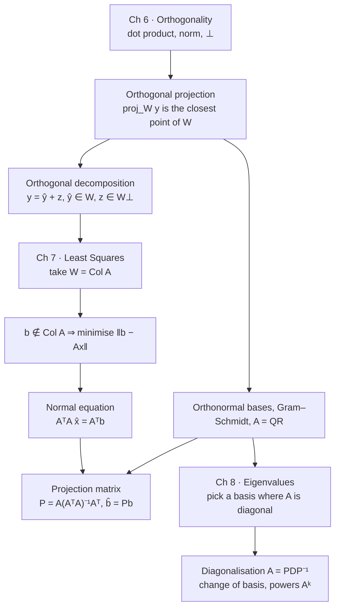

# SC1004 Linear Algebra — Theory & Theorems: Chapters 6 → 8

> A focused reference for **all the theory and theorems** in Chapters 6–8 of the SC1004 Linear Algebra video series — every key definition, every theorem (with proofs where the course gives them), and the ideas that tie the three chapters together.
>
> **Sources:**
> - **C6 guide** — Chapter 6: *Orthogonality* (Sections 6.1.1 – 6.3.3, 36 videos, ≈ 4 h 23 min) → `C6/Linear_Algebra_C6_Complete_Study_Guide.md`
> - **C7 guide** — Chapter 7: *Least Squares* (Sections 7.1.1 – 7.2.1, 15 videos) → `C7/Linear_Algebra_C7_Complete_Study_Guide.md`
> - **C8 guide** — Chapter 8: *Eigenvalues & Eigenvectors* (Sections 8.1.0 – 8.1.6, 72 videos, ≈ 6 h 10 min) → `C8/Linear_Algebra_C8_Complete_Study_Guide.md`
>
> Chapter 8A (*Complex Numbers & the DFT*) is covered separately in the full [theorems.md](./theorems.md) Part X, and is needed only for §8.1.6 (*complex eigenvalues*). Companion documents: [Study_Guide_C6-C8.md](./Study_Guide_C6-C8.md) (what to learn), [definitions.md](./definitions.md) (glossary), [practice_problems.md](./practice_problems.md) (Parts H–J).

---

## Table of Contents

**How the Three Chapters Connect**
- [The single idea: projection](#the-single-idea-projection)

**Chapter 6 — Orthogonality (C6)**
- [Key Definitions & Concepts — Orthogonality](#key-definitions--concepts--orthogonality)
- 1. [Theorem 3.2.1 — Properties of the Norm](#61-theorem-321--properties-of-the-norm)
- 2. [Theorem 3.2.3 — Algebraic Properties of the Dot Product](#62-theorem-323--algebraic-properties-of-the-dot-product)
- 3. [Theorem 3.2.4 — Cauchy–Schwarz Inequality](#63-theorem-324--cauchyschwarz-inequality)
- 4. [Theorem 3.2.5 — Triangle Inequality](#64-theorem-325--triangle-inequality)
- 5. [Theorem 3.3.1 — Point–Normal Form of a Line/Plane](#65-theorem-331--pointnormal-form-of-a-lineplane)
- 6. [Theorem 4 — Orthogonal Sets are Linearly Independent](#66-theorem-4--orthogonal-sets-are-linearly-independent)
- 7. [Theorem 3.3.2 — Projection Theorem](#67-theorem-332--projection-theorem)
- 8. [Theorem 5 — Orthogonal Decomposition Theorem](#68-theorem-5--orthogonal-decomposition-theorem)
- 9. [Theorem 8 — Projection onto a Subspace (Orthogonal Basis)](#69-theorem-8--projection-onto-a-subspace-orthogonal-basis)
- 10. [Theorem 9 — Best Approximation Theorem](#610-theorem-9--best-approximation-theorem)
- 11. [Theorem 10 — Projection with an Orthonormal Basis](#611-theorem-10--projection-with-an-orthonormal-basis)
- 12. [Theorem 6 — $U^{\mathsf T}U=I$ ⇔ Orthonormal Columns](#612-theorem-6--umathsf-tu--i--orthonormal-columns)
- 13. [Theorem 11 — The Gram–Schmidt Process](#613-theorem-11--the-gramschmidt-process)
- 14. [QR Factorisation Theorem](#614-qr-factorisation-theorem)

**Chapter 7 — Least Squares (C7)**
- [Key Definitions & Concepts — Least Squares](#key-definitions--concepts--least-squares)
- 1. [Consistency of a Linear System](#71-consistency-of-a-linear-system)
- 2. [Best Approximation Theorem (6.4.1)](#72-best-approximation-theorem-641)
- 3. [The Normal Equations (6.5.1)](#73-the-normal-equations-651)
- 4. [Projection Matrix Properties](#74-projection-matrix-properties)
- 5. [Three Ways to Solve the Over-Determined System](#75-three-ways-to-solve-the-over-determined-system)
- 6. [Least-Squares Error and the Residual](#76-least-squares-error-and-the-residual)
- 7. [Linear Models (Least-Squares Fitting)](#77-linear-models-least-squares-fitting)

**Chapter 8 — Eigenvalues and Eigenvectors (C8)**
- [Key Definitions & Concepts — Eigenvalues](#key-definitions--concepts--eigenvalues)
- 1. [The Eigenvalue Equation](#81-the-eigenvalue-equation)
- 2. [Eigenspaces are Subspaces](#82-eigenspaces-are-subspaces)
- 3. [The Characteristic Equation](#83-the-characteristic-equation)
- 4. [Eigenvalues of Triangular / Diagonal / Power Matrices](#84-eigenvalues-of-triangular--diagonal--power-matrices)
- 5. [The Diagonalization Theorem](#85-the-diagonalization-theorem)
- 6. [Distinct Eigenvalues ⇒ Linearly Independent](#86-distinct-eigenvalues--linearly-independent)
- 7. [Similar Matrices Share Eigenvalues](#87-similar-matrices-share-eigenvalues)
- 8. [Powers of a Matrix via Diagonalization](#88-powers-of-a-matrix-via-diagonalization)
- 9. [Eigenvectors of a Linear Transformation](#89-eigenvectors-of-a-linear-transformation)
- 10. [Change of Basis and $\mathcal B$-Matrices](#810-change-of-basis-and-mathcal-b-matrices)
- 11. [Complex Eigenvalues of a Real Matrix](#811-complex-eigenvalues-of-a-real-matrix)

**Appendix**
- [Quick Reference — Formula Sheet](#quick-reference--formula-sheet)
- [Named-Theorem Index](#named-theorem-index)
- [Source Video Cross-Reference](#source-video-cross-reference)

---

# How the Three Chapters Connect

The three chapters are one argument told in three steps: **project → minimise → re-basis.**

### The single idea: projection

- **Chapter 6** proves that for any subspace $W$ and vector $\mathbf y$ there is a **unique** decomposition $\mathbf y=\hat{\mathbf y}+\mathbf z$ with $\hat{\mathbf y}\in W$, $\mathbf z\in W^{\perp}$, and that $\hat{\mathbf y}$ is the **closest point of $W$ to $\mathbf y$** (Best Approximation).
- **Chapter 7** applies this verbatim with $W=\operatorname{Col}A$. When $A\mathbf x=\mathbf b$ has no solution (over-determined), the best you can do is make $\mathbf b-A\mathbf x$ orthogonal to $\operatorname{Col}A$ — which *is* the **normal equation**.
- **Chapter 8** keeps the "pick a better basis" theme but changes bases to the **eigenvector basis**, where the transformation becomes the diagonal scaling $D$. Orthogonality returns in §8.1.6 (complex eigenvalues of a rotation, $e^{\pm j\theta}$).
- **Gram–Schmidt / QR** is the bridge: it converts any basis into an orthonormal one, which makes both projection (Ch 6) and least squares (Ch 7) numerically clean.

---

# Chapter 6 — Orthogonality (C6)

## Key Definitions & Concepts — Orthogonality

| Term | Meaning |
|---|---|
| **Norm** | $\lVert\mathbf v\rVert = \sqrt{v_1^2+\cdots+v_n^2}$ — length/magnitude. |
| **Unit vector / normalising** | $\mathbf u = \mathbf v/\lVert\mathbf v\rVert$ has norm 1. |
| **Distance** | $d(\mathbf u,\mathbf v)=\lVert\mathbf u-\mathbf v\rVert$. |
| **Dot product** | $\mathbf u\cdot\mathbf v = \lVert\mathbf u\rVert\,\lVert\mathbf v\rVert\cos\theta = \sum_i u_iv_i = \mathbf u^{\mathsf T}\mathbf v$ (a scalar). |
| **Orthogonal** | $\mathbf u\cdot\mathbf v = 0$ (the zero vector is orthogonal to all vectors). |
| **Orthogonal / orthonormal set** | pairwise orthogonal / pairwise orthonormal ($\mathbf u_i\cdot\mathbf u_j = \delta_{ij}$). |
| **Orthogonal basis / orthonormal basis** | a basis that is an orthogonal / orthonormal set. |
| **Normal vector** | nonzero vector orthogonal to a line: $\mathbf n=(a,b)$; to a plane: $\mathbf n=(a,b,c)$. |
| **Orthogonal complement** | $W^{\perp} = \{\mathbf z : \mathbf z\cdot\mathbf w = 0\ \forall \mathbf w\in W\}$ — itself a subspace. |
| **Projection** | $\operatorname{proj}_{\mathbf a}\mathbf u = \frac{\mathbf u\cdot\mathbf a}{\lVert\mathbf a\rVert^2}\mathbf a$; onto $W$: $\hat{\mathbf y} = \operatorname{proj}_W\mathbf y$. |
| **Orthogonal matrix** | a **square** matrix with orthonormal columns: $U^{\mathsf T}U = UU^{\mathsf T} = I$. |
| **Projection matrix** | $P = QQ^{\mathsf T}$ with $Q$ having orthonormal columns — symmetric and idempotent. |
| **QR factorisation** | $A = QR$: $Q$ has orthonormal columns spanning $\operatorname{Col}A$, $R$ is upper triangular. |

## 6.1 Theorem 3.2.1 — Properties of the Norm

If $\mathbf v \in \mathbb{R}^n$ and $k$ is any scalar, then

**(a)** $\lVert\mathbf v\rVert \ge 0$; **(b)** $\lVert\mathbf v\rVert = 0 \iff \mathbf v = \mathbf 0$; **(c)** $\lVert k\mathbf v\rVert = |k|\,\lVert\mathbf v\rVert$.

**Proof of (c).** $\lVert k\mathbf v\rVert = \sqrt{(kv_1)^2+\cdots+(kv_n)^2} = \sqrt{k^2(v_1^2+\cdots+v_n^2)} = |k|\,\lVert\mathbf v\rVert$.

## 6.2 Theorem 3.2.3 — Algebraic Properties of the Dot Product

For $\mathbf u,\mathbf v,\mathbf w\in\mathbb{R}^n$ and scalar $k$:

1. $\mathbf 0\cdot\mathbf v = 0$
2. $\mathbf u\cdot\mathbf v = \mathbf v\cdot\mathbf u$ (commutative)
3. $\mathbf u\cdot(\mathbf v+\mathbf w) = \mathbf u\cdot\mathbf v+\mathbf u\cdot\mathbf w$ (distributive)
4. $k(\mathbf u\cdot\mathbf v) = (k\mathbf u)\cdot\mathbf v$ (homogeneous)
5. $\mathbf v\cdot\mathbf v = \lVert\mathbf v\rVert^2$, and $\mathbf v\cdot\mathbf v \ge 0$ with equality only for $\mathbf v = \mathbf 0$.

Also: $\mathbf u\cdot\mathbf v = \mathbf u^{\mathsf T}\mathbf v$, and $(A\mathbf u)\cdot\mathbf v = \mathbf u\cdot(A^{\mathsf T}\mathbf v)$.

## 6.3 Theorem 3.2.4 — Cauchy–Schwarz Inequality

For $\mathbf u,\mathbf v\in\mathbb{R}^n$,
$$|\mathbf u\cdot\mathbf v| \le \lVert\mathbf u\rVert\,\lVert\mathbf v\rVert, \qquad \left|\textstyle\sum_i u_iv_i\right| \le \left(\sum_i u_i^2\right)^{1/2}\left(\sum_i v_i^2\right)^{1/2}.$$

**Proof (from the angle form).** $|\mathbf u\cdot\mathbf v| = \lVert\mathbf u\rVert\,\lVert\mathbf v\rVert\,|\cos\theta| \le \lVert\mathbf u\rVert\,\lVert\mathbf v\rVert$.

Equality holds precisely when one vector is a scalar multiple of the other.

## 6.4 Theorem 3.2.5 — Triangle Inequality

For $\mathbf u,\mathbf v \in \mathbb{R}^n$: $\;\lVert\mathbf u+\mathbf v\rVert \le \lVert\mathbf u\rVert+\lVert\mathbf v\rVert$.

**Proof.** $\lVert\mathbf u+\mathbf v\rVert^2 = \lVert\mathbf u\rVert^2 + 2(\mathbf u\cdot\mathbf v)+\lVert\mathbf v\rVert^2 \le \lVert\mathbf u\rVert^2 + 2|\mathbf u\cdot\mathbf v| + \lVert\mathbf v\rVert^2 \le \lVert\mathbf u\rVert^2 + 2\lVert\mathbf u\rVert\lVert\mathbf v\rVert + \lVert\mathbf v\rVert^2 = (\lVert\mathbf u\rVert+\lVert\mathbf v\rVert)^2$ (using Cauchy–Schwarz).

- **For distance:** $d(\mathbf u,\mathbf v) \le d(\mathbf u,\mathbf w) + d(\mathbf w,\mathbf v)$.

## 6.5 Theorem 3.3.1 — Point–Normal Form of a Line/Plane

A line in $\mathbb{R}^2$ / plane in $\mathbb{R}^3$ through $P_0$ with normal $\mathbf n$ satisfies
$$\mathbf n\cdot\overrightarrow{P_0P} = 0 \;\Longleftrightarrow\; a(x-x_0)+b(y-y_0)+c(z-z_0)=0 \;\Longleftrightarrow\; ax+by+cz = d.$$

- The **coefficients of the variables are the components of the normal vector**.

## 6.6 Theorem 4 — Orthogonal Sets are Linearly Independent

If $S = \{\mathbf u_1,\dots,\mathbf u_p\}$ is an **orthogonal set of nonzero vectors** in $\mathbb{R}^n$, then $S$ is **linearly independent** (hence a basis for the subspace it spans, so $p \le n$).

**Proof.** Suppose $c_1\mathbf u_1+\cdots+c_p\mathbf u_p = \mathbf 0$. Taking the dot product with $\mathbf u_1$: $0 = \mathbf 0\cdot\mathbf u_1 = c_1\lVert\mathbf u_1\rVert^2$, and since $\mathbf u_1\neq\mathbf 0$ we get $c_1 = 0$. Repeating with each $\mathbf u_j$ gives every $c_j = 0$.

## 6.7 Theorem 3.3.2 — Projection Theorem

If $\mathbf u,\mathbf a\in\mathbb{R}^n$ and $\mathbf a\neq\mathbf 0$, then $\mathbf u$ can be written in **exactly one way** as
$$\mathbf u = \mathbf w_1+\mathbf w_2, \qquad \mathbf w_1 = \operatorname{proj}_{\mathbf a}\mathbf u = \frac{\mathbf u\cdot\mathbf a}{\lVert\mathbf a\rVert^2}\mathbf a, \quad \mathbf w_2 = \mathbf u-\mathbf w_1 \perp \mathbf a.$$

**Proof (residual method).** Write $\mathbf w_1 = k\mathbf a$ and require $\mathbf e = \mathbf u-k\mathbf a\perp\mathbf a$. Then $0 = \mathbf a\cdot(\mathbf u-k\mathbf a) = \mathbf a\cdot\mathbf u-k\lVert\mathbf a\rVert^2$, so $k = \dfrac{\mathbf u\cdot\mathbf a}{\lVert\mathbf a\rVert^2}$. Uniqueness follows because two such decompositions differ by a vector that is both a multiple of $\mathbf a$ and orthogonal to it, hence $\mathbf 0$.

- **Length:** $\lVert\mathbf w_1\rVert = \lVert\mathbf u\rVert\cos\theta = \dfrac{\mathbf u\cdot\mathbf a}{\lVert\mathbf a\rVert}$.
- **Orthogonal component:** $\mathbf w_2 = \mathbf u - \dfrac{\mathbf u\cdot\mathbf a}{\lVert\mathbf a\rVert^2}\mathbf a$.

## 6.8 Theorem 5 — Orthogonal Decomposition Theorem

Let $W$ be a subspace of $\mathbb{R}^n$. Each $\mathbf y\in\mathbb{R}^n$ can be written **uniquely** as
$$\mathbf y = \hat{\mathbf y}+\mathbf z, \qquad \hat{\mathbf y}\in W, \quad \mathbf z\in W^{\perp}.$$

- If $\{\mathbf u_1,\dots,\mathbf u_p\}$ is an **orthogonal basis** of $W$ then $\hat{\mathbf y} = \sum_{j} \frac{\mathbf y\cdot\mathbf u_j}{\mathbf u_j\cdot\mathbf u_j}\mathbf u_j$.
- **Weights theorem:** if $\mathbf y = c_1\mathbf u_1+\cdots+c_p\mathbf u_p$ for an orthogonal set, then each weight is
  $$c_j = \frac{\mathbf y\cdot\mathbf u_j}{\mathbf u_j\cdot\mathbf u_j}.$$

## 6.9 Theorem 8 — Projection onto a Subspace (Orthogonal Basis)

For an **orthogonal basis** $\{\mathbf u_1,\dots,\mathbf u_p\}$ of $W$, the vector
$$\hat{\mathbf y} = \sum_{j=1}^{p}\frac{\mathbf y\cdot\mathbf u_j}{\mathbf u_j\cdot\mathbf u_j}\mathbf u_j$$
is in $W$, and $\mathbf y-\hat{\mathbf y}\in W^{\perp}$.

**Proof.** $\hat{\mathbf y}\in W$ because it is a combination of basis vectors. And $(\mathbf y-\hat{\mathbf y})\cdot\mathbf u_1 = \mathbf y\cdot\mathbf u_1 - \dfrac{\mathbf y\cdot\mathbf u_1}{\mathbf u_1\cdot\mathbf u_1}(\mathbf u_1\cdot\mathbf u_1) = 0$; likewise for every $\mathbf u_j$. Since the $\mathbf u_j$ span $W$, $\mathbf y-\hat{\mathbf y}\perp W$.

## 6.10 Theorem 9 — Best Approximation Theorem

With $\hat{\mathbf y} = \operatorname{proj}_W\mathbf y$:
$$\lVert\mathbf y-\hat{\mathbf y}\rVert < \lVert\mathbf y-\mathbf v\rVert \quad \text{for every } \mathbf v\in W, \ \mathbf v\neq\hat{\mathbf y}.$$

**Proof (Pythagoras).** Write $\mathbf y-\mathbf v = (\mathbf y-\hat{\mathbf y})+(\hat{\mathbf y}-\mathbf v)$. The first term lies in $W^{\perp}$ and the second in $W$, so they are orthogonal and
$$\lVert\mathbf y-\mathbf v\rVert^2 = \lVert\mathbf y-\hat{\mathbf y}\rVert^2+\lVert\hat{\mathbf y}-\mathbf v\rVert^2 > \lVert\mathbf y-\hat{\mathbf y}\rVert^2 \quad\text{whenever } \mathbf v\neq\hat{\mathbf y}.$$

- If $\mathbf y\in W$ then $\operatorname{proj}_W\mathbf y = \mathbf y$ (and the residual is $\mathbf 0$).

## 6.11 Theorem 10 — Projection with an Orthonormal Basis

If $\{\mathbf u_1,\dots,\mathbf u_p\}$ is an **orthonormal** basis for $W$, then
$$\operatorname{proj}_W\mathbf y = (\mathbf y\cdot\mathbf u_1)\mathbf u_1+\cdots+(\mathbf y\cdot\mathbf u_p)\mathbf u_p, \qquad \operatorname{proj}_W\mathbf y = UU^{\mathsf T}\mathbf y,$$
where $U = [\,\mathbf u_1\ \cdots\ \mathbf u_p\,]$ and $UU^{\mathsf T}$ is the projection matrix onto $W$.

- For a **square** orthonormal $U$, $UU^{\mathsf T}=I$: the projection is the identity (the whole space).

## 6.12 Theorem 6 — $U^{\mathsf T}U = I$ ⇔ Orthonormal Columns

An $m\times n$ matrix $U$ has **orthonormal columns** if and only if $U^{\mathsf T}U = I_n$.

- If $U$ is **square**, then $UU^{\mathsf T} = I$ as well: $U$ is an **orthogonal matrix**, with $U^{-1} = U^{\mathsf T}$.
- If $U$ is **rectangular**, $UU^{\mathsf T} \ne I$; it is the **projection matrix** onto $\operatorname{Col} U$.
- For any $U$ with orthonormal columns: $\lVert U\mathbf x\rVert = \lVert\mathbf x\rVert$ (length- and angle-preserving).

## 6.13 Theorem 11 — The Gram–Schmidt Process

Given a basis $\{\mathbf x_1,\dots,\mathbf x_p\}$ for a nonzero subspace $W$ of $\mathbb{R}^n$, define
$$\mathbf v_1 = \mathbf x_1, \qquad \mathbf v_j = \mathbf x_j - \sum_{i<j}\frac{\mathbf x_j\cdot\mathbf v_i}{\mathbf v_i\cdot\mathbf v_i}\mathbf v_i \quad (j = 2,\dots,p).$$
Then $\{\mathbf v_1,\dots,\mathbf v_p\}$ is an **orthogonal basis** for $W$, and
$$\operatorname{Span}\{\mathbf v_1,\dots,\mathbf v_j\} = \operatorname{Span}\{\mathbf x_1,\dots,\mathbf x_j\} \quad \text{for each } j.$$

- Normalising gives an **orthonormal** basis: $\mathbf q_j = \mathbf v_j/\lVert\mathbf v_j\rVert$.

## 6.14 QR Factorisation Theorem

If $A$ is an $m\times n$ matrix with **linearly independent columns**, then
$$A = QR$$
where $Q$ is $m\times n$ with **orthonormal columns** forming a basis of $\operatorname{Col} A$, and $R$ is $n\times n$ **upper triangular** with positive diagonal entries (unique when $r_{jj}>0$).

- From Gram–Schmidt: $r_{ij} = \dfrac{\mathbf x_j\cdot\mathbf v_i}{\mathbf v_i\cdot\mathbf v_i}$ for $i<j$, and $r_{jj} = \lVert\mathbf v_j\rVert$.
- $C(Q) = C(A)$, $Q^{\mathsf T}Q = I$, and $QQ^{\mathsf T}$ is the projection matrix onto $\operatorname{Col} A$ (for a tall $A$, $QQ^{\mathsf T}\neq I$).
- **Solving:** $A\mathbf x = \mathbf b \Rightarrow R\mathbf x = Q^{\mathsf T}\mathbf b$ (back-substitution).
- **Dependent columns:** the factorisation still exists, but a zero on the diagonal of $R$ flags the dependency and $R$ is singular.
- **Full vs economy:** full QR has $Q$ of size $m\times m$ and $R$ of size $m\times n$ (bottom $m-n$ rows zero); the economy form drops those columns (`qr(A,0)` in MATLAB, `reduced` in NumPy).

---

# Chapter 7 — Least Squares (C7)

## Key Definitions & Concepts — Least Squares

| Term | Meaning |
|---|---|
| **Over-determined** | $A\mathbf x=\mathbf b$ with $m>n$ (tall, thin $A$). Usually inconsistent. |
| **Under-determined** | $m<n$ (short, fat $A$). Infinitely many solutions. |
| **Least-squares solution** $\hat{\mathbf x}$ | the vector minimising $\lVert\mathbf b - A\mathbf x\rVert$ (equivalently the sum of squares of the residual components). |
| **Residual (error)** | $\mathbf b - A\hat{\mathbf x}$ — orthogonal to $\operatorname{Col} A$. |
| **Fitted value** | $\hat{\mathbf b} = A\hat{\mathbf x} = P\mathbf b$ — the projection of $\mathbf b$ onto $\operatorname{Col} A$. |
| **Normal equation** | $A^{\mathsf T}A\hat{\mathbf x} = A^{\mathsf T}\mathbf b$ — always consistent. |
| **Projection matrix** | $P = A(A^{\mathsf T}A)^{-1}A^{\mathsf T}$ — square, symmetric, idempotent. |
| **Pseudoinverse** | $(A^{\mathsf T}A)^{-1}A^{\mathsf T}$ (Moore–Penrose when $A^{\mathsf T}A$ is singular). |
| **Noise model** | $\mathbf b = A\mathbf x + \boldsymbol\epsilon$. |
| **Linear-in-parameters model** | $y=\beta_0+\beta_1f_1(x)+\cdots$ — linear in the $\beta_i$, so least squares applies. |

## 7.1 Consistency of a Linear System

$A\mathbf x=\mathbf b$ is consistent
$$\iff \mathbf b\in\operatorname{Col} A
\iff \operatorname{rank}(A) = \operatorname{rank}([A\mid\mathbf b])
\iff \text{no row }[0\ \cdots\ 0\mid c]\ (c\neq0)\text{ in the reduced echelon form}.$$

Supplementary counting rule: with $A$ of size $m\times n$ —

- $m > n$: $\operatorname{Col}A$ cannot be all of $\mathbb{R}^m$, so a **tall** system is generally **not** solvable for every $\mathbf b$;
- $m < n$: the system has free variables, so when it is consistent it has **infinitely many** solutions;
- $m = n$: unique solution $\mathbf x = A^{-1}\mathbf b$ when $A$ is invertible.

**Solution count:** $\operatorname{rank}(A)=\operatorname{rank}([A\mid\mathbf b])=n$ ⇒ unique; $=\operatorname{rank}(A)<n$ ⇒ infinitely many; $\operatorname{rank}(A)<\operatorname{rank}([A\mid\mathbf b])$ ⇒ inconsistent.

## 7.2 Best Approximation Theorem (6.4.1)

> **Theorem 6.4.1 (Best Approximation).** Let $W$ be a subspace of $\mathbb{R}^n$, $\mathbf y\in\mathbb{R}^n$, and $\hat{\mathbf y}=P_W\mathbf y$ the orthogonal projection of $\mathbf y$ onto $W$. Then $\hat{\mathbf y}$ is the **closest point in $W$ to $\mathbf y$**:
> $$\lVert\mathbf y - \hat{\mathbf y}\rVert < \lVert\mathbf y - \mathbf v\rVert \quad \text{for all } \mathbf v\in W,\ \mathbf v\neq\hat{\mathbf y}.$$
>
> Equivalently, the residual $\mathbf y - \hat{\mathbf y}$ is orthogonal to every vector in $W$.

Applied with $W=\operatorname{Col} A$, this is exactly why the least-squares solution is obtained by projection — this is Chapter 6's Theorem 9 specialised.

## 7.3 The Normal Equations (6.5.1)

> **Theorem 6.5.1.** The set of least-squares solutions of $A\mathbf x=\mathbf b$ coincides with the **non-empty** set of solutions of the normal equation
> $$A^{\mathsf T}A\,\hat{\mathbf x} = A^{\mathsf T}\mathbf b.$$
>
> If $A$ has **linearly independent columns**, then $A^{\mathsf T}A$ is invertible and
> $$\hat{\mathbf x} = (A^{\mathsf T}A)^{-1}A^{\mathsf T}\mathbf b, \qquad \hat{\mathbf b} = A\hat{\mathbf x} = A(A^{\mathsf T}A)^{-1}A^{\mathsf T}\mathbf b.$$

**Why "normal".** The residual must be orthogonal to $\operatorname{Col}A$, so it must be orthogonal to every column $\mathbf a_j$ of $A$:
$$\mathbf a_j\cdot(\mathbf b-A\hat{\mathbf x}) = 0 \ \ \forall j \iff A^{\mathsf T}(\mathbf b-A\hat{\mathbf x}) = \mathbf 0 \iff A^{\mathsf T}A\hat{\mathbf x} = A^{\mathsf T}\mathbf b.$$
Because the residual is **normal (⊥)** to $\operatorname{Col}A$, these are the *normal* equations.

- If the columns of $A$ are **dependent**, $A^{\mathsf T}A$ is singular and there are **infinitely many** least-squares solutions — solve $A^{\mathsf T}A\hat{\mathbf x}=A^{\mathsf T}\mathbf b$ by elimination instead.

## 7.4 Projection Matrix Properties

For $A$ with independent columns, $P = A(A^{\mathsf T}A)^{-1}A^{\mathsf T}$ satisfies:

1. $P^2 = P$ (**idempotent**) — projecting twice changes nothing;
2. $P^{\mathsf T} = P$ (**symmetric**);
3. $P\mathbf b \in \operatorname{Col} A$ and $\mathbf b - P\mathbf b \perp \operatorname{Col} A$;
4. $I-P$ is the projection onto $(\operatorname{Col} A)^\perp = N(A^{\mathsf T})$.

Special case — **projection onto a line** spanned by $\mathbf v$: $\;P = \dfrac{\mathbf v\mathbf v^{\mathsf T}}{\mathbf v^{\mathsf T}\mathbf v}$.

## 7.5 Three Ways to Solve the Over-Determined System

| Method | Formula | Notes |
|---|---|---|
| Normal equations | $A^{\mathsf T}A\hat{\mathbf x}=A^{\mathsf T}\mathbf b$ | Simplest; forming $A^{\mathsf T}A$ can worsen conditioning |
| QR factorisation | $A=QR\Rightarrow R\hat{\mathbf x}=Q^{\mathsf T}\mathbf b$ | Numerically best; back-substitution |
| Projection | $\hat{\mathbf x}=(A^{\mathsf T}A)^{-1}A^{\mathsf T}\mathbf b,\ \hat{\mathbf b}=P\mathbf b$ | Same answer; shows the geometry |

All three give the **same** least-squares solution.

## 7.6 Least-Squares Error and the Residual

- Error vector: $\mathbf r = \mathbf b - A\hat{\mathbf x}$, with $A^{\mathsf T}\mathbf r = \mathbf 0$.
- Minimum error: $\lVert\mathbf r\rVert = \sqrt{\mathbf b^{\mathsf T}\mathbf b - \hat{\mathbf x}^{\mathsf T}A^{\mathsf T}\mathbf b}$ (since $\hat{\mathbf b}\perp\mathbf r$, Pythagoras gives $\lVert\mathbf b\rVert^2=\lVert\hat{\mathbf b}\rVert^2+\lVert\mathbf r\rVert^2$).
- If $\mathbf b$ happens to lie in $\operatorname{Col} A$, then $\mathbf r=\mathbf 0$ and $\hat{\mathbf x}$ is an **exact** solution.
- **Worked references:** $A=\begin{bmatrix}4&0\\0&2\\1&1\end{bmatrix}$, $\mathbf b=(2,0,11)$ give $\hat{\mathbf x}=(1,2)$, $\hat{\mathbf b}=(4,4,3)$, $\mathbf r=(-2,-4,8)$, error $=\sqrt{84}\approx9.17$; and $A=\begin{bmatrix}2&0\\-1&1\\0&2\end{bmatrix}$, $\mathbf b=(1,0,-1)$ give $\hat{\mathbf x}=(\tfrac13,-\tfrac13)$ with squared error $\approx0.680$.

## 7.7 Linear Models (Least-Squares Fitting)

A model is **linear in its parameters** if $y = \beta_0 + \beta_1 f_1(x) + \beta_2 f_2(x) + \cdots$, with design matrix
$$A = \begin{bmatrix} 1 & f_1(x_1) & f_2(x_1) \\ 1 & f_1(x_2) & f_2(x_2) \\ \vdots & \vdots & \vdots \\ 1 & f_1(x_m) & f_2(x_m)\end{bmatrix},\qquad
\mathbf y = A\boldsymbol\beta + \boldsymbol\epsilon .$$
The coefficients come from the normal equation $A^{\mathsf T}A\boldsymbol\beta = A^{\mathsf T}\mathbf y$.

- **Least-squares line:** $y=\beta_0+\beta_1x$ (degree-1 polynomial) — the classic regression line; design matrix rows $(1,x_j)$.
- **Polynomial of degree $k$:** $y=\beta_0+\beta_1x+\cdots+\beta_kx^k$ — design matrix is **Vandermonde**, rows $(1,x_j,\dots,x_j^k)$.
- **Other functions:** $\beta_0+\beta_1\sin x$, $\beta_0+\beta_1e^x$, … — still linear in the $\beta_i$, so least squares applies directly.
- If two columns of $A$ are dependent (e.g. duplicate measurement points), $A^{\mathsf T}A$ is singular and the least-squares solution is **not unique**.

---

# Chapter 8 — Eigenvalues and Eigenvectors (C8)

## Key Definitions & Concepts — Eigenvalues

| Term | Meaning |
|---|---|
| **Eigenvalue / eigenvector** | $A\mathbf x = \lambda\mathbf x$ with $\mathbf x\ne\mathbf 0$. |
| **Eigenspace** | $E_\lambda = N(A-\lambda I)$ — eigenvectors for $\lambda$ plus $\mathbf 0$; a subspace. |
| **Characteristic polynomial** | $\det(A-\lambda I)$; its roots are the eigenvalues. |
| **Algebraic multiplicity** | multiplicity of $\lambda$ as a root of the characteristic polynomial. |
| **Geometric multiplicity** | $\dim E_\lambda$ — number of independent eigenvectors for $\lambda$. |
| **Similar matrices** | $A=PBP^{-1}$; same eigenvalues, determinant, trace. |
| **Diagonalizable** | $A=PDP^{-1}$ with $D$ diagonal — needs $n$ independent eigenvectors. |
| **Defective** | fewer than $n$ independent eigenvectors (geometric < algebraic); not diagonalizable. |
| **$\mathcal B$-coordinates** | $[\mathbf x]_{\mathcal B}$ — weights of $\mathbf x$ in the basis $\mathcal B$. |
| **$\mathcal B$-matrix of $T$** | $[T]_{\mathcal B} = P_{\mathcal B}^{-1}AP_{\mathcal B}$ — similar to $A$. |
| **Complex eigenvalues** | a real matrix has non-real eigenvalues in conjugate pairs $a\pm bj$. |

## 8.1 The Eigenvalue Equation

$\lambda$ is an **eigenvalue** of the $n\times n$ matrix $A$, with **eigenvector** $\mathbf x\ne\mathbf 0$, iff
$$(A-\lambda I)\mathbf x = \mathbf 0 \ \text{ has a nontrivial solution} \iff \det(A-\lambda I) = 0 \iff A-\lambda I \text{ is singular}.$$

Consequences:

- $A$ and $A^{\mathsf T}$ have the **same eigenvalues**;
- $\lambda=0$ is an eigenvalue $\iff A$ is **singular** (hence invertible $\iff 0$ is not an eigenvalue);
- $\operatorname{tr} A = \sum_i \lambda_i$ and $\det A = \prod_i \lambda_i$ (both counted with multiplicity);
- $A^k\mathbf x = \lambda^k\mathbf x$ for the same eigenvector.

## 8.2 Eigenspaces are Subspaces

For a fixed eigenvalue $\lambda$, the set $E_\lambda=N(A-\lambda I)$ is a **subspace** of $\mathbb{R}^n$, and its dimension (the **geometric multiplicity**) satisfies
$$1 \le \dim E_\lambda \le \text{algebraic multiplicity of } \lambda .$$

The eigenvectors for $\lambda$ together with $\mathbf 0$ are exactly $E_\lambda$; eigenvectors belonging to **different** eigenvalues are linearly independent.

## 8.3 The Characteristic Equation

$$\det(A-\lambda I) = 0$$ is a polynomial equation of degree $n$ in $\lambda$ (the **characteristic polynomial**). Hence:

- an $n\times n$ matrix has exactly $n$ eigenvalues over $\mathbb{C}$ (counted with multiplicity);
- **triangular and diagonal** matrices have their **diagonal entries** as eigenvalues;
- if $A$ has a zero eigenvalue then $A$ is singular, so $A^{-1}$ does not exist.

**Sign note:** $\det(A-\lambda I)$ and $\det(\lambda I-A)$ differ by a factor $(-1)^n$ but have the **same roots**.

## 8.4 Eigenvalues of Triangular / Diagonal / Power Matrices

1. $A$ triangular (or diagonal) $\Rightarrow$ eigenvalues $a_{11},\dots,a_{nn}$ (the diagonal entries).
2. $A\mathbf x=\lambda\mathbf x \Rightarrow A^k\mathbf x=\lambda^k\mathbf x$ (same eigenvector).
3. $A$ invertible $\Rightarrow$ $A^{-1}$ has eigenvalues $1/\lambda$ (same eigenvectors).
4. $A+cI$ has eigenvalues $\lambda_i + c$ (same eigenvectors).
5. $A^{\mathsf T}$ has the same eigenvalues as $A$.

These shortcuts let you get eigenvalues of $A^k$, $A^{-1}$, $A+cI$ and similar matrices **without** the characteristic polynomial.

## 8.5 The Diagonalization Theorem

$A$ ($n\times n$) is **diagonalizable**, i.e. $A=PDP^{-1}$ with $D=\operatorname{diag}(\lambda_1,\dots,\lambda_n)$ and $P$ invertible, iff:

1. $A$ has $n$ **linearly independent** eigenvectors; equivalently,
2. for **every** eigenvalue the geometric multiplicity equals the algebraic multiplicity.

Here $P = [\mathbf v_1\ \cdots\ \mathbf v_n]$ (an eigenvector basis) and $D$ holds the corresponding eigenvalues — **the order of the columns of $P$ must match the order on the diagonal of $D$**. Then $A = PDP^{-1}$ and $A^k = PD^kP^{-1}$.

## 8.6 Distinct Eigenvalues ⇒ Linearly Independent

> If $\mathbf v_1,\dots,\mathbf v_r$ are eigenvectors corresponding to **distinct** eigenvalues $\lambda_1,\dots,\lambda_r$, then $\{\mathbf v_1,\dots,\mathbf v_r\}$ is linearly independent.

**Corollary:** an $n\times n$ matrix with $n$ **distinct** eigenvalues is always diagonalizable. Repeated eigenvalues do **not** automatically prevent diagonalization — you must check $\dim E_\lambda$.

## 8.7 Similar Matrices Share Eigenvalues

If $A = PBP^{-1}$ then $A$ and $B$ have the same **characteristic polynomial**, hence the same **eigenvalues** (with the same multiplicities), and also the same **determinant** and **trace** — all similarity invariants. Eigenvectors are **not** shared: if $\mathbf v$ is an eigenvector of $B$, then $P\mathbf v$ is the corresponding eigenvector of $A$.

## 8.8 Powers of a Matrix via Diagonalization

With $A=PDP^{-1}$:
$$A^k = P D^k P^{-1} = P\begin{bmatrix}\lambda_1^k & & \\ & \ddots & \\ & & \lambda_n^k\end{bmatrix}P^{-1}.$$

This gives **discrete dynamical systems** $\mathbf x_{k+1} = A\mathbf x_k \Rightarrow \mathbf x_k = A^k\mathbf x_0$: the coefficients of $\mathbf x_0$ in the eigenvector basis are scaled by $\lambda^k$, so $|\lambda|<1$ decays, $|\lambda|>1$ grows, $|\lambda|=1$ persists. (If $A$ is not diagonalizable, one uses the Jordan form — beyond this course.)

## 8.9 Eigenvectors of a Linear Transformation

$\mathbf v$ is an **eigenvector** of a linear transformation $T:V\to V$ if $T(\mathbf v)=\lambda\mathbf v$. In a basis $\mathcal B=\{\mathbf b_1,\dots,\mathbf b_n\}$,
$$[T]_{\mathcal B} = P_{\mathcal B}^{-1} A P_{\mathcal B}, \qquad P_{\mathcal B} = [\mathbf b_1\ \cdots\ \mathbf b_n].$$

$T$ is **diagonalizable** iff there is a basis of eigenvectors, in which case $[T]_{\mathcal B}$ is diagonal and $D$ simply lists the eigenvalues. The eigenvectors are the directions that $T$ only **scales**.

## 8.10 Change of Basis and $\mathcal B$-Matrices

- **Coordinates:** $\mathbf x = P_{\mathcal B}[\mathbf x]_{\mathcal B}$, and $[\mathbf x]_{\mathcal C} = \mathop{P}\limits_{\mathcal C\leftarrow\mathcal B}\,[\mathbf x]_{\mathcal B}$ with $\mathop{P}\limits_{\mathcal C\leftarrow\mathcal B} = P_{\mathcal C}^{-1}P_{\mathcal B}$.
- The coordinate mapping $\mathbf x\mapsto[\mathbf x]_{\mathcal B}$ is a **linear transformation**, and it is an isomorphism.
- **Diagonalisation is a change of basis** to an eigenvector basis: $D = P^{-1}AP$.
- **Similar matrices** are exactly coordinate representations of the **same** transformation in different bases.

## 8.11 Complex Eigenvalues of a Real Matrix

- **Conjugate pairs:** if $A$ is real and $\lambda=a+bj$ is an eigenvalue, so is $\bar\lambda=a-bj$ (and the eigenvectors are conjugate too).
- For real $A$, a complex eigenvalue corresponds to a **rotation–scaling**: solutions of $\mathbf x' = A\mathbf x$ spiral when $a\neq0$.
- **Rotation matrices:** a $2\times2$ rotation by $\theta$ has $\lambda = e^{\pm j\theta} = \cos\theta \pm j\sin\theta$ — no real eigenvectors.
- Real form: the pair $a\pm bj$ corresponds to the block $\begin{bmatrix} a & -b \\ b & a\end{bmatrix}$ (a scaled rotation).
- If $A$ has complex eigenvalues, $A$ is **not** diagonalizable over $\mathbb{R}$ (only over $\mathbb{C}$). This connects to the complex-number machinery of Chapter 8A.

---

# Quick Reference — Formula Sheet

| Concept | Result |
|---|---|
| Norm · distance | $\lVert\mathbf v\rVert=\sqrt{\textstyle\sum v_i^2}$ · $d(\mathbf u,\mathbf v)=\lVert\mathbf u-\mathbf v\rVert$ |
| Dot product | $\mathbf u\cdot\mathbf v=\lVert\mathbf u\rVert\lVert\mathbf v\rVert\cos\theta=\mathbf u^{\mathsf T}\mathbf v$ |
| Cauchy–Schwarz | $\lvert\mathbf u\cdot\mathbf v\rvert\le\lVert\mathbf u\rVert\lVert\mathbf v\rVert$ |
| Triangle inequality | $\lVert\mathbf u+\mathbf v\rVert\le\lVert\mathbf u\rVert+\lVert\mathbf v\rVert$ |
| Projection onto a vector | $\operatorname{proj}_{\mathbf a}\mathbf u=\dfrac{\mathbf u\cdot\mathbf a}{\lVert\mathbf a\rVert^2}\mathbf a$ |
| Projection onto $W$ (orthogonal basis) | $\hat{\mathbf y}=\sum_j\frac{\mathbf y\cdot\mathbf u_j}{\mathbf u_j\cdot\mathbf u_j}\mathbf u_j$ |
| Projection onto $W$ (orthonormal basis) | $\hat{\mathbf y}=UU^{\mathsf T}\mathbf y$ |
| Orthonormal columns | $U^{\mathsf T}U=I$; square ⇒ $U^{-1}=U^{\mathsf T}$ |
| Gram–Schmidt | $\mathbf v_j=\mathbf x_j-\sum_{i<j}\frac{\mathbf x_j\cdot\mathbf v_i}{\mathbf v_i\cdot\mathbf v_i}\mathbf v_i$ |
| QR | $A=QR$; $r_{ij}=\frac{\mathbf x_j\cdot\mathbf v_i}{\mathbf v_i\cdot\mathbf v_i}$, $r_{jj}=\lVert\mathbf v_j\rVert$; $R\mathbf x=Q^{\mathsf T}\mathbf b$ |
| Consistency | $\mathbf b\in\operatorname{Col}A\iff\operatorname{rank}(A)=\operatorname{rank}([A\mid\mathbf b])$ |
| Normal equation | $A^{\mathsf T}A\hat{\mathbf x}=A^{\mathsf T}\mathbf b$ |
| Least-squares solution | $\hat{\mathbf x}=(A^{\mathsf T}A)^{-1}A^{\mathsf T}\mathbf b$ |
| Projection matrix | $P=A(A^{\mathsf T}A)^{-1}A^{\mathsf T}$; $P^{\mathsf T}=P$, $P^2=P$ |
| Eigenvalue equation | $A\mathbf x=\lambda\mathbf x$, $\mathbf x\neq\mathbf 0$; $E_\lambda=N(A-\lambda I)$ |
| Characteristic equation | $\det(A-\lambda I)=0$ |
| Diagonalization | $A=PDP^{-1}$ ⇔ $n$ independent eigenvectors ⇔ geom. = alg. mult. everywhere |
| Powers | $A^k=PD^kP^{-1}$ |
| Invariants | $\operatorname{tr}A=\sum\lambda_i$, $\det A=\prod\lambda_i$, shared by similar matrices |
| Shifts / inverses | $A+cI$: $\lambda_i+c$ · $A^{-1}$: $1/\lambda_i$ |
| Change of basis | $[\mathbf x]_{\mathcal C}=\mathop{P}\limits_{\mathcal C\leftarrow\mathcal B}[\mathbf x]_{\mathcal B}$, $\mathop{P}\limits_{\mathcal C\leftarrow\mathcal B}=P_{\mathcal C}^{-1}P_{\mathcal B}$ |
| $\mathcal B$-matrix of $T$ | $[T]_{\mathcal B}=P_{\mathcal B}^{-1}AP_{\mathcal B}$ |

---

# Named-Theorem Index

| Name (as used in lectures) | Section | Statement |
|---|---|---|
| **Theorem 3.2.1** | 6.1 | Properties of the norm |
| **Theorem 3.2.3** | 6.2 | Algebraic properties of the dot product |
| **Theorem 3.2.4** | 6.3 | Cauchy–Schwarz inequality |
| **Theorem 3.2.5** | 6.4 | Triangle inequality |
| **Theorem 3.3.1** | 6.5 | Point–normal form of a line/plane |
| **Theorem 4** | 6.6 | Orthogonal sets (of nonzero vectors) are linearly independent |
| **Theorem 3.3.2** | 6.7 | Projection theorem (vector onto vector) |
| **Theorem 5** | 6.8 | Orthogonal decomposition theorem |
| **Theorem 8** | 6.9 | Projection onto a subspace via an orthogonal basis |
| **Theorem 9** | 6.10 | Best approximation theorem |
| **Theorem 10** | 6.11 | Projection with an orthonormal basis |
| **Theorem 6** | 6.12 | $U^{\mathsf T}U=I$ ⇔ orthonormal columns |
| **Theorem 11** | 6.13 | Gram–Schmidt process |
| **QR Factorisation** | 6.14 | $A=QR$ with $Q$ orthonormal columns, $R$ upper triangular |
| **Theorem 6.4.1** | 7.2 | Best approximation (as applied to least squares) |
| **Theorem 6.5.1** | 7.3 | The normal equations |

---

# Source Video Cross-Reference

| Section | Source | Videos |
|---|---|---|
| 6.1 – 6.4 | `V-6.1.1` Review of Vectors · `V-6.1.2` Norm and Unit Vector · `V-6.1.3` The Dot Product · `V-6.1.4` Inequalities | 11 |
| 6.5 – 6.12 | `V-6.2.1` Orthogonality · `V-6.2.2` Orthogonal Projections · `V-6.2.3` Orthogonal Sets and Basis · `V-6.2.4` Orthonormal Sets and Orthogonal Matrices · `V-6.2.5` Orthogonal Decomposition | 15 |
| 6.13 – 6.14 | `V-6.3.1` QR Motivation · `V-6.3.2` Gram–Schmidt · `V-6.3.3` QR (examples / MATLAB) | 10 |
| **Chapter 6 total** | | **36** |
| 7.1 | `V-7.1.1` Consistency in a System of Equations | 3 |
| 7.2 – 7.4 | `V-7.1.2` The Least Squares Problem · `V-7.1.3` Best Approximation & Normal Equation · `V-7.1.4` Projection Matrix and its Properties | 8 |
| 7.5 – 7.6 | `V-7.1.5` Summary: Solving Least Squares (and with QR) | 1 |
| 7.7 | `V-7.2.1` Applications of Least Squares: Linear Models | 3 |
| **Chapter 7 total** | | **15** |
| 8.1 – 8.2 | `V-8.1.0` Overview · `V-8.1.1` Eigenvalues and Eigenvectors | 14 |
| 8.3 – 8.4 | `V-8.1.2` The Characteristic Equation | 6 |
| 8.5 – 8.8 | `V-8.1.3` Diagonalization · `V-8.1.4` Powers of a Matrix | 22 |
| 8.9 – 8.10 | `V-8.1.5A` Revision: Coordinate Systems · `V-8.1.5B` Eigenvectors and Linear Transformations | 26 |
| 8.11 | `V-8.1.6` Complex Eigenvalues | 4 |
| **Chapter 8 total** | | **72** |

*End of reference.*
