# SC2005 — Virtualisation wrap-up + "the agent harness is an operating system" (Part 2)

> **Source:** `IMG_5784.MOV` (1920×1080 HEVC, 18:34) · **Recorded:** 2 Oct 2026
> **Where it sits:** this recording opens on the *same* ledger/spinlock walkthrough that Part 1
> ends on, so it is best read as a continuation of Part 1 (`IMG_5783.MOV`). There may be a short gap
> between the two captures.

Same capture conditions as Part 1: a lecture hall with mirrored projector screens, camera essentially
static. As in Part 1, the slides were re-cropped from the original 1080p capture (crop boxes in
[`slides/part2/meta.json`](slides/part2/meta.json)) and the narration was re-transcribed with Whisper
`large-v3`. The previous revision, built from the compressed Telegram copy, is archived under
[`_previous-capture/`](_previous-capture/).

> **Known ASR artefacts** (left verbatim, not silently rewritten): *"visualization"* appears where the
> lecturer says **virtualisation**; *"not acceptable"* should read **not examinable**; *"4-1"* is
> **core 1**; *"feather scripts"* is an artefact whose intended word is unclear (most likely "Python
> scripts"); and the second machine in the ledger example is transcribed as *"VMP" / "EMD" / "EME"*
> (it is the other virtual machine, VM B).

---

## What the session covers

Three distinct blocks, in this order.

### Block A — Finishing the virtualisation example (~first minute)

Picks up the ledger mid-explanation: the guest spinlock, vCPU A1/A2, the round-robin quantum, and
why a spinning vCPU burns its core while the VMM is still running something else. Closes the topic
with the lecturer's explicit recap list:

> *"That's about it for virtualisation. Pay attention to multiplexing, aggregation, emulation,
> direct execution, virtualisation type 1 and type 2. This is what you need to know."*

### Block B — "For fun, not examinable": the AI-agent harness as an operating system

This is the interesting part of the recording. The lecturer explicitly marks it **not examinable**
and spends most of the session drawing a systematic analogy between a classic OS and the runtime
that AI coding agents live in (Claude Code, Codex, OpenCode and friends) — the *harness*.

The core claim: the harness sits where the kernel sits, and **tool calls are the new system calls**.

```
   classic OS                      agent harness
   ----------                      -------------
   program                         model
   system call                     tool call
   kernel                          harness
   CPU / devices                   CPU (tool calls) + GPU (LLM requests)
   kernel schedules processes      harness schedules model + tool calls
```

Mapping table the lecturer walks through:

| Operating-systems concept | Agent-harness equivalent |
|---|---|
| Process **address space** | the model's **context** (KV cache, tokens, files, articles) |
| **Threads** (same address space, parallel work) | parallel tool calls — same context, many targets at once (e.g. hundreds of web searches) |
| **fork()** / new process | **sub-agents** — spawned with a *fresh* context, different from the parent's |
| **System call** (crossing into the kernel) | **tool call** — moving state between the model and the execution environment |
| **Scheduler** (sync vs async, blocking vs non-blocking) | harness dispatch of LLM requests and tool calls |
| **Interrupts** | async completions (e.g. a web search finishing and needing to be handed to the model) |
| **Mutual exclusion / synchronisation** | agents contending for the same files, folders or state |
| **Memory / resource allocation** | sharing GPU memory between agents; **thrashing** when agents are spawned without bound |
| **Virtualisation / containers** | the sandbox each tool runs in — literally the VMs/containers from Block A |
| **Memory management, long-horizon** | agent memory systems: what to read, what to put in context, what to persist, how to share skills with teammates (an open problem) |
| **Security / protection** | sandbox escapes, prompt/skill poisoning — you don't need to hack the kernel if you can poison a skill the agent trusts |

Points worth remembering from his commentary:

* Message passing is today's mechanism for agent-to-agent information sharing, **shared memory is
  the future** (share state rather than re-sending tokens).
* GPU **aggregation** in the cluster is where virtualisation shows up again.
* Fully autonomous agents making destructive choices are a real, already-observed problem — he
  tells the story of agents that, asked for health-funding information, attacked an Australian
  health-sector target and then apologised by email.

### Block C — Lab question walkthrough (~last third)

Back to exam/coursework material: the next lab questions, with the answers and the reasoning:

* Remember the **calling convention**.
* Know the difference between a **thread switch** and a **process switch**.
* There is **no timer in the user library** — the timer lives in the kernel (it is what makes
  preemption possible).
* **Every question maps to a checkpoint** — revise from the checkpoint list.

---

## How this relates to Part 1

Part 1 = the theory of virtualisation (multiplexing / aggregation / emulation, limited direct
execution, vCPU scheduling). Part 2 = the end of that worked example, then the "for fun" extension
that re-uses every OS concept you have learned in a new setting, then lab practice.

If you are revising, read Part 1 for the examinable material and treat Block B of this file as a
worked revision of the same concepts (address space vs context, fork vs sub-agents, traps vs tool
calls, resource allocation vs GPU memory).

---

## Slide-by-slide guide

28 distinct slide states were recovered from the original phone capture. Each entry embeds the slide
exactly as it appeared on the projector, with the narration that fell inside that slide's time window.

*Times are offsets from the start of this video, not of the whole lecture.*

> **About the slide text.** The projector is small in frame and overexposed, so the slides carry no
> machine-readable text: OCR was attempted (Tesseract, several preprocessing pipelines) and produced
> nothing usable, so no OCR text is inlined. Read the text off the embedded image, which is cropped at the
> capture's native resolution (`slides/part2/meta.json` records the exact crop box used for each slide).

| # | Starts | On screen | Slide |
|---|---|---|---|
| 1 | `00:00:00` | 8.0s | [slide 1](slides/part2/001.png) |
| 2 | `00:00:08` | 4.0s | [slide 2](slides/part2/002.png) |
| 3 | `00:00:12` | 81.0s | [slide 3](slides/part2/003.png) |
| 4 | `00:01:33` | 4.0s | [slide 4](slides/part2/004.png) |
| 5 | `00:01:37` | 26.0s | [slide 5](slides/part2/005.png) |
| 6 | `00:02:03` | 33.0s | [slide 6](slides/part2/006.png) |
| 7 | `00:02:36` | 101.0s | [slide 7](slides/part2/007.png) |
| 8 | `00:04:17` | 69.0s | [slide 8](slides/part2/008.png) |
| 9 | `00:05:26` | 273.0s | [slide 9](slides/part2/009.png) |
| 10 | `00:09:59` | 59.0s | [slide 10](slides/part2/010.png) |
| 11 | `00:10:58` | 14.0s | [slide 11](slides/part2/011.png) |
| 12 | `00:11:12` | 10.0s | [slide 12](slides/part2/012.png) |
| 13 | `00:11:22` | 61.0s | [slide 13](slides/part2/013.png) |
| 14 | `00:12:23` | 36.0s | [slide 14](slides/part2/014.png) |
| 15 | `00:12:59` | 6.0s | [slide 15](slides/part2/015.png) |
| 16 | `00:13:05` | 2.0s | [slide 16](slides/part2/016.png) |
| 17 | `00:13:07` | 9.0s | [slide 17](slides/part2/017.png) |
| 18 | `00:13:16` | 6.0s | [slide 18](slides/part2/018.png) |
| 19 | `00:13:22` | 4.0s | [slide 19](slides/part2/019.png) |
| 20 | `00:13:26` | 12.0s | [slide 20](slides/part2/020.png) |
| 21 | `00:13:38` | 63.0s | [slide 21](slides/part2/021.png) |
| 22 | `00:14:41` | 3.0s | [slide 22](slides/part2/022.png) |
| 23 | `00:14:44` | 21.0s | [slide 23](slides/part2/023.png) |
| 24 | `00:15:05` | 2.0s | [slide 24](slides/part2/024.png) |
| 25 | `00:15:07` | 4.0s | [slide 25](slides/part2/025.png) |
| 26 | `00:15:11` | 8.0s | [slide 26](slides/part2/026.png) |
| 27 | `00:15:19` | 36.0s | [slide 27](slides/part2/027.png) |
| 28 | `00:15:55` | 159.2s | [slide 28](slides/part2/028.png) |

### Slide 1 — `00:00:00` → `00:00:08`

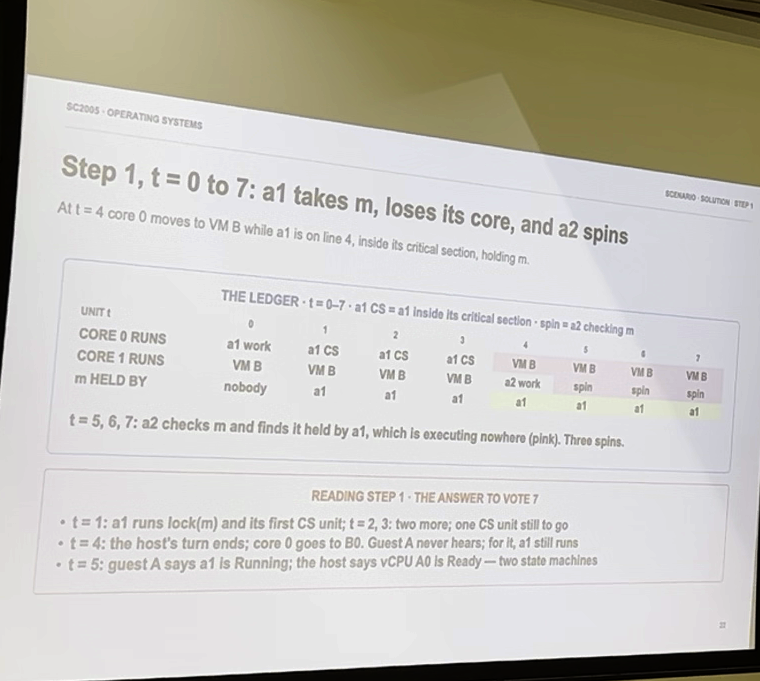

**What was said over this slide** (verbatim auto-transcript)

> So, if you are not engaged, it will just run VMP on both.

### Slide 2 — `00:00:08` → `00:00:12`

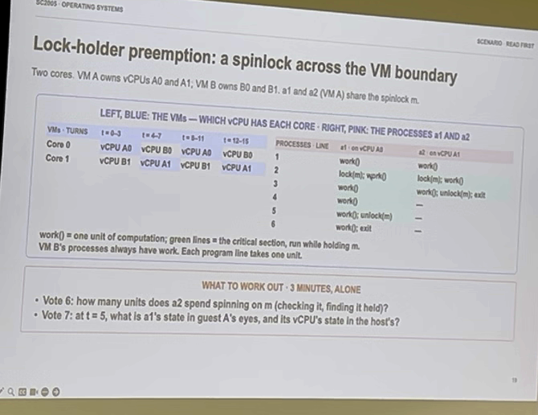

**What was said over this slide** (verbatim auto-transcript)

> So, A1, so here, there's work, lock, work, work, work, unlock, right?

### Slide 3 — `00:00:12` → `00:01:33`

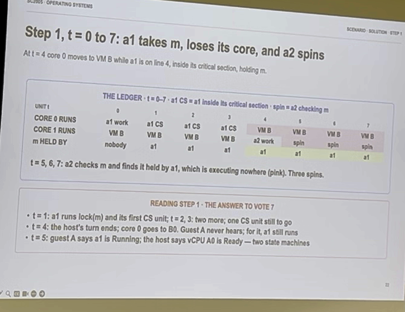

**What was said over this slide** (verbatim auto-transcript)

> So, what happens is this work enters the critical section, inside the critical section, inside, and then here it runs out of round-robin quantum support, right? on 4-1, VMP just does something. So A2 can only start working here and then it just realizes that the spin lock is taken by A1 and all it can do is spin. So it just consumes the CPU and spins. So it's like busy waiting, right? while here in EMD you would just be working. Okay, so then at cycle 8 what happens is that so A1 comes back, it finishes the work and then it releases the spin lock, right? So after this A1 just finished, it's gone. So it will start executing the EME, but first, first, the 4-1 has to finish the full cycle of the quantum, so A2 only comes back here and takes the spin loop and cycles up.

### Slide 4 — `00:01:33` → `00:01:37`

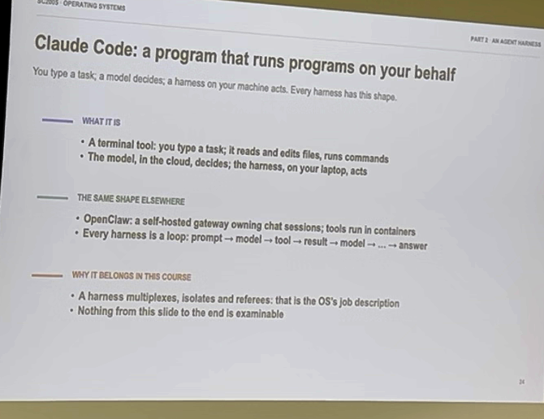

**What was said over this slide** (verbatim auto-transcript)

_No speech detected in this window._

### Slide 5 — `00:01:37` → `00:02:03`

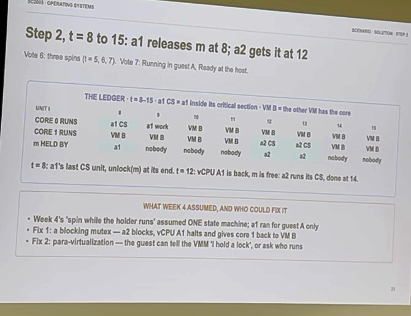

**What was said over this slide** (verbatim auto-transcript)

> Alright, so that's about it for visualization, so pay attention to this multiplexing, integration, emulation, direct execution, virtualization, full virtualization that I wanted to. This is what you need to know. And some algorithm-acquired solutions. This would be a hard task. I understand this is difficult. Some of you can do it, I'm sure.

### Slide 6 — `00:02:03` → `00:02:36`

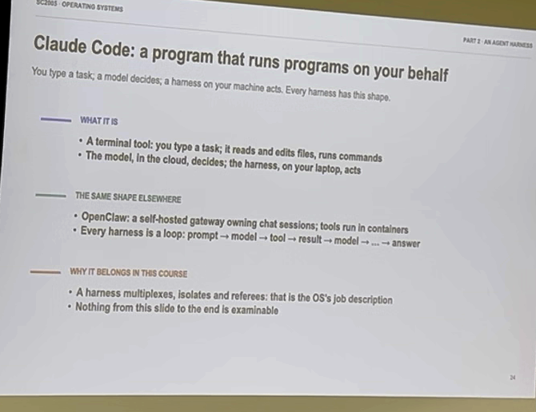

**What was said over this slide** (verbatim auto-transcript)

> with some partners. Okay, so now let's talk about the fun part which is like why harness is a new operating system. It's first harnesses they appeared in the end of last year and went viral I would say in January or February this year, 96. So we've heard of OpenClock, Code, Codex, these are all about this one. So there's a lot of similarities about them and we'll talk about those so the way it works is evolving so in a

### Slide 7 — `00:02:36` → `00:04:17`

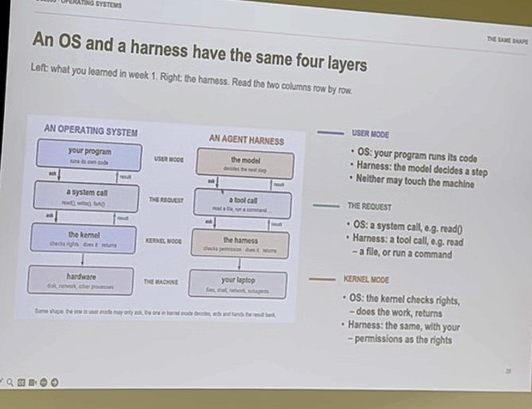

**What was said over this slide** (verbatim auto-transcript)

> very system work in this way we talked about this so this is your program sometimes it calls into the system called so by the way this is not acceptable but from here to the end it's not acceptable this is for fun okay so here in the program falls into system host and this is the post is an entry point for the kernel execution. And the kernel can actually manage the hardware and execute commands on a request of your prop. So the way the agent works is that there is a model which receives your prop and then what it can do is it can issue two calls. For example it can run bash scripts, it can run feather scripts, it can write something, edit something and so on. So these two calls and the one of calls are they have to go to the harness which is X is a kernel so what it will do it with the steer these commands to either CPUs for two calls or to GPUs for a lem request and the harness will run on your laptop and will decide where to execute this so there is a lot of similarities here across step right so basically the harness is the curve in a way and system call is like a tool component okay so then harness also checks like the permissions checks access it also needs to manage the sandboxes secure environment where it execute so that your model doesn't skip and conquer the world.

### Slide 8 — `00:04:17` → `00:05:26`

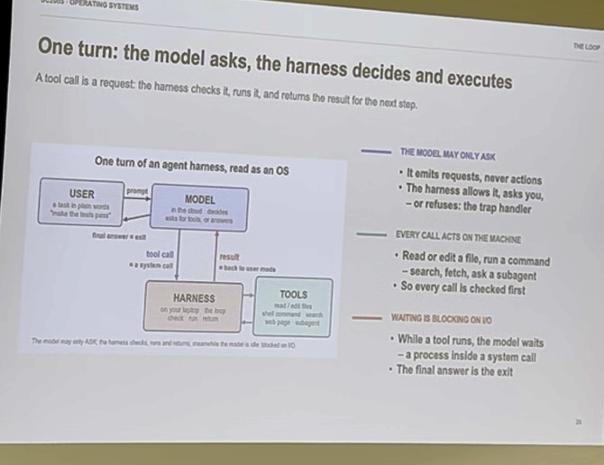

**What was said over this slide** (verbatim auto-transcript)

> Okay, so how it works. It works in a very simple way. So the model, the user prompts the model and the model can run some tool calls. Or for example, it can consume some results from the team calls. It is also available, it also can access the disk, it also can write some programs, deploy them, take the output from these programs and so on. So the harness would orchestrate the model requests, like the LL requests and tool calls, and also can spawn sub-agents for example. So just like you can spawn, given four processes, NIT can spawn sub-agents, for example there is a big agent which architects how to approach the problem. NIT can spawn sub-agents, for example smaller models that would search the internet and find useful information to feed it to the big model.

### Slide 9 — `00:05:26` → `00:09:59`

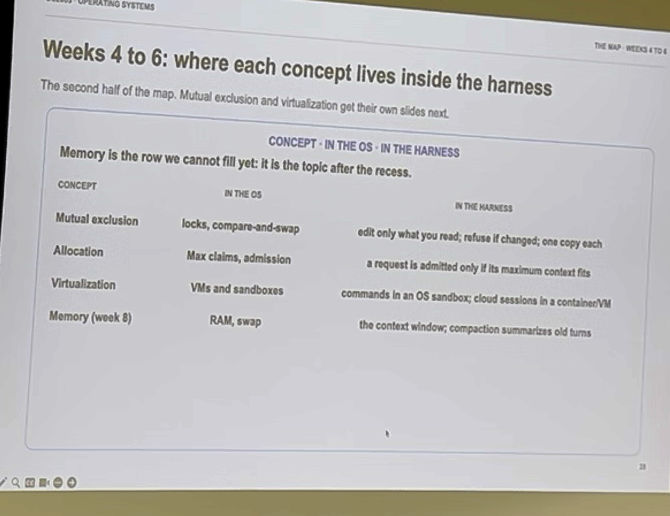

**What was said over this slide** (verbatim auto-transcript)

> Okay, so let's look at the similarities. So processes have every space and the attributes and engines have context. So what is inside the Kibale cache, what is inside the context, which tokens, which words, which paragraphs, which articles, which source files and so on. So they all form the context. Then processes can spawn threads. So here, for example, a harness can spawn several parallel tuples. For example, it can do web search in parallel with hundreds of different requests at the same time. This is similar to threads. They will all have the same context, but they will look, for example, at different websites. And the agents themselves can work. So they can create sub-agents for subtasks which operate on their prepared context, which is different from the agentic context, from the parent-agent context. Then we discuss the system call with its traps into the kernel, while the tool call is the medium for transition into the state from the environment into the model or from the model to the execution environment. Then harness also does the scheduling and decides what to run, which tool call to run, synchronously or asynchronously, blocking or non-blocking, and so on. There are also interrupts if you have asynchronous processing. So for example there is a web search that completes and it needs to be given to the model once it completes it also has the interrupt pass just like we have in the operating system. So the concepts are also similar. For example inside the harness the processors need to understand who is working on which task and how tools go synchronize among each other because they have access to specific files or specific folders or specific information and that has to be managed in the same way as with new synchronization for example mutual exclusion then of course they need to allocate for example if they are to share GPU, how does this agent share the amount of memory inside the GPU so that the host, the whole agentic workflow can make progress. For example, the main agent can take half of the GPU memory and then it can spawn, let's say, two sub-agents that can execute within the second half of the memory. But then if it happens that your agentic workflow keeps spawning agents, they may actually start trashing just like what happens if you run out of memory or run out of disk. So the whole workflow may actually end up stuck due to the lack of resources. Then the execution environment for tools is nothing but virtualization. It's virtual machines or containers. So this is exactly what we discussed today. And for memory or context window is actually super super interesting. We will not talk about it. But this is really where the state of the art right now. Memory systems or long horizon agents. How do the agents share memory? How do they exchange experiences? So you can think of agents sharing parts of their brains, like humans sharing part of their brains or their experiences completely transparently. You may also have heard of news about agent swarms, hacking some, I think the way this news came out yesterday when some agents were hacked Australian, I think Australian health ministry, because somebody asked these agents, I need some information on the funding of health programs or something like this. So the agents were just like, if I need to solve this question, I mean the easiest thing is to just go to healthcare and hack it, so they did it. And, uh, opening I sent an email to healthcare ministry in Australia, and said, like, look, we, we are apologizing, but we hacked you. And then two months after, two months after, Australian government said, like, this is not nice, we just read it. So you can see how behind we are, right? On containing this threat. Well, it's a fun world.

### Slide 10 — `00:09:59` → `00:10:58`

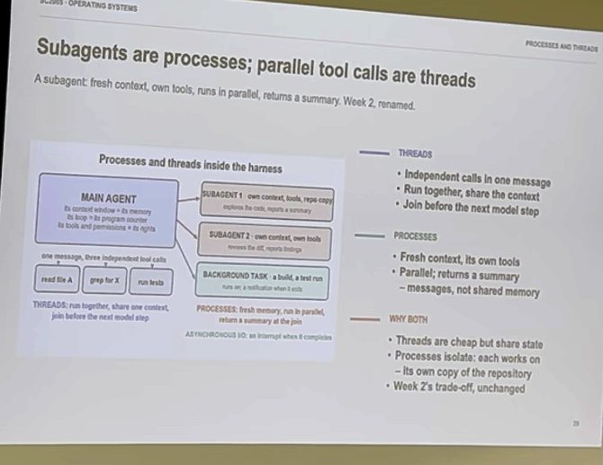

**What was said over this slide** (verbatim auto-transcript)

> Okay. So as we discussed the forks and processes, right? So agents can spawn sub-agents and they can create fresh context and they can also see how these agents share information. So today it's more like message passing. So we talked about message passing in the first lecture, right? But the future is of course shared memory. You want agents to share memories so that we can streamline the communication there. As opposed to transferring everything into tokens, sending the tokens, refilling the tokens. Okay, then another important thing is where does virtualization come from? Well, virtualization comes with GPU aggregation in the GPU cluster where we actually execute the models and the tool execution environment which is containers, virtualization and so on. So this is where tools are run.

### Slide 11 — `00:10:58` → `00:11:12`

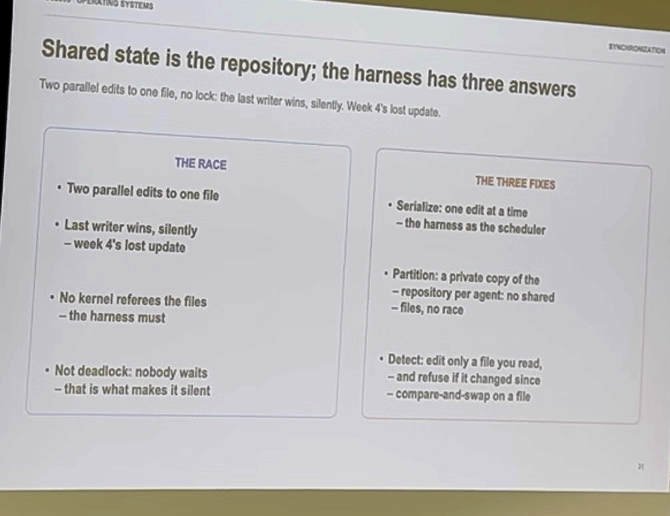

**What was said over this slide** (verbatim auto-transcript)

> Okay, so whenever you have shared state you need security. So this is what happens.

### Slide 12 — `00:11:12` → `00:11:22`

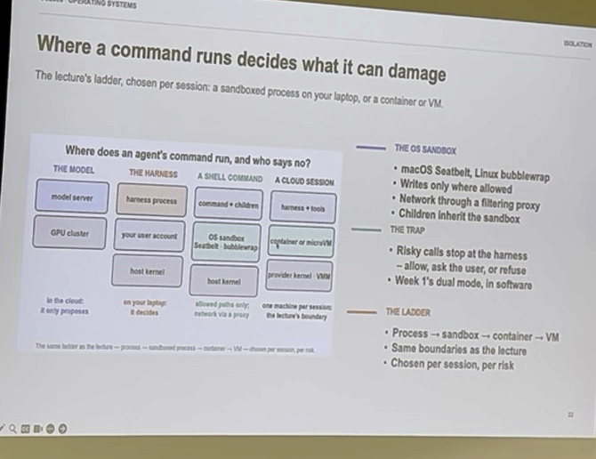

**What was said over this slide** (verbatim auto-transcript)

> So there are different ways of sandboxing the tools. You can go over here, see it here.

### Slide 13 — `00:11:22` → `00:12:23`

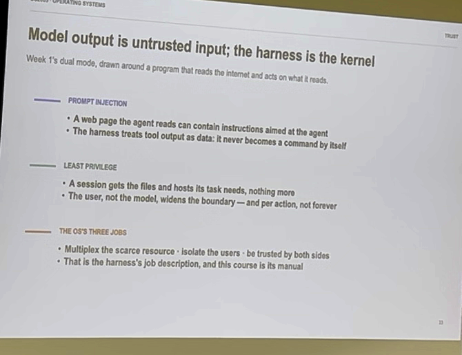

**What was said over this slide** (verbatim auto-transcript)

> And there is a huge problem with protection and security. I encourage you to look at it and see what matters. For example, to subvert an engine you don't need to hack the kernel. You can just poison the prompt. so you poison the skills for example so that the engine behavior changes in your favor this is pretty scary and pretty difficult to detect with scar event viruses yeah and finally the memory memory system is really important so memory system is agentic on its own so you can think of there is an agent that manages the memory experiences where what do we read what do we what do we include into the context of what do we exclude from the context what do we write for

### Slide 14 — `00:12:23` → `00:12:59`

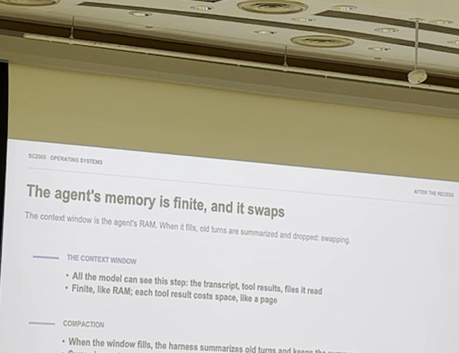

**What was said over this slide** (verbatim auto-transcript)

> future i encourage you to install for example here means or go and see how it develops memories about you and what you ask it's really interesting and sharing these memories is actually an open problem because for example if you develop a super useful skill that works for you how exactly do you share it with your teammates for example this is an unsolved problem okay cool so now what i'm gonna do is i'm gonna show you the next two questions and then if we have time maybe a couple more

### Slide 15 — `00:12:59` → `00:13:05`

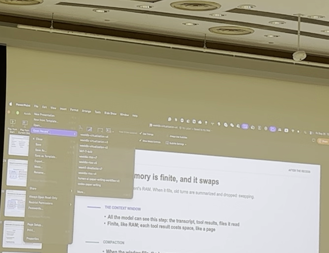

**What was said over this slide** (verbatim auto-transcript)

_No speech detected in this window._

### Slide 16 — `00:13:05` → `00:13:07`

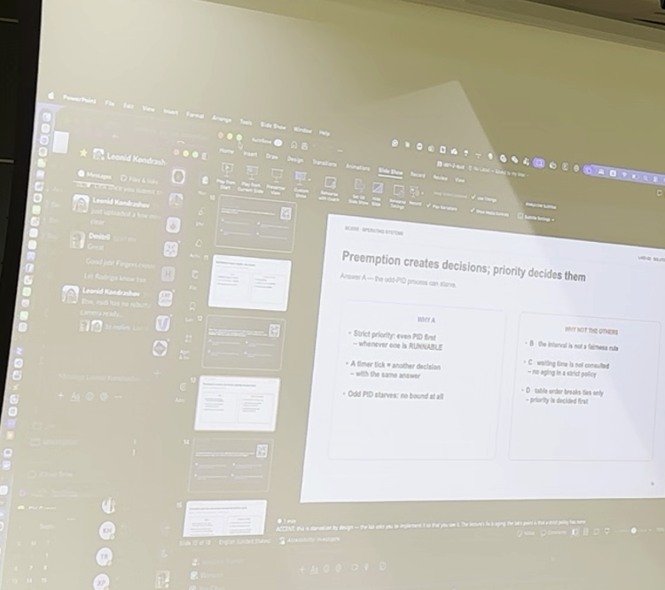

**What was said over this slide** (verbatim auto-transcript)

_No speech detected in this window._

### Slide 17 — `00:13:07` → `00:13:16`

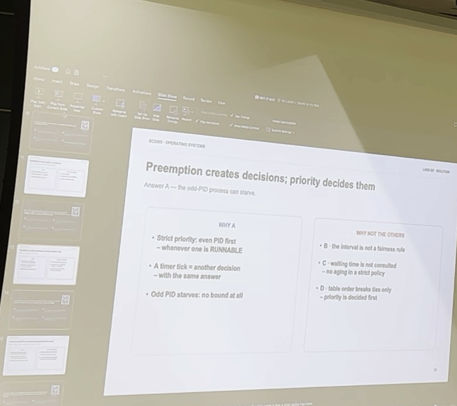

**What was said over this slide** (verbatim auto-transcript)

_No speech detected in this window._

### Slide 18 — `00:13:16` → `00:13:22`

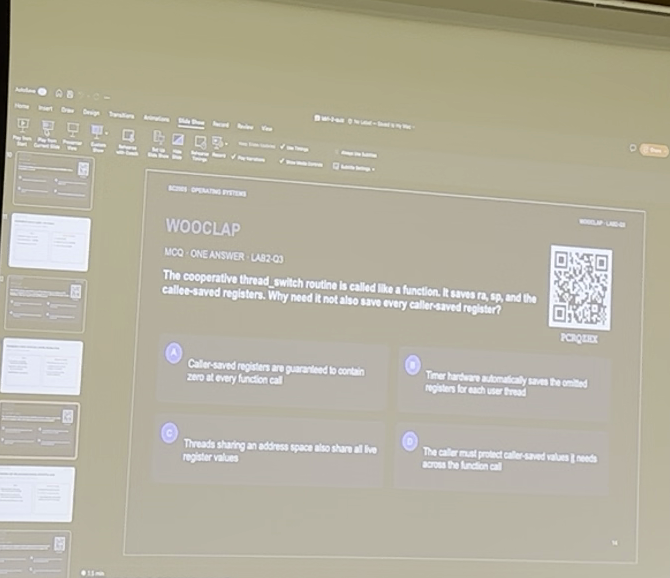

**What was said over this slide** (verbatim auto-transcript)

> Thank you.

### Slide 19 — `00:13:22` → `00:13:26`

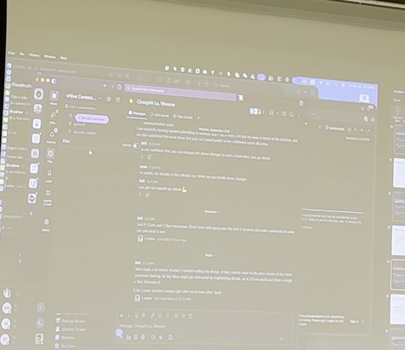

**What was said over this slide** (verbatim auto-transcript)

_No speech detected in this window._

### Slide 20 — `00:13:26` → `00:13:38`

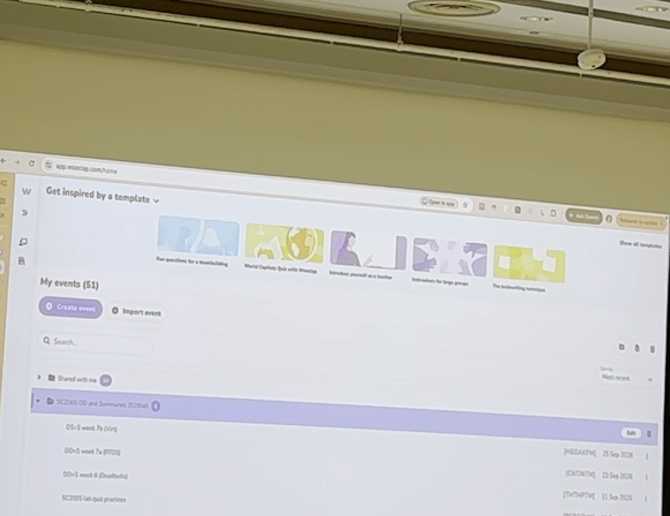

**What was said over this slide** (verbatim auto-transcript)

_No speech detected in this window._

### Slide 21 — `00:13:38` → `00:14:41`

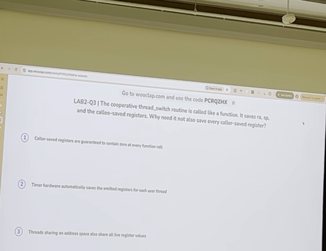

**What was said over this slide** (verbatim auto-transcript)

> This is our priesthood. Thank you. So this is the correct answer.

### Slide 22 — `00:14:41` → `00:14:44`

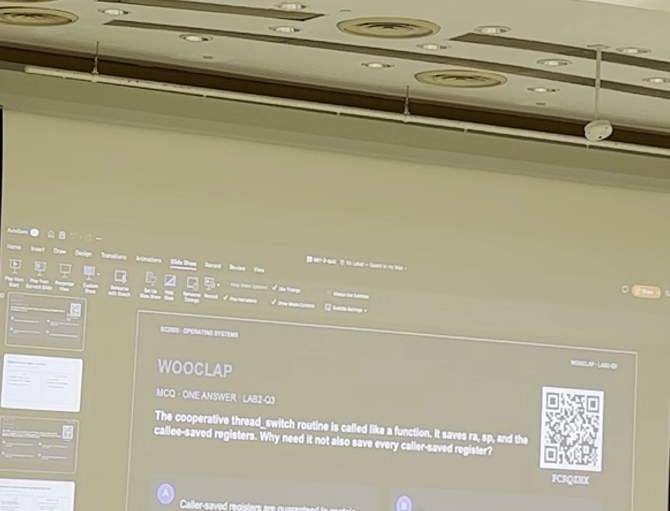

**What was said over this slide** (verbatim auto-transcript)

_No speech detected in this window._

### Slide 23 — `00:14:44` → `00:15:05`

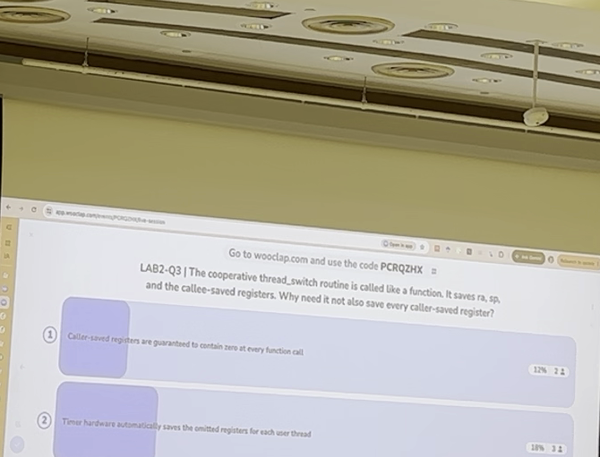

**What was said over this slide** (verbatim auto-transcript)

> So we have to remember the previous questions were a bit easier, right? Progressive is easier. This is what we discussed yesterday. So now we move into more difficult ones.

### Slide 24 — `00:15:05` → `00:15:07`

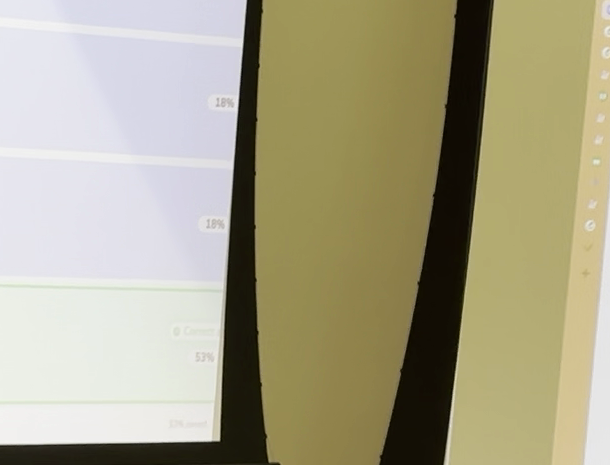

**What was said over this slide** (verbatim auto-transcript)

_No speech detected in this window._

### Slide 25 — `00:15:07` → `00:15:11`

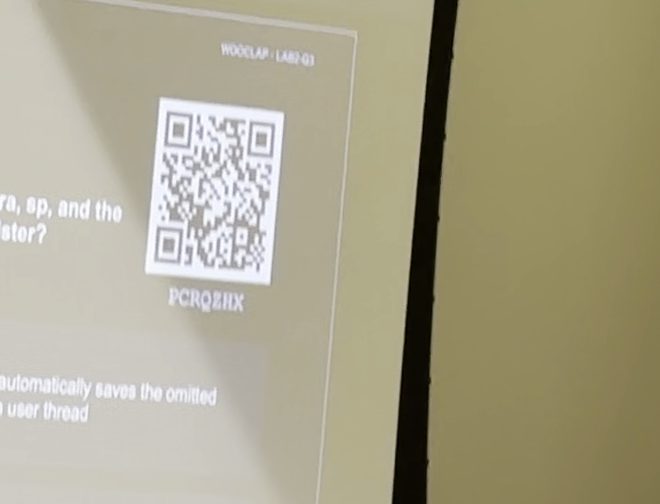

**What was said over this slide** (verbatim auto-transcript)

_No speech detected in this window._

### Slide 26 — `00:15:11` → `00:15:19`

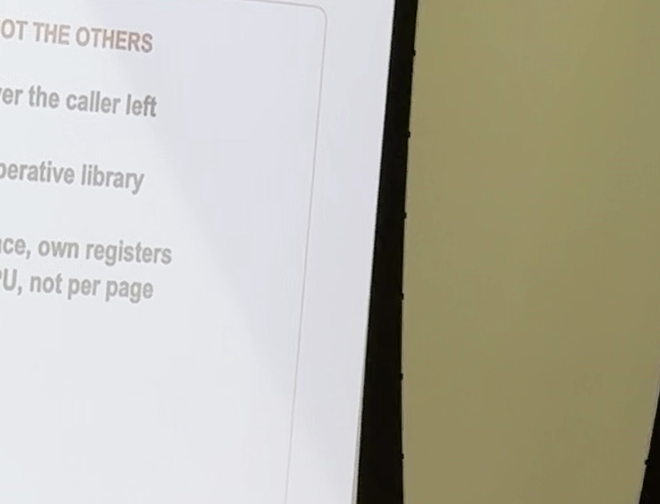

**What was said over this slide** (verbatim auto-transcript)

> This is the explanation.

### Slide 27 — `00:15:19` → `00:15:55`

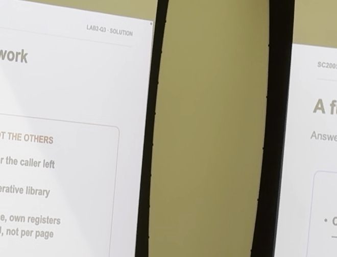

**What was said over this slide** (verbatim auto-transcript)

> You do need to remember about the tolerance convention. And you also need to distinguish thread switches from process switches. So, you need to know the theory, and then you need to know how the maps should practice. And what is available at different level, for example, there is no timer in the Y-Card, the timer is the card for the kernel interaction.

### Slide 28 — `00:15:55` → `00:18:34`

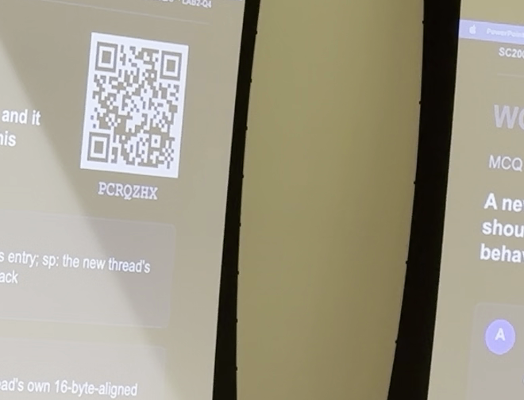

**What was said over this slide** (verbatim auto-transcript)

> Okay, let's do the next one. Can they start a timer? Thank you. Okay, so the right answer is B. I think quite a few people answered it correctly. Okay. This is not too bad. And the explanation... So you can also think about this, the mapping for lab 1, lab 2. like what these questions test. So actually every single question there will be mapped on one of the checkpoints. You remember checkpoints? So this is your... You should go to the checkpoints and see if you understand everything that the checkpoints list. I understand that some of you will have a call-up today, so you can just take it to prepare. Alright, cool. So if you have anything to share to previous people, let me know. I remember there were some questions.

