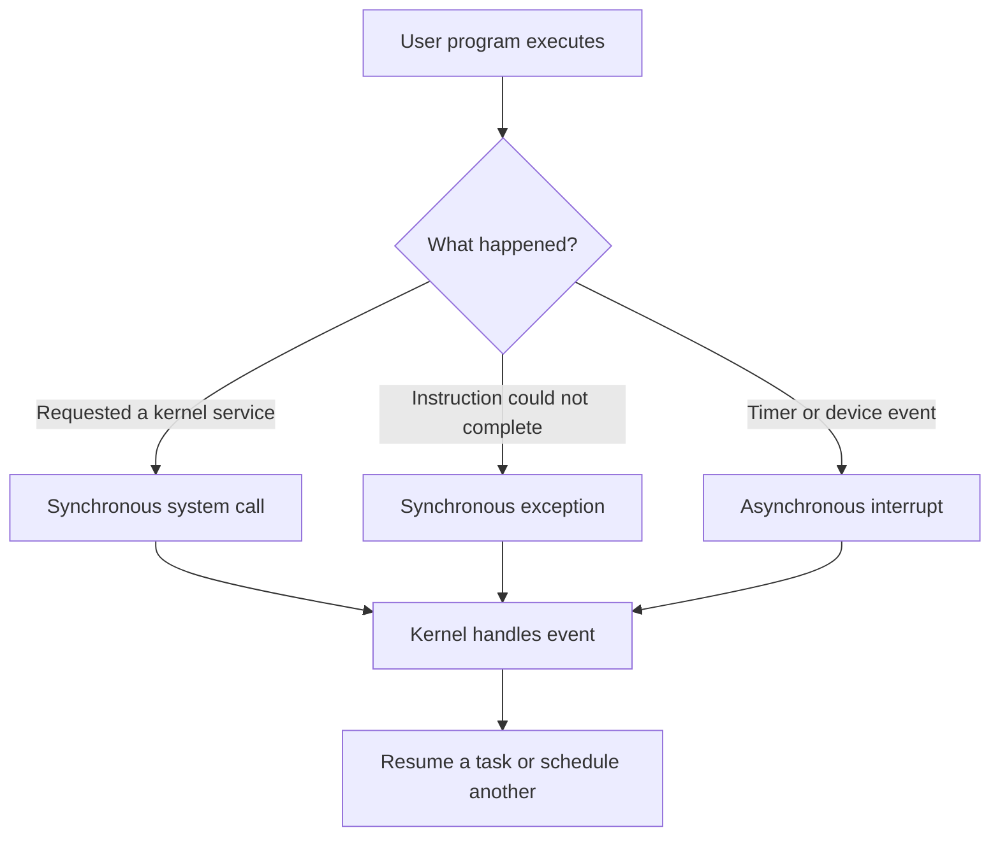
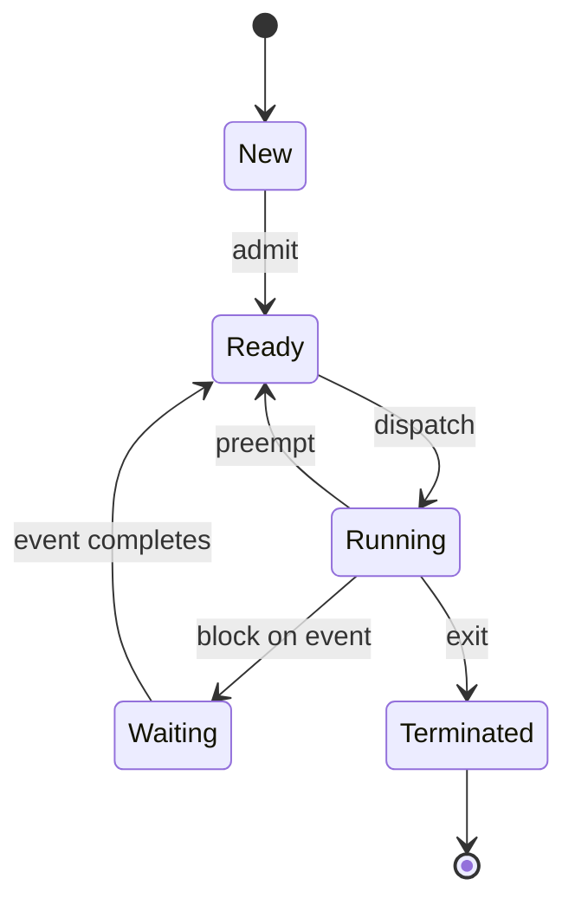
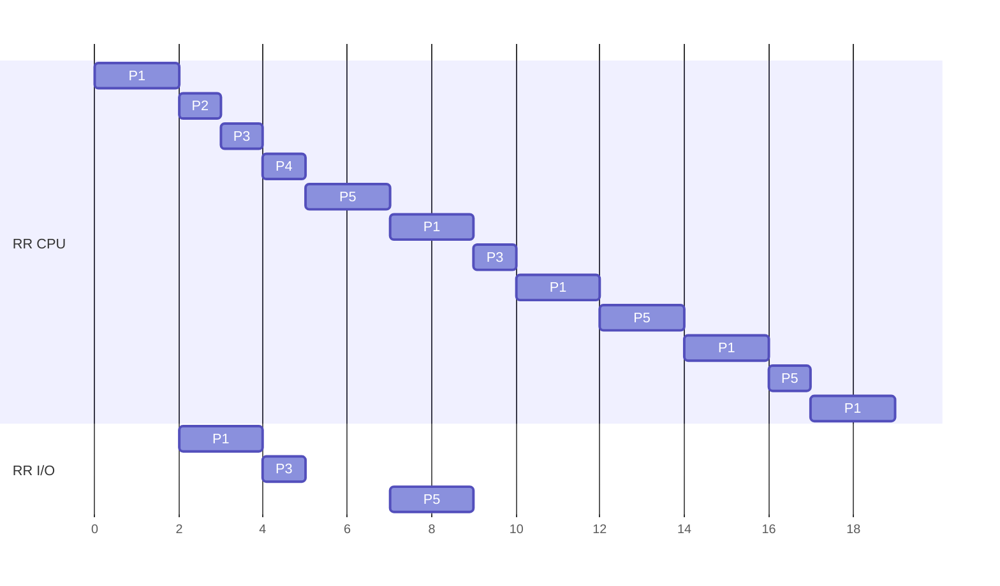
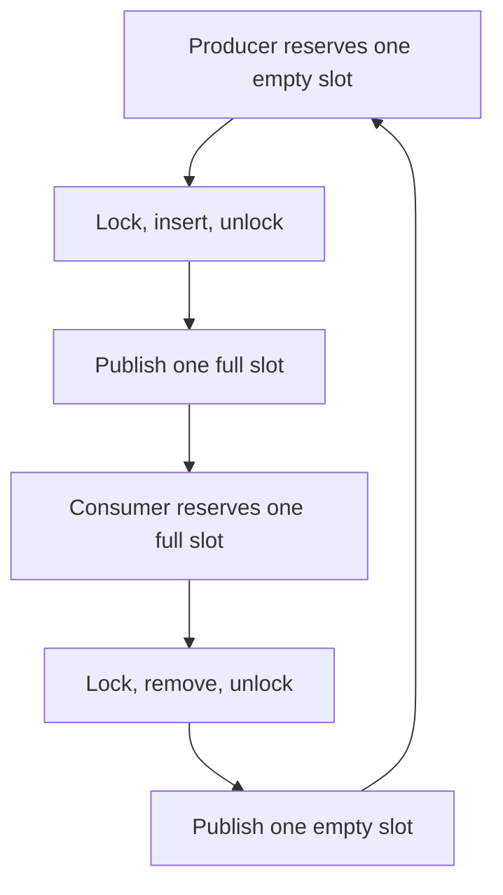
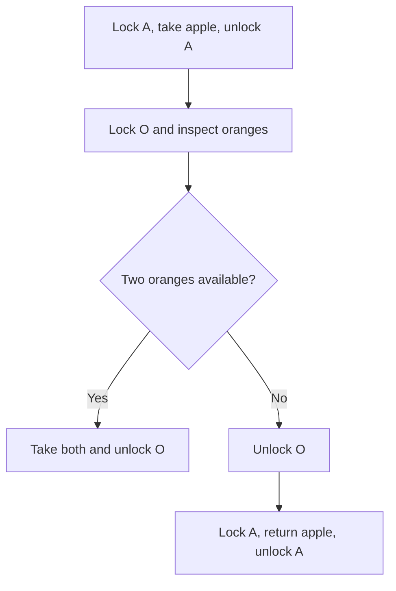
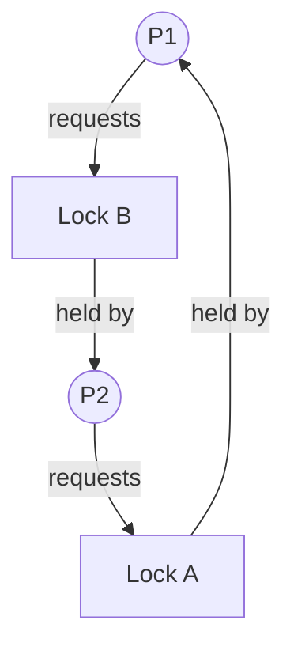
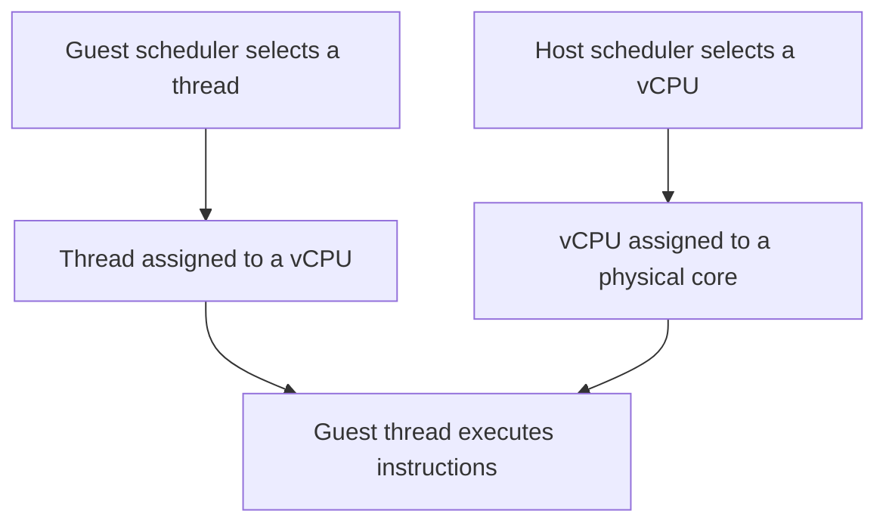
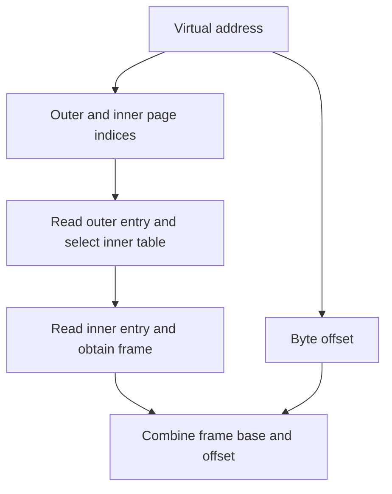
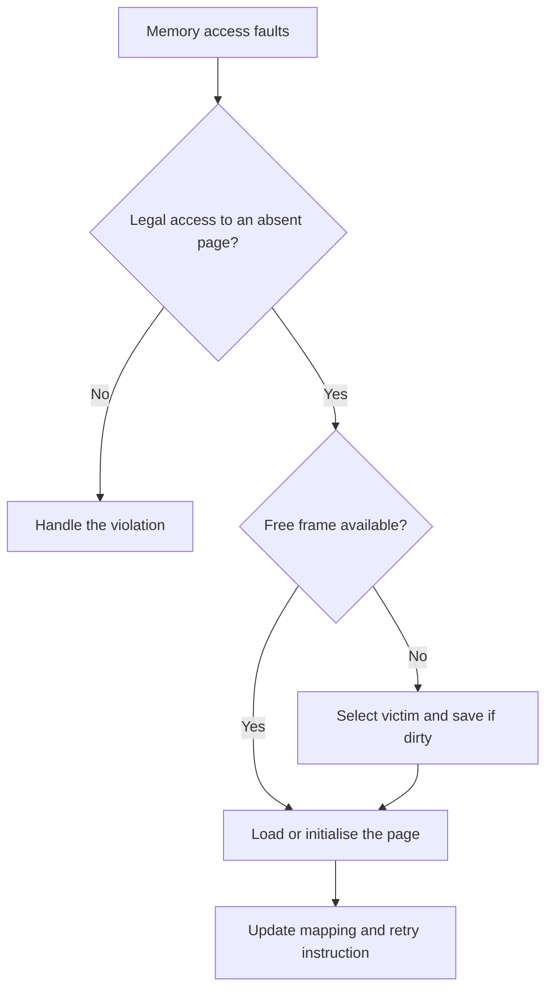
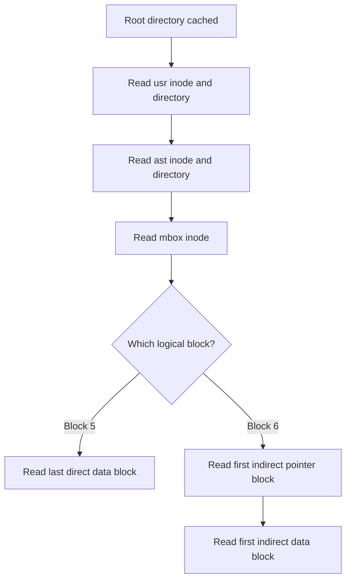

# SC2005 Operating Systems — Visual Study Guide

Study each topic in three steps. Read the **lecture theory** to understand what the OS tracks and why. Use the **official NTULearn tutorial** to practise applying it. Then try the **practical check** before reading the answer. In timelines, `2–4` means execution from time 2 up to time 4.

The lecture explanations draw on the course materials available in the project, including slide transcriptions and recorded-lecture notes. Each tutorial links to the corresponding question sheet in [26S1 SC2005 on NTULearn](https://ntulearn.ntu.edu.sg/ultra/courses/_2712284_1/outline).

| Topic | What you practise |
|---|---|
| [1. OS foundations](#1-os-foundations) | System calls, interrupts, DMA, and memory protection |
| [2. Processes and threads](#2-processes-and-threads) | Process state, context switches, and IPC |
| [3. CPU scheduling](#3-cpu-scheduling) | Queues, scheduling metrics, and multicore traces |
| [4. Critical sections](#4-critical-sections) | Races, Peterson, and atomic operations |
| [5. Semaphores](#5-semaphores) | Blocking, bounded buffers, and lock ordering |
| [6. Deadlocks](#6-deadlocks) | Resource graphs, prevention, and Banker’s algorithm |
| [7. Real-time OS and virtualisation](#7-real-time-os-and-virtualisation) | Deadlines, EDF, and the guest and host schedulers |
| [8. Memory organisation](#8-memory-organisation) | Address binding, allocation, and TLB timing |
| [9. Address translation and replacement](#9-address-translation-and-replacement) | Two-level walks, segmentation, and page replacement |
| [10. Virtual memory](#10-virtual-memory) | Demand paging, frame allocation, and thrashing |
| [11. File systems](#11-file-systems) | Directories, descriptors, allocation, and inodes |
| [12. I/O and disk scheduling](#12-io-and-disk-scheduling) | Buffering, disk timing, scheduling, and RAID |

## 1. OS foundations

### Lecture theory

The OS gives applications abstractions such as processes and files, and shares hardware resources between them. A **mechanism** provides a capability. A **policy** decides when or for whom to use it. A timer interrupt lets the kernel regain control, while a scheduling policy chooses the next task. The kernel manages CPU time, memory, files, devices, and access rights.

| System model | What changes |
|---|---|
| Simple batch | Groups similar jobs to reduce setup work. With one resident job, the CPU can sit idle during I/O. |
| Multiprogramming | Keeps several jobs available so one can use the CPU while another waits. |
| Time-sharing | Rotates the CPU among interactive jobs to keep response times low. |
| Multiprocessing | Uses several cores for simultaneous execution. It can coexist with multiprogramming. |
| Desktop, embedded, and real-time | Desktop systems prioritise responsiveness. Embedded systems may face power and memory limits. Real-time systems must satisfy explicit timing constraints. |

Hardware transfers control to a privileged entry point, and the handler uses the saved state and cause to decide what to do. A library call such as `fopen()` can invoke a system call. Hardware privilege and account permissions are separate. Even a program launched by an administrator normally runs in user mode. In the lecture’s base/limit model, an address is legal when `base ≤ address < base + limit`.

Controllers handle device operations. With **polling**, the CPU repeatedly checks status. An **interrupt** lets the device notify the CPU when work is ready or complete. With **DMA**, the driver sets up the transfer, the controller moves the data between the device and RAM, and a completion interrupt can report a whole block or batch. Faster, smaller storage near the CPU caches data from slower levels. The introductory slides mark their storage-hierarchy review as non-examinable.

*Lecture source: Introduction and background, slides S2–S44.*

### Tutorial 1 walkthrough

[NTULearn Tutorial 1 question sheet](https://ntulearn.ntu.edu.sg/ultra/courses/_2712284_1/document/_5884290_1?view=content&state=view)

| Part | Answer and reasoning |
|---|---|
| Q1. Hardware, interrupts, and DMA | The CPU and controllers share access to memory. An interrupt transfers control to a kernel handler. In interrupt-driven programmed I/O the CPU can still be responsible for moving data. In DMA the driver sets up the transfer and the controller moves a block to or from RAM, then signals completion. |
| Q2(a). Privileged I/O | **True** in the lecture’s protection model for hardware I/O instructions. User programs request device operations through the OS. |
| Q2(b). Base and limit | **False.** `base=0x1000`, `limit=0x1000` gives `[0x1000,0x2000)`. `0x1FFF` is the last legal byte. |
| Q2(c). Desktop OS deadlines | **False** for ordinary desktop configurations. A real-time guarantee concerns a stated deadline and worst-case behaviour. |
| Q2(d). System calls | **True** in the lecture’s trap-entry model. An actual system call enters the kernel synchronously. A library function can sometimes finish entirely in user space. |
| Q3. Multiprogramming vs multiprocessing | Multiprogramming keeps jobs available so a CPU has useful work during an I/O wait. Multiprocessing adds cores that can execute simultaneously, increasing throughput and enabling resource sharing. |

### Application and practical check

**Application.** A file read can enter the kernel synchronously, block the caller, and complete later via a device interrupt. On a cache hit, the read may finish with no device request at all. CPU use during the wait depends on whether another task is ready.

**Practical check.** With `base=0x4000` and `limit=0x200`, identify the last legal address and what happens on a load from `0x4200`. **Answer:** `0x41FF` is legal. `0x4200` reaches the exclusive upper bound and traps. The CPU enters the kernel to handle the fault.

## 2. Processes and threads

### Lecture theory

A **process** is a running instance of a program. Its address space normally contains executable text, global/static data, heap, and stack. The kernel tracks each process in a **PCB**, which holds or references its ID, state, saved registers and program counter, memory mappings, scheduling information, and open files.

A mode switch enters or leaves the kernel. A context switch changes the executing context, saving the outgoing state and restoring the incoming one. The **long-term** scheduler admits jobs, the **short-term** scheduler dispatches ready work, and the **medium-term** scheduler can suspend or swap out processes to manage load. A child created with `fork()` can run concurrently with its parent. `exec()` replaces the caller’s program image. `wait()` lets a parent collect a child’s exit status.

| Model | What is shared or how it runs |
|---|---|
| Shared-memory IPC | Processes map the same physical storage and coordinate conflicting access. |
| Message-passing IPC | Processes send/receive directly or through a mailbox. Queue capacity and blocking rules affect the flow. |
| Threads in one process | Share the address space and open-file resources. Each has its own registers, PC, stack, and scheduling state. |
| Many-to-one | Many user threads share one kernel thread. A blocking kernel call can stall the group. |
| One-to-one or many-to-many | Multiple kernel threads can run on separate cores. One-to-one incurs a kernel thread per user thread. Many-to-many needs a user-level scheduler. |

*Lecture source: Processes and Threads, slides S3–S40.*

### Tutorial 2 walkthrough

[NTULearn Tutorial 2 question sheet](https://ntulearn.ntu.edu.sg/ultra/courses/_2712284_1/document/_5884300_1?view=content&state=view)

| Part | Answer and reasoning |
|---|---|
| Q1(a). Waiting for CPU | **False.** The process is **Ready**. **Waiting** means it needs an event before it can run. |
| Q1(b). Hardware interrupt | **False as a universal claim.** An interrupt can enter the kernel and return to the same task. In the Q4 figure, the interrupt is followed by a switch, so the old task does move to Ready there. |
| Q1(c). `wait()` | **False.** A parent typically waits for a child’s termination and collects its status. |
| Q1(d). IPC memory | **False** as a general claim. In the lecture’s copied-message model, sender, kernel, and receiver can hold copies. Shared memory maps common physical pages. Actual overhead depends on implementation. |
| Q2. Data vs stack | Data holds globals and statics whose storage is set by the process image. A stack holds call frames and typically grows and shrinks with calls and returns. |
| Q3. Threads | One thread has one execution context. Multiple threads share code, globals, and heap, while each has its own registers, program counter, and stack. A runnable peer can continue if the thread mapping allows it. |

**Q4. Annotate the P1 → P0 → P1 switches.** A/B saves P1 to PCB1 and restores P0 from PCB0. P1 goes **Running → Ready**, then P0 goes **Ready → Running**. If the interrupt wakes P0, its **Waiting → Ready** transition comes first. C/D saves P0 to PCB0 when it blocks and restores P1 from PCB1. P0 goes **Running → Waiting** and becomes Ready at its completion interrupt. P1 goes **Ready → Running** when dispatched. The figure ends before P0’s I/O completion.

### Application and practical check

**Application.** A server can keep accepting connections while one worker waits for storage, provided another runnable thread can be scheduled. Threads can share an in-memory cache, so cache updates need synchronisation. Separate processes give stronger isolation and need IPC for shared work.

**Practical check.** A worker starts a blocking read. While it waits, another worker runs. Draw the states of the first worker up to its next CPU instruction. **Answer:** `Running → Waiting → Ready → Running`. Device completion creates the Ready transition. Dispatch creates the final Running transition.

## 3. CPU scheduling

### Lecture theory

A process alternates CPU bursts with blocked intervals such as I/O. When a task blocks or exits, the scheduler can dispatch another ready task. Preemption lets it replace a task that could still run. An arrival, a timer tick, and an I/O completion are separate events. In a multicore trace, check both whether a core is free and whether the policy can preempt an occupied core.

| Policy | Selection rule and trade-off |
|---|---|
| FCFS | Oldest ready task runs until the burst ends. A long first job can delay many short ones. |
| SJF | Choose the shortest available next burst and run it to completion. For jobs already available, swapping adjacent bursts of lengths `a>b` saves `a−b` units of total waiting. |
| SRTF | Reconsider at relevant events using remaining burst time. With two cores, keep the two shortest runnable bursts under global scheduling. |
| Priority | Choose the highest priority ready task. Aging raises a long-waiting task’s priority to counter starvation. |
| Round Robin | Run the ready-queue head for at most quantum `q`, then requeue unfinished work. Smaller `q` increases switching overhead. With `q` at least as long as all bursts, RR behaves like FCFS for the same queue. |
| Multilevel queue | Give different classes their own queues and policies. Strict priority can starve a lower queue. Time shares can reserve service for it. |
| Partitioned or global multicore | Partitioning gives each core a queue and preserves affinity. A global scheduler can better use spare cores, but migration can cost cache locality. |

**Metrics.** Turnaround is `finish − arrival`. Response is `first dispatch − arrival`. Waiting is total time in the **CPU ready queue**, so subtract CPU execution and all blocked time from turnaround. Blocked time can include waiting in a device queue. Utilisation measures busy CPU time as a fraction of available core time. Throughput is completions per unit time.

The lecture’s two-core SRTF example has P1 `(arrival=0, burst=7)`, P2 `(2,4)`, P3 `(4,1)`, and P4 `(5,4)`. P2 takes the idle second core at time 2. At time 4, P1 has 3 units left and P2 has 2. P3 needs 1, so P3 replaces P1. P1 resumes at 5, and P4 waits until P2 finishes at 6. The ready-queue waits are `1, 0, 0, 1`, averaging **0.5**.

*Lecture source: CPU Scheduling, slides S3–S30.*

### Tutorial 3 walkthrough

[NTULearn Tutorial 3 question sheet](https://ntulearn.ntu.edu.sg/ultra/courses/_2712284_1/document/_5884307_1?view=content&state=view)

**Q1.** Both statements are false as blanket claims. An admission need not displace a running task on a busy CPU. In a strictly partitioned schedule, a task stays on its assigned core, so ordinary dispatch does not incur cross-core migration. A separate rebalancing policy can introduce migration.

**Q2. Use one timeline per core and one for the shared I/O device.** P1 arrives at 0 with CPU bursts 2 and 8 around an I/O burst of 2. P2 arrives at 0 with one CPU unit. P3 arrives at 2 with CPU bursts 1 and 1 around I/O of 1. P4 arrives at 2 with one CPU unit. P5 arrives at 4 with CPU bursts 2 and 3 around I/O of 2. P1 precedes P2 and P3 precedes P4 on the initial arrival ties. At `t=4` in RR, enqueue the new P5 arrival before the returning P1, as the tie-break for this trace. Use FCFS for the shared I/O device.

| Lane | Timeline |
|---|---|
| RR CPU, `q=2` | `0–2 P1 · 2–3 P2 · 3–4 P3 · 4–5 P4 · 5–7 P5 · 7–9 P1 · 9–10 P3 · 10–12 P1 · 12–14 P5 · 14–16 P1 · 16–17 P5 · 17–19 P1` |
| RR I/O | `2–4 P1 · 4–5 P3 · 7–9 P5` |
| Global SRTF core 1 | `0–2 P1 · 2–3 P4 · 3–4 idle · 4–5 P1 · 5–6 P3 · 6–13 P1` |
| Global SRTF core 2 | `0–1 P2 · 1–2 idle · 2–3 P3 · 3–4 idle · 4–6 P5 · 6–8 idle · 8–11 P5` |
| Global SRTF I/O | `2–4 P1 · 4–5 P3 · 6–8 P5` |

The important SRTF events are `t=3` and `t=5`. At 3, P3 requests I/O but must wait for the device until 4. At 5, its I/O completes and its one-unit CPU burst preempts P1. It finishes at 6. Use `turnaround = finish − arrival` and `CPU-ready waiting = turnaround − CPU execution − all blocked time`. For P3 under SRTF, blocked time is **two** units, including the time in the device queue.

| Process | RR turnaround | RR CPU-ready waiting | SRTF turnaround | SRTF CPU-ready waiting |
|---|---:|---:|---:|---:|
| P1 | 19 | 7 | 13 | 1 |
| P2 | 3 | 2 | 1 | 0 |
| P3 | 8 | 5 | 4 | 0 |
| P4 | 3 | 2 | 1 | 0 |
| P5 | 13 | 6 | 7 | 0 |

**Q3. Identify a scheduler from the supplied figure.** Read the CPU lanes and the I/O lane separately.

| Lane | Timeline from the worksheet |
|---|---|
| Core 1 | `0–1 P0 · 1–4 P4 · 4–5 P2 · 5–7 P0 · 7–9 P4 · 9–10 P2 · 10–12 P3` |
| Core 2 | `0–2 P5 · 2–6 P6 · 6–12 P1` |
| I/O device | `1–3 P0 · 4–7 P4 · 7–9 P2` |

The burst tuples `(CPU, I/O, CPU)` are P0 `(1,2,2)`, P2 `(1,2,1)`, and P4 `(3,3,2)`. P1, P3, P5, and P6 have single CPU bursts of 6, 2, 2, and 4 respectively. P2 is blocked from time 5 to 9, but its I/O burst is **two** units. The first two units are spent waiting for the device.

Partitioned SJF or SRTF can produce the trace with the pictured assignment to cores. Global non-preemptive SJF can also produce it. At `t=0` it picks P0 and P5, and at `t=1` it picks P4’s three-unit burst. Under global SRTF, P2’s arrival at `t=3` would preempt P6. P4 and P2 each need one unit, while P6 has three remaining. FCFS and RR would also produce a different order under the given initial queue order.

**Q4. Round Robin efficiency.** For a representative CPU burst `T`, switching cost `S`, and quantum `Q>0`, count one switch per slice, including the initial dispatch. Efficiency is `T / (T + S × ceil(T/Q))`. For `Q=∞` or `Q>T`, it is `T/(T+S)`. For `S<Q<T` use the full expression. With `Q=S` it is at most one-half, exactly one-half when `T` is a multiple of `S`. As `Q` tends to zero from above, efficiency tends to zero for `S>0`.

### Application and practical check

**Application.** A responsive service can use a policy that quickly gives new requests their first CPU slice, even if another policy would give better average turnaround. Core affinity can help a worker keep warm caches, but pinning too many busy workers to one core can leave another idle.

**Practical check.** On one core, A arrives at 0 and needs 6 CPU units. B arrives at 2 and needs 1. Under SRTF, write the execution order and A’s waiting time. **Answer:** `0–2 A · 2–3 B · 3–7 A`. A responds at 0 and waits one unit after preemption. B responds immediately at time 2.

## 4. Critical sections

### Lecture theory

A race condition arises when the outcome depends on the ordering of concurrent actions. An expression such as `count++` can read, compute, then write. If two workers each read `5` and both write `6`, the final count is `6` even though two increments should produce `7`.

| Requirement | What to demonstrate |
|---|---|
| Mutual exclusion | Two participants cannot occupy the same protected section simultaneously. |
| Progress | If the section is empty and somebody wants in, the protocol eventually selects an entrant. |
| Bounded waiting | Once a request is pending, there is a bound on how many entries others can make ahead of it. |

| Entry protocol | Where it succeeds or fails |
|---|---|
| Strict alternation | A process can be held outside by a peer that never asks to enter. |
| Intent flags only | Both peers can declare intent and then wait indefinitely. Checking before declaring intent can instead let both enter. |
| Peterson | For two participants, declare intent and give the peer priority with `turn`. Under the lecture’s atomic, sequentially consistent model, a simultaneous attempt has a winner and each requester can be overtaken at most once. |
| Test-and-Set | Atomic read-and-set can acquire a lock in one indivisible step. A simple spinlock can repeatedly favour the same contender. |

In **Peterson’s algorithm**, process `i` sets `flag[i]=true`, sets `turn=j`, and waits while `flag[j] && turn==j`. On exit it clears `flag[i]`. If both processes want in, the shared `turn` can favour only one. With an ordinary **Test-and-Set** lock, a holder can release and reacquire before a spinner gets another CPU slice. The spinner can lose indefinitely even though the system continues admitting a process.

Disabling interrupts can prevent local interrupt-driven preemption on one core. Other cores can still execute. Spinning can make sense for short waits when the lock holder can run concurrently. A long wait benefits from blocking, which gives the CPU to other tasks.

*Lecture source: Process Synchronisation, slides S3–S27.*

### Tutorial 4 walkthrough

[NTULearn Tutorial 4 question sheet](https://ntulearn.ntu.edu.sg/ultra/courses/_2712284_1/document/_5884329_1?view=content&state=view)

**Q1. Show a specific failing execution.** In the sheet’s protocol, P0 sets the shared flag and waits if `turn=1`. P1 sets `turn=0` and waits if the flag is true and `turn=0`.

| Property | Trace or argument |
|---|---|
| Mutual exclusion fails | P1 finds the flag clear and enters. While P1 is inside, P0 sets the flag, observes `turn=0`, and also enters. |
| Progress fails | P0 completes once, sets `turn=1`, then requests entry again. If P1 stays in its remainder section, the critical section is empty while P0 spins. |
| Bounded overtaking holds under the worksheet’s counting convention | Once P0 is spinning, P1’s entry code resets `turn` and enables P0. Once P1 is spinning, P0 can finish its current entry and set `turn=1`, enabling P1 before P0 can enter again. This checks the already-spinning cases used in the worked sheet. For a stronger bound from the first intent write, P1 can clear the flag on exit and repeatedly re-enter while P0 is delayed. State which convention you use. |

**Q2.** Disabling interrupts can enforce exclusion on a single core for a kernel section that does not voluntarily block. On a multicore machine, other cores can still enter. Progress does not imply bounded waiting. An unfair atomic spinlock can always let somebody enter while the same contender keeps losing.

**Q3. Read the lock’s actual values.** This variant atomically returns the old Boolean and writes `false`. The first caller consumes the only `true`, so mutual exclusion holds. The exit also writes `false`, leaving the section permanently unavailable. Progress fails. With this polarity the release would have to restore `true`.

### Application and practical check

**Application.** If an application checks whether a connection limit has been reached and then increments its count, protecting only the increment leaves the check-and-admit decision exposed. Both operations belong in the same critical section.

**Practical check.** Build an interleaving for two workers admitting requests when `count=9` and `limit=10`. **Answer:** A reads 9 and passes the check. B reads 9 and passes too. Both admit. If both write the same computed value, the count can still say 10 even though 11 requests were admitted. Protect the test and state change together.

## 5. Semaphores

### Lecture theory

A semaphore represents available permits and can also enforce ordering. In the lecture’s blocking implementation, `wait` atomically decrements the value and blocks if the result is `< 0`. `signal` atomically increments and wakes one waiter if the result is `≤ 0`. A negative value represents queued waiters under this convention. A semaphore initialised to `0` can make B wait for an event signalled by A.

The decrement must be visible before the waiter sleeps. If a waiter sees `S=0` and sleeps without updating it, a signal sees `0→1` and can skip the wakeup because the count showed no waiter. The wakeup test also needs equality: `−1→0` means the last queued waiter should be released.

For a buffer of size `N`, initialise `empty=N`, `full=0`, and `mutex=1`. The producer waits on `empty`, acquires `mutex`, inserts, then releases `mutex` and signals `full`. The consumer waits on `full`, acquires `mutex`, removes, then releases `mutex` and signals `empty`. A consumer that holds the mutex while waiting on an empty buffer can prevent the producer from inserting anything.

**Readers–writers.** Concurrent readers can share access. Writers need exclusive access. In the reader-preference pattern, a mutex protects `readcount`, the first reader acquires the writer-exclusion semaphore, and the last reader releases it. A continuing flow of readers can starve a writer. **Dining philosophers.** If everyone picks up one chopstick and waits for the next, a cycle forms. A consistent acquisition order or a four-philosopher admission limit in the five-person setup can break it. The lecture also introduces monitors as a higher-level way to combine exclusion and condition waiting.

*Lecture source: Process Synchronisation, slides S28–S54.*

### Tutorial 5 walkthrough

[NTULearn Tutorial 5 question sheet](https://ntulearn.ntu.edu.sg/ultra/courses/_2712284_1/document/_5884330_1?view=content&state=view)

**Q1. Protect the operation that touches each basket.** Take the apple with `A` held, release `A`, then acquire `O`. Check and remove the oranges while holding `O`. On failure, release `O` before acquiring `A` again to return the apple. The apple already picked is private until it is put back. Alice never holds a basket lock while waiting for the other, so her code cannot create a circular lock dependency with another player.

**Q2. Shift the semaphore count.** The variant starts at `S=0`, blocks after decrement when `S < −1`, and wakes after increment when `S ≤ 0`. Let `V=S+1`. Then `V` starts at 1 and the wait condition becomes `V<0`. The correct signal condition in terms of `V` would be `V≤0`. The variant also calls wakeup at `V=1`, when nobody is queued. If wakeup on an empty queue does nothing, **mutual exclusion and progress hold**. For a hand trace, the first waiter moves `S: 0→−1` and enters. The second moves `−1→−2` and sleeps. The first signals `−2→−1`, waking the second. In the uncontended case `−1→0` causes the extra empty-queue wakeup.

**Q3. Build a blocking semaphore using Test-and-Set.** Add an internal spinlock `guard` to the semaphore, initially unlocked. Use atomic Test-and-Set to acquire it. The guard protects both `value` and the waiter queue `L`. Keep the guard held only while changing semaphore state.

| Operation | While holding `guard` | How it ends |
|---|---|---|
| `wait(S)` | Decrement `S.value`. If it is negative, enqueue the current process in `L`. | If it got a permit, release `guard` and continue. Otherwise use a scheduler operation that makes the sleep visible and releases `guard` as part of the same coordinated transition. |
| `signal(S)` | Increment `S.value`. If the result is `≤ 0`, remove one queued waiter and make it Ready. | Release `guard`. The selected waiter resumes with its permit already assigned. |

The race to prevent is `enqueue → unlock → signal and wake → sleep`. A wakeup can be lost if the process sleeps after its wakeup has already happened. Use an atomic sleep-and-unlock operation or an equivalent scheduler lock handoff. A waiter must release the spinlock when it sleeps so `signal` can acquire it. Use acquire/release memory ordering around the protected updates.

### Application and practical check

**Application.** In a worker pool, a queue mutex guards the queue itself. A separate count of ready jobs lets workers sleep while the queue is empty. The wakeup must be coordinated with enqueueing and sleeping so a worker cannot miss a notification.

**Practical check.** A blocking semaphore starts at 1. A waits, B waits, C waits, then A signals. **Answer:** `1 → 0 → −1 → −2 → −1`. A enters, B and C queue, and the signal releases one waiter. Which waiter wakes depends on the queue policy.

## 6. Deadlocks

### Lecture theory

A resource-allocation graph distinguishes **request edges** (`process → resource`) and **assignment edges** (`resource instance → process`). With one instance per resource type, a cycle establishes deadlock. With multiple instances, another holder may finish and release a usable instance. A deadlock can exist even with one process, for example if it waits on its own non-reentrant lock.

All four conditions are necessary: **mutual exclusion**, **hold and wait**, **no preemption**, and **circular wait**. Prevention breaks one of them. Ordering resources globally breaks circular wait because a cycle would require acquisition order to increase back to its starting point. Avoidance tests whether granting a request would leave a **safe sequence**. An unsafe state can still have runnable processes. It lacks a guarantee that all can complete under their maximum claims.

**Banker’s algorithm.** Calculate `Need = Max − Allocation`. Before granting a request, check it against both `Need` and `Available`, then update the three quantities tentatively. Set `Work = Available` after the tentative grant. Find an unfinished process with `Need ≤ Work` componentwise, mark it finished, and add its `Allocation` to `Work`. Its outstanding `Need` was only borrowed in the simulation and is returned, so the net gain is its previous allocation. If the loop cannot finish everyone, restore the original allocation and defer the request. Detection checks current outstanding requests, while Banker’s uses maximum future claims.

*Lecture source: Deadlocks and Starvation, slides S4–S44.*

### Tutorial 6 walkthrough

[NTULearn Tutorial 6 question sheet](https://ntulearn.ntu.edu.sg/ultra/courses/_2712284_1/document/_5884351_1?view=content&state=view)

**Q1.** Under the standard five-philosopher model, admitting at most four to compete for chopsticks breaks the complete circular chain. A single process can deadlock on a non-reentrant lock it already holds. A resource-allocation cycle proves deadlock when each resource type has one instance. With multiple instances, a process outside the cycle can sometimes finish and release another instance.

**Q2.** Before either request, `Available=2`, allocations are `(1,1,2,4)` and needs are `(5,4,2,3)`. Test each request independently from that state.

| Tentative request | After grant | Safety result |
|---|---|---|
| P4 takes one | `Work=1`, needs `(5,4,2,2)` | **Unsafe.** No remaining claim fits 1. |
| P3 takes one | `Work=1`, P3 now needs 1 and holds 3 | **Safe.** P3 → P2 → P4 → P1 gives `Work: 1→4→5→9→10`. |

**Q3. Find the minimum `(x,y)` for `Available=(0,x,y,1)`.** P3 requests one D. After the tentative grant, `Work=(0,x,y,0)`. Only P1 can start the A/B group, so `x≥1`. P3 can start the C/D group when `y≥1`, but returns only one C. P4 needs three C, so `y+1≥3` and `y≥2`. The groups cannot release resources for each other. **`x=1, y=2`** is sufficient, as this trace shows.

| Process finished | Work after returning its allocation |
|---|---|
| Start | `(0,1,2,0)` |
| P1 | `(3,2,2,0)` |
| P2 | `(4,3,2,0)` |
| P0 | `(6,5,2,0)` |
| P3 | `(6,5,3,2)` |
| P4 | `(6,5,4,3)` |

### Application and practical check

**Application.** Two transactions that lock records in opposite orders can block one another. Acquiring records in the same order prevents that cycle. A system that detects the deadlock instead can abort and retry one transaction to free its locks.

**Practical check.** There is one free unit. A holds one and needs two more. B holds two and needs one more. **Answer:** B can finish first and return its two units, giving `Work=3`. A can then finish. A request from B for the free unit is safe in this state.

## 7. Real-time OS and virtualisation

### Lecture theory

A real-time job needs a correct result by a deadline. Average response time alone cannot establish that guarantee. A job released at `r` with relative deadline `D` must finish by `r+D`. A periodic task `(T,C,D)` releases work every `T` units and each job requires `C` CPU units. Finishing exactly at the deadline meets it.

| Scheduler | Choice | What to watch |
|---|---|---|
| Rate Monotonic (RM) | Fixed priority by shortest period. | A task’s shorter relative deadline does not change its priority. |
| Earliest Deadline First (EDF) | Dynamic priority by earliest absolute deadline among released jobs. | Re-evaluate at releases and completions. State how ties are handled. |

On one CPU, periodic tasks with total demand `Σ(C/T)>1` cannot all be met in the long run. For independent, preemptible periodic tasks with `D=T` and negligible overhead, `Σ(C/T)≤1` is sufficient under EDF. For shorter deadlines, workload can be concentrated into an infeasible interval even when overall utilisation is below one. The lecture also compares classic FCFS, SJF, and RR. A long FCFS job can delay a shorter job past its deadline, SJF selects by burst length, and RR selects by queue order and quantum.

In the lecture’s example, P1–P5 have `(release, CPU time, absolute deadline)` of `(0,20,30)`, `(0,5,10)`, `(5,10,40)`, `(20,10,50)`, and `(25,5,35)`.

| Policy | Execution order | Missed deadlines |
|---|---|---|
| FCFS | P1 → P2 → P3 → P4 → P5 | P2 finishes at 25 and P5 at 50. Both are 15 units late. |
| Non-preemptive SJF | P2 → P3 → P1 → P5 → P4 | P1 finishes at 35 and P5 at 40. Both are 5 units late. |
| RR, quantum 5 | P1 → P2 → P1 → P3 → P1 → P3 → P1 → P4 → P5 → P4 | P1 finishes at 35 and P5 at 45. They are 5 and 10 units late respectively. This trace requeues an expired job before simultaneous arrivals. |
| EDF | P2 → P1 → P5 → P3 → P4 | All meet their deadlines. |

A virtual machine gives its guest OS a virtual hardware interface. A **Type 1** hypervisor runs on hardware. A **Type 2** hypervisor runs with a host OS. **Paravirtualisation** means the guest cooperates, for example by making a hypercall. It describes the guest interface and can coexist with either arrangement. **Multiplexing** shares a resource, **aggregation** combines resources, and **emulation** reproduces an interface or device. Ordinary compatible instructions can run directly on the CPU. A guest application’s system call normally enters the guest kernel, while an intercepted operation can cause a **VM exit** to the hypervisor.

In the lecture’s lock-holder trace, guest task `a1` takes a spinlock on vCPU A0. The host switches A0 off the physical core while the lock is held. The guest still shows `a1` as Running, and task `a2` on A1 spins in slots **5, 6, and 7**. A0 gets CPU time again in slot 8 and releases the lock. A1 next runs in slot 12 and acquires it. The two schedulers explain the apparent contradiction.

*Lecture source: Real-Time OS slides S3–S19 and the two virtualisation lecture captures.*

### Tutorial 7 walkthrough

[NTULearn Tutorial 7 question sheet](https://ntulearn.ntu.edu.sg/ultra/courses/_2712284_1/document/_5884359_1?view=content&state=view)

**Q1.** The four verdicts are **false, false, false, true**. Real-time means predictable completion by a deadline, whose duration depends on the application. The guest kernel serves its applications. A Type 1 hypervisor runs directly on hardware, and a paravirtualised guest can invoke the hypervisor through hypercalls.

**Q2. Mixed virtualised workloads.** A bare-metal hypervisor provides a common isolation and scheduling layer. Reserve CPU and memory for heavy jobs where predictable performance matters. Pool bursty web VMs to use spare capacity, and use resource limits or reservations so contention does not cause one workload to crowd out the other. Whether to pin cores or oversubscribe depends on measured utilisation and latency targets.

**Q3. Draw deadlines before choosing a job.** The worksheet gives `(period, CPU time, relative deadline)` as P1 `(5,2,5)`, P2 `(10,3,10)`, P3 `(20,5,20)`. The pattern repeats every **20** units. Total work is `4×2 + 2×3 + 1×5 = 19`. Use `P1@5` to mean the instance released at time 5.

The common prefix through `t=12` is `0–2 P1@0 · 2–5 P2@0 · 5–7 P1@5 · 7–10 P3@0 · 10–12 P1@10`. At `t=10` the new P1 has deadline 15, so it preempts P3, whose deadline is 20. At `t=12`, both ready jobs have deadline 20. The P1 job released at `t=15` will also have deadline 20. If ties can be decided at each release or completion, there are four continuations.

| Choice at `t=12` | Choice at `t=15` | Timeline from `t=12` |
|---|---|---|
| P2@10 | P1@15 | `12–15 P2@10 · 15–17 P1@15 · 17–19 P3@0` |
| P2@10 | P3@0 | `12–15 P2@10 · 15–17 P3@0 · 17–19 P1@15` |
| P3@0 | P1@15 | `12–14 P3@0 · 14–15 P2@10 · 15–17 P1@15 · 17–19 P2@10` |
| P3@0 | Keep P2@10 | `12–14 P3@0 · 14–17 P2@10 · 17–19 P1@15` |

Each finishes at 19 and idles until 20. **Schedulable under EDF.** If equal deadlines never preempt an existing runner, omit the third continuation. State the tie rule when drawing the schedules.

### Application and practical check

**Application.** A guest’s CPU priority controls which of its ready threads gets a vCPU. A host reservation or affinity policy controls whether that vCPU gets physical CPU time. A latency-sensitive workload can miss its wall-clock deadline when the host is overcommitted even if the guest’s own schedule looks feasible.

**Practical check.** At time 8, A is ready with release 0 and relative deadline 12. B arrives with relative deadline 6. Which job has EDF priority? **Answer:** A. Its absolute deadline is 12 and B’s is 14.

## 8. Memory organisation

### Lecture theory

Address binding can occur at **compile time**, **load time**, or **execution time**. The compiler and linker form the executable, the loader prepares it to run, and the MMU can translate logical addresses during execution. Runtime translation lets an OS relocate physical storage while the program uses the same addresses.

| Allocation scheme | How placement works | Fragmentation |
|---|---|---|
| Fixed partitions | One predefined partition per resident process. | Internal waste inside a partition. |
| Variable partitions | Fit a process into a contiguous hole. First fit takes the first suitable hole, best fit the smallest suitable one, worst fit the largest. | External holes between allocations. |
| Paging | Equal-sized pages map independently to equal-sized frames. | Internal waste in a partially used page. |
| Segmentation | Variable-sized logical segments map independently, each with its own contiguous range. | External holes between segments. |

Coalescing merges adjacent free holes. Compaction moves occupied regions so separated holes can merge. With base/limit relocation, check `0 ≤ offset < limit` before adding the base. With paging, a byte address splits into page number and offset. The page table supplies the frame, giving `physical = frame × page_size + offset`. A flat table tracks each virtual page in an address space. An inverted table has one entry per physical frame and records its owner and virtual page.

A **TLB** caches translations. In the lecture’s serial one-level model with lookup cost `ε`, memory time `m`, and hit rate `h`, effective time for resident pages is `h(ε+m) + (1−h)(ε+2m)`. A TLB miss with a valid resident mapping costs a walk. A missing resident page requires separate fault handling.

*Lecture source: Memory Organisation recordings, parts 01–03 and 05.*

### Tutorial 8 walkthrough

[NTULearn Tutorial 8 question sheet](https://ntulearn.ntu.edu.sg/ultra/courses/_2712284_1/document/_5884366_1?view=content&state=view)

**Q1. Track free intervals after each request.** In the 4800-word space, the initial occupied half-open intervals are `[1000,2200)`, `[3100,3800)`, `[4000,4400)`, and `[4400,4600)`. This leaves holes of lengths **1000, 900, 200, 200** in ascending address order. Allocate from the low end of a chosen hole. For compaction, move occupied partitions downward in address order and stop as soon as a hole of the requested size forms.

| Policy | Place 600 | Place 250 | Moves before placing 1050 | Place 1050 |
|---|---|---|---|---|
| Best fit | `[2200,2800)` | `[2800,3050)` | Move original 1200-word partition `1000→0`, new 600-word partition `2200→1200`, then new 250-word partition `2800→1800`. | `[2050,3100)` |
| First fit | `[0,600)` | `[600,850)` | Move original 1200-word partition `1000→850`. Its vacated space merges with the next hole. | `[2050,3100)` |

After best fit the lower occupied intervals are `[0,1200)`, `[1200,1800)`, `[1800,2050)`, and `[2050,3100)`. After first fit they are `[0,600)`, `[600,850)`, `[850,2050)`, and `[2050,3100)`. The original intervals starting at 3100, 4000, and 4400 stay in place in both traces. **First fit moves fewer partitions and fewer words** here, 1200 versus 2050. 

| Part | Answer and reasoning |
|---|---|
| Q2(a). Internal fragmentation | Fixed partitions and paging can leave unused space inside an allocated unit. |
| Q2(b). Compaction | Absolute machine addresses still point to old locations after moving a partition. Runtime translation allows the OS to change the mapping while the process keeps its logical addresses. |
| Q3(a). Page table in memory | One memory read for the PTE and one for data give `2×200 = 400 ns`. |
| Q3(b). TLB | With negligible lookup time and 75% hits, `0.75×200 + 0.25×400 = 250 ns`. |
| Q4(a). Address fields | 1 KiB pages imply 10 offset bits. Logical address is **22 page bits + 10 offset bits**. 1 GiB RAM needs 30 physical address bits, so physical is **20 frame bits + 10 offset bits**. |
| Q4(b–c). Table sizes | A flat per-process table has `2²²` entries. The inverted table has `2²⁰` entries, one per physical frame. |

### Application and practical check

**Application.** A program can have a large, sparse address space. Paging lets the OS give it scattered frames. A hierarchical page table lets the OS allocate lower-level tables only for ranges the program actually uses.

**Practical check.** A one-level page table is in RAM. TLB lookup takes 10 ns, memory takes 100 ns, and the TLB hits 90% of the time. **Answer:** `0.9×110 + 0.1×210 = 120 ns`, excluding page faults.

## 9. Address translation and replacement

### Lecture theory

With a two-level page table, the outer index selects an inner table and the inner index selects the page-table entry. The offset is carried through unchanged. With segmentation, the segment entry gives a **base and limit**. The offset must be below the limit, and the physical address is then `base+offset`.

For 32-bit addresses, 4 KiB pages and 4-byte entries, a flat table would have `2²⁰` entries and take 4 MiB per process. A page-sized inner table holds 1024 entries, giving a `10 | 10 | 12` address split. A TLB miss in the two-level model can take two table reads plus the data access.

| Replacement policy | Decision on a full-frame fault | State to update on a hit |
|---|---|---|
| FIFO | Evict the earliest-loaded resident page. | Leave queue order alone. |
| OPT | Evict the page used farthest in the future, including never used again. | Advance through the reference string. |
| LRU | Evict the page with the oldest last use. | Mark the page most recently used. |
| Clock | From the hand, clear set reference bits and advance. Evict the first clear candidate, then advance. | Set the page’s reference bit. |

With the lecture string `1 2 3 4 1 2 5 1 2 3 4 5`, FIFO faults **9** times with three frames and **10** with four. That is **Belady’s anomaly**. LRU and OPT have the inclusion property under consistent tie handling, which prevents that reversal. The Clock result depends on the reference-bit convention.

*Lecture source: Memory Organisation recordings, parts 04–05, and Virtual Memory recordings, parts 02–03.*

### Tutorial 9 walkthrough

[NTULearn Tutorial 9 question sheet](https://ntulearn.ntu.edu.sg/ultra/courses/_2712284_1/document/_5884367_1?view=content&state=view)

**Q1. Split the same address in two ways.** For `1000011011₂` with 128-byte pages, split it as `100` and `0011011`. Page 4 maps to frame `01001`, so the physical address is `01001 0011011₂` = **1179**. For maximum segment size 256 B, split it as `10` and `00011011`. Segment 2 has limit 32 and base `010011010000₂` = 1232. Offset 27 is in bounds, so the physical address is **1259**, or `010011101011₂`.

**Q2. Size a two-level page table.** With `x` page-number bits and `y` offset bits, a page has `2^y` bytes and the flat table has `2^x` entries. If each PTE is 4 bytes and one inner table fits exactly in a page, it holds `2^(y−2)` entries. For the usual case `x≥y−2` and `y≥2`, split the address into **`x−y+2` outer bits**, **`y−2` inner bits**, and **`y` offset bits**. There are `2^(x−y+2)` outer entries. With a smaller page-number field, one inner table suffices.

**Q3. Use the right state for each algorithm.** FIFO and LRU columns below are oldest to newest. The Clock column lists the four physical slots as `page^reference-bit` after the access. The hand points at the next candidate slot, starting with slot 0 once all four are loaded. The lecture starts a newly loaded page at reference bit 0 and sets it on a subsequent hit. `F` means fault and `H` means hit.

| Ref | FIFO | LRU | Clock slots | Next hand |
|---:|---|---|---|---:|
| 0 | `F 0` | `F 0` | `F 0^0` | — |
| 1 | `F 01` | `F 01` | `F 0^0 1^0` | — |
| 6 | `F 016` | `F 016` | `F 0^0 1^0 6^0` | — |
| 0 | `H 016` | `H 160` | `H 0^1 1^0 6^0` | — |
| 3 | `F 0163` | `F 1603` | `F 0^1 1^0 6^0 3^0` | 0 |
| 4 | `F 1634` | `F 6034` | `F 0^0 4^0 6^0 3^0` | 2 |
| 0 | `F 6340` | `H 6340` | `H 0^1 4^0 6^0 3^0` | 2 |
| 1 | `F 3401` | `F 3401` | `F 0^1 4^0 1^0 3^0` | 3 |
| 0 | `H 3401` | `H 3410` | `H 0^1 4^0 1^0 3^0` | 3 |
| 3 | `H 3401` | `H 4103` | `H 0^1 4^0 1^0 3^1` | 3 |
| 4 | `H 3401` | `H 1034` | `H 0^1 4^1 1^0 3^1` | 3 |
| 6 | `F 4016` | `F 0346` | `F 0^0 4^0 6^0 3^0` | 3 |
| 3 | `F 0163` | `H 0463` | `H 0^0 4^0 6^0 3^1` | 3 |
| 4 | `F 1634` | `H 0634` | `H 0^0 4^1 6^0 3^1` | 3 |
| **Faults** | **10** | **7** | **7** | |

On the first full-frame Clock fault for `4`, the hand clears page 0’s bit, moves forward, and evicts page 1. If your question explicitly sets the bit to 1 on each load, this same sequence gives **10** Clock faults under that convention.

### Application and practical check

**Application.** An OS can cache translations for common memory references and use approximate recency to choose replacement candidates when RAM is tight. A translation cache and a resident-page replacement policy operate on different state.

**Practical check.** With the `10 | 10 | 12` split, translate `0x00403064` if the selected inner PTE maps to frame `0x123`. **Answer:** outer index `1`, inner index `3`, offset `0x064`. The physical address is **`0x123064`**. The outer entry gives the inner table’s location, and the inner entry gives the data frame.

## 10. Virtual memory

### Lecture theory

Demand paging loads legal pages as they are needed. **Locality** makes this useful: programs revisit recently used pages and often touch nearby addresses. Classical swapping moves an entire process image, while paging moves individual pages. The kernel must distinguish a legal page that is absent from an illegal address or a permission violation.

A dirty victim may need write-back, while a clean page with a valid backing copy can be discarded. During storage I/O the faulting process can block. For fault probability `p`, normal reference time `m`, and total fault-path time `f`, effective access time is `(1−p)m + pf`. Convert units before combining times.

**Allocation** decides a process’s frame count. **Replacement scope** decides where a victim may come from. Local replacement chooses a frame already assigned to that process. Global replacement can change frame ownership. Fixed counts can be distributed equally or proportionally, while variable counts can adapt as a workload changes.

**Thrashing** occurs when active processes repeatedly lose pages they need again. Faults keep tasks blocked and CPU utilisation can fall. If the scheduler treats low utilisation as a reason to admit more jobs, it can intensify the problem. A working set counts **distinct pages** in the last `Δ` references. If the sum of working-set sizes exceeds available frames, reducing the active load can help. Page-fault-frequency control instead adjusts frame allocation according to measured fault rates.

*Lecture source: Virtual Memory recordings, parts 01 and 04–05.*

### Tutorial 10 walkthrough

[NTULearn Tutorial 10 question sheet](https://ntulearn.ntu.edu.sg/ultra/courses/_2712284_1/document/_5884375_1?view=content&state=view)

**Q1. Reverse LRU.** There are four full frames and five possible pages. At each fault, the referenced page must be the only one absent immediately before the fault. The first four victims, `3,1,2,4`, each precede their own reload, so the initial frames contain **`{1,2,3,4}`**. Their initial least-to-most-recent order is `3,1,2,4`. After the first five evictions the queue is `3,1,2,4`. The no-eviction reference must hit **3** so that **1** becomes the next victim. This reconstructs **`5,3,1,2,4,3,5`**.

**Q2. Compare recency order with a four-reference working set.** Start LRU from least to most recent `0,1,3,2`. Use the same order as the initial four-reference window, treating the table’s consecutive last-access times as the prior four accesses. The working set is the distinct pages in the window, so repeats can shrink it.

| Ref | LRU order after access | Result | Working set after access | Result |
|---:|---|---|---|---|
| 4 | `1324` | F | `{1,2,3,4}` | F |
| 0 | `3240` | F | `{0,2,3,4}` | F |
| 0 | `3240` | H | `{0,2,4}` | H |
| 0 | `3240` | H | `{0,4}` | H |
| 2 | `3402` | H | `{0,2}` | F |
| 4 | `3024` | H | `{0,2,4}` | F |
| 2 | `3042` | H | `{0,2,4}` | H |
| 1 | `0421` | F | `{1,2,4}` | F |
| 0 | `4210` | H | `{0,1,2,4}` | F |
| 3 | `2103` | F | `{0,1,2,3}` | F |
| 2 | `1032` | H | `{0,1,2,3}` | H |
| **Faults** | | **4** | | **7** |

**Q3. Diagnose the bottleneck.** With the CPU at 20%, paging disk at 97.7%, and other devices at 5%, the likely problem is thrashing. Lowering multiprogramming or adding RAM can reduce faults. Faster paging storage can reduce time spent blocked, though it does not remove the cause. A faster CPU or additional disk capacity alone leaves the paging bottleneck. Adding runnable processes can intensify pressure. A larger page may improve spatial reuse or worsen frame pressure and I/O cost, so the data do not fix its effect.

### Application and practical check

**Application.** If a machine slows down with low CPU use and a saturated paging device, inspect memory pressure and the page-fault rate. Reducing concurrent jobs or giving the workload more RAM can improve throughput by keeping its active pages resident.

**Practical check.** Normal access costs 100 ns, a fault costs 8 ms total, and one in 100,000 accesses faults. **Answer:** `0.99999×100 + 0.00001×8,000,000 ≈ 180 ns`. A rare fault can still dominate the added latency.

## 11. File systems

### Lecture theory

A file system turns names and offsets into persistent storage locations. The **logical file system** resolves paths and checks permissions. The **file organisation module** allocates blocks, tracks free space, and maps offsets. The **basic file system** submits generic block operations, and the driver controls the device. Applications can interpret records within the byte stream.

A directory entry associates a name with an inode or other metadata record. Absolute paths start at root and relative paths start at the current directory. On a Unix directory, `r` lists names, `x` permits traversal, and creating or deleting entries generally needs `w` and `x` on the parent. A hard link gives the same inode another name. A symbolic link stores a path that can dangle. `open()` installs a descriptor that refers to open-file state. Independent opens normally have independent offsets. Descriptors inherited or duplicated from one open can share its offset. Closing one descriptor releases one reference. Storage becomes reclaimable when the last hard link and the last open reference are gone.

| Block allocation | How to find logical block `q` | Trade-off |
|---|---|---|
| Contiguous | `first + q` | Fast direct access and sequential locality. Growth can need relocation or more extents. |
| Linked | Start at the first block and follow `q` links. | Easy growth. Random access may traverse earlier blocks. In-block pointers reduce payload. |
| Indexed | Look up `q` in a pointer block or tree. | Supports direct access, with extra metadata and possible I/O. |

For payload `B` bytes per block, `q = offset div B` and `displacement = offset mod B`. With block size `B` and `p` bytes per pointer, an indirect block holds `E=floor(B/p)` entries. A Unix-style inode with `d` direct slots and one pointer of each indirect depth addresses `d+E+E²+E³` data blocks. Subtract the capacities of preceding tiers to index a higher tier. A free-space bitmap uses one bit per block and helps find runs. A linked free list can store the links in the free blocks themselves. Larger blocks reduce lookup and transfer overhead but can waste more space at file tails.

*Lecture source: File Systems recordings, parts 01–04.*

### Tutorial 11 walkthrough

[NTULearn Tutorial 11 question sheet](https://ntulearn.ntu.edu.sg/ultra/courses/_2712284_1/document/_5884385_1?view=content&state=view)

**Q1. Trace what the link names.** A stale identifier may refer to unrelated data after storage is reused if the system does not validate object identity. A symbolic link stores a path and may resolve to a replacement file at that path. Prevent stale object references with link/open reference counts and, where identifiers can be reused, generation checks. A single shared copy saves space and keeps updates in one place. Replicas can improve availability and locality but add synchronisation and consistency costs.

**Q2. Count metadata and data reads separately.** For `open("/usr/ast/mbox")`, the root directory data is already cached. In the worksheet’s separate cold-block model, read the inode and directory block for `usr`, then the inode and directory block for `ast`, then the inode for `mbox`. This gives **5 reads**. If multiple inodes are packed into the same already-read physical block, the actual count can be lower.

`seek(fd,5900)` adjusts the open-file offset, so it costs **0 reads**. The following 200-byte read crosses from logical block 5 to 6. Read the two data blocks and the indirect pointer block, for **3 reads** assuming those blocks are cold. The capacity is `(6 + 1000/2) × 1000 = 506,000 bytes`.

**Q3. The method changes what the directory entry lets you skip.** Starting at byte 1900 for 200 bytes reaches logical blocks 1 and 2. This holds for both 1000-byte payloads and linked blocks with 996-byte payloads after reserving a 4-byte pointer.

| Allocation | Blocks read | I/Os |
|---|---|---:|
| Contiguous | Read logical data blocks 1 and 2 directly. | **2** |
| Linked | Read block 0 to follow its pointer, then blocks 1 and 2. | **3** |
| Indexed | Read the index block, then data blocks 1 and 2. | **3** |

**Q4. Two allocation sizes.** In the 6 KiB example, one 4 KiB block plus four 512 B fragments uses 6 KiB exactly. Two 4 KiB blocks would waste 2 KiB, while using 512 B units everywhere needs 12 units. Mixing sizes preserves larger chunks for most of the file and saves space at the tail, with extra allocation bookkeeping.

### Application and practical check

**Application.** Deleting a log file while a service keeps it open removes its directory name, but the service can keep writing through its existing descriptor. The space can remain allocated until the service closes that reference.

**Practical check.** With 12 direct pointers and 1024 pointers per indirect block, locate logical block 2065. **Answer:** after subtracting the 12 direct and 1024 single-indirect positions, the double-indirect index is `1029`. Select outer entry `1` and inner entry `5` because `1029 = 1×1024+5`. With the inode cached and both pointer blocks cold, reading the data costs three block reads.

## 12. I/O and disk scheduling

### Lecture theory

The I/O stack turns a program’s request into device operations. The driver and controller manage device-specific details, while the device-independent layer handles uniform names, protection, queues, and errors. Blocking I/O can put the caller to sleep. Non-blocking I/O can return a retry indication when it would block. An asynchronous request can continue after submission and report completion later.

| Mechanism | Job |
|---|---|
| Buffering | Hold data in transit, accommodate different speeds or transfer sizes, and allow overlap. |
| Caching | Keep a copy so a later request can reuse it without going to the device. |
| Spooling | Queue work for a device that serves jobs serially, such as a printer. |

A rotating disk has tracks, sectors, and cylinders. Service time includes **seek**, **rotational latency**, and **transfer**. Average rotation wait is half a revolution under a uniform position assumption. Sequential reads can share positioning costs. A scheduler can choose only among eligible requests. Count physical movement separately from the request order.

| Disk policy | Which way the head moves |
|---|---|
| FCFS | Arrival order. |
| SSTF | Nearest pending cylinder. Continuous nearby arrivals can starve a distant request. |
| SCAN and LOOK | Sweep and reverse. SCAN reaches the physical endpoint under the lecture’s model. LOOK reverses at the last outstanding request in that direction. |
| C-SCAN and C-LOOK | Serve one direction and wrap without servicing requests on the return. Include the wrap in travel distance. |

Disk management includes formatting, partitioning, boot blocks, remapping bad blocks, and swap space. RAID 0 stripes without redundancy. RAID 1 mirrors data. RAID 0+1 mirrors entire stripe sets, while RAID 1+0 stripes across mirror pairs. After one disk fails, RAID 1+0 can survive another failure in a different pair. Which combinations survive depends on which members are lost.

*Lecture source: I/O and Disk, slides S2–S44.*

### Tutorial 12 walkthrough

[NTULearn Tutorial 12 question sheet](https://ntulearn.ntu.edu.sg/ultra/courses/_2712284_1/document/_5884395_1?view=content&state=view)

| Part | Answer and reasoning |
|---|---|
| Q1(a). Re-reading recent data | **False** under the slide’s intended distinction. Reuse is the role of caching. Buffering batches transfers or absorbs speed mismatches. A buffer that retains data for reuse is also acting as a cache. |
| Q1(b). Non-blocking I/O | **False.** The call can return immediately, including with a retry indication when the operation cannot proceed. An asynchronous submission can also return while the request continues and completes later. |
| Q1(c). Device drivers | **True** for the broad kernel I/O stack. In the layered diagram the driver sits below the narrower device-independent I/O layer. |
| Q2(a). Read-then-process loop | Use two buffers and overlap reading the next block with processing the current one. In steady state the ideal cost per block falls from `read + compute` to `max(read, compute)`. Read-ahead and batching can also reduce positioning costs. |
| Q2(b). Allocation for sequential reads | Contiguous allocation places successive blocks together and reduces positioning on a rotating disk. |
| Q3(a). SCAN experiment | FCFS-like timing does not disprove the driver’s claim. If the test issues one synchronous read at a time, the driver has one pending request and cannot reorder it. Sector-order scheduling also needs multiple requests within a cylinder. |
| Q3(b). When reordering hurts | A sparse queue or an already sequential workload may offer little seek saving. Reordering can add bookkeeping or make an individual request wait longer. |

**Q4. SSTF with arrivals.** At each completion, choose the nearest request among those already queued. Assume one request runs to completion once started. Service time is `20 + 0.1×distance + 2 + 8` ms, including seek, rotation, and transfer. At `t=65.5`, the request for cylinder 40, which arrived at 65, is eligible and is only 5 cylinders from the head at 35. At `t=96`, the second request for cylinder 35 has arrived and becomes the nearest.

| Dispatch time (ms) | Request arrival (ms) | Head movement | Service (ms) | Completion (ms) |
|---:|---:|---|---:|---:|
| 0 | 0 | `0 → 45` | 34.5 | 34.5 |
| 34.5 | 20 | `45 → 35` | 31.0 | 65.5 |
| 65.5 | 65 | `35 → 40` | 30.5 | 96.0 |
| 96.0 | 88 | `40 → 35` | 30.5 | 126.5 |
| 126.5 | 30 | `35 → 23` | 31.2 | 157.7 |
| 157.7 | 70 | `23 → 10` | 31.3 | 189.0 |
| 189.0 | 23 | `10 → 4` | 30.6 | 219.6 |
| 219.6 | 35 | `4 → 50` | 34.6 | 254.2 |
| 254.2 | 50 | `50 → 70` | 32.0 | 286.2 |
| 286.2 | 15 | `70 → 132` | 36.2 | 322.4 |

**Mean service time = 32.24 ms.** If asked for mean time from arrival to completion, include queueing and compute **135.56 ms**. For example, cylinder 132 arrives at 15 and completes at 322.4, giving 307.4 ms elapsed for that request.

### Application and practical check

**Application.** A program issuing one synchronous disk read at a time gives the driver little room to reorder requests. Read-ahead or issuing several independent reads can create overlap. HDD seek-optimisation rules matter less for SSDs because there is no moving head.

**Practical check.** Start at cylinder 53 with requests at 14, 65, and 98. Use downward SCAN on cylinders `0–199`, then downward LOOK. **Answer:** SCAN goes `53→14→0→65→98` for 151 cylinders. LOOK goes `53→14→65→98` for 123. Both serve the same order here, but the travel differs.
