# SC2006 / CE2006 / CZ2006 — Software Engineering: Study Guide

> Built from the supplied SC2006 lecture decks (L1–L6, L8–L9, L12–L18, including 2026 versions), the tutorial set (T1–T9), the
> Grain Elevator System (GES) case-study supplement, the SRS notes, the UML specification notes, and eight supplied AY2022/23–AY2025/26 examination papers.
> Assessment context: tutorials 5% · group project 45% (labs 3×5%, demo 15%, docs 15%) · **exam 50%**.

---

## Table of Contents

0. [How to use this guide](#0-how-to-use-this-guide)
1. [The spine of the course: SDLC → artefacts](#1-the-spine-of-the-course-sdlc--artefacts)
2. [Requirements elicitation (L2–L4)](#2-requirements-elicitation-l2l4)
3. [Use case modelling (L3–L4)](#3-use-case-modelling-l3l4)
4. [Requirements analysis: conceptual model & class diagrams (L5)](#4-requirements-analysis-conceptual-model--class-diagrams-l5)
5. [Dynamic models: state machine & activity diagrams (L6)](#5-dynamic-models-state-machine--activity-diagrams-l6)
6. [The SRS (L4, L6, "Writing SRS")](#6-the-srs-l4-l6-writing-srs)
7. [Software processes (L8)](#7-software-processes-l8)
8. [Agile, XP and Scrum (L9)](#8-agile-xp-and-scrum-l9)
9. [System design & architecture (L12)](#9-system-design--architecture-l12)
10. [Object design & design patterns (L13, L14)](#10-object-design--design-patterns-l13-l14)
11. [MVC (L15)](#11-mvc-l15)
12. [Testing fundamentals & basis path testing (L16)](#12-testing-fundamentals--basis-path-testing-l16)
13. [Equivalence class & boundary value testing (L17, L18)](#13-equivalence-class--boundary-value-testing-l17-l18)
14. [The Grain Elevator System (GES) walkthrough](#14-the-grain-elevator-system-ges-walkthrough)
15. [Tutorial answer sketches (T1–T9)](#15-tutorial-answer-sketches-t1t9)
16. [Past-year papers — AY2022/23](#16-past-year-papers--ay202223)
17. [Past-year papers — AY2023/24](#17-past-year-papers--ay202324)
18. [Past-year papers — AY2024/25](#18-past-year-papers--ay202425)
19. [Past-year papers — AY2025/26](#19-past-year-papers--ay202526)
20. [The trap compendium](#20-the-trap-compendium)
21. [Last-24-hours revision sheet](#21-last-24-hours-revision-sheet)
22. [Appendix: AI engineering and agentic development](#22-appendix-ai-engineering-and-agentic-development)
23. [Source map and audit notes](#23-source-map-and-audit-notes)

---

## 0. How to use this guide

### Visual reading route

**Start with the visual summary at the top of each topic, then read details only where you need them.**
These are learning aids based on the audited material; exact UML notation and source caveats remain
in the sections below.

- **Requirements:** [FR or NFR?](#visual-classify-a-requirement) · [Include or extend?](#visual-decide-between-include-and-extend) · [Class responsibilities](#visual-assign-each-class-a-responsibility)
- **Models and specification:** [Which dynamic diagram?](#visual-choose-the-diagram-that-answers-the-question) · [SRS compartments](#visual-see-the-srs-as-five-compartments)
- **Process and design:** [Process comparison](#visual-compare-how-the-work-is-arranged) · [Scrum loop](#visual-follow-one-sprint-through-its-feedback-loops) · [Architecture families](#visual-recognise-the-architectural-organisation) · [Pattern selector](#visual-match-the-design-problem-to-a-pattern) · [MVC edit sequence](#visual-watch-one-edit-update-every-view)
- **Testing and application:** [Test selection](#visual-separate-test-selection-from-code-coverage) · [EC/BV workflow](#visual-build-tests-in-the-right-order) · [Boundary example](#visual-see-the-mortgage-income-partitions-and-their-edges) · [GES arrival flow](#visual-distinguish-a-proposal-from-the-grain-actually-stored)

**Source check (29 October 2026).** Core explanations follow the local lecture decks, the nine
Tutorial Questions and the two-page GES supplement. Section 23 maps topics to source pages and
records source conflicts. Tutorial solutions and past-paper answers are reasoned examples, not official
model answers. Sections 16–19 record observed question structures and printed marks in the eight supplied papers; these do not guarantee future coverage, marks or exclusions.

**Conventions.** Use course terminology when answering course questions. Historical Scrum wording
and the course's reduced BV test selection are identified explicitly. Assumptions in worked designs
are not additional client requirements. All visual diagrams use Mermaid; where Mermaid cannot show
exact UML notation, the accompanying text specifies what to draw in UML.

### Practice question shapes

The lectures and tutorials combine definitions, modelling, design judgement and test design.
Use these five question shapes for practice; they are not a prediction of the exam:

| Shape                    | Typical wording                                                                                            | What to include                                                                                                 |
| ------------------------ | ---------------------------------------------------------------------------------------------------------- | ---------------------------------------------------------------------------------------------------------------- |
| **Define / distinguish** | "Differentiate requirement elicitation from requirement analysis."                                         | A two-column distinction, then _why it matters_ (artefact produced)                                              |
| **Atomise / critique**   | "Rewrite this requirement so it is atomic and verifiable."                                                 | Numbered sub-requirements, measurable thresholds, no banned words                                                |
| **Derive a model**       | "From the paragraph, identify actors and use cases and draw the diagram."                                  | Complete actor list (incl. external systems), include/extend justified, no system-internal actors                |
| **Apply a pattern**      | "Identify the design problem and apply the appropriate pattern; draw the class diagram and explain roles." | Problem statement in _their_ vocabulary, pattern name, correct arrow/diamond notation, role table, trade-off     |
| **Design tests**         | "Determine ECs and BVs and systematically design test cases."                                              | Full partition (incl. out-of-universe inputs), boundary triplets, **exactly one invalid per row**, oracle column |

### Suggested pattern-answer structure

For any "design problem → pattern" question, write in this fixed order:

1. **Symptom** — name the smell ("the client is tightly coupled to N concrete classes").
2. **Force** — what must stay flexible ("new protocols must be addable without editing the client").
3. **Pattern** — name it (+ GoF category where applicable; Simple Factory is not a GoF entry).
4. **Structure** — class diagram with the _abstract_ role names (Context/Strategy/ConcreteStrategy…).
5. **Roles** — one line per class.
6. **Consequence** — one pro, one con, and the principle it satisfies (usually OCP / low coupling).

---

## 1. The spine of the course: SDLC → artefacts

The SDLC diagram connects activities and work products. Activities iterate in practice; the SRS
results from **elicitation and analysis**, and test design begins before test execution.

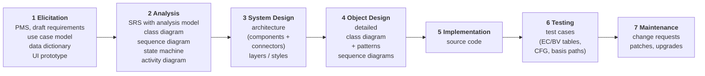

### Milestones and work products (L1 work-product table)

| Phase                      | Work products / milestones                                                                      |
| -------------------------- | ----------------------------------------------------------------------------------------------- |
| Requirements specification | SRS, prototype, requirements review                                                             |
| Design | Software Design Document, Interface Design Document, models, **test cases**; preliminary & final design reviews |
| Implementation             | Source code, system build, technical documentation, user manual                                 |
| Testing                    | Test execution, test report, user acceptance test                                                   |
| Maintenance                | Change request, bug report, patch release, upgrade                                              |

### Definition to memorise

> **Software engineering** is _the production of maintainable, fault-free software that meets the
> user's requirements and is delivered on time and within budget._

Four testable clauses: **maintainable**, **fault-free**, **meets requirements**, **on time / on budget**.

### The four process activities (also the exam-safe summary)

**Specification** (what it should do) → **Design & implementation** (organisation + code) →
**Validation** (does it do what the customer wants) → **Evolution** (change in response to need).

> ⚠️ **Trap:** the SDLC _activities_ and the _process models_ are different things. Waterfall /
> incremental / reuse-oriented are **models** (arrangements of the activities). MVC / layered /
> client–server are **architectures**. Design patterns are **micro-architectures**. Mixing these
> three vocabularies is a terminology mistake; distinguish these levels.

### Requirement → analysis → design traceability chain

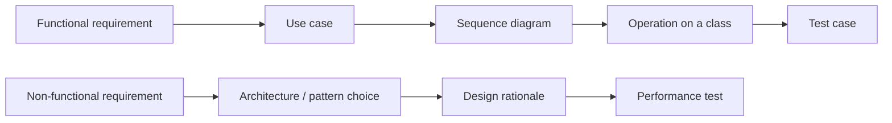

---

## 2. Requirements elicitation (L2–L4)

### Visual: classify a requirement

Read what the statement asserts, then check whether you can verify it.

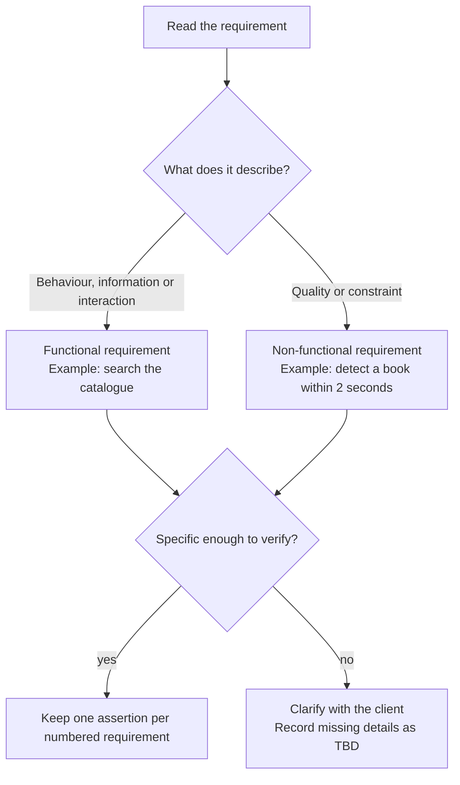

**Remember:** “user-friendly” is a vague NFR, not a third requirement category. A number alone does
not make a requirement non-functional; follow the lecture's examples below.

### 2.1 Project mission statement

Two or three sentences that define:

1. **The problem** — what will be done (scope and limits).
2. **The stakeholders** — developers and users.
3. **The outcomes and benefits** — plus a completion criterion.

> _"The GoFast team will develop a website that enables airline travellers to rate their travel
> experiences. This project will be considered complete when the website has been tested and
> approved for release by the FactFinding Organisation. This project supports the International
> Travel Watchdogs objective to ensure air passengers can openly compare airlines."_

**Distinction:** a mission statement summarises purpose, stakeholders and benefits, rather than listing detailed features.
The SRS product-description section can include that mission statement (Writing SRS, pp. 7–8).

### 2.2 Elicitation techniques (six — memorise the list)

| Technique                     | Use when                                                                         |
| ----------------------------- | -------------------------------------------------------------------------------- |
| **Interview**                 | You need depth from one stakeholder; open questions                              |
| **Observation**               | Users cannot articulate what they do ("watch the work")                          |
| **Workshop**                  | Many stakeholders must agree; resolve conflicts fast                             |
| **Legacy product study**      | Replacing an existing system; inherit its quirks                                 |
| **Competitive product study** | No access to users; derive features from rivals                                  |
| **Prototype**                 | Requirements are visual/interaction-heavy; "a picture is worth a thousand words" |

Two goals behind all six: **learn the problem domain** and **study user tasks**.

**Trap:** "Prototype" appears twice in the course — as an _elicitation technique_ (L2) and as a
_validation technique_ (L2) in the form of a **UI prototype** (storyboard, still images, interactive
prototype). Both are correct; state the purpose.

### 2.3 Functional vs non-functional requirements

|            | **Functional**                                                                                                       | **Non-functional**                                                                                                              |
| ---------- | -------------------------------------------------------------------------------------------------------------------- | ------------------------------------------------------------------------------------------------------------------------------- |
| Definition | Interactions between the system and its environment; maps program inputs to program outputs                          | Properties the system must have, not directly related to functional behaviour                                                   |
| Answers    | _What must the system do?_                                                                                           | _How well must it do it?_                                                                                                       |
| Sub-kinds  | System functionality · Information to be processed · Interface with other systems                                    | Usability · Reliability · Performance · Supportability (also security, availability, scalability, maintainability, portability) |
| Example    | "The library member must be able to search the library catalog."                                                     | "When a book is placed on the checkout pad, the system must detect it within 2 seconds."                                        |
| Example    | "The system must display the temperature in degrees centigrade in the range −10 °C to +130 °C to one decimal place." | "Help messages must be displayed in the local language according to the user's locale."                                         |
| Example    | "The system must be able to control up to six robot arms simultaneously."                                            | "After a system reboot, the full system functionality must be restored within 5 minutes."                                       |

**Classification drill (high-yield).** Decide which of these are FR vs NFR:

| Statement                                                                            | Answer                               | Why                                                      |
| ------------------------------------------------------------------------------------ | ------------------------------------ | -------------------------------------------------------- |
| The system must display the current time in 24-hour format                           | **FR**                               | Information to be processed                              |
| The database must be replaceable with any commercial product supporting standard SQL | **NFR** (supportability)             | Portability/replaceability property                      |
| The system must verify membership with the University Account System before a loan   | **FR**                               | Interface with another system                            |
| 80% of first-time users must enter a simple search query within 2 minutes            | **NFR** (usability)                  | Measurable quality target                                |
| The system must log the event when the email server is unreachable                   | **FR**                               | Functionality (though see §3 — may be an exception flow) |
| The system must be user-friendly | **NFR, but not verifiable as written** | Usability intent; needs a measurable criterion |

> ⚠️ **Trap:** the "control up to six robot arms" example is **functional** (number of controllable
> devices is a capability), while "response within 2 seconds" is **performance/NFR**. Do not classify
> by the presence of a number — classify by **what is being asserted**.

### 2.4 Atomic, verifiable, traceable

**Atomic** — one testable assertion per numbered statement. Nest sub-requirements.

> _Original:_ "When a computer is added, the tracking system requires the user to specify its type
> and allow the user to provide a description. Both these fields must be text of length > 0 and < 512."
>
> ```
> 1.1   When a computer is added to the tracking system, the user must enter the computer type.
> 1.1.1 The computer type data must be text of at least one character and less than 512 characters.
> 1.2   When a computer is added to the tracking system, the user must enter a description.
> 1.2.1 The description of the computer must be text of at least one character and less than 512 characters.
> ```

**Verifiable** — sufficiently specific to be testable, with an oracle.

| ✗ Not verifiable                                       | ✓ Verifiable                                                                                                        |
| ------------------------------------------------------ | ------------------------------------------------------------------------------------------------------------------- |
| The user interface must be user-friendly.              | 80% of first-time users must be able to enter a simple search query within 2 minutes of starting to use the system. |
| The system must control more than one drill press.     | The system must control up to seven drill presses concurrently.                                                     |
| The company must not hire too-young or too-old people. | 0–15 and 55–99: do not hire; 16–17: part-time; 18–54: full-time.                                                    |

**Traceability** — _the ability to track requirements from their expression in the SRS to their
realisation in design, documentation, source code, and their verification in reviews and tests; and
to track dependencies among requirements, system functions and system components._

> ⚠️ **Trap:** traceability is **not** just "numbering requirements". Numbering is a prerequisite
> (modifiability); traceability is the **link** forwards (to design/code/test) and backwards (to source).

### 2.5 Data dictionary (problem-domain glossary)

The table below is the lecture's **illustrative university domain**, not a statement of NTU's academic calendar.

- Ensures _consistent, unambiguous terminology_ that all stakeholders agree on.
- Defines **problem-domain** terms (Programme of Study, Course, Lecture, Tutorial, Class, Laboratory,
  Seminar) — **not** implementation terms (table, foreign key, thread).

| Term               | Definition                                                                                             |
| ------------------ | ------------------------------------------------------------------------------------------------------ |
| Programme of Study | A university programme a student enrols into. Three levels: undergraduate, master, PhD.                |
| Semester           | Four per academic year. Semesters 1 and 4 have 13 teaching weeks; semesters 2 and 3 have 5.            |
| Course             | A basic unit of teaching; compulsory or elective; must include lectures and tutorials; some have labs. |
| Lecture            | Traditional class in lecture theatres; video recorded and published in the LMS.                        |
| Tutorial           | Interactive, small-size class in technology-enhanced rooms; **not** video recorded.                    |

> ⚠️ **Trap:** the data dictionary is part of the SRS (§5 of the SRS contents). It is not a database
> schema and not a class diagram.

### 2.6 Requirements validation

| Technique                                                              | What it checks                                                                                                                                                                                          |
| ---------------------------------------------------------------------- | ------------------------------------------------------------------------------------------------------------------------------------------------------------------------------------------------------- |
| **Review** (walkthrough, inspection, critical review) with a checklist | completeness, consistency, unambiguity, correctness                                                                                                                                                     |
| **Prototype**                                                          | Stakeholders: the system specified meets their needs/desires (**correct**) and requirements are **prioritised**. Development team: requirements and underlying assumptions are **properly understood**. |

> ⚠️ **Trap:** review ≠ testing. Review is **static** (document inspection); testing is **dynamic**
> (execution). Both appear as "validation" in different lectures — read the context.

### 2.7 The iterative elicitation loop (memorise the steps)

**Step 1 — Project team alone.** Review the client's specification (and legacy/competitive products) to:

1. **Atomise** requirements.
2. Identify **actors**.
3. Identify main **use cases** (functional requirements).
4. Identify **non-functional** requirements.
5. Initiate the **data dictionary**.
6. Identify **uncertainties → TBD** (To Be Determined). _Never guess user requirements._

**Step 2 — Project team meets client** (interview / observation / workshop). Agenda agreed up-front:

1. Present and walk through the initial requirements + data dictionary → get agreement.
2. Clarify the TBD issues.
3. Discuss new requirements the client raises.

Repeat 1–2 **until** all uncertainties and ambiguities in functional, non-functional requirements and
data-dictionary terms are agreed with the client. A prototype may be produced to show intended
functionality. **Minimise the number of meetings by making meetings productive.**

> ⚠️ **Trap:** "Do not guess the user requirements" is an explicit lecture instruction — the correct answer to
> a missing requirement is **TBD + ask the client**, not "assume a sensible default".

---

## 3. Use case modelling (L3–L4)

### Visual: decide between include and extend

First identify a meaningful unit of behaviour; do not turn every sentence into a use case.

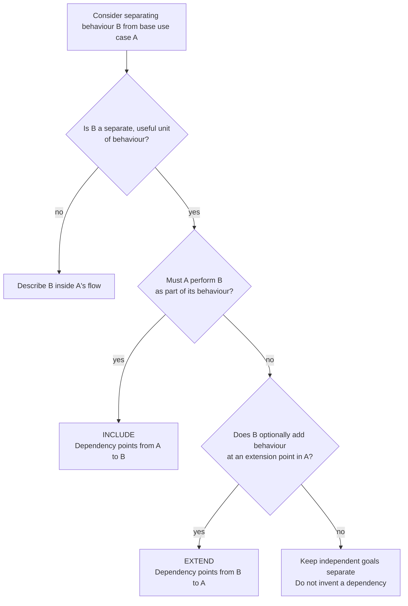

**Arrow memory:** include points to the helper; extend points to the host. Conditional behaviour can
also stay in an alternative or exception flow. This is a reasoning aid, not a new UML rule.

### 3.1 UML in one table

UML = _a graphical notation with textual annotation for specifying, documenting and communicating
structure, functionality and dynamic behaviour of complex software systems._ Booch + Jacobson +
Rumbaugh; the lecture gives UML 1.1 adoption in 1997 and refers to UML 2.5 (2015). These are
historical references in the supplied slides, not a claim about the current UML release.

| Category                                       | Diagrams                                                                                                     |
| ---------------------------------------------- | ------------------------------------------------------------------------------------------------------------ |
| **Structure** (static, "irrespective of time") | Class, Object, Package, Component, Composite Structure, Deployment (L3 list)                                           |
| **Behaviour** (dynamic)                        | **Use Case**, **Activity**, **State Machine**, **Sequence**, **Communication**, Interaction Overview, Timing |

Course modelling focus: **use case, class, sequence, state machine,
activity** (communication/object appear in the SRS figure list).

**Trap:** UML is **not** a programming language and **not** a method. "Only use the diagrams that are
useful and necessary to define the system" — select diagrams for the modelling need rather than drawing every diagram type.

### 3.2 Use case model = static + dynamic

> **Use case model = Use case diagram (static) + Use case descriptions (dynamic).**

The diagram identifies relationships; the description specifies the behaviour. Supply both when requested.

### 3.3 Diagram elements

| Element             | Notation                                               | Meaning                                                                              |
| ------------------- | ------------------------------------------------------ | ------------------------------------------------------------------------------------ |
| **Actor**           | Stick figure, labelled with role (not a person's name) | An **external** entity that interacts with the system                                |
| **Use case**        | Ellipse, labelled with a verb phrase                   | A unit of functionality performed by the system yielding a result/value for an actor |
| **Association**     | Solid line actor↔use case                              | Actor participates in that use case                                                  |
| **System boundary** | Rectangle around use cases                             | Separates system from environment                                                    |
| **Generalization**  | Solid line, hollow triangle pointing to the parent     | Actor or use-case specialisation                                                     |
| **«include»**       | Dashed arrow from base → included                      | Base **always** performs the included behaviour                                      |
| **«extend»**        | Dashed arrow from extending → base                     | Extending behaviour is **optional/conditional**                                      |

### 3.4 «include» vs «extend» — decomposition, reuse and optional behaviour

|                 | **«include»**                                                                                                            | **«extend»**                                        |
| --------------- | ------------------------------------------------------------------------------------------------------------------------ | --------------------------------------------------- |
| Trigger         | Always, as part of the base                                                                                              | Under an explicit condition / at an extension point |
| Purpose         | Functional decomposition, or **reuse** of common behaviour                                                               | Add **optional** functionality                      |
| Base alone is…  | **Incomplete** without the included UC                                                                                   | **Complete by itself**                              |
| Arrow direction | base ──► included                                                                                                        | extending ──► base                                  |
| Course example  | Manage Incident **includes** Create / Handle / Close Incident; Open Incident and Allocate Resources **include** View Map | Report Emergency ◄── **extends** ── Help            |

> ⚠️ **Trap #1 (arrow direction).** Students reverse «extend» arrows constantly. Mnemonic:
> **"include points to the helper; extend points to the host."**
>
> ⚠️ **Trap #2 (exclusive use).** If the behaviour _always_ happens, it is **include**, not extend.
> If behaviour is conditional, first decide whether it belongs in an alternative/exception flow or a
> separate extending use case. Conditional behaviour alone does not require **extend**.
>
> ⚠️ **Trap #3.** "A includes B" is read as _"an instance of A performs all the behaviour of B —
> A delegates to B."_ It is **not** "B is part of A's name".
>
> ⚠️ **Trap #4.** An alternative flow (e.g. wrong PIN) is **not** automatically an «extend» use case.
> Small variations belong in the **use case description**; «extend» is for a genuinely separate
> optional unit of functionality.

### 3.5 The use case description — mandatory fields

1. **Participating actors** (with the **initiating actor** identified).
   - A use case can have more than one participating actor.
   - The **initiating actor triggers** the use case.
   - If triggered by a **system event or another use case**, the initiating actor is **NULL**.
2. **Entry conditions (pre-condition)** — system state that must be satisfied to execute.
3. **Exit conditions (post-condition)** — system state that must be reached afterwards.
4. **Flow of events** (a.k.a. normal / main success flow) — alternating actor and system steps:
   step 1 = how the actor triggers; step 2 = how the system responds; …
5. **Alternative flows** — variations or errors that **return to the normal flow** (e.g. invalid
   card/PIN → back to step 2; insufficient funds → back to step 6).
6. **Exceptions** — exceptional situations that **cause the use case to fail** (e.g. three invalid
   PIN attempts → card suspended; ATM out of funds → refuses card).

Template also captures: Use Case ID, Name, Created/Updated by, dates, Actor, Description, Priority,
Frequency of Use, Includes, Special Requirements, Assumptions, Notes and Issues.

### 3.6 Worked example — "Withdraw Money using ATM"

**Participating actors:** Bank Customer (**initiating**), Bank (secondary/external system).
**Entry conditions:** (1) customer has an account with the bank **and** (2) has an ATM card and PIN.
**Exit conditions:** (1) customer receives the requested cash **or** (2) customer receives an
explanation from the ATM why cash could not be dispensed.

**Normal flow (note the A/S alternation):**

| #   | Actor step                      | System step                                          |
| --- | ------------------------------- | ---------------------------------------------------- |
| 1   | Inputs the card into the ATM    |                                                      |
| 2   |                                 | Requests input of a six-digit PIN                    |
| 3   | Enters a PIN                    |                                                      |
| 4   |                                 | Verifies card and PIN with account info in the Bank  |
| 5   |                                 | If verified, requests the amount to withdraw         |
| 6   | Enters an amount                |                                                      |
| 7   |                                 | Verifies the amount is available in the account      |
| 8   |                                 | If sufficient funds, outputs money, card and receipt |
| 9   | Removes card, receipt and money |                                                      |

**Alternative flows**

- **AF-S5 (invalid card and PIN):** 1. ATM displays "Invalid card and PIN. Please try again!" for 2 s. 2. ATM **returns to step 2**.
- **AF-S8 (insufficient funds):** 1. ATM displays "Insufficient funds… enter a smaller amount!" for
  2 s. 2. ATM **returns to step 6**.

**Exceptions**

- **EX1 (invalid PIN three times):** 1. Displays "Card is suspended! Please call customer service
  (1633)…" for 2 s. 2. Outputs the card. → _Use case fails._
- **EX2 (ATM has insufficient funds):** 1. Displays "This ATM is off-service due to insufficient
  funds!" at the start screen. 2. Does not accept the card.

> ⚠️ **Trap:** the AF/EX distinction is graded. **AF = recoverable, returns to a step. EX = terminal,
> the goal is not achieved.** "Insufficient funds in _account_" is recoverable (AF); "insufficient
> funds in _ATM_" is not (EX). Read carefully which one the question describes.

### 3.7 Deriving use cases from functional requirements

Use the Library Management System drill (L3):

| #   | Functional requirement                                                    | Actor(s)                          | Use case            | Association                     |
| --- | ------------------------------------------------------------------------- | --------------------------------- | ------------------- | ------------------------------- |
| 1   | Member searches for materials                                             | Member                            | Search Material     | —                               |
| 2   | Member loans materials                                                    | Member                            | Loan Material       | —                               |
| 3   | System verifies membership with University Account System **before** loan | Member, University Account System | Verify Member       | «include» from Loan Material    |
| 4   | Member returns materials via drop-off kiosk                               | Member, Library Drop-off Kiosk    | Return Material     | —                               |
| 5   | System sends overdue notice via CITS Email Server                         | CITS Email System                 | Send Overdue Notice | —                               |
| 6   | **When** network to CITS fails, log the event                             | — (system event)                  | Log Network Issues  | «extend» on Send Overdue Notice |

**Method (do this in the exam, in order):**

1. **Identify actors** — scan for _people/roles_ and _external systems_; underline nouns.
2. **Identify use cases** — scan for _verb phrases describing a goal_ ("search", "loan", "return",
   "send notice"). One goal = one use case.
3. **Identify associations** — draw actor↔UC lines only where the actor participates.
4. **Add include/extend/generalization** — only where justified; annotate with one sentence of
   reasoning.
5. **Write the description** for the use cases the question names.

**Lecture comparison.** L3, pp. 20–22, shows three candidate library diagrams, including different
choices of actor and authentication behaviour. Do not treat every candidate as an approved solution.
Trace each element to the stated requirements: membership verification is required before a loan;
Login is not stated for the library example. L4, pp. 12–16, separately uses Login in the course
registration example. Explain the system boundary and reuse choice.

**Trap — actors vs system internals.** "Database", "Sensor" (if part of the system's own hardware),
"UI" are **not** actors. But an **external** University Account System, CITS Email Server, Billing
System, Library Drop-off Kiosk **are** actors.

**Trap — actor generalization.** If Student and Professor share Login, model an abstract **User**
actor with generalization arrows from Student/Professor to User, then associate Login with User.
Do not draw duplicate Logins.

---

## 4. Requirements analysis: conceptual model & class diagrams (L5)

### Visual: assign each class a responsibility

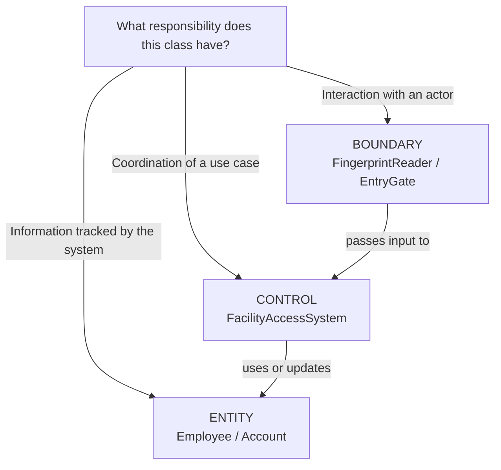

The bottom links illustrate a common collaboration, not a complete restriction on allowed class
relationships. Derive classes from the use case and domain; then assign responsibilities.

### 4.1 Elicitation vs analysis (L5 distinction)

|             | **Requirements elicitation**                                     | **Requirements analysis**                                                                            |
| ----------- | ---------------------------------------------------------------- | ---------------------------------------------------------------------------------------------------- |
| Purpose     | Find out **what customers want**                                 | Produce a system model that is **correct, complete, consistent, unambiguous** based on the use cases |
| Output      | Description of the system in terms of **actors and use cases**   | **Conceptual model** (system structure) + **dynamic model** (system behaviour)                       |
| Perspective | Customer's                                                       | Software engineer's                                                                                  |
| Artefacts   | SRS, use case diagram + descriptions, data dictionary, prototype | Class diagram (boundary/control/entity), sequence diagrams, state machines, activity diagrams        |

Formalising requirements with analysis models: **clarifies** structure and dynamics, **validates**
requirements, **underpins** solution modelling.

### 4.2 Conceptual model vocabulary

| Element       | Definition                                               | Example                                                            |
| ------------- | -------------------------------------------------------- | ------------------------------------------------------------------ |
| **Object**    | Anything that has a **state** and exhibits **behaviour** | Bus, Dog, Company; _LoginForm, UserVerifier, UserList_             |
| **Operation** | Procedure through which objects communicate              | Bus: Stop, Start; Company: Sell, Quote; UserVerifier: authenticate |
| **Attribute** | Variable holding state information                       | Bus: Seats, Colour; Company: Name, Employees                       |

Documented in a **class diagram**: Object → Class; Roles of the object → Attributes and methods of
the class.

### 4.3 Class notation

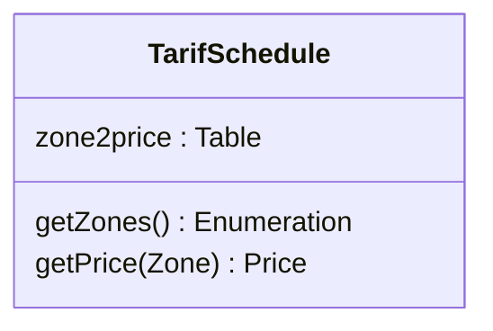

### 4.4 Relationships — notation and reading

| Relationship                 | Notation                                                           | Meaning                                                                         | Reading test                  |
| ---------------------------- | ------------------------------------------------------------------ | ------------------------------------------------------------------------------- | ----------------------------- |
| **Association**              | Plain solid line                                                   | Semantic relationship between instances                                         | "A is related to B"           |
| **Navigability**             | Open arrowhead pointing **at the target** class                    | Instances at the plain end can reach the class the arrow points at              | "from A you can reach B"      |
| **Non-navigable**            | Small **x** on the end                                             | That end is explicitly _not_ reachable                                          | "B cannot be reached from A"  |
| **Unspecified navigability** | Solid line with **nothing** at either end                          | Direction of navigation is left unspecified — **not** the same as bidirectional | "assume nothing"              |
| **Generalization**           | Solid line + **hollow** triangle at the **general** (parent) class | Inheritance ("is-a"); carries **no** multiplicity and no role names             | "B is a kind of A"            |
| **Abstract class parent**    | Solid line + hollow triangle (name italicised)                     | Cannot instantiate                                                              |                               |
| **Interface**                | **Dashed** line + hollow triangle                                  | Realisation ("can-do")                                                          | "B implements contract A"     |
| **Aggregation**              | **Hollow** diamond at the **whole**                                | "is part of" (parts can outlive whole)                                          | "the whole has parts"         |
| **Composition**              | **Filled** diamond at the **whole**                                | "is entirely made of"; **parts live and die with the whole**                    | "delete whole ⇒ delete parts" |
| **Dependency**               | **Dashed** arrow, open head                                        | "uses temporarily"; often an implementation detail, not part of state           | "A needs B to do its job"     |

#### What the relationships look like

The following are concrete class-diagram sketches. Read the symbol **at the end of the line**
carefully: that is where the relationship is attached.

<div align="center">

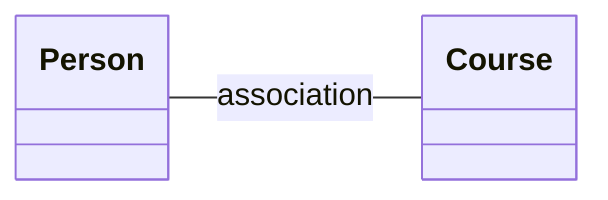

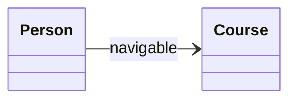

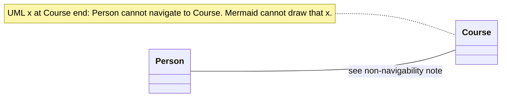

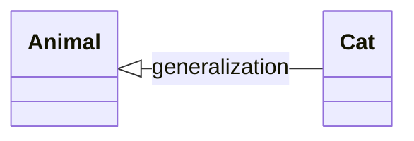

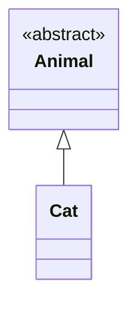

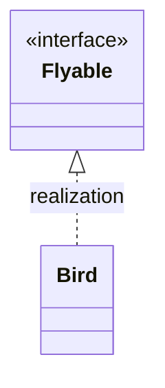

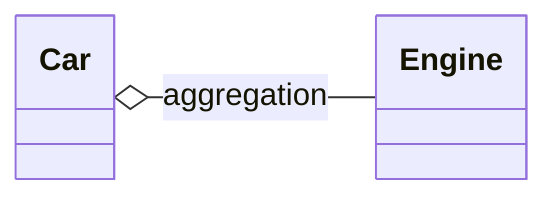

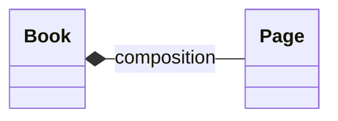

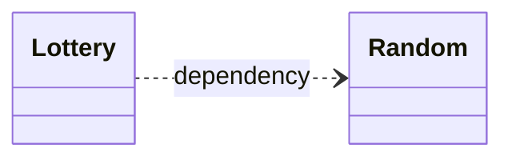

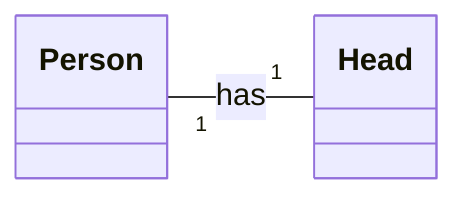

</div>

With multiplicities, the same relationship becomes more precise:

The diagram follows L5, p. 11: one `Person` has exactly one `Head`, and each `Head` belongs to
exactly one `Person`. The same slide shows `Polygon "1" -- "*" Point` for one-to-many.

Course reminders: the Mermaid diagrams above show `Car` aggregation with `Engine`, `Book`
composition with `Page`, and `Lottery` dependency on `Random`.

**Multiplicity cheatsheet**

| Notation      | Meaning                |
| ------------- | ---------------------- |
| `1`           | Exactly one            |
| `0..1`        | Zero or one (optional) |
| `*` or `0..*` | Zero or more           |
| `1..*`        | One or more            |
| `3`           | Exactly three          |
| `1..6`        | Between one and six    |

**How to read a multiplicity correctly:** the number is written **at the end near the class it
counts**. `Person "1" -- "1" Head` means one Head per Person and one Person per Head.
`Polygon "1" -- "*" Point` means zero or more Points per Polygon and one Polygon per Point.

**Notation conflict in sources:** L5, p. 13, draws a filled arrowhead for a concrete superclass.
The supplied UML specification notes use the UML hollow triangle for generalization. Use a solid
line and hollow triangle for class inheritance, and a dashed line and hollow triangle for interface
realisation. Abstract class names are italicised or marked `{abstract}`; Mermaid uses an annotation.

#### One line, two ends — read both ends against the same relationship

Every line is **one** relationship with **two** ends, and each relationship type permits only its
own adornments. Importing an adornment from a different relationship produces a diagram that is
not valid UML (a notation error).

| Rule                                                                                                                                                 | Why it matters                                                                                                                                          |
| ---------------------------------------------------------------------------------------------------------------------------------------------------- | ------------------------------------------------------------------------------------------------------------------------------------------------------- |
| A **generalization** carries _only_ the hollow triangle at the **general** class — no multiplicity, no role name, no open arrowhead at the other end | Generalization is not an association: it says nothing about counts or about which instance can reach which                                              |
| The **hollow triangle points at the general (parent) class**; the subclass sits at the plain end                                                     | `Cat ―▷ Animal` = "Cat is a kind of Animal"; a triangle at `Cat` claims the reverse                                                                     |
| **Multiplicity at both ends ⇒ it is an association**, never a generalization                                                                         | Two multiplicities _is_ the association pattern; a "generalization" drawn that way is a different, malformed relationship                               |
| A **solid line with nothing at either end conveys no navigability**                                                                                  | Navigation is shown only by an open arrowhead (or an `x` for explicitly non-navigable). No arrowhead = **unspecified**, so do not call it bidirectional |

Worked reading, using the sketches above:

- `Person --> Course` — **one** association, navigable from `Person` to `Course` (arrowhead at
  `Course`). Nothing is said about `Course → Person`.
- `Animal <|-- Cat` — **one** generalization, hollow triangle at `Animal` (the general class). It has
  **no** multiplicities: "how many Animals per Cat" is not a question generalization answers.
- `Animal "1" -- "*" Cat` — **not** a generalization even if you add a triangle: with multiplicities
  at both ends this is an association ("one Animal is associated with many Cats").
- `Person ― Course` with no adornments — the relationship exists, but its navigability is
  **unspecified**.

> ⚠️ **Trap #1 (diamond side).** The diamond is always at the **whole**, never at the part. If you
> write `Engine ◆— Car`, you have said "an Engine is made of Cars".
>
> ⚠️ **Trap #2 (aggregation vs composition).** Only composition implies **lifetime dependency** and
> **exclusive ownership (a part is in at most one composite at a time)**. L5 uses Book/Page for
> composition and Car/Engine for aggregation. Reassignment alone does not distinguish them: a
> composite part can be detached before deletion. State ownership and lifetime assumptions.
>
> ⚠️ **Trap #3 (association vs dependency).** Association = structural, persists in state.
> Dependency = temporary use (parameter, local variable, return type). "Lottery uses Random" ⇒ dependency.
>
> ⚠️ **Trap #4 (multiplicity direction).** Write the multiplicity at **both** ends of every
> association in the exam; omitted multiplicities leave the intended counts unspecified.
>
> ⚠️ **Trap #5 (generalization drawn as an association).** Multiplicity at **both** ends means the
> relationship is an **association**. A generalization may **not** carry multiplicities (or role
> names) at its ends: if you draw a hollow triangle _and_ `1 … *`, the diagram is malformed — decide
> which single relationship you mean and draw only that one.
>
> ⚠️ **Trap #6 (triangle direction).** The hollow triangle is attached to the **general** class and
> the plain end to the **specialised** class: `SavingsAccount ―▷ Account` = "a savings account is a
> kind of account". A triangle at `SavingsAccount` reverses the intended meaning.
>
> ⚠️ **Trap #7 (plain solid line ≠ bidirectional).** A solid line with no adornment at either end
> **does not convey navigability** — the direction is unspecified, not "both ways". Navigability is
> shown only by open arrowhead(s); draw one at **each** end if you truly mean bidirectional.

### 4.5 Stereotypes: entity / boundary / control

| Stereotype     | Role                                           | Typical examples                                                 |
| -------------- | ---------------------------------------------- | ---------------------------------------------------------------- |
| **«entity»**   | Information tracked by the system | `Account`, `Silo`, `Shipment`                                    |
| **«boundary»** | Interaction between an actor and the system    | `LoginForm`, `EntryGate`, `FingerprintReader`                    |
| **«control»**  | Logic that realises a use case (coordination)  | `FacilityAccessSystem`, `SheetManager`, `RegistrationController` |

Worked example — **EnterSecureFacility**:

> 1. User presses finger on FingerprintReader. 2. FingerprintReader scans and sends image to
>    FacilityAccessSystem. 3. FacilityAccessSystem validates fingerprint and unlocks EntryGate.
> 4. EntryGate signals the system it has opened. 5. FacilityAccessSystem locks EntryGate, logs the
>    entry event and increments occupant count.

Classes: `Employee` («entity»), `Fingerprint` («entity»), `FingerprintReader` («boundary»),
`EntryGate` («boundary»), `FacilityAccessSystem` («control»).
Relations with stereotypes: `<<read>>`, `<<call>>`, `<<signal>>` (usage dependencies between them).

**L15 mapping:** UI event handling is in the presentation boundary; business coordination and
data are inside the Model. The course's mapping is:
**(View, Controller) ↔ boundary; Model ↔ entity + control (app logic + data)**.

### 4.6 Four-step analysis procedure

1. Identify the **classes**.
2. Find the **attributes** for each class.
3. Find the **methods/operations** for each class.
4. Find the **associations** between classes.

How to find classes:

1. **Recurring nouns/concepts** in the use cases.
2. **Real-world entities** the system must track.
3. **Application/problem-domain terms** in the data dictionary.
   Then **review definitions and attributes with stakeholders**.

> ⚠️ **Trap:** do **not** promote every noun to a class. If a noun has no attributes, no identity and
> no behaviour of its own (e.g. "amount", "date", "grade"), it is an **attribute**, not a class.
> Conversely "grade" in GES has an enumerated domain and constrains storage rules → it can justify a
> class/type in the design model.

---

## 5. Dynamic models: state machine & activity diagrams (L6)

### Visual: choose the diagram that answers the question

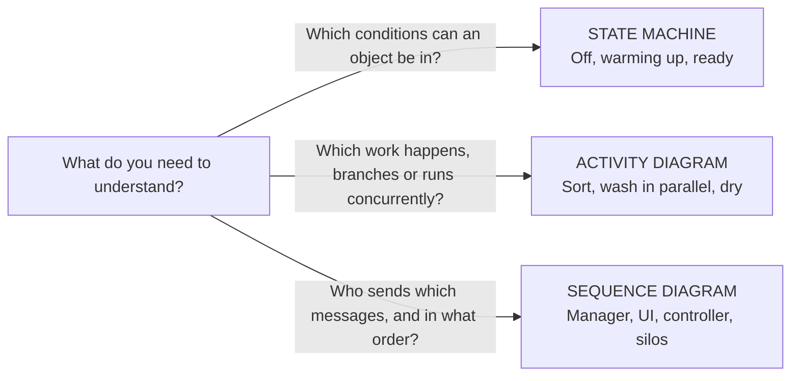

**Memory cue:** state = condition; activity = work; sequence = messages over time. The sequence
example is worked through in §14.6; state/activity notation is explained below.

### 5.1 State machine diagram (a.k.a. statechart, finite state automaton, **dialog map**)

- Models a system/object by the **states** it can be in.
- **State** = a _stable condition_ that exists for a period (or all) of time until an **action/event**
  drives it to another stable state.
- Finite number of states; transitions determined by previous state and actions.
- Notation: rounded rectangle, name at top, optional **entry / action**, **exit / action**, **do / activity**.
- A diagram begins with a **start node** (filled circle) and ends with an **end node** — **unless** the
  system loops forever, in which case there is no end node.
- A transition is **assumed instantaneous** in response to an event. Full label:

```
event(arguments) [guard] / action
```

**Dialog map** = a state machine used to prototype navigation. Since most UIs show one screen/window
at a time (a state) with defined conditions to move (transitions), dialog maps:

- find **missing or incorrect navigation pathways early**, when they are cheap to fix;
- spot **reuse opportunities and redundancies** without premature screen design.

**Vending machine dialog map (L6, p. 7):**

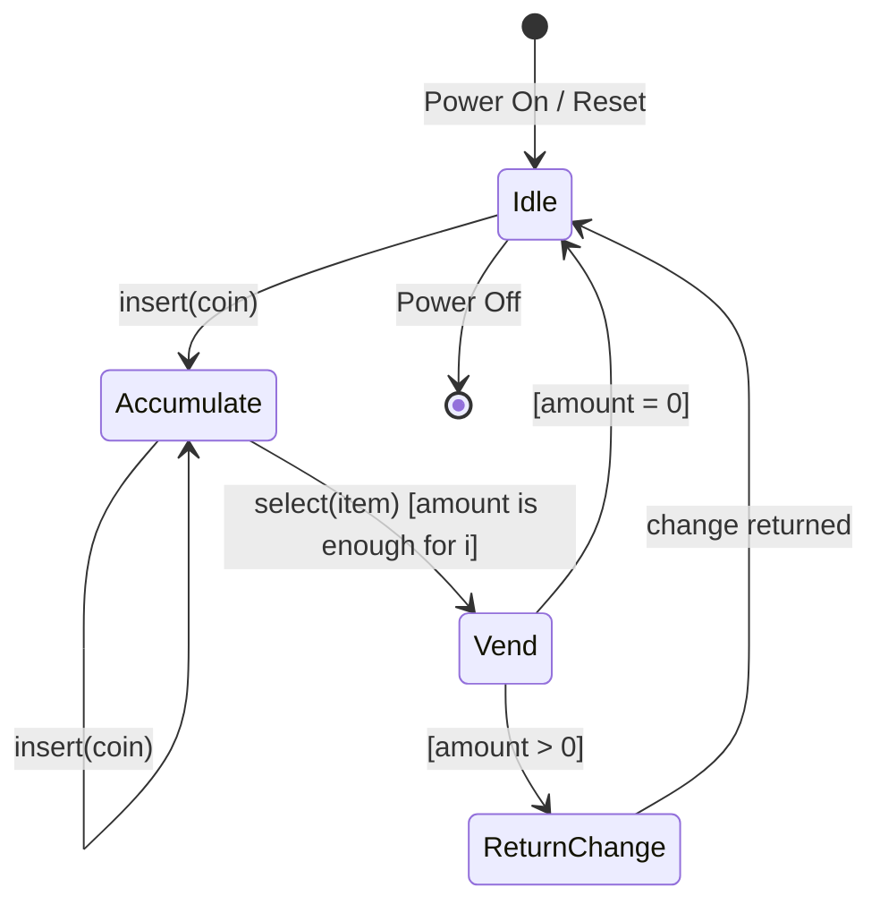

| State | Entry action | Do activity |
| --- | --- | --- |
| Idle | `amount := 0` | `display(greeting)` |
| Accumulate | `amount := amount + c.amount` | `display(amount)` |
| Vend | `amount := amount − i.cost` | `dispense(i); display(vending)` |
| ReturnChange | — | `return(amount)` |

The lecture types the events as `insert(c:Coin)` and `select(i:item)`; Mermaid labels shorten them
to avoid a colon parsing limitation. The self-transition on Accumulate re-enters the state and adds the next coin. ReturnChange returns
to Idle after returning change; the slide leaves that completion transition unlabelled.

Stopwatch practice (L6, p. 9): Ready enters with `Reset time`; Start moves Ready to Continuous Update;
Stop moves Continuous Update to Time Paused; Start resumes. Reset moves **Time Paused to Ready**.
Close Window exits from each state. Do not invent a Reset transition from Continuous Update.

**State/activity distinction:** a state is a condition; its `do/` activity describes work performed
while active. An activity may finish before the state is exited. `entry/` and `exit/` execute on each
entry and exit, including repeated entries. A decision's guards should be mutually exclusive and
cover the intended cases, with `[else]` where needed.

### 5.2 Activity diagram

- **Activity** = execution of one or more basic operations (rounded rectangle).
- **Control flow** = arrows.
- **Fork** = one input, two or more **concurrent** outputs (**thick bar**).
- **Join** = two or more flows come together into one (**thick bar**).
- **Decision/branch** = one input, several guarded outputs (**diamond**).
- **Merge** = several branches into one (**diamond**).

Laundry example: `Sort Clothes in Whites and Darks` → **fork** → (`Wash Whites` ‖ `Wash Darks`) →
**join** → `Dry Clothes`. Drying loop: `Run Dryer —[still wet]→ Run Dryer`, `Run Dryer —[else]→ Fold Clothes`.

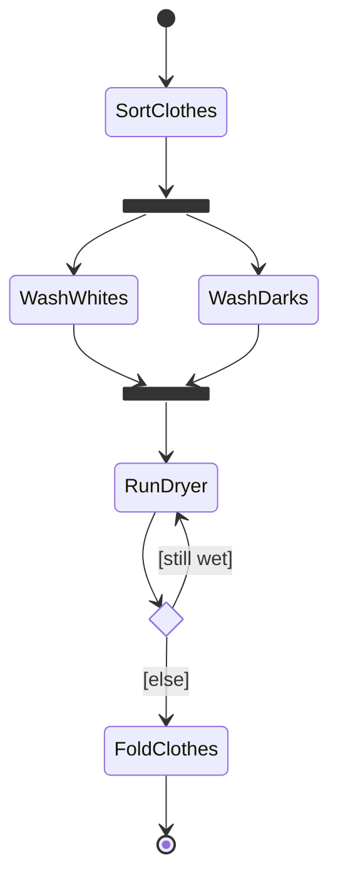

This Mermaid state-diagram rendering supplies fork/join bars for the **activity workflow**. In UML,
use action nodes, an activity initial/final node, and guarded decision/merge diamonds. A join
synchronises concurrent branches; a merge combines alternatives without waiting for every input.

### 5.3 State machine vs activity diagram (L6 comparison)

|              | **State machine**                                         | **Activity**                                  |
| ------------ | --------------------------------------------------------- | --------------------------------------------- |
| Models       | The **states** of a system/object and events that move it | The **workflow of activities** (a flow chart) |
| Node meaning | A stable condition                                        | A unit of work                                |
| Focus        | Event-driven **reactive** behaviour                       | Procedural **control flow**, concurrency      |
| Typical use  | UI navigation (dialog map), protocol/device states        | Business process, algorithm, use-case flow    |

> ⚠️ **Trap:** fork/join are **bars**; decision/merge are **diamonds**. A diamond for concurrency
> or a bar for a conditional branch uses the wrong notation.

### 5.4 The requirements elicitation & analysis activity diagram (memorise the loop)

1. Study the client's initial specification.
2. Generate the initial use case diagram/descriptions, data dictionary, FRs/NFRs and uncertainties.
3. Review requirements with the client.
4. If elicitation is not agreed, refine those artefacts and repeat the review.
5. Once initial elicitation is agreed, identify classes and draw initial class diagrams.
6. Add associations/multiplicities and dynamic diagrams; record new uncertainties.
7. Review the analysis and requirements with the client.
8. If use cases are affected, update them.
9. Refine class diagrams and other affected diagrams; repeat the review.
10. When requirements are agreed, sign off the SRS.

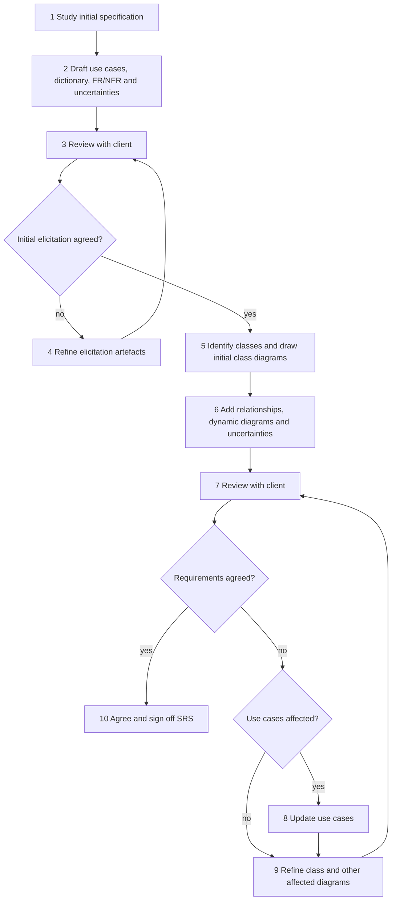

---

## 6. The SRS (L4, L6, "Writing SRS")

### Visual: see the SRS as five compartments

```mermaid
mindmap
    root((SRS))
        Product description
            Purpose and scope
            Stakeholders
            Assumptions and constraints
        Functional requirements
            What the system does
            Supporting analysis models
        Non-functional requirements
            Required qualities and constraints
        Interface requirements
            User
            Hardware
            Software
        Data dictionary
            Shared terms and definitions
```

**Remember:** this records required behaviour and constraints. Selecting implementation patterns
belongs in design. The nine quality checks in §6.4 apply across the document.

### 6.1 What the SRS is (six definitions that get paraphrased into exam questions)

1. The **output of requirements elicitation and analysis**.
2. An organisation's **written understanding** of a customer's requirements and dependencies at a
   point in time, prior to design/development.
3. A **two-way insurance policy**: both client and organisation understand each other's requirements.
4. A statement in **precise, clear language** of the functions and capabilities the system must
   provide, plus required constraints.
5. A **blueprint** for completing the project with as little cost growth as possible.
6. **Detailed functional and non-functional requirements — it does NOT contain design suggestions.**

### 6.2 Purpose of the SRS (4 items)

1. Give the customer assurance that the organisation understands the problems to be solved and the
   necessary software behaviour.
2. **Decompose** the problem into component parts.
3. Serve as **input to the design specification** — so it must contain sufficient functional detail
   for a design solution to be devised.
4. Serve as the **parent/master document for testing and validation**.

### 6.3 Contents (5 sections — memorise the numbering)

| §   | Section                         | Contents                                                                                                                                                                              |
| --- | ------------------------------- | ------------------------------------------------------------------------------------------------------------------------------------------------------------------------------------- |
| 1   | **Product description**         | a) Purpose of the system (mission statement) · b) Scope · c) Users and stakeholders · d) Assumptions and constraints                                                                  |
| 2   | **Functional requirements**     | Precise numbered statements + activity diagrams, use case diagrams with descriptions, class diagrams, sequence diagrams, communication diagrams, state machine diagrams, UI prototype |
| 3   | **Non-functional requirements** | Numbered statements covering performance, standards, reliability, availability, security, maintainability, portability                                                                |
| 4   | **Interface requirements**      | a) **User** (screen formats, layouts, report/menu content, function keys) · b) **Hardware** (ports, instruction sets) · c) **Software** (interfaces to DBMS, OS, maths packages)      |
| 5   | **Data dictionary**             | Unambiguously defines all terms, phrases and abbreviations used in the SRS                                                                                                            |

Standards reference: **IEEE 830-1998**, _IEEE Recommended Practice for Software Requirements
Specifications_.

Who writes it: it should be in **natural language, unambiguous, with diagrams as necessary**; it must
be understood by the development team; programmers/managers are seldom the best writers, so it is
good practice to **involve a technical writer**.

### 6.4 The nine language-quality characteristics

| #   | Characteristic  | Test you can apply                                                                                     |
| --- | --------------- | ------------------------------------------------------------------------------------------------------ |
| 1   | **Correct**     | Only user representatives can confirm; include them in inspections                                     |
| 2   | **Feasible**    | Implementable within known capabilities/limits of system and environment                               |
| 3   | **Necessary**   | Can you identify its origin (customer need, external interface, standard)? If not, maybe not necessary |
| 4   | **Unambiguous** | Multiple readers must reach **one** interpretation                                                     |
| 5   | **Verifiable**  | Can you devise a test / inspection / demonstration for it?                                             |
| 6   | **Complete**    | Nothing missing; organise hierarchically so reviewers can spot gaps                                    |
| 7   | **Consistent**  | No conflict with other requirements or higher-level requirements                                       |
| 8   | **Modifiable**  | Uniquely labelled, expressed separately, change history maintained                                     |
| 9   | **Traceable**   | Link each requirement to its source and its realisation                                                |

### 6.5 Word list (memorise both columns)

**✓ Use these words**

| ✓ Use               | Meaning                                                             |
| ------------------- | ------------------------------------------------------------------- |
| **Shall**           | Dictates provision of a functional capability                       |
| **Must / Must not** | Establishes performance requirement or constraint                   |
| **Is required to**  | Imperative in SRS statements                                        |
| **Are applicable**  | Includes standards/documentation by reference                       |
| **Responsible for** | Imperative for pre-defined architectures                            |
| **Will**            | Cites what the operational/development **environment** will provide |

**✗ Avoid these words**

| ✗ Avoid                        | Why                |
| ------------------------------ | ------------------ |
| adequate                       | vague threshold    |
| as a minimum                   | unbounded          |
| be capable of…                 | avoids commitment  |
| as applicable / as appropriate | optional           |
| effective                      | unmeasurable       |
| if possible / if practical     | optional           |
| timely                         | unmeasurable       |
| normal                         | undefined baseline |

> The two lists are **independent** — the lecture presents them side by side, so a row on the left
> is not the "opposite" of the row on the right.

> ⚠️ **Trap (shall vs will).** **Shall** binds the _system_; **will** describes what the
> _environment_ supplies. "The system **shall** …" is a requirement; "The user **will** provide a
> valid card" is an assumption about the environment. Swapping them blurs responsibility for the behaviour.
>
> ⚠️ **Trap (SRS ≠ design).** If your SRS contains "we will use a Singleton factory", you have
> violated definition 6. Design decisions belong in the SDD.

---

## 7. Software processes (L8)

### Visual: compare how the work is arranged

```mermaid
%%{init: {"flowchart": {"nodeSpacing": 20, "rankSpacing": 25}}}%%
flowchart TB
    subgraph W["Waterfall"]
        direction LR
        W1["Requirements"] --> W2["Design"] --> W3["Build<br/>Unit test"] --> W4["Integrate<br/>System test"] --> W5["Operate<br/>Maintain"]
    end
    subgraph I["Incremental"]
        direction LR
        I1["Specify<br/>one useful increment"] --> I2["Develop<br/>and validate"] --> I3["Deliver<br/>and get feedback"]
        I3 --> I1
    end
    subgraph R["Reuse-oriented"]
        direction LR
        R1["Specify<br/>requirements"] --> R2["Discover and evaluate<br/>existing software"] --> R3["Refine<br/>requirements"] --> R4["Configure, adapt<br/>and integrate"]
    end
    W ~~~ I
    I ~~~ R
```

**Trade-offs:** waterfall makes later changes costly; incremental delivery needs structural care;
reuse reduces new development but can compromise requirements and control over evolution.
Incremental development can be plan-driven or agile.

### 7.1 Definitions

> A **software process** is _a structured set of activities required to develop a software system._

All processes involve four activities:

1. **Specification** — defining what the system should do.
2. **Design and implementation** — defining the organisation of the system and implementing it.
3. **Validation** — checking that it does what the customer wants.
4. **Evolution** — changing the system in response to changing customer needs.

> A **software process model** is _an abstract representation of a process — a description from some
> particular perspective._

**Process descriptions** include, besides activities and their ordering:

- **Products** — outcomes of a process activity;
- **Roles** — responsibilities of the people involved;
- **Pre- and post-conditions** — statements true before/after an activity or product.

### 7.2 Plan-driven vs agile

|           | **Plan-driven**                                                           | **Agile**                                                                                                  |
| --------- | ------------------------------------------------------------------------- | ---------------------------------------------------------------------------------------------------------- |
| Planning  | All activities planned **in advance**; progress measured against the plan | Planning is **incremental**; process easily changed to reflect changing requirements                       |
| Iteration | Iteration occurs **within** activities                                    | Specification, design, implementation, testing are **inter-leaved**; outputs negotiated during development |
| Outputs   | Decided **up front**                                                      | Decided through **negotiation** during the process                                                         |

Most practical processes include **elements of both**. **There are no right or wrong software
processes.**

### 7.3 The three general models

| Model                                            | Shape                                                                                    | When used                                                                                                           | Key benefit                                                                             | Key problem                                                                                                              |
| ------------------------------------------------ | ---------------------------------------------------------------------------------------- | ------------------------------------------------------------------------------------------------------------------- | --------------------------------------------------------------------------------------- | ------------------------------------------------------------------------------------------------------------------------ |
| **Waterfall**                                    | Separate, distinct, sequential phases                                                    | Requirements **well understood** and changes limited; large systems-engineering projects developed at several sites | Plan-driven coordination across sites                                                   | **Difficulty of accommodating change** once under way; inflexible partitioning                                           |
| **Incremental**                                  | Specification, development, validation **inter-leaved**; may be plan-driven **or** agile | Most business systems                                                                                               | Lower cost of accommodating change; easier customer feedback; earlier delivery of value | **Process not visible** (managers need deliverables); **structure degrades** as increments are added unless you refactor |
| **Integration & configuration (reuse-oriented)** | Assemble from existing components/COTS                                                   | Systems buildable from existing assets; standard for many business systems                                          | Reduced cost and risk; faster delivery                                                  | **Requirements compromises inevitable**; loss of control over evolution of reused elements                               |

**Waterfall phases** (exact names): Requirements analysis and definition → System and software design
→ Implementation and unit testing → Integration and system testing → Operation and maintenance.

**Incremental benefits (3):** reduced cost of accommodating changing requirements; easier customer
feedback on demonstrations; more rapid delivery/deployment of useful software.

**Incremental problems (2):** process not visible (managers need regular deliverables; producing
documents for every version is not cost-effective); system structure tends to degrade as increments
are added (needs refactoring, else change becomes increasingly difficult/costly).

**Reuse-oriented phases (5):** requirements specification → software discovery and evaluation →
requirements refinement → application system configuration → component adaptation and integration.

**Types of reusable software (3):** stand-alone application systems (COTS) configured for a
particular environment; collections of objects packaged for a component framework (.NET, J2EE);
web services developed to service standards and remotely invocable.

> ⚠️ **Trap #1.** "Incremental = agile" is **false** — incremental development _may be plan-driven_.
>
> ⚠️ **Trap #2.** Waterfall's headline problem is **not** "no testing"; it has testing phases. The
> problem is **inflexibility to change** and the cost of rework.
>
> ⚠️ **Trap #3.** Reuse-oriented's headline problem is **not** "slower"; it is **faster but
> compromised requirements + loss of control** over reused elements.

### 7.4 Why costs are high / why maintenance dominates (Tutorial 4)

Prepare a _reasoned_ answer, not a slogan:

- **Costs**: requirements churn, integration of heterogeneous components, testing effort grows
  super-linearly with interfaces, coordination cost in teams, environment/tooling/long lifetimes.
- **Maintenance**: software is soft — it _can_ change, so it _must_ change (new requirements, new
  platforms, bug fixes). Systems can live for decades; ongoing fixes and adaptation accumulate over that lifetime. Unlike hardware, there is no manufacturing cost, so evolution dominates total cost.
- **Characteristics affecting development**: size (source/binary/users/developers/lifetime/versions),
  complexity (environment, technologies, hardware), cost and schedule constraints, non-functional
  requirements (performance, availability, security, scalability, extensibility).
- **Two distinct differences from hardware manufacturing**: (1) software is **designed, not
  manufactured** — copying is free; (2) software **does not wear out** — it degrades by change, and
  hardware failures follow a bathtub curve.

---

## 8. Agile, XP and Scrum (L9)

### Visual: follow one sprint through its feedback loops

```mermaid
flowchart TD
    P["Product backlog<br/>Product Owner orders the work"] --> PL["Sprint planning<br/>Developers select feasible work and plan it"]
    PL --> S["Sprint backlog<br/>Selected items plus delivery plan"]
    S --> B["Build, integrate and test<br/>toward a Done increment"]
    B --> D["Daily Scrum<br/>Inspect progress and impediments"]
    D -->|adapt the work plan| B
    B --> N["Done product increment"]
    N --> R["Sprint Review<br/>Inspect the product with stakeholders"]
    R -->|product feedback| P
    R --> T["Retrospective<br/>Improve people, process and tools"]
    T -->|process improvements| PL
```

**Do not mix the reviews:** Review examines the **product**; Retrospective examines **how the team
works**. This map follows the course material; historical Scrum wording and conflicts are noted in §8.5.

### 8.1 Why agile emerged

Rapid delivery became the dominant requirement: requirements change too fast for stable specs;
plan-driven development does not meet these needs; agile methods (late 1990s) aimed to **radically
reduce delivery time for working software**.

Agile development characteristics:

- program specification, design and implementation are **inter-leaved**;
- the system is developed as **a series of versions/increments**, with stakeholders involved in
  specification and evaluation of each version;
- **frequent delivery** of new versions for evaluation;
- **extensive tool support** (e.g. automated testing);
- **minimal documentation** — focus on working code.

### 8.2 Agile manifesto (4 values — quote them exactly)

> We are uncovering better ways of developing software by doing it and helping others do it. Through
> this work we have come to value:
>
> - **Individuals and interactions** over processes and tools
> - **Working software** over comprehensive documentation
> - **Customer collaboration** over contract negotiation
> - **Responding to change** over following a plan
>
> That is, while there is value in the items on the right, we value the items on the left more.

**Trap:** it does **not** say "no documentation". Both sides have value; the left is _valued more_.
Saying "agile means no documentation" is inconsistent with the manifesto.

### 8.3 The five agile principles

| Principle                | Description                                                                                     |
| ------------------------ | ----------------------------------------------------------------------------------------------- |
| **Customer involvement** | Customers closely involved throughout; provide and prioritise requirements, evaluate iterations |
| **Incremental delivery** | Software developed in increments; customer specifies requirements for each increment            |
| **People, not process**  | Recognise and exploit team skills; let teams develop their own ways of working                  |
| **Embrace change**       | Expect requirements to change; design to accommodate change                                     |
| **Maintain simplicity**  | Focus on simplicity in software and process; actively eliminate complexity                      |

**Applicability:** product development (small/medium product for sale) and custom in-house
development with a committed customer and few external rules/regulations.

**Across organisations:** managers may be risk-averse; large organisations have quality procedures
incompatible with agile bureaucracy; agile works best with **high-skill teams** but large orgs have a
wide skill range; cultural resistance where conventional processes are entrenched.

### 8.4 Extreme Programming (XP)

Extreme approach: new versions possibly **several times per day**; increments delivered **every 2
weeks**; **all tests run for every build**, and the build is accepted only if tests pass.

**Ten practices in L9, pp. 15–16:**

| Practice                   | Description                                                                                                                                    |
| -------------------------- | ---------------------------------------------------------------------------------------------------------------------------------------------- |
| **Incremental planning**   | Requirements on **story cards**; stories for a release chosen by time available and relative priority; developers break stories into **tasks** |
| **Small releases**         | Minimal useful functionality providing business value first; releases frequent, adding functionality                                           |
| **Simple design**          | Enough design for current requirements and no more                                                                                             |
| **Test-first development** | Automated unit test framework; tests written **before** functionality                                                                          |
| **Refactoring**            | Continuous improvement of code as soon as improvements are found                                                                               |
| **Pair programming**       | Two developers at one machine, checking each other's work                                                                                      |
| **Collective ownership**   | Pairs work on all areas; no islands of expertise; anyone can change anything                                                                   |
| **Continuous integration** | Task integrated into the whole system as soon as complete; after any integration all unit tests must pass                                      |
| **Sustainable pace**       | Large amounts of overtime unacceptable — reduces quality and medium-term productivity                                                          |
| **On-site customer**       | A representative end-user available **full time**; a member of the team, responsible for bringing requirements                                 |

Related lecture topics: **user stories for specification** and **automated test harnesses**.
These are not two extra entries in the ten-row practice table.

**Key influential practices (4):** user stories for specification, refactoring, test-first
development, pair programming.

**Refactoring — the lecture argument.** Conventional wisdom: _design for change_ — spend effort
anticipating change. XP: **changes cannot be reliably anticipated**, so instead do **constant code
improvement** so that change is cheap when it arrives. Benefits: improves understandability, reduces
the need for documentation, makes change easier. Cost: **architecture refactoring is much more
expensive**. Examples: reorganise a class hierarchy to remove duplicate code; rename/tidy attributes
and methods; replace inline code with library method calls.

**Pair programming — the lecture argument.** Dynamic pairs (everyone works with everyone) →
knowledge sharing reduces project risk when people leave; develops common ownership; acts as an
**informal review** (every line seen by ≥2 people); encourages refactoring. The lecture cites **some evidence** that a pair can be more efficient than two programmers working
separately; this is not a guaranteed productivity gain.

**Test-first development (TDD).** Writing tests before code **clarifies the requirements**; tests are
programs, not data, so they run automatically and self-check (JUnit); all previous + new tests run on
every addition → regression safety.

> ⚠️ **Trap:** TDD ≠ "testing at the end". TDD = test **first**, watch it fail, then implement. The
> "tests are written as programs rather than data" point is what makes automation possible.
>
> ⚠️ **Trap:** XP is technically focused and **hard to integrate with management practice** in most
> organisations — consequently the _method as originally defined is not widely used_, even though its
> practices are.

### 8.5 Scrum

Scrum focuses on **managing iterative development** rather than on specific technical practices.
The following describes the supplied L9 slides; do not treat their historical terminology as a
statement of the current Scrum standard. The slides themselves contain variants: p. 32 says no more
than 7 developers; p. 41 says 5–9. Neither is needed to infer the headcount in Tutorial 5 Q6.

**Three phases:**

1. **Outline planning** — establish general objectives, design the software architecture.
2. **Sprint cycles** — each develops an increment.
3. **Project closure** — wrap up, complete documentation (help frames, user manuals), assess lessons learned.

**Terminology (memorise verbatim-ish):**

| Term                                        | Definition                                                                                                                                                                                                                                                                  |
| ------------------------------------------- | --------------------------------------------------------------------------------------------------------------------------------------------------------------------------------------------------------------------------------------------------------------------------- |
| **Development team**                        | A **self-organising** group, **no more than 7 people**, responsible for developing the software and essential project documents                                                                                                                                             |
| **Potentially shippable product increment** | The increment delivered from a sprint; ideally in a finished state needing no further work (e.g. testing) before inclusion in the final product — _in practice not always achievable_                                                                                       |
| **Product backlog**                         | A list of "to do" items the Scrum team must tackle: feature definitions, requirements, user stories, or supplementary tasks such as architecture definition or user documentation                                                                                           |
| **Product owner**                           | An individual (or small group) who identifies features/requirements, **prioritises** them, and continuously reviews the backlog to ensure the project meets critical business needs; may be a customer, product manager, or stakeholder representative                      |
| **Scrum (meeting)**                         | A **daily** meeting of the Scrum team reviewing progress and prioritising work for that day; ideally short, face-to-face, whole team                                                                                                                                        |
| **ScrumMaster**                             | Ensures the Scrum process is followed, guides the team in effective use of Scrum, interfaces with the rest of the company, protects the team from outside interference. **Should NOT be thought of as a project manager** (the developers are adamant; others may disagree) |
| **Sprint**                                  | A development iteration, usually **2–4 weeks**                                                                                                                                                                                                                              |
| **Velocity**                                | An estimate of how much product-backlog effort the team can cover in one sprint; basis for estimating what fits and for measuring improvement                                                                                                                               |

**Sprint cycle:** fixed length 2–4 weeks → planning starts from the **product backlog** → **selection
phase** (whole team + customer select features for the sprint) → team self-organises and develops,
**isolated from customer and organisation**, all communication channelled through the ScrumMaster,
whose role is to **protect the team from external distractions** → at the end, work reviewed and
presented to stakeholders → next sprint begins.

**Teamwork in Scrum:** the ScrumMaster is a **facilitator** who arranges daily meetings, tracks the
backlog, records decisions, measures progress against the backlog, and communicates with customers
and management outside the team. Everyone attends the short daily meeting and shares progress,
problems, and plans for the next day → everyone knows what is going on and can re-plan short-term work.

**Scrum benefits (5):** product broken into manageable, understandable chunks; unstable requirements
do not hold up progress; whole team has visibility → communication improves; customers see on-time
delivery and give feedback; trust is established and a positive culture created.

**Practical Scrum material (L9, pp. 38–61; some pages are image-only):**

- **Product backlog:** owned by the PO; ordered requirements/features/tasks for the product.
- **Sprint backlog:** selected product backlog items **plus the plan** for delivering the increment
  and Sprint Goal; owned by the Development Team. The slides protect the selected sprint scope and
  goal, while task estimates and remaining work are updated daily. Unfinished work returns to the
  product backlog for reconsideration; it earns no completed velocity points.
- **Product increment:** integrates Done work with previous increments; tested and potentially
  releasable. Potentially shippable does not mean a release must occur every sprint.
- **Sprint planning:** PO presents ordered items; developers decide how much fits and how to build it.
  Tasks are estimated in hours (the slide suggests 1–16 hours); points size backlog items, not hours.
- **Daily Scrum:** 15-minute time box; yesterday's progress, today's plan and impediments.
- **Sprint Review:** inspect the product with stakeholders and revise the product backlog. The slide
  gives a time box of 1 hour per week of sprint length.
- **Sprint Retrospective:** inspect people, process and tools; agree improvements and actions for the
  next sprint. The slide gives 45 minutes per week, after the Review.
- **Burndown chart:** remaining work against time; compare actual progress with planned work.

**Good backlog = DEEP (L9, pp. 54–55; Tutorial 5 Q3):** **Detailed appropriately** (small, detailed
near-term items; larger, less detailed later items), **Emergent** (continually changes), **Estimated**
(effort estimates inform prioritisation), **Prioritised** (especially work for upcoming sprints).
Refinement continuously adds detail, estimates and reprioritises items; p. 56 suggests up to 10% of
team time as a guideline.

**User stories (L9, pp. 57–61):** “As a [role], I want [action], so that [benefit].” An **epic** is a
large body of work split into smaller stories. The **3Cs** are **Card** (intent), **Conversation**
(shared understanding) and **Confirmation** (acceptance criteria). Acceptance criteria define when
work is finished; they can be functional or non-functional. State intent, remain independent of
implementation and avoid unnecessary design detail. INVEST below evaluates the story itself.

### 8.6 INVEST (Tutorial 5 — memorise)

| Letter | Meaning         | Test                                                         |
| ------ | --------------- | ------------------------------------------------------------ |
| **I**  | **Independent** | Can be developed/released without depending on another story |
| **N**  | **Negotiable**  | Detail is negotiated between team and PO, not fixed up-front |
| **V**  | **Valuable**    | Delivers value to a user/customer                            |
| **E**  | **Estimable**   | Team can size it                                             |
| **S**  | **Small**       | Fits in a sprint                                             |
| **T**  | **Testable**    | Has an oracle; can be verified                               |

### 8.7 Velocity & cost arithmetic (Tutorial 5 Q6)

> Total backlog = **64 points**. Scrum Team = Product Owner + ScrumMaster + **6** developers = **8**
> people. Cost per member per sprint = **$2K**. **8 sprints** needed.

```
Velocity  = total points / number of sprints = 64 / 8 = 8 points per sprint
Cost      = people × cost per person per sprint × sprints
          = 8 × $2,000 × 8 = $128,000
```

> ⚠️ **Trap:** do **not** drop the PO and ScrumMaster. The question says _"each member in the Scrum
> Team"_ and then enumerates them. Dropping them gives 6 × 2K × 8 = **$96,000** (wrong). State your
> assumption explicitly if you think the question is ambiguous — make the calculation auditable.
>
> ⚠️ **Trap:** velocity is **measured from history**, not decreed. "Points per sprint", not "hours".
> If asked how to _estimate_ velocity for a new team, answer: run a sprint, measure completed points,
> average over sprints, adjust for team-size/leave changes — optionally use yesterday's weather /
> planning poker-based initial guess.

---

## 9. System design & architecture (L12)

### Visual: recognise the architectural organisation

```mermaid
flowchart LR
    A["Architectural style families"]
    A --> I["Independent components<br/>Client-server; event systems"]
    A --> F["Data flow<br/>Batch sequential; pipe-and-filter"]
    A --> D["Data-centred<br/>Repository; blackboard"]
    A --> V["Virtual machine<br/>Interpreter; rule-based system"]
    A --> C["Call and return<br/>Main program/subroutine; OO; layered"]
```

**Recognition cue:** streams suggest data flow; shared storage suggests data-centred organisation;
service levels suggest layering. These are clues, not automatic answers: justify components,
connectors, constraints and trade-offs. A system can combine styles.

### 9.1 Why design is hard here

Scale and complexity are increasing: source/binary size, number of users and inputs, number of
developers, project life (decades), number of changes/versions; environment/technologies/hardware
change. Meanwhile **cost, schedule and maintenance** constrain you, and **non-functional requirements**
(performance, availability, security, scalability, extensibility) dominate architecture.

### 9.2 Definition

> **Software architecture** is _a description of the high-level structure of a software system in
> terms of architectural elements and the interactions between them._

> _"Abstractly, software architecture involves the description of elements from which systems are
> built, interactions among those elements, patterns that guide their composition, and constraints on
> these patterns."_ — Shaw & Garlan, 1996

**Architecture = {Components, Connectors}**

|               | Definition                                                               | Examples                                                                                                 |
| ------------- | ------------------------------------------------------------------------ | -------------------------------------------------------------------------------------------------------- |
| **Component** | A unit of software that performs some function **at run time**           | programs, objects, processes, clients, servers, databases                                                |
| **Connector** | Interaction among components: communication, coordination or cooperation | shared variable access, procedure calls, RPC, communication protocols, data streams, transaction streams |

Connectors are usually **distributed over many components** and often do **not** correspond to
discrete elements of the running system.

**Three properties (exam-ready):**

1. **Architecture is abstract** — details of components and connectors are hidden.
2. **Architecture is about structure and interactions** — topology, components, data and control communication.
3. **Architecture is purposeful** — it demonstrates/analyses properties of interest; it is design
   documentation and transferable knowledge.

### 9.3 Architectural style

> An **architectural style** defines _a family of systems in terms of a pattern of structural
> organisation_: a vocabulary of component and connector types, a set of constraints on how they can
> be combined, and one or more semantic models that determine the system's overall properties from the
> properties of its parts.

What varies between instances of a style: **number of components** (2 filters + 1 pipe vs 20 filters + 19 pipes), **interaction mechanism** (local vs remote procedure calls), and **function of the
  components** (the database component may hold different data).

### 9.4 Style taxonomy (know the 5 families and their members)

| Family                     | Members                                                                                                      |
| -------------------------- | ------------------------------------------------------------------------------------------------------------ |
| **Independent components** | Communicating processes (client & server); Event systems (**implicit** invocation / **explicit** invocation) |
| **Data flow**              | Batch sequential; **Pipe-and-filter**                                                                        |
| **Data-centred**           | Repository; Blackboard                                                                                       |
| **Virtual machine**        | Interpreter; Rule-based system                                                                               |
| **Call and return**        | Main program and subroutine; Object-oriented; **Layered system**                                             |

### 9.5 Layered architecture

**Advantages**

- Supports designs based on **increasing levels of abstraction**.
- Supports **enhancement** of functionality by introducing new components.
- Supports **reuse of lower-layer components** while upper-layer components vary.

**Disadvantages**

- **Not all systems** are easily structured in a layered fashion.
- **Difficult to find the right levels** of abstraction.
- **Lower performance** (layer traversal overhead).

Constraint: **one layer can only call the service provided by the lower layer.**

**The layering problem this course cares about:** many situations require **up-calls** from lower to
higher layers (e.g. `WorkSheet` must tell the views that data changed). A direct call creates a
**dependency from the lower layer to the higher layer**, destroying the layering. Solution =
**Observer pattern** (loose coupling between the two layers).

> ⚠️ **Trap:** the answer to "why does layering break in event-driven systems?" is **up-calls create
> dependencies from lower-layer code to concrete higher-layer code**, not "layers are slow".

### 9.6 Client–server

**Advantages:** modifiability by **decoupling the computation**; concurrent execution; scalability;
easy integration.
**Disadvantages:** components are independent, so _was the message received?_ → **complicated
protocols**; **correctness is hard** to achieve.

### 9.7 Pipe-and-filter

Filters transform streams; pipes connect them. **Semantic constraint: filters do not share state
with each other.** Good for batch/stream transformation, poor for interactive state.

### 9.8 Data-centred (repository / blackboard)

A central data store (repository) is the connector; components read/write it. Great for data
integration and evolvability of producers/consumers; the repository becomes a single point of
coupling, contention and failure.

### 9.9 Design principles (L12 and L14)

| Principle                                          | Statement                                                     | Fails when…                                                           |
| -------------------------------------------------- | ------------------------------------------------------------- | --------------------------------------------------------------------- |
| **Single Responsibility Principle (SRP)**          | A class should have one reason to change                      | A class both parses input and writes to DB                            |
| **Open–Closed Principle (OCP)**                    | Open for **extension**, closed for **modification**           | Adding a new type forces you to edit an `if/else` chain in the client |
| **DRY** (Don't Repeat Yourself)                    | Every piece of knowledge has one authoritative representation | Copy-pasted creation logic across clients                             |
| **Principle of Least Knowledge** (Law of Demeter)  | Talk only to your immediate friends                           | `a.getB().getC().doIt()`                                              |
| **Program to an interface, not an implementation** | Depend on abstract types                                      | Field typed as `MySQLImpl`                                            |
| **High cohesion**                                  | One class, one focused purpose                                | God class                                                             |
| **Low coupling**                                   | Few dependencies between modules                              | Client knows every concrete class                                     |
| **Separation of concerns**                         | Isolate distinct aspects (UI vs logic vs data)                | Business logic in event handlers                                      |
| **Favour composition over inheritance**            | Assemble behaviour                                            | Deep fragile hierarchies                                              |
| **Identify what varies and separate it**           | Encapsulate the varying part                                  | `switch` on type scattered everywhere                                 |
| **Modularity / Abstraction / Reusability**         | (L12's headline trio)                                         | Monolith                                                              |

### 9.10 Design rationale frame (design rationale)

```mermaid
flowchart LR
    WHY[Why?] --> FR["Functional requirement<br/>(dynamic models, analysis object model)"]
    WHAT[What?] --> NFR["Non-functional requirements<br/>(efficiency, reliability, robustness,<br/>security, maintainability)"]
    HOW[How?] --> DPC["Design principles + design patterns + constraints<br/>(languages, libraries, communications)"]
```

> ⚠️ **Trap:** an architecture question should explain its **trade-offs** and assumptions. End with
> "…at the cost of X (e.g. lower performance / harder debugging / requirements compromise)".

### 9.11 The design process (descriptive model)

External requirements → identify nature of requirements → requirements specification → analyse and
build a model of the problem → postulate design solution(s) → validate each solution → (revise / seek
new solution on mismatch) → elaborate solution → compare solutions → selected design solution →
"blueprint". Mismatches between designer's model and requirements drive iteration.

---

## 10. Object design & design patterns (L13, L14)

### Visual: match the design problem to a pattern

```mermaid
flowchart LR
    P["What design problem must be solved?"]
    P -->|Interchangeable algorithms or behaviour| S["STRATEGY<br/>Swap the behaviour behind an interface"]
    P -->|Subscribers need updates when something changes| O["OBSERVER<br/>Subscribe, notify and update"]
    P -->|Hide concrete-object selection and creation| F["FACTORY<br/>Centralise construction"]
    P -->|Make a complex subsystem easier to use| A["FACADE<br/>Offer one simpler interface"]
```

**Combine when the problems combine:** Tutorial 6 uses Strategy for network protocols; Tutorial 7
adds Factory for their creation. Observer can use a Strategy for notification channels. The course's
Static/Simple Factory is distinct from GoF Factory Method and Abstract Factory (§10.7).

### 10.1 What object design adds over system design

| System design                            | Object design                                    |
| ---------------------------------------- | ------------------------------------------------ |
| Architecture, subsystems, layers, styles | **Detailed** class diagram, interfaces, patterns |
| Decides _where_ responsibility lives     | Decides _how_ objects collaborate                |

**Four object-design activities:**

1. **Reuse** — existing libraries and **design patterns**.
2. **Interface specification** — operations, arguments, type signatures, **exceptions**.
3. **Restructuring** — to meet design goals: maintainability, flexibility…
4. **Optimization** — speed or memory.

### 10.2 Why patterns at all?

```mermaid
flowchart BT
    PAT["Design patterns<br/>Singleton · Abstract Factory · DAO · Strategy<br/>Decorator · Observer · Factory · Façade"]
    PRI["Design principles<br/>program to an interface · high cohesion · low coupling<br/>open–closed · separation of concerns"]
    GOOD["Good design<br/>maintainability · extensibility · scalability · testability · reusability"]
    PAT -->|apply| PRI
    PRI -->|support| GOOD
```

> **Design pattern** = _a proven solution to a problem in a context_; it **abstracts a recurring design
> structure** — a template with class and/or object dependencies, structures, interactions or
> conventions. (GoF, 1996)

### 10.3 The four elements (L13 definition)

| Element          | Describes                                                                                              | Answers                         |
| ---------------- | ------------------------------------------------------------------------------------------------------ | ------------------------------- |
| **Name**         | Describes the pattern; adds to common terminology (not just sentence enhancers)                        | How do we talk about it?        |
| **Problem**      | When to apply the pattern                                                                              | What is it trying to solve?     |
| **Solution**     | Elements, relationships, responsibilities and collaborations that make up the design                   | What does the design look like? |
| **Consequences** | Results of applying the pattern: **benefits and costs**, subjective depending on the concrete scenario | What do I gain/lose?            |

### 10.4 GoF 23 — grouping (know the buckets)

| Category             | Patterns                                                                                                                                    |
| -------------------- | ------------------------------------------------------------------------------------------------------------------------------------------- |
| **Creational (5)**   | Abstract Factory, Builder, **Factory Method**, Prototype, **Singleton**                                                                     |
| **Structural (7)**   | Adapter, Bridge, Composite, **Decorator**, **Façade**, Flyweight, Proxy                                                                     |
| **Behavioural (11)** | Chain of Responsibility, **Command**, Interpreter, Iterator, Mediator, Memento, **Observer**, State, **Strategy**, Template Method, Visitor |

### 10.5 Strategy

**Problem:** a set of algorithms or objects should be **interchangeable**.
**Solution:** `Context` holds a `Strategy` reference; `ConcreteStrategyA/B` implement the interface;
behaviour can change at runtime.

```mermaid
classDiagram
    class Context {
        -strategy : Strategy
        +operation()
    }
    class Strategy {
        <<interface>>
        +algorithm()
    }
    class ConcreteStrategyA
    class ConcreteStrategyB
    Context --> Strategy : uses
    Strategy <|.. ConcreteStrategyA : implements
    Strategy <|.. ConcreteStrategyB : implements
```

| Pros                                         | Cons                                             |
| -------------------------------------------- | ------------------------------------------------ |
| Easy extension for new strategies            | Complex, hard-to-understand code **if overused** |
| Provides encapsulation, hides implementation | Client must choose/instantiate a strategy        |
| Allows behaviour change **at runtime**       | Extra indirection                                |

**Use when:** the mobile device must speak LAN/WiFi/Bluetooth/3G/4G and _further protocols with minimal
impact_ (Tutorial 6). The variable part is the **network access protocol**; encapsulate it.

### 10.6 Observer (L13; Tutorial 7)

**Problem (say it this way):**

> A **subject** must notify many **observers** when it changes, but it does not know — and should not
> care — who they are or how many; observers can subscribe/unsubscribe freely and constantly; and
> observers cannot poll because they do not know when the change will occur.

Also called **Subscriber–Publisher** or **Consumer–Producer**.

```mermaid
classDiagram
    class Subject {
        <<interface>>
        +attach(o:Observer)
        +detach(o:Observer)
        +notify()
        +getData() Details
    }
    class Observer {
        <<interface>>
        +update()
    }
    class ConcreteSubject {
        -observers : Observer[*]
    }
    class LineChart {
        +drawLine()
    }
    class BarChart {
        +drawBar()
    }
    class YourAccount {
        +newAnnouncement()
    }
    Subject <|.. ConcreteSubject : implements
    Observer <|.. LineChart : implements
    Observer <|.. BarChart : implements
    Observer <|.. YourAccount : implements
    ConcreteSubject "1" --> "0..*" Observer : registered observers
    note for ConcreteSubject "WorkSheet, SC2006NTU, Silo"
```

Contract: `notify()` does `for each o in observers: o.update()`.

**Two notification protocols:**

|               | **Pull**                                 | **Push**                                             |
| ------------- | ---------------------------------------- | ---------------------------------------------------- |
| Subject sends | Simple notification (`update()`)         | Detailed change data (`update(data)`)                |
| Observer then | Calls back `getData()` — **two-way**     | Needs no callback — **one-way**                      |
| Coupling      | Observer must know the subject's getters | Subject must know what observers need; may over-send |
| Efficiency    | Observer fetches only if interested      | Wastes data when observer is uninterested            |

**Selective notification:** observers register **interests** (e.g. `register(account, tutorial)`), and
the subject notifies only those with a matching interest. Either push or pull can be used; choose
based on payload needs and communication cost.

**Pros:** abstracts coupling between Subject and Observer; supports **broadcast** communication;
enables reusability of subjects and observers independently.
**Cons:** **slower performance**; can add **unnecessary complexity** if not used carefully; observers
are notified in unspecified order; risk of update storms / memory leaks if observers are not detached.

**Answer to "what kind of coupling is preferred and why?"** → **Loose coupling**, because:
subject holds registered observer references but does not depend on their concrete classes; observers can be added/removed at runtime; both
sides can be reused independently; and implementation changes behind stable interfaces need not affect the other side.

### 10.7 Factory (Static Factory)

**Problem:** you have a set of classes implementing a common superclass but **do not know which one to
instantiate until runtime**; you want to keep creation logic out of the client.

**Solution:**

```mermaid
classDiagram
    class DataStoreFactory {
        +getDatastore()$ DataStoreInterface
    }
    class DataStoreInterface {
        <<interface>>
    }
    class FlatFileImpl
    class MySQLImpl
    class DB2Impl
    DataStoreFactory ..> DataStoreInterface : creates
    DataStoreInterface <|.. FlatFileImpl
    DataStoreInterface <|.. MySQLImpl
    DataStoreInterface <|.. DB2Impl
```

**Naming:** the lecture's **Static/Simple Factory** centralises creation. It is not itself one of
the GoF 23 patterns. **Factory Method** uses a creation operation overridden by subclasses;
**Abstract Factory** creates families of related products. Do not use those names interchangeably.

**What it does for you:**

- **Encapsulates object creation**;
- removes **duplicate creation code** from clients (compare `EMSNoFactory` vs `EMSBasicFactory`);
- **centralises class selection and creation**;
- easy to extend/replace/add subclasses (swap `MySQLImpl1` → `MySQLImpl2`, add `OracleImpl`);
- easy to change creation logic;
- supports **Singleton** objects (`EMSFactoryUsingSingleton`);
- supports **lazy initialization** (`EMSFactoryLazyInitialization`).

**Where it is used in practice (memorise one example):**

- **Eclipse** — `Workbench` loads `ViewPart` subclasses registered via `RegistryStrategyOSGI`, so you
  can add `SE2006View` **without modifying a single line of Eclipse code**.
- **Java Swing** — `UIManager` creates a `LookAndFeel` (Motif, Metal, your own).
- **JDBC** — `DriverManager` creates a `java.sql.Connection` (`mysql.ConnectionImpl`,
  `postgresql.JDBC4Connection`, …).

**Strategy + Factory + dynamic loading** =

> "Create any subclass object **without specifying the class name in the code**; no need to change a
> single line of code to use new classes; provides the foundation for modern frameworks to load
> application-specific classes."

> ⚠️ **Trap:** **Factory is not a substitute for Strategy.** Strategy = interchangeable _behaviour_;
> Factory = interchangeable _construction_. Tutorial 7 Q2 explicitly asks "what is missing in your
> Strategy solution?" → **the creation of the concrete strategy at runtime → add a Factory.**

### 10.8 Façade

> Provides a **unified interface** to a set of interfaces in a subsystem; defines a **higher-level
> interface** that makes the subsystem easier to use.

| Pros                                     | Cons                                                                                        |
| ---------------------------------------- | ------------------------------------------------------------------------------------------- |
| Makes code easier to use and understand  | More rework if the Façade class is improperly designed                                      |
| Reduces dependencies on classes          | Increases complexity and decreases runtime performance for a large number of Façade classes |
| Decouples a client from a complex system | Does not prevent direct access to subsystems                                                |

### 10.9 Other patterns you must be able to _name_ for a scenario

| Pattern              | Scenario signal                                                                     | Sketch                                        |
| -------------------- | ----------------------------------------------------------------------------------- | --------------------------------------------- |
| **Singleton**        | "exactly one instance", configuration/registry, lazy init                           | private ctor, static `getInstance()`          |
| **Abstract Factory** | "create **families** of related objects" (controller _or_ look-and-feel for a view) | `AbstractFactory.createButton()/createMenu()` |
| **Factory Method**   | Subclasses decide which class to instantiate                                        | `creator.factoryMethod()`                     |
| **DAO**              | Isolate persistence from domain logic                                               | `CustomerDAO.find(id)`                        |
| **Decorator**        | Attach **additional** responsibilities dynamically (e.g. scrolling on a view)       | `ScrollingView wraps View`                    |
| **Composite**        | Nested views (Panel contains Button; nested Panels)                                 | tree of `Component`                           |
| **Command**          | Undo/redo of user actions                                                           | `Command.execute()/undo()`                    |
| **Adapter**          | Convert one interface into another expected by the client                           | wrapper class                                 |
| **Proxy**            | Surrogate controlling access (remote/lazy/protection)                               | same interface as real subject                |

**Pattern-selection matrix (use this to answer "which pattern?")**

| If the requirement says…                                                              | Answer               |
| ------------------------------------------------------------------------------------- | -------------------- |
| "interchangeable algorithms / change behaviour at runtime / pluggable protocol"       | **Strategy**         |
| "notify many, subscription, they can come and go, don't poll"                         | **Observer**         |
| "which concrete class only known at runtime / hide creation / replace implementation" | **Factory**          |
| "families of related products (LAF + controller)"                                     | **Abstract Factory** |
| "exactly one instance / global configuration"                                         | **Singleton**        |
| "simplify a complex subsystem for clients"                                            | **Façade**           |
| "add behaviour to individual objects without subclassing"                             | **Decorator**        |
| "treat individual and composite objects uniformly"                                    | **Composite**        |
| "undo/redo"                                                                           | **Command**          |
| "decouple persistence from domain"                                                    | **DAO**              |

> **Tutorial sequence:** T6 Q2 asks for interchangeable behaviour (**Strategy**); T7 Q2 adds
> concrete-object creation (**Factory**). A separate factory is useful when selection/creation needs
> isolation; not every Strategy design requires a new factory class. A switch-based factory still
> needs an edit for a new product. Dynamic loading moves class selection into configuration.

---

## 11. MVC (L15)

### Visual: watch one edit update every view

```mermaid
%%{init: {"sequence": {"width": 100, "actorMargin": 20, "diagramMarginX": 10}}}%%
sequenceDiagram
    actor User
    participant V as Editing View
    participant C as Controller
    participant M as Model
    participant O as Other Views
    Note over V,O: Views already subscribed
    User->>V: enter(value)
    V->>C: handleEvent(value)
    C->>M: service(value)
    M->>M: change data
    M->>V: update()
    V->>M: getData()
    M-->>V: current data
    V->>V: redraw
    loop each View
        M->>O: update()
        O->>M: getData()
        M-->>O: current data
        O->>O: redraw
    end
```

**Follow the responsibility:** Controller changes Model; Model notifies subscribers; Views read and
redraw. This illustrates pull updates. Some lecture variants also let Controllers observe the Model;
the sequence shows the basic view-notification flow, not every permitted MVC interaction.

### 11.1 The problem MVC solves

Interactive event-driven systems:

- UIs are **prone to change**;
- the **same data** can be presented differently (line chart vs bar chart vs table);
- UI changes must be easy and even **possible at runtime**;
- the display must **reflect data changes immediately**;
- the same presentation can have different **look and feel**;
- the app reacts to user input differently;
- **UI must NOT be tightly coupled** with core functionality and data.

**Main goal:** _facilitate and optimise the implementation of interactive-intensive systems, particularly
those using **multiple synchronised presentations of shared information**._

**Key idea:** separation of the **Model** from **View** and **Controller** allows **multiple Views of
the same Model** — it separates presentation and interaction from the data. If a user changes the
Model via one View's Controller, **all other Views** depending on that data reflect the change.

### 11.2 Components

| Component      | Responsibility                                                                                                                                                                                               | Stereotype           | Example                     |
| -------------- | ------------------------------------------------------------------------------------------------------------------------------------------------------------------------------------------------------------ | -------------------- | --------------------------- |
| **Model**      | Contains the **processing (operations) and the data**                                                                                                                                                        | «control» + «entity»             | `WorkSheet`, `SheetManager` |
| **View**       | Defines and manages **how data is presented**; each View provides a specific presentation of the same Model; each View **observes** the Model                                                                | «boundary»           | `LineChart`, `BarChart`     |
| **Controller** | Manages **user interaction**: captures input (mouse clicks, key presses) and passes interactions to View and Model; each View is associated with a Controller; user interacts **solely through Controllers** | «boundary»/«control» | `EditWS`, `EditWSCtrler`    |

### 11.3 The triangular structure (know the arrows by heart)

```mermaid
flowchart TB
    M[Model]
    V[View]
    C[Controller]
    V -->|"register(this) / unregister(this) — Observer subscription"| M
    M -->|"notify() → update() — Observer notification"| V
    V -->|"handleEvent() — Strategy"| C
    C -->|"service() / update model"| M
    V -->|"getData() — pull"| M
    C -->|"select / update view where needed"| V
```

Call relationships in the basic view-notification flow:

| From       | To         | Call                                  | Mechanism                                     |
| ---------- | ---------- | ------------------------------------- | --------------------------------------------- |
| View       | Model      | `register(this)` / `unregister(this)` | Observer **subscription**                     |
| Model      | View       | `notify()` → `update()`               | Observer **notification**                     |
| View       | Controller | `handleEvent()`                       | **Strategy** (View delegates input behaviour) |
| Controller | Model      | `service()` / update data             | Control flow                                  |
| View       | Model      | `getData()`                           | Observer **pull** update                      |

- **MVC architecture style is non-hierarchical (triangular).**
- View **subscribes** to Model changes (**Observer** subscription mechanism).
- Controller **gathers input/change** from the user and **updates the Model**.
- Model **updates** and **notifies all subscribers (Views)** (**Observer** notification mechanism).
- View is notified and **updates its display**; the user sees the change.

### 11.4 Which patterns live inside MVC

| Relationship                           | Pattern              | Why                                                                                                              |
| -------------------------------------- | -------------------- | ---------------------------------------------------------------------------------------------------------------- |
| **View ↔ Model; subscribed Controller ↔ Model** | **Observer**         | Multiple views, loose coupling, automatic update                                                                 |
| **View ↔ Controller**                  | **Strategy**         | View delegates interface behaviour; controller swappable → different responses to input; also View ↔ Look & Feel |
| **Controller creation / Look & Feel**  | **Abstract Factory** | Create a controller or LAF for a view                                                                            |
| **Nested views**                       | **Composite**        | Panel contains Button; nested Panels                                                                             |
| **Extra UI functionality (scrolling)** | **Decorator**        | Attach additional UI functionality to a view                                                                     |
| **Undo/redo of user actions**          | **Command**          | Support undo/redo                                                                                                |

**Key three:** **Observer, Strategy, Abstract Factory** are the key patterns in MVC; the others
_also support_ the design of interactive systems.

### 11.5 Why MVC over plain layering (the exam argument)

Plain layered Excel architecture has three problems:

1. **Timer** polling every 10 s → slow refresh or excessive polling.
2. **Views calling one another** → a complex UI creates dependencies.
3. **Direct callbacks** → tight coupling between layers.

Applying Observer fixes the up-call dependency (worksheet → views) but **does not solve everything**:
the same presentation with different look-and-feel and different reactions to input still need
**Strategy**. Hence **MVC = Observer + Strategy (+ Abstract Factory)**.

### 11.6 Pros / cons

| Pros                                                                                    | Cons                                                                                                         |
| --------------------------------------------------------------------------------------- | ------------------------------------------------------------------------------------------------------------ |
| **Simultaneous development** — multiple views per model; models can have multiple views | **Code navigability** and a pronounced **learning curve**                                                    |
| **High cohesion** — related actions grouped on a controller; views for a model grouped  | Framework navigation is complex: new layers of abstraction, users must adapt to MVC's decomposition criteria |
| **Low coupling** among models, views and controllers                                    | **Multi-artifact consistency** — one logical change touches three artefacts                                  |

> ⚠️ **Trap #1:** MVC ≠ 3-tier layered architecture. MVC is **triangular** (Model, View, Controller
> all may know each other through abstractions); layers are **hierarchical** (upper calls lower only).
>
> ⚠️ **Trap #2:** the **Controller** modifies the **Model**; the **Model** notifies the **View**; the
> **View** reads from the Model (`getData`). Controllers can select/update views. The lecture also
> permits Controllers to observe the Model; notifications can therefore reach subscribed Controllers
> through the Observer abstraction (L15, pp. 22, 25).
>
> ⚠️ **Trap #3:** "View observes Model" ≠ "View observes Controller". Observers are on the **Model**
> (or on a `WSSubject` abstraction of it), which is why multiple views stay in sync.

---

## 12. Testing fundamentals & basis path testing (L16)

### Visual: separate test selection from code coverage

```mermaid
flowchart TD
    T["How will you select tests?"]
    T -->|Start from requirements| B["BLACK BOX<br/>Partition inputs into ECs; check boundaries"]
    T -->|Start from implementation| W["WHITE BOX<br/>Draw CFG; analyse decisions and paths"]
    B --> O["Set the oracle<br/>Expected behaviour for each input"]
    W --> O
    O --> E["Execute and record actual results"]
    E --> C["Compare expected with actual<br/>Investigate mismatches"]
```

**Coverage cue:** branch coverage implies statement coverage; statement coverage does not imply
branch coverage. CC measures a structural basis, **not** the minimum tests for either criterion.
For Tutorial 9, the combined-guard basis has four paths, but two calls achieve both coverage criteria.

### 12.1 Definitions

> A **software bug** is _an error, flaw, failure or fault in a computer program or system that causes it
> to produce an incorrect or unexpected result, or to behave in unintended ways._

(Lecture anecdote: the 1947 Harvard Mark II moth incident.)

> **Software testing** is _an investigation conducted to provide stakeholders with information about the
> quality of the software product or service under test._

Three properties that decide many MCQs:

1. It is **dynamic execution** (you run the software).
2. It aims **to find bugs, not to prove that no bugs exist** (Dijkstra).
3. It reduces the **perceived risk** of the system not working to an acceptable value.

**Not testing:** testing ≠ debugging. Testing finds the failure; debugging locates and fixes the fault.

### 12.2 Why exhaustive testing is impossible

For a 16-bit integer there are **2¹⁶ = 65 536** inputs. Even that is affordable once, but for realistic
signatures the input space is astronomically large, so we must **select** inputs cleverly. That
selection is exactly what **EC** and **BV** testing formalise.

The lecture's buggy program:

```java
int blech(int input) {      // spec: add 1, then divide by 30000
    input = input - 1;      // BUG: subtracts instead of adds
    return input/30000;
}
```

- **Random sampling** (1, 42, 32000, −31218) is unlikely to hit a boundary ⇒ the bug survives.
- **EC/BV** pins the three output regions exactly and catches it at the boundaries.

### 12.3 Black box vs white box

|                     | **Black box**                                                                                             | **White box**                                                  |
| ------------------- | --------------------------------------------------------------------------------------------------------- | -------------------------------------------------------------- |
| What to analyse     | **Requirements and specifications**                                                                       | **Implementation details**, internal paths and structure       |
| Example requirement | "The income of an applicant must be between $1500 and $8000 per month"                                    | —                                                              |
| Techniques          | **Equivalence class testing, boundary value testing**, state-based testing                                | **Control flow testing** (CFG, basis paths), data flow testing |
| Pros                | Directs the tester to a **very small subset** of inputs likely to find bugs; applicable at **all levels** | Gives a **coverage** notion                                    |
| Cons                | **Cannot infer code coverage from black-box inputs alone**; EC/requirement coverage can still be tracked                        | Needs code; misses "missing requirement" bugs                  |

### 12.4 Levels of testing (4)

| Level                        | Scope                                                                                  |
| ---------------------------- | -------------------------------------------------------------------------------------- |
| **Unit testing**             | Test a unit individually (the level used in this course)                               |
| **Integration testing**      | Test units **in combination**                                                          |
| **System testing**           | Everything: functionality, usability, reliability, performance, portability, security… |
| **Acceptance testing (UAT)** | Customer accepts the software and pays                                                 |

### 12.5 Ingredients of a test case (5 — memorise)

| Ingredient   | Description                             |
| ------------ | --------------------------------------- |
| **Name**     | Distinct name of the test case          |
| **Location** | Path to the test program and its inputs |
| **Input**    | Input data or commands                  |
| **Oracle**   | **Expected** test output                |
| **Log**      | **Actual** output produced by the test  |

JUnit mapping: `@Test public void testQualifiedApplication()` = **Name**; the class/package = **Location**;
the arguments to `analyzeApplication(...)` = **Input**; the expected argument in
`assertEquals(ApplicationResult.Approval, result)` = **Oracle**;
the recorded actual `result` and test report = **Log**.

> ⚠️ **Trap:** _oracle_ = expected; _log_ = actual. Keep this distinction when naming test-case components.
>
> **Oracle:** expected behaviour comes from requirements, not the observed implementation result.
> Testing code against its own output can hide implementation faults; wrong requirements need
> separate validation with stakeholders.

### 12.6 Execution order: cascading vs independent tests

|           | **Cascading (dependent)**                                                | **Independent**                                                     |
| --------- | ------------------------------------------------------------------------ | ------------------------------------------------------------------- |
| Shape     | Create → Read → Update → Delete → Read-deleted (each builds on the last) | Self-contained cases for each feature                               |
| ✓ Benefit | **Smaller and simpler** test cases; realistic end-to-end sequence        | **Parallel** test execution; failures are isolated                  |
| ✗ Cost    | **One failure invalidates subsequent tests**                             | **Larger and more complex** test cases (each sets up its own state) |

### 12.7 Basis path testing (white box)

> **Basis path testing** (structured testing) is a white-box method for designing test cases intended to
> exercise a **basis set of linearly independent control-flow paths**.

Process:

1. Draw the **Control Flow Graph (CFG)**.
2. Compute the **Cyclomatic Complexity (CC)**.
3. Derive a set of **linearly independent paths** (the basis set) — there are **CC** of them.
4. Generate a test case for **each** basis path.

**Cyclomatic complexity (three equivalent formulas):**

```
CC = E − N + 2        (E = edges, N = nodes; per connected component, P components → +2P)
CC = number of binary decision nodes + 1   (one connected CFG)
CC = number of bounded regions + 1
```

For a connected, single-entry/single-exit CFG, CC is the number of paths in a **graph basis**.
It is **not** a minimum for statement or branch coverage. Some graph paths are infeasible because of
program data, so a structural basis is not automatically an executable test suite. L16, p. 10, loosely
says “all possible paths”; p. 11 illustrates a basis set instead. Loops can create infinitely many
execution paths, so these are different coverage goals.

**Lecture example:**

```java
 1  int a = 0;
 2  while (a < n) {
 3    if (a < 3) {
 4      print("X");
 5    } else {
 6      print("Y");
 7    }
 8    a++;
 9  }
10  return;
```

```mermaid
flowchart TD
    N1((1)) --> N2((2))
    N2 -->|true| N3((3))
    N2 -->|false| N10((10))
    N3 -->|t| N4((4))
    N3 -->|f| N6((6))
    N4 --> N8((8))
    N6 --> N8
    N8 -->|loop| N2
```

CC = 3 (nodes 2, 3 are the two predicates; 2 + 1 = 3).

| Path | Node sequence        | Test input |
| ---- | -------------------- | ---------- |
| 1    | 1, 2, 10             | `n = 0`    |
| 2    | 1, 2, 3, 4, 8, 2, 10 | `n = 1`    |
| 3 | 1, 2, 3, 6, 8, 2, 10 (**schematic, infeasible literally**) | `n = 4` reaches the new Y branch; full trace below |

> Note the lecture's point: the **real** execution path for `n = 4` is
> `1,2,3,4,8,2,3,4,8,2,3,4,8,2,3,6,8,2,10` — the basis path `1,2,3,6,8,2,10` is a
> **schematic structural path**, not a literal run of the program. It is **infeasible as an exact
> execution**: `a` starts at 0, so the first iteration cannot print Y. Use the shown full `n = 4`
> trace when reporting an executable path; it introduces the Y branch after three X iterations.

### 12.8 Coverage criteria

| Criterion                      | Requirement                                                           | Implication                                          |
| ------------------------------ | --------------------------------------------------------------------- | ---------------------------------------------------- |
| **Statement coverage**         | Every **node** executed at least once                                 | Weakest; misses branch-only bugs                     |
| **Branch (decision) coverage** | Every **edge** (true and false of every decision) taken at least once | **100% branch ⇒ 100% statement**, but not vice versa |
| **Path coverage**              | Every **path** executed                                               | Usually infeasible (loops ⇒ infinite paths)          |
| **Basis-path coverage**        | A feasible independent path set exercised; report infeasible structural paths                    | Practical middle ground                              |

> ⚠️ **Trap:** "statement coverage implies branch coverage" is **false** (a `if` with no `else` whose
> body always executes gives 100% statement but not 100% branch). The reverse _is_ true.

### 12.9 Worked white-box example you should be able to reproduce — Tutorial 9

```java
public int sum(int n, int upperbound){
 1  int result, i;
 2  result = 0;
 3  i = 0;
 4  if(n < 0) {
 5    n = -n;
 6  }
 7  while(i<n && result <= upperbound){
 8    i = i + 1;
 9    result = result + i;
10  }
11  if(result <= upperbound){
12    System.out.println("The sum is " + result);
13  } else {
14    System.out.println("The sum is too large!");
15  }
16  return result;
}
```

**CFG** — 12 nodes (1, 2, 3, 4, 5, 7, 8, 9, 11, 12, 14, 16); the compound `while` guard is **one** node:

```mermaid
flowchart TD
    N1((1)) --> N2((2)) --> N3((3)) --> N4((4))
    N4 -->|true| N5((5))
    N4 -->|false| N7((7))
    N5 --> N7
    N7 -->|true| N8((8))
    N7 -->|false| N11((11))
    N8 --> N9((9))
    N9 --> N7
    N11 -->|true| N12((12))
    N11 -->|false| N14((14))
    N12 --> N16((16))
    N14 --> N16
```

Exact edge list: `1→2, 2→3, 3→4, 4→5, 4→7, 5→7, 7→8, 7→11, 8→9, 9→7, 11→12, 11→14, 12→16, 14→16`.

**N = 12, E = 14 ⇒ CC = E − N + 2 = 14 − 12 + 2 = 4.**
_(Cross-check by predicates: `if(n<0)`, the `while`, `if(result <= upperbound)` = 3 decisions ⇒ 3 + 1 = 4.)_

**One feasible basis set for the combined-guard CFG (CC = 4):**

| #   | Path                       | Covering input   | Expected output                           |
| --- | -------------------------- | ---------------- | ----------------------------------------- |
| 1   | 1,2,3,4,7,11,12,16         | n = 0, ub = 100  | prints "The sum is 0", returns 0          |
| 2   | 1,2,3,4,7,8,9,7,11,12,16   | n = 1, ub = 100  | prints "The sum is 1", returns 1          |
| 3   | 1,2,3,4,5,7,8,9,7,11,12,16 | n = −1, ub = 100 | prints "The sum is 1", returns 1          |
| 4   | 1,2,3,4,7,8,9,7,11,14,16   | n = 1, ub = 0    | prints "The sum is too large!", returns 1 |

**Statement and branch coverage need only two tests**, not four:

| Input | Executed path | Expected print / return |
| --- | --- | --- |
| `n = −1, upperbound = 100` | `1,2,3,4,5,7,8,9,7,11,12,16` | `The sum is 1` / `1` |
| `n = 5, upperbound = 1` | `1,2,3,4,7,8,9,7,8,9,7,11,14,16` | `The sum is too large!` / `3` |

Together these cover all executable statements and both outcomes of each of the three combined
decisions. Two is minimal because the final `if` takes only one outcome per call. Four paths are
needed for the **illustrated basis set**, a stronger, different target. The method returns the sum
**after** it has crossed the bound; it does not clamp the return value to `upperbound`.

**Compound-condition convention:** treating the whole `while` guard as node 7 gives **N = 12,
E = 14, CC = 4**. Splitting short-circuit `&&` into nodes 7a (`i<n`) and 7b
(`result<=upperbound`) gives **N = 13, E = 16, CC = 5**. In the split graph, 7a false skips 7b;
7a true reaches 7b; either false exits to 11. State the convention and make the formula match the graph.

The same two coverage tests above also exercise both outcomes of both operands in the split graph:
the first ends with `i<n` false; the second ends with `i<n` true and `result<=upperbound` false.
If a fifth basis path is requested for that graph, add `n = 1, upperbound = −1`: it skips the body
because 7b is false immediately, prints `The sum is too large!` and returns `0`.

**Trace carefully:** `n = 4` with a large bound executes four iterations. A single iteration can be
obtained with `n = 1` and a non-negative bound; `n = 2` needs a bound that stops the loop after the first
addition. A claimed basis path must either match its stated input exactly or be labelled schematic.

---

## 13. Equivalence class & boundary value testing (L17, L18)

### Visual: build tests in the right order

```mermaid
flowchart TD
    R["Read a verifiable requirement<br/>Identify the input unit and expected behaviour"] --> P["Partition each input into ECs<br/>Separate distinct behaviours and invalid inputs"]
    P --> V["Choose representative valid inputs<br/>Combine them across parameters"]
    P --> I["Choose invalid inputs<br/>One invalid parameter per test row"]
    V --> B["For ordered ranges, examine boundaries<br/>On, just below and just above"]
    I --> B
    B --> O["Write the expected outcome for every test<br/>Use TBD if the requirement does not specify it"]
    O --> E["Execute tests and compare with the oracle"]
```

**EC asks:** which region behaves alike? **BV asks:** where does that behaviour change? Keep full
boundary triplets separate from the lecture's reduced selection (§13.5).

### 13.1 Two assumptions behind black-box testing

1. **A verifiable requirement / API specification exists** — make software testable from inception.
   _Not verifiable:_ "The company must not hire too-young or too-old people."
   _Verifiable:_ "0–15 and 55–99: do not hire; 16–17: part-time; 18–54: full-time."
2. **The code must be testable** — a 100-branch `if (age==0) … if (age==99)` chain makes black-box
   testing ineffective compared with range conditions.

### 13.2 Equivalence classes

> A set of input values forms an **equivalence class (EC)** if:
>
> - they are all **supposed to produce the same output**;
> - if one value catches a bug, the others **probably will too**;
> - if one value does not catch a bug, the others **probably will not either**.

### 13.3 Partition rules

| Input type                                                                    | Valid ECs                                                                                          | Invalid ECs                                      |
| ----------------------------------------------------------------------------- | -------------------------------------------------------------------------------------------------- | ------------------------------------------------ |
| **Range of values** (`1500 ≤ x ≤ 80000`)                                      | **ONE** valid EC (or more, if the requirement has several valid ranges — e.g. hiring rules have 4) | **TWO** invalid ECs (`x ≤ 1499` and `x ≥ 80001`) |
| **Discrete values** (applicant type ∈ {Person}, property type ∈ {HDB, Condo}) | **ONE** valid EC (the listed set)                                                                  | **ONE** invalid EC (everything else)             |

Worked partitions:

| Parameter                           | Valid EC(s)                                                    | Invalid EC(s)                    |
| ----------------------------------- | -------------------------------------------------------------- | -------------------------------- |
| Mortgage income (1500–80000)        | 1500 ≤ x ≤ 80000                                               | x ≤ 1499 ; x ≥ 80001             |
| #mortgages (0–5)                    | 0 ≤ x ≤ 5                                                      | x ≤ −1 ; x ≥ 6                   |
| Password length (4–8)               | 4 ≤ x ≤ 8                                                      | x ≤ 3 ; x ≥ 9                    |
| Password characters (a–z, A–Z, 0–9) | {a…z, A…Z, 0…9}                                                | everything else (+, −, (, ), …)  |
| Applicant type (Person only)        | {Person}                                                       | {Company, Trust, Partnership, …} |
| Property type (HDB, Condo)          | {HDB, Condo}                                                   | {Townhouse, MobileHome, …}       |
| Hiring age                          | 0–15 (no hire) ; 16–17 (part) ; 18–54 (full) ; 55–99 (no hire) | age ≤ −1 ; age ≥ 100             |

> ⚠️ **Trap:** counting the _hiring_ rule as "one valid EC" is wrong — there are **four** valid ECs
> because the lecture partitions **four contiguous ranges**. The two “no hire” ranges share an
output but have different boundaries; four ranges do not mean four distinct output values.

### 13.4 Designing test cases from ECs — the two golden rules

1. **Valid tests:** you **may combine** valid values of **several** parameters in one test case —
   choose one value from one EC of each parameter.
2. **Invalid tests:** **exactly ONE invalid value** per test case (one parameter, one EC); all other
   parameters take **valid** values.

**Why only one invalid per case?** So that the failure can be attributed: you learn the error handling
and behaviour for **each type of invalid input**. With four invalid values in one row, a rejection tells
you nothing about which input caused it — and error handling may mask each other.

**Why enumerate small ECs?** If a valid EC has few values (e.g. #mortgage ∈ {0,1,2,3,4,5};
property type ∈ {HDB, Condo}) you may create test cases for **all** of them. You would not do this for
income (78 501 integer-dollar values) or password characters.

**Testing by contract vs defensive testing**

|              | **Testing by contract**                           | **Defensive testing**                                                                            |
| ------------ | ------------------------------------------------- | ------------------------------------------------------------------------------------------------ |
| Cases        | **Only valid** inputs (satisfying pre-conditions) | **Both valid and invalid** inputs                                                                |
| Assumption   | Users use the code as intended                    | Users will not; test that invalid input does not cause unforeseen errors or abnormal termination |
| Preferred by | —                                                 | **Testers** (if it breaks, the tester is blamed)                                                 |

### 13.5 Boundary value testing (BVT)

#### Visual: see the mortgage-income partitions and their edges

```mermaid
flowchart TD
    I["Income requirement<br/>1500 to 80000 inclusive; integer dollars"]
    I --> L["LOW INVALID EC<br/>1499 and below"]
    I --> V["VALID EC<br/>1500 through 80000"]
    I --> H["HIGH INVALID EC<br/>80001 and above"]
    L --> LB["Just outside lower edge<br/>1499: Reject"]
    V --> VB["Lower triplet: 1499 / 1500 / 1501<br/>Upper triplet: 79999 / 80000 / 80001"]
    H --> HB["Just outside upper edge<br/>80001: Reject"]
```

Hold all other mortgage inputs valid. Within these triplets, 1500, 1501, 79999 and 80000 are valid;
1499 and 80001 are invalid. The course's reduced valid selection retains 1500 and 80000.

> For **each boundary of each range-of-values EC**, choose **three** values: one **on-the-boundary**,
> one **just-below**, one **just-above**. The size of the "just" step depends on the **unit** of the value.

**In the lecture's terminology**, range-of-values parameters include integer counts. “Discrete
values” means **unordered categories** such as Person/Company and HDB/Condo, which have no numeric
BVs. Integer quantities such as mortgage count **do** have BVs.

**Worked BVs (full triplets, with the lecture's reduced valid/invalid selection):**

| Requirement         | Lower boundary       | Upper boundary          | Valid BVs                  | Invalid BVs   |
| ------------------- | -------------------- | ----------------------- | -------------------------- | ------------- |
| Income 1500–80000   | 1499, **1500**, 1501 | 79999, **80000**, 80001 | {1500, 80000}              | {1499, 80001} |
| #mortgages 0–5      | **−1**, 0, 1         | 4, **5**, 6             | {0, 5}                     | {−1, 6}       |
| Password length 4–8 | 3, **4**, 5          | 7, **8**, 9             | {4, 8}                     | {3, 9}        |
| Hiring age 0–15     | −1, **0**, 1         | 14, **15**, 16          | {0, 15} (see de-dup below) | {−1, 100}     |
| Hiring age 16–17    | 15, **16**, 17       | 16, **17**, 18          | …                          | …             |
| Hiring age 18–54    | 17, **18**, 19       | 53, **54**, 55          | …                          | …             |
| Hiring age 55–99    | 54, **55**, 56       | 98, **99**, 100         | …                          | …             |

Following the **course's reduced BV selection**, the hiring sets are: **valid BVs = {0, 15, 16, 17, 18, 54, 55, 99}**;
**invalid BVs = {−1, 100}**.

**The course's test-reduction rule (L18, pp. 11–15):**

> Remove the just-below / just-above value from an EC's BVs (do **not** create a duplicate test case) if
> that value **falls into another EC** — including the _current_ EC.

Concretely: a just-below/just-above value is used as an **invalid test value only if it lies outside
all valid ECs**. If it lands in another valid EC, that EC's own on-the-boundary value already covers
it. (For 0–15, 1 is omitted because it stays inside the same EC; 16 is already a boundary of the next
EC.) This is **more than removing equal duplicate values**: the slides also omit distinct interior
neighbours. State the full triplets when asked for BVs, then identify the reduced test selection.
Keeping all distinct triplet values is a valid stronger test suite; do not claim those values are duplicates.

### 13.6 Designing test cases from BVs

Same two rules as ECs, with BVs supplying the values:

- **Valid test cases:** combination of **on-the-boundary (valid) values**, one from each EC, combined
  across parameters.
- **Invalid test cases:** **one** just-below/just-above (invalid) value per test case, with valid
  values for all other parameters.

For two range parameters _A_ and _B_, the lecture uses these three test shapes:

1. **Valid A + Valid B** → combination of valid inputs.
2. **Valid A + Invalid B** → one invalid.
3. **Invalid A + Valid B** → one invalid.

### 13.7 Worked full example — Mortgage application

**Requirements**

- Income must be **$1500–$80000/month** (L17/L18 worked problem, not L16's separate $8000 example).
- Number of mortgages per applicant must be **0–5**.
- Only **Person** applicants are approved.
- Only **HDB** and **Condo** properties are approved.

**ECs**

| Parameter      | Valid EC(s)  | Invalid EC(s)              | BVs                                                                |
| -------------- | ------------ | -------------------------- | ------------------------------------------------------------------ |
| Income         | 1500–80000   | ≤1499 ; ≥80001             | valid {1500, 80000}; invalid {1499, 80001}                         |
| #mortgage      | 0–5          | ≤−1 ; ≥6                   | valid {0, 5}; invalid {−1, 6} (you may additionally enumerate 1–4) |
| Applicant type | {Person}     | {Company, Trust, …}        | none (discrete)                                                    |
| Property type  | {HDB, Condo} | {Townhouse, MobileHome, …} | none (discrete)                                                    |

**Valid test cases** (combining valid values; enumerating the small discrete/range ECs)

| #   | Income | #mortgage | Applicant | Property | Expected |
| --- | ------ | --------- | --------- | -------- | -------- |
| 1   | $1500  | 0         | Person    | Condo    | Approval |
| 2   | $2000  | 1         | Person    | Condo    | Approval |
| 3   | $5000  | 2         | Person    | Condo    | Approval |
| 4   | $12345 | 3         | Person    | HDB      | Approval |
| 5   | $76543 | 4         | Person    | HDB      | Approval |
| 6   | $80000 | 5         | Person    | HDB      | Approval |

> Note how one row already covers the single valid EC of **every** parameter (the lecture's point),
> and the remaining rows exist only to enumerate the small ECs' values.

**Invalid test cases** (exactly one invalid per row, everything else valid)

| #   | Income     | #mortgage | Applicant   | Property       | Expected |
| --- | ---------- | --------- | ----------- | -------------- | -------- |
| 7   | **$100**   | 1         | Person      | Condo          | Reject   |
| 8   | **$81000** | 2         | Person      | HDB            | Reject   |
| 9   | $5000      | **−1**    | Person      | Condo          | Reject   |
| 10  | $10000     | **8**     | Person      | HDB            | Reject   |
| 11  | $12345     | 3         | **Company** | HDB            | Reject   |
| 12  | $76543     | 4         | Person      | **Mobilehome** | Reject   |

**Anti-pattern for isolated invalid EC tests:**

| Income   | #mortgage | Applicant   | Property       | Expected |
| -------- | --------- | ----------- | -------------- | -------- |
| **$100** | **8**     | **Company** | **Mobilehome** | Reject   |

Four invalid inputs ⇒ if it rejects you have learned **nothing** about which check fired.

### 13.8 Summary table (put this in your head — it is a slide)

|         | Range of values                                                                                           | Discrete values              |
| ------- | --------------------------------------------------------------------------------------------------------- | ---------------------------- |
| **ECs** | ONE or more valid EC; **TWO** invalid ECs                                                                 | ONE valid EC; ONE invalid EC |
| **BVs** | For each EC: lower boundary → on / just-below / just-above; upper boundary → on / just-below / just-above | **NO boundary values**       |

> ⚠️ **Trap #1 (off-by-one).** For `0 ≤ x ≤ 5`, BVs are **−1, 0, 1** and **4, 5, 6** — _not_
> 0, 0.5, 1 (that is only for continuous/real-valued inputs where the unit allows halves).
>
> ⚠️ **Trap #2.** The **upper** boundary of `0–5` takes **4, 5, 6**, not 5, 6, 7. "Just-below" refers
> to being below **5**, i.e. 4.
>
> ⚠️ **Trap #3.** An endpoint of an inclusive valid range is a **VALID** test value; just-below/just-above are
> **INVALID** only when outside all valid ranges. For 1500–80000, 1501 and 79999 are valid
> neighbours. Do not label every just-below/just-above value invalid; classify against the specification.
>
> ⚠️ **Trap #4.** For **adjacent** range ECs (e.g. hiring 0–15 / 16–17 / 18–54 / 55–99) the
> just-above value of one EC is the on-the-boundary value of the next. Take it **once**; do not
> generate 15, 16 here and 16, 15 again there. The de-duplicated set is what the marker expects.
>
> ⚠️ **Trap #5.** Do not invent an output in the oracle column. The oracle comes from the _requirement_,
> e.g. "income out of range ⇒ Reject", never from what your implementation happens to print.
>
> ⚠️ **Trap #6 (universe of discourse).** Physically impossible values (humidity < 0%, temperature
> < −10 °C) also deserve ECs — they are _invalid input_ ECs distinct from _valid-input-but-rejected_
> ECs. See the GES silo example below.

### 13.9 Worked example — GES silo (Tutorial 8)

**Given:** humidity 0–100%, normal 35–50%; temperature −10–100 °C, normal 40–60 °C. The question
says a silo cannot accept grain if either reading “exceeds normal levels”.

**State the interpretation:** the solution below permits acceptance only when **both readings are
inside their inclusive normal ranges**. The wording does not explicitly resolve below-normal
readings. Confirm that interpretation with the client; if “exceeds” means only above the upper bound,
the below-normal oracle changes. Assume integer percentage points and whole degrees for ±1 BVs.
Real-valued sensors require a specified resolution; −10 °C here is a stated input limit, not a
universal physical minimum.

| Parameter | Valid normal input: permit acceptance | Valid sensor input: block acceptance | Outside stated sensor range |
| --- | --- | --- | --- |
| Humidity | 35–50 | 0–34; 51–100 | ≤−1; ≥101 |
| Temperature | 40–60 | −10–39; 61–100 | ≤−11; ≥101 |

“Valid sensor input” and “eligible to accept grain” are different predicates. The three in-range ECs
have specified business outcomes under the stated interpretation. Out-of-range input needs a
validation policy; the tutorial does **not** specify an error code, message or recovery action.

**Full boundary triplets for all in-range ECs:**

| Parameter | Lower/upper boundaries of its ECs | Triplets (on ±1) |
| --- | --- | --- |
| Humidity | 0, 34, 35, 50, 51, 100 | (−1,0,1); (33,34,35); (34,35,36); (49,50,51); (50,51,52); (99,100,101) |
| Temperature | −10, 39, 40, 60, 61, 100 | (−11,−10,−9); (38,39,40); (39,40,41); (59,60,61); (60,61,62); (99,100,101) |

Following the lecture's reduced BV selection gives humidity
`{−1,0,34,35,50,51,100,101}` and temperature `{−11,−10,39,40,60,61,100,101}`.
Interior neighbours may additionally be retained for stronger boundary checks.

| # | Humidity | Temperature | Expected outcome under the stated interpretation |
| --- | --- | --- | --- |
| 1 | 35 | 40 | Permit acceptance: both lower normal boundaries |
| 2 | 50 | 60 | Permit acceptance: both upper normal boundaries |
| 3 | 0 | 45 | Block: humidity below normal, valid sensor input |
| 4 | 34 | 45 | Block: humidity just below normal |
| 5 | 51 | 45 | Block: humidity just above normal |
| 6 | 100 | 45 | Block: humidity above normal, at sensor limit |
| 7 | 45 | −10 | Block: temperature below normal, at sensor limit |
| 8 | 45 | 39 | Block: temperature just below normal |
| 9 | 45 | 61 | Block: temperature just above normal |
| 10 | 45 | 100 | Block: temperature above normal, at sensor limit |
| 11 | −1 | 45 | Out-of-range humidity; validation response TBD |
| 12 | 101 | 45 | Out-of-range humidity; validation response TBD |
| 13 | 45 | −11 | Out-of-range temperature; validation response TBD |
| 14 | 45 | 101 | Out-of-range temperature; validation response TBD |

Rows 3–10 isolate one abnormal reading; rows 11–14 isolate one invalid sensor input. Acceptance
also depends on capacity/type/grade in the complete GES, but Tutorial 8 isolates the sensor rule.

---

## 14. The Grain Elevator System (GES) walkthrough

### Visual: distinguish a proposal from the grain actually stored

```mermaid
flowchart TD
    M["Manager enters grain type, grade and quantity"] --> E["Check eligible silos<br/>Compatible contents, free capacity, permitted conditions"]
    E --> Q{"Can any grain be accepted?"}
    Q -->|no| N["Report no grain accepted<br/>Zero-quantity logging policy is TBD"]
    Q -->|yes| P["Propose silo quantities<br/>Identify any unaccepted remainder"]
    P --> D{"Manager accepts the proposal?"}
    D -->|yes| U["Manager arranges physical unloading"]
    D -->|no| O["Manager overrules silo selection<br/>B, C and E constraints still apply"]
    O --> U
    U --> A["Manager reports ACTUAL deposits<br/>Plus truck, driver and seller details"]
    A --> R["GES records actual stock changes and shipment log<br/>Then acknowledges receipt"]
```

**The important distinction:** a proposed allocation does not change stock. Actual-deposit reporting
is required after accepting **or** overruling the proposal. Detailed boundary choices and unspecified
recovery policies remain in §14.3.

Tutorials 2, 3, 6, 7 and 8 use this case. Facts below come from the scanned two-page supplement;
proposed model structures are example solutions, not additional requirements.

### 14.1 Domain facts

| Fact | Value |
| --- | --- |
| Grain types | Wheat, barley, long grain rice, short grain rice, oats, hops |
| Grades | High and low for each grain type |
| Non-empty silo | Stores only one grain type and grade |
| Empty silo | May be assigned any accepted grain type and grade |
| Silos | 12: 1–6 hold 8 000 bushels each; 7–12 hold 12 000 each |
| Total capacity (derived) | 6 × 8 000 + 6 × 12 000 = **120 000 bushels** |
| Truck load | 150–180 bushels |
| Rail car capacity | 2 000 bushels |
| Arrival | Trucks from growers/sellers only; plate number, driver and seller recorded |
| Departure | Rail cars to processing plants/buyers only; serial number, conductor and buyer recorded |
| Monitoring | Humidity and temperature sensors send readings periodically |
| Abnormal alert | **Sensors** alert both GES and an external grain dryer; affected silo cannot accept more grain until both readings return to normal |

The supplement supplies no numeric normal ranges; **Tutorial 8** supplies those thresholds.

### 14.2 Requirements A–K mapped to models

| Requirement | Required behaviour / constraint | Example model element |
| --- | --- | --- |
| A | Track grain arriving, stored and departing | Arrival, Silo, Departure |
| B | Accepted types/grades; homogeneous contents per non-empty silo | Silo attributes and invariants |
| C | Silo capacities, truck loads and rail car capacity | Numeric constraints and test inputs |
| D | Truck/rail car identifiers and people/organisations | Truck, RailCar, Driver, Seller, Conductor, Buyer |
| E | Periodic readings, sensor alerts to GES and dryer, block intake until normal | Sensor boundary; Silo condition state machine |
| F | Log quantity, type, grade, date/time, manager, direction, vehicle ID, driver/conductor, seller/buyer for each shipment | Shipment and TransactionLogEntry |
| G | Propose one or more silos and amount per silo; accept all, part or none | Accept Grain Arrival, Allocate Silos |
| H | Manager accepts or overrules proposal; **always reports actual deposits and truck/driver/seller details**; system acknowledges | Normal confirmation/reporting; optional overrule flow |
| I | Record removals per silo, loaded rail cars, conductor and buyer; acknowledge | Record Grain Departure |
| J | Report per-silo type, amount, remaining capacity; remaining capacity by currently stored type; uncommitted capacity | Produce Elevator Report |
| K | Chronological transaction log on manager request | Produce Transaction Log |

### 14.3 Actors, use cases and arrival description (Tutorial 2)

**System boundary:** GES is the tracking software. Elevator Manager and external temperature/humidity
sensors directly interact with it. Seller, Buyer, Driver and Conductor are recorded domain entities;
the supplement does **not** say they operate GES. “For accounting purposes” does not establish an
external Billing System. Sensors alert the dryer directly; do not invent a GES-to-dryer command.
The dryer is in the environment but is not a direct GES actor under this boundary.

```mermaid
flowchart LR
    Manager["Actor: Elevator Manager"]
    Sensors["Actor: Temperature / humidity sensors"]
    Dryer["External grain dryer"]
    subgraph GES["Grain Elevator System"]
        Arrival([Accept Grain Arrival])
        Allocate([Allocate Silos])
        Overrule([Overrule Proposed Allocation])
        Departure([Record Grain Departure])
        Monitor([Monitor Silo Conditions])
        Report([Produce Elevator Report])
        Log([Produce Transaction Log])
    end
    Manager --- Arrival
    Manager --- Overrule
    Manager --- Departure
    Manager --- Report
    Manager --- Log
    Sensors --- Monitor
    Arrival -.->|«include»| Allocate
    Overrule -.->|«extend»: manager rejects proposal| Arrival
    Sensors -.->|direct alert outside GES| Dryer
```

This is a **Mermaid use-case sketch**: actor boxes stand for UML stick figures. The sensor-to-dryer
line shows environment context, not a use-case relationship. Use hollow-triangle generalization only
where a real specialisation is identified; the question does not require inventing one.

**Include:** Accept Grain Arrival uses Allocate Silos to obtain the system proposal.
**Extend:** Overrule Proposed Allocation optionally changes that proposal. **Record Actual Deposit is
required whether the manager accepts or overrules**; it is part of the main use case.
Reports J and K are separate manager-triggered goals.

**Use case: Accept Grain Arrival / Allocate Silos**

- **Participating/initiating actor:** Elevator Manager.
- **Entry:** a truck arrives with a load of an accepted grain type and grade; manager provides its quantity.
- **Exit:** GES acknowledges actual deposited amounts and shipment details and records the shipment;
  alternatively, it reports that no grain can be accepted. A proposal alone does not change stock.
- **Main flow:** (1) Manager enters grain type, grade and offered quantity. (2) GES checks compatible,
  available silos and proposes silo IDs and quantities, identifying any unaccepted remainder.
  (3) Manager accepts the proposal. (4) After unloading, manager reports **actual amount per silo**,
  truck plate, driver and seller. (5) GES records actual stock changes and the F transaction fields,
  including manager, direction and date/time. (6) GES acknowledges receipt.
- **Alternative flow (overrule):** at step 3, manager supplies a revised choice; return to actual-deposit
  reporting at step 4. Checking that the revision respects B/C/E is a design safeguard, not permission
  to ignore those requirements.
- **Alternative flow (partial capacity):** step 2 proposes only the quantity that fits; continue at step 3.
- **Terminal outcome (no capacity):** step 2 reports no grain accepted. Do not invent an error message
  or claim that a zero-quantity transaction must/must not be logged; that policy is TBD.
- **Exceptions/TBD:** invalid quantity, sensor failure, cancellation and communication failure need
  agreed recovery behaviour. Invalid input is not automatically a terminal exception; a correction
  prompt could instead return to the flow.

**Data dictionary examples:** Silo = a numbered storage container with capacity and current contents;
Bushel = the volume unit used in the specification; Shipment = grain arriving by truck or leaving by
rail; Allocation = proposed quantity per silo for an arrival; Actual deposit = quantity actually
placed in a silo; Grade = high or low for a grain type; Transaction log = chronological shipment
records containing F's fields; Uncommitted capacity = capacity not currently committed to a grain
type. Define numeric normal levels using Tutorial 8 and record its wording ambiguity (§13.9).

### 14.4 Conceptual classes and associations (Tutorial 3 Q1)

For the **arrival/allocation** scope, distinguish proposed amounts from actual deposits. One arrival
can use several silos; each silo can receive many arrivals over time. An association class Allocation
can carry the amount for each arrival/silo pair. The diagram uses an ordinary class linked to both
ends, which Mermaid supports directly.

```mermaid
classDiagram
    class Arrival {
        dateTime
        grainType
        grade
        offeredQuantity
    }
    class Allocation {
        proposedAmount
        actualDepositedAmount
    }
    class Silo {
        id
        capacity
        currentAmount
        grainType
        grade
        temperature
        humidity
    }
    class Truck {
        plateNumber
    }
    class TransactionLogEntry
    class ElevatorManager
    class Driver
    class Seller
    Arrival "1" -- "0..*" Allocation : allocations
    Silo "1" -- "0..*" Allocation : receives
    Truck "1" -- "0..*" Arrival : carries
    Driver "1" -- "0..*" Arrival : drives for
    Seller "1" -- "0..*" Arrival : supplies
    ElevatorManager "1" -- "0..*" Arrival : records
    Arrival "1" -- "0..1" TransactionLogEntry : recorded as
```

The log multiplicity allows a pending arrival before recording; assume one completed shipment per
log entry. An allocation can be zero if its proposed silo is not used. For full-system modelling,
introduce Shipment with Arrival/Departure specialisations, RailCar, Buyer and Conductor. Do not
associate every Shipment with **both** a Truck and a RailCar. Seller/Buyer may be organisations, so
making all such roles subclasses of Person is an unsupported restriction.

### 14.5 Silo condition state machine (requirement E)

Model **environmental condition separately from empty/non-empty/full**. An empty silo can be abnormal;
unloading does not itself restore normal conditions. Sensors, rather than GES, send the dryer alert.

```mermaid
stateDiagram-v2
    [*] --> Normal : assume initial readings are normal
    Normal --> Blocked : sensor alert [humidity or temperature abnormal]
    Blocked --> Normal : readings [humidity and temperature normal]
    Blocked --> Blocked : deposit requested / refuse intake
    note right of Blocked
        Intake disabled regardless of occupancy.
        Sensors also alert external grain dryer.
    end note
```

The initial normal reading is a stated model assumption. Unknown initial readings and sensor-failure
policy remain TBD. “Intake disabled” is a constraint; `refuse intake` is an event response, not a
continuously running `do/` activity. Returning to Normal removes the sensor block; capacity and
type/grade constraints still apply.

### 14.6 Sequence for arrival and actual recording (requirements G–H)

```mermaid
sequenceDiagram
    actor Manager
    participant UI as ArrivalUI
    participant AC as AllocationController
    participant S as Silos
    participant TL as TransactionLog
    Manager->>UI: grain type, grade, offered quantity
    UI->>AC: proposeAllocation(type, grade, quantity)
    activate AC
    AC->>S: get compatible capacity and condition
    S-->>AC: eligible silos and available quantities
    AC-->>UI: proposed silo quantities and unaccepted remainder
    deactivate AC
    UI-->>Manager: show proposal
    alt no grain can be accepted
        UI-->>Manager: report no grain accepted
        Note over Manager,TL: Zero-quantity logging policy is TBD
    else some or all grain can be accepted
        alt manager accepts
            Manager->>UI: accept proposal
        else manager overrules
            Manager->>UI: revised silo selection
        end
        Note over Manager,S: Manager arranges physical unloading outside GES
        Manager->>UI: actual amounts per silo, truck, driver, seller
        UI->>AC: recordActualDeposit(actuals, shipment details)
        activate AC
        loop each silo receiving grain
            AC->>S: record actual deposited amount
        end
        AC->>TL: append F shipment fields with date/time and manager
        TL-->>AC: recorded
        AC-->>UI: acknowledge receipt
        deactivate AC
        UI-->>Manager: acknowledgement
    end
```

---

## 15. Tutorial answer sketches (T1–T9)

> The lecturer states most questions have **no single model answer**. What follows is the _structure_
> of a strong answer plus the specific traps in each tutorial.

### Tutorial 1 — Atomising requirements + NFRs

**Q1. Atomise the Inventory & Asset Tracking System description.** The paragraph is:

> The System maybe queried. A query may contain a user number or a serial number. If the query contains
> a user number, all equipment assigned to that user is reported. If the query contains a serial number,
> the assignment for that computer is reported. All query results show the name, office and user number
> of a user, followed by the serial numbers and types of all computers assigned to that user, and the
> date of each assignment. If a user is not assigned a computer or a computer not assigned to a user,
> this is reported.

Rewrite as numbered, atomic, verifiable statements:

```
1.1 The system shall accept a query containing a user number.
1.2 The system shall accept a query containing a computer serial number.
1.3 For a user-number query, the system shall report all equipment assigned to that user.
1.4 For a serial-number query, the system shall report the assignment for that computer.
1.5.1 The user details in a result shall include the user's name.
1.5.2 The user details in a result shall include the user's office.
1.5.3 The user details in a result shall include the user's user number.
1.6.1 The computer details shall include the serial number of each computer assigned to that user.
1.6.2 The computer details shall include the type of each computer assigned to that user.
1.6.3 The computer details shall include the assignment date for each such computer.
1.7 The result shall present user details before computer details.
1.8 If the queried user has no computer assigned, the system shall report that condition.
1.9 If the queried computer has no user assigned, the system shall report that condition.
```

**TBD:** treatment of unknown identifiers, both identifiers in one query, exact report format and
message wording. Do not invent these. For an unassigned computer, no user details exist; the
unassigned result is the specified exception to the user-details format.

**Mark-earning points:** one assertion per line; use **shall**; keep the _condition_ and the
_response_ together; make "reported" concrete (which fields, in which order).

**Q2. Example NFR proposals — agree targets with the client:**

- Performance: at least 95% of queries shall complete within 2 seconds with 100 concurrent users
  and 100 000 recorded assets.
- Availability: the service shall be available for at least 99.5% of each calendar month's minutes,
  measured by a defined service health check.
- Recovery: after a restart, query service shall be restored within 5 minutes.
- Usability: at least 80% of first-time authorised users shall run a user-number query within
  2 minutes without assistance.

These are proposed measurable qualities, not thresholds in the tutorial. Access-control **functions**
such as checking permission are functional requirements; privacy/security constraints can be NFRs.

### Tutorial 2 — GES use cases

- **(a)** Actor boundary, Mermaid use-case sketch and include/extend rationale: §14.3.
- **(b)** Arrival/allocation use-case description, including required actual-deposit reporting: §14.3;
  interaction sequence: §14.6. State unknown recovery policies as TBD.
- **(c)** Data dictionary examples: §14.3; separate proposals from actual deposits.

### Tutorial 3 — Conceptual model + projector state machine

- **Q1(a–b):** classes, attributes, associations and multiplicities for arrival/allocation: §14.4.
- **Q2:** projector states follow the supplied interaction, without automatic shutdown:

```mermaid
stateDiagram-v2
    [*] --> Off
    Off --> WarmingUp : press ON
    WarmingUp --> ReadyPC : ready / indicator green
    ReadyPC --> Laptop : press LAPTOP
    ReadyPC --> Off : press OFF
    Laptop --> Off : press OFF
    note right of WarmingUp
        entry / beep once
        do / blink red
    end note
    note right of ReadyPC
        Default source is PC.
    end note
```

The beep belongs on entry to WarmingUp. Readiness triggers the next transition; beep and blinking
are not extra readiness events. Assume OFF is modelled from the ready states shown in the scenario;
OFF during warm-up and a PC button are not specified. Jane may leave the projector in Laptop.

### Tutorial 4 — Software processes

See §7.4. For XP (Q5): when to use (small co-located teams, volatile requirements, high skill, customer
available full time); pair programming (knowledge sharing, informal review, common ownership);
TDD (tests clarify requirements, regression safety, automation); refactoring (continuous improvement,
reduces need for documentation; architecture refactoring is expensive).

### Tutorial 5 — Scrum

1. **Adoption:** assess requirement volatility, customer availability, team size/skills/location,
   integration needs, regulation and required documentation. Mix plan-driven and agile practices
   where the constraints require it (§8.3).
2. **Velocity:** use completed points from several comparable sprints and average them; for a new team,
   run a trial sprint or make an explicitly provisional forecast using relevant prior experience.
   A mandated completion date does not measure velocity. Re-estimate when capacity changes.
3. **Good backlog:** all four DEEP properties in §8.5, not only Estimated and Prioritised.
4. **INVEST:** see §8.6.
5. **Increment:** tested, integrated and potentially shippable software gives usable value, earlier
   feedback and visible progress. “Potentially” does not require a release every sprint.
6. **Arithmetic:** §8.7 gives 8 points/sprint and $128 000, counting all eight Scrum Team members.

### Tutorial 6 — Architecture + Strategy

**Q1.** Model dependencies among boundary/control/entity with a **layered architecture**:
presentation (boundary) → control → entity, arrows only **downwards**. This is a logical
responsibility layout; entity objects need not each be separate deployment tiers. The tutorial's
reference to “Tutorial #4” appears to mean the conceptual model in **Tutorial 3 Q1**.

```mermaid
flowchart TD
    UI["Boundary: ArrivalUI / SensorBoundary"] --> C["Control: AllocationController / MonitoringController"]
    C --> E["Entity: Silo / Arrival / Allocation / TransactionLogEntry"]
```

**Q2.** Mobile device + many network protocols (LAN, WiFi, Bluetooth, 3G, 4G) + "further protocols with
minimal impact":

- **Design problem:** the application is coupled to concrete protocol implementations; adding a
  protocol requires modifying and recompiling the application. The protocol varies independently of
  the application logic.
- **Pattern:** **Strategy** — `NetworkContext` (Context) holds a `NetworkStrategy`; `LANStrategy`,
  `WiFiStrategy`, `BluetoothStrategy`, `ThreeGStrategy`, `FourGStrategy` implement it.
- **Class diagram + roles:** Context delegates `connect()/send()` to the strategy; adding a protocol
  = adding a class, no client change (**OCP**).

```mermaid
classDiagram
    class NetworkContext {
        -strategy : NetworkStrategy
        +connect()
        +send(data)
    }
    class NetworkStrategy {
        <<interface>>
        +connect()
        +send(data)
    }
    NetworkContext "1" --> "1" NetworkStrategy : delegates to
    NetworkStrategy <|.. LANStrategy
    NetworkStrategy <|.. WiFiStrategy
    NetworkStrategy <|.. BluetoothStrategy
    NetworkStrategy <|.. ThreeGStrategy
    NetworkStrategy <|.. FourGStrategy
```

Context is the application using the network; the Strategy interface is the stable contract;
concrete strategies implement each protocol. Runtime selection/construction is added in T7 Q2.

### Tutorial 7 — Observer + Factory

**Q1.** GES notifies processing plants on grain arrival/departure; plants register **interests in
specific grain types**; notification via preferred channel **email, SMS, or both**; interests and
channels **vary over time**; must be **easily extended** to new channels.

- **Design problem:** one-to-many notification with runtime-variable subscribers and _two_ varying
  dimensions (interest + channel).
- **Patterns:** **Observer** (subscription + notification: `attach/detach/notify`, `update` with
  interests → **selective notification**) **+ Strategy** for the communication means
  (`EmailNotifier`, `SMSNotifier`, `CompositeNotifier` for "both") **+ an optional Factory** to create the notifier
  for a plant's current preference.
- **Trap:** "combination of these means" ⇒ the **Composite** pattern is also defensible for
  email+SMS; say so and justify.

```mermaid
classDiagram
    class GrainEventSource {
        +attach(observer, interests)
        +detach(observer)
        +changeInterests(observer, interests)
        +notify(event)
    }
    class PlantObserver {
        <<interface>>
        +update(event)
    }
    class ProcessingPlantSubscription {
        interests
        +update(event)
        +setChannels(channels)
    }
    class NotificationStrategy {
        <<interface>>
        +send(event)
    }
    GrainEventSource "1" --> "0..*" PlantObserver : selective notification
    PlantObserver <|.. ProcessingPlantSubscription
    ProcessingPlantSubscription "1" --> "1..*" NotificationStrategy : preferred channels
    NotificationStrategy <|.. EmailNotifier
    NotificationStrategy <|.. SMSNotifier
```

**Roles:** event source = Subject; subscription object = concrete Observer for a processing plant;
NotificationStrategy = channel contract; EmailNotifier/SMSNotifier = concrete strategies. Maintain
one active channel or both; `update(event)` sends through each selected channel. Interests can change
without replacing GES. This list handles “both” without requiring an extra Composite class. A Factory
for channel selection is optional; the creation question below explicitly needs one.

**Q2.** "Refer to the design in Tutorial 6 Q2: what is missing?"
→ **Object creation.** Strategy abstracts behaviour but something must decide _which_ concrete
strategy to instantiate (the protocol may only be known at runtime, e.g. detected from the network).
Add a **Factory** (`NetworkFactory.createStrategy(type)`), optionally with dynamic loading so new
protocols need no code change. This is exactly the **Strategy + Factory + dynamic loading** trio from
L14 (Eclipse/JDBC/Swing).

```mermaid
classDiagram
    class NetworkFactory {
        +createStrategy(type)$ NetworkStrategy
    }
    class NetworkContext
    class NetworkStrategy {
        <<interface>>
    }
    NetworkContext ..> NetworkFactory : obtains strategy
    NetworkFactory ..> LANStrategy : creates
    NetworkFactory ..> WiFiStrategy : creates
    NetworkFactory ..> BluetoothStrategy : creates
    NetworkFactory ..> ThreeGStrategy : creates
    NetworkFactory ..> FourGStrategy : creates
    NetworkContext --> NetworkStrategy : uses
    NetworkStrategy <|.. LANStrategy
    NetworkStrategy <|.. WiFiStrategy
    NetworkStrategy <|.. BluetoothStrategy
    NetworkStrategy <|.. ThreeGStrategy
    NetworkStrategy <|.. FourGStrategy
```

The Factory owns selection/creation; Context owns behaviour delegation. A basic factory centralises
changes; dynamic loading can select registered new implementations through configuration.

### Tutorial 8 — GES silo EC/BV

See §13.9 for ECs, BVs, test rows and explicit assumptions about below-normal readings and resolution.

### Tutorial 9 — CFG/CC/coverage

See §12.9 for CFG, both CC conventions, basis paths, exact traces and a two-test coverage suite.

---

## 16. Past-year papers — AY2022/23

> **Unofficial worked answers.** Sections 16–19 replace the original easy/medium/hard exercises with all four questions from each of the eight supplied papers. Prompts are faithful summaries, not verbatim transcriptions; use the linked PDFs for the full wording and Appendix A. Question numbers and printed marks are retained. Designs are defensible examples, not unique model answers. Proposed design details and ambiguous input rules are identified explicitly.
>
> **Verified format in all eight papers:** 2 hours; open book; answer all four questions; 25 marks per question, 100 total. A planning allowance is about 30 minutes per question, including reading and checking. Historical format is evidence, not a guarantee for a future examination.

| Paper | Scenario | Main modelling variation |
| --- | --- | --- |
| [AY2022/23 S1](pyps/SC2006_AY2223_S1_Questions.pdf) | Car sales | Hold-car use case, conceptual classes, dialog map |
| [AY2022/23 S2](pyps/SC2006_AY2223_S2_Questions.pdf) | Shopping chatbot | Replacement use case, conceptual classes, activity diagram |
| [AY2023/24 S1](pyps/SC2006_AY2324_S1_Questions.pdf) | DevSecOps | Security-check use case, classes, activity diagram |
| [AY2023/24 S2](pyps/SC2006_AY2324_S2_Questions.pdf) | CodeAgent | Reviewer use case, classes, QA-Checker state machine |
| [AY2024/25 S1](pyps/SC2006_AY2425_S1_Questions.pdf) | Task management | Assignment use case, classes, task lifecycle activity diagram |
| [AY2024/25 S2](pyps/SC2006_AY2425_S2_Questions.pdf) | Disaster Warning System | Stakeholders/requirements, sensor state machine, linking activity |
| [AY2025/26 S1](pyps/SC2006_AY2526_S1_Questions.pdf) | Smart home | Guest access use case, controller state machine, voice activity |
| [AY2025/26 S2](pyps/SC2006_AY2526_S2_Questions.pdf) | Restaurant recommendations | JSON-check activity, recommendation classes, conversation state machine |

**Answer basis.** Use-case and analysis answers apply §§3–5; process answers apply §§7–8; architecture/pattern answers apply §§9–11; testing answers apply §§12–13. AI-related discussion also draws on §22. Case-specific maintenance, integration and responsibility answers are reasoned applications, not claims that the lecture provides an official answer.

**Reading the answers.** Attempt a question before opening its answer. Every paper tests equivalence classes, boundaries and defensive tests. Q2 also tests process/agile reasoning; Q3 tests architecture/design judgement, sometimes responsibility or LLM trade-offs. None of these eight papers asks for critical-path scheduling or a CFG calculation; that does not remove topics from the current syllabus.

**Diagram conventions.** Mermaid has no native UML use-case or activity diagram. Rounded nodes approximate use cases; dotted arrows labelled `«include»` point from base to included use case, and `«extend»` from optional behaviour to base. Activity swimlanes are approximated with subgraphs; in exact UML use a filled initial node, an activity-final node and guarded decision edges. Class stereotypes are shown as Mermaid annotations; copy them as `«boundary»`, `«control»`, `«entity»` in an exam. Authentication is generally a precondition for protected actions, not a compulsory fresh login on every action.

### 16.1 AY2022/23 Semester 1 — Car selling system X

**Source:** [Question paper](pyps/SC2006_AY2223_S1_Questions.pdf), Q1–Q4 on PDF pp. 1–3; Appendix A on p. 4.

**Case facts.** Visitors browse/search new and used cars. A registered, logged-in user can hold one car by paying a deposit through the dealer's payment system. A car has only one holder at a time; another user cannot hold or buy it. Cancellation/expiry causes a refund. A buyer completes purchase with dealer staff. Staff log in, view car information, manage orders and complete delivery only after full-payment confirmation. A sales manager additionally manages car listings and generates sales reports.

#### Q1 — Use cases (25 marks)

**(a) Identify actors/use cases and draw their relationships (17). (b) Describe holding a car: actors, preconditions, flow and alternatives (8).**

<details><summary>Worked answer — Q1</summary>

**(a)** Actors: Visitor, Registered Customer, Dealer Staff, Sales Manager and external Dealer Payment System. Registered Customer can do the visitor's browsing; Sales Manager inherits staff capabilities. The system itself, its database and a car are not actors.

```mermaid
flowchart LR
    V["Visitor"] --- Browse(["Browse / search cars"])
    U["Registered customer"] --- Account(["Create account / log in"])
    V --- Account
    U --- Browse
    U --- Hold(["Hold car"])
    U --- Cancel(["Cancel hold"])
    U --- Buy(["Complete purchase"])
    V --- Buy
    S["Dealer staff"] --- Login(["Staff login"])
    S --- Info(["View full car information"])
    S --- Orders(["Create / update / delete<br/>orders"])
    S --- Buy
    S --- Deliver(["Complete delivery"])
    M["Sales manager<br/>also has staff capabilities"] --- Listings(["Add / update / delete listings"])
    M --- Reports(["Generate period sales report"])
    Hold -. "«include»" .-> Eligible(["Check availability and hold<br/>conflict"])
    Buy -. "«include»" .-> Eligible
    Hold -. "«include»" .-> Deposit(["Pay deposit"])
    Cancel -. "«include»" .-> Refund(["Return deposit"])
    Expire(["Expire hold"]) -. "«include»" .-> Refund
    Deliver -. "«include»" .-> Paid(["Confirm full payment"])
    P["Dealer payment system"] --- Deposit
    P --- Refund
    P --- Paid
```

In exact UML, draw Customer generalization to Visitor and Sales Manager generalization to Staff, with hollow triangles pointing to the general actor. Expiry is an internally scheduled system action; a timer need not be invented as an external actor. The appendix does not explicitly require an account/deposit for a direct purchase with staff; those requirements apply to holding a car. A failed deposit is an alternative flow, not an `«extend»` use case. The question says use relationships **where appropriate**, so an artificial extension is unnecessary.

**(b) Use case: Hold Car.** Primary actor: Registered Customer. Supporting actor: Dealer Payment System. Preconditions: customer is authenticated; selected car exists, is unsold and is not already under an active hold. Normal flow:

1. Customer selects a car and requests a hold.
2. System checks current availability and displays deposit/hold terms. The duration and deposit amount come from dealer policy; the paper gives no numbers.
3. Customer confirms and authorises the deposit through the payment system.
4. Payment system confirms success. System creates the hold for that customer and marks the car unavailable to other customers until expiry.
5. System displays the hold reference and expiry time.

Alternatives: failed/cancelled payment creates no active hold; a concurrent hold/purchase causes rejection rather than double allocation; expiry or user cancellation ends the hold and requests a refund. A payment confirmed after an allocation conflict must be compensated/refunded. **Design assumption:** availability checks and allocation are made atomic, with a pending reservation/payment reconciliation mechanism. Do not imply that an initial availability check alone prevents races.

</details>

#### Q2 — Analysis and process (25 marks)

**(a) Hold-car conceptual classes with boundary/control/entity stereotypes (8). (b) Dialog map for holding a car (8). (c) Can customer involvement fix Waterfall's response to changing requirements? (4). (d) Estimate Scrum progress and timely completion (5).**

<details><summary>Worked answer — Q2</summary>

**(a)** A boundary handles interaction, a control coordinates the use case, and entities hold domain information. The external payment system is represented by a payment boundary, not an entity.

```mermaid
classDiagram
    class HoldPage {
        <<boundary>>
    }
    class PaymentGateway {
        <<boundary>>
    }
    class HoldController {
        <<control>>
    }
    class Customer {
        <<entity>>
    }
    class Car {
        <<entity>>
    }
    class Hold {
        <<entity>>
    }
    class Deposit {
        <<entity>>
    }
    HoldPage --> HoldController
    HoldController --> PaymentGateway
    HoldController --> Car
    HoldController --> Hold
    Customer "1" -- "0..*" Hold
    Car "1" -- "0..*" Hold : historical holds
    Hold "1" -- "1" Deposit
```

Constraint: each Car has **at most one active Hold**, even though historical holds are many. Customer may have multiple holds on different cars; Appendix A does not prohibit that. Attributes/operations are deliberately omitted for this analysis question.

**(b)** A dialog map describes interface states/screens, not just the physical car's state.

```mermaid
stateDiagram-v2
    [*] --> CarList
    CarList --> CarDetails : select car
    CarDetails --> LoginScreen : request hold [not logged in]
    LoginScreen --> CarDetails : login successful
    CarDetails --> HoldTerms : request hold [authenticated and available]
    CarDetails --> CarDetails : unavailable / show reason
    HoldTerms --> DepositPayment : confirm
    HoldTerms --> CarDetails : cancel
    DepositPayment --> HoldConfirmation : payment and allocation succeed
    DepositPayment --> PaymentError : failed or allocation conflict
    PaymentError --> DepositPayment : retry after recheck
    PaymentError --> CarDetails : abandon
    HoldConfirmation --> RefundStatus : cancel or receive expiry notification
    RefundStatus --> CarDetails : refund result shown
```

Terms/error/refund screens are proposed interface details. The business invariants from Q1 still apply.

**(c)** Customer involvement helps discover misunderstandings early and assess changes, but does not remove Waterfall's dependency on baselined requirements and sequential work products. Late changes can invalidate design, implementation, tests, cost and schedule. Use early reviews/prototypes plus formal impact analysis and controlled replanning; choose incremental delivery when changes are frequent.

**(d)** Estimate backlog items in consistent effort units, prioritise them, and measure **completed** effort per sprint (velocity). Track remaining work against sprint/release time, for example with a burndown chart. Forecast remaining sprints as `remaining effort / recent representative velocity`, allowing for capacity, uncertainty and new scope. Review actual progress each sprint and negotiate scope/priorities with the customer. Velocity is a planning measure, not a promise or a target for comparing individuals.

</details>

#### Q3 — Architecture and pattern composition (25 marks)

**(a)(i) Architecture and detailed classes (8); (ii) alternative using a different pattern and its advantages (6). (b)(i) Combined-pattern car-sales scenario and classes (8); (ii) when patterns can be combined/merged, with an example (3).**

<details><summary>Worked answer — Q3</summary>

**(a)(i)** Use a layered architecture: presentation boundaries, application controls, domain entities and persistence/integration boundaries. HoldController enforces allocation/refund rules rather than putting them into the page. Extend Q2's conceptual model as follows:

```mermaid
classDiagram
    class HoldPage {
        +selectedCarId
        +showTerms()
        +confirmHold()
        +showResult()
    }
    class HoldController {
        +requestHold(customerId, carId)
        +cancelHold(holdId)
        +expireHold(holdId)
    }
    class Car {
        +id
        +price
        +saleStatus
        +isAvailableFor(customerId)
    }
    class Hold {
        +customerId
        +carId
        +expiresAt
        +status
        +activate(paymentId)
        +end(reason)
    }
    class HoldRepository {
        +allocateAtomically(hold)
        +findActive(carId)
        +save(hold)
    }
    class PaymentGateway {
        +chargeDeposit(amount)
        +refund(paymentId)
        +confirmFullPayment(orderId)
    }
    HoldPage --> HoldController
    HoldController --> Car
    HoldController --> Hold
    HoldController --> HoldRepository
    HoldController --> PaymentGateway
```

Order/delivery controls similarly require full-payment confirmation before delivery. Persistence must enforce active-hold uniqueness; payment callbacks need reconciliation to avoid recording inconsistent states.

**(a)(ii)** An MVC alternative makes Car/Hold and their services the Model, listing/details/status screens the Views, and HoldController the Controller. Model changes publish notifications to customer and staff views through Observer; views refresh from the Model. Advantages: consistent multiple views, separate display changes from domain rules, and easier independent testing. Costs: notification/lifecycle complexity. MVC and layering are compatible; MVC refines presentation interaction rather than replacing all lower layers.

**(b)(i)** Combine **Strategy** with **Simple Factory** for selecting a dealer payment provider. This is a proposed extension; the appendix only requires integration with the dealer payment system.

```mermaid
classDiagram
    class HoldController {
        +holdCar(provider, amount)
    }
    class PaymentFactory {
        +create(provider) PaymentStrategy
    }
    class PaymentStrategy {
        <<interface>>
        +charge(amount)
        +refund(paymentId)
    }
    class CardPayment {
        +charge(amount)
        +refund(paymentId)
    }
    class WalletPayment {
        +charge(amount)
        +refund(paymentId)
    }
    HoldController --> PaymentFactory : obtains strategy
    HoldController --> PaymentStrategy : delegates
    PaymentFactory ..> CardPayment : creates
    PaymentFactory ..> WalletPayment : creates
    PaymentStrategy <|.. CardPayment
    PaymentStrategy <|.. WalletPayment
```

The factory centralises creation/selection; Strategy makes payment behaviour interchangeable behind a stable interface. Neither pattern replaces validation or transaction handling.

**(b)(ii)** Combine patterns when their responsibilities solve different, compatible forces; a class may play roles in multiple patterns when responsibilities remain clear. MVC commonly combines Observer for Model/View updates with Strategy for controller behaviour. Strategy plus Factory is another composition: one governs behaviour and the other creation. Do not merge classes solely to reduce class count.

</details>

#### Q4 — Input testing, test levels and maintenance (25 marks)

**(a)(i) Derive ECs for Car Model, Price, Manufacturing Date and Color (4). (ii) Give on/below/above boundary values (4). (iii) Design defensive tests (5).**

<details><summary>Worked answer — Q4(a)</summary>

**Input interpretation.** Car Model must be ASCII; Price is a 6-digit integer; Manufacturing Date is between 2010 and 2022; Color is one of `White`, `Black`, `Blue`, `Red`, `Others`. Assume a positive 6-digit numeric value (not a string whose leading zeroes count as digits), inclusive complete calendar years, and one-day date resolution. These interpretations are stated because the brief does not specify parsing details. Do not invent an ASCII-field length limit.

**(i) Equivalence classes:**

| Field | Valid EC | Invalid ECs |
| --- | --- | --- |
| Car Model | ASCII text | Text containing non-ASCII characters |
| Price | Integer 100000…999999 | Integer below 100000; integer above 999999; malformed/non-integer input at the input boundary |
| Manufacturing Date | Real calendar date 2010-01-01…2022-12-31 | Real date before 2010-01-01; real date after 2022-12-31; malformed/nonexistent date |
| Color | One EC containing {White, Black, Blue, Red, Others} | Any unlisted value |

The category set is **one valid EC**, although testing all its few members is useful. No empty-string prohibition or printable-only ASCII restriction is supplied; clarify those separately instead of asserting an invented oracle.

**(ii) Boundary triplets:**

| Field / boundary | Just below | On boundary | Just above |
| --- | --- | --- | --- |
| Price: minimum | 99999 (reject) | 100000 (accept) | 100001 (accept) |
| Price: maximum | 999998 (accept) | 999999 (accept) | 1000000 (reject) |
| Manufacturing Date: earliest | 2009-12-31 (reject) | 2010-01-01 (accept) | 2010-01-02 (accept) |
| Manufacturing Date: latest | 2022-12-30 (accept) | 2022-12-31 (accept) | 2023-01-01 (reject) |

ASCII membership and unordered categories have no specified application-level ordered boundary. Malformed values are additional EC tests, not numeric/date neighbours.

**(iii) Defensive suite.** Each row is independent, with other business/fixture preconditions valid. Accept means input validation succeeds; Reject means controlled validation failure without changing stored data or crashing. Valid rows combine boundary values; every rejected row has exactly one invalid field. Full distinct triplet values are retained here, which is stronger than the course's reduced interior-neighbour selection (§13.5).

| Car Model | Price | Manufacturing Date | Color | Expected / purpose |
| --- | --- | --- | --- | --- |
| `CAR-A` | `100000` | `2010-01-01` | `White` | Accept — valid boundaries / category coverage |
| `CAR-A` | `100001` | `2010-01-02` | `Black` | Accept — valid boundaries / category coverage |
| `CAR-A` | `999998` | `2022-12-30` | `Blue` | Accept — valid boundaries / category coverage |
| `CAR-A` | `999999` | `2022-12-31` | `Red` | Accept — valid boundaries / category coverage |
| `CAR-A` | `549999` | `2016-07-01` | `Others` | Accept — interior baseline / category coverage |
| `非ASCII` | `549999` | `2016-07-01` | `White` | Reject — non-ASCII Car Model |
| `CAR-A` | `99999` | `2016-07-01` | `White` | Reject — Price below minimum |
| `CAR-A` | `1000000` | `2016-07-01` | `White` | Reject — Price above maximum |
| `CAR-A` | `549999` | `2009-12-31` | `White` | Reject — Manufacturing Date below minimum |
| `CAR-A` | `549999` | `2023-01-01` | `White` | Reject — Manufacturing Date above maximum |
| `CAR-A` | `549999` | `2016-07-01` | `Unknown` | Reject — unlisted Color |
| `CAR-A` | `12x` | `2016-07-01` | `White` | Reject — malformed integer; extra defensive case |
| `CAR-A` | `549999` | `2010-02-30` | `White` | Reject — nonexistent calendar date; extra defensive case |

</details>

**(b)(i) Give at least two unit/system testing differences (4). (ii) Why might grey-box testing be better in some cases? (6). (iii) When is refactoring needed? (2).**

<details><summary>Worked answer — Q4(b)</summary>

**(i)** Unit testing isolates a small component, such as Hold's expiry rule, often replacing dependencies with test doubles; system testing checks the integrated car-sales system against its requirements. Unit tests localise failures and run cheaply; system tests expose end-to-end failures such as a paid deposit not producing a hold or delivery proceeding without payment.

**(ii)** Grey-box tests retain externally observable acceptance criteria while using partial knowledge of database structure, interfaces or state to select stronger cases. Knowing that a hold and payment are stored separately suggests callback-order and reconciliation tests that pure input/output exploration may miss. Compared with implementation-driven white-box tests, independently specified expected results reduce the risk of copying the code's mistake. Grey-box testing may therefore improve fault targeting and cost-effectiveness, but is not universally superior: it neither guarantees structural coverage nor replaces full black-box requirement checks.

**(iii)** Refactor when duplication, excessive coupling, unclear responsibilities or difficult changes make the code costly to maintain. Improve internal structure while preserving observable behaviour, using regression tests to check preservation. Adding a new feature or changing an incorrect requirement is not itself refactoring.

</details>

### 16.2 AY2022/23 Semester 2 — Customer-service chatbot

**Source:** [Question paper](pyps/SC2006_AY2223_S2_Questions.pdf), Q1–Q4 on PDF pp. 1–4; Appendix A on p. 5.

**Case facts.** The chatbot answers product/pricing/availability queries and helps logged-in customers manage carts, orders, payment/delivery details, status, replacements and refunds. Free replacement/refund is available within seven days of delivery, with item photos, purchase receipt and reasons. The company confirms or rejects the request; the chatbot communicates instructions or rejection.

#### Q1 — Use cases (25 marks)

**(a) Actors/use cases and relationships (17). (b) Item-replacement description with actors, preconditions, normal/alternative flows (8).**

<details><summary>Worked answer — Q1</summary>

**(a)** The chatbot is the system being modelled, not an external actor. Customer is the primary actor. Existing Web-Based Shopping System is a supporting actor outside the chatbot boundary; company approval is supplied through that system. If company staff directly operate a chatbot approval interface, they become another actor, but that interface is not specified.

```mermaid
flowchart LR
    C["Customer"] --- Query(["Ask product / price /<br/>availability"])
    C --- Login(["Log in for shopping"])
    C --- Cart(["Add items to cart"])
    C --- Order(["Place order"])
    C --- Status(["Get order status"])
    C --- Replace(["Request replacement"])
    C --- Refund(["Request refund"])
    Order -. "«include»" .-> Details(["Confirm payment and delivery"])
    Replace -. "«include»" .-> Evidence(["Collect photos, receipt and<br/>reason"])
    Refund -. "«include»" .-> Evidence
    Replace -. "«include»" .-> Eligibility(["Check seven-day eligibility"])
    Refund -. "«include»" .-> Eligibility
    Replace -. "«include»" .-> Decision(["Submit for company decision"])
    Refund -. "«include»" .-> Decision
    W["Existing shopping system"] --- Query
    W --- Login
    W --- Cart
    W --- Order
    W --- Status
    W --- Eligibility
    W --- Decision
```

A successful decision leads to replacement/refund instructions; rejection is an alternative flow. Neither outcome should be forced into an artificial `«extend»` relationship. Shopping actions require a valid authenticated session, while product enquiries can precede login.

**(b) Use case: Request Item Replacement.** Actors: Customer, Existing Shopping System (including company decision service). Preconditions: customer is logged in; the delivered purchase can be identified. Normal flow:

1. Customer asks for replacement and selects the purchased item/order.
2. Chatbot retrieves purchase/delivery details and checks the seven-day rule.
3. Chatbot asks for item photos, receipt and replacement reason; customer supplies them.
4. Chatbot validates completeness and submits the request to the existing system for company confirmation.
5. On approval, chatbot sends the company-provided replacement procedure and request reference.

Alternatives: outside the eligibility period, reject the free replacement; missing evidence, request correction; company rejects, communicate rejection; integration failure, report pending/failure without falsely confirming approval. **Assumption:** “within seven days” includes the seventh day; the exact timestamp/timezone policy needs agreement. Company review may be asynchronous, so “submitted/pending” is distinct from “approved”.

</details>

#### Q2 — Analysis and development process (25 marks)

**(a) Replacement conceptual classes with stereotypes (7). (b) Replacement activity with user/chatbot/existing-system participants (8). (c) Why reuse-based integration/configuration can force requirement compromises, and mitigation (4). (d) Scrum Master response to a bug threatening sprint completion (6).**

<details><summary>Worked answer — Q2</summary>

**(a)**

```mermaid
classDiagram
    class ChatInterface {
        <<boundary>>
    }
    class ShoppingSystemGateway {
        <<boundary>>
    }
    class ReplacementController {
        <<control>>
    }
    class Customer {
        <<entity>>
    }
    class Purchase {
        <<entity>>
    }
    class ReplacementRequest {
        <<entity>>
    }
    class Evidence {
        <<entity>>
    }
    class CompanyDecision {
        <<entity>>
    }
    ChatInterface --> ReplacementController
    ReplacementController --> ShoppingSystemGateway
    ReplacementController --> Purchase
    ReplacementController --> ReplacementRequest
    Customer "1" -- "0..*" Purchase
    Purchase "1" -- "0..*" ReplacementRequest
    ReplacementRequest "1" -- "1" Evidence
    ReplacementRequest "1" -- "0..1" CompanyDecision
```

Decision is absent while pending. Evidence groups photos, receipt and reason; its presence does not imply that an incomplete submission is approved.

**(b)** Subgraphs approximate activity swimlanes. Company approval is an activity of the existing system's organisation, not an autonomous chatbot decision.

```mermaid
flowchart TD
    subgraph User
        U1["Request replacement / identify<br/>item"]
        U2["Supply photos, receipt and<br/>reason"]
        U3["Receive procedure or rejection"]
    end
    subgraph Chatbot
        C1["Obtain purchase and delivery<br/>data"]
        C2{"Within seven days?"}
        C3["Collect evidence"]
        C4{"Evidence complete?"}
        C5["Submit request; show pending"]
        C6["Communicate decision"]
    end
    subgraph ExistingSystem["Existing web-based system"]
        W1["Retrieve order / delivery"]
        W2["Company reviews request"]
        W3{"Approved?"}
        W4["Provide replacement procedure"]
        W5["Provide rejection"]
    end
    U1 --> C1 --> W1 --> C2
    C2 -->|No| C6
    C2 -->|Yes| C3 --> U2 --> C4
    C4 -->|No| C3
    C4 -->|Yes| C5 --> W2 --> W3
    W3 -->|Yes| W4 --> C6
    W3 -->|No| W5 --> C6
    C6 --> U3
    StartNode(("Start")) --> U1
    U3 --> EndNode(("End"))
```

**(c)** Existing products/services have fixed features, interfaces, constraints and licensing; available components may not exactly meet desired requirements. Adapting requirements avoids expensive bespoke development but can reduce fit. Evaluate candidates against prioritised must-have requirements, prototype risky integrations early, and negotiate acceptable compromises. Isolate mismatches behind adapters or build a missing component when a non-negotiable requirement cannot be met.

**(d)** Surface the bug's impact during the daily meeting, then let developers investigate with relevant people outside the timeboxed status discussion. Facilitate removing the impediment; do not assign blame or dictate a technical fix. Assess severity, effort and effect on the Sprint Goal with the team/Product Owner. Replan remaining work and, if necessary, negotiate less essential scope while protecting the goal and quality. Keep the sprint timebox; unfinished work is not counted as done and returns to backlog consideration. Review root causes and prevention in the retrospective.

</details>

#### Q3 — Chatbot architecture and combined patterns (25 marks)

**(a)(i) Architecture/detailed classes (8); (ii) alternative pattern and advantages (6). (b)(i) Combined patterns and class diagram (8); (ii) structural method for comparing architectures (3).**

<details><summary>Worked answer — Q3</summary>

**(a)(i)** Use layered boundaries, application controls, entities and a gateway to the existing shop. Keep order/replacement decisions in deterministic services; natural-language interpretation identifies the requested operation.

```mermaid
classDiagram
    class ChatView {
        +sendMessage(text)
        +showReply(text)
    }
    class ChatController {
        +sessionId
        +handleMessage(text)
        +dispatch(intent)
    }
    class ReplacementService {
        +requestReplacement(orderId, evidence)
        +checkEligibility(deliveredAt, now)
    }
    class ReplacementRequest {
        +id
        +orderId
        +status
        +recordDecision(decision)
    }
    class ShoppingGateway {
        +getProduct(id)
        +getOrder(id)
        +updateCart(items)
        +placeOrder(details)
        +submitReplacement(request)
    }
    ChatView --> ChatController
    ChatController --> ReplacementService
    ChatController --> ShoppingGateway
    ReplacementService --> ShoppingGateway
    ReplacementService --> ReplacementRequest
```

**(a)(ii)** An MVC alternative separates conversation/cart/request Models from chat/status Views and input Controllers. Make the Model observable so both the conversation and order-status view refresh when a replacement decision arrives. Benefits: multiple views stay consistent, presentation is replaceable, and business rules can be tested without the UI. Observer adds subscription cleanup and update-order concerns; layering can remain underneath MVC.

**(b)(i)** Combine Strategy for handling different intents with Simple Factory for selecting the handler:

```mermaid
classDiagram
    class ChatController {
        +handle(intent, context)
    }
    class HandlerFactory {
        +create(intent) IntentHandler
    }
    class IntentHandler {
        <<interface>>
        +execute(context)
    }
    class ProductQueryHandler {
        +execute(context)
    }
    class ReplacementHandler {
        +execute(context)
    }
    class RefundHandler {
        +execute(context)
    }
    ChatController --> HandlerFactory
    ChatController --> IntentHandler
    HandlerFactory ..> ProductQueryHandler
    HandlerFactory ..> ReplacementHandler
    HandlerFactory ..> RefundHandler
    IntentHandler <|.. ProductQueryHandler
    IntentHandler <|.. ReplacementHandler
    IntentHandler <|.. RefundHandler
```

The factory isolates construction; handlers isolate business behaviour. The underlying shop remains the authority for purchase data and approval.

**(b)(ii)** Model each architecture as components/classes and connectors/dependencies. Compare cohesion within modules, coupling across modules, cycles and change propagation. For example, replacing the shopping API should affect its gateway rather than every handler/view. Lower coupling and higher cohesion generally favour maintainability, but raw class/edge counts alone do not prove architectural quality; compare the same requirements and scenarios.

</details>

#### Q4 — Order inputs and AI-assisted maintenance/testing (25 marks)

**(a)(i) Derive ECs for Product ID, Quantity, Payment Date and Shipping method (4). (ii) Give on/below/above boundary values (4). (iii) Design defensive tests (5).**

<details><summary>Worked answer — Q4(a)</summary>

**Input interpretation.** Product ID must be ASCII; Quantity is a 7-digit integer; Payment Date is between 2010 and 2023; Shipping method is one of `Flat rate`, `Express`, `Next-day Delivery`, `Pickup`, `Others`. Assume a positive 7-digit numeric value (not a string whose leading zeroes count as digits), inclusive complete calendar years, and one-day date resolution. These interpretations are stated because the brief does not specify parsing details. Do not invent an ASCII-field length limit.

**(i) Equivalence classes:**

| Field | Valid EC | Invalid ECs |
| --- | --- | --- |
| Product ID | ASCII text | Text containing non-ASCII characters |
| Quantity | Integer 1000000…9999999 | Integer below 1000000; integer above 9999999; malformed/non-integer input at the input boundary |
| Payment Date | Real calendar date 2010-01-01…2023-12-31 | Real date before 2010-01-01; real date after 2023-12-31; malformed/nonexistent date |
| Shipping method | One EC containing {Flat rate, Express, Next-day Delivery, Pickup, Others} | Any unlisted value |

The category set is **one valid EC**, although testing all its few members is useful. No empty-string prohibition or printable-only ASCII restriction is supplied; clarify those separately instead of asserting an invented oracle.

**(ii) Boundary triplets:**

| Field / boundary | Just below | On boundary | Just above |
| --- | --- | --- | --- |
| Quantity: minimum | 999999 (reject) | 1000000 (accept) | 1000001 (accept) |
| Quantity: maximum | 9999998 (accept) | 9999999 (accept) | 10000000 (reject) |
| Payment Date: earliest | 2009-12-31 (reject) | 2010-01-01 (accept) | 2010-01-02 (accept) |
| Payment Date: latest | 2023-12-30 (accept) | 2023-12-31 (accept) | 2024-01-01 (reject) |

ASCII membership and unordered categories have no specified application-level ordered boundary. Malformed values are additional EC tests, not numeric/date neighbours.

**(iii) Defensive suite.** Each row is independent, with other business/fixture preconditions valid. Accept means input validation succeeds; Reject means controlled validation failure without changing stored data or crashing. Valid rows combine boundary values; every rejected row has exactly one invalid field. Full distinct triplet values are retained here, which is stronger than the course's reduced interior-neighbour selection (§13.5).

| Product ID | Quantity | Payment Date | Shipping method | Expected / purpose |
| --- | --- | --- | --- | --- |
| `P100` | `1000000` | `2010-01-01` | `Flat rate` | Accept — valid boundaries / category coverage |
| `P100` | `1000001` | `2010-01-02` | `Express` | Accept — valid boundaries / category coverage |
| `P100` | `9999998` | `2023-12-30` | `Next-day Delivery` | Accept — valid boundaries / category coverage |
| `P100` | `9999999` | `2023-12-31` | `Pickup` | Accept — valid boundaries / category coverage |
| `P100` | `5499999` | `2016-07-01` | `Others` | Accept — interior baseline / category coverage |
| `非ASCII` | `5499999` | `2016-07-01` | `Flat rate` | Reject — non-ASCII Product ID |
| `P100` | `999999` | `2016-07-01` | `Flat rate` | Reject — Quantity below minimum |
| `P100` | `10000000` | `2016-07-01` | `Flat rate` | Reject — Quantity above maximum |
| `P100` | `5499999` | `2009-12-31` | `Flat rate` | Reject — Payment Date below minimum |
| `P100` | `5499999` | `2024-01-01` | `Flat rate` | Reject — Payment Date above maximum |
| `P100` | `5499999` | `2016-07-01` | `Unknown` | Reject — unlisted Shipping method |
| `P100` | `12x` | `2016-07-01` | `Flat rate` | Reject — malformed integer; extra defensive case |
| `P100` | `5499999` | `2010-02-30` | `Flat rate` | Reject — nonexistent calendar date; extra defensive case |

</details>

**(b)(i) Use requirement understanding to assist testing (3). (ii) Use code summarisation for testing (3). (iii) Give two maintainability uses (6).**

<details><summary>Worked answer — Q4(b)</summary>

**(i)** Turn requirements into a traceable candidate test catalogue: normal/alternative use-case flows, input ECs/BVs and expected results. Review cases against the actual requirements, then implement automated tests. The company-confirmation rule must not disappear merely because a generated test assumes automatic approval.

**(ii)** Summarise branches, state changes and dependencies to identify candidate unit tests, branch/path cases and integration failures. Compare the code's apparent behaviour with the independently specified intended behaviour; a summary of a bug must not become the test oracle. Run tests and inspect coverage rather than treating generated prose as evidence of execution.

**(iii)** Two useful applications: **program comprehension/documentation**, where code summaries explain responsibilities and dependencies to maintainers; and **change/refactoring assistance**, where candidate patches remove duplication or address a change request, accompanied by regression tests and human review. Generated explanations and patches can be wrong, so validate them against code, requirements and tests. These are applied suggestions, not official marking points or guarantees of an AI product's capabilities.

</details>

---

## 17. Past-year papers — AY2023/24

### 17.1 AY2023/24 Semester 1 — DevSecOps platform

**Source:** [Question paper](pyps/SC2006_AY2324_S1_Questions.pdf), Q1–Q4 on PDF pp. 1–3; Appendix A on p. 4. Answers follow the unofficial-answer and diagram conventions in §16.

**Case facts.** A developer supplies a local project or GitHub link. The platform analyses security and quality using four external toolsets: SCA, SAST, DAST and IAST. It generates a report and offers mitigation recommendations. Project-selection help is optional. Developers may rerun selected toolsets to verify fixes and generate reports on request.

#### Q1 — Use cases (25 marks)

**(a) Actors, use cases and relationships (17). (b) Describe the security-check functionality (8).**

<details><summary>Worked answer — Q1</summary>

**(a)** Primary actor: Developer. Supporting actors: external SCA/SAST/DAST/IAST services and GitHub for remote project retrieval. The platform's own scanner coordinator and report store are internal components, not actors.

```mermaid
flowchart LR
    D["Developer"] --- Full(["Run full project analysis"])
    D --- Recheck(["Recheck with selected toolsets"])
    D --- Report(["Generate / view report"])
    D --- Mitigate(["Request mitigation<br/>recommendations"])
    Full -. "«include»" .-> Select(["Specify local project or<br/>GitHub link"])
    Recheck -. "«include»" .-> Select
    Help(["Show project-selection help"]) -. "«extend» [help requested]" .-> Select
    Full -. "«include»" .-> A(["Run SCA"])
    Full -. "«include»" .-> B(["Run SAST"])
    Full -. "«include»" .-> C(["Run DAST"])
    Full -. "«include»" .-> E(["Run IAST"])
    Full -. "«include»" .-> Report
    SCA["External SCA"] --- A
    SAST["External SAST"] --- B
    DAST["External DAST"] --- C
    IAST["External IAST"] --- E
    G["GitHub"] --- Select
```

Selected reruns invoke only chosen engines; the diagram's four mandatory includes apply to the **full-analysis** use case. GitHub participates only in the remote-source alternative. Mitigation is available after a report; it need not be automatically included in every scan. Selection help is a genuine optional extension.

**(b) Use case: Check Project Security.** Actors: Developer; selected external analysis toolsets; GitHub when applicable. Preconditions: project is accessible; required engines are available/configured. Normal flow:

1. Developer specifies local source or a GitHub link; platform obtains the project.
2. Platform runs all four toolsets for an initial full analysis, or the developer selects toolsets for a verification rerun.
3. Each selected toolset returns its findings; platform associates results with the project/version and combines them.
4. Platform generates and displays a security/quality report.
5. On request, platform supplies mitigation recommendations.

Alternatives: developer requests selection help; inaccessible source produces a corrective message; unsupported/failed/timed-out engine is reported with explicit incomplete status, not a clean result; developer fixes issues and reruns selected checks. Version tagging and incomplete-result status are proposed design details needed for trustworthy results. The paper does not specify a login requirement, so do not invent one as a case fact.

</details>

#### Q2 — Analysis and agile (25 marks)

**(a) Security-check conceptual classes/stereotypes (8). (b) Activity diagram with swimlanes (8). (c) Explain how incremental development can be plan-driven or agile (4). (d) Why may agile struggle with widely varying team skills? (5).**

<details><summary>Worked answer — Q2</summary>

**(a)**

```mermaid
classDiagram
    class ProjectScreen {
        <<boundary>>
    }
    class ToolsetGateway {
        <<boundary>>
    }
    class SecurityCheckController {
        <<control>>
    }
    class Project {
        <<entity>>
    }
    class Scan {
        <<entity>>
    }
    class Finding {
        <<entity>>
    }
    class Report {
        <<entity>>
    }
    ProjectScreen --> SecurityCheckController
    SecurityCheckController --> ToolsetGateway
    SecurityCheckController --> Project
    SecurityCheckController --> Scan
    Project "1" -- "0..*" Scan
    Scan "1" -- "0..*" Finding
    Scan "1" -- "0..1" Report
    Report --> Finding : presents
```

**(b)** The external tool lane represents selected engines, not people inside the platform. Activities may be scheduled in parallel if dependencies permit; that scheduling is not specified by Appendix A.

```mermaid
flowchart TD
    subgraph Developer
        D1["Specify local project or<br/>GitHub link"]
        D2["Review report"]
        D3{"Request mitigation?"}
        D4["Review recommendations / fix<br/>code"]
    end
    subgraph Platform
        P1{"Need selection help?"}
        P2["Display help"]
        P3["Retrieve / validate project"]
        P4["Select all engines or<br/>requested rerun subset"]
        P5["Dispatch scans"]
        P6["Combine results and report<br/>incomplete checks"]
        P7["Generate report"]
        P8["Generate mitigation<br/>recommendations"]
        EndNode(("End"))
    end
    subgraph Tools["External analysis toolsets"]
        T1["Run selected SCA / SAST / DAST<br/>/ IAST checks"]
    end
    D1 --> P1
    P1 -->|Yes| P2 --> D1
    P1 -->|No| P3 --> P4 --> P5 --> T1 --> P6 --> P7 --> D2 --> D3
    D3 -->|Yes| P8 --> D4
    D3 -->|No| EndNode
    D4 -->|Verify fixes| P4
    StartNode(("Start")) --> D1
    D4 -->|Finish| EndNode
```

**(c)** Incremental describes delivering the system in portions. Plan-driven/agile describes how requirements, planning and change are managed. A plan-driven project may specify and schedule all increments in advance; an agile project may reprioritise increment content using frequent feedback. Therefore incremental does not automatically mean agile.

**(d)** Agile relies on collaboration, self-organisation, shared ownership and frequent integration. A large skill gap can produce inconsistent quality, poor estimates, dependence on experts and integration rework; less experienced members may need more guidance than a lightly prescribed process provides. Pairing, mentoring, shared standards, smaller work items and automated tests can reduce these problems. Skill diversity is not inherently incompatible with agile; unsupported differences in capability are the risk.

</details>

#### Q3 — Quality attributes and architecture (25 marks)

**(a)(i) Important NFRs (6); (ii) detailed architecture/classes addressing them (8). (b)(i) Combined-pattern scenario/classes (6); (ii) can AI design software architectures? (5).**

<details><summary>Worked answer — Q3</summary>

**(a)(i)** Defensible priorities are **security/confidentiality** of submitted source and isolated tool execution; **extensibility/interoperability** for different analysis engines; and **performance/reliability** so long-running or failed scans do not freeze the interface or corrupt reports. These are reasoned priorities, not measured requirements supplied by the paper. Agree measurable workload/latency, isolation and failure-recovery criteria with stakeholders rather than inventing guaranteed numbers.

**(a)(ii)** Use layered presentation/application/domain components plus plug-in engine boundaries. A scan coordinator implements a Facade for the UI; a stable Engine interface supports replacement tool adapters. Proposed queued jobs and isolated execution address responsiveness and fault containment.

```mermaid
classDiagram
    class ScanView {
        +submitProject(source)
        +showStatus(jobId)
        +showReport(reportId)
    }
    class ScanCoordinator {
        +submit(project, engineNames)
        +getStatus(jobId)
        +buildReport(jobId)
    }
    class ScanJob {
        +id
        +projectVersion
        +status
        +recordResult(result)
    }
    class Engine {
        <<interface>>
        +scan(project) ScanResult
    }
    class SCAAdapter {
        +scan(project)
    }
    class SASTAdapter {
        +scan(project)
    }
    class DASTAdapter {
        +scan(project)
    }
    class IASTAdapter {
        +scan(project)
    }
    class Report {
        +findings
        +incompleteEngines
        +render()
    }
    ScanView --> ScanCoordinator
    ScanCoordinator --> ScanJob
    ScanCoordinator --> Engine
    ScanJob --> Report
    Engine <|.. SCAAdapter
    Engine <|.. SASTAdapter
    Engine <|.. DASTAdapter
    Engine <|.. IASTAdapter
```

Isolate source access and credentials at adapter/execution boundaries; apply timeouts and preserve partial-failure information. Adding an engine should add an adapter rather than change UI or report-domain rules. These choices directly connect the architecture to the proposed NFRs.

**(b)(i)** Combine Strategy and Simple Factory: engines share the Engine contract while an EngineFactory creates configured adapters. ScanCoordinator uses the resulting strategies without knowing their concrete classes.

```mermaid
classDiagram
    class ScanCoordinator {
        +submit(project, engineNames)
    }
    class EngineFactory {
        +create(name) Engine
    }
    class Engine {
        <<interface>>
        +scan(project)
    }
    class SASTAdapter {
        +scan(project)
    }
    class SCAAdapter {
        +scan(project)
    }
    ScanCoordinator --> EngineFactory
    ScanCoordinator --> Engine
    EngineFactory ..> SASTAdapter
    EngineFactory ..> SCAAdapter
    Engine <|.. SASTAdapter
    Engine <|.. SCAAdapter
```

Factory handles construction; Strategy handles interchangeable behaviour. Add DAST/IAST adapters using the same relationships as in Q3(a).

**(b)(ii)** AI can assist: extract candidate requirements/quality attributes, propose architecture alternatives and diagrams, and suggest trade-offs. It cannot establish missing stakeholder priorities or prove that a proposed architecture satisfies security, throughput or integration constraints. It may invent interfaces and overlook failure modes. Supply requirements and constraints, review traceability, compare alternatives, and validate risky decisions with prototypes/tests and responsible human review. Treat the result as a candidate architecture, not authoritative evidence of fitness.

</details>

#### Q4 — Project inputs and testing strategy (25 marks)

**(a)(i) Derive ECs for Project ID, Scan Time Limit (minutes), Last Commit Date and Scan Engines (4). (ii) Give on/below/above boundary values (4). (iii) Design defensive tests (5).**

<details><summary>Worked answer — Q4(a)</summary>

**Input interpretation.** Project ID must be ASCII; Scan Time Limit (minutes) is a 6-digit integer; Last Commit Date is between 2000 and 2023; Scan Engines is one of `SAST`, `SCA`, `DAST`, `IAST`, `All Engines`. Assume a positive 6-digit numeric value (not a string whose leading zeroes count as digits), inclusive complete calendar years, and one-day date resolution. These interpretations are stated because the brief does not specify parsing details. Do not invent an ASCII-field length limit.

**(i) Equivalence classes:**

| Field | Valid EC | Invalid ECs |
| --- | --- | --- |
| Project ID | ASCII text | Text containing non-ASCII characters |
| Scan Time Limit (minutes) | Integer 100000…999999 | Integer below 100000; integer above 999999; malformed/non-integer input at the input boundary |
| Last Commit Date | Real calendar date 2000-01-01…2023-12-31 | Real date before 2000-01-01; real date after 2023-12-31; malformed/nonexistent date |
| Scan Engines | One EC containing {SAST, SCA, DAST, IAST, All Engines} | Any unlisted value |

The category set is **one valid EC**, although testing all its few members is useful. No empty-string prohibition or printable-only ASCII restriction is supplied; clarify those separately instead of asserting an invented oracle.

**(ii) Boundary triplets:**

| Field / boundary | Just below | On boundary | Just above |
| --- | --- | --- | --- |
| Scan Time Limit (minutes): minimum | 99999 (reject) | 100000 (accept) | 100001 (accept) |
| Scan Time Limit (minutes): maximum | 999998 (accept) | 999999 (accept) | 1000000 (reject) |
| Last Commit Date: earliest | 1999-12-31 (reject) | 2000-01-01 (accept) | 2000-01-02 (accept) |
| Last Commit Date: latest | 2023-12-30 (accept) | 2023-12-31 (accept) | 2024-01-01 (reject) |

ASCII membership and unordered categories have no specified application-level ordered boundary. Malformed values are additional EC tests, not numeric/date neighbours.

**(iii) Defensive suite.** Each row is independent, with other business/fixture preconditions valid. Accept means input validation succeeds; Reject means controlled validation failure without changing stored data or crashing. Valid rows combine boundary values; every rejected row has exactly one invalid field. Full distinct triplet values are retained here, which is stronger than the course's reduced interior-neighbour selection (§13.5).

| Project ID | Scan Time Limit (minutes) | Last Commit Date | Scan Engines | Expected / purpose |
| --- | --- | --- | --- | --- |
| `PROJ1` | `100000` | `2000-01-01` | `SAST` | Accept — valid boundaries / category coverage |
| `PROJ1` | `100001` | `2000-01-02` | `SCA` | Accept — valid boundaries / category coverage |
| `PROJ1` | `999998` | `2023-12-30` | `DAST` | Accept — valid boundaries / category coverage |
| `PROJ1` | `999999` | `2023-12-31` | `IAST` | Accept — valid boundaries / category coverage |
| `PROJ1` | `549999` | `2011-07-01` | `All Engines` | Accept — interior baseline / category coverage |
| `非ASCII` | `549999` | `2011-07-01` | `SAST` | Reject — non-ASCII Project ID |
| `PROJ1` | `99999` | `2011-07-01` | `SAST` | Reject — Scan Time Limit (minutes) below minimum |
| `PROJ1` | `1000000` | `2011-07-01` | `SAST` | Reject — Scan Time Limit (minutes) above maximum |
| `PROJ1` | `549999` | `1999-12-31` | `SAST` | Reject — Last Commit Date below minimum |
| `PROJ1` | `549999` | `2024-01-01` | `SAST` | Reject — Last Commit Date above maximum |
| `PROJ1` | `549999` | `2011-07-01` | `Unknown` | Reject — unlisted Scan Engines |
| `PROJ1` | `12x` | `2011-07-01` | `SAST` | Reject — malformed integer; extra defensive case |
| `PROJ1` | `549999` | `2000-02-30` | `SAST` | Reject — nonexistent calendar date; extra defensive case |

</details>

**(b) Apply unit, integration, system and acceptance testing to the platform (8). (c) Design projects that exercise the four engines (4).**

<details><summary>Worked answer — Q4(b–c)</summary>

**(b)** Unit: test validators, result parsers and report aggregation with tool doubles. Integration: test source retrieval, each real tool adapter, result interchange and timeout/error handling. System: run an end-to-end local/GitHub submission through scans, report and mitigation, including selected reruns and partial failures. Acceptance: developers evaluate agreed workflows and quality criteria on representative projects, checking that reports are useful and findings trace to source/version. Begin test design early and automate regression checks; one level cannot substitute for all others.

**(c)** Prepare controlled projects with known ground truth and clean counterparts: vulnerable dependency/component for SCA; a known insecure code construct for SAST; a safely deployed application with an observable runtime vulnerability for DAST; an instrumented test application exercising a known vulnerable path for IAST. Check detection, location, severity/report mapping and absence of false positives on corrected versions. Include unsupported inputs, tool failure and mixed-engine cases. Run intentionally vulnerable fixtures only in an isolated test environment. “Found at least one issue” alone is not a sufficient oracle.

</details>

### 17.2 AY2023/24 Semester 2 — CodeAgent

**Source:** [Question paper](pyps/SC2006_AY2324_S2_Questions.pdf), Q1–Q4 on PDF pp. 1–4; Appendix A on p. 5.

**Case facts.** Seven internal agents are User, CEO, CPO, CTO, Reviewer, Coder and QA-Checker. The first six correspond to user roles; users log in to interact with the corresponding agents. Code review recognises input modality/language; Reviewer checks commit-message consistency, vulnerability injection and formatting; Coder revises code; Coder/CTO/CEO summarise the work. Paired agents converse under QA-Checker supervision until the answer is appropriate or a dialogue limit is reached. Logs/reports are generated on request.

#### Q1 — Use cases (25 marks)

**(a) Actors/use cases/relationships (19). (b) Reviewer-agent use case description (6).**

<details><summary>Worked answer — Q1</summary>

**(a)** With the **whole CodeAgent platform** as the system boundary, agents are internal software, not external human actors. Model the six corresponding external user roles and their authenticated interactions. Appendix wording is unusual; this boundary/role interpretation is explicit rather than silently treating every program as an actor.

```mermaid
flowchart LR
    U["User-role human"] --- Login(["Log in"])
    U --- Review(["Request code review"])
    U --- Logs(["Request conversation logs"])
    U --- Reports(["Request review report"])
    CEO["CEO-role human"] --- Summary(["Review summary /<br/>supervise review work"])
    CPO["CPO-role human"] --- Identify(["Recognise input<br/>modality and language"])
    CTO["CTO-role human"] --- Summary
    RH["Reviewer-role human"] --- Analyse(["Perform review analysis"])
    CH["Coder-role human"] --- Revise(["Revise incorrect code"])
    Review -. "«include»" .-> Identify
    Review -. "«include»" .-> Analyse
    Review -. "«include»" .-> Summary
    Revise -. "«extend» [incorrect snippets]" .-> Review
```

Detail view of the same **Perform review analysis** use case:

```mermaid
flowchart TD
    Analyse(["Perform review analysis"]) -. "«include»" .-> CA(["Check commit / message consistency"])
    Analyse -. "«include»" .-> VA(["Check vulnerability injection"])
    Analyse -. "«include»" .-> FA(["Check format consistency"])
    Analyse -. "«include»" .-> Converse(["Collaborate through<br/>paired conversation"])
    Converse -. "«include»" .-> QA(["Assess answer and refine<br/>question if needed"])
```

All six role users can log in, interact with their corresponding agents, and request permitted outputs; show generalization to a common Authenticated User actor in exact UML rather than implying that only User-role humans log in. Internal CEO/CPO/Coder collaboration and Coder/CTO/CEO summarisation occur through agent orchestration; external users need not manually perform every subtask. QA-Checker needs no extra human actor.

**(b) Use case: Review Submitted Code.** Primary actor: authenticated requesting user/Reviewer-role user, according to the interface boundary chosen above. Preconditions: commit, commit message and original files are available; prior input recognition identifies modality/language. Flow: submit review request; Reviewer obtains code/context with Coder's help; analyse commit-message consistency, introduced vulnerabilities and formatting; conduct supervised conversations where needed; create an analysis report with observations and suggested revisions; provide it to Coder/user. Alternatives: missing/unreadable inputs, ask for correction; inappropriate answers, QA-Checker appends instructions and retries within the limit; limit exhausted, report unresolved/incomplete analysis rather than claiming success. Coder's subsequent revision is conditional on finding incorrect snippets.

</details>

#### Q2 — Reviewer analysis, QA states and process (25 marks)

**(a) Reviewer conceptual classes/stereotypes (9). (b) QA-Checker state machine (7). (c) Two ways plan-driven projects can handle changing requirements (4). (d) Importance of Scrum velocity (5).**

<details><summary>Worked answer — Q2</summary>

**(a)**

```mermaid
classDiagram
    class ReviewScreen {
        <<boundary>>
    }
    class ReviewController {
        <<control>>
    }
    class ReviewerAgent {
        <<control>>
    }
    class CoderAgent {
        <<control>>
    }
    class QAChecker {
        <<control>>
    }
    class ReviewRequest {
        <<entity>>
    }
    class Conversation {
        <<entity>>
    }
    class AnalysisReport {
        <<entity>>
    }
    ReviewScreen --> ReviewController
    ReviewController --> ReviewRequest
    ReviewController --> ReviewerAgent
    ReviewerAgent --> CoderAgent
    ReviewerAgent --> QAChecker
    ReviewRequest "1" -- "0..*" Conversation
    QAChecker --> Conversation
    ReviewRequest "1" -- "0..1" AnalysisReport
```

Agents coordinate behaviour; they are not merely stored domain records. ReviewRequest groups commit, message and original files. Report is absent before completion; unresolved status is possible.

**(b)** Let `n` count answers received and `max` be the configured maximum dialogue count. Assume `max ≥ 1`. On the first received answer set `n=1`.

```mermaid
stateDiagram-v2
    [*] --> AwaitingFirstAnswer
    AwaitingFirstAnswer --> Checking : answer received / n = 1
    Checking --> Accepted : [answer appropriate]
    Checking --> Refining : [inappropriate and n < max]
    Refining --> AwaitingNextAnswer : append instructions to original question and send
    AwaitingNextAnswer --> Checking : answer received / n = n + 1
    Checking --> LimitReached : [inappropriate and n >= max]
    Accepted --> [*]
    LimitReached --> [*]
```

Accept an appropriate answer even on the last permitted round. LimitReached means unresolved, not accepted. This models supervision of **one conversation**; a new conversation starts a new instance/reset.

**(c)** First, use prototypes/early reviews to expose changes before costly downstream work and deliver planned increments to get earlier feedback. Second, use change control: record requests, analyse impacts, obtain stakeholder approval, revise baselines/schedule/budget, and update affected design/tests. Simply ignoring changes or accepting them without replanning does not resolve the problem.

**(d)** Velocity measures completed backlog effort per sprint and helps forecast capacity, select feasible sprint scope, estimate remaining sprints and detect planning mismatches. For example, 60 remaining points at a stable 15 points/sprint suggests about four sprints before uncertainty/new scope. It is team-specific and must exclude incomplete work. Inspect trends and capacity changes; increasing point estimates is not increased productivity.

</details>

#### Q3 — Extending CodeAgent and architecture (25 marks)

**(a)(i) Two additional agent roles (3); (ii) one important NFR (3); (iii) detailed architecture addressing it (8). (b)(i) Combined-pattern scenario/classes (6); (ii) can CodeAgent replace development teams? (5).**

<details><summary>Worked answer — Q3</summary>

**(a)(i)** A **Test Engineer agent** creates/executes candidate regression tests and reports evidence; a **Requirements Analyst agent** clarifies requests and checks traceability between requirements and reviewed changes. These are proposed additions, distinct from the existing conversation-focused QA-Checker.

**(a)(ii)** Choose **extensibility/maintainability**: new agent roles and analysis strategies should be addable without changing all existing agents. The request to introduce roles makes this a defensible priority; correctness/security would also require attention in a real platform.

**(a)(iii)** Use layered UI/orchestration/domain boundaries with plug-in agents. A coordinator schedules phases and supervised conversations; agents implement a common contract; configuration/registry selects roles. This avoids hard-coded peer dependencies throughout the UI.

```mermaid
classDiagram
    class ReviewUI {
        +submit(commit, message, files)
        +showReport(id)
    }
    class ReviewCoordinator {
        +start(request)
        +runPhase(phase)
        +summarise(request)
    }
    class Agent {
        <<interface>>
        +respond(question, context)
    }
    class RoleAgent {
        +role
        +respond(question, context)
    }
    class AgentRegistry {
        +register(role, agent)
        +get(role) Agent
    }
    class Conversation {
        +instructorRole
        +assistantRole
        +roundCount
        +maxRounds
        +record(message)
    }
    class QAChecker {
        +assess(question, answer)
        +refine(question, answer)
    }
    class ReviewReport {
        +observations
        +unresolvedItems
        +render()
    }
    ReviewUI --> ReviewCoordinator
    ReviewCoordinator --> AgentRegistry
    ReviewCoordinator --> Conversation
    ReviewCoordinator --> ReviewReport
    AgentRegistry --> Agent
    Agent <|.. RoleAgent
    Conversation --> QAChecker
    Conversation --> Agent : instructor and assistant
```

Configure RoleAgent for User/CEO/CPO/CTO/Reviewer/Coder, or add new Agent implementations. Persist logs and preserve unresolved status when conversation limits are reached. The registry approach supports the chosen extensibility NFR; storage and orchestration should not depend on one concrete role.

**(b)(i)** Combine Strategy for analysis methods with Simple Factory for constructing the requested checks:

```mermaid
classDiagram
    class ReviewerAgent {
        +review(request)
    }
    class CheckFactory {
        +create(kind) ReviewCheck
    }
    class ReviewCheck {
        <<interface>>
        +analyse(request)
    }
    class ConsistencyCheck {
        +analyse(request)
    }
    class VulnerabilityCheck {
        +analyse(request)
    }
    class FormatCheck {
        +analyse(request)
    }
    ReviewerAgent --> CheckFactory
    ReviewerAgent --> ReviewCheck
    CheckFactory ..> ConsistencyCheck
    CheckFactory ..> VulnerabilityCheck
    CheckFactory ..> FormatCheck
    ReviewCheck <|.. ConsistencyCheck
    ReviewCheck <|.. VulnerabilityCheck
    ReviewCheck <|.. FormatCheck
```

Reviewer's three analyses retain separate responsibilities, while creation is centralised. A new check can be registered without duplicating the review workflow.

**(b)(ii)** CodeAgent can automate review/revision tasks and assist people, but the described system does not replace the full responsibilities of a development team. Stakeholder negotiation, ambiguous requirements, architecture trade-offs, independent validation, deployment/operations and accountability remain. Agent agreement or an “appropriate” conversation does not prove correct software. Use reviewed outputs, deterministic tests and human decisions for consequential changes. Avoid equating automated code review with complete autonomous development.

</details>

#### Q4 — Inputs, QA effectiveness and evolution (25 marks)

**(a)(i) Derive ECs for Project Description, Development Time Limit (minutes), Launch Date and Application Type (4). (ii) Give on/below/above boundary values (4). (iii) Design defensive tests (7).**

<details><summary>Worked answer — Q4(a)</summary>

**Input interpretation.** Project Description must be ASCII; Development Time Limit (minutes) is a 4-digit integer; Launch Date is between 2000 and 2026; Application Type is one of `Desktop Application`, `Web Site`, `Mobile App`, `AI Application`, `All Types`. Assume a positive 4-digit numeric value (not a string whose leading zeroes count as digits), inclusive complete calendar years, and one-day date resolution. These interpretations are stated because the brief does not specify parsing details. Do not invent an ASCII-field length limit.

**(i) Equivalence classes:**

| Field | Valid EC | Invalid ECs |
| --- | --- | --- |
| Project Description | ASCII text | Text containing non-ASCII characters |
| Development Time Limit (minutes) | Integer 1000…9999 | Integer below 1000; integer above 9999; malformed/non-integer input at the input boundary |
| Launch Date | Real calendar date 2000-01-01…2026-12-31 | Real date before 2000-01-01; real date after 2026-12-31; malformed/nonexistent date |
| Application Type | One EC containing {Desktop Application, Web Site, Mobile App, AI Application, All Types} | Any unlisted value |

The category set is **one valid EC**, although testing all its few members is useful. No empty-string prohibition or printable-only ASCII restriction is supplied; clarify those separately instead of asserting an invented oracle.

**(ii) Boundary triplets:**

| Field / boundary | Just below | On boundary | Just above |
| --- | --- | --- | --- |
| Development Time Limit (minutes): minimum | 999 (reject) | 1000 (accept) | 1001 (accept) |
| Development Time Limit (minutes): maximum | 9998 (accept) | 9999 (accept) | 10000 (reject) |
| Launch Date: earliest | 1999-12-31 (reject) | 2000-01-01 (accept) | 2000-01-02 (accept) |
| Launch Date: latest | 2026-12-30 (accept) | 2026-12-31 (accept) | 2027-01-01 (reject) |

ASCII membership and unordered categories have no specified application-level ordered boundary. Malformed values are additional EC tests, not numeric/date neighbours.

**(iii) Defensive suite.** Each row is independent, with other business/fixture preconditions valid. Accept means input validation succeeds; Reject means controlled validation failure without changing stored data or crashing. Valid rows combine boundary values; every rejected row has exactly one invalid field. Full distinct triplet values are retained here, which is stronger than the course's reduced interior-neighbour selection (§13.5).

| Project Description | Development Time Limit (minutes) | Launch Date | Application Type | Expected / purpose |
| --- | --- | --- | --- | --- |
| `Build service` | `1000` | `2000-01-01` | `Desktop Application` | Accept — valid boundaries / category coverage |
| `Build service` | `1001` | `2000-01-02` | `Web Site` | Accept — valid boundaries / category coverage |
| `Build service` | `9998` | `2026-12-30` | `Mobile App` | Accept — valid boundaries / category coverage |
| `Build service` | `9999` | `2026-12-31` | `AI Application` | Accept — valid boundaries / category coverage |
| `Build service` | `5499` | `2013-07-01` | `All Types` | Accept — interior baseline / category coverage |
| `非ASCII` | `5499` | `2013-07-01` | `Desktop Application` | Reject — non-ASCII Project Description |
| `Build service` | `999` | `2013-07-01` | `Desktop Application` | Reject — Development Time Limit (minutes) below minimum |
| `Build service` | `10000` | `2013-07-01` | `Desktop Application` | Reject — Development Time Limit (minutes) above maximum |
| `Build service` | `5499` | `1999-12-31` | `Desktop Application` | Reject — Launch Date below minimum |
| `Build service` | `5499` | `2027-01-01` | `Desktop Application` | Reject — Launch Date above maximum |
| `Build service` | `5499` | `2013-07-01` | `Unknown` | Reject — unlisted Application Type |
| `Build service` | `12x` | `2013-07-01` | `Desktop Application` | Reject — malformed integer; extra defensive case |
| `Build service` | `5499` | `2000-02-30` | `Desktop Application` | Reject — nonexistent calendar date; extra defensive case |

</details>

**(b) Improve QA-Checker with course testing techniques (6). (c) Extend CodeAgent for maintenance/evolution (4).**

<details><summary>Worked answer — Q4(b–c)</summary>

**(b)** Derive EC/BV tests from requirements for candidate code, including invalid inputs and limits. Generate normal/alternative scenario tests and independently reviewed expected outputs. Use structural analysis for branch/basis-path coverage where code is available, then run unit, integration and system tests in isolation. Regression suites compare revised code with required existing behaviour; known-defect fixtures check whether the agent detects real issues. Record actual results/coverage and return failures to Coder. QA-Checker must distinguish conversational relevance from executable correctness; generated tests and oracles need review because agents may share the same mistake.

**(c)** Add versioned change requests and impact analysis linking requirements, affected components and tests. Maintain code/documentation/version history and decision logs. Let maintenance agents propose patches/refactorings, run regression and compatibility tests, and require review before acceptance. Update reports/documentation and retain a rollback path. These additions support continuing evolution rather than regenerating the entire project without preserving behaviour.

</details>

---

## 18. Past-year papers — AY2024/25

### 18.1 AY2024/25 Semester 1 — Collaborative task management

**Source:** [Question paper](pyps/SC2006_AY2425_S1_Questions.pdf), Q1–Q4 on PDF pp. 1–3; Appendix A on p. 4. Answers remain unofficial; diagram conventions are in §16.

**Case facts.** Registered users log in; access is role based. Members create tasks; team leaders/project managers verify and assign them to an individual or team, setting deadlines/milestones. Tasks have categories, priorities and tags. Reassignment is allowed, but a task cannot have two assignments simultaneously. Finished tasks can be updated/deleted. Chat, comments and documents support collaboration; dashboards show progress/overdue work/workloads; email and in-app notifications cover deadlines, upcoming tasks and priority changes, with configurable alerts.

#### Q1 — Use cases (25 marks)

**(a) Actors/use cases/relationships (19). (b) Task-assignment use case with actors, preconditions and alternative flows (6).**

<details><summary>Worked answer — Q1</summary>

**(a)** Actors: Team Member, Team Leader, Project Manager and external Email Server. Leaders/managers have member capabilities; model actor generalization in UML. The dashboard and notification subsystem are internal, not actors.

```mermaid
flowchart LR
    M["Team member"] --- Account(["Register / log in"])
    M --- Create(["Create task"])
    M --- Collaborate(["Chat / comment / share<br/>documents"])
    M --- Progress(["Record / monitor task progress"])
    M --- AlertConfig(["Configure reminders"])
    M --- Notify(["Receive notifications"])
    L["Team leader / project manager<br/>also member capabilities"] --- Assign(["Assign / reassign task"])
    L --- Dash(["View progress, overdue tasks<br/>and workload"])
    M --- Finished(["Update / delete finished task"])
    Assign -. "«include»" .-> Verify(["Verify task and assignment<br/>authority"])
    Assign -. "«include»" .-> Deadline(["Set deadline / milestone"])
    Assign -. "«include»" .-> Unique(["Enforce one current assignment"])
    Notify -. "«include»" .-> Email(["Send email notification"])
    Notify -. "«include»" .-> App(["Deliver in-app notification"])
    E["Email server"] --- Email
```

Every protected action requires a valid session and appropriate role. Member permissions for modifying/deleting tasks must follow the agreed access policy; the appendix does not say every member can modify every task. Include categorisation/priority/tag fields in Create/Update Task descriptions rather than treating each field entry as a separate user goal. No optional extension is needed simply to satisfy the diagram wording.

**(b) Use case: Assign Task.** Primary actor: authenticated Team Leader or Project Manager. Preconditions: task exists and actor is authorised; chosen individual/team exists. Normal flow: actor selects task; system presents task and current assignment; actor verifies task, chooses one assignee and specifies deadline/milestones; system validates rights and details; system atomically records the assignment and exposes updated workload/progress. Alternatives: unverified/invalid task or unavailable assignee, request correction; unauthorised actor, reject; concurrent assignment change, reject/reload; reassignment, replace the old assignment atomically instead of appending a second active assignment. **Assumption:** “one assignment” means one assignee target, which may be an individual or a team, not only one person within a team.

</details>

#### Q2 — Analysis, lifecycle and process (25 marks)

**(a) Assignment conceptual classes/stereotypes (9). (b) Activity/swimlane diagram from task creation to deletion (7). (c) Waterfall response to drastic mid-project requirement change (4). (d) Improve customer satisfaction after a disappointing first agile sprint (5).**

<details><summary>Worked answer — Q2</summary>

**(a)**

```mermaid
classDiagram
    class AssignmentPage {
        <<boundary>>
    }
    class AssignmentController {
        <<control>>
    }
    class Task {
        <<entity>>
    }
    class Assignment {
        <<entity>>
    }
    class Assignee {
        <<entity>>
    }
    class Individual {
        <<entity>>
    }
    class Team {
        <<entity>>
    }
    class AuthorisedUser {
        <<entity>>
    }
    AssignmentPage --> AssignmentController
    AssignmentController --> AuthorisedUser : checks role
    AssignmentController --> Task
    Task "1" -- "0..1" Assignment : current
    Assignment "0..*" --> "1" Assignee
    Assignee <|-- Individual
    Assignee <|-- Team
```

If assignment history is added, use `0..*` historical assignments plus an explicit **at most one active assignment** constraint; do not remove the invariant.

**(b)** The appendix permits update/deletion after completion, so those actions appear after Finished. Reassignment is an atomic replacement. Deletion is optional, not an automatic consequence of finishing.

```mermaid
flowchart TD
    subgraph Member["Team member"]
        A["Create task with description,<br/>category, priority and tags"]
        W["Work / collaborate / record<br/>progress"]
        F["Mark finished"]
    end
    subgraph Leader["Leader / Manager"]
        V{"Verify task?"}
        R["Request correction"]
        S["Choose individual or team; set<br/>deadline"]
        Re["Choose replacement assignee"]
    end
    subgraph System
        Save["Save task"]
        One["Atomically save one assignment"]
        Dash["Update dashboard / scheduled<br/>notifications"]
        Next{"Next action?"}
        Complete["Save finished status"]
        Action{"Finished-task action?"}
        Update["Authorised update"]
        Delete["Authorised deletion"]
        Retain["Retain finished task"]
        EndNode(("End"))
    end
    A --> Save --> V
    V -->|No| R --> A
    V -->|Yes| S --> One --> Dash --> W --> Next
    Next -->|Reassign| Re --> One
    Next -->|Continue| W
    Next -->|Finish| F --> Complete --> Action
    Action -->|Update| Update --> Action
    Action -->|Delete| Delete --> EndNode
    Action -->|Keep| Retain --> EndNode
    StartNode(("Start")) --> A
```

**(c)** Record and clarify changes with the customer; analyse their effects on requirements, design, code, tests, schedule and budget. Obtain agreement on revised scope/baselines, replan affected phases, update documentation and rerun impacted tests. If repeated change makes the original process unsuitable, agree on incremental/agile delivery for remaining work rather than silently continuing an obsolete plan.

**(d)** Demonstrate the actual increment and ask which unmet needs cause dissatisfaction. With the Product Owner, reprioritise the backlog around highest customer value, clarify acceptance criteria and agree a realistic Sprint Goal. Investigate estimation, capacity, communication or integration problems in the retrospective and adopt concrete improvements. Deliver smaller usable increments, obtain regular feedback, and evaluate accepted outcomes. Do not promise unlimited scope or change the definition of done to make progress appear better.

</details>

#### Q3 — Architecture, NFR and patterns (25 marks)

**(a)(i) Detailed architecture/classes (8); (ii) one relevant NFR and alternative architecture addressing it (8). (b)(i) Combined-pattern scenario/classes (6); (ii) is combining patterns always beneficial? (3).**

<details><summary>Worked answer — Q3</summary>

**(a)(i)** Use a layered task application: UI boundaries, application services, task/assignment entities and repositories/notification gateways.

```mermaid
classDiagram
    class TaskView {
        +createTask(details)
        +assignTask(id, assignee)
        +showDashboard()
    }
    class TaskService {
        +create(details)
        +assign(id, assignee, deadline)
        +reassign(id, assignee)
        +finish(id)
        +deleteFinished(id)
    }
    class Task {
        +id
        +description
        +priority
        +deadline
        +status
        +finish()
    }
    class Assignment {
        +assigneeId
        +assigneeType
        +replaceWith(assignee)
    }
    class TaskRepository {
        +find(id)
        +replaceAssignmentAtomically(id, assignment)
        +save(task)
    }
    class NotificationService {
        +notifyDeadline(task)
        +notifyPriorityChange(task)
    }
    TaskView --> TaskService
    TaskService --> TaskRepository
    TaskService --> NotificationService
    TaskRepository --> Task
    Task "1" -- "0..1" Assignment : current
```

**(a)(ii)** Choose **security/access control**, explicitly motivated by role-based access and sensitive team information. An alternative centralised **client–server architecture with a security Facade** places all task operations behind authenticated server-side authorisation. Browser/UI role checks alone cannot protect the data.

```mermaid
classDiagram
    class BrowserClient {
        +sendRequest(action, taskId)
    }
    class SecureTaskFacade {
        +perform(session, action, taskId)
    }
    class AccessPolicy {
        +authorise(user, action, task) bool
    }
    class TaskService {
        +performApproved(action, taskId)
    }
    class AuditStore {
        +record(user, action, result)
    }
    BrowserClient --> SecureTaskFacade
    SecureTaskFacade --> AccessPolicy
    SecureTaskFacade --> TaskService : only after authorisation
    SecureTaskFacade --> AuditStore
```

Keep Task/Assignment/Repository from Q3(a)(i) behind TaskService. Centralisation makes policy consistent across clients and supports audited denials; it adds a server/network dependency. Audit storage is a proposed security measure, not an explicit appendix feature. Layering and client–server are compatible architectural dimensions; the alternative adds a trust boundary rather than claiming that these styles are mutually exclusive.

**(b)(i)** Combine Observer with Simple Factory for email and in-app notifications. A task subject notifies both subscribed channels on relevant events; a factory creates/configures channel observers. Deadline timers also publish events rather than requiring a task to mutate every second.

```mermaid
classDiagram
    class TaskEvents {
        +observers
        +attach(observer)
        +detach(observer)
        +notify(event)
    }
    class NotificationObserver {
        <<interface>>
        +update(event)
    }
    class EmailNotifier {
        +update(event)
    }
    class InAppNotifier {
        +update(event)
    }
    class NotificationFactory {
        +create(channel) NotificationObserver
    }
    TaskEvents --> NotificationObserver : notifies all subscribers
    NotificationObserver <|.. EmailNotifier
    NotificationObserver <|.. InAppNotifier
    NotificationFactory ..> EmailNotifier
    NotificationFactory ..> InAppNotifier
```

Factory governs creation; Observer governs runtime notification without coupling task code to concrete delivery channels. The requirements call for email **and** in-app messages, not arbitrarily selecting only one.

**(b)(ii)** No. Unnecessary composition adds interfaces, indirection, lifecycle/configuration complexity and testing cost. Combine patterns only when actual forces justify each responsibility and their interactions remain understandable. A single straightforward implementation is preferable where no variation or reuse is needed.

</details>

#### Q4 — Task inputs, shift-left and maintenance (25 marks)

**(a)(i) Derive ECs for Task Description, Resource needed, Deadline and Task Priority (4). (ii) Give on/below/above boundary values (4). (iii) Design defensive tests (5).**

<details><summary>Worked answer — Q4(a)</summary>

**Input interpretation.** Task Description must be ASCII; Resource needed is a 4-digit integer; Deadline is between 2024 and 2026; Task Priority is one of `Critical`, `High`, `Normal`, `Low`, `Very Low`. Assume a positive 4-digit numeric value (not a string whose leading zeroes count as digits), inclusive complete calendar years, and one-day date resolution. These interpretations are stated because the brief does not specify parsing details. Do not invent an ASCII-field length limit.

**(i) Equivalence classes:**

| Field | Valid EC | Invalid ECs |
| --- | --- | --- |
| Task Description | ASCII text | Text containing non-ASCII characters |
| Resource needed | Integer 1000…9999 | Integer below 1000; integer above 9999; malformed/non-integer input at the input boundary |
| Deadline | Real calendar date 2024-01-01…2026-12-31 | Real date before 2024-01-01; real date after 2026-12-31; malformed/nonexistent date |
| Task Priority | One EC containing {Critical, High, Normal, Low, Very Low} | Any unlisted value |

The category set is **one valid EC**, although testing all its few members is useful. No empty-string prohibition or printable-only ASCII restriction is supplied; clarify those separately instead of asserting an invented oracle.

**(ii) Boundary triplets:**

| Field / boundary | Just below | On boundary | Just above |
| --- | --- | --- | --- |
| Resource needed: minimum | 999 (reject) | 1000 (accept) | 1001 (accept) |
| Resource needed: maximum | 9998 (accept) | 9999 (accept) | 10000 (reject) |
| Deadline: earliest | 2023-12-31 (reject) | 2024-01-01 (accept) | 2024-01-02 (accept) |
| Deadline: latest | 2026-12-30 (accept) | 2026-12-31 (accept) | 2027-01-01 (reject) |

ASCII membership and unordered categories have no specified application-level ordered boundary. Malformed values are additional EC tests, not numeric/date neighbours.

**(iii) Defensive suite.** Each row is independent, with other business/fixture preconditions valid. Accept means input validation succeeds; Reject means controlled validation failure without changing stored data or crashing. Valid rows combine boundary values; every rejected row has exactly one invalid field. Full distinct triplet values are retained here, which is stronger than the course's reduced interior-neighbour selection (§13.5).

| Task Description | Resource needed | Deadline | Task Priority | Expected / purpose |
| --- | --- | --- | --- | --- |
| `Implement API` | `1000` | `2024-01-01` | `Critical` | Accept — valid boundaries / category coverage |
| `Implement API` | `1001` | `2024-01-02` | `High` | Accept — valid boundaries / category coverage |
| `Implement API` | `9998` | `2026-12-30` | `Normal` | Accept — valid boundaries / category coverage |
| `Implement API` | `9999` | `2026-12-31` | `Low` | Accept — valid boundaries / category coverage |
| `Implement API` | `5499` | `2025-07-01` | `Very Low` | Accept — interior baseline / category coverage |
| `非ASCII` | `5499` | `2025-07-01` | `Critical` | Reject — non-ASCII Task Description |
| `Implement API` | `999` | `2025-07-01` | `Critical` | Reject — Resource needed below minimum |
| `Implement API` | `10000` | `2025-07-01` | `Critical` | Reject — Resource needed above maximum |
| `Implement API` | `5499` | `2023-12-31` | `Critical` | Reject — Deadline below minimum |
| `Implement API` | `5499` | `2027-01-01` | `Critical` | Reject — Deadline above maximum |
| `Implement API` | `5499` | `2025-07-01` | `Unknown` | Reject — unlisted Task Priority |
| `Implement API` | `12x` | `2025-07-01` | `Critical` | Reject — malformed integer; extra defensive case |
| `Implement API` | `5499` | `2024-02-30` | `Critical` | Reject — nonexistent calendar date; extra defensive case |

</details>

**(b) Why is shift-left testing useful? (4). (c) Four maintenance challenges and mitigations (8).**

<details><summary>Worked answer — Q4(b–c)</summary>

**(b)** Reviewing requirements and designing tests early exposes ambiguity before it spreads into design/code. Early unit/integration automation provides fast feedback, reduces downstream rework and makes changes safer. Examples: identify the one-assignment invariant during analysis and test the service before building the dashboard. Shift-left complements rather than eliminates later system, performance and acceptance testing.

**(c)**

| Challenge | Mitigation |
| --- | --- |
| Understanding unfamiliar/poorly documented legacy code | Maintain architecture/decision notes, clear interfaces and traceable change history; use code reviews and onboarding. |
| Regressions caused by changes | Automate regression tests, check integration/compatibility, and use reviewed version-controlled changes with rollback. |
| Increasing technical debt and coupling | Refactor incrementally with behaviour-preservation checks; keep responsibilities and boundaries clear. |
| Changing requirements/dependencies and operational environments | Perform impact analysis, prioritise changes, maintain supported dependency versions, and update requirements/tests/documentation together. |

Tie each challenge to its remedy rather than listing four generic “best practices” without explanation.

</details>

### 18.2 AY2024/25 Semester 2 — Disaster Warning System (DWS)

**Source:** [Question paper](pyps/SC2006_AY2425_S2_Questions.pdf), Q1–Q4 on PDF pp. 1–4; Appendix A on p. 5.

**Case facts.** A local government deploys a configurable DWS. Its manager registers/deregisters physically connected sensors and alert systems, links/unlinks registered sensor–alert pairs, and chooses safe measurement ranges. Registered sensors send integer updates at any time; an out-of-range value triggers the linked alert. Changes and received/sent messages are recorded. More than 24 hours without an update from a registered sensor causes a manager alert. The manager can retrieve the full record.

#### Q1 — Stakeholders, requirements and use cases (25 marks)

**(a) Four stakeholders and interests (4). (b) Three FRs and three NFRs (6). (c) Actors/use cases/relationships (15).**

<details><summary>Worked answer — Q1</summary>

**(a)** Local government: public safety, budget and dependable operation. DWS manager: correct configuration, sensor health and usable records. Emergency responders/alert recipients: timely, accurate, actionable warnings. Residents: protection from disasters and avoidance of missed/false alarms. A stakeholder need not directly operate the software and therefore need not be an actor.

**(b) Three FRs:** (1) accept sensor/alert registration only when physical connection is detected; (2) maintain configured links/ranges and trigger linked alerts for out-of-range integer measurements; (3) notify the manager when a registered sensor has supplied no update for over 24 hours. Recording and record retrieval are additional FRs.

**Three proposed NFRs:** (1) flexibility/interoperability across different deployments and sensor/alert implementations; (2) availability/reliability for ongoing monitoring and fault recovery; (3) performance for timely processing and delivery of alerts under the agreed peak sensor workload. Flexibility is explicit in the case; measurable availability, latency and recovery targets must be agreed, not invented. “Log all messages” is functional behaviour, not automatically an NFR merely because it concerns auditing.

**(c)** Actors: DWS Manager, external Sensor, external Alert System. Time passage is an event, not necessarily an actor.

```mermaid
flowchart LR
    M["DWS manager"] --- RS(["Register sensor"])
    M --- DS(["Deregister sensor"])
    M --- RA(["Register alert"])
    M --- DA(["Deregister alert"])
    M --- Link(["Link sensor to alert and safe<br/>range"])
    M --- Unlink(["Unlink sensor and alert"])
    M --- Records(["Request full<br/>interaction/message record"])
    M --- Health(["Receive no-update warning"])
    RS -. "«include»" .-> Connected(["Verify physical connection"])
    RA -. "«include»" .-> Connected
    Link -. "«include»" .-> Registered(["Validate registered endpoints<br/>and range"])
    S["Sensor"] --- Receive(["Receive integer measurement"])
    Receive -. "«include»" .-> Evaluate(["Evaluate linked safe ranges"])
    Trigger(["Send disaster alert"]) -. "«extend» [outside linked<br/>range]" .-> Evaluate
    A["Alert system"] --- Trigger
    Receive -. "«include»" .-> Log(["Record interaction / message"])
    Trigger -. "«include»" .-> Log
    Monitor(["Check sensor freshness"]) -. "«include»" .-> Inspect(["Inspect last-update time"])
    Health -. "«extend» [silence over 24<br/>hours]" .-> Monitor
```

Registration, deregistration, linking and unlinking also include recording; add their arrows to the shared Record use case in exact UML. The physical-connection check applies only to registration. Safe-range alerting is conditional, making `«extend»` reasonable here. The system must not let an unregistered sensor bypass its configured registration policy.

</details>

#### Q2 — Sensor behaviour and process (25 marks)

**(a) Sensor-object state machine (6). (b) Linking activity/swimlanes (7). (c)(i) Choose Waterfall or Agile for changing requirements (3); (ii) manage changes (3). (d) Scrum response to an urgent mid-sprint feature request (6).**

<details><summary>Worked answer — Q2</summary>

**(a)** Model the sensor's **DWS-side lifecycle**, since this software cannot dictate the internal hardware's physical operating states. A registered sensor is monitored even when quiet; silence is not automatic deregistration. A registration timestamp starts monitoring until the first update, a necessary stated assumption because the appendix does not define that initial timer.

```mermaid
stateDiagram-v2
    direction LR
    [*] --> Unregistered
    Unregistered --> Fresh : register [connected] / beginMonitoring()
    Unregistered --> Unregistered : register [not connected] / reject()
    Fresh --> Fresh : integer update / processUpdate()
    Fresh --> Overdue : timeout [silence > 24h] / warnManager()
    Overdue --> Fresh : integer update / processUpdate()
    Fresh --> Unregistered : deregister / endMonitoring()
    Overdue --> Unregistered : deregister / endMonitoring()
```

`beginMonitoring()` records registration and starts freshness timing; `processUpdate()` records the valid measurement, evaluates linked ranges and resets freshness; `endMonitoring()` records deregistration and stops monitoring/subscriptions. Exactly 24 hours is not “over 24 hours”. Repeated warning frequency is unspecified; assume one warning per overdue episode unless the client defines reminders. Invalid-type messages are rejected/logged by a defensive integration boundary, not treated as valid measurements.

**(b)**

```mermaid
flowchart TD
    subgraph Manager
        A["Select registered sensor and<br/>alert; enter safe range"]
        Fix["Correct selection / range or<br/>cancel"]
        Confirm["Receive confirmation"]
    end
    subgraph DWS
        B["Validate input format and<br/>registered endpoints"]
        C{"All checks pass?"}
        Err["Show rejection reason"]
        D["Persist link and safe range"]
        E["Record configuration<br/>interaction"]
        F["Use link for future<br/>measurement evaluation"]
    end
    A --> B --> C
    C -->|No| Err --> Fix
    Fix -->|Retry| A
    C -->|Yes| D --> E --> Confirm --> F
    StartNode(("Start")) --> A
    Fix -->|Cancel| EndNode(("End"))
    F --> EndNode
```

Linking does not require an immediate disaster measurement, nor does it automatically send an alert. Preserve the existing configuration if validation fails.

**(c)(i)** Recommend Agile/incremental delivery because requirements may change and early stakeholder feedback can refine configuration and warning workflows. Retain appropriate safety reviews, documentation and rigorous testing; “agile” does not mean no planning.

**(c)(ii)** Capture changes in a prioritised backlog, clarify acceptance criteria, analyse safety/interface impacts and select feasible increments. Protect the current sprint's goal; negotiate later scope and re-estimate affected work, then validate changes with regression and acceptance tests.

**(d)** Do not unilaterally insert the feature or extend the sprint. Discuss urgency and effect on the Sprint Goal with the Product Owner and developers. Normally prioritise it in the product backlog for a future sprint. If developers and Product Owner can renegotiate work without endangering the goal or quality, make that change transparently. If the goal is obsolete, the Product Owner may cancel the sprint; the Scrum Master facilitates rather than cancelling it alone. This is consistent with the course's principle of protecting sprint work while managing change explicitly.

</details>

#### Q3 — DWS architecture, Observer and responsibility (25 marks)

**(a) Architecture/justification (3). (b)(i) Most applicable pattern (3); (ii) detailed classes (10). (c)(i) One reason for/against blaming the vendor for a crash on a string measurement (2); (ii) two other responsible parties (4); (iii) three prevention/risk-reduction measures (3).**

<details><summary>Worked answer — Q3</summary>

**(a)** An event-driven architecture, with layered configuration, monitoring/domain and device-integration services, fits asynchronous measurements. A registry manages runtime membership, a monitor evaluates configured links, and gateways deliver alerts while a record store preserves interactions. Isolate malformed or failing devices so one sensor cannot crash monitoring for all others.

**(b)(i)** **Observer**: sensor subjects publish measurements to a DWS observer that can subscribe/unsubscribe at runtime. This avoids tight coupling to a fixed sensor set and avoids requiring the DWS to synchronously poll for every update. Distinguish domain registration from subscription: the registration service coordinates both, but a list of objects alone is not Observer.

**(b)(ii)**

```mermaid
classDiagram
    class SensorSubject {
        <<interface>>
        +attach(observer)
        +detach(observer)
        +notify(measurement)
    }
    class Sensor {
        +id
        +lastMeasurement
        +attach(observer)
        +detach(observer)
        +notify(measurement)
    }
    class MeasurementObserver {
        <<interface>>
        +update(sensorId, measurement)
    }
    class DWSMonitor {
        +lastSeenBySensor
        +update(sensorId, measurement)
        +checkSilence(now)
    }
    class RegistrationService {
        +registerSensor(sensor)
        +deregisterSensor(id)
        +registerAlert(alert)
        +link(sensorId, alertId, lower, width)
        +unlink(sensorId, alertId)
    }
    class Link {
        +sensorId
        +alertId
        +lower
        +width
        +outside(value) bool
    }
    class AlertGateway {
        +send(alertId, measurement)
        +warnManager(sensorId)
    }
    class RecordStore {
        +append(event)
        +readAll()
    }
    SensorSubject <|.. Sensor
    SensorSubject --> MeasurementObserver : subscribers
    MeasurementObserver <|.. DWSMonitor
    RegistrationService --> SensorSubject : attach / detach DWS monitor
    RegistrationService --> Link
    RegistrationService --> RecordStore
    DWSMonitor --> Link
    DWSMonitor --> AlertGateway
    DWSMonitor --> RecordStore
```

For heterogeneous external devices, a sensor adapter can expose SensorSubject while translating the real protocol. `update` validates integer messages, records them, updates freshness, evaluates every matching Link, and records any sent alerts. Registration verifies connection before subscribing. Link changes are recorded. Deregistration stops monitoring/subscriptions; the policy for dependent links must be agreed rather than leaving dangling references. Use overflow-safe arithmetic for safe-range calculations.

**(c)(i)** Engineering arguments **for** responsibility: a foreseeable malformed external input should be rejected/isolated rather than causing a system-wide outage, especially in a warning system. **Against:** the third-party sensor violated the specified integer interface contract; the DWS vendor did not control that sensor's implementation. Both facts can be relevant; neither alone settles all responsibility.

**(c)(ii)** Sensor manufacturer: emitted a value outside the agreed protocol or failed to validate its output. Client/integrator: installed or approved incompatible equipment without verifying conformance and deployment integration. Explain the actual contribution rather than assigning blame solely because a party exists.

**(c)(iii)** Three measures: (1) validate types/ranges and contain exceptions at every device boundary; (2) run defensive, fault-injection and third-party conformance/integration tests, including string messages and disconnected devices; (3) document interface contracts, supported-device requirements and acceptance evidence, with monitoring and clear failure reporting. Documentation reduces ambiguity but does not substitute for robust error handling.

</details>

#### Q4 — DWS defensive tests and dependent inputs (25 marks)

**Given:** deployed sensor `smoke concentration`, alert `fire`; signed five-digit decimal `N` (e.g. `+83220`, `-00123`); unsigned five-digit non-negative decimal `M` (e.g. `12345`, `00020`). Safe upper bound is `N+M`. Individually, integer values outside `−32768…32767` must be rejected.

**(a) ECs for the four inputs (5). (b) Boundary triplets (4). (c) Defensive test suite (8). (d) Consequences of additionally restricting `N+M` to signed 16-bit range (4). (e)(i) Difficulty of one generic deployment-independent suite (2); (ii) solution (2).**

<details><summary>Worked answer — Q4</summary>

**(a) Treat formatting and parsed numeric value separately.** Assume exactly one sign and five ASCII digits for N, and exactly five ASCII digits without a sign for M. Leading zeroes are required/allowed as in the paper. ASCII names must also identify registered endpoints in this deployment.

| Field | Valid EC | Invalid ECs |
| --- | --- | --- |
| Sensor name | Exact registered name `smoke concentration` | Other ASCII name not registered; name containing non-ASCII characters |
| Alert name | Exact registered name `fire` | Other ASCII name not registered; name containing non-ASCII characters |
| N | Format `[+-][0-9]{5}` and parsed value `−32768 ≤ N ≤ 32767` | Well-formed value below −32768; well-formed value above 32767; malformed representation |
| M | Format `[0-9]{5}` and parsed value `0 ≤ M ≤ 32767` | Well-formed value above 32767; malformed representation, including a negative/sign-bearing input |

These partitions are disjoint when numeric invalid classes are restricted to correctly formatted values. `+83220` illustrates the required shape but is **invalid under the additional 16-bit rule**. Negative M cannot satisfy its unsigned format. No assumption that every ASCII name is registered is allowed.

**(b)** Numeric triplets, written using the required formats:

| Boundary | Just below | On boundary | Just above |
| --- | --- | --- | --- |
| N minimum −32768 | `-32769` reject | `-32768` accept | `-32767` accept |
| N maximum 32767 | `+32766` accept | `+32767` accept | `+32768` reject |
| M minimum 0 | `-00001` reject (format) | `00000` accept | `00001` accept |
| M maximum 32767 | `32766` accept | `32767` accept | `32768` reject |

Name membership has no ordered boundary. Extra/missing digits and signs are format tests, not numeric boundary neighbours. The just-below-zero M representation is necessarily invalid in format; there is no negative, unsigned, well-formed M string.

**(c)** In this initial version, the **sum has no extra 16-bit rejection rule**. For each row keep all other inputs valid. Abbreviations in the table: `S = smoke concentration`, `A = fire`; `other sensor` and `other alert` are stipulated unregistered. A means accepted link/configuration, R means clean rejection without changing links or crashing.

| Sensor | Alert | N | M | Expected / purpose |
| --- | --- | --- | --- | --- |
| S | A | `+00000` | `00020` | A — baseline |
| S | A | `-32768` | `00000` | A — N lower, M lower |
| S | A | `-32767` | `00001` | A — valid lower neighbours |
| S | A | `+32766` | `32766` | A — valid upper neighbours; sum restriction absent |
| S | A | `+32767` | `32767` | A — valid maxima; sum restriction absent |
| S | A | `-32769` | `00020` | R — N too small |
| S | A | `+32768` | `00020` | R — N too large |
| S | A | `+00000` | `32768` | R — M too large |
| S | A | `+00000` | `-00001` | R — M negative / forbidden sign |
| other sensor | A | `+00000` | `00020` | R — sensor not registered |
| `烟` | A | `+00000` | `00020` | R — sensor non-ASCII |
| S | other alert | `+00000` | `00020` | R — alert not registered |
| S | `火` | `+00000` | `00020` | R — alert non-ASCII |
| S | A | `00000` | `00020` | R — N missing sign |
| S | A | `+0000` | `00020` | R — N too few digits |
| S | A | `+000000` | `00020` | R — N too many digits |
| S | A | `+00a00` | `00020` | R — N non-digit |
| S | A | `+00000` | `+00020` | R — M forbidden sign |
| S | A | `+00000` | `0020` | R — M too few digits |
| S | A | `+00000` | `000020` | R — M too many digits |
| S | A | `+00000` | `00a20` | R — M non-digit |

Use fresh/reset fixtures for each row so an existing link does not alter the oracle. Exactly one **parameter** is invalid in each rejected row; a malformed parameter can violate more than one format predicate. Supplement with physical-connection/registration tests at the appropriate integration boundary.

**(d)** Now M's valid numeric range depends on N:

`0 ≤ M ≤ min(32767, 32767 − N)`, with valid N already in `−32768…32767`.

The sum cannot underflow because M is non-negative, but it can overflow. Partition the **pair** `(N,M)` into sum-valid and sum-too-large cases in addition to independent format/range classes. For N=`+32760`, M=`00006`, `00007`, `00008` exercise below/on/above the upper sum boundary; the last is now rejected. At N=`+32767`, only M=`00000` is valid. Reclassify earlier maximum-pair tests rather than reusing their old acceptance oracles. Compute the sum in a wider/checked representation before testing its range.

**(e)(i)** Registered names and even available devices vary by deployment. A name valid in one installation can be invalid in another; a supposedly “invalid” hard-coded name may actually be registered elsewhere. Physical connections and existing links also affect results.

**(e)(ii)** Parameterise the suite with known registered names, verified absent ASCII names and resettable configuration. Prefer a controlled fixture that registers a test sensor and alert (using connected simulators/test devices), runs the suite, and restores state. Validate fixture preconditions; do not label deployment differences as software defects.

</details>

---

## 19. Past-year papers — AY2025/26

### 19.1 AY2025/26 Semester 1 — Smart Home Control System

**Source:** [Question paper](pyps/SC2006_AY2526_S1_Questions.pdf), Q1–Q4 on PDF pp. 1–3; Appendix A on p. 4. Answers remain unofficial; diagram conventions are in §16.

**Case facts.** Owners control lights, AC and door locks through a mobile app or LLM-powered voice assistant. The assistant interprets voice requests and can ask clarifying questions. Owners grant/revoke temporary guest access to specific doors. Guests may lock/unlock only during their permitted period; denied out-of-window attempts are logged. Administrators manage accounts, credentials and access rights but do not control devices. All guest-access activity is logged.

#### Q1 — Use cases (25 marks)

**(a) Actors/use cases/relationships (18). (b) Guest door-access description (7).**

<details><summary>Worked answer — Q1</summary>

**(a)** Actors: Homeowner, Guest, Administrator and external controlled devices (Lights, AC, Door Locks). App and voice assistant are interfaces/components of the SHCS, not additional human users. An external hosted speech/LLM service can be a supporting actor if that deployment boundary is chosen, but hosting is not specified in this appendix.

```mermaid
flowchart LR
    O["Homeowner"] --- Control(["Control lights / AC / locks"])
    O --- Grant(["Grant / revoke temporary door<br/>access"])
    G["Guest"] --- Door(["Request door lock / unlock"])
    O --- Door
    A["Administrator"] --- Users(["Add / remove accounts"])
    A --- Credentials(["Reset credentials"])
    A --- Rights(["Adjust access rights"])
    Control -. "«include»" .-> Authorise(["Authenticate and authorise<br/>command"])
    Door -. "«include»" .-> Authorise
    Door -. "«include»" .-> Log(["Record access attempt and<br/>outcome"])
    Voice(["Use voice command"]) -. "«extend» [voice channel]" .-> Control
    Voice -. "«extend» [voice channel]" .-> Door
    Voice -. "«include»" .-> Interpret(["Transcribe and interpret<br/>request"])
    Clarify(["Clarify ambiguous request"]) -. "«extend» [ambiguous]" .-> Voice
    D["Lights / AC / door locks"] --- Control
    Lock["Door lock"] --- Door
```

Authorisation includes a guest's door-specific grant, revocation status and current time. Do not generalise Administrator from Homeowner or give administrators device-control associations. An owner-granted access period is not a one-time login token or permission for every door. Both permitted and denied guest attempts must reach the log.

**(b) Use case: Guest Door Access.** Primary actor: Guest. Supporting actor: Door Lock; voice interface if selected. Preconditions: guest identity can be authenticated; door and guest grant can be identified. Do **not** require “current time is valid” as the only precondition if the description must cover out-of-window denial. Flow: guest requests lock/unlock for a specific door through app or voice; system interprets/clarifies the request as needed; authenticate guest; check action, door, grant, revocation and time; execute permitted command through the lock interface; record request/time/outcome and show confirmation. Alternatives: no grant, revoked grant, wrong door or outside period, deny and log; ambiguous command, clarify without unlocking; device failure, log failure and report it rather than claiming success. A voice utterance alone is not proof of identity.

</details>

#### Q2 — Access states, voice activity and process (25 marks)

**(a) Temporary guest access-controller state machine (4). (b) Guest voice-unlock activity/swimlanes (8). (c) Waterfall/Agile comparison: flexibility, customer involvement, delivery and one advantage each (5). (d) Two sprint advantages and two challenges, with examples (8).**

<details><summary>Worked answer — Q2</summary>

**(a)** Model one guest–door grant. **Assumption:** a time window is half-open `[start,end)`; the paper requires a strict window but does not specify endpoint inclusion. Agree the exact policy before implementation/testing.

```mermaid
stateDiagram-v2
    [*] --> NoGrant
    NoGrant --> Scheduled : owner grants [now < start]
    NoGrant --> Active : owner grants [start <= now and now < end]
    Scheduled --> Active : start reached
    Active --> Expired : now >= end
    Scheduled --> Revoked : owner revokes
    Active --> Revoked : owner revokes
    Active --> Active : access [correct door and identity] / execute and log
    Scheduled --> Scheduled : access / deny and log
    Expired --> Expired : access / deny and log
    Revoked --> Revoked : access / deny and log
    NoGrant --> NoGrant : access / deny and log
```

A new grant can create a fresh controller/grant instance. A command arriving late must recheck time before execution; being previously Active is not enough.

**(b)**

```mermaid
flowchart TD
    subgraph Guest
        G1["Speak unlock request"]
        G2["Clarify target / action"]
        G3["Receive result"]
    end
    subgraph Voice["Voice assistant"]
        V1["Transcribe and interpret"]
        V2{"Ambiguous?"}
        V3["Ask clarification"]
        V4["Submit structured door command"]
    end
    subgraph Access["Trusted access controller"]
        A1["Authenticate guest; validate<br/>door, grant, revocation and<br/>time"]
        A2{"Permitted now?"}
        A3["Deny request"]
        A4["Record attempt and actual<br/>outcome"]
    end
    subgraph Device["Door lock interface"]
        D1["Attempt unlock; return success<br/>or failure"]
    end
    G1 --> V1 --> V2
    V2 -->|Yes| V3 --> G2 --> V1
    V2 -->|No| V4 --> A1 --> A2
    A2 -->|No| A3 --> A4
    A2 -->|Yes| D1 --> A4
    A4 --> G3
    StartNode(("Start")) --> G1
    G3 --> EndNode(("End"))
```

LLM output proposes an action; deterministic access rules decide whether it can occur. Failure to interpret/authenticate must not unlock the door.

**(c)** Waterfall: relatively expensive late change, customer involvement concentrated in requirements/reviews/acceptance, and usually later integrated delivery; advantage: clear baselines and milestone planning when requirements are stable. Agile: embraces reprioritisation between iterations, frequent customer feedback and incremental usable delivery; advantage: earlier validation and adaptation. Both require planning, quality checks and stakeholder involvement; neither guarantees success merely by its label.

**(d)** Two advantages: **frequent feedback**, e.g. owners test voice clarification after an early sprint; **bounded planning and visible increments**, e.g. a sprint delivers tested guest-access rules instead of reporting only percentage-complete code. Two challenges: **poorly sliced/underestimated work**, e.g. voice plus device integration does not fit the sprint, addressed by smaller items/spikes and capacity-based selection; **interruptions/dependencies**, e.g. urgent requests or unavailable lock hardware threaten the goal, addressed by backlog negotiation, early integration and test doubles. Keep the timebox; finish to the agreed definition of done rather than extending every sprint.

</details>

#### Q3 — Smart-home architecture and pattern judgement (25 marks)

**(a)(i) Architecture/detailed classes (8); (ii) one NFR and alternative architecture (8). (b)(i) Combined-pattern scenario/classes (6); (ii) evaluate the cost of pattern overuse (3).**

<details><summary>Worked answer — Q3</summary>

**(a)(i)** Use layered channel interfaces, application command control, domain access policy and device gateways. Both app and voice requests reach the same trusted policy before actuation.

```mermaid
classDiagram
    class MobileView {
        +request(action, deviceId)
        +showResult(result)
    }
    class VoiceAssistant {
        +interpret(audio)
        +clarify(question)
    }
    class CommandController {
        +execute(userId, action, deviceId, now)
    }
    class AccessPolicy {
        +allows(user, action, device, now) bool
    }
    class GuestGrant {
        +guestId
        +doorId
        +startsAt
        +endsAt
        +revoked
        +isActive(now) bool
    }
    class DeviceGateway {
        +execute(deviceId, action)
    }
    class AuditLog {
        +record(userId, action, deviceId, time, outcome)
    }
    MobileView --> CommandController
    VoiceAssistant --> CommandController
    CommandController --> AccessPolicy
    AccessPolicy --> GuestGrant
    CommandController --> DeviceGateway : authorised commands only
    CommandController --> AuditLog : permitted and denied attempts
```

**(a)(ii)** Choose **security**, explicitly required by authentication, role separation and time-limited door grants. An alternative **client–server architecture with a security Facade/reference gate** treats app and LLM processing as untrusted input channels. Only a trusted server-side access service can invoke device gateways. Account administration uses a separate authorised API and does not confer device-control rights.

```mermaid
flowchart LR
    App["Mobile client"] --> Gate["Secure command facade<br/>authenticate; validate;<br/>authorise"]
    LLM["Voice / LLM channel"] --> Gate
    Gate -->|Allowed command only| Devices["Device gateway"]
    Gate --> Policy["Role and guest-grant store"]
    Gate --> Log["Access audit log"]
    Admin["Admin client"] --> AdminAPI["Account / rights service"]
    AdminAPI --> Policy
```

Compared with policy spread among clients, a central gate prevents channel-specific bypasses and keeps one authoritative time/grant check. It introduces connectivity/availability concerns that require explicit failure behaviour; door access must not silently bypass checks when the policy service fails. This is a deployment/trust-boundary alternative compatible with layered internals.

**(b)(i)** Combine Strategy for role-specific permission policies with Simple Factory for selecting the policy from the **authenticated role**, never an LLM-supplied role string.

```mermaid
classDiagram
    class AccessService {
        +authorise(user, action, device, now)
    }
    class PolicyFactory {
        +create(authenticatedRole) AccessPolicy
    }
    class AccessPolicy {
        <<interface>>
        +allows(user, action, device, now) bool
    }
    class OwnerPolicy {
        +allows(user, action, device, now) bool
    }
    class GuestPolicy {
        +allows(user, action, device, now) bool
    }
    class AdministratorPolicy {
        +allows(user, action, device, now) bool
    }
    AccessService --> PolicyFactory
    AccessService --> AccessPolicy
    PolicyFactory ..> OwnerPolicy
    PolicyFactory ..> GuestPolicy
    PolicyFactory ..> AdministratorPolicy
    AccessPolicy <|.. OwnerPolicy
    AccessPolicy <|.. GuestPolicy
    AccessPolicy <|.. AdministratorPolicy
```

GuestPolicy checks only allowed doors/actions during the grant period. AdministratorPolicy denies device-control actions. Factory isolates construction; Strategy isolates policy variation. A simpler policy table may be preferable if the policies remain trivial.

**(b)(ii)** Agree: unnecessary patterns add classes, indirection, configuration and cognitive cost. They help when real variation, coupling or lifecycle problems justify them. Use the smallest design that satisfies access rules and testability, and introduce a pattern when a concrete change pressure appears. “More patterns” is not evidence of better architecture.

</details>

#### Q4 — User inputs and automation (25 marks)

**(a)(i) Derive ECs for Name, Phone Number, Access Expiry Date and Type of the User (4). (ii) Give on/below/above boundary values (4). (iii) Design defensive tests (5).**

<details><summary>Worked answer — Q4(a)</summary>

**Input interpretation.** Name must be ASCII; Phone Number is a 8-digit integer; Access Expiry Date is between 2025 and 2030; Type of the User is one of `Administrator`, `Owner`, `Guest`, `One Time User`. Assume a positive 8-digit numeric value (not a string whose leading zeroes count as digits), inclusive complete calendar years, and one-day date resolution. These interpretations are stated because the brief does not specify parsing details. Do not invent an ASCII-field length limit.

**(i) Equivalence classes:**

| Field | Valid EC | Invalid ECs |
| --- | --- | --- |
| Name | ASCII text | Text containing non-ASCII characters |
| Phone Number | Integer 10000000…99999999 | Integer below 10000000; integer above 99999999; malformed/non-integer input at the input boundary |
| Access Expiry Date | Real calendar date 2025-01-01…2030-12-31 | Real date before 2025-01-01; real date after 2030-12-31; malformed/nonexistent date |
| Type of the User | One EC containing {Administrator, Owner, Guest, One Time User} | Any unlisted value |

The category set is **one valid EC**, although testing all its few members is useful. No empty-string prohibition or printable-only ASCII restriction is supplied; clarify those separately instead of asserting an invented oracle.

**(ii) Boundary triplets:**

| Field / boundary | Just below | On boundary | Just above |
| --- | --- | --- | --- |
| Phone Number: minimum | 9999999 (reject) | 10000000 (accept) | 10000001 (accept) |
| Phone Number: maximum | 99999998 (accept) | 99999999 (accept) | 100000000 (reject) |
| Access Expiry Date: earliest | 2024-12-31 (reject) | 2025-01-01 (accept) | 2025-01-02 (accept) |
| Access Expiry Date: latest | 2030-12-30 (accept) | 2030-12-31 (accept) | 2031-01-01 (reject) |

ASCII membership and unordered categories have no specified application-level ordered boundary. Malformed values are additional EC tests, not numeric/date neighbours.

**(iii) Defensive suite.** Each row is independent, with other business/fixture preconditions valid. Accept means input validation succeeds; Reject means controlled validation failure without changing stored data or crashing. Valid rows combine boundary values; every rejected row has exactly one invalid field. Full distinct triplet values are retained here, which is stronger than the course's reduced interior-neighbour selection (§13.5).

| Name | Phone Number | Access Expiry Date | Type of the User | Expected / purpose |
| --- | --- | --- | --- | --- |
| `Alex` | `10000000` | `2025-01-01` | `Administrator` | Accept — valid boundaries / category coverage |
| `Alex` | `10000001` | `2025-01-02` | `Owner` | Accept — valid boundaries / category coverage |
| `Alex` | `99999998` | `2030-12-30` | `Guest` | Accept — valid boundaries / category coverage |
| `Alex` | `99999999` | `2030-12-31` | `One Time User` | Accept — valid boundaries / category coverage |
| `Alex` | `54999999` | `2027-07-01` | `Administrator` | Accept — interior baseline / category coverage |
| `非ASCII` | `54999999` | `2027-07-01` | `Administrator` | Reject — non-ASCII Name |
| `Alex` | `9999999` | `2027-07-01` | `Administrator` | Reject — Phone Number below minimum |
| `Alex` | `100000000` | `2027-07-01` | `Administrator` | Reject — Phone Number above maximum |
| `Alex` | `54999999` | `2024-12-31` | `Administrator` | Reject — Access Expiry Date below minimum |
| `Alex` | `54999999` | `2031-01-01` | `Administrator` | Reject — Access Expiry Date above maximum |
| `Alex` | `54999999` | `2027-07-01` | `Unknown` | Reject — unlisted Type of the User |
| `Alex` | `12x` | `2027-07-01` | `Administrator` | Reject — malformed integer; extra defensive case |
| `Alex` | `54999999` | `2025-02-30` | `Administrator` | Reject — nonexistent calendar date; extra defensive case |

The Q4 category `One Time User` is valid for this input question, although Appendix A does not define that role's device permissions. Do not invent its access policy from the category name.

</details>

**(b) How can LLMs assist automated testing? (4). (c) At least four challenges of fully automated development (8).**

<details><summary>Worked answer — Q4(b–c)</summary>

**(b)** Use requirements and code context to propose tests, fixtures, boundary cases and automation scripts; run them through a real test runner and report actual results. Generate guest-access cases for wrong door, revocation and exact time edges, and validate expected results against the agreed policy. Review generated code/oracles and measure meaningful coverage. An LLM's claim that a test passed is not execution evidence; voice-language tests also need representative ambiguous/adversarial requests and repeatability controls.

**(c)** Four challenges with consequences: **ambiguous/incomplete requirements** require stakeholder clarification, otherwise correct-looking code solves the wrong problem; **incorrect or nondeterministic generation** can introduce defects/security flaws, requiring independent execution and review; **integration/context limits** make existing interfaces, hardware behaviour and cross-component invariants hard to preserve; **validation and accountability** require trusted oracles, quality-attribute evidence and responsibility for consequential decisions. Maintenance adds further difficulty because changes must preserve compatibility, intent and operational safety across versions. In this case, a plausible voice response cannot establish that a physical door was correctly authorised or operated.

</details>

### 19.2 AY2025/26 Semester 2 — Restaurant Recommendation System

**Source:** [Question paper](pyps/SC2006_AY2526_S2_Questions.pdf), Q1–Q4 on PDF pp. 1–3; Appendix A on p. 4.

**Case facts.** Anonymous users converse with an LLM about food preferences. Conversation ends after ten user/assistant message pairs or an earlier Finished action. The same LLM then returns JSON containing up to five tags from a fixed set of twenty. Invalid JSON, out-of-set tags or more than five tags produces an error and a restart invitation. With valid tags, user provides postcode and integer travel radius; recommendations stay within radius and sort by decreasing count of matching tags. Clicking a restaurant website records preferences and selection. Administrators authenticate to maintain restaurant entries and view selection logs.

#### Q1 — Use cases and JSON-check activity (25 marks)

**(a) Actors/use cases/relationships (18). (b) Activity/swimlane diagram for checking JSON output (7).**

<details><summary>Worked answer — Q1</summary>

**(a)** Actors: Anonymous User, Administrator, and external LLM Service if externally hosted (explicitly the deployment considered in Q3(c)). The database and validation function are internal components. A restaurant website need not be a supporting actor merely because the browser follows its link.

```mermaid
flowchart LR
    U["Anonymous user"] --- Recommend(["Obtain restaurant<br/>recommendations"])
    Recommend -. "«include»" .-> Converse(["Converse about preferences"])
    Finish(["Finish conversation early"]) -. "«extend» [Finished clicked<br/>before limit]" .-> Converse
    Recommend -. "«include»" .-> Tags(["Extract preference tags"])
    Tags -. "«include»" .-> Check(["Validate JSON, tag membership<br/>and count"])
    Recommend -. "«include»" .-> Location(["Provide postcode and radius"])
    Recommend -. "«include»" .-> Rank(["Filter by distance and rank<br/>matches"])
    U --- Click(["Open restaurant website"])
    Click -. "«include»" .-> Log(["Record preferences and<br/>selected restaurant"])
    L["External LLM service"] --- Converse
    L --- Tags
    A["Administrator"] --- Login(["Administrator login"])
    A --- Maintain(["Add / remove / alter<br/>restaurant entries"])
    A --- ViewLog(["View selection log"])
```

Protected administrator actions require authentication; anonymous recommendations do not. Early finish is optional; reaching ten completed pairs also ends the conversation. Location/ranking steps belong to the successful flow; validation failure terminates that attempt before them. Recording a selection happens on a website click, not automatically for every displayed restaurant.

**(b)** **Schema assumption:** the LLM contract represents tags as a JSON array of strings (or an agreed object field holding that array). JSON validity alone does not ensure that the parsed shape is usable as a tag list.

```mermaid
flowchart TD
    subgraph LLM["LLM service"]
        L1["Return candidate tag JSON"]
    end
    subgraph System
        P["Parse JSON"]
        J{"Valid JSON and agreed tag-list<br/>shape?"}
        N{"At most five tag entries?"}
        T{"Every tag belongs to fixed<br/>twenty-tag set?"}
        OK["Accept tags; request postcode<br/>and radius"]
        Fail["Display error and invite<br/>restart"]
    end
    subgraph User
        U1["Continue with location input"]
        U2["Choose whether to restart"]
    end
    L1 --> P --> J
    J -->|No| Fail
    J -->|Yes| N
    N -->|No| Fail
    N -->|Yes| T
    T -->|No| Fail
    T -->|Yes| OK --> U1
    Fail --> U2
    StartNode(("Start")) --> L1
    U1 --> EndNode(("End"))
    U2 --> EndNode
```

“Up to five” supplies no minimum-one rule: do not reject an empty tag list unless a separate requirement establishes that rule. Duplicate-tag handling is unspecified; do not silently add a rejection requirement. Count entries before any optional deduplication so a six-entry response cannot evade the stated limit.

</details>

#### Q2 — Recommendation classes, conversation states and Scrum (25 marks)

**(a) Recommendation-generation conceptual classes/stereotypes (8). (b) Conversation state machine (6). (c) Waterfall versus Agile when the tag set changes (5). (d) Two causes/remedies for frequently overrun sprints (6).**

<details><summary>Worked answer — Q2</summary>

**(a)**

```mermaid
classDiagram
    class RecommendationPage {
        <<boundary>>
    }
    class LLMGateway {
        <<boundary>>
    }
    class RecommendationController {
        <<control>>
    }
    class TagValidator {
        <<control>>
    }
    class ConversationSession {
        <<entity>>
    }
    class Preferences {
        <<entity>>
    }
    class Restaurant {
        <<entity>>
    }
    class RecommendationList {
        <<entity>>
    }
    RecommendationPage --> RecommendationController
    RecommendationController --> LLMGateway
    RecommendationController --> TagValidator
    RecommendationController --> ConversationSession
    ConversationSession "1" -- "0..1" Preferences
    RecommendationController --> RecommendationList
    RecommendationList --> Restaurant : ranked entries
    Preferences --> Restaurant : tag matching
```

Postcode/radius belong to the recommendation request; preferences contain validated tags. No registered-user entity is required for anonymous use.

**(b)** Count **completed user/assistant pairs**, not individual messages. The limit is ten of each, not ten combined.

```mermaid
stateDiagram-v2
    state CountCheck <<choice>>
    [*] --> WaitingForUser : pairs = 0
    WaitingForUser --> WaitingForReply : user sends message
    WaitingForReply --> CountCheck : LLM response delivered / pairs = pairs + 1
    CountCheck --> WaitingForUser : [pairs < 10]
    CountCheck --> Ended : [pairs == 10]
    WaitingForUser --> Ended : Finished clicked
    WaitingForReply --> Ended : Finished clicked / cancel or ignore late reply
    Ended --> [*] : request tag JSON using conversation context
```

Handling Finished while a reply is pending is a stated design choice; it must not reopen the ended conversation when a late reply arrives. Restart after invalid tag JSON starts a fresh session. JSON validation/recommendation are subsequent components, not extra conversation messages.

**(c)** Waterfall treats the original tag set as part of its requirements/design baseline. Change requires impact analysis and approved revisions to data, prompts, validators, stored restaurant tags, UI and tests; late changes can be expensive. Agile puts the change into a prioritised backlog, clarifies migration/acceptance criteria and delivers it in a future increment with feedback. Neither approach makes changing only the prompt sufficient: the fixed vocabulary must remain consistent across the whole system. Configuring/versioning the tag set reduces change cost in either process.

**(d)** Cause 1: oversized items, optimistic estimates or insufficient capacity allowance. Remedy: split stories, use actual completed velocity, clarify the definition of done and select less work. Cause 2: hidden integration dependencies, external LLM/API failures or unplanned scope/defect work. Remedy: investigate dependencies early, use interface test doubles/spikes, protect sprint scope and reserve realistic capacity for known support work. Sprints are fixed timeboxes: do not repeatedly extend them; unfinished work is not done and must be replanned.

</details>

#### Q3 — Architecture and external LLM trade-offs (25 marks)

**(a) Architecture (3). (b) Detailed classes with attributes/methods (12). (c)(i) Two upsides/two downsides of self-hosting an LLM (4); (ii) two other responses to a hosted LLM advertising competitors (6).**

<details><summary>Worked answer — Q3</summary>

**(a)** Use client–server with layered application/domain services and an external LLM gateway. MVC can organise browser interaction: views display conversation/results, controllers accept inputs, and domain models/services hold conversation, tag-validation and recommendation rules. Keep the restaurant database, logging and administrator authorisation on the server; never trust unvalidated LLM output.

**(b)** Two views of one class model keep the diagram readable. `SessionController` is the same class in both views; operations are shown in the view that uses them.

```mermaid
classDiagram
    class WebView {
        +sendMessage(text)
        +finish()
        +submitLocation(postcode, radius)
        +showRecommendations(items)
    }
    class SessionController {
        +handleMessage(sessionId, text)
        +finishConversation(sessionId)
    }
    class ConversationSession {
        +id
        +messages
        +completedPairs
        +ended
        +appendReply(text)
        +finish()
    }
    class LLMGateway {
        +reply(history)
        +extractTags(history, tagSet)
    }
    class TagValidator {
        +allowedTags
        +parseAndValidate(json) Preferences
    }
    WebView --> SessionController
    SessionController --> ConversationSession
    SessionController --> LLMGateway
    SessionController --> TagValidator
```

```mermaid
classDiagram
    class SessionController {
        +recommend(sessionId, postcode, radius)
        +openWebsite(sessionId, restaurantId)
    }
    class RecommendationService {
        +recommend(tags, postcode, radius)
        +matchCount(tags, restaurant) int
    }
    class LocationGateway {
        +resolve(postcode)
        +distance(origin, restaurant) number
    }
    class RestaurantRepository {
        +findCandidates(origin, radius)
        +add(entry)
        +update(entry)
        +remove(id)
    }
    class Restaurant {
        +id
        +name
        +address
        +website
        +tags
    }
    class SelectionLog {
        +append(preferences, restaurantId)
        +readAll()
    }
    class AdminController {
        +authenticate(username, password)
        +maintainRestaurant(session, change)
        +viewLog(session)
    }
    SessionController --> RecommendationService
    RecommendationService --> LocationGateway
    RecommendationService --> RestaurantRepository
    RestaurantRepository --> Restaurant
    SessionController --> SelectionLog : only on selected website link
    AdminController --> RestaurantRepository
    AdminController --> SelectionLog
```

A server-side selection endpoint records the preferences/restaurant associated with that anonymous session, then redirects to the restaurant website. Domain algorithm: resolve location; retain restaurants with `distance ≤ radius`; compute the number of matching preference tags; sort descending; display names and website links. Zero matches are not explicitly excluded. Tie ordering and distance calculation method are unspecified; declare any chosen policy. Location resolution is a proposed integration needed for distance calculation, distinct from Q4's initially format-only validator.

**(c)(i)** Self-hosting upsides: **control over model behaviour/version/customisation**, and **control over data handling with less dependence on a hosted provider's policies/availability**. Downsides: **compute/infrastructure cost**, and **operational/expertise burden** for serving, monitoring, updates, capacity and security. Self-hosting does not automatically deliver better accuracy or eliminate harmful outputs.

**(c)(ii)** Two approaches other than self-hosting:

1. **Switch to another externally hosted model/provider**, through the gateway, after testing against conversation and tag-extraction requirements. Establish service/content expectations and regression checks; avoid merely assuming every alternative behaves better.
2. **Add a server-side output-policy boundary.** Check user-visible replies for unwanted promotional content, block affected responses and request a constrained regeneration with bounded retries; provide a controlled error/fallback when checks fail. Keep tag extraction under strict structural/membership validation as well. A prompt instruction alone is not a reliable enforcement boundary, and valid JSON does not establish that freeform replies contain no advertising. Evaluate false positives/negatives and preserve the required conversation capability.

</details>

#### Q4 — Postcode/distance ECs, external API and internationalisation (25 marks)

**Given:** `validateUserInput(postcode, distance)` accepts a postcode string of six numerical digits and an integer distance from 0 to 100 km inclusive. **(a) ECs/assumptions (4). (b) Boundary triplets (4). (c) Defensive suite (8). (d)(i) EC changes when a public API confirms a real Singapore building (3); (ii) two complications for comprehensive tests (4). (e) Adaptation to multiple countries (2).**

<details><summary>Worked answer — Q4</summary>

**(a)** Assume “numerical digits” means ASCII `0`–`9`, retain leading zeroes, do not trim/coerce invalid inputs silently, and initially check **syntax only**, not real-building existence. The function contract already gives string/integer argument types; non-string/non-integer inputs are extra defensive-interface cases if the implementation permits them.

| Input | Valid EC | Invalid ECs |
| --- | --- | --- |
| Postcode | Exactly six ASCII digits: `[0-9]{6}` | Length other than six; length six with at least one non-digit (including non-ASCII digits) |
| Distance | Integer `0 ≤ d ≤ 100` | Integer `d < 0`; integer `d > 100` |

The postcode invalid classes are disjoint as defined. `000000` and `999999` are syntactically valid even if they do not identify buildings. Postcode is not an integer range from 100000 to 999999.

**(b)** Distance triplets: `−1, 0, 1` and `99, 100, 101`. Postcode **length** triplet: length `5, 6, 7`, e.g. `00000`, `000000`, `0000000`. Character membership is a discrete format rule; use a six-character string containing a letter/space rather than inventing an overall numeric postcode boundary.

**(c)** Reset/isolate each test. “Accept” means this validator returns acceptance; it does not promise that later geocoding/recommendation will succeed.

| Postcode string | Distance (km) | Expected / purpose |
| --- | --- | --- |
| `612345` | 50 | Accept — baseline |
| `000000` | 50 | Accept — leading zeroes, syntax only |
| `999999` | 50 | Accept — six digits, syntax only |
| `612345` | 0 | Accept — lower distance boundary |
| `612345` | 1 | Accept — lower valid neighbour |
| `612345` | 99 | Accept — upper valid neighbour |
| `612345` | 100 | Accept — upper distance boundary |
| `612345` | −1 | Reject — distance below minimum |
| `612345` | 101 | Reject — distance above maximum |
| `00000` | 50 | Reject — five characters |
| `0000000` | 50 | Reject — seven characters |
| `12345a` | 50 | Reject — six characters with non-digit |
| `123 45` | 50 | Reject — embedded space |
| `１２３４５６` | 50 | Reject — non-ASCII digits under stated assumption |
| empty string | 50 | Reject — wrong length |

All rejected rows contain exactly one invalid parameter. If runtime types are not enforced, add type-check tests such as fractional distance and a numeric rather than string postcode, with explicit rejection policy.

**(d)(i)** Split the old valid-syntax postcode class into **API-confirmed real-building postcodes** and **well-formed postcodes confirmed not to identify a building**. Keep malformed classes. Timeout, unavailable service, malformed API response or rate limiting is a dependency-failure outcome, not proof that the postcode is invalid. Define fail/retry/error behaviour explicitly.

**(d)(ii)** Two complications: **changing external data**, so a postcode's building association/validity may change and make hard-coded oracles stale; **nondeterministic service behaviour**, including network failures, latency, limits and unexpected response formats. Use versioned fixtures/test doubles for deterministic unit/contract cases and a smaller controlled live integration suite with recorded expectations. Exercise confirmed-valid, confirmed-absent and each failure response; do not claim that a mocked suite verifies live API availability.

**(e)** Add a country identifier or country-specific validation policy: `validateUserInput(countryCode, postcode, distance)`. Select the appropriate format and, where required, country-specific lookup service. Preserve postcodes as strings because countries may use letters, spaces and leading zeroes. Define normalisation and accepted formats per country and parameterise tests; do not impose Singapore's six-digit rule globally.

</details>

---

## 20. The trap compendium

> Common mistakes derived from these topics. This is a revision checklist, not evidence of past marking.

### 20.1 Requirements

| #   | Trap                                                          | Correct                                                                                         |
| --- | ------------------------------------------------------------- | ----------------------------------------------------------------------------------------------- |
| 1   | Writing "the system shall be user-friendly / fast / adequate" | Attach a **number, population and condition** ("80% of first-time users… within 2 min")         |
| 2   | Treating a number as proof of an NFR                          | Classify by **what is asserted**, not by the presence of a digit ("control up to 6 arms" is FR) |
| 3   | Guessing a missing requirement                                | Mark it **TBD** and ask the client — "Do not guess the user requirements"                       |
| 4   | Putting several actions in one requirement                    | **Atomise**; nest sub-requirements (1.1, 1.1.1)                                                 |
| 5   | Writing implementation detail in the SRS                      | SRS contains **no design suggestions**                                                          |
| 6   | Defining implementation terms in the data dictionary          | It is a **problem-domain glossary**                                                             |
| 7   | Confusing traceability with numbering                         | Traceability = **links** forwards to design/code/test and backwards to source                   |
| 8   | Calling review "testing"                                      | Review = **static** inspection; testing = **dynamic** execution                                 |
| 9   | Describing the mission statement as a feature list            | It states **problem, stakeholders, outcomes/benefits + completion criterion**                   |

### 20.2 Use cases

| #   | Trap                                                 | Correct                                                                    |
| --- | ---------------------------------------------------- | -------------------------------------------------------------------------- |
| 10  | Reversing the «extend» arrow                         | extending → base                                                           |
| 11  | Using «extend» for behaviour that always occurs      | That is «include»                                                          |
| 12  | Making the system, a database or the UI an **actor** | Actors are **external**; internal parts are not actors                     |
| 13  | Naming actors as people ("John")                     | Actors are **roles** ("Rider")                                             |
| 14  | One use case per sentence                            | One use case per **goal**                                                  |
| 15  | Omitting the **initiating actor**                    | State it; **NULL** if system-triggered                                     |
| 16  | Treating an alternative flow as an exception         | AF **returns to a step**; EX **fails** the use case                        |
| 17  | Drawing the diagram and skipping the description     | Supply the behaviour description when requested                                  |
| 18  | Forgetting **external systems** as actors            | External systems are actors **when they directly interact with the chosen system**; see GES boundary in §14.3 |
| 19  | Not justifying include/extend                        | Explain the relationship using the required behaviour                                         |

### 20.3 Class & state modelling

| #   | Trap                                                                              | Correct                                                                       |
| --- | --------------------------------------------------------------------------------- | ----------------------------------------------------------------------------- |
| 20  | Drawing the diamond next to the **part**                                          | Diamond belongs to the **whole**                                              |
| 21  | Calling any "has-a" **composition**                                               | Composition ⇒ **lifetime + exclusive ownership**                              |
| 22  | Reading a multiplicity from the wrong end                                         | The number sits **near the class it counts**                                  |
| 23  | Omitting multiplicity on one end                                                  | Always state **both** ends                                                    |
| 24  | Modelling "amount", "date" as classes                                             | They are **attributes** unless they have identity/behaviour                   |
| 25  | Using **dependency** for a persistent reference                                   | Persistent structural link = **association**                                  |
| 26  | Attaching **multiplicity** to a **generalization**                                | Multiplicity at both ends ⇒ it is an **association**; generalization has none |
| 27  | Pointing the **hollow triangle at the subclass**                                  | Triangle sits at the **general** class (subclass ⇒ parent)                    |
| 28  | Modelling **actions** as states                                                   | Actions go in `entry/`, `exit/`, `do/`                                        |
| 29  | Using a **diamond** for fork/join                                                 | fork/join = **bars**; decision/merge = **diamonds**                           |
| 30  | Guard-less decision branches                                                      | Guards must be **mutually exclusive** (and exhaustive, or `[else]`)           |
| 31  | Putting `do/` where `entry/` belongs                                              | `entry`/`exit` run on each entry/exit; `do` can run while active and may complete                     |
| 32  | Forgetting the **start node** (or adding an end node to a non-terminating system) | Start always; end only if the system terminates                               |

### 20.4 Process / agile

| #   | Trap                                            | Correct                                                                                |
| --- | ----------------------------------------------- | -------------------------------------------------------------------------------------- |
| 33  | "Incremental = agile"                           | Incremental **may be plan-driven**                                                     |
| 34  | "Waterfall has no testing"                      | It has implementation/unit + integration/system testing; its flaw is **inflexibility** |
| 35  | "Agile means no documentation"                  | Working software is valued **more**, not documentation at zero                         |
| 36  | "ScrumMaster is the project manager"            | Explicitly **not**; a facilitator/protector                                            |
| 37  | "Velocity is assigned / is hours"               | **Measured**, in **points per sprint**                                                 |
| 38  | Dropping PO/ScrumMaster from a cost calculation | The question says "each member in the Scrum Team"                                      |
| 39  | Treating reuse-oriented as strictly better      | It **compromises requirements** and loses **control of evolution**                     |
| 40  | Claiming refactoring is free                    | **Architecture** refactoring is much more expensive                                    |

### 20.5 Architecture / patterns

| #   | Trap                                                                | Correct                                                                                                         |
| --- | ------------------------------------------------------------------- | --------------------------------------------------------------------------------------------------------------- |
| 41  | Using "architecture", "pattern" and "process model" interchangeably | Architecture = components+connectors; pattern = recurring micro-structure; process model = activity arrangement |
| 42  | Listing components without **connectors**                           | Architecture = **{components, connectors}**                                                                     |
| 43  | Saying layered is always best                                       | Trade-off: **lower performance**, hard to find abstraction levels                                               |
| 44  | Mixing Strategy and Factory                                         | Strategy = varying **behaviour**; Factory = varying **construction**                                            |
| 45  | Drawing Observer with concrete field types                          | Field must be `Observer[*]` — the **abstraction**                                                               |
| 46  | Forgetting `attach`/`detach`                                        | Subscription is the point; `notify` alone is not Observer                                                       |
| 47  | Calling MVC "3-tier"                                                | MVC is **triangular**, not hierarchical                                                                         |
| 48  | Saying the Controller draws the View                                | Controller updates the **Model**; Model notifies the **View**                                                   |
| 49  | Using Façade where Adapter is needed                                | Façade **simplifies**; Adapter **converts** an interface                                                        |
| 50  | Claiming Observer has no cost                                       | **Slower**, adds **complexity**, notification order unspecified                                                 |

### 20.6 Testing

| #   | Trap                                                         | Correct                                                        |
| --- | ------------------------------------------------------------ | -------------------------------------------------------------- |
| 51  | Swapping **oracle** and **log**                              | Oracle = expected; log = actual                                |
| 52  | Deriving the oracle from the code                            | Derive it from the **requirement**                             |
| 53  | Putting several invalid values in one row                    | **Exactly one** invalid per test case                          |
| 54  | Giving boundary values to a **discrete** parameter           | Unordered categorical ECs have no numeric BVs; integer ranges do                                   |
| 55  | `0–5` BVs as 5,6,7                                           | **−1, 0, 1** and **4, 5, 6**                                   |
| 56  | Calling the on-the-boundary value invalid                    | An inclusive valid endpoint is valid; classify each neighbour against the ranges             |
| 57  | Duplicating values where two ECs are adjacent                | De-duplicate (e.g. hiring: valid {0,15,16,17,18,54,55,99})     |
| 58  | Only creating "sensible" ECs                                 | Also model **out-of-universe** inputs (humidity < 0, age < 0)  |
| 59  | Claiming statement ⇒ branch coverage                         | **Branch ⇒ statement**, not the reverse                        |
| 60  | Confusing CC with the number of paths                        | CC = structural basis size; not the minimum for statement/branch coverage |
| 61  | Forgetting `P` in `E − N + 2P` for multiple components       | Use `+2P`                                                      |
| 62  | Ignoring **short-circuit** evaluation in compound conditions | Branch coverage may hide an untested operand                   |
| 63  | Assuming a rejected row proves which check fired             | One invalid isolates the invalid class; execution evidence is needed to prove which check fired             |
| 64  | Sampling randomly and calling it testing                     | Random inputs rarely hit boundaries; use EC/BV                 |

---

## 21. Last-24-hours revision sheet

### 21.1 The ten lists you must be able to write from memory

1. **SE definition** — maintainable, fault-free, meets requirements, on time/on budget.
2. **Four process activities** — specification, design & implementation, validation, evolution.
3. **Six elicitation techniques** — interview, observation, workshop, legacy study, competitive study, prototype.
4. **SRS contents (5)** — product description, functional, non-functional, interface (user/hardware/software), data dictionary.
5. **SRS quality (9)** — correct, feasible, necessary, unambiguous, verifiable, complete, consistent, modifiable, traceable.
6. **Use case description fields (6)** — actors + initiating, pre, post, flow, alternative flows, exceptions.
7. **Test case ingredients (5)** — name, location, input, oracle, log.
8. **Levels of testing (4)** — unit, integration, system, acceptance.
9. **Four pattern elements** — name, problem, solution, consequences.
10. **Four object-design activities** — reuse, interface specification, restructuring, optimization.

### 21.2 The six formulas

```
CC = E − N + 2            (or +2P for P components)
CC = binary decision nodes + 1   (one connected CFG)
CC = bounded regions + 1
Velocity = points delivered ÷ sprints
Cost = people × cost/person/sprint × sprints
Charge/effort = ceil((value − threshold) / blockSize)   [for "per started block" rules]
```

### 21.3 The five diagram checks before you hand in

1. Every actor is **external** and named as a **role**.
2. Every use case is a **goal** (verb phrase), and «include»/«extend» arrows point the right way.
3. Every association has **multiplicity at both ends**; diamonds are on the **whole**; **no**
   multiplicity or role name on a generalization, whose hollow triangle points at the **general**
   class; a plain undecorated line claims **nothing** about navigability.
4. Every decision branch has a **guard**; fork/join are **bars**.
5. Every state is a **condition**, and entry/exit/do are in the right compartments.

### 21.4 The four-sentence pattern answer

> "**Problem:** [name the smell]. **Force:** [what must vary / stay stable]. **Pattern:** [name +
> category], which [mechanism in one clause]. **Consequence:** it satisfies [OCP / low coupling /
> SRP] at the cost of [complexity / indirection / performance]."

### 21.5 The three test-design rules

1. **Partition first** — use the lecture's range/category rules, then refine for distinct behaviour.
   Out-of-range inputs have no exact oracle until their handling is specified.
2. **One invalid per row** — everything else valid.
3. **Boundary triplets** — on / just-below / just-above for ordered ranges, using the stated unit.
   Distinguish the full triplets from the course's reduced test selection (§13.5).

### 21.6 Common-word decoder for exam prompts

| Prompt says                        | They want                                                   |
| ---------------------------------- | ----------------------------------------------------------- |
| "Atomise"                          | Numbered, single-assertion, verifiable statements           |
| "Identify the design problem"      | The _smell_ + the _force_, before any pattern name          |
| "Apply the appropriate pattern"    | Name + class diagram + role table                           |
| "Systematically design test cases" | A **table** with one row per test case and an oracle column |
| "Discuss"                          | Two sides + a verdict + a trade-off                         |
| "With justification"               | One sentence of _why_ per decision                          |
| "Draw"                             | Correct **notation**, not prose                             |

---

---

## 22. Appendix: AI engineering and agentic development

Three local decks cover related industry material: **Understanding AI Engineering**, **AI Engineering
as a practice - NTU**, and **20260818_NTU Agentic Software Engineering**. Their exam status is **not
established by the supplied files**. The project competition separately weights Effective Use of
Artificial Intelligence at 30%; that competition rubric is not the course assessment breakdown.

### 22.1 AI engineering vocabulary

| Term                                 | Definition                                                                                                                                                                                                              |
| ------------------------------------ | ----------------------------------------------------------------------------------------------------------------------------------------------------------------------------------------------------------------------- |
| **AI engineering**                   | The discipline of **building, deploying and maintaining AI-powered systems** in the real world; it fuses AI research (what is possible), software engineering (what works reliably) and domain expertise (what matters) |
| **AI vs ML vs DL**                   | AI = broad science of mimicking human abilities; ML = algorithms that improve through experience; DL = multi-layer neural networks for complex patterns                                                                 |
| **AI engineering vs ML engineering** | The guest decks contrast traditional model development/training with applications built on foundation models; treat this as a focus distinction, not an exclusive definition                                                                                                       |
| **LLM pipeline**                     | Tokenisation → embeddings → attention → next-token prediction → (training adjusted the weights)                                                                                                                         |
| **RAG**                              | Retrieval-augmented generation: fetch relevant documents, then generate grounded on them                                                                                                                                |
| **Agent**                            | Plans and executes a **sequence of actions** to achieve a goal — plans across steps, keeps state/memory, uses tools, loops until done (vs a stateless, one-shot chatbot)                                                |
| **ReAct loop**                       | THINK → ACT → OBSERVE → THINK … with tools, memory, and a **condition** for termination                                                                                                                                 |
| **MCP**                              | Model Context Protocol — standard way to expose tools/context to models                                                                                                                                                 |
| **Agent risks**                      | infinite loops · **indirect prompt injection** · **irreversible actions**                                                                                                                                               |

### 22.2 AI failure modes worth remembering

| Failure              | Description                                                                       |
| -------------------- | --------------------------------------------------------------------------------- |
| **Hallucination**    | Confidently stating factually wrong things (e.g. non-existent case citations)     |
| **Bias**             | Amplifying historical discrimination (e.g. a hiring model downgrading résumés)    |
| **Prompt injection** | Malicious instructions hidden in content the model reads (direct vs **indirect**) |
| **Over-reliance**    | Automation bias — humans stop checking the output                                 |

**Evaluation challenges:** natural complexity · open-ended tasks with multiple valid answers · black-box
nature · benchmark saturation · emerging capabilities.

### 22.3 TDD vs BDD vs SDD (the one comparison worth knowing)

|                                        | Question it answers                                                                                        |
| -------------------------------------- | ---------------------------------------------------------------------------------------------------------- |
| **TDD** (test-driven development)      | _How do you verify **one behaviour**?_ Write a test first, then code to make it pass                       |
| **BDD** (behaviour-driven development) | _How do **users/business** expect it to act?_ Write scenarios in business language, implement against them |
| **SDD** (spec-driven development)      | _What should the **system** do?_ Write the spec first, implement to match it                               |

**The SDD loop:** **Discuss → Specify → Delegate → Evaluate**, with a **human review checkpoint** for
every submitted change. Anti-pattern: _vibe coding_ — vague request → plausible code → hope
("fragile & ungrounded").

**Mapping back onto SC2006 (the useful part):**

| SDD phase | SC2006 equivalent                                                                                      |
| --------- | ------------------------------------------------------------------------------------------------------ |
| Discuss   | Requirements **elicitation** (interview/workshop, learn the problem domain, name what is out of scope) |
| Specify   | **SRS** + use case descriptions + data dictionary (the "written spec that survives the session")       |
| Delegate  | Implementation (object design → code)                                                                  |
| Evaluate  | **Validation & verification**, acceptance testing, UAT                                                 |

The deck's core claim is a software-engineering claim: _"the agent is a function of its context window
— output = f(context); what you know but haven't written down is invisible."_ That is the same argument
as **"requirements must be explicit, atomic and verifiable"** — an unwritten customer need cannot be reliably implemented or verified until captured.
A need can still exist before it is documented.

---

### 22.4 AI engineering practice: adapting, evaluating and operating systems

The practice deck develops three layers: **application development** (interface, prompts, context,
evaluation), **model development** (adaptation/training, datasets, inference optimisation,
evaluation) and **infrastructure** (compute/data management, serving, monitoring).

- **Prompt engineering:** specify task, instructions, examples and context. Fast to change; it does
  not update the model's weights or make unsupported output automatically correct.
- **RAG:** retrieve relevant external documents and supply them as generation context. Useful for
  private or changing knowledge; retrieval quality, latency and document maintenance still matter.
- **Fine-tuning:** adapt model weights using suitable labelled examples for a narrow task or desired
  behaviour. It needs data and training effort; distinguish it from adding context at inference time.
- **Evaluation:** use representative tests and quantitative/qualitative review throughout development,
  including component tests and end-to-end behaviour. The Understanding deck also covers fairness,
  privacy, hallucination, prompt injection and monitoring after deployment.
- **Operations:** the practice deck includes REST APIs, containerised dependencies, Kubernetes for
  orchestration, and CI/CD/continuous training. Architecture combines the application, model,
  retrieval/data and serving layers; no single tool guarantees quality.

The agentic-development deck adds **automated**, **observed** and **human** evaluation evidence:
unit/integration tests, type checks/lint/builds; runtime/UI behaviour and logs; requirements
traceability, diff review, security/privacy/maintainability. It advocates short feedback loops,
enforced checks and searchable structured logs. Passing those checks establishes only what the
checks cover, not absence of bugs.

### 22.5 Architecture extension in the Thursday system-design deck

`Lecture_12_System_Design_2026_Thursday.pdf`, pp. 8–14, discusses intelligence, a three-level capability
system (**foundational, integrative, applied**), LLM agent architecture and brain-inspired agent
architecture. These are exploratory architecture examples, not new GES requirements or additional
GoF patterns. Their assessment status is not stated in the files.

---

## 23. Source map and audit notes

Page numbers below are **PDF page numbers**, including title pages. Links refer to this repository's
source files. Lecture numbering follows topic headings: the file named
`Lecture_13_System_Design_2026.pdf` actually opens with **Lecture 13: Object Design**.

| Guide topic | Primary local evidence |
| --- | --- |
| §1 SE definition, SDLC, assessment | [L1](lectures/1%20-%20Introduction.pdf), pp. 4, 8–14 |
| §2 elicitation, FR/NFR, atomisation, dictionary | [L2](lectures/2%20-%20Requirements%20Elicitation%201.pdf), pp. 6–18 |
| §3 use cases and relationships | [L3](lectures/3%20-%20Requirements%20Elicitation%202.pdf), pp. 3–22; [L4](lectures/4%20-%20Requirements%20Elicitation%203.pdf), pp. 3–22 |
| §4 conceptual modelling | [L5](lectures/5%20-%20Requirements%20Analysis%20Conceptual%20Models.pdf), pp. 3–21; [UML notes](lectures/UMLSpecNotes.pdf), pp. 2–8 |
| §5 dynamic models and review loop | [L6](lectures/6%20-%20Dynamic%20models.pdf), pp. 3–18; [UML notes](lectures/UMLSpecNotes.pdf), pp. 19–35 |
| §6 SRS | [Writing SRS](lectures/Writing%20SRS.pdf), pp. 3–16; L6, pp. 19–22 |
| §7 process models | [L8](lectures/8%20-%20Software%20Processes%20-%20Basics.pdf), pp. 3–20; Tutorial 4 discussion questions |
| §8 agile, XP and Scrum | [L9](lectures/9%20-%20Agile%20Software%20Development%20-%20Basics.pdf), pp. 3–36, **38–61 image slides**, 62–65; Tutorial 5 |
| §9 architecture | [System Design](lectures/Lecture%2012%20System%20Design.pdf), pp. 7–28; [Thursday deck](lectures/Lecture_12_System_Design_2026_Thursday.pdf), pp. 2–7 |
| §10 object design and Observer/Strategy | [2026 Object Design](lectures/Lecture_13_System_Design_2026.pdf), pp. 3–38; [other Object Design deck](lectures/Lecture%2013%20Object%20Design.pdf), pp. 5–47 |
| §10 factory and façade | [L14](lectures/Lecture%2014%20Design%20Patterns.pdf), pp. 4–20 |
| §11 MVC | [L15, 27-page version](lectures/Lecture%2015%20MVC%20Design%20Patterns%20%281%29.pdf), pp. 4–26; [26-page version](lectures/Lecture%2015%20MVC%20Design%20Patterns.pdf) |
| §12 testing and basis paths | [2026 Test Fundamentals](lectures/Lecture%2016%20Test%20Fundamentals%202026.pdf), pp. 6–19; [other L16](lectures/Lecture%2016%20Testing%20Introduction.pdf); Tutorial 9 |
| §13 EC testing | [2026 L17](lectures/Lecture%2017%20Equivalence%20Class%20Testing%202026.pdf), pp. 2–25; [other L17](lectures/Lecture%2017%20Testing%20Equvalence%20Class.pdf) |
| §13 BV testing | [2026 L18](lectures/Lecture%2018%20Boundary%20Value%20Testing%202026.pdf), pp. 11–16; [other L18](lectures/Lecture%2018%20BV%20Testing%20Lecture.pdf); [summary](lectures/summary%281%29.pdf) |
| §14 GES facts A–K | [Scanned GES supplement](tutorial/CECZ2006_tutorials_supplement.pdf), pp. 1–2; visually checked because it has no extractable body text |
| §15 all nine tutorials | [Tutorial Questions](tutorial/Tutorial%20Questions.pdf), one tutorial per PDF page; solutions in this guide are derived, not official |
| §§16–19 past-year questions and answers | Eight original question PDFs in [pyps](pyps/), AY2022/23 S1/S2 through AY2025/26 S1/S2; each paper and relevant PDF pages are linked at its subsection. Prompts are summarised; worked answers are derived and unofficial. |
| §§20–21 traps and revision | Summaries applying the lecture/tutorial sources above; not an official marking scheme or prediction of future papers |
| §22 guest material | [Understanding AI Engineering](lectures/Understanding%20AI%20Engineering.pdf); [AI Engineering as a practice](lectures/AI%20Engineering%20as%20a%20practice%20-%20NTU.pdf); [Agentic Software Engineering](lectures/20260818_NTU%20Agentic%20Software%20Engineering.pdf) |
| §22 architecture extension and competition | Thursday deck, pp. 8–14; [competition](lectures/20260821_NTU%20SWE%20Course%20Project%20Competition.pdf), p. 4 |

**Conflicts and limits kept explicit:**

- **Scrum:** L9 gives both ≤7 (p. 32) and 5–9 developers (p. 41). Its 2–4-week sprints,
  customer-isolation wording and scope rules are course-slide descriptions, not current-standard claims.
- **UML:** L5 p. 13's concrete-parent arrow differs from the supplied UML specification notes.
  This guide uses hollow-triangle generalization. An `x` at an association end means that **target
  end is not navigable**, not that the class at that end cannot navigate in the other direction.
- **Basis paths:** L16 p. 10's “all possible paths” phrase is too broad; its p. 11 third schematic
  path is not a literal execution. §12 distinguishes schematic graph paths and feasible traces.
- **Mortgage income:** L16's illustrative black-box sentence uses $1 500–$8 000, while L17/L18's
  worked mortgage problem uses **$1 500–$80 000**. Use the numbers in the specific problem.
  The separate `summary(1).pdf` upper-neighbour value `800001` is a typo; the 2026 L18 gives **80001**.
- **BV reduction:** L18 omits some interior neighbours even when they are distinct values. Full
  triplets and the reduced course selection are labelled separately here.
- **GES:** below-normal handling, measurement resolution, sensor failures and zero-quantity logging
  are not fully specified. §13.9/§14 state assumptions and TBDs instead of inventing requirements.
- **Scope:** announcements, competition publicity and the two-page textbook cover/contents PDF do
  not establish an exam syllabus. Example ZIPs and the mortgage spreadsheet are supporting assets;
  this audit checks the guide against lectures/tutorials and the eight supplied past papers, not execution of those sample projects.
- **Past papers:** questions and printed marks are primary evidence; worked answers are original, unofficial derivations. Architecture/design answers can have multiple valid solutions. Input-format, timing and deployment assumptions are stated with the affected answer; historical exam format does not establish a future syllabus.

_End of guide._
