# SC2006 / CE2006 / CZ2006 — Software Engineering: Study Guide

> Built from the supplied SC2006 lecture decks (L1–L6, L8–L9, L12–L18, including 2026 versions), the tutorial set (T1–T9), the
> Grain Elevator System (GES) case-study supplement, the SRS notes, and the UML specification notes.
> Assessment context: tutorials 5% · group project 45% (labs 3×5%, demo 15%, docs 15%) · **exam 50%**.

---

## Table of Contents

0. [How to use this guide](#0-how-to-use-this-guide)
1. [The spine of the course: SDLC → artefacts](#1-the-spine-of-the-course-sdlc--artefacts)
2. [Requirements elicitation (L2–L4)](#2-requirements-elicitation-l2l4)
3. [Use case modelling (L3–L4)](#3-use-case-modelling-l3l4)
4. [Requirements analysis: conceptual model & class diagrams (L5)](#4-requirements-analysis-conceptual-model--class-diagrams-l5)
5. [Dynamic models: state machine & activity diagrams (L6)](#5-dynamic-models-state-machine--activity-diagrams-l6)
6. [The SRS (L4, L6, "Writing SRS")](#6-the-srs-l4-l6-writing-srs)
7. [Software processes (L8)](#7-software-processes-l8)
8. [Agile, XP and Scrum (L9)](#8-agile-xp-and-scrum-l9)
9. [System design & architecture (L12)](#9-system-design--architecture-l12)
10. [Object design & design patterns (L13, L14)](#10-object-design--design-patterns-l13-l14)
11. [MVC (L15)](#11-mvc-l15)
12. [Testing fundamentals & basis path testing (L16)](#12-testing-fundamentals--basis-path-testing-l16)
13. [Equivalence class & boundary value testing (L17, L18)](#13-equivalence-class--boundary-value-testing-l17-l18)
14. [The Grain Elevator System (GES) walkthrough](#14-the-grain-elevator-system-ges-walkthrough)
15. [Tutorial answer sketches (T1–T9)](#15-tutorial-answer-sketches-t1t9)
16. [Sample questions — Easy](#16-sample-questions--easy)
17. [Sample questions — Medium](#17-sample-questions--medium)
18. [Sample questions — Hard](#18-sample-questions--hard)
19. [Sample questions — Challenging / exam-style](#19-sample-questions--challenging--exam-style)
20. [The trap compendium](#20-the-trap-compendium)
21. [Last-24-hours revision sheet](#21-last-24-hours-revision-sheet)
22. [Appendix: AI engineering and agentic development](#22-appendix-ai-engineering-and-agentic-development)
23. [Source map and audit notes](#23-source-map-and-audit-notes)

---

## 0. How to use this guide

**Source check (28 October 2026).** Core explanations follow the local lecture decks, the nine
Tutorial Questions and the two-page GES supplement. Section 23 maps topics to source pages and
records source conflicts. Tutorial solutions and practice answers are reasoned examples, not official
model answers. The supplied files do not establish exam frequency, guaranteed marks or exclusions.

**Conventions.** Use course terminology when answering course questions. Historical Scrum wording
and the course's reduced BV test selection are identified explicitly. Assumptions in worked designs
are not additional client requirements. All visual diagrams use Mermaid; where Mermaid cannot show
exact UML notation, the accompanying text specifies what to draw in UML.

### Practice question shapes

The lectures and tutorials combine definitions, modelling, design judgement and test design.
Use these five question shapes for practice; they are not a prediction of the exam:

| Shape                    | Typical wording                                                                                            | What to include                                                                                                 |
| ------------------------ | ---------------------------------------------------------------------------------------------------------- | ---------------------------------------------------------------------------------------------------------------- |
| **Define / distinguish** | "Differentiate requirement elicitation from requirement analysis."                                         | A two-column distinction, then _why it matters_ (artefact produced)                                              |
| **Atomise / critique**   | "Rewrite this requirement so it is atomic and verifiable."                                                 | Numbered sub-requirements, measurable thresholds, no banned words                                                |
| **Derive a model**       | "From the paragraph, identify actors and use cases and draw the diagram."                                  | Complete actor list (incl. external systems), include/extend justified, no system-internal actors                |
| **Apply a pattern**      | "Identify the design problem and apply the appropriate pattern; draw the class diagram and explain roles." | Problem statement in _their_ vocabulary, pattern name, correct arrow/diamond notation, role table, trade-off     |
| **Design tests**         | "Determine ECs and BVs and systematically design test cases."                                              | Full partition (incl. out-of-universe inputs), boundary triplets, **exactly one invalid per row**, oracle column |

### Suggested pattern-answer structure

For any "design problem → pattern" question, write in this fixed order:

1. **Symptom** — name the smell ("the client is tightly coupled to N concrete classes").
2. **Force** — what must stay flexible ("new protocols must be addable without editing the client").
3. **Pattern** — name it (+ GoF category where applicable; Simple Factory is not a GoF entry).
4. **Structure** — class diagram with the _abstract_ role names (Context/Strategy/ConcreteStrategy…).
5. **Roles** — one line per class.
6. **Consequence** — one pro, one con, and the principle it satisfies (usually OCP / low coupling).

---

## 1. The spine of the course: SDLC → artefacts

The SDLC diagram connects activities and work products. Activities iterate in practice; the SRS
results from **elicitation and analysis**, and test design begins before test execution.

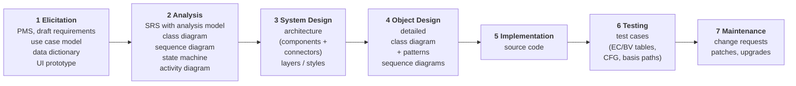

### Milestones and work products (L1 work-product table)

| Phase                      | Work products / milestones                                                                      |
| -------------------------- | ----------------------------------------------------------------------------------------------- |
| Requirements specification | SRS, prototype, requirements review                                                             |
| Design | Software Design Document, Interface Design Document, models, **test cases**; preliminary & final design reviews |
| Implementation             | Source code, system build, technical documentation, user manual                                 |
| Testing                    | Test execution, test report, user acceptance test                                                   |
| Maintenance                | Change request, bug report, patch release, upgrade                                              |

### Definition to memorise

> **Software engineering** is _the production of maintainable, fault-free software that meets the
> user's requirements and is delivered on time and within budget._

Four testable clauses: **maintainable**, **fault-free**, **meets requirements**, **on time / on budget**.

### The four process activities (also the exam-safe summary)

**Specification** (what it should do) → **Design & implementation** (organisation + code) →
**Validation** (does it do what the customer wants) → **Evolution** (change in response to need).

> ⚠️ **Trap:** the SDLC _activities_ and the _process models_ are different things. Waterfall /
> incremental / reuse-oriented are **models** (arrangements of the activities). MVC / layered /
> client–server are **architectures**. Design patterns are **micro-architectures**. Mixing these
> three vocabularies is a terminology mistake; distinguish these levels.

### Requirement → analysis → design traceability chain

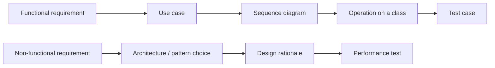

---

## 2. Requirements elicitation (L2–L4)

### 2.1 Project mission statement

Two or three sentences that define:

1. **The problem** — what will be done (scope and limits).
2. **The stakeholders** — developers and users.
3. **The outcomes and benefits** — plus a completion criterion.

> _"The GoFast team will develop a website that enables airline travellers to rate their travel
> experiences. This project will be considered complete when the website has been tested and
> approved for release by the FactFinding Organisation. This project supports the International
> Travel Watchdogs objective to ensure air passengers can openly compare airlines."_

**Distinction:** a mission statement summarises purpose, stakeholders and benefits, rather than listing detailed features.
The SRS product-description section can include that mission statement (Writing SRS, pp. 7–8).

### 2.2 Elicitation techniques (six — memorise the list)

| Technique                     | Use when                                                                         |
| ----------------------------- | -------------------------------------------------------------------------------- |
| **Interview**                 | You need depth from one stakeholder; open questions                              |
| **Observation**               | Users cannot articulate what they do ("watch the work")                          |
| **Workshop**                  | Many stakeholders must agree; resolve conflicts fast                             |
| **Legacy product study**      | Replacing an existing system; inherit its quirks                                 |
| **Competitive product study** | No access to users; derive features from rivals                                  |
| **Prototype**                 | Requirements are visual/interaction-heavy; "a picture is worth a thousand words" |

Two goals behind all six: **learn the problem domain** and **study user tasks**.

**Trap:** "Prototype" appears twice in the course — as an _elicitation technique_ (L2) and as a
_validation technique_ (L2) in the form of a **UI prototype** (storyboard, still images, interactive
prototype). Both are correct; state the purpose.

### 2.3 Functional vs non-functional requirements

|            | **Functional**                                                                                                       | **Non-functional**                                                                                                              |
| ---------- | -------------------------------------------------------------------------------------------------------------------- | ------------------------------------------------------------------------------------------------------------------------------- |
| Definition | Interactions between the system and its environment; maps program inputs to program outputs                          | Properties the system must have, not directly related to functional behaviour                                                   |
| Answers    | _What must the system do?_                                                                                           | _How well must it do it?_                                                                                                       |
| Sub-kinds  | System functionality · Information to be processed · Interface with other systems                                    | Usability · Reliability · Performance · Supportability (also security, availability, scalability, maintainability, portability) |
| Example    | "The library member must be able to search the library catalog."                                                     | "When a book is placed on the checkout pad, the system must detect it within 2 seconds."                                        |
| Example    | "The system must display the temperature in degrees centigrade in the range −10 °C to +130 °C to one decimal place." | "Help messages must be displayed in the local language according to the user's locale."                                         |
| Example    | "The system must be able to control up to six robot arms simultaneously."                                            | "After a system reboot, the full system functionality must be restored within 5 minutes."                                       |

**Classification drill (high-yield).** Decide which of these are FR vs NFR:

| Statement                                                                            | Answer                               | Why                                                      |
| ------------------------------------------------------------------------------------ | ------------------------------------ | -------------------------------------------------------- |
| The system must display the current time in 24-hour format                           | **FR**                               | Information to be processed                              |
| The database must be replaceable with any commercial product supporting standard SQL | **NFR** (supportability)             | Portability/replaceability property                      |
| The system must verify membership with the University Account System before a loan   | **FR**                               | Interface with another system                            |
| 80% of first-time users must enter a simple search query within 2 minutes            | **NFR** (usability)                  | Measurable quality target                                |
| The system must log the event when the email server is unreachable                   | **FR**                               | Functionality (though see §3 — may be an exception flow) |
| The system must be user-friendly | **NFR, but not verifiable as written** | Usability intent; needs a measurable criterion |

> ⚠️ **Trap:** the "control up to six robot arms" example is **functional** (number of controllable
> devices is a capability), while "response within 2 seconds" is **performance/NFR**. Do not classify
> by the presence of a number — classify by **what is being asserted**.

### 2.4 Atomic, verifiable, traceable

**Atomic** — one testable assertion per numbered statement. Nest sub-requirements.

> _Original:_ "When a computer is added, the tracking system requires the user to specify its type
> and allow the user to provide a description. Both these fields must be text of length > 0 and < 512."
>
> ```
> 1.1   When a computer is added to the tracking system, the user must enter the computer type.
> 1.1.1 The computer type data must be text of at least one character and less than 512 characters.
> 1.2   When a computer is added to the tracking system, the user must enter a description.
> 1.2.1 The description of the computer must be text of at least one character and less than 512 characters.
> ```

**Verifiable** — sufficiently specific to be testable, with an oracle.

| ✗ Not verifiable                                       | ✓ Verifiable                                                                                                        |
| ------------------------------------------------------ | ------------------------------------------------------------------------------------------------------------------- |
| The user interface must be user-friendly.              | 80% of first-time users must be able to enter a simple search query within 2 minutes of starting to use the system. |
| The system must control more than one drill press.     | The system must control up to seven drill presses concurrently.                                                     |
| The company must not hire too-young or too-old people. | 0–15 and 55–99: do not hire; 16–17: part-time; 18–54: full-time.                                                    |

**Traceability** — _the ability to track requirements from their expression in the SRS to their
realisation in design, documentation, source code, and their verification in reviews and tests; and
to track dependencies among requirements, system functions and system components._

> ⚠️ **Trap:** traceability is **not** just "numbering requirements". Numbering is a prerequisite
> (modifiability); traceability is the **link** forwards (to design/code/test) and backwards (to source).

### 2.5 Data dictionary (problem-domain glossary)

The table below is the lecture's **illustrative university domain**, not a statement of NTU's academic calendar.

- Ensures _consistent, unambiguous terminology_ that all stakeholders agree on.
- Defines **problem-domain** terms (Programme of Study, Course, Lecture, Tutorial, Class, Laboratory,
  Seminar) — **not** implementation terms (table, foreign key, thread).

| Term               | Definition                                                                                             |
| ------------------ | ------------------------------------------------------------------------------------------------------ |
| Programme of Study | A university programme a student enrols into. Three levels: undergraduate, master, PhD.                |
| Semester           | Four per academic year. Semesters 1 and 4 have 13 teaching weeks; semesters 2 and 3 have 5.            |
| Course             | A basic unit of teaching; compulsory or elective; must include lectures and tutorials; some have labs. |
| Lecture            | Traditional class in lecture theatres; video recorded and published in the LMS.                        |
| Tutorial           | Interactive, small-size class in technology-enhanced rooms; **not** video recorded.                    |

> ⚠️ **Trap:** the data dictionary is part of the SRS (§5 of the SRS contents). It is not a database
> schema and not a class diagram.

### 2.6 Requirements validation

| Technique                                                              | What it checks                                                                                                                                                                                          |
| ---------------------------------------------------------------------- | ------------------------------------------------------------------------------------------------------------------------------------------------------------------------------------------------------- |
| **Review** (walkthrough, inspection, critical review) with a checklist | completeness, consistency, unambiguity, correctness                                                                                                                                                     |
| **Prototype**                                                          | Stakeholders: the system specified meets their needs/desires (**correct**) and requirements are **prioritised**. Development team: requirements and underlying assumptions are **properly understood**. |

> ⚠️ **Trap:** review ≠ testing. Review is **static** (document inspection); testing is **dynamic**
> (execution). Both appear as "validation" in different lectures — read the context.

### 2.7 The iterative elicitation loop (memorise the steps)

**Step 1 — Project team alone.** Review the client's specification (and legacy/competitive products) to:

1. **Atomise** requirements.
2. Identify **actors**.
3. Identify main **use cases** (functional requirements).
4. Identify **non-functional** requirements.
5. Initiate the **data dictionary**.
6. Identify **uncertainties → TBD** (To Be Determined). _Never guess user requirements._

**Step 2 — Project team meets client** (interview / observation / workshop). Agenda agreed up-front:

1. Present and walk through the initial requirements + data dictionary → get agreement.
2. Clarify the TBD issues.
3. Discuss new requirements the client raises.

Repeat 1–2 **until** all uncertainties and ambiguities in functional, non-functional requirements and
data-dictionary terms are agreed with the client. A prototype may be produced to show intended
functionality. **Minimise the number of meetings by making meetings productive.**

> ⚠️ **Trap:** "Do not guess the user requirements" is an explicit lecture instruction — the correct answer to
> a missing requirement is **TBD + ask the client**, not "assume a sensible default".

---

## 3. Use case modelling (L3–L4)

### 3.1 UML in one table

UML = _a graphical notation with textual annotation for specifying, documenting and communicating
structure, functionality and dynamic behaviour of complex software systems._ Booch + Jacobson +
Rumbaugh; the lecture gives UML 1.1 adoption in 1997 and refers to UML 2.5 (2015). These are
historical references in the supplied slides, not a claim about the current UML release.

| Category                                       | Diagrams                                                                                                     |
| ---------------------------------------------- | ------------------------------------------------------------------------------------------------------------ |
| **Structure** (static, "irrespective of time") | Class, Object, Package, Component, Composite Structure, Deployment (L3 list)                                           |
| **Behaviour** (dynamic)                        | **Use Case**, **Activity**, **State Machine**, **Sequence**, **Communication**, Interaction Overview, Timing |

Course modelling focus: **use case, class, sequence, state machine,
activity** (communication/object appear in the SRS figure list).

**Trap:** UML is **not** a programming language and **not** a method. "Only use the diagrams that are
useful and necessary to define the system" — select diagrams for the modelling need rather than drawing every diagram type.

### 3.2 Use case model = static + dynamic

> **Use case model = Use case diagram (static) + Use case descriptions (dynamic).**

The diagram identifies relationships; the description specifies the behaviour. Supply both when requested.

### 3.3 Diagram elements

| Element             | Notation                                               | Meaning                                                                              |
| ------------------- | ------------------------------------------------------ | ------------------------------------------------------------------------------------ |
| **Actor**           | Stick figure, labelled with role (not a person's name) | An **external** entity that interacts with the system                                |
| **Use case**        | Ellipse, labelled with a verb phrase                   | A unit of functionality performed by the system yielding a result/value for an actor |
| **Association**     | Solid line actor↔use case                              | Actor participates in that use case                                                  |
| **System boundary** | Rectangle around use cases                             | Separates system from environment                                                    |
| **Generalization**  | Solid line, hollow triangle pointing to the parent     | Actor or use-case specialisation                                                     |
| **«include»**       | Dashed arrow from base → included                      | Base **always** performs the included behaviour                                      |
| **«extend»**        | Dashed arrow from extending → base                     | Extending behaviour is **optional/conditional**                                      |

### 3.4 «include» vs «extend» — decomposition, reuse and optional behaviour

|                 | **«include»**                                                                                                            | **«extend»**                                        |
| --------------- | ------------------------------------------------------------------------------------------------------------------------ | --------------------------------------------------- |
| Trigger         | Always, as part of the base                                                                                              | Under an explicit condition / at an extension point |
| Purpose         | Functional decomposition, or **reuse** of common behaviour                                                               | Add **optional** functionality                      |
| Base alone is…  | **Incomplete** without the included UC                                                                                   | **Complete by itself**                              |
| Arrow direction | base ──► included                                                                                                        | extending ──► base                                  |
| Course example  | Manage Incident **includes** Create / Handle / Close Incident; Open Incident and Allocate Resources **include** View Map | Report Emergency ◄── **extends** ── Help            |

> ⚠️ **Trap #1 (arrow direction).** Students reverse «extend» arrows constantly. Mnemonic:
> **"include points to the helper; extend points to the host."**
>
> ⚠️ **Trap #2 (exclusive use).** If the behaviour _always_ happens, it is **include**, not extend.
> If behaviour is conditional, first decide whether it belongs in an alternative/exception flow or a
> separate extending use case. Conditional behaviour alone does not require **extend**.
>
> ⚠️ **Trap #3.** "A includes B" is read as _"an instance of A performs all the behaviour of B —
> A delegates to B."_ It is **not** "B is part of A's name".
>
> ⚠️ **Trap #4.** An alternative flow (e.g. wrong PIN) is **not** automatically an «extend» use case.
> Small variations belong in the **use case description**; «extend» is for a genuinely separate
> optional unit of functionality.

### 3.5 The use case description — mandatory fields

1. **Participating actors** (with the **initiating actor** identified).
   - A use case can have more than one participating actor.
   - The **initiating actor triggers** the use case.
   - If triggered by a **system event or another use case**, the initiating actor is **NULL**.
2. **Entry conditions (pre-condition)** — system state that must be satisfied to execute.
3. **Exit conditions (post-condition)** — system state that must be reached afterwards.
4. **Flow of events** (a.k.a. normal / main success flow) — alternating actor and system steps:
   step 1 = how the actor triggers; step 2 = how the system responds; …
5. **Alternative flows** — variations or errors that **return to the normal flow** (e.g. invalid
   card/PIN → back to step 2; insufficient funds → back to step 6).
6. **Exceptions** — exceptional situations that **cause the use case to fail** (e.g. three invalid
   PIN attempts → card suspended; ATM out of funds → refuses card).

Template also captures: Use Case ID, Name, Created/Updated by, dates, Actor, Description, Priority,
Frequency of Use, Includes, Special Requirements, Assumptions, Notes and Issues.

### 3.6 Worked example — "Withdraw Money using ATM"

**Participating actors:** Bank Customer (**initiating**), Bank (secondary/external system).
**Entry conditions:** (1) customer has an account with the bank **and** (2) has an ATM card and PIN.
**Exit conditions:** (1) customer receives the requested cash **or** (2) customer receives an
explanation from the ATM why cash could not be dispensed.

**Normal flow (note the A/S alternation):**

| #   | Actor step                      | System step                                          |
| --- | ------------------------------- | ---------------------------------------------------- |
| 1   | Inputs the card into the ATM    |                                                      |
| 2   |                                 | Requests input of a six-digit PIN                    |
| 3   | Enters a PIN                    |                                                      |
| 4   |                                 | Verifies card and PIN with account info in the Bank  |
| 5   |                                 | If verified, requests the amount to withdraw         |
| 6   | Enters an amount                |                                                      |
| 7   |                                 | Verifies the amount is available in the account      |
| 8   |                                 | If sufficient funds, outputs money, card and receipt |
| 9   | Removes card, receipt and money |                                                      |

**Alternative flows**

- **AF-S5 (invalid card and PIN):** 1. ATM displays "Invalid card and PIN. Please try again!" for 2 s. 2. ATM **returns to step 2**.
- **AF-S8 (insufficient funds):** 1. ATM displays "Insufficient funds… enter a smaller amount!" for
  2 s. 2. ATM **returns to step 6**.

**Exceptions**

- **EX1 (invalid PIN three times):** 1. Displays "Card is suspended! Please call customer service
  (1633)…" for 2 s. 2. Outputs the card. → _Use case fails._
- **EX2 (ATM has insufficient funds):** 1. Displays "This ATM is off-service due to insufficient
  funds!" at the start screen. 2. Does not accept the card.

> ⚠️ **Trap:** the AF/EX distinction is graded. **AF = recoverable, returns to a step. EX = terminal,
> the goal is not achieved.** "Insufficient funds in _account_" is recoverable (AF); "insufficient
> funds in _ATM_" is not (EX). Read carefully which one the question describes.

### 3.7 Deriving use cases from functional requirements

Use the Library Management System drill (L3):

| #   | Functional requirement                                                    | Actor(s)                          | Use case            | Association                     |
| --- | ------------------------------------------------------------------------- | --------------------------------- | ------------------- | ------------------------------- |
| 1   | Member searches for materials                                             | Member                            | Search Material     | —                               |
| 2   | Member loans materials                                                    | Member                            | Loan Material       | —                               |
| 3   | System verifies membership with University Account System **before** loan | Member, University Account System | Verify Member       | «include» from Loan Material    |
| 4   | Member returns materials via drop-off kiosk                               | Member, Library Drop-off Kiosk    | Return Material     | —                               |
| 5   | System sends overdue notice via CITS Email Server                         | CITS Email System                 | Send Overdue Notice | —                               |
| 6   | **When** network to CITS fails, log the event                             | — (system event)                  | Log Network Issues  | «extend» on Send Overdue Notice |

**Method (do this in the exam, in order):**

1. **Identify actors** — scan for _people/roles_ and _external systems_; underline nouns.
2. **Identify use cases** — scan for _verb phrases describing a goal_ ("search", "loan", "return",
   "send notice"). One goal = one use case.
3. **Identify associations** — draw actor↔UC lines only where the actor participates.
4. **Add include/extend/generalization** — only where justified; annotate with one sentence of
   reasoning.
5. **Write the description** for the use cases the question names.

**Lecture comparison.** L3, pp. 20–22, shows three candidate library diagrams, including different
choices of actor and authentication behaviour. Do not treat every candidate as an approved solution.
Trace each element to the stated requirements: membership verification is required before a loan;
Login is not stated for the library example. L4, pp. 12–16, separately uses Login in the course
registration example. Explain the system boundary and reuse choice.

**Trap — actors vs system internals.** "Database", "Sensor" (if part of the system's own hardware),
"UI" are **not** actors. But an **external** University Account System, CITS Email Server, Billing
System, Library Drop-off Kiosk **are** actors.

**Trap — actor generalization.** If Student and Professor share Login, model an abstract **User**
actor with generalization arrows from Student/Professor to User, then associate Login with User.
Do not draw duplicate Logins.

---

## 4. Requirements analysis: conceptual model & class diagrams (L5)

### 4.1 Elicitation vs analysis (L5 distinction)

|             | **Requirements elicitation**                                     | **Requirements analysis**                                                                            |
| ----------- | ---------------------------------------------------------------- | ---------------------------------------------------------------------------------------------------- |
| Purpose     | Find out **what customers want**                                 | Produce a system model that is **correct, complete, consistent, unambiguous** based on the use cases |
| Output      | Description of the system in terms of **actors and use cases**   | **Conceptual model** (system structure) + **dynamic model** (system behaviour)                       |
| Perspective | Customer's                                                       | Software engineer's                                                                                  |
| Artefacts   | SRS, use case diagram + descriptions, data dictionary, prototype | Class diagram (boundary/control/entity), sequence diagrams, state machines, activity diagrams        |

Formalising requirements with analysis models: **clarifies** structure and dynamics, **validates**
requirements, **underpins** solution modelling.

### 4.2 Conceptual model vocabulary

| Element       | Definition                                               | Example                                                            |
| ------------- | -------------------------------------------------------- | ------------------------------------------------------------------ |
| **Object**    | Anything that has a **state** and exhibits **behaviour** | Bus, Dog, Company; _LoginForm, UserVerifier, UserList_             |
| **Operation** | Procedure through which objects communicate              | Bus: Stop, Start; Company: Sell, Quote; UserVerifier: authenticate |
| **Attribute** | Variable holding state information                       | Bus: Seats, Colour; Company: Name, Employees                       |

Documented in a **class diagram**: Object → Class; Roles of the object → Attributes and methods of
the class.

### 4.3 Class notation

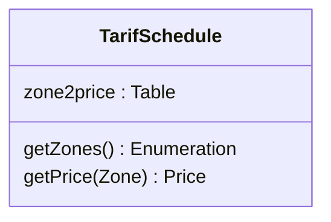

### 4.4 Relationships — notation and reading

| Relationship                 | Notation                                                           | Meaning                                                                         | Reading test                  |
| ---------------------------- | ------------------------------------------------------------------ | ------------------------------------------------------------------------------- | ----------------------------- |
| **Association**              | Plain solid line                                                   | Semantic relationship between instances                                         | "A is related to B"           |
| **Navigability**             | Open arrowhead pointing **at the target** class                    | Instances at the plain end can reach the class the arrow points at              | "from A you can reach B"      |
| **Non-navigable**            | Small **x** on the end                                             | That end is explicitly _not_ reachable                                          | "B cannot be reached from A"  |
| **Unspecified navigability** | Solid line with **nothing** at either end                          | Direction of navigation is left unspecified — **not** the same as bidirectional | "assume nothing"              |
| **Generalization**           | Solid line + **hollow** triangle at the **general** (parent) class | Inheritance ("is-a"); carries **no** multiplicity and no role names             | "B is a kind of A"            |
| **Abstract class parent**    | Solid line + hollow triangle (name italicised)                     | Cannot instantiate                                                              |                               |
| **Interface**                | **Dashed** line + hollow triangle                                  | Realisation ("can-do")                                                          | "B implements contract A"     |
| **Aggregation**              | **Hollow** diamond at the **whole**                                | "is part of" (parts can outlive whole)                                          | "the whole has parts"         |
| **Composition**              | **Filled** diamond at the **whole**                                | "is entirely made of"; **parts live and die with the whole**                    | "delete whole ⇒ delete parts" |
| **Dependency**               | **Dashed** arrow, open head                                        | "uses temporarily"; often an implementation detail, not part of state           | "A needs B to do its job"     |

#### What the relationships look like

The following are concrete class-diagram sketches. Read the symbol **at the end of the line**
carefully: that is where the relationship is attached.

<div align="center">

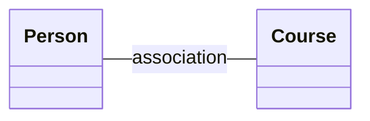

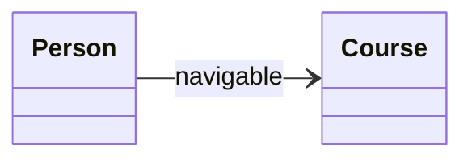

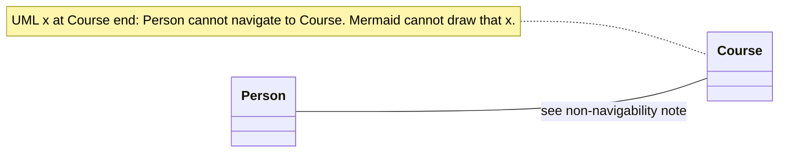

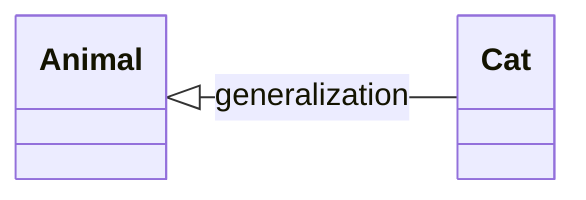

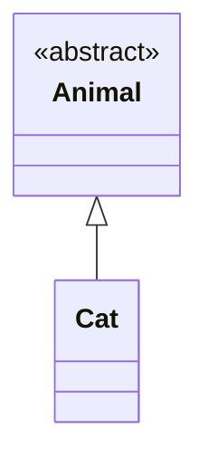

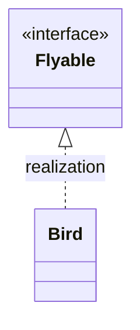

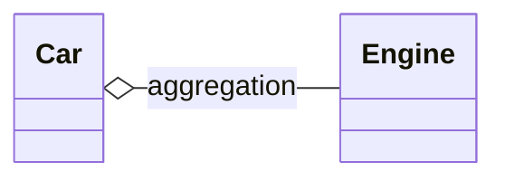

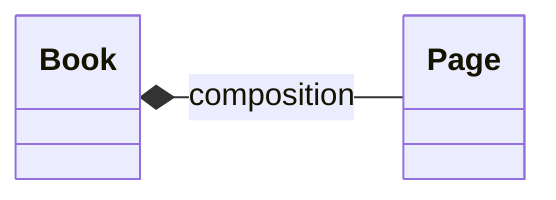

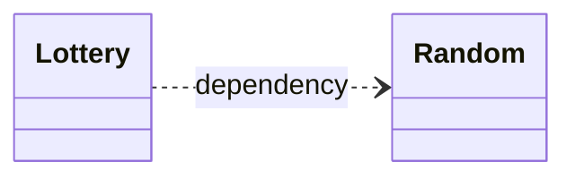

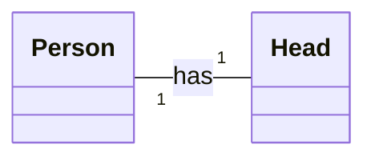

</div>

With multiplicities, the same relationship becomes more precise:

The diagram follows L5, p. 11: one `Person` has exactly one `Head`, and each `Head` belongs to
exactly one `Person`. The same slide shows `Polygon "1" -- "*" Point` for one-to-many.

Course reminders: the Mermaid diagrams above show `Car` aggregation with `Engine`, `Book`
composition with `Page`, and `Lottery` dependency on `Random`.

**Multiplicity cheatsheet**

| Notation      | Meaning                |
| ------------- | ---------------------- |
| `1`           | Exactly one            |
| `0..1`        | Zero or one (optional) |
| `*` or `0..*` | Zero or more           |
| `1..*`        | One or more            |
| `3`           | Exactly three          |
| `1..6`        | Between one and six    |

**How to read a multiplicity correctly:** the number is written **at the end near the class it
counts**. `Person "1" -- "1" Head` means one Head per Person and one Person per Head.
`Polygon "1" -- "*" Point` means zero or more Points per Polygon and one Polygon per Point.

**Notation conflict in sources:** L5, p. 13, draws a filled arrowhead for a concrete superclass.
The supplied UML specification notes use the UML hollow triangle for generalization. Use a solid
line and hollow triangle for class inheritance, and a dashed line and hollow triangle for interface
realisation. Abstract class names are italicised or marked `{abstract}`; Mermaid uses an annotation.

#### One line, two ends — read both ends against the same relationship

Every line is **one** relationship with **two** ends, and each relationship type permits only its
own adornments. Importing an adornment from a different relationship produces a diagram that is
not valid UML (a notation error).

| Rule                                                                                                                                                 | Why it matters                                                                                                                                          |
| ---------------------------------------------------------------------------------------------------------------------------------------------------- | ------------------------------------------------------------------------------------------------------------------------------------------------------- |
| A **generalization** carries _only_ the hollow triangle at the **general** class — no multiplicity, no role name, no open arrowhead at the other end | Generalization is not an association: it says nothing about counts or about which instance can reach which                                              |
| The **hollow triangle points at the general (parent) class**; the subclass sits at the plain end                                                     | `Cat ―▷ Animal` = "Cat is a kind of Animal"; a triangle at `Cat` claims the reverse                                                                     |
| **Multiplicity at both ends ⇒ it is an association**, never a generalization                                                                         | Two multiplicities _is_ the association pattern; a "generalization" drawn that way is a different, malformed relationship                               |
| A **solid line with nothing at either end conveys no navigability**                                                                                  | Navigation is shown only by an open arrowhead (or an `x` for explicitly non-navigable). No arrowhead = **unspecified**, so do not call it bidirectional |

Worked reading, using the sketches above:

- `Person --> Course` — **one** association, navigable from `Person` to `Course` (arrowhead at
  `Course`). Nothing is said about `Course → Person`.
- `Animal <|-- Cat` — **one** generalization, hollow triangle at `Animal` (the general class). It has
  **no** multiplicities: "how many Animals per Cat" is not a question generalization answers.
- `Animal "1" -- "*" Cat` — **not** a generalization even if you add a triangle: with multiplicities
  at both ends this is an association ("one Animal is associated with many Cats").
- `Person ― Course` with no adornments — the relationship exists, but its navigability is
  **unspecified**.

> ⚠️ **Trap #1 (diamond side).** The diamond is always at the **whole**, never at the part. If you
> write `Engine ◆— Car`, you have said "an Engine is made of Cars".
>
> ⚠️ **Trap #2 (aggregation vs composition).** Only composition implies **lifetime dependency** and
> **exclusive ownership (a part is in at most one composite at a time)**. L5 uses Book/Page for
> composition and Car/Engine for aggregation. Reassignment alone does not distinguish them: a
> composite part can be detached before deletion. State ownership and lifetime assumptions.
>
> ⚠️ **Trap #3 (association vs dependency).** Association = structural, persists in state.
> Dependency = temporary use (parameter, local variable, return type). "Lottery uses Random" ⇒ dependency.
>
> ⚠️ **Trap #4 (multiplicity direction).** Write the multiplicity at **both** ends of every
> association in the exam; omitted multiplicities leave the intended counts unspecified.
>
> ⚠️ **Trap #5 (generalization drawn as an association).** Multiplicity at **both** ends means the
> relationship is an **association**. A generalization may **not** carry multiplicities (or role
> names) at its ends: if you draw a hollow triangle _and_ `1 … *`, the diagram is malformed — decide
> which single relationship you mean and draw only that one.
>
> ⚠️ **Trap #6 (triangle direction).** The hollow triangle is attached to the **general** class and
> the plain end to the **specialised** class: `SavingsAccount ―▷ Account` = "a savings account is a
> kind of account". A triangle at `SavingsAccount` reverses the intended meaning.
>
> ⚠️ **Trap #7 (plain solid line ≠ bidirectional).** A solid line with no adornment at either end
> **does not convey navigability** — the direction is unspecified, not "both ways". Navigability is
> shown only by open arrowhead(s); draw one at **each** end if you truly mean bidirectional.

### 4.5 Stereotypes: entity / boundary / control

| Stereotype     | Role                                           | Typical examples                                                 |
| -------------- | ---------------------------------------------- | ---------------------------------------------------------------- |
| **«entity»**   | Information tracked by the system | `Account`, `Silo`, `Shipment`                                    |
| **«boundary»** | Interaction between an actor and the system    | `LoginForm`, `EntryGate`, `FingerprintReader`                    |
| **«control»**  | Logic that realises a use case (coordination)  | `FacilityAccessSystem`, `SheetManager`, `RegistrationController` |

Worked example — **EnterSecureFacility**:

> 1. User presses finger on FingerprintReader. 2. FingerprintReader scans and sends image to
>    FacilityAccessSystem. 3. FacilityAccessSystem validates fingerprint and unlocks EntryGate.
> 4. EntryGate signals the system it has opened. 5. FacilityAccessSystem locks EntryGate, logs the
>    entry event and increments occupant count.

Classes: `Employee` («entity»), `Fingerprint` («entity»), `FingerprintReader` («boundary»),
`EntryGate` («boundary»), `FacilityAccessSystem` («control»).
Relations with stereotypes: `<<read>>`, `<<call>>`, `<<signal>>` (usage dependencies between them).

**L15 mapping:** UI event handling is in the presentation boundary; business coordination and
data are inside the Model. The course's mapping is:
**(View, Controller) ↔ boundary; Model ↔ entity + control (app logic + data)**.

### 4.6 Four-step analysis procedure

1. Identify the **classes**.
2. Find the **attributes** for each class.
3. Find the **methods/operations** for each class.
4. Find the **associations** between classes.

How to find classes:

1. **Recurring nouns/concepts** in the use cases.
2. **Real-world entities** the system must track.
3. **Application/problem-domain terms** in the data dictionary.
   Then **review definitions and attributes with stakeholders**.

> ⚠️ **Trap:** do **not** promote every noun to a class. If a noun has no attributes, no identity and
> no behaviour of its own (e.g. "amount", "date", "grade"), it is an **attribute**, not a class.
> Conversely "grade" in GES has an enumerated domain and constrains storage rules → it can justify a
> class/type in the design model.

---

## 5. Dynamic models: state machine & activity diagrams (L6)

### 5.1 State machine diagram (a.k.a. statechart, finite state automaton, **dialog map**)

- Models a system/object by the **states** it can be in.
- **State** = a _stable condition_ that exists for a period (or all) of time until an **action/event**
  drives it to another stable state.
- Finite number of states; transitions determined by previous state and actions.
- Notation: rounded rectangle, name at top, optional **entry / action**, **exit / action**, **do / activity**.
- A diagram begins with a **start node** (filled circle) and ends with an **end node** — **unless** the
  system loops forever, in which case there is no end node.
- A transition is **assumed instantaneous** in response to an event. Full label:

```
event(arguments) [guard] / action
```

**Dialog map** = a state machine used to prototype navigation. Since most UIs show one screen/window
at a time (a state) with defined conditions to move (transitions), dialog maps:

- find **missing or incorrect navigation pathways early**, when they are cheap to fix;
- spot **reuse opportunities and redundancies** without premature screen design.

**Vending machine dialog map (L6, p. 7):**

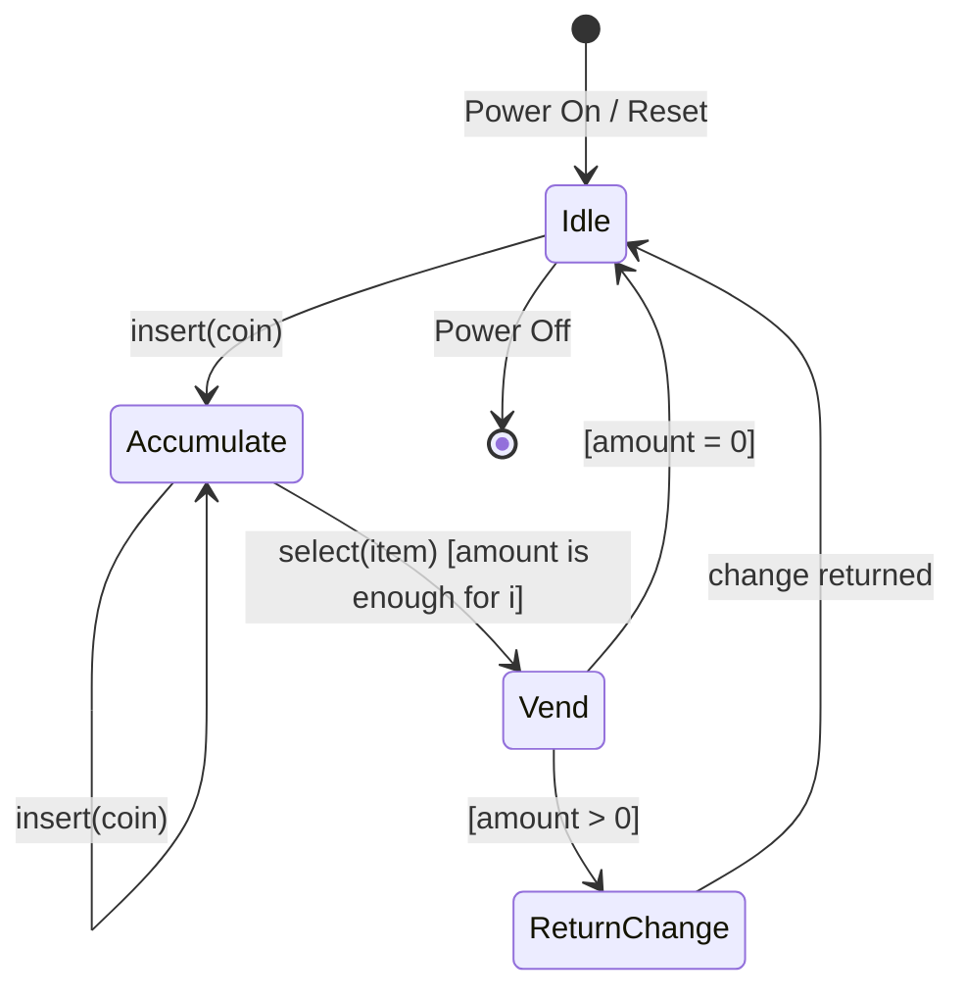

| State | Entry action | Do activity |
| --- | --- | --- |
| Idle | `amount := 0` | `display(greeting)` |
| Accumulate | `amount := amount + c.amount` | `display(amount)` |
| Vend | `amount := amount − i.cost` | `dispense(i); display(vending)` |
| ReturnChange | — | `return(amount)` |

The lecture types the events as `insert(c:Coin)` and `select(i:item)`; Mermaid labels shorten them
to avoid a colon parsing limitation. The self-transition on Accumulate re-enters the state and adds the next coin. ReturnChange returns
to Idle after returning change; the slide leaves that completion transition unlabelled.

Stopwatch practice (L6, p. 9): Ready enters with `Reset time`; Start moves Ready to Continuous Update;
Stop moves Continuous Update to Time Paused; Start resumes. Reset moves **Time Paused to Ready**.
Close Window exits from each state. Do not invent a Reset transition from Continuous Update.

**State/activity distinction:** a state is a condition; its `do/` activity describes work performed
while active. An activity may finish before the state is exited. `entry/` and `exit/` execute on each
entry and exit, including repeated entries. A decision's guards should be mutually exclusive and
cover the intended cases, with `[else]` where needed.

### 5.2 Activity diagram

- **Activity** = execution of one or more basic operations (rounded rectangle).
- **Control flow** = arrows.
- **Fork** = one input, two or more **concurrent** outputs (**thick bar**).
- **Join** = two or more flows come together into one (**thick bar**).
- **Decision/branch** = one input, several guarded outputs (**diamond**).
- **Merge** = several branches into one (**diamond**).

Laundry example: `Sort Clothes in Whites and Darks` → **fork** → (`Wash Whites` ‖ `Wash Darks`) →
**join** → `Dry Clothes`. Drying loop: `Run Dryer —[still wet]→ Run Dryer`, `Run Dryer —[else]→ Fold Clothes`.

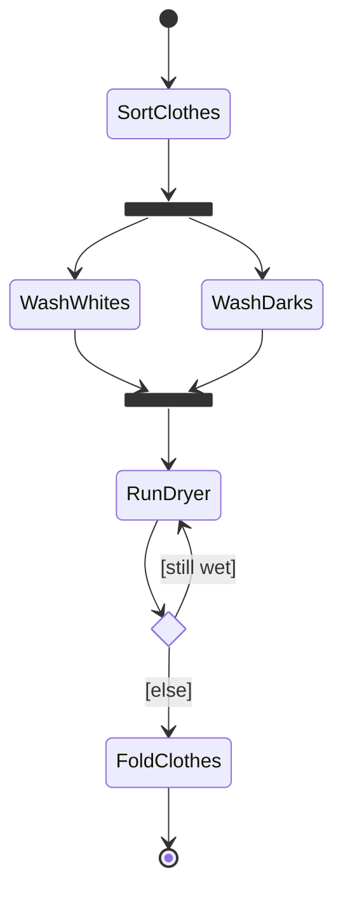

This Mermaid state-diagram rendering supplies fork/join bars for the **activity workflow**. In UML,
use action nodes, an activity initial/final node, and guarded decision/merge diamonds. A join
synchronises concurrent branches; a merge combines alternatives without waiting for every input.

### 5.3 State machine vs activity diagram (L6 comparison)

|              | **State machine**                                         | **Activity**                                  |
| ------------ | --------------------------------------------------------- | --------------------------------------------- |
| Models       | The **states** of a system/object and events that move it | The **workflow of activities** (a flow chart) |
| Node meaning | A stable condition                                        | A unit of work                                |
| Focus        | Event-driven **reactive** behaviour                       | Procedural **control flow**, concurrency      |
| Typical use  | UI navigation (dialog map), protocol/device states        | Business process, algorithm, use-case flow    |

> ⚠️ **Trap:** fork/join are **bars**; decision/merge are **diamonds**. A diamond for concurrency
> or a bar for a conditional branch uses the wrong notation.

### 5.4 The requirements elicitation & analysis activity diagram (memorise the loop)

1. Study the client's initial specification.
2. Generate the initial use case diagram/descriptions, data dictionary, FRs/NFRs and uncertainties.
3. Review requirements with the client.
4. If elicitation is not agreed, refine those artefacts and repeat the review.
5. Once initial elicitation is agreed, identify classes and draw initial class diagrams.
6. Add associations/multiplicities and dynamic diagrams; record new uncertainties.
7. Review the analysis and requirements with the client.
8. If use cases are affected, update them.
9. Refine class diagrams and other affected diagrams; repeat the review.
10. When requirements are agreed, sign off the SRS.

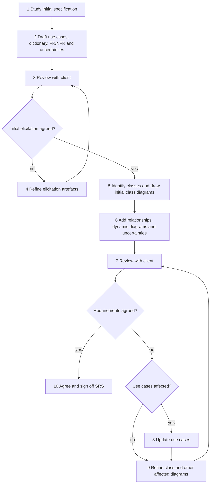

---

## 6. The SRS (L4, L6, "Writing SRS")

### 6.1 What the SRS is (six definitions that get paraphrased into exam questions)

1. The **output of requirements elicitation and analysis**.
2. An organisation's **written understanding** of a customer's requirements and dependencies at a
   point in time, prior to design/development.
3. A **two-way insurance policy**: both client and organisation understand each other's requirements.
4. A statement in **precise, clear language** of the functions and capabilities the system must
   provide, plus required constraints.
5. A **blueprint** for completing the project with as little cost growth as possible.
6. **Detailed functional and non-functional requirements — it does NOT contain design suggestions.**

### 6.2 Purpose of the SRS (4 items)

1. Give the customer assurance that the organisation understands the problems to be solved and the
   necessary software behaviour.
2. **Decompose** the problem into component parts.
3. Serve as **input to the design specification** — so it must contain sufficient functional detail
   for a design solution to be devised.
4. Serve as the **parent/master document for testing and validation**.

### 6.3 Contents (5 sections — memorise the numbering)

| §   | Section                         | Contents                                                                                                                                                                              |
| --- | ------------------------------- | ------------------------------------------------------------------------------------------------------------------------------------------------------------------------------------- |
| 1   | **Product description**         | a) Purpose of the system (mission statement) · b) Scope · c) Users and stakeholders · d) Assumptions and constraints                                                                  |
| 2   | **Functional requirements**     | Precise numbered statements + activity diagrams, use case diagrams with descriptions, class diagrams, sequence diagrams, communication diagrams, state machine diagrams, UI prototype |
| 3   | **Non-functional requirements** | Numbered statements covering performance, standards, reliability, availability, security, maintainability, portability                                                                |
| 4   | **Interface requirements**      | a) **User** (screen formats, layouts, report/menu content, function keys) · b) **Hardware** (ports, instruction sets) · c) **Software** (interfaces to DBMS, OS, maths packages)      |
| 5   | **Data dictionary**             | Unambiguously defines all terms, phrases and abbreviations used in the SRS                                                                                                            |

Standards reference: **IEEE 830-1998**, _IEEE Recommended Practice for Software Requirements
Specifications_.

Who writes it: it should be in **natural language, unambiguous, with diagrams as necessary**; it must
be understood by the development team; programmers/managers are seldom the best writers, so it is
good practice to **involve a technical writer**.

### 6.4 The nine language-quality characteristics

| #   | Characteristic  | Test you can apply                                                                                     |
| --- | --------------- | ------------------------------------------------------------------------------------------------------ |
| 1   | **Correct**     | Only user representatives can confirm; include them in inspections                                     |
| 2   | **Feasible**    | Implementable within known capabilities/limits of system and environment                               |
| 3   | **Necessary**   | Can you identify its origin (customer need, external interface, standard)? If not, maybe not necessary |
| 4   | **Unambiguous** | Multiple readers must reach **one** interpretation                                                     |
| 5   | **Verifiable**  | Can you devise a test / inspection / demonstration for it?                                             |
| 6   | **Complete**    | Nothing missing; organise hierarchically so reviewers can spot gaps                                    |
| 7   | **Consistent**  | No conflict with other requirements or higher-level requirements                                       |
| 8   | **Modifiable**  | Uniquely labelled, expressed separately, change history maintained                                     |
| 9   | **Traceable**   | Link each requirement to its source and its realisation                                                |

### 6.5 Word list (memorise both columns)

**✓ Use these words**

| ✓ Use               | Meaning                                                             |
| ------------------- | ------------------------------------------------------------------- |
| **Shall**           | Dictates provision of a functional capability                       |
| **Must / Must not** | Establishes performance requirement or constraint                   |
| **Is required to**  | Imperative in SRS statements                                        |
| **Are applicable**  | Includes standards/documentation by reference                       |
| **Responsible for** | Imperative for pre-defined architectures                            |
| **Will**            | Cites what the operational/development **environment** will provide |

**✗ Avoid these words**

| ✗ Avoid                        | Why                |
| ------------------------------ | ------------------ |
| adequate                       | vague threshold    |
| as a minimum                   | unbounded          |
| be capable of…                 | avoids commitment  |
| as applicable / as appropriate | optional           |
| effective                      | unmeasurable       |
| if possible / if practical     | optional           |
| timely                         | unmeasurable       |
| normal                         | undefined baseline |

> The two lists are **independent** — the lecture presents them side by side, so a row on the left
> is not the "opposite" of the row on the right.

> ⚠️ **Trap (shall vs will).** **Shall** binds the _system_; **will** describes what the
> _environment_ supplies. "The system **shall** …" is a requirement; "The user **will** provide a
> valid card" is an assumption about the environment. Swapping them blurs responsibility for the behaviour.
>
> ⚠️ **Trap (SRS ≠ design).** If your SRS contains "we will use a Singleton factory", you have
> violated definition 6. Design decisions belong in the SDD.

---

## 7. Software processes (L8)

### 7.1 Definitions

> A **software process** is _a structured set of activities required to develop a software system._

All processes involve four activities:

1. **Specification** — defining what the system should do.
2. **Design and implementation** — defining the organisation of the system and implementing it.
3. **Validation** — checking that it does what the customer wants.
4. **Evolution** — changing the system in response to changing customer needs.

> A **software process model** is _an abstract representation of a process — a description from some
> particular perspective._

**Process descriptions** include, besides activities and their ordering:

- **Products** — outcomes of a process activity;
- **Roles** — responsibilities of the people involved;
- **Pre- and post-conditions** — statements true before/after an activity or product.

### 7.2 Plan-driven vs agile

|           | **Plan-driven**                                                           | **Agile**                                                                                                  |
| --------- | ------------------------------------------------------------------------- | ---------------------------------------------------------------------------------------------------------- |
| Planning  | All activities planned **in advance**; progress measured against the plan | Planning is **incremental**; process easily changed to reflect changing requirements                       |
| Iteration | Iteration occurs **within** activities                                    | Specification, design, implementation, testing are **inter-leaved**; outputs negotiated during development |
| Outputs   | Decided **up front**                                                      | Decided through **negotiation** during the process                                                         |

Most practical processes include **elements of both**. **There are no right or wrong software
processes.**

### 7.3 The three general models

| Model                                            | Shape                                                                                    | When used                                                                                                           | Key benefit                                                                             | Key problem                                                                                                              |
| ------------------------------------------------ | ---------------------------------------------------------------------------------------- | ------------------------------------------------------------------------------------------------------------------- | --------------------------------------------------------------------------------------- | ------------------------------------------------------------------------------------------------------------------------ |
| **Waterfall**                                    | Separate, distinct, sequential phases                                                    | Requirements **well understood** and changes limited; large systems-engineering projects developed at several sites | Plan-driven coordination across sites                                                   | **Difficulty of accommodating change** once under way; inflexible partitioning                                           |
| **Incremental**                                  | Specification, development, validation **inter-leaved**; may be plan-driven **or** agile | Most business systems                                                                                               | Lower cost of accommodating change; easier customer feedback; earlier delivery of value | **Process not visible** (managers need deliverables); **structure degrades** as increments are added unless you refactor |
| **Integration & configuration (reuse-oriented)** | Assemble from existing components/COTS                                                   | Systems buildable from existing assets; standard for many business systems                                          | Reduced cost and risk; faster delivery                                                  | **Requirements compromises inevitable**; loss of control over evolution of reused elements                               |

**Waterfall phases** (exact names): Requirements analysis and definition → System and software design
→ Implementation and unit testing → Integration and system testing → Operation and maintenance.

**Incremental benefits (3):** reduced cost of accommodating changing requirements; easier customer
feedback on demonstrations; more rapid delivery/deployment of useful software.

**Incremental problems (2):** process not visible (managers need regular deliverables; producing
documents for every version is not cost-effective); system structure tends to degrade as increments
are added (needs refactoring, else change becomes increasingly difficult/costly).

**Reuse-oriented phases (5):** requirements specification → software discovery and evaluation →
requirements refinement → application system configuration → component adaptation and integration.

**Types of reusable software (3):** stand-alone application systems (COTS) configured for a
particular environment; collections of objects packaged for a component framework (.NET, J2EE);
web services developed to service standards and remotely invocable.

> ⚠️ **Trap #1.** "Incremental = agile" is **false** — incremental development _may be plan-driven_.
>
> ⚠️ **Trap #2.** Waterfall's headline problem is **not** "no testing"; it has testing phases. The
> problem is **inflexibility to change** and the cost of rework.
>
> ⚠️ **Trap #3.** Reuse-oriented's headline problem is **not** "slower"; it is **faster but
> compromised requirements + loss of control** over reused elements.

### 7.4 Why costs are high / why maintenance dominates (Tutorial 4)

Prepare a _reasoned_ answer, not a slogan:

- **Costs**: requirements churn, integration of heterogeneous components, testing effort grows
  super-linearly with interfaces, coordination cost in teams, environment/tooling/long lifetimes.
- **Maintenance**: software is soft — it _can_ change, so it _must_ change (new requirements, new
  platforms, bug fixes). Systems can live for decades; ongoing fixes and adaptation accumulate over that lifetime. Unlike hardware, there is no manufacturing cost, so evolution dominates total cost.
- **Characteristics affecting development**: size (source/binary/users/developers/lifetime/versions),
  complexity (environment, technologies, hardware), cost and schedule constraints, non-functional
  requirements (performance, availability, security, scalability, extensibility).
- **Two distinct differences from hardware manufacturing**: (1) software is **designed, not
  manufactured** — copying is free; (2) software **does not wear out** — it degrades by change, and
  hardware failures follow a bathtub curve.

---

## 8. Agile, XP and Scrum (L9)

### 8.1 Why agile emerged

Rapid delivery became the dominant requirement: requirements change too fast for stable specs;
plan-driven development does not meet these needs; agile methods (late 1990s) aimed to **radically
reduce delivery time for working software**.

Agile development characteristics:

- program specification, design and implementation are **inter-leaved**;
- the system is developed as **a series of versions/increments**, with stakeholders involved in
  specification and evaluation of each version;
- **frequent delivery** of new versions for evaluation;
- **extensive tool support** (e.g. automated testing);
- **minimal documentation** — focus on working code.

### 8.2 Agile manifesto (4 values — quote them exactly)

> We are uncovering better ways of developing software by doing it and helping others do it. Through
> this work we have come to value:
>
> - **Individuals and interactions** over processes and tools
> - **Working software** over comprehensive documentation
> - **Customer collaboration** over contract negotiation
> - **Responding to change** over following a plan
>
> That is, while there is value in the items on the right, we value the items on the left more.

**Trap:** it does **not** say "no documentation". Both sides have value; the left is _valued more_.
Saying "agile means no documentation" is inconsistent with the manifesto.

### 8.3 The five agile principles

| Principle                | Description                                                                                     |
| ------------------------ | ----------------------------------------------------------------------------------------------- |
| **Customer involvement** | Customers closely involved throughout; provide and prioritise requirements, evaluate iterations |
| **Incremental delivery** | Software developed in increments; customer specifies requirements for each increment            |
| **People, not process**  | Recognise and exploit team skills; let teams develop their own ways of working                  |
| **Embrace change**       | Expect requirements to change; design to accommodate change                                     |
| **Maintain simplicity**  | Focus on simplicity in software and process; actively eliminate complexity                      |

**Applicability:** product development (small/medium product for sale) and custom in-house
development with a committed customer and few external rules/regulations.

**Across organisations:** managers may be risk-averse; large organisations have quality procedures
incompatible with agile bureaucracy; agile works best with **high-skill teams** but large orgs have a
wide skill range; cultural resistance where conventional processes are entrenched.

### 8.4 Extreme Programming (XP)

Extreme approach: new versions possibly **several times per day**; increments delivered **every 2
weeks**; **all tests run for every build**, and the build is accepted only if tests pass.

**Ten practices in L9, pp. 15–16:**

| Practice                   | Description                                                                                                                                    |
| -------------------------- | ---------------------------------------------------------------------------------------------------------------------------------------------- |
| **Incremental planning**   | Requirements on **story cards**; stories for a release chosen by time available and relative priority; developers break stories into **tasks** |
| **Small releases**         | Minimal useful functionality providing business value first; releases frequent, adding functionality                                           |
| **Simple design**          | Enough design for current requirements and no more                                                                                             |
| **Test-first development** | Automated unit test framework; tests written **before** functionality                                                                          |
| **Refactoring**            | Continuous improvement of code as soon as improvements are found                                                                               |
| **Pair programming**       | Two developers at one machine, checking each other's work                                                                                      |
| **Collective ownership**   | Pairs work on all areas; no islands of expertise; anyone can change anything                                                                   |
| **Continuous integration** | Task integrated into the whole system as soon as complete; after any integration all unit tests must pass                                      |
| **Sustainable pace**       | Large amounts of overtime unacceptable — reduces quality and medium-term productivity                                                          |
| **On-site customer**       | A representative end-user available **full time**; a member of the team, responsible for bringing requirements                                 |

Related lecture topics: **user stories for specification** and **automated test harnesses**.
These are not two extra entries in the ten-row practice table.

**Key influential practices (4):** user stories for specification, refactoring, test-first
development, pair programming.

**Refactoring — the lecture argument.** Conventional wisdom: _design for change_ — spend effort
anticipating change. XP: **changes cannot be reliably anticipated**, so instead do **constant code
improvement** so that change is cheap when it arrives. Benefits: improves understandability, reduces
the need for documentation, makes change easier. Cost: **architecture refactoring is much more
expensive**. Examples: reorganise a class hierarchy to remove duplicate code; rename/tidy attributes
and methods; replace inline code with library method calls.

**Pair programming — the lecture argument.** Dynamic pairs (everyone works with everyone) →
knowledge sharing reduces project risk when people leave; develops common ownership; acts as an
**informal review** (every line seen by ≥2 people); encourages refactoring. The lecture cites **some evidence** that a pair can be more efficient than two programmers working
separately; this is not a guaranteed productivity gain.

**Test-first development (TDD).** Writing tests before code **clarifies the requirements**; tests are
programs, not data, so they run automatically and self-check (JUnit); all previous + new tests run on
every addition → regression safety.

> ⚠️ **Trap:** TDD ≠ "testing at the end". TDD = test **first**, watch it fail, then implement. The
> "tests are written as programs rather than data" point is what makes automation possible.
>
> ⚠️ **Trap:** XP is technically focused and **hard to integrate with management practice** in most
> organisations — consequently the _method as originally defined is not widely used_, even though its
> practices are.

### 8.5 Scrum

Scrum focuses on **managing iterative development** rather than on specific technical practices.
The following describes the supplied L9 slides; do not treat their historical terminology as a
statement of the current Scrum standard. The slides themselves contain variants: p. 32 says no more
than 7 developers; p. 41 says 5–9. Neither is needed to infer the headcount in Tutorial 5 Q6.

**Three phases:**

1. **Outline planning** — establish general objectives, design the software architecture.
2. **Sprint cycles** — each develops an increment.
3. **Project closure** — wrap up, complete documentation (help frames, user manuals), assess lessons learned.

**Terminology (memorise verbatim-ish):**

| Term                                        | Definition                                                                                                                                                                                                                                                                  |
| ------------------------------------------- | --------------------------------------------------------------------------------------------------------------------------------------------------------------------------------------------------------------------------------------------------------------------------- |
| **Development team**                        | A **self-organising** group, **no more than 7 people**, responsible for developing the software and essential project documents                                                                                                                                             |
| **Potentially shippable product increment** | The increment delivered from a sprint; ideally in a finished state needing no further work (e.g. testing) before inclusion in the final product — _in practice not always achievable_                                                                                       |
| **Product backlog**                         | A list of "to do" items the Scrum team must tackle: feature definitions, requirements, user stories, or supplementary tasks such as architecture definition or user documentation                                                                                           |
| **Product owner**                           | An individual (or small group) who identifies features/requirements, **prioritises** them, and continuously reviews the backlog to ensure the project meets critical business needs; may be a customer, product manager, or stakeholder representative                      |
| **Scrum (meeting)**                         | A **daily** meeting of the Scrum team reviewing progress and prioritising work for that day; ideally short, face-to-face, whole team                                                                                                                                        |
| **ScrumMaster**                             | Ensures the Scrum process is followed, guides the team in effective use of Scrum, interfaces with the rest of the company, protects the team from outside interference. **Should NOT be thought of as a project manager** (the developers are adamant; others may disagree) |
| **Sprint**                                  | A development iteration, usually **2–4 weeks**                                                                                                                                                                                                                              |
| **Velocity**                                | An estimate of how much product-backlog effort the team can cover in one sprint; basis for estimating what fits and for measuring improvement                                                                                                                               |

**Sprint cycle:** fixed length 2–4 weeks → planning starts from the **product backlog** → **selection
phase** (whole team + customer select features for the sprint) → team self-organises and develops,
**isolated from customer and organisation**, all communication channelled through the ScrumMaster,
whose role is to **protect the team from external distractions** → at the end, work reviewed and
presented to stakeholders → next sprint begins.

**Teamwork in Scrum:** the ScrumMaster is a **facilitator** who arranges daily meetings, tracks the
backlog, records decisions, measures progress against the backlog, and communicates with customers
and management outside the team. Everyone attends the short daily meeting and shares progress,
problems, and plans for the next day → everyone knows what is going on and can re-plan short-term work.

**Scrum benefits (5):** product broken into manageable, understandable chunks; unstable requirements
do not hold up progress; whole team has visibility → communication improves; customers see on-time
delivery and give feedback; trust is established and a positive culture created.

**Practical Scrum material (L9, pp. 38–61; some pages are image-only):**

- **Product backlog:** owned by the PO; ordered requirements/features/tasks for the product.
- **Sprint backlog:** selected product backlog items **plus the plan** for delivering the increment
  and Sprint Goal; owned by the Development Team. The slides protect the selected sprint scope and
  goal, while task estimates and remaining work are updated daily. Unfinished work returns to the
  product backlog for reconsideration; it earns no completed velocity points.
- **Product increment:** integrates Done work with previous increments; tested and potentially
  releasable. Potentially shippable does not mean a release must occur every sprint.
- **Sprint planning:** PO presents ordered items; developers decide how much fits and how to build it.
  Tasks are estimated in hours (the slide suggests 1–16 hours); points size backlog items, not hours.
- **Daily Scrum:** 15-minute time box; yesterday's progress, today's plan and impediments.
- **Sprint Review:** inspect the product with stakeholders and revise the product backlog. The slide
  gives a time box of 1 hour per week of sprint length.
- **Sprint Retrospective:** inspect people, process and tools; agree improvements and actions for the
  next sprint. The slide gives 45 minutes per week, after the Review.
- **Burndown chart:** remaining work against time; compare actual progress with planned work.

**Good backlog = DEEP (L9, pp. 54–55; Tutorial 5 Q3):** **Detailed appropriately** (small, detailed
near-term items; larger, less detailed later items), **Emergent** (continually changes), **Estimated**
(effort estimates inform prioritisation), **Prioritised** (especially work for upcoming sprints).
Refinement continuously adds detail, estimates and reprioritises items; p. 56 suggests up to 10% of
team time as a guideline.

**User stories (L9, pp. 57–61):** “As a [role], I want [action], so that [benefit].” An **epic** is a
large body of work split into smaller stories. The **3Cs** are **Card** (intent), **Conversation**
(shared understanding) and **Confirmation** (acceptance criteria). Acceptance criteria define when
work is finished; they can be functional or non-functional. State intent, remain independent of
implementation and avoid unnecessary design detail. INVEST below evaluates the story itself.

### 8.6 INVEST (Tutorial 5 — memorise)

| Letter | Meaning         | Test                                                         |
| ------ | --------------- | ------------------------------------------------------------ |
| **I**  | **Independent** | Can be developed/released without depending on another story |
| **N**  | **Negotiable**  | Detail is negotiated between team and PO, not fixed up-front |
| **V**  | **Valuable**    | Delivers value to a user/customer                            |
| **E**  | **Estimable**   | Team can size it                                             |
| **S**  | **Small**       | Fits in a sprint                                             |
| **T**  | **Testable**    | Has an oracle; can be verified                               |

### 8.7 Velocity & cost arithmetic (Tutorial 5 Q6)

> Total backlog = **64 points**. Scrum Team = Product Owner + ScrumMaster + **6** developers = **8**
> people. Cost per member per sprint = **$2K**. **8 sprints** needed.

```
Velocity  = total points / number of sprints = 64 / 8 = 8 points per sprint
Cost      = people × cost per person per sprint × sprints
          = 8 × $2,000 × 8 = $128,000
```

> ⚠️ **Trap:** do **not** drop the PO and ScrumMaster. The question says _"each member in the Scrum
> Team"_ and then enumerates them. Dropping them gives 6 × 2K × 8 = **$96,000** (wrong). State your
> assumption explicitly if you think the question is ambiguous — make the calculation auditable.
>
> ⚠️ **Trap:** velocity is **measured from history**, not decreed. "Points per sprint", not "hours".
> If asked how to _estimate_ velocity for a new team, answer: run a sprint, measure completed points,
> average over sprints, adjust for team-size/leave changes — optionally use yesterday's weather /
> planning poker-based initial guess.

---

## 9. System design & architecture (L12)

### 9.1 Why design is hard here

Scale and complexity are increasing: source/binary size, number of users and inputs, number of
developers, project life (decades), number of changes/versions; environment/technologies/hardware
change. Meanwhile **cost, schedule and maintenance** constrain you, and **non-functional requirements**
(performance, availability, security, scalability, extensibility) dominate architecture.

### 9.2 Definition

> **Software architecture** is _a description of the high-level structure of a software system in
> terms of architectural elements and the interactions between them._

> _"Abstractly, software architecture involves the description of elements from which systems are
> built, interactions among those elements, patterns that guide their composition, and constraints on
> these patterns."_ — Shaw & Garlan, 1996

**Architecture = {Components, Connectors}**

|               | Definition                                                               | Examples                                                                                                 |
| ------------- | ------------------------------------------------------------------------ | -------------------------------------------------------------------------------------------------------- |
| **Component** | A unit of software that performs some function **at run time**           | programs, objects, processes, clients, servers, databases                                                |
| **Connector** | Interaction among components: communication, coordination or cooperation | shared variable access, procedure calls, RPC, communication protocols, data streams, transaction streams |

Connectors are usually **distributed over many components** and often do **not** correspond to
discrete elements of the running system.

**Three properties (exam-ready):**

1. **Architecture is abstract** — details of components and connectors are hidden.
2. **Architecture is about structure and interactions** — topology, components, data and control communication.
3. **Architecture is purposeful** — it demonstrates/analyses properties of interest; it is design
   documentation and transferable knowledge.

### 9.3 Architectural style

> An **architectural style** defines _a family of systems in terms of a pattern of structural
> organisation_: a vocabulary of component and connector types, a set of constraints on how they can
> be combined, and one or more semantic models that determine the system's overall properties from the
> properties of its parts.

What varies between instances of a style: **number of components** (2 filters + 1 pipe vs 20 filters + 19 pipes), **interaction mechanism** (local vs remote procedure calls), and **function of the
  components** (the database component may hold different data).

### 9.4 Style taxonomy (know the 5 families and their members)

| Family                     | Members                                                                                                      |
| -------------------------- | ------------------------------------------------------------------------------------------------------------ |
| **Independent components** | Communicating processes (client & server); Event systems (**implicit** invocation / **explicit** invocation) |
| **Data flow**              | Batch sequential; **Pipe-and-filter**                                                                        |
| **Data-centred**           | Repository; Blackboard                                                                                       |
| **Virtual machine**        | Interpreter; Rule-based system                                                                               |
| **Call and return**        | Main program and subroutine; Object-oriented; **Layered system**                                             |

### 9.5 Layered architecture

**Advantages**

- Supports designs based on **increasing levels of abstraction**.
- Supports **enhancement** of functionality by introducing new components.
- Supports **reuse of lower-layer components** while upper-layer components vary.

**Disadvantages**

- **Not all systems** are easily structured in a layered fashion.
- **Difficult to find the right levels** of abstraction.
- **Lower performance** (layer traversal overhead).

Constraint: **one layer can only call the service provided by the lower layer.**

**The layering problem this course cares about:** many situations require **up-calls** from lower to
higher layers (e.g. `WorkSheet` must tell the views that data changed). A direct call creates a
**dependency from the lower layer to the higher layer**, destroying the layering. Solution =
**Observer pattern** (loose coupling between the two layers).

> ⚠️ **Trap:** the answer to "why does layering break in event-driven systems?" is **up-calls create
> dependencies from lower-layer code to concrete higher-layer code**, not "layers are slow".

### 9.6 Client–server

**Advantages:** modifiability by **decoupling the computation**; concurrent execution; scalability;
easy integration.
**Disadvantages:** components are independent, so _was the message received?_ → **complicated
protocols**; **correctness is hard** to achieve.

### 9.7 Pipe-and-filter

Filters transform streams; pipes connect them. **Semantic constraint: filters do not share state
with each other.** Good for batch/stream transformation, poor for interactive state.

### 9.8 Data-centred (repository / blackboard)

A central data store (repository) is the connector; components read/write it. Great for data
integration and evolvability of producers/consumers; the repository becomes a single point of
coupling, contention and failure.

### 9.9 Design principles (L12 and L14)

| Principle                                          | Statement                                                     | Fails when…                                                           |
| -------------------------------------------------- | ------------------------------------------------------------- | --------------------------------------------------------------------- |
| **Single Responsibility Principle (SRP)**          | A class should have one reason to change                      | A class both parses input and writes to DB                            |
| **Open–Closed Principle (OCP)**                    | Open for **extension**, closed for **modification**           | Adding a new type forces you to edit an `if/else` chain in the client |
| **DRY** (Don't Repeat Yourself)                    | Every piece of knowledge has one authoritative representation | Copy-pasted creation logic across clients                             |
| **Principle of Least Knowledge** (Law of Demeter)  | Talk only to your immediate friends                           | `a.getB().getC().doIt()`                                              |
| **Program to an interface, not an implementation** | Depend on abstract types                                      | Field typed as `MySQLImpl`                                            |
| **High cohesion**                                  | One class, one focused purpose                                | God class                                                             |
| **Low coupling**                                   | Few dependencies between modules                              | Client knows every concrete class                                     |
| **Separation of concerns**                         | Isolate distinct aspects (UI vs logic vs data)                | Business logic in event handlers                                      |
| **Favour composition over inheritance**            | Assemble behaviour                                            | Deep fragile hierarchies                                              |
| **Identify what varies and separate it**           | Encapsulate the varying part                                  | `switch` on type scattered everywhere                                 |
| **Modularity / Abstraction / Reusability**         | (L12's headline trio)                                         | Monolith                                                              |

### 9.10 Design rationale frame (design rationale)

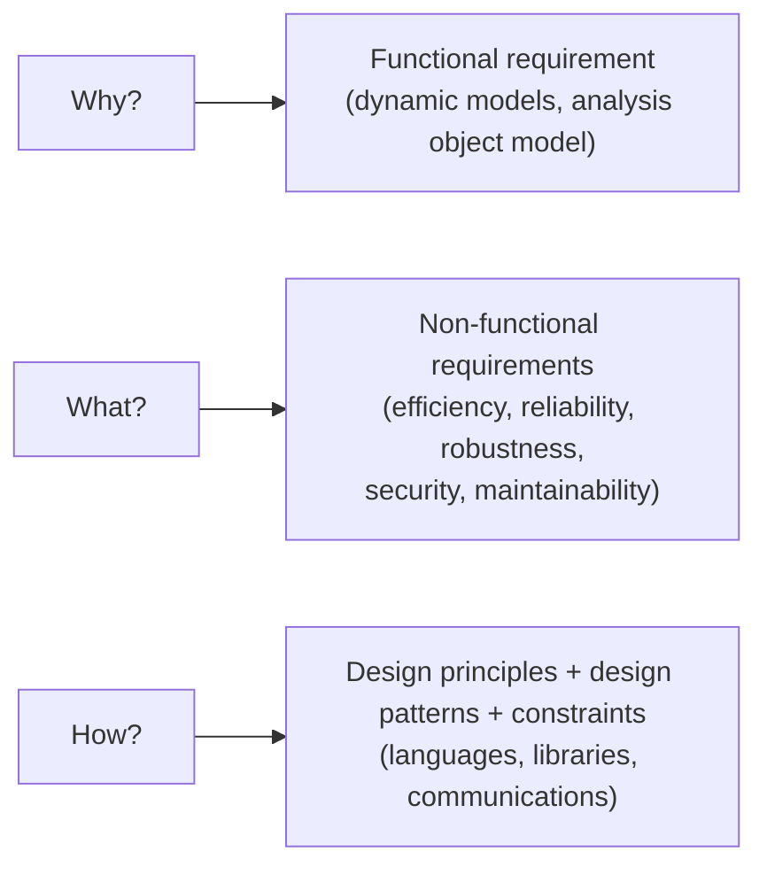

> ⚠️ **Trap:** an architecture question should explain its **trade-offs** and assumptions. End with
> "…at the cost of X (e.g. lower performance / harder debugging / requirements compromise)".

### 9.11 The design process (descriptive model)

External requirements → identify nature of requirements → requirements specification → analyse and
build a model of the problem → postulate design solution(s) → validate each solution → (revise / seek
new solution on mismatch) → elaborate solution → compare solutions → selected design solution →
"blueprint". Mismatches between designer's model and requirements drive iteration.

---

## 10. Object design & design patterns (L13, L14)

### 10.1 What object design adds over system design

| System design                            | Object design                                    |
| ---------------------------------------- | ------------------------------------------------ |
| Architecture, subsystems, layers, styles | **Detailed** class diagram, interfaces, patterns |
| Decides _where_ responsibility lives     | Decides _how_ objects collaborate                |

**Four object-design activities:**

1. **Reuse** — existing libraries and **design patterns**.
2. **Interface specification** — operations, arguments, type signatures, **exceptions**.
3. **Restructuring** — to meet design goals: maintainability, flexibility…
4. **Optimization** — speed or memory.

### 10.2 Why patterns at all?

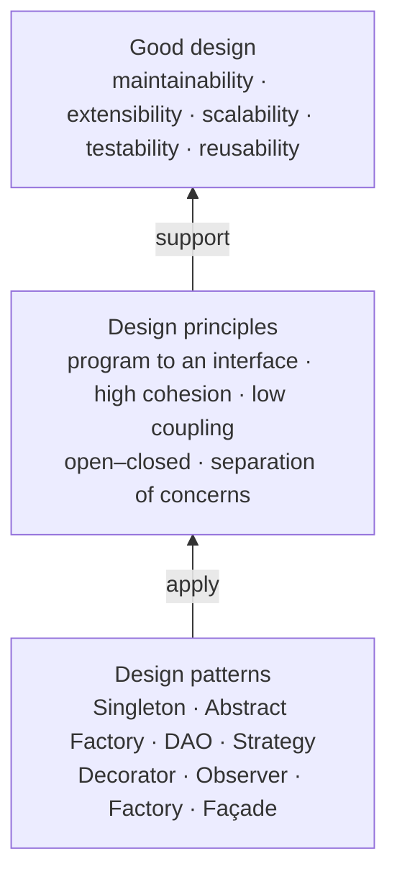

> **Design pattern** = _a proven solution to a problem in a context_; it **abstracts a recurring design
> structure** — a template with class and/or object dependencies, structures, interactions or
> conventions. (GoF, 1996)

### 10.3 The four elements (L13 definition)

| Element          | Describes                                                                                              | Answers                         |
| ---------------- | ------------------------------------------------------------------------------------------------------ | ------------------------------- |
| **Name**         | Describes the pattern; adds to common terminology (not just sentence enhancers)                        | How do we talk about it?        |
| **Problem**      | When to apply the pattern                                                                              | What is it trying to solve?     |
| **Solution**     | Elements, relationships, responsibilities and collaborations that make up the design                   | What does the design look like? |
| **Consequences** | Results of applying the pattern: **benefits and costs**, subjective depending on the concrete scenario | What do I gain/lose?            |

### 10.4 GoF 23 — grouping (know the buckets)

| Category             | Patterns                                                                                                                                    |
| -------------------- | ------------------------------------------------------------------------------------------------------------------------------------------- |
| **Creational (5)**   | Abstract Factory, Builder, **Factory Method**, Prototype, **Singleton**                                                                     |
| **Structural (7)**   | Adapter, Bridge, Composite, **Decorator**, **Façade**, Flyweight, Proxy                                                                     |
| **Behavioural (11)** | Chain of Responsibility, **Command**, Interpreter, Iterator, Mediator, Memento, **Observer**, State, **Strategy**, Template Method, Visitor |

### 10.5 Strategy

**Problem:** a set of algorithms or objects should be **interchangeable**.
**Solution:** `Context` holds a `Strategy` reference; `ConcreteStrategyA/B` implement the interface;
behaviour can change at runtime.

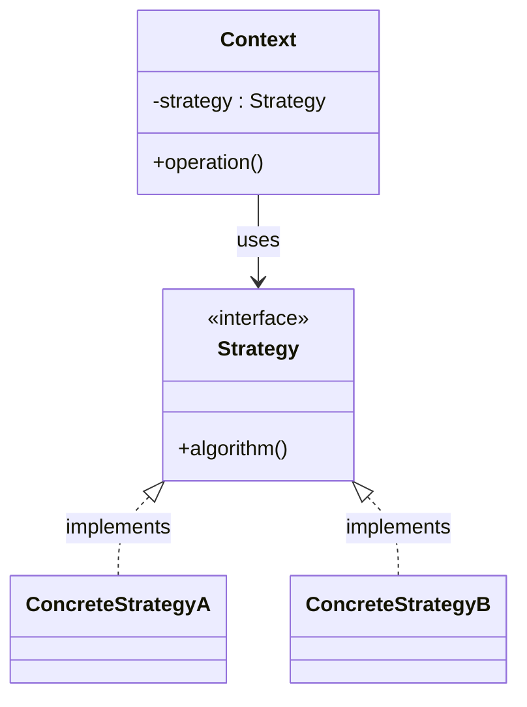

| Pros                                         | Cons                                             |
| -------------------------------------------- | ------------------------------------------------ |
| Easy extension for new strategies            | Complex, hard-to-understand code **if overused** |
| Provides encapsulation, hides implementation | Client must choose/instantiate a strategy        |
| Allows behaviour change **at runtime**       | Extra indirection                                |

**Use when:** the mobile device must speak LAN/WiFi/Bluetooth/3G/4G and _further protocols with minimal
impact_ (Tutorial 6). The variable part is the **network access protocol**; encapsulate it.

### 10.6 Observer (L13; Tutorial 7)

**Problem (say it this way):**

> A **subject** must notify many **observers** when it changes, but it does not know — and should not
> care — who they are or how many; observers can subscribe/unsubscribe freely and constantly; and
> observers cannot poll because they do not know when the change will occur.

Also called **Subscriber–Publisher** or **Consumer–Producer**.

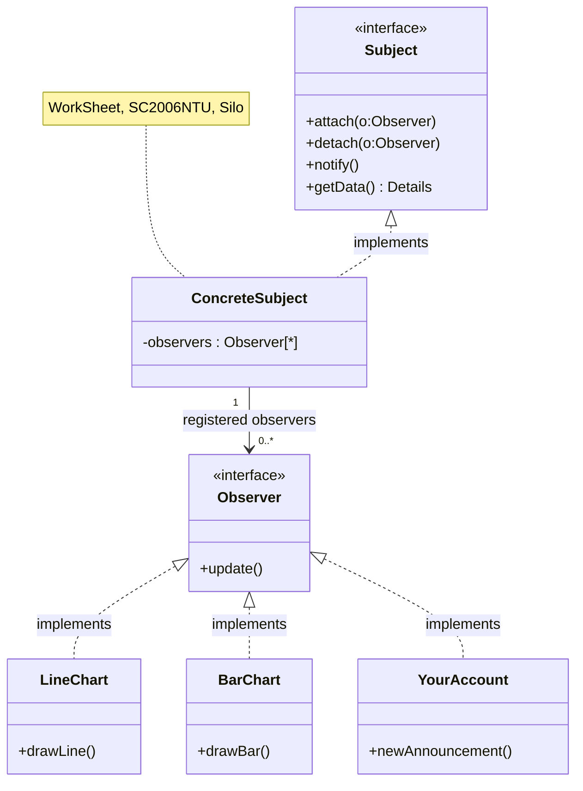

Contract: `notify()` does `for each o in observers: o.update()`.

**Two notification protocols:**

|               | **Pull**                                 | **Push**                                             |
| ------------- | ---------------------------------------- | ---------------------------------------------------- |
| Subject sends | Simple notification (`update()`)         | Detailed change data (`update(data)`)                |
| Observer then | Calls back `getData()` — **two-way**     | Needs no callback — **one-way**                      |
| Coupling      | Observer must know the subject's getters | Subject must know what observers need; may over-send |
| Efficiency    | Observer fetches only if interested      | Wastes data when observer is uninterested            |

**Selective notification:** observers register **interests** (e.g. `register(account, tutorial)`), and
the subject notifies only those with a matching interest. Either push or pull can be used; choose
based on payload needs and communication cost.

**Pros:** abstracts coupling between Subject and Observer; supports **broadcast** communication;
enables reusability of subjects and observers independently.
**Cons:** **slower performance**; can add **unnecessary complexity** if not used carefully; observers
are notified in unspecified order; risk of update storms / memory leaks if observers are not detached.

**Answer to "what kind of coupling is preferred and why?"** → **Loose coupling**, because:
subject holds registered observer references but does not depend on their concrete classes; observers can be added/removed at runtime; both
sides can be reused independently; and implementation changes behind stable interfaces need not affect the other side.

### 10.7 Factory (Static Factory)

**Problem:** you have a set of classes implementing a common superclass but **do not know which one to
instantiate until runtime**; you want to keep creation logic out of the client.

**Solution:**

```mermaid
classDiagram
    class DataStoreFactory {
        +getDatastore()$ DataStoreInterface
    }
    class DataStoreInterface {
        <<interface>>
    }
    class FlatFileImpl
    class MySQLImpl
    class DB2Impl
    DataStoreFactory ..> DataStoreInterface : creates
    DataStoreInterface <|.. FlatFileImpl
    DataStoreInterface <|.. MySQLImpl
    DataStoreInterface <|.. DB2Impl
```

**Naming:** the lecture's **Static/Simple Factory** centralises creation. It is not itself one of
the GoF 23 patterns. **Factory Method** uses a creation operation overridden by subclasses;
**Abstract Factory** creates families of related products. Do not use those names interchangeably.

**What it does for you:**

- **Encapsulates object creation**;
- removes **duplicate creation code** from clients (compare `EMSNoFactory` vs `EMSBasicFactory`);
- **centralises class selection and creation**;
- easy to extend/replace/add subclasses (swap `MySQLImpl1` → `MySQLImpl2`, add `OracleImpl`);
- easy to change creation logic;
- supports **Singleton** objects (`EMSFactoryUsingSingleton`);
- supports **lazy initialization** (`EMSFactoryLazyInitialization`).

**Where it is used in practice (memorise one example):**

- **Eclipse** — `Workbench` loads `ViewPart` subclasses registered via `RegistryStrategyOSGI`, so you
  can add `SE2006View` **without modifying a single line of Eclipse code**.
- **Java Swing** — `UIManager` creates a `LookAndFeel` (Motif, Metal, your own).
- **JDBC** — `DriverManager` creates a `java.sql.Connection` (`mysql.ConnectionImpl`,
  `postgresql.JDBC4Connection`, …).

**Strategy + Factory + dynamic loading** =

> "Create any subclass object **without specifying the class name in the code**; no need to change a
> single line of code to use new classes; provides the foundation for modern frameworks to load
> application-specific classes."

> ⚠️ **Trap:** **Factory is not a substitute for Strategy.** Strategy = interchangeable _behaviour_;
> Factory = interchangeable _construction_. Tutorial 7 Q2 explicitly asks "what is missing in your
> Strategy solution?" → **the creation of the concrete strategy at runtime → add a Factory.**

### 10.8 Façade

> Provides a **unified interface** to a set of interfaces in a subsystem; defines a **higher-level
> interface** that makes the subsystem easier to use.

| Pros                                     | Cons                                                                                        |
| ---------------------------------------- | ------------------------------------------------------------------------------------------- |
| Makes code easier to use and understand  | More rework if the Façade class is improperly designed                                      |
| Reduces dependencies on classes          | Increases complexity and decreases runtime performance for a large number of Façade classes |
| Decouples a client from a complex system | Does not prevent direct access to subsystems                                                |

### 10.9 Other patterns you must be able to _name_ for a scenario

| Pattern              | Scenario signal                                                                     | Sketch                                        |
| -------------------- | ----------------------------------------------------------------------------------- | --------------------------------------------- |
| **Singleton**        | "exactly one instance", configuration/registry, lazy init                           | private ctor, static `getInstance()`          |
| **Abstract Factory** | "create **families** of related objects" (controller _or_ look-and-feel for a view) | `AbstractFactory.createButton()/createMenu()` |
| **Factory Method**   | Subclasses decide which class to instantiate                                        | `creator.factoryMethod()`                     |
| **DAO**              | Isolate persistence from domain logic                                               | `CustomerDAO.find(id)`                        |
| **Decorator**        | Attach **additional** responsibilities dynamically (e.g. scrolling on a view)       | `ScrollingView wraps View`                    |
| **Composite**        | Nested views (Panel contains Button; nested Panels)                                 | tree of `Component`                           |
| **Command**          | Undo/redo of user actions                                                           | `Command.execute()/undo()`                    |
| **Adapter**          | Convert one interface into another expected by the client                           | wrapper class                                 |
| **Proxy**            | Surrogate controlling access (remote/lazy/protection)                               | same interface as real subject                |

**Pattern-selection matrix (use this to answer "which pattern?")**

| If the requirement says…                                                              | Answer               |
| ------------------------------------------------------------------------------------- | -------------------- |
| "interchangeable algorithms / change behaviour at runtime / pluggable protocol"       | **Strategy**         |
| "notify many, subscription, they can come and go, don't poll"                         | **Observer**         |
| "which concrete class only known at runtime / hide creation / replace implementation" | **Factory**          |
| "families of related products (LAF + controller)"                                     | **Abstract Factory** |
| "exactly one instance / global configuration"                                         | **Singleton**        |
| "simplify a complex subsystem for clients"                                            | **Façade**           |
| "add behaviour to individual objects without subclassing"                             | **Decorator**        |
| "treat individual and composite objects uniformly"                                    | **Composite**        |
| "undo/redo"                                                                           | **Command**          |
| "decouple persistence from domain"                                                    | **DAO**              |

> **Tutorial sequence:** T6 Q2 asks for interchangeable behaviour (**Strategy**); T7 Q2 adds
> concrete-object creation (**Factory**). A separate factory is useful when selection/creation needs
> isolation; not every Strategy design requires a new factory class. A switch-based factory still
> needs an edit for a new product. Dynamic loading moves class selection into configuration.

---

## 11. MVC (L15)

### 11.1 The problem MVC solves

Interactive event-driven systems:

- UIs are **prone to change**;
- the **same data** can be presented differently (line chart vs bar chart vs table);
- UI changes must be easy and even **possible at runtime**;
- the display must **reflect data changes immediately**;
- the same presentation can have different **look and feel**;
- the app reacts to user input differently;
- **UI must NOT be tightly coupled** with core functionality and data.

**Main goal:** _facilitate and optimise the implementation of interactive-intensive systems, particularly
those using **multiple synchronised presentations of shared information**._

**Key idea:** separation of the **Model** from **View** and **Controller** allows **multiple Views of
the same Model** — it separates presentation and interaction from the data. If a user changes the
Model via one View's Controller, **all other Views** depending on that data reflect the change.

### 11.2 Components

| Component      | Responsibility                                                                                                                                                                                               | Stereotype           | Example                     |
| -------------- | ------------------------------------------------------------------------------------------------------------------------------------------------------------------------------------------------------------ | -------------------- | --------------------------- |
| **Model**      | Contains the **processing (operations) and the data**                                                                                                                                                        | «control» + «entity»             | `WorkSheet`, `SheetManager` |
| **View**       | Defines and manages **how data is presented**; each View provides a specific presentation of the same Model; each View **observes** the Model                                                                | «boundary»           | `LineChart`, `BarChart`     |
| **Controller** | Manages **user interaction**: captures input (mouse clicks, key presses) and passes interactions to View and Model; each View is associated with a Controller; user interacts **solely through Controllers** | «boundary»/«control» | `EditWS`, `EditWSCtrler`    |

### 11.3 The triangular structure (know the arrows by heart)

```mermaid
flowchart TB
    M[Model]
    V[View]
    C[Controller]
    V -->|"register(this) / unregister(this) — Observer subscription"| M
    M -->|"notify() → update() — Observer notification"| V
    V -->|"handleEvent() — Strategy"| C
    C -->|"service() / update model"| M
    V -->|"getData() — pull"| M
    C -->|"select / update view where needed"| V
```

Call relationships in the basic view-notification flow:

| From       | To         | Call                                  | Mechanism                                     |
| ---------- | ---------- | ------------------------------------- | --------------------------------------------- |
| View       | Model      | `register(this)` / `unregister(this)` | Observer **subscription**                     |
| Model      | View       | `notify()` → `update()`               | Observer **notification**                     |
| View       | Controller | `handleEvent()`                       | **Strategy** (View delegates input behaviour) |
| Controller | Model      | `service()` / update data             | Control flow                                  |
| View       | Model      | `getData()`                           | Observer **pull** update                      |

- **MVC architecture style is non-hierarchical (triangular).**
- View **subscribes** to Model changes (**Observer** subscription mechanism).
- Controller **gathers input/change** from the user and **updates the Model**.
- Model **updates** and **notifies all subscribers (Views)** (**Observer** notification mechanism).
- View is notified and **updates its display**; the user sees the change.

### 11.4 Which patterns live inside MVC

| Relationship                           | Pattern              | Why                                                                                                              |
| -------------------------------------- | -------------------- | ---------------------------------------------------------------------------------------------------------------- |
| **View ↔ Model; subscribed Controller ↔ Model** | **Observer**         | Multiple views, loose coupling, automatic update                                                                 |
| **View ↔ Controller**                  | **Strategy**         | View delegates interface behaviour; controller swappable → different responses to input; also View ↔ Look & Feel |
| **Controller creation / Look & Feel**  | **Abstract Factory** | Create a controller or LAF for a view                                                                            |
| **Nested views**                       | **Composite**        | Panel contains Button; nested Panels                                                                             |
| **Extra UI functionality (scrolling)** | **Decorator**        | Attach additional UI functionality to a view                                                                     |
| **Undo/redo of user actions**          | **Command**          | Support undo/redo                                                                                                |

**Key three:** **Observer, Strategy, Abstract Factory** are the key patterns in MVC; the others
_also support_ the design of interactive systems.

### 11.5 Why MVC over plain layering (the exam argument)

Plain layered Excel architecture has three problems:

1. **Timer** polling every 10 s → slow refresh or excessive polling.
2. **Views calling one another** → a complex UI creates dependencies.
3. **Direct callbacks** → tight coupling between layers.

Applying Observer fixes the up-call dependency (worksheet → views) but **does not solve everything**:
the same presentation with different look-and-feel and different reactions to input still need
**Strategy**. Hence **MVC = Observer + Strategy (+ Abstract Factory)**.

### 11.6 Pros / cons

| Pros                                                                                    | Cons                                                                                                         |
| --------------------------------------------------------------------------------------- | ------------------------------------------------------------------------------------------------------------ |
| **Simultaneous development** — multiple views per model; models can have multiple views | **Code navigability** and a pronounced **learning curve**                                                    |
| **High cohesion** — related actions grouped on a controller; views for a model grouped  | Framework navigation is complex: new layers of abstraction, users must adapt to MVC's decomposition criteria |
| **Low coupling** among models, views and controllers                                    | **Multi-artifact consistency** — one logical change touches three artefacts                                  |

> ⚠️ **Trap #1:** MVC ≠ 3-tier layered architecture. MVC is **triangular** (Model, View, Controller
> all may know each other through abstractions); layers are **hierarchical** (upper calls lower only).
>
> ⚠️ **Trap #2:** the **Controller** modifies the **Model**; the **Model** notifies the **View**; the
> **View** reads from the Model (`getData`). Controllers can select/update views. The lecture also
> permits Controllers to observe the Model; notifications can therefore reach subscribed Controllers
> through the Observer abstraction (L15, pp. 22, 25).
>
> ⚠️ **Trap #3:** "View observes Model" ≠ "View observes Controller". Observers are on the **Model**
> (or on a `WSSubject` abstraction of it), which is why multiple views stay in sync.

---

## 12. Testing fundamentals & basis path testing (L16)

### 12.1 Definitions

> A **software bug** is _an error, flaw, failure or fault in a computer program or system that causes it
> to produce an incorrect or unexpected result, or to behave in unintended ways._

(Lecture anecdote: the 1947 Harvard Mark II moth incident.)

> **Software testing** is _an investigation conducted to provide stakeholders with information about the
> quality of the software product or service under test._

Three properties that decide many MCQs:

1. It is **dynamic execution** (you run the software).
2. It aims **to find bugs, not to prove that no bugs exist** (Dijkstra).
3. It reduces the **perceived risk** of the system not working to an acceptable value.

**Not testing:** testing ≠ debugging. Testing finds the failure; debugging locates and fixes the fault.

### 12.2 Why exhaustive testing is impossible

For a 16-bit integer there are **2¹⁶ = 65 536** inputs. Even that is affordable once, but for realistic
signatures the input space is astronomically large, so we must **select** inputs cleverly. That
selection is exactly what **EC** and **BV** testing formalise.

The lecture's buggy program:

```java
int blech(int input) {      // spec: add 1, then divide by 30000
    input = input - 1;      // BUG: subtracts instead of adds
    return input/30000;
}
```

- **Random sampling** (1, 42, 32000, −31218) is unlikely to hit a boundary ⇒ the bug survives.
- **EC/BV** pins the three output regions exactly and catches it at the boundaries.

### 12.3 Black box vs white box

|                     | **Black box**                                                                                             | **White box**                                                  |
| ------------------- | --------------------------------------------------------------------------------------------------------- | -------------------------------------------------------------- |
| What to analyse     | **Requirements and specifications**                                                                       | **Implementation details**, internal paths and structure       |
| Example requirement | "The income of an applicant must be between $1500 and $8000 per month"                                    | —                                                              |
| Techniques          | **Equivalence class testing, boundary value testing**, state-based testing                                | **Control flow testing** (CFG, basis paths), data flow testing |
| Pros                | Directs the tester to a **very small subset** of inputs likely to find bugs; applicable at **all levels** | Gives a **coverage** notion                                    |
| Cons                | **Cannot infer code coverage from black-box inputs alone**; EC/requirement coverage can still be tracked                        | Needs code; misses "missing requirement" bugs                  |

### 12.4 Levels of testing (4)

| Level                        | Scope                                                                                  |
| ---------------------------- | -------------------------------------------------------------------------------------- |
| **Unit testing**             | Test a unit individually (the level used in this course)                               |
| **Integration testing**      | Test units **in combination**                                                          |
| **System testing**           | Everything: functionality, usability, reliability, performance, portability, security… |
| **Acceptance testing (UAT)** | Customer accepts the software and pays                                                 |

### 12.5 Ingredients of a test case (5 — memorise)

| Ingredient   | Description                             |
| ------------ | --------------------------------------- |
| **Name**     | Distinct name of the test case          |
| **Location** | Path to the test program and its inputs |
| **Input**    | Input data or commands                  |
| **Oracle**   | **Expected** test output                |
| **Log**      | **Actual** output produced by the test  |

JUnit mapping: `@Test public void testQualifiedApplication()` = **Name**; the class/package = **Location**;
the arguments to `analyzeApplication(...)` = **Input**; the expected argument in
`assertEquals(ApplicationResult.Approval, result)` = **Oracle**;
the recorded actual `result` and test report = **Log**.

> ⚠️ **Trap:** _oracle_ = expected; _log_ = actual. Keep this distinction when naming test-case components.
>
> **Oracle:** expected behaviour comes from requirements, not the observed implementation result.
> Testing code against its own output can hide implementation faults; wrong requirements need
> separate validation with stakeholders.

### 12.6 Execution order: cascading vs independent tests

|           | **Cascading (dependent)**                                                | **Independent**                                                     |
| --------- | ------------------------------------------------------------------------ | ------------------------------------------------------------------- |
| Shape     | Create → Read → Update → Delete → Read-deleted (each builds on the last) | Self-contained cases for each feature                               |
| ✓ Benefit | **Smaller and simpler** test cases; realistic end-to-end sequence        | **Parallel** test execution; failures are isolated                  |
| ✗ Cost    | **One failure invalidates subsequent tests**                             | **Larger and more complex** test cases (each sets up its own state) |

### 12.7 Basis path testing (white box)

> **Basis path testing** (structured testing) is a white-box method for designing test cases intended to
> exercise a **basis set of linearly independent control-flow paths**.

Process:

1. Draw the **Control Flow Graph (CFG)**.
2. Compute the **Cyclomatic Complexity (CC)**.
3. Derive a set of **linearly independent paths** (the basis set) — there are **CC** of them.
4. Generate a test case for **each** basis path.

**Cyclomatic complexity (three equivalent formulas):**

```
CC = E − N + 2        (E = edges, N = nodes; per connected component, P components → +2P)
CC = number of binary decision nodes + 1   (one connected CFG)
CC = number of bounded regions + 1
```

For a connected, single-entry/single-exit CFG, CC is the number of paths in a **graph basis**.
It is **not** a minimum for statement or branch coverage. Some graph paths are infeasible because of
program data, so a structural basis is not automatically an executable test suite. L16, p. 10, loosely
says “all possible paths”; p. 11 illustrates a basis set instead. Loops can create infinitely many
execution paths, so these are different coverage goals.

**Lecture example:**

```java
 1  int a = 0;
 2  while (a < n) {
 3    if (a < 3) {
 4      print("X");
 5    } else {
 6      print("Y");
 7    }
 8    a++;
 9  }
10  return;
```

```mermaid
flowchart TD
    N1((1)) --> N2((2))
    N2 -->|true| N3((3))
    N2 -->|false| N10((10))
    N3 -->|t| N4((4))
    N3 -->|f| N6((6))
    N4 --> N8((8))
    N6 --> N8
    N8 -->|loop| N2
```

CC = 3 (nodes 2, 3 are the two predicates; 2 + 1 = 3).

| Path | Node sequence        | Test input |
| ---- | -------------------- | ---------- |
| 1    | 1, 2, 10             | `n = 0`    |
| 2    | 1, 2, 3, 4, 8, 2, 10 | `n = 1`    |
| 3 | 1, 2, 3, 6, 8, 2, 10 (**schematic, infeasible literally**) | `n = 4` reaches the new Y branch; full trace below |

> Note the lecture's point: the **real** execution path for `n = 4` is
> `1,2,3,4,8,2,3,4,8,2,3,4,8,2,3,6,8,2,10` — the basis path `1,2,3,6,8,2,10` is a
> **schematic structural path**, not a literal run of the program. It is **infeasible as an exact
> execution**: `a` starts at 0, so the first iteration cannot print Y. Use the shown full `n = 4`
> trace when reporting an executable path; it introduces the Y branch after three X iterations.

### 12.8 Coverage criteria

| Criterion                      | Requirement                                                           | Implication                                          |
| ------------------------------ | --------------------------------------------------------------------- | ---------------------------------------------------- |
| **Statement coverage**         | Every **node** executed at least once                                 | Weakest; misses branch-only bugs                     |
| **Branch (decision) coverage** | Every **edge** (true and false of every decision) taken at least once | **100% branch ⇒ 100% statement**, but not vice versa |
| **Path coverage**              | Every **path** executed                                               | Usually infeasible (loops ⇒ infinite paths)          |
| **Basis-path coverage**        | A feasible independent path set exercised; report infeasible structural paths                    | Practical middle ground                              |

> ⚠️ **Trap:** "statement coverage implies branch coverage" is **false** (a `if` with no `else` whose
> body always executes gives 100% statement but not 100% branch). The reverse _is_ true.

### 12.9 Worked white-box example you should be able to reproduce — Tutorial 9

```java
public int sum(int n, int upperbound){
 1  int result, i;
 2  result = 0;
 3  i = 0;
 4  if(n < 0) {
 5    n = -n;
 6  }
 7  while(i<n && result <= upperbound){
 8    i = i + 1;
 9    result = result + i;
10  }
11  if(result <= upperbound){
12    System.out.println("The sum is " + result);
13  } else {
14    System.out.println("The sum is too large!");
15  }
16  return result;
}
```

**CFG** — 12 nodes (1, 2, 3, 4, 5, 7, 8, 9, 11, 12, 14, 16); the compound `while` guard is **one** node:

```mermaid
flowchart TD
    N1((1)) --> N2((2)) --> N3((3)) --> N4((4))
    N4 -->|true| N5((5))
    N4 -->|false| N7((7))
    N5 --> N7
    N7 -->|true| N8((8))
    N7 -->|false| N11((11))
    N8 --> N9((9))
    N9 --> N7
    N11 -->|true| N12((12))
    N11 -->|false| N14((14))
    N12 --> N16((16))
    N14 --> N16
```

Exact edge list: `1→2, 2→3, 3→4, 4→5, 4→7, 5→7, 7→8, 7→11, 8→9, 9→7, 11→12, 11→14, 12→16, 14→16`.

**N = 12, E = 14 ⇒ CC = E − N + 2 = 14 − 12 + 2 = 4.**
_(Cross-check by predicates: `if(n<0)`, the `while`, `if(result <= upperbound)` = 3 decisions ⇒ 3 + 1 = 4.)_

**One feasible basis set for the combined-guard CFG (CC = 4):**

| #   | Path                       | Covering input   | Expected output                           |
| --- | -------------------------- | ---------------- | ----------------------------------------- |
| 1   | 1,2,3,4,7,11,12,16         | n = 0, ub = 100  | prints "The sum is 0", returns 0          |
| 2   | 1,2,3,4,7,8,9,7,11,12,16   | n = 1, ub = 100  | prints "The sum is 1", returns 1          |
| 3   | 1,2,3,4,5,7,8,9,7,11,12,16 | n = −1, ub = 100 | prints "The sum is 1", returns 1          |
| 4   | 1,2,3,4,7,8,9,7,11,14,16   | n = 1, ub = 0    | prints "The sum is too large!", returns 1 |

**Statement and branch coverage need only two tests**, not four:

| Input | Executed path | Expected print / return |
| --- | --- | --- |
| `n = −1, upperbound = 100` | `1,2,3,4,5,7,8,9,7,11,12,16` | `The sum is 1` / `1` |
| `n = 5, upperbound = 1` | `1,2,3,4,7,8,9,7,8,9,7,11,14,16` | `The sum is too large!` / `3` |

Together these cover all executable statements and both outcomes of each of the three combined
decisions. Two is minimal because the final `if` takes only one outcome per call. Four paths are
needed for the **illustrated basis set**, a stronger, different target. The method returns the sum
**after** it has crossed the bound; it does not clamp the return value to `upperbound`.

**Compound-condition convention:** treating the whole `while` guard as node 7 gives **N = 12,
E = 14, CC = 4**. Splitting short-circuit `&&` into nodes 7a (`i<n`) and 7b
(`result<=upperbound`) gives **N = 13, E = 16, CC = 5**. In the split graph, 7a false skips 7b;
7a true reaches 7b; either false exits to 11. State the convention and make the formula match the graph.

The same two coverage tests above also exercise both outcomes of both operands in the split graph:
the first ends with `i<n` false; the second ends with `i<n` true and `result<=upperbound` false.
If a fifth basis path is requested for that graph, add `n = 1, upperbound = −1`: it skips the body
because 7b is false immediately, prints `The sum is too large!` and returns `0`.

**Trace carefully:** `n = 4` with a large bound executes four iterations. A single iteration can be
obtained with `n = 1` and a non-negative bound; `n = 2` needs a bound that stops the loop after the first
addition. A claimed basis path must either match its stated input exactly or be labelled schematic.

---

## 13. Equivalence class & boundary value testing (L17, L18)

### 13.1 Two assumptions behind black-box testing

1. **A verifiable requirement / API specification exists** — make software testable from inception.
   _Not verifiable:_ "The company must not hire too-young or too-old people."
   _Verifiable:_ "0–15 and 55–99: do not hire; 16–17: part-time; 18–54: full-time."
2. **The code must be testable** — a 100-branch `if (age==0) … if (age==99)` chain makes black-box
   testing ineffective compared with range conditions.

### 13.2 Equivalence classes

> A set of input values forms an **equivalence class (EC)** if:
>
> - they are all **supposed to produce the same output**;
> - if one value catches a bug, the others **probably will too**;
> - if one value does not catch a bug, the others **probably will not either**.

### 13.3 Partition rules

| Input type                                                                    | Valid ECs                                                                                          | Invalid ECs                                      |
| ----------------------------------------------------------------------------- | -------------------------------------------------------------------------------------------------- | ------------------------------------------------ |
| **Range of values** (`1500 ≤ x ≤ 80000`)                                      | **ONE** valid EC (or more, if the requirement has several valid ranges — e.g. hiring rules have 4) | **TWO** invalid ECs (`x ≤ 1499` and `x ≥ 80001`) |
| **Discrete values** (applicant type ∈ {Person}, property type ∈ {HDB, Condo}) | **ONE** valid EC (the listed set)                                                                  | **ONE** invalid EC (everything else)             |

Worked partitions:

| Parameter                           | Valid EC(s)                                                    | Invalid EC(s)                    |
| ----------------------------------- | -------------------------------------------------------------- | -------------------------------- |
| Mortgage income (1500–80000)        | 1500 ≤ x ≤ 80000                                               | x ≤ 1499 ; x ≥ 80001             |
| #mortgages (0–5)                    | 0 ≤ x ≤ 5                                                      | x ≤ −1 ; x ≥ 6                   |
| Password length (4–8)               | 4 ≤ x ≤ 8                                                      | x ≤ 3 ; x ≥ 9                    |
| Password characters (a–z, A–Z, 0–9) | {a…z, A…Z, 0…9}                                                | everything else (+, −, (, ), …)  |
| Applicant type (Person only)        | {Person}                                                       | {Company, Trust, Partnership, …} |
| Property type (HDB, Condo)          | {HDB, Condo}                                                   | {Townhouse, MobileHome, …}       |
| Hiring age                          | 0–15 (no hire) ; 16–17 (part) ; 18–54 (full) ; 55–99 (no hire) | age ≤ −1 ; age ≥ 100             |

> ⚠️ **Trap:** counting the _hiring_ rule as "one valid EC" is wrong — there are **four** valid ECs
> because the lecture partitions **four contiguous ranges**. The two “no hire” ranges share an
output but have different boundaries; four ranges do not mean four distinct output values.

### 13.4 Designing test cases from ECs — the two golden rules

1. **Valid tests:** you **may combine** valid values of **several** parameters in one test case —
   choose one value from one EC of each parameter.
2. **Invalid tests:** **exactly ONE invalid value** per test case (one parameter, one EC); all other
   parameters take **valid** values.

**Why only one invalid per case?** So that the failure can be attributed: you learn the error handling
and behaviour for **each type of invalid input**. With four invalid values in one row, a rejection tells
you nothing about which input caused it — and error handling may mask each other.

**Why enumerate small ECs?** If a valid EC has few values (e.g. #mortgage ∈ {0,1,2,3,4,5};
property type ∈ {HDB, Condo}) you may create test cases for **all** of them. You would not do this for
income (78 501 integer-dollar values) or password characters.

**Testing by contract vs defensive testing**

|              | **Testing by contract**                           | **Defensive testing**                                                                            |
| ------------ | ------------------------------------------------- | ------------------------------------------------------------------------------------------------ |
| Cases        | **Only valid** inputs (satisfying pre-conditions) | **Both valid and invalid** inputs                                                                |
| Assumption   | Users use the code as intended                    | Users will not; test that invalid input does not cause unforeseen errors or abnormal termination |
| Preferred by | —                                                 | **Testers** (if it breaks, the tester is blamed)                                                 |

### 13.5 Boundary value testing (BVT)

> For **each boundary of each range-of-values EC**, choose **three** values: one **on-the-boundary**,
> one **just-below**, one **just-above**. The size of the "just" step depends on the **unit** of the value.

**In the lecture's terminology**, range-of-values parameters include integer counts. “Discrete
values” means **unordered categories** such as Person/Company and HDB/Condo, which have no numeric
BVs. Integer quantities such as mortgage count **do** have BVs.

**Worked BVs (full triplets, with the lecture's reduced valid/invalid selection):**

| Requirement         | Lower boundary       | Upper boundary          | Valid BVs                  | Invalid BVs   |
| ------------------- | -------------------- | ----------------------- | -------------------------- | ------------- |
| Income 1500–80000   | 1499, **1500**, 1501 | 79999, **80000**, 80001 | {1500, 80000}              | {1499, 80001} |
| #mortgages 0–5      | **−1**, 0, 1         | 4, **5**, 6             | {0, 5}                     | {−1, 6}       |
| Password length 4–8 | 3, **4**, 5          | 7, **8**, 9             | {4, 8}                     | {3, 9}        |
| Hiring age 0–15     | −1, **0**, 1         | 14, **15**, 16          | {0, 15} (see de-dup below) | {−1, 100}     |
| Hiring age 16–17    | 15, **16**, 17       | 16, **17**, 18          | …                          | …             |
| Hiring age 18–54    | 17, **18**, 19       | 53, **54**, 55          | …                          | …             |
| Hiring age 55–99    | 54, **55**, 56       | 98, **99**, 100         | …                          | …             |

Following the **course's reduced BV selection**, the hiring sets are: **valid BVs = {0, 15, 16, 17, 18, 54, 55, 99}**;
**invalid BVs = {−1, 100}**.

**The course's test-reduction rule (L18, pp. 11–15):**

> Remove the just-below / just-above value from an EC's BVs (do **not** create a duplicate test case) if
> that value **falls into another EC** — including the _current_ EC.

Concretely: a just-below/just-above value is used as an **invalid test value only if it lies outside
all valid ECs**. If it lands in another valid EC, that EC's own on-the-boundary value already covers
it. (For 0–15, 1 is omitted because it stays inside the same EC; 16 is already a boundary of the next
EC.) This is **more than removing equal duplicate values**: the slides also omit distinct interior
neighbours. State the full triplets when asked for BVs, then identify the reduced test selection.
Keeping all distinct triplet values is a valid stronger test suite; do not claim those values are duplicates.

### 13.6 Designing test cases from BVs

Same two rules as ECs, with BVs supplying the values:

- **Valid test cases:** combination of **on-the-boundary (valid) values**, one from each EC, combined
  across parameters.
- **Invalid test cases:** **one** just-below/just-above (invalid) value per test case, with valid
  values for all other parameters.

For two range parameters _A_ and _B_, the lecture uses these three test shapes:

1. **Valid A + Valid B** → combination of valid inputs.
2. **Valid A + Invalid B** → one invalid.
3. **Invalid A + Valid B** → one invalid.

### 13.7 Worked full example — Mortgage application

**Requirements**

- Income must be **$1500–$80000/month** (L17/L18 worked problem, not L16's separate $8000 example).
- Number of mortgages per applicant must be **0–5**.
- Only **Person** applicants are approved.
- Only **HDB** and **Condo** properties are approved.

**ECs**

| Parameter      | Valid EC(s)  | Invalid EC(s)              | BVs                                                                |
| -------------- | ------------ | -------------------------- | ------------------------------------------------------------------ |
| Income         | 1500–80000   | ≤1499 ; ≥80001             | valid {1500, 80000}; invalid {1499, 80001}                         |
| #mortgage      | 0–5          | ≤−1 ; ≥6                   | valid {0, 5}; invalid {−1, 6} (you may additionally enumerate 1–4) |
| Applicant type | {Person}     | {Company, Trust, …}        | none (discrete)                                                    |
| Property type  | {HDB, Condo} | {Townhouse, MobileHome, …} | none (discrete)                                                    |

**Valid test cases** (combining valid values; enumerating the small discrete/range ECs)

| #   | Income | #mortgage | Applicant | Property | Expected |
| --- | ------ | --------- | --------- | -------- | -------- |
| 1   | $1500  | 0         | Person    | Condo    | Approval |
| 2   | $2000  | 1         | Person    | Condo    | Approval |
| 3   | $5000  | 2         | Person    | Condo    | Approval |
| 4   | $12345 | 3         | Person    | HDB      | Approval |
| 5   | $76543 | 4         | Person    | HDB      | Approval |
| 6   | $80000 | 5         | Person    | HDB      | Approval |

> Note how one row already covers the single valid EC of **every** parameter (the lecture's point),
> and the remaining rows exist only to enumerate the small ECs' values.

**Invalid test cases** (exactly one invalid per row, everything else valid)

| #   | Income     | #mortgage | Applicant   | Property       | Expected |
| --- | ---------- | --------- | ----------- | -------------- | -------- |
| 7   | **$100**   | 1         | Person      | Condo          | Reject   |
| 8   | **$81000** | 2         | Person      | HDB            | Reject   |
| 9   | $5000      | **−1**    | Person      | Condo          | Reject   |
| 10  | $10000     | **8**     | Person      | HDB            | Reject   |
| 11  | $12345     | 3         | **Company** | HDB            | Reject   |
| 12  | $76543     | 4         | Person      | **Mobilehome** | Reject   |

**Anti-pattern for isolated invalid EC tests:**

| Income   | #mortgage | Applicant   | Property       | Expected |
| -------- | --------- | ----------- | -------------- | -------- |
| **$100** | **8**     | **Company** | **Mobilehome** | Reject   |

Four invalid inputs ⇒ if it rejects you have learned **nothing** about which check fired.

### 13.8 Summary table (put this in your head — it is a slide)

|         | Range of values                                                                                           | Discrete values              |
| ------- | --------------------------------------------------------------------------------------------------------- | ---------------------------- |
| **ECs** | ONE or more valid EC; **TWO** invalid ECs                                                                 | ONE valid EC; ONE invalid EC |
| **BVs** | For each EC: lower boundary → on / just-below / just-above; upper boundary → on / just-below / just-above | **NO boundary values**       |

> ⚠️ **Trap #1 (off-by-one).** For `0 ≤ x ≤ 5`, BVs are **−1, 0, 1** and **4, 5, 6** — _not_
> 0, 0.5, 1 (that is only for continuous/real-valued inputs where the unit allows halves).
>
> ⚠️ **Trap #2.** The **upper** boundary of `0–5` takes **4, 5, 6**, not 5, 6, 7. "Just-below" refers
> to being below **5**, i.e. 4.
>
> ⚠️ **Trap #3.** An endpoint of an inclusive valid range is a **VALID** test value; just-below/just-above are
> **INVALID** only when outside all valid ranges. For 1500–80000, 1501 and 79999 are valid
> neighbours. Do not label every just-below/just-above value invalid; classify against the specification.
>
> ⚠️ **Trap #4.** For **adjacent** range ECs (e.g. hiring 0–15 / 16–17 / 18–54 / 55–99) the
> just-above value of one EC is the on-the-boundary value of the next. Take it **once**; do not
> generate 15, 16 here and 16, 15 again there. The de-duplicated set is what the marker expects.
>
> ⚠️ **Trap #5.** Do not invent an output in the oracle column. The oracle comes from the _requirement_,
> e.g. "income out of range ⇒ Reject", never from what your implementation happens to print.
>
> ⚠️ **Trap #6 (universe of discourse).** Physically impossible values (humidity < 0%, temperature
> < −10 °C) also deserve ECs — they are _invalid input_ ECs distinct from _valid-input-but-rejected_
> ECs. See the GES silo example below.

### 13.9 Worked example — GES silo (Tutorial 8)

**Given:** humidity 0–100%, normal 35–50%; temperature −10–100 °C, normal 40–60 °C. The question
says a silo cannot accept grain if either reading “exceeds normal levels”.

**State the interpretation:** the solution below permits acceptance only when **both readings are
inside their inclusive normal ranges**. The wording does not explicitly resolve below-normal
readings. Confirm that interpretation with the client; if “exceeds” means only above the upper bound,
the below-normal oracle changes. Assume integer percentage points and whole degrees for ±1 BVs.
Real-valued sensors require a specified resolution; −10 °C here is a stated input limit, not a
universal physical minimum.

| Parameter | Valid normal input: permit acceptance | Valid sensor input: block acceptance | Outside stated sensor range |
| --- | --- | --- | --- |
| Humidity | 35–50 | 0–34; 51–100 | ≤−1; ≥101 |
| Temperature | 40–60 | −10–39; 61–100 | ≤−11; ≥101 |

“Valid sensor input” and “eligible to accept grain” are different predicates. The three in-range ECs
have specified business outcomes under the stated interpretation. Out-of-range input needs a
validation policy; the tutorial does **not** specify an error code, message or recovery action.

**Full boundary triplets for all in-range ECs:**

| Parameter | Lower/upper boundaries of its ECs | Triplets (on ±1) |
| --- | --- | --- |
| Humidity | 0, 34, 35, 50, 51, 100 | (−1,0,1); (33,34,35); (34,35,36); (49,50,51); (50,51,52); (99,100,101) |
| Temperature | −10, 39, 40, 60, 61, 100 | (−11,−10,−9); (38,39,40); (39,40,41); (59,60,61); (60,61,62); (99,100,101) |

Following the lecture's reduced BV selection gives humidity
`{−1,0,34,35,50,51,100,101}` and temperature `{−11,−10,39,40,60,61,100,101}`.
Interior neighbours may additionally be retained for stronger boundary checks.

| # | Humidity | Temperature | Expected outcome under the stated interpretation |
| --- | --- | --- | --- |
| 1 | 35 | 40 | Permit acceptance: both lower normal boundaries |
| 2 | 50 | 60 | Permit acceptance: both upper normal boundaries |
| 3 | 0 | 45 | Block: humidity below normal, valid sensor input |
| 4 | 34 | 45 | Block: humidity just below normal |
| 5 | 51 | 45 | Block: humidity just above normal |
| 6 | 100 | 45 | Block: humidity above normal, at sensor limit |
| 7 | 45 | −10 | Block: temperature below normal, at sensor limit |
| 8 | 45 | 39 | Block: temperature just below normal |
| 9 | 45 | 61 | Block: temperature just above normal |
| 10 | 45 | 100 | Block: temperature above normal, at sensor limit |
| 11 | −1 | 45 | Out-of-range humidity; validation response TBD |
| 12 | 101 | 45 | Out-of-range humidity; validation response TBD |
| 13 | 45 | −11 | Out-of-range temperature; validation response TBD |
| 14 | 45 | 101 | Out-of-range temperature; validation response TBD |

Rows 3–10 isolate one abnormal reading; rows 11–14 isolate one invalid sensor input. Acceptance
also depends on capacity/type/grade in the complete GES, but Tutorial 8 isolates the sensor rule.

---

## 14. The Grain Elevator System (GES) walkthrough

Tutorials 2, 3, 6, 7 and 8 use this case. Facts below come from the scanned two-page supplement;
proposed model structures are example solutions, not additional requirements.

### 14.1 Domain facts

| Fact | Value |
| --- | --- |
| Grain types | Wheat, barley, long grain rice, short grain rice, oats, hops |
| Grades | High and low for each grain type |
| Non-empty silo | Stores only one grain type and grade |
| Empty silo | May be assigned any accepted grain type and grade |
| Silos | 12: 1–6 hold 8 000 bushels each; 7–12 hold 12 000 each |
| Total capacity (derived) | 6 × 8 000 + 6 × 12 000 = **120 000 bushels** |
| Truck load | 150–180 bushels |
| Rail car capacity | 2 000 bushels |
| Arrival | Trucks from growers/sellers only; plate number, driver and seller recorded |
| Departure | Rail cars to processing plants/buyers only; serial number, conductor and buyer recorded |
| Monitoring | Humidity and temperature sensors send readings periodically |
| Abnormal alert | **Sensors** alert both GES and an external grain dryer; affected silo cannot accept more grain until both readings return to normal |

The supplement supplies no numeric normal ranges; **Tutorial 8** supplies those thresholds.

### 14.2 Requirements A–K mapped to models

| Requirement | Required behaviour / constraint | Example model element |
| --- | --- | --- |
| A | Track grain arriving, stored and departing | Arrival, Silo, Departure |
| B | Accepted types/grades; homogeneous contents per non-empty silo | Silo attributes and invariants |
| C | Silo capacities, truck loads and rail car capacity | Numeric constraints and test inputs |
| D | Truck/rail car identifiers and people/organisations | Truck, RailCar, Driver, Seller, Conductor, Buyer |
| E | Periodic readings, sensor alerts to GES and dryer, block intake until normal | Sensor boundary; Silo condition state machine |
| F | Log quantity, type, grade, date/time, manager, direction, vehicle ID, driver/conductor, seller/buyer for each shipment | Shipment and TransactionLogEntry |
| G | Propose one or more silos and amount per silo; accept all, part or none | Accept Grain Arrival, Allocate Silos |
| H | Manager accepts or overrules proposal; **always reports actual deposits and truck/driver/seller details**; system acknowledges | Normal confirmation/reporting; optional overrule flow |
| I | Record removals per silo, loaded rail cars, conductor and buyer; acknowledge | Record Grain Departure |
| J | Report per-silo type, amount, remaining capacity; remaining capacity by currently stored type; uncommitted capacity | Produce Elevator Report |
| K | Chronological transaction log on manager request | Produce Transaction Log |

### 14.3 Actors, use cases and arrival description (Tutorial 2)

**System boundary:** GES is the tracking software. Elevator Manager and external temperature/humidity
sensors directly interact with it. Seller, Buyer, Driver and Conductor are recorded domain entities;
the supplement does **not** say they operate GES. “For accounting purposes” does not establish an
external Billing System. Sensors alert the dryer directly; do not invent a GES-to-dryer command.
The dryer is in the environment but is not a direct GES actor under this boundary.

```mermaid
flowchart LR
    Manager["Actor: Elevator Manager"]
    Sensors["Actor: Temperature / humidity sensors"]
    Dryer["External grain dryer"]
    subgraph GES["Grain Elevator System"]
        Arrival([Accept Grain Arrival])
        Allocate([Allocate Silos])
        Overrule([Overrule Proposed Allocation])
        Departure([Record Grain Departure])
        Monitor([Monitor Silo Conditions])
        Report([Produce Elevator Report])
        Log([Produce Transaction Log])
    end
    Manager --- Arrival
    Manager --- Overrule
    Manager --- Departure
    Manager --- Report
    Manager --- Log
    Sensors --- Monitor
    Arrival -.->|«include»| Allocate
    Overrule -.->|«extend»: manager rejects proposal| Arrival
    Sensors -.->|direct alert outside GES| Dryer
```

This is a **Mermaid use-case sketch**: actor boxes stand for UML stick figures. The sensor-to-dryer
line shows environment context, not a use-case relationship. Use hollow-triangle generalization only
where a real specialisation is identified; the question does not require inventing one.

**Include:** Accept Grain Arrival uses Allocate Silos to obtain the system proposal.
**Extend:** Overrule Proposed Allocation optionally changes that proposal. **Record Actual Deposit is
required whether the manager accepts or overrules**; it is part of the main use case.
Reports J and K are separate manager-triggered goals.

**Use case: Accept Grain Arrival / Allocate Silos**

- **Participating/initiating actor:** Elevator Manager.
- **Entry:** a truck arrives with a load of an accepted grain type and grade; manager provides its quantity.
- **Exit:** GES acknowledges actual deposited amounts and shipment details and records the shipment;
  alternatively, it reports that no grain can be accepted. A proposal alone does not change stock.
- **Main flow:** (1) Manager enters grain type, grade and offered quantity. (2) GES checks compatible,
  available silos and proposes silo IDs and quantities, identifying any unaccepted remainder.
  (3) Manager accepts the proposal. (4) After unloading, manager reports **actual amount per silo**,
  truck plate, driver and seller. (5) GES records actual stock changes and the F transaction fields,
  including manager, direction and date/time. (6) GES acknowledges receipt.
- **Alternative flow (overrule):** at step 3, manager supplies a revised choice; return to actual-deposit
  reporting at step 4. Checking that the revision respects B/C/E is a design safeguard, not permission
  to ignore those requirements.
- **Alternative flow (partial capacity):** step 2 proposes only the quantity that fits; continue at step 3.
- **Terminal outcome (no capacity):** step 2 reports no grain accepted. Do not invent an error message
  or claim that a zero-quantity transaction must/must not be logged; that policy is TBD.
- **Exceptions/TBD:** invalid quantity, sensor failure, cancellation and communication failure need
  agreed recovery behaviour. Invalid input is not automatically a terminal exception; a correction
  prompt could instead return to the flow.

**Data dictionary examples:** Silo = a numbered storage container with capacity and current contents;
Bushel = the volume unit used in the specification; Shipment = grain arriving by truck or leaving by
rail; Allocation = proposed quantity per silo for an arrival; Actual deposit = quantity actually
placed in a silo; Grade = high or low for a grain type; Transaction log = chronological shipment
records containing F's fields; Uncommitted capacity = capacity not currently committed to a grain
type. Define numeric normal levels using Tutorial 8 and record its wording ambiguity (§13.9).

### 14.4 Conceptual classes and associations (Tutorial 3 Q1)

For the **arrival/allocation** scope, distinguish proposed amounts from actual deposits. One arrival
can use several silos; each silo can receive many arrivals over time. An association class Allocation
can carry the amount for each arrival/silo pair. The diagram uses an ordinary class linked to both
ends, which Mermaid supports directly.

```mermaid
classDiagram
    class Arrival {
        dateTime
        grainType
        grade
        offeredQuantity
    }
    class Allocation {
        proposedAmount
        actualDepositedAmount
    }
    class Silo {
        id
        capacity
        currentAmount
        grainType
        grade
        temperature
        humidity
    }
    class Truck {
        plateNumber
    }
    class TransactionLogEntry
    class ElevatorManager
    class Driver
    class Seller
    Arrival "1" -- "0..*" Allocation : allocations
    Silo "1" -- "0..*" Allocation : receives
    Truck "1" -- "0..*" Arrival : carries
    Driver "1" -- "0..*" Arrival : drives for
    Seller "1" -- "0..*" Arrival : supplies
    ElevatorManager "1" -- "0..*" Arrival : records
    Arrival "1" -- "0..1" TransactionLogEntry : recorded as
```

The log multiplicity allows a pending arrival before recording; assume one completed shipment per
log entry. An allocation can be zero if its proposed silo is not used. For full-system modelling,
introduce Shipment with Arrival/Departure specialisations, RailCar, Buyer and Conductor. Do not
associate every Shipment with **both** a Truck and a RailCar. Seller/Buyer may be organisations, so
making all such roles subclasses of Person is an unsupported restriction.

### 14.5 Silo condition state machine (requirement E)

Model **environmental condition separately from empty/non-empty/full**. An empty silo can be abnormal;
unloading does not itself restore normal conditions. Sensors, rather than GES, send the dryer alert.

```mermaid
stateDiagram-v2
    [*] --> Normal : assume initial readings are normal
    Normal --> Blocked : sensor alert [humidity or temperature abnormal]
    Blocked --> Normal : readings [humidity and temperature normal]
    Blocked --> Blocked : deposit requested / refuse intake
    note right of Blocked
        Intake disabled regardless of occupancy.
        Sensors also alert external grain dryer.
    end note
```

The initial normal reading is a stated model assumption. Unknown initial readings and sensor-failure
policy remain TBD. “Intake disabled” is a constraint; `refuse intake` is an event response, not a
continuously running `do/` activity. Returning to Normal removes the sensor block; capacity and
type/grade constraints still apply.

### 14.6 Sequence for arrival and actual recording (requirements G–H)

```mermaid
sequenceDiagram
    actor Manager
    participant UI as ArrivalUI
    participant AC as AllocationController
    participant S as Silos
    participant TL as TransactionLog
    Manager->>UI: grain type, grade, offered quantity
    UI->>AC: proposeAllocation(type, grade, quantity)
    activate AC
    AC->>S: get compatible capacity and condition
    S-->>AC: eligible silos and available quantities
    AC-->>UI: proposed silo quantities and unaccepted remainder
    deactivate AC
    UI-->>Manager: show proposal
    alt no grain can be accepted
        UI-->>Manager: report no grain accepted
        Note over Manager,TL: Zero-quantity logging policy is TBD
    else some or all grain can be accepted
        alt manager accepts
            Manager->>UI: accept proposal
        else manager overrules
            Manager->>UI: revised silo selection
        end
        Note over Manager,S: Manager arranges physical unloading outside GES
        Manager->>UI: actual amounts per silo, truck, driver, seller
        UI->>AC: recordActualDeposit(actuals, shipment details)
        activate AC
        loop each silo receiving grain
            AC->>S: record actual deposited amount
        end
        AC->>TL: append F shipment fields with date/time and manager
        TL-->>AC: recorded
        AC-->>UI: acknowledge receipt
        deactivate AC
        UI-->>Manager: acknowledgement
    end
```

---

## 15. Tutorial answer sketches (T1–T9)

> The lecturer states most questions have **no single model answer**. What follows is the _structure_
> of a strong answer plus the specific traps in each tutorial.

### Tutorial 1 — Atomising requirements + NFRs

**Q1. Atomise the Inventory & Asset Tracking System description.** The paragraph is:

> The System maybe queried. A query may contain a user number or a serial number. If the query contains
> a user number, all equipment assigned to that user is reported. If the query contains a serial number,
> the assignment for that computer is reported. All query results show the name, office and user number
> of a user, followed by the serial numbers and types of all computers assigned to that user, and the
> date of each assignment. If a user is not assigned a computer or a computer not assigned to a user,
> this is reported.

Rewrite as numbered, atomic, verifiable statements:

```
1.1 The system shall accept a query containing a user number.
1.2 The system shall accept a query containing a computer serial number.
1.3 For a user-number query, the system shall report all equipment assigned to that user.
1.4 For a serial-number query, the system shall report the assignment for that computer.
1.5.1 The user details in a result shall include the user's name.
1.5.2 The user details in a result shall include the user's office.
1.5.3 The user details in a result shall include the user's user number.
1.6.1 The computer details shall include the serial number of each computer assigned to that user.
1.6.2 The computer details shall include the type of each computer assigned to that user.
1.6.3 The computer details shall include the assignment date for each such computer.
1.7 The result shall present user details before computer details.
1.8 If the queried user has no computer assigned, the system shall report that condition.
1.9 If the queried computer has no user assigned, the system shall report that condition.
```

**TBD:** treatment of unknown identifiers, both identifiers in one query, exact report format and
message wording. Do not invent these. For an unassigned computer, no user details exist; the
unassigned result is the specified exception to the user-details format.

**Mark-earning points:** one assertion per line; use **shall**; keep the _condition_ and the
_response_ together; make "reported" concrete (which fields, in which order).

**Q2. Example NFR proposals — agree targets with the client:**

- Performance: at least 95% of queries shall complete within 2 seconds with 100 concurrent users
  and 100 000 recorded assets.
- Availability: the service shall be available for at least 99.5% of each calendar month's minutes,
  measured by a defined service health check.
- Recovery: after a restart, query service shall be restored within 5 minutes.
- Usability: at least 80% of first-time authorised users shall run a user-number query within
  2 minutes without assistance.

These are proposed measurable qualities, not thresholds in the tutorial. Access-control **functions**
such as checking permission are functional requirements; privacy/security constraints can be NFRs.

### Tutorial 2 — GES use cases

- **(a)** Actor boundary, Mermaid use-case sketch and include/extend rationale: §14.3.
- **(b)** Arrival/allocation use-case description, including required actual-deposit reporting: §14.3;
  interaction sequence: §14.6. State unknown recovery policies as TBD.
- **(c)** Data dictionary examples: §14.3; separate proposals from actual deposits.

### Tutorial 3 — Conceptual model + projector state machine

- **Q1(a–b):** classes, attributes, associations and multiplicities for arrival/allocation: §14.4.
- **Q2:** projector states follow the supplied interaction, without automatic shutdown:

```mermaid
stateDiagram-v2
    [*] --> Off
    Off --> WarmingUp : press ON
    WarmingUp --> ReadyPC : ready / indicator green
    ReadyPC --> Laptop : press LAPTOP
    ReadyPC --> Off : press OFF
    Laptop --> Off : press OFF
    note right of WarmingUp
        entry / beep once
        do / blink red
    end note
    note right of ReadyPC
        Default source is PC.
    end note
```

The beep belongs on entry to WarmingUp. Readiness triggers the next transition; beep and blinking
are not extra readiness events. Assume OFF is modelled from the ready states shown in the scenario;
OFF during warm-up and a PC button are not specified. Jane may leave the projector in Laptop.

### Tutorial 4 — Software processes

See §7.4. For XP (Q5): when to use (small co-located teams, volatile requirements, high skill, customer
available full time); pair programming (knowledge sharing, informal review, common ownership);
TDD (tests clarify requirements, regression safety, automation); refactoring (continuous improvement,
reduces need for documentation; architecture refactoring is expensive).

### Tutorial 5 — Scrum

1. **Adoption:** assess requirement volatility, customer availability, team size/skills/location,
   integration needs, regulation and required documentation. Mix plan-driven and agile practices
   where the constraints require it (§8.3).
2. **Velocity:** use completed points from several comparable sprints and average them; for a new team,
   run a trial sprint or make an explicitly provisional forecast using relevant prior experience.
   A mandated completion date does not measure velocity. Re-estimate when capacity changes.
3. **Good backlog:** all four DEEP properties in §8.5, not only Estimated and Prioritised.
4. **INVEST:** see §8.6.
5. **Increment:** tested, integrated and potentially shippable software gives usable value, earlier
   feedback and visible progress. “Potentially” does not require a release every sprint.
6. **Arithmetic:** §8.7 gives 8 points/sprint and $128 000, counting all eight Scrum Team members.

### Tutorial 6 — Architecture + Strategy

**Q1.** Model dependencies among boundary/control/entity with a **layered architecture**:
presentation (boundary) → control → entity, arrows only **downwards**. This is a logical
responsibility layout; entity objects need not each be separate deployment tiers. The tutorial's
reference to “Tutorial #4” appears to mean the conceptual model in **Tutorial 3 Q1**.

```mermaid
flowchart TD
    UI["Boundary: ArrivalUI / SensorBoundary"] --> C["Control: AllocationController / MonitoringController"]
    C --> E["Entity: Silo / Arrival / Allocation / TransactionLogEntry"]
```

**Q2.** Mobile device + many network protocols (LAN, WiFi, Bluetooth, 3G, 4G) + "further protocols with
minimal impact":

- **Design problem:** the application is coupled to concrete protocol implementations; adding a
  protocol requires modifying and recompiling the application. The protocol varies independently of
  the application logic.
- **Pattern:** **Strategy** — `NetworkContext` (Context) holds a `NetworkStrategy`; `LANStrategy`,
  `WiFiStrategy`, `BluetoothStrategy`, `ThreeGStrategy`, `FourGStrategy` implement it.
- **Class diagram + roles:** Context delegates `connect()/send()` to the strategy; adding a protocol
  = adding a class, no client change (**OCP**).

```mermaid
classDiagram
    class NetworkContext {
        -strategy : NetworkStrategy
        +connect()
        +send(data)
    }
    class NetworkStrategy {
        <<interface>>
        +connect()
        +send(data)
    }
    NetworkContext "1" --> "1" NetworkStrategy : delegates to
    NetworkStrategy <|.. LANStrategy
    NetworkStrategy <|.. WiFiStrategy
    NetworkStrategy <|.. BluetoothStrategy
    NetworkStrategy <|.. ThreeGStrategy
    NetworkStrategy <|.. FourGStrategy
```

Context is the application using the network; the Strategy interface is the stable contract;
concrete strategies implement each protocol. Runtime selection/construction is added in T7 Q2.

### Tutorial 7 — Observer + Factory

**Q1.** GES notifies processing plants on grain arrival/departure; plants register **interests in
specific grain types**; notification via preferred channel **email, SMS, or both**; interests and
channels **vary over time**; must be **easily extended** to new channels.

- **Design problem:** one-to-many notification with runtime-variable subscribers and _two_ varying
  dimensions (interest + channel).
- **Patterns:** **Observer** (subscription + notification: `attach/detach/notify`, `update` with
  interests → **selective notification**) **+ Strategy** for the communication means
  (`EmailNotifier`, `SMSNotifier`, `CompositeNotifier` for "both") **+ an optional Factory** to create the notifier
  for a plant's current preference.
- **Trap:** "combination of these means" ⇒ the **Composite** pattern is also defensible for
  email+SMS; say so and justify.

```mermaid
classDiagram
    class GrainEventSource {
        +attach(observer, interests)
        +detach(observer)
        +changeInterests(observer, interests)
        +notify(event)
    }
    class PlantObserver {
        <<interface>>
        +update(event)
    }
    class ProcessingPlantSubscription {
        interests
        +update(event)
        +setChannels(channels)
    }
    class NotificationStrategy {
        <<interface>>
        +send(event)
    }
    GrainEventSource "1" --> "0..*" PlantObserver : selective notification
    PlantObserver <|.. ProcessingPlantSubscription
    ProcessingPlantSubscription "1" --> "1..*" NotificationStrategy : preferred channels
    NotificationStrategy <|.. EmailNotifier
    NotificationStrategy <|.. SMSNotifier
```

**Roles:** event source = Subject; subscription object = concrete Observer for a processing plant;
NotificationStrategy = channel contract; EmailNotifier/SMSNotifier = concrete strategies. Maintain
one active channel or both; `update(event)` sends through each selected channel. Interests can change
without replacing GES. This list handles “both” without requiring an extra Composite class. A Factory
for channel selection is optional; the creation question below explicitly needs one.

**Q2.** "Refer to the design in Tutorial 6 Q2: what is missing?"
→ **Object creation.** Strategy abstracts behaviour but something must decide _which_ concrete
strategy to instantiate (the protocol may only be known at runtime, e.g. detected from the network).
Add a **Factory** (`NetworkFactory.createStrategy(type)`), optionally with dynamic loading so new
protocols need no code change. This is exactly the **Strategy + Factory + dynamic loading** trio from
L14 (Eclipse/JDBC/Swing).

```mermaid
classDiagram
    class NetworkFactory {
        +createStrategy(type)$ NetworkStrategy
    }
    class NetworkContext
    class NetworkStrategy {
        <<interface>>
    }
    NetworkContext ..> NetworkFactory : obtains strategy
    NetworkFactory ..> LANStrategy : creates
    NetworkFactory ..> WiFiStrategy : creates
    NetworkFactory ..> BluetoothStrategy : creates
    NetworkFactory ..> ThreeGStrategy : creates
    NetworkFactory ..> FourGStrategy : creates
    NetworkContext --> NetworkStrategy : uses
    NetworkStrategy <|.. LANStrategy
    NetworkStrategy <|.. WiFiStrategy
    NetworkStrategy <|.. BluetoothStrategy
    NetworkStrategy <|.. ThreeGStrategy
    NetworkStrategy <|.. FourGStrategy
```

The Factory owns selection/creation; Context owns behaviour delegation. A basic factory centralises
changes; dynamic loading can select registered new implementations through configuration.

### Tutorial 8 — GES silo EC/BV

See §13.9 for ECs, BVs, test rows and explicit assumptions about below-normal readings and resolution.

### Tutorial 9 — CFG/CC/coverage

See §12.9 for CFG, both CC conventions, basis paths, exact traces and a two-test coverage suite.

---

## 16. Sample questions — Easy

> Difficulty 1: recall and classify. Target: 2–3 minutes each, no notes.

**E1.** Define software engineering in one sentence and name its four testable clauses.

<details><summary>Answer</summary>

The production of **maintainable, fault-free software that meets the user's requirements and is
delivered on time and within budget**. Clauses: maintainable · fault-free · meets requirements ·
on time and within budget.

</details>

---

**E2.** Classify each statement as **functional (F)** or **non-functional (N)**.

1. The system shall display the current time in 24-hour format.
2. The system shall restore full functionality within 5 minutes after a reboot.
3. The system shall communicate all transactions with the client's secure database over WiFi.
4. Help messages shall be displayed in the user's local language.
5. The database shall be replaceable with any commercial product supporting standard SQL queries.
6. The system shall control up to six robot arms simultaneously.

<details><summary>Answer</summary>

1. **F** — information to be processed (output format).
2. **N** — reliability/recoverability (a property, not an interaction).
3. **F** — interface with another system.
4. **N** — usability (localisation).
5. **N** — supportability/portability.
6. **F** — system functionality (capability). _Trap: the number does not make it an NFR._
</details>

---

**E3.** State the difference between «include» and «extend», **including arrow direction**.

<details><summary>Answer</summary>

«include»: the base use case **always** performs the included behaviour; used for functional
decomposition and reuse; base is incomplete without it. Arrow: **base → included**.

«extend»: the extending use case adds **optional/conditional** behaviour to a base that is **complete
by itself**. Arrow: **extending → base**.

Mnemonic: _include points to the helper; extend points to the host._

</details>

---

**E4.** Name the five ingredients of a test case and say which is "expected" and which is "actual".

<details><summary>Answer</summary>

**Name · Location · Input · Oracle (expected output) · Log (actual output).**

</details>

---

**E5.** Name the four elements of a design pattern and the question each answers.

<details><summary>Answer</summary>

**Name** — how do we talk about it? **Problem** — when to apply / what is it solving?
**Solution** — elements, relationships, responsibilities, collaborations. **Consequences** — benefits
and costs, subjective to the scenario.

</details>

---

**E6.** Give the three formulas for cyclomatic complexity.

<details><summary>Answer</summary>

1. `CC = E − N + 2` for one connected CFG; `E − N + 2P` for P components
2. `CC = number of binary decision nodes + 1` for one connected CFG
3. `CC = number of bounded regions in the CFG + 1`

CC = the size of a structural basis of independent paths. Feasibility must be checked; it is not
the minimum number of tests for statement or branch coverage.

</details>

---

**E7.** Name the five architectural style families and one member of each.

<details><summary>Answer</summary>

| Family                 | Member                                          |
| ---------------------- | ----------------------------------------------- |
| Independent components | Client–server (or event systems)                |
| Data flow              | Pipe-and-filter (or batch sequential)           |
| Data-centred           | Repository (or blackboard)                      |
| Virtual machine        | Interpreter (or rule-based system)              |
| Call and return        | Layered system (or main program/subroutine, OO) |

</details>

---

**E8.** List the five top-level sections of an SRS, in order.

<details><summary>Answer</summary>

1. Product description (purpose/mission, scope, users & stakeholders, assumptions & constraints)
2. Functional requirements
3. Non-functional requirements
4. Interface requirements (user, hardware, software)
5. Data dictionary

(Standard: IEEE 830-1998.)

</details>

---

**E9.** A backlog totals 64 points; the team delivers it in 8 sprints. What is the velocity? If each of
the 8 Scrum Team members costs $2K per sprint, what is the project cost?

<details><summary>Answer</summary>

Velocity = 64 / 8 = **8 points per sprint**. Cost = 8 people × $2,000 × 8 sprints = **$128,000**.

</details>

---

**E10.** Give three XP practices and three Scrum terms with definitions.

<details><summary>Answer</summary>

XP: pair programming, test-first development, refactoring, continuous integration, small releases,
collective ownership, simple design, sustainable pace, on-site customer, incremental planning,
user stories, automated test harness (any three).

Scrum: **product backlog** (to-do list of features/requirements/tasks) · **sprint** (2–4-week
iteration) · **velocity** (backlog effort per sprint) · **product owner** (prioritises the backlog) ·
**ScrumMaster** (ensures process followed, protects team) · **potentially shippable increment**.

</details>

---

**E11.** Name the four generic process activities.

<details><summary>Answer</summary>

**Specification · Design and implementation · Validation · Evolution.**

</details>

---

**E12.** Complete the transition label syntax of a state machine, and name the three compartments of
a state.

<details><summary>Answer</summary>

Label: `event (arguments) [guard] / action`.
State compartments: **entry / action**, **exit / action**, **do / activity**.

</details>

---

## 17. Sample questions — Medium

> Difficulty 2: apply a technique to new material. Target: 8–12 minutes each.

**M1. Atomise and make verifiable.** Rewrite the following as atomic, verifiable requirements.

> The System maybe queried. A query may contain a user number or a serial number. If the query contains
> a user number, all equipment assigned to that user is reported. If the query contains a serial number,
> the assignment for that computer is reported. All query results show the name, office and user number
> of a user, followed by the serial numbers and types of all computers assigned to that user, and the
> date of each assignment. If a user is not assigned a computer or a computer not assigned to a user,
> this is reported.

<details><summary>Answer sketch</summary>

Check for: (i) one assertion per numbered line, (ii) explicit condition → response, (iii) all fields
named, (iv) the two "reported" edge cases made explicit, (v) "shall" used.

```
1.1 The system shall accept a query containing a user number.
1.2 The system shall accept a query containing a computer serial number.
1.3 For a user-number query, the system shall report all equipment assigned to that user.
1.4 For a serial-number query, the system shall report the assignment for that computer.
1.5.1 The user details in a result shall include the user's name.
1.5.2 The user details in a result shall include the user's office.
1.5.3 The user details in a result shall include the user's user number.
1.6.1 The computer details shall include the serial number of each computer assigned to that user.
1.6.2 The computer details shall include the type of each computer assigned to that user.
1.6.3 The computer details shall include the assignment date for each such computer.
1.7 The result shall present user details before computer details.
1.8 If the queried user has no computer assigned, the system shall report that condition.
1.9 If the queried computer has no user assigned, the system shall report that condition.
```

**TBD:** treatment of unknown identifiers, both identifiers in one query, exact report format and
message wording. Do not invent these. For an unassigned computer, no user details exist; the
unassigned result is the specified exception to the user-details format.

Use §15 Tutorial 1's hierarchy. Preserve every field and the required ordering.

</details>

---

**M2. Actors and use cases.** For the paragraph below, list actors, use cases, and one «include» and
one «extend» with justification.

> A student logs in with their NTU account and enrols in courses. When a course is full, the system
> places the student on a waitlist and, if a place frees up within 24 hours, offers it to the student by
> email. Students may drop courses until the end of week 2. Lecturers view their class list. The
> timetable system supplies room bookings.

<details><summary>Answer</summary>

**Actors:** Student, Lecturer, **NTU Account System** (external, authentication), **Timetable System**
(external, room bookings), **Email System** (external, notification).

**Use cases:** Login · Enrol in Course · Join Waitlist · Offer Place · Drop Course · View Class List ·
(Import Room Bookings, if you model the timetable integration).

**«include»:** _Enrol in Course_ **includes** _Login_ — every enrolment requires authentication, it is
always performed, and it is reused by _Drop Course_ and _View Class List_. (Alternative: an abstract
**User** actor generalises Student and Lecturer, and `Login` is associated with `User` — also valid;
justify it.)

**«extend»:** _Join Waitlist_ **extends** _Enrol in Course_ at the “course full” extension point,
under the explicit modelling choice that enrolment can end with no immediate place. _Offer Place_
is a **later event-triggered use case**, not an extension executing inside the completed waitlist
interaction. Authentication may instead be a precondition if a valid session already exists; Login
is included only if the base actually performs it.

**Traps marked here:** making "System" an actor; listing "Enrol" and "Add Course" as two use cases for
one goal; using «extend» for something that always happens (Login).

</details>

---

**M3. Alternative flows and exceptions.** For _Borrow Book_ in a library system, write two alternative
flows and two exceptions.

<details><summary>Answer</summary>

**AF-1 (book already on loan):** 1. System displays "This copy is on loan; the earliest return date is
`<dd/mm/yyyy>`." 2. System returns to the step where the member scans a copy.
**AF-2 (member has reached the loan limit):** 1. System displays "Loan limit reached (5 of 5)." 2. System
returns to the step where the member scans a copy.

**EX-1 (membership suspended):** 1. System displays "Membership suspended. Please contact the library
counter." 2. System ends the use case without creating a loan.
**EX-2 (library network unavailable):** 1. System displays "Service unavailable; please use the
self-service kiosk later." 2. System logs the event and ends the use case.

_Why:_ AFs are recoverable and **return to a step**; EXs are terminal and the goal is **not** achieved.

</details>

---

**M4. EC and BV design.** A booking system takes `rooms` (1–10), `nights` (1–30) and `memberType`
∈ {Standard, Gold}. Rules: bookings are accepted when `rooms` is 1–10 **and** `nights` is 1–30 **and**
the member type is valid.

(a) Give all ECs. (b) Give all BVs. (c) Design the minimum EC-based test set with correct invalid rows.

<details><summary>Answer</summary>

**(a) ECs**

| Param      | Valid            | Invalid                           |
| ---------- | ---------------- | --------------------------------- |
| rooms      | 1 ≤ r ≤ 10       | r ≤ 0 ; r ≥ 11                    |
| nights     | 1 ≤ n ≤ 30       | n ≤ 0 ; n ≥ 31                    |
| memberType | {Standard, Gold} | anything else (e.g. Silver, null) |

**(b) BVs** (range params only)

| Param      | Boundary | Triplet        | Valid BV | Invalid BV               |
| ---------- | -------- | -------------- | -------- | ------------------------ |
| rooms      | lower 1  | 0, **1**, 2    | 1        | 0                        |
| rooms      | upper 10 | 9, **10**, 11  | 10       | 11                       |
| nights     | lower 1  | 0, **1**, 2    | 1        | 0                        |
| nights     | upper 30 | 29, **30**, 31 | 30       | 31                       |
| memberType | —        | —              | —        | — (discrete: **no BVs**) |

**(c) Minimum EC-only suite:** **6 tests**: one all-valid row and five rows isolating the invalid
ECs (two rooms, two nights, one member type). Either valid category represents their shared EC.
The **7-row suite below** additionally enumerates both valid categories and covers both numeric
endpoints; it is stronger than the minimum EC requirement.

Valid (combine; enumerate the small categorical EC):

| #   | rooms | nights | memberType | Expected |
| --- | ----- | ------ | ---------- | -------- |
| 1   | 1     | 1      | Standard   | Accepted |
| 2   | 10    | 30     | Gold       | Accepted |

Invalid (exactly one invalid per row):

| #   | rooms  | nights | memberType | Expected |
| --- | ------ | ------ | ---------- | -------- |
| 3   | **0**  | 5      | Standard   | Rejected |
| 4   | **11** | 5      | Standard   | Rejected |
| 5   | 5      | **0**  | Standard   | Rejected |
| 6   | 5      | **31** | Standard   | Rejected |
| 7   | 5      | 5      | **Silver** | Rejected |

_Check:_ **one** valid EC and **two** invalid ECs per range, one invalid EC for memberType, "no BVs for memberType",
exactly one bolded invalid cell per invalid row.

</details>

---

**M5. CFG and cyclomatic complexity.** Draw the CFG for the method below, compute CC, list the basis
paths, and give a test input for each.

```java
public int classify(int score) {
1  int grade;
2  if (score >= 90) {
3     grade = 4;
4  } else if (score >= 75) {
5     grade = 3;
6  } else if (score >= 60) {
7     grade = 2;
8  } else {
9     grade = 1;
10 }
11 return grade;
}
```

<details><summary>Answer</summary>

Nodes: 1, 2, 3, 4, 5, 6, 7, 9, 11; **N = 9**. The `else` keyword at line 8 is not a separate
executable statement. **E = 11**, so **CC = 11 − 9 + 2 = 4**, also three decisions + 1.

```mermaid
flowchart TD
    N1((1)) --> N2{"2: score >= 90?"}
    N2 -->|true| N3["3: grade = 4"]
    N2 -->|false| N4{"4: score >= 75?"}
    N4 -->|true| N5["5: grade = 3"]
    N4 -->|false| N6{"6: score >= 60?"}
    N6 -->|true| N7["7: grade = 2"]
    N6 -->|false| N9["9: grade = 1"]
    N3 --> N11["11: return grade"]
    N5 --> N11
    N7 --> N11
    N9 --> N11
```

| Path | Sequence | Input | Output |
| --- | --- | --- | --- |
| P1 | 1,2,3,11 | 95 | 4 |
| P2 | 1,2,4,5,11 | 80 | 3 |
| P3 | 1,2,4,6,7,11 | 65 | 2 |
| P4 | 1,2,4,6,9,11 | 50 | 1 |

**Boundary link:** the CFG proves _branch_ coverage, not _boundary_ correctness. `>= 90`
must also be tested at **89 and 90**; `>= 75` at **74 and 75**; `>= 60` at **59 and 60**. The path set
above never tests exactly 90, so a `>` / `>=` bug survives 100% branch coverage — the classic
white-box blind spot that BVT covers.

</details>

---

**M6. Coverage reasoning.** A method has statements S1…S10. Test A executes S1,S2,S3,S5,S7,S8,S10;
test B executes S1,S2,S3,S4,S6,S7,S9,S10. What coverage has been achieved?

<details><summary>Answer</summary>

**100% statement coverage** (all ten statements executed). **Branch coverage is unknown** from
statement lists — you need the CFG to know whether both outcomes of each decision were taken. Do not
claim 100% branch coverage from statement information alone. (This is the intended trap.)

</details>

---

**M7. Name that pattern.** One line each.

1. A mobile app must support LAN, WiFi, Bluetooth, 3G, 4G, and future protocols, with minimal change.
2. A worksheet must update a line chart and a bar chart whenever a cell changes; charts come and go.
3. The concrete database implementation is chosen from a config file at start-up.
4. You need exactly one configuration registry per JVM.
5. A report generator must call 12 subsystem classes in the right order; clients want one call.
6. Undo/redo of editor actions.
7. A scrollbar must be attachable to any view at runtime.

<details><summary>Answer</summary>

1. **Strategy**
2. **Observer**
3. **Factory**
4. **Singleton**
5. **Façade**
6. **Command**
7. **Decorator**
</details>

---

**M8. Observer design.** `Silo` must notify `Dashboard`, `AlarmSiren` and `GrainDryer` when its humidity
exceeds the normal level. New display devices are added at runtime; the silo must not know their types.

(a) Draw the class diagram. (b) Choose push or pull and justify. (c) Give one pro and one con.

<details><summary>Answer</summary>

**(a)**

```mermaid
classDiagram
    class Subject {
        <<interface>>
        +attach(o:Observer)
        +detach(o:Observer)
        +notify()
    }
    class Observer {
        <<interface>>
        +update()
    }
    class Silo {
        -humidity
        +getData() Reading
    }
    class Dashboard
    class AlarmSiren
    class GrainDryer
    Subject <|.. Silo : implements
    Observer <|.. Dashboard : implements
    Observer <|.. AlarmSiren : implements
    Observer <|.. GrainDryer : implements
    Silo "1" --> "0..*" Observer : registered observers
    note for Dashboard "Dashboard, AlarmSiren and GrainDryer each read the silo via getData()"
```

`notify()` = `for each o in observers: o.update()`. `Silo` holds `observers: Observer[*]` — note the
field type is the **interface**, not the concrete classes.

**(b) Pull** is preferable here: the reading is a small object but different observers need different
parts (dashboard wants the trend, siren wants a threshold flag, dryer wants a command), and pull keeps
the subject ignorant of observer needs. _Push_ is better if updates are rare and all observers want the
same payload (fewer calls, one-way).

**(c)** Pro: loose coupling — add/remove observers at runtime without touching `Silo`; enables
broadcast. Con: slower (indirection + iteration), and notification order is unspecified; if observers
are not detached, memory leaks.

</details>

---

**M9. MVC mapping.** The Excel example has `WorkSheet`, `SheetManager`, `LineChart`, `BarChart`,
`EditWS`. Assign each to Model / View / Controller, name the pattern for each MVC edge, and explain who
calls `getData()` and why.

<details><summary>Answer</summary>

| Class                       | Role                                                  | Stereotype       |
| --------------------------- | ----------------------------------------------------- | ---------------- |
| `WorkSheet`, `SheetManager` | **Model** (data + app logic)                          | entity for WorkSheet; control for SheetManager           |
| `LineChart`, `BarChart`     | **View**                                              | boundary         |
| `EditWS` | Initial combined editing UI, a **boundary**; full MVC splits `EditWSView` and `EditWSCtrler` | boundary / presentation |

Edges: **View ↔ Model = Observer** (view registers, model notifies `update()`);
**View ↔ Controller = Strategy** (view delegates interface behaviour; controller swappable);
controller/LAF creation = **Abstract Factory**.

`getData()` is called **by the View on the Model** after `update()` — this is the **pull** protocol. It
exists so that the model does not have to know what each view needs, and so a view can fetch only the
data it displays.

</details>

---

**M10. Find the multiplicity errors.** A `Customer` places `Order`s; each `Order` has `OrderLine`s that
cannot exist without the order; an `OrderLine` refers to exactly one `Product`, and a `Product` may
appear on many order lines; a `Customer` has exactly one `Address`.

Diagram given: `Customer 1 — 1 Order`; `Order ◇— * OrderLine`; `OrderLine * — 1 Product`;
`Customer * — 1 Address`.

<details><summary>Answer</summary>

| Error                     | Should be                                                                                                 |
| ------------------------- | --------------------------------------------------------------------------------------------------------- |
| `Customer 1 — 1 Order`    | `Customer 1 — * Order` (a customer places many orders)                                                    |
| `Order ◇— * OrderLine`    | **`Order "1" *-- "0..*" OrderLine`** — composition. Use `1..*` only if empty orders are forbidden by an explicit assumption                   |
| `OrderLine * — 1 Product` | Correct                                                                                                   |
| `Customer * — 1 Address` | **Consistent with the statement**: one Address per Customer; several Customers may share it. Address exclusivity is not specified. |

_Rule to state:_ the number sits at the end **near the class it counts**.

</details>

---

**M11. Process choice.** A bank needs a core ledger replacement, with fixed regulatory sign-off gates,
an external auditor, and 40 developers across 3 countries. Waterfall, incremental, or agile?

<details><summary>Answer</summary>

**Plan-driven incremental** (waterfall-like gates _inside_ increments) is the defensible answer:

- Regulatory sign-off and auditability demand **documented, pre-planned deliverables** → plan-driven.
- 40 developers across 3 countries need a **shared plan** for coordination → waterfall's original
  rationale ("large systems engineering projects developed at several sites").
- But a pure waterfall cannot absorb 18 months of requirement drift → deliver in **increments**, each
  with its own requirement/design/build/test/audit gate.

Say explicitly: _"In practice most large systems use a process that incorporates elements of all
models"_ and name the trade-off (agility vs auditability).

</details>

---

**M12. SRS language.** Replace each phrase with an acceptable one.

1. "The system should be as user-friendly as possible."
2. "The system must respond quickly."
3. "Reports will be generated if possible."
4. "The system shall provide adequate security."
5. "The user will enter a valid card number."

<details><summary>Answer</summary>

1. "80% of first-time users shall complete a booking within 3 minutes without assistance."
2. "The system shall return search results within 2 seconds for 95% of queries under 500 concurrent users."
3. "The system shall generate the daily report at 23:00." (remove the optionality — or delete it if not required)
4. "The system shall authenticate every user by password and shall lock the account after 3 failed attempts."
5. The sentence is an **environment assumption**, and **will** is the correct modal verb here ("The user **will** provide a valid card number" is an
assumption). The _requirement_ would be "The system **shall** validate the card number before
accepting the payment."
</details>

---

## 18. Sample questions — Hard

> Difficulty 3: analyse, critique, design, justify. Target: 15–20 minutes each.

**H1. SRS critique.** A student submits these requirements. Find **five** defects and rewrite each.

```
R1. The system shall be fast and easy to use.
R2. The system shall use a Singleton to access the database.
R3. When a user logs in, the system shall check the password and display the dashboard and load
    preferences and send a welcome email.
R4. The system shall not accept invalid input.
R5. The system must not hire too-young or too-old people.
```

<details><summary>Answer</summary>

| #   | Defect                                                            | Rewrite                                                                                                                                                                                       |
| --- | ----------------------------------------------------------------- | --------------------------------------------------------------------------------------------------------------------------------------------------------------------------------------------- |
| R1  | **Two requirements in one**, neither verifiable ("fast", "easy")  | R1.1 "The system shall display the dashboard within 2 s of a valid login (95th percentile)." R1.2 "80% of first-time users shall complete a transfer within 4 minutes without assistance."    |
| R2  | **Design suggestion** — violates "the SRS contains no design"     | Delete. If persistence is a constraint, state it as an NFR: "The system shall persist data in a relational database supporting standard SQL."                                                 |
| R3  | **Not atomic** — four actions in one sentence; no oracle for each | Split into R3.1 verify credentials (accept/reject), R3.2 display dashboard, R3.3 load preferences, R3.4 send welcome email after login. Any timing target needs agreement; do not change “after login” to “once per account”. |
| R4  | **Unverifiable + vacuous** ("invalid" undefined)                  | Enumerate: "The system shall reject an income value < 1500 or > 80000 with error code E102 and shall not create an application."                                                              |
| R5  | **Unverifiable** ("too young / too old")                          | "0–15 and 55–99: do not hire; 16–17: part-time; 18–54: full-time."                                                                                                                            |

The given draft contains vague adjectives, undefined validity and unrequested design decisions.
Optionality phrases are another SRS risk, but none appears in R1–R5. Numerical targets in these
example rewrites are proposals for client agreement, not facts recoverable from the draft. Mention that R3 also violates **modifiability** (you cannot
label or trace individual behaviours).

</details>

---

**H2. Architecture trade-off.** A hospital wants a system that (i) ingests HL7 messages from 20 device
types, (ii) applies validation and normalisation rules that change monthly, (iii) presents 6 different
dashboards, (iv) must be auditable and available 24/7. Propose an architecture, name the styles, and
give two disadvantages you accept.

<details><summary>Answer</summary>

**Proposed decomposition**

| Concern                        | Style / pattern                                                                                                           | Why                                                                                                               |
| ------------------------------ | ------------------------------------------------------------------------------------------------------------------------- | ----------------------------------------------------------------------------------------------------------------- |
| Device ingestion               | **Pipe-and-filter** (or independent-component adapters)                                                                   | Each device message is transformed in stages; filters do not share state, so a new device is a new source adapter |
| Validation/normalisation rules | **Strategy** + **Factory** (rule engine / virtual-machine style)                                                          | Rules change monthly; Strategy keeps the pipeline closed to modification (OCP); Factory selects the rule set      |
| Dashboards                     | **MVC** with **Observer**                                                                                                 | 6 synchronised presentations of one model; UI changes are isolated                                                |
| Audit + persistence            | **Repository** (data-centred) layer under the domain                                                                      | Single auditable store; Report/Audit components read from it                                                      |
| Overall                        | **Layered** (presentation → control → domain → persistence) with an explicit **publish/subscribe** connector for up-calls | Keeps dependencies one-directional; Observer solves the lower→upper notification                                  |

**Accepted disadvantages:** (1) layered + pipe traversal costs latency and throughput, conflicting with
24/7 high-volume ingestion; (2) the repository is a single point of contention/failure, requiring
replication, and rules-as-configuration reduces static analysability (a bad rule is data, not code).

_Marks:_ naming components **and connectors**, matching each non-functional requirement to a
structure, and admitting the cost.

</details>

---

**H3. Multi-pattern.** "GES must notify processing plants when grain arrives or leaves. Plants register
interests in specific grain types and choose email, SMS, or both; they change interests and channels
over time; new channels must be addable without touching GES."

(a) Identify **three** design problems. (b) Apply patterns and draw the class diagram. (c) What is
missing if you only use Observer? (d) Which principle does your design satisfy?

<details><summary>Answer</summary>

**(a) Problems**

1. **One-to-many, runtime-variable notification**: GES must not know who or how many plants are
   listening (Observer).
2. **Varying notification channel**: the channel varies independently of the event and must be
   extensible (Strategy).
3. **Runtime construction of the channel**: which concrete notifier to use is known only from the
   plant's current preference (Factory).

**(b)** `GrainEventSource` (Subject) holds `observers: PlantObserver[*]` with
`attach(observer, interests)/detach/notify(interest)`. `PlantObserver.update(event)` delegates to a
`NotificationStrategy` (`EmailNotifier`, `SMSNotifier`, `CompositeNotifier` = both). `NotifierFactory`
creates the strategy from the plant's preference record. `notify()` filters by `interests`
(**selective notification**).

```mermaid
classDiagram
    class GrainEventSource
    class PlantObserver {
        <<interface>>
        +update(event)
    }
    class PlantSubscription
    class NotificationStrategy {
        <<interface>>
        +send(event)
    }
    class NotifierFactory {
        +create(preference) NotificationStrategy
    }
    GrainEventSource --> PlantObserver : notifies matching interests
    PlantObserver <|.. PlantSubscription
    PlantSubscription --> NotificationStrategy : sends through
    PlantSubscription ..> NotifierFactory : obtains channels
    NotifierFactory ..> EmailNotifier : creates
    NotifierFactory ..> SMSNotifier : creates
    NotificationStrategy <|.. EmailNotifier
    NotificationStrategy <|.. SMSNotifier
```

To support both channels, use a list as in Tutorial 7 or an optional composite implementing
NotificationStrategy. The factory can construct that selection.

**(c)** Observer alone gives you _who to tell_ but not _how to tell them_, and no place to decide the
concrete channel → add **Strategy** (channel) and **Factory** (creation). If you used only Strategy you
would still have GES calling a specific plant.

**(d)** **Open–Closed**: subscribers and notifier implementations depend on interfaces, so the event
source can stay unchanged. New channels are implementations; new grain types may simply be domain
values. A switch-based factory still needs updating; a configurable registry/dynamic loader can
keep that selection out of source code. Also **low coupling** and **single responsibility** (event detection vs channel delivery).

</details>

---

**H4. Turn a vague requirement into a testable one, then test it.**

> "The system must reject suspicious transactions."

(a) Rewrite as a verifiable requirement with a concrete rule. (b) Derive ECs and BVs. (c) Give the
minimum test set and state which class of bug the tests can and cannot catch.

<details><summary>Answer</summary>

**(a)** Proposed rule for client agreement: “For a transaction amount in the supported range
SGD 0.00–1 000 000.00, the system shall **reject** the transaction when its amount is greater than
SGD 10 000.00. It shall accept amounts at or below SGD 10 000.00. It shall report out-of-range amounts
as invalid input.” Assume amounts have two decimal places. This defines an illustrative policy;
the original word “suspicious” alone does not establish it.

**(b)** ECs: `0.00 ≤ amount ≤ 10000.00` (Accept),
`10000.01 ≤ amount ≤ 1000000.00` (Reject), `amount < 0.00` (Invalid),
`amount > 1000000.00` (Invalid). Around the decision threshold use **9999.99, 10000.00, 10000.01**;
apply the same ±0.01 step to the supported limits and the adjacent EC endpoint at 10000.01.

**(c)** Minimum EC-only set has **4 tests**: 100.00 / Accept; 20000.00 / Reject; −0.01 / Invalid;
1000000.01 / Invalid. For BVs add 0.00, 10000.00, 10000.01 and 1000000.00, keeping their expected
outcomes distinct; retaining all boundary neighbours gives stronger coverage. EC/BV tests can find
wrong range checks and off-by-one comparisons. They cannot establish whether this invented policy
matches the customer's intended definition of suspicious; that requires requirements validation.

</details>

---

**H5. Compound condition trap.** For `while (i < n && result <= upperbound)` in Tutorial 9:
(a) does the short-circuit `&&` change the _CFG-based_ CC? (b) does it change the _number of test cases
needed for 100% branch coverage_? (c) does it change _MC/DC_? Answer each with justification.

<details><summary>Answer</summary>

**(a)** Short-circuit evaluation affects the graph **when operands are modelled separately**.
Combined guard: N = 12, E = 14, CC = 4. Split operands: N = 13, E = **16**, CC = 5.
The formula stays unchanged; the graph abstraction changes. State which one you draw.

**(b)** Branch coverage is relative to that graph. Combined decision coverage needs true and false
for the whole expression; split coverage also needs both outcomes of each operand when evaluated.
It does **not automatically require more test calls**. The two tests in §12.9 cover both graphs.

**(c) Extension beyond the supplied testing lectures:** MC/DC asks whether each condition can
independently change the decision outcome. Write `A = i<n`, `B = result<=upperbound`. Relevant
evaluations are `(T,T)` (continue), `(F,T)` (exit because **A** is false; Java skips B), and `(T,F)`
(exit because **B** is false). With short-circuit code, specify the treatment of skipped operands,
such as masking MC/DC; merely counting whole-expression branches does not establish MC/DC.
`n = 1, ub = 100` supplies the first two logical states, and `n = 2, ub = 0` supplies `(T,F)` after
one addition. Several condition evaluations occur in one run, so do not equate condition combinations
with the number of test calls.

</details>

---

**H6. Agile under constraint.** A medical-device firmware team wants to adopt Scrum. The regulator
requires a complete hazard analysis before any code, a documented trace matrix from requirement to
test, and a design history file. Advise.

<details><summary>Answer</summary>

Adopt **agile practices selectively, inside a plan-driven envelope**:

- Keep **sprints** (2–4 weeks) for the development work, **backlog** with the product owner as the
  clinical stakeholder, **daily scrums**, **velocity** tracking.
- Keep **test-first/automated regression** — this strengthens the trace matrix rather than weakening it
  (each test is executable evidence).
- **Do not** adopt "minimal documentation": hazards and the trace matrix _are_ the deliverable. Produce
  the design history file incrementally — one section per sprint — so it is always current.
- **Hazard analysis must precede code**: make it an acceptance criterion of sprint 0/epic readiness
  (a "definition of ready" gate).
- Recognise the course's own warning: _"agile methods seem to work best when team members have a
  relatively high skill level"_ and large organisations' quality procedures can be incompatible with
  agile methods. So expect process tailoring, not off-the-shelf Scrum.

_Marks come from:_ naming the tension (embrace-change vs frozen-evidence), not pretending it away.

</details>

---

**H7. From description to sequence diagram.** Draw the sequence diagram for _Accept Grain Arrival_,
including the manager overruling the system's allocation.

<details><summary>Answer</summary>

Use the complete Mermaid sequence in §14.6: it includes the proposal, optional override,
mandatory actual-deposit reporting, no-capacity outcome, per-silo loop, log recording and acknowledgement.
Keep physical unloading outside the tracking software. Show returned acknowledgements through the
controller and UI. Zero-quantity logging and unknown validation policies remain TBD.

</details>

---

**H8. Layering broken.** "In the Excel architecture, `WorkSheet` (app logic layer) calls `LineChart`
(presentation layer) to refresh. Why is this bad, and how do you fix it without giving the View control
of the model?"

<details><summary>Answer</summary>

**Why bad:** a **lower layer acquires a compile-time dependency on a higher layer**. Consequences:

- the app-logic layer can no longer be reused with a different presentation (it knows `LineChart`);
- every new view requires editing `WorkSheet` (**violates OCP**);
- dependency cycles make unit testing `WorkSheet` require the whole UI;
- the "layered" claim is now false — the architecture is a directed graph with cycles.

**Fix:** invert the dependency. Define an `Observer` interface in the _lower_ layer (or in a neutral
package): `WorkSheet` holds `observers: Observer[*]` and calls `notify()`; `LineChart`/`BarChart`
implement `Observer`. Now `WorkSheet` depends only on the **abstraction it owns**, and the concrete
views depend on `WorkSheet`'s `getData()` — a **Dependency-Inversion** arrangement.

**Why this does not give the View control of the model:** the View can only `getData()` (read), and
`update()` is called _by_ the model. Mutations still flow through the Controller → Model. Adding a view
changes no model code.

_Bonus:_ if views also need different look-and-feel and input behaviour, add **Strategy** (controller /
LAF) — that is the step from Observer to **MVC**.

</details>

---

## 19. Sample questions — Challenging / exam-style

> Difficulty 4: longer, multi-artefact practice. These are original exercises, not supplied exam questions.

### C1. End-to-end case: Bicycle Sharing System (BSS)

> **Background.** A city runs a bicycle-sharing system. Riders register with an email address and a
> mobile number and must be at least 16 years old. A rider rents a bicycle from any dock and returns it
> to any dock. Riders pay per trip or buy a monthly pass. The first 30 minutes of a trip are free; each
> additional 30-minute block (or part thereof) costs $1; a trip longer than 4 hours incurs a flat $50
> penalty instead. Each dock detects how many bicycles it holds; when a dock reaches zero bicycles the
> system notifies the operations team. The operations team may rebalance bicycles between docks.
> Maintenance staff can flag a bicycle as out of service. Riders can view their trip history.

**(a)** Identify actors and use cases; draw the use case diagram; justify one «include» and one «extend».
**(b)** Write the use case description for **Return Bicycle** (flows, one AF, one EX).
**(c)** Produce a conceptual class diagram with multiplicities.
**(d)** Model the **Bicycle** lifecycle as a state machine.
**(e)** Determine ECs and BVs for **trip duration** and design the test set.
**(f)** The product owner now wants _new payment methods_ and _new notification channels_, with minimal
change. Which patterns? Draw the collaboration.

<details><summary>Answer</summary>

**(a) Actors:** Rider, Operations Team and Maintenance Staff. A Payment Gateway or Notification
Service is an external actor **if** the chosen solution delegates those functions outside the system;
the background does not mandate a provider. Assume Dock hardware is inside the system.

**Use cases:** Register · Rent Bicycle · Return Bicycle · Pay for Trip · Buy Monthly Pass ·
View Trip History · Monitor Dock Occupancy · Notify Operations Team · Rebalance Bicycles ·
Flag Bicycle Out of Service · Calculate Trip Charge.

**«include»:** _Return Bicycle_ **includes** _Calculate Trip Charge_ under the assumption that the
system computes a charge when a trip ends. Calculation can return $0. Payment settlement and the
monthly-pass tariff are unspecified; do not assume every return charges a gateway. Account/payment
provider interactions require an explicit system-boundary assumption.

**«extend»:** _Notify Operations Team_ **extends** _Monitor Dock Occupancy_ — the notification occurs
only in the specific condition "dock count reaches 0", while monitoring is meaningful on its own.

Do not add Login merely to demonstrate actor generalization; authentication is not specified.

```mermaid
flowchart LR
    Rider["Actor: Rider"]
    Ops["Actor: Operations Team"]
    Maintenance["Actor: Maintenance Staff"]
    subgraph BSS["Bicycle Sharing System, including dock hardware"]
        Register([Register])
        Rent([Rent Bicycle])
        Return([Return Bicycle])
        Calculate([Calculate Trip Charge])
        Pass([Buy Monthly Pass])
        History([View Trip History])
        Monitor([Monitor Dock Occupancy])
        Notify([Notify Operations Team])
        Rebalance([Rebalance Bicycles])
        Flag([Flag Bicycle Out of Service])
    end
    Rider --- Register
    Rider --- Rent
    Rider --- Return
    Rider --- Pass
    Rider --- History
    Ops --- Notify
    Ops --- Rebalance
    Maintenance --- Flag
    Return -.->|«include»| Calculate
    Notify -.->|«extend»: count reaches zero| Monitor
```

Mermaid actor boxes stand for UML actors; use ellipses and proper UML dependency arrows in a
submitted use-case diagram.

**(b) Return Bicycle**

- **Participating actor:** Rider (**initiating**). Assume Dock hardware is inside the system boundary;
  it is not an external actor under this choice. Gateway participation depends on a payment policy,
  which is not specified here.
- **Entry conditions:** The rider has an active trip; the bicycle is currently rented to that rider.
- **Exit conditions:** The bicycle is docked and locked at a dock; the trip is closed; the trip charge
  is computed for the stated per-trip tariff; the trip appears in history. Pass entitlements and
  settlement timing remain TBD.

**Normal flow**

| #   | Actor                                                      | System                                                       |
| --- | ---------------------------------------------------------- | ------------------------------------------------------------ |
| 1   | Rides to a dock and inserts the bicycle into an empty slot |                                                              |
| 2   |                                                            | Detects the bicycle, locks it, records the dock and end time |
| 3   |                                                            | Computes the trip duration and the charge                    |
| 4   |                                                            | Includes _Calculate Trip Charge_ for the per-trip tariff      |
| 5   |                                                            | Closes the trip and displays "Trip closed. Charge: $X."      |

**AF-1 (dock full / no empty slot):** 1. Dock displays "No empty slot. Please use another dock." 2. System keeps the trip open and returns to step 1.

**EX-1 (proposed recovery policy; confirm with client):** if the dock cannot confirm that the bicycle
is locked, display a fault and leave the trip open for assistance. The background supplies no failure
policy, so this is an assumption, not a derived requirement. Do not invent account suspension for a
failed payment.

**(c) Conceptual classes**

A minimal conceptual model treats Dock as a location containing several bicycles. An active Trip
has no endDock yet; a dock may be shared across many trips over time.

```mermaid
classDiagram
    class Rider {
        email
        mobile
        dateOfBirth
    }
    class Bicycle {
        id
        outOfService
    }
    class Dock {
        id
        capacity
    }
    class Trip {
        startTime
        endTime
        charge
    }
    class Pass {
        validFrom
        validTo
    }
    Rider "1" -- "0..*" Trip : takes
    Bicycle "1" -- "0..*" Trip : used in
    Dock "0..1" -- "0..*" Bicycle : current location
    Dock "1" -- "0..*" Trip : startDock
    Dock "0..1" -- "0..*" Trip : endDock
    Rider "1" -- "0..*" Pass : purchase history
```

Assume a bicycle has at most one current dock and one active trip; those are separate invariants.
Do not draw both `Bicycle 1 — * Trip` and `Trip 1 — 1 Bicycle`: the latter incorrectly limits each
bicycle to one trip. The prompt does not require a separate Station or impose one pass per lifetime.

**(d) Bicycle state machine**

```mermaid
stateDiagram-v2
    [*] --> InDock
    InDock --> InUse : rent() [not outOfService]
    InUse --> InDock : return()
    note right of InDock
        Maintenance can set outOfService.
        Renting requires outOfService = false.
    end note
    note right of InUse
        An outOfService flag does not itself end a trip.
    end note
```

Use **location state** plus an **outOfService attribute**: the prompt does not forbid maintenance
flagging a rented bicycle. No 24-hour lost-bike rule, repair workflow or automatic penalty on loss is
specified. Initial placement at a dock is a model assumption.

**(e) Trip duration ECs and BVs**

Assume duration is measured in **whole minutes**, and use the **per-trip** tariff. The prompt does
not give a maximum duration or monthly-pass charging policy. Negative duration needs a validation
policy; do not invent a named error code.

| EC | Duration (minutes) | Charge |
| --- | --- | --- |
| E1 | 0–30 | $0 |
| E2 | 31–60 | $1 |
| E3 | 61–90 | $2 |
| E4 | 91–120 | $3 |
| E5 | 121–150 | $4 |
| E6 | 151–180 | $5 |
| E7 | 181–210 | $6 |
| E8 | 211–240 | $7 |
| E9 | ≥241 | $50 flat, replacing the per-block charge |
| Invalid | <0 | Validation response TBD |

`31–240` is **not one same-output EC**: the price changes at each block. For `30 < d ≤ 240`, use
`ceil((d−30)/30)` dollars; for `d > 240`, use $50. Derive full ±1 triplets at each finite EC boundary.
The reduced course selection uses each interval endpoint; this table checks both sides of every
price change and the zero lower limit:

| Durations | Expected charges in matching order |
| --- | --- |
| −1, 0, 1 | TBD invalid handling, $0, $0 |
| 29, 30, 31 | $0, $0, $1 |
| 59, 60, 61 | $1, $1, $2 |
| 89, 90, 91 | $2, $2, $3 |
| 119, 120, 121 | $3, $3, $4 |
| 149, 150, 151 | $4, $4, $5 |
| 179, 180, 181 | $5, $5, $6 |
| 209, 210, 211 | $6, $6, $7 |
| 239, 240, 241 | $7, $7, $50 |
| 1440, 1441 | $50, $50: no upper duration limit is stated |

The separate registration age boundary is 15/16/17 for whole-year input. For elapsed-time inputs
with seconds, use the specified resolution rather than silently rounding a part-minute down.

**(f) Extensibility**

- **Strategy** — `PaymentStrategy` (`CardPayment`, `PayPalPayment`, `WalletPayment`) and
  `NotificationStrategy` (`SMS`, `Email`, `Push`). Varying behaviour, selected at runtime.
- **Factory** — `PaymentStrategyFactory`, `NotificationStrategyFactory`; the concrete class is chosen
  from configuration/preference, and the client never names it.
- **Observer** — `Dock` (Subject) notifies `OperationsTeam` (Observer) when count reaches 0, so new
  listeners (dashboard, pager) plug in without touching `Dock`.
- _(Defensible extras: **Composite** for "SMS + email", **State** for Bicycle lifecycle.)_

Collaboration sketch:

```mermaid
flowchart LR
    R[Rider] --> BC[BookingCtl]
    BC -->|uses| PS["«interface» PaymentStrategy"]
    CP[CardPayment] -.->|implements| PS
    WP[WalletPayment] -.->|implements| PS
    BC -->|creates via| PF[PaymentStrategyFactory]
    PF --> PS
    DK["Dock (Subject)"] -->|"notify()"| OB["«interface» Observer"]
    OT[OperationsTeam] -.->|implements| OB
    DB[Dashboard] -.->|implements| OB
```

</details>

---

### C2. Spot the design flaws

```java
class ReportGenerator {
    void generate(String type) {
        if (type.equals("PDF"))       new PdfReport().render();
        else if (type.equals("CSV"))  new CsvReport().render();
        else if (type.equals("HTML")) new HtmlReport().render();
    }
}
```

(a) Which principle is violated, and how? (b) Refactor with a pattern and draw it. (c) After the
refactor, what problem remains? (d) How do you unit-test the refactored design, and what does the
original make impossible?

<details><summary>Answer</summary>

**(a)** **Open–Closed Principle**: adding `XMLReport` requires **modifying** `ReportGenerator`. Also
**SRP** (the class both selects and renders) and **DIP** (it depends on three concrete classes).

**(b)** **Strategy**:

```mermaid
classDiagram
    class ReportGenerator {
        <<Context>>
        +generate(r:ReportRenderer)
    }
    class ReportRenderer {
        <<interface>>
        +render()
    }
    class Pdf
    class Csv
    class Html
    ReportGenerator --> ReportRenderer : uses
    ReportRenderer <|.. Pdf
    ReportRenderer <|.. Csv
    ReportRenderer <|.. Html
```

`generate(ReportRenderer r) { r.render(); }` — `ReportGenerator` is now **closed for modification**.
If selection must stay inside the generator, add a **Factory**: `RendererFactory.create(type)` — that
centralises the one place that knows the mapping (and is the only place to edit for a new type).

**(c)** Someone must still map `"PDF"` → `PdfRenderer`. With **Strategy only**, that switch moves to
the _client_ (`new PdfReport()` at call sites) — the OCP violation relocates rather than disappears.
A Factory centralises construction; a registry/dynamic loader can move type selection to
configuration. A switch-based Factory still changes when a new renderer is added, so it does not
make the whole application automatically closed to modification.

**(d)** Testing: inject a **fake/stub** `ReportRenderer` and assert `generate` calls `render()` exactly
once — no file system, no PDF library. The original's `new PdfReport()` **hard-wires construction**, so
you cannot substitute a test double through ordinary injection: ordinary dependency injection cannot substitute a renderer without changing the code.
Integration tests remain possible; instrumentation/mocking of construction is an additional tooling
option, not something this course example needs. This is the **testability** consequence of the DIP violation.

</details>

---

### C3. Are these tests adequate?

```java
1  double price = 100;
2  if (age < 12 || age >= 65) {
3      price = price * 0.7;
4  } else if (member) {
5      price = price * 0.9;
6  }
7  return price;
```

Test set: `(30, true) → 90`, `(10, false) → 70`, `(70, false) → 70`.

(a) Statement coverage? (b) Branch coverage? (c) Which behaviour is untested? (d) Give the missing test
and one EC/BV table for `age`.

<details><summary>Answer</summary>

**(a) 100% statement coverage** — nodes 1, 2, 3, 4, 5, 7 are all executed.

**(b) Branch coverage is NOT 100%.** The inner `else if (member)` has a **false** edge (straight to
node 7) that is never taken: `age = 10` and `age = 70` both exit at node 3 (the outer condition is true
and short-circuits), and `age = 30` takes the `member == true` edge. So the "not a member, not a
senior/child" combination is never exercised. _(This is the short-circuit trap: the second operand of
`||` is not evaluated when the first is true.)_

**(c) The full-price path** — an adult non-member paying $100 — is never asserted. A fault that
returns 90 instead of 100 **only when `member` is false** survives these tests. Inverting the member
test would **not** survive: `(30, true)` would fail.

**(d)** Add `(30, false) → 100`.

EC/BV for `age` under the **additional assumption** that supported ages are 0–120:

| EC      | Range          | Output band     |
| ------- | -------------- | --------------- |
| valid   | 0 ≤ age ≤ 11   | child discount  |
| valid   | 12 ≤ age ≤ 64  | no age discount |
| valid   | 65 ≤ age ≤ 120 | senior discount |
| invalid | age ≤ −1       | invalid input   |
| invalid | age ≥ 121      | invalid input   |

State triplets at 0, 11, 12, 64, 65 and 120. The course's reduced valid BV set is
**{0, 11, 12, 64, 65, 120}**, with invalid values **{−1, 121}** under that age-range assumption. The
`<` / `>=` operators in the code make **12** and **65** the decisive values.

**Lesson to write down:** 100% statement ≠ 100% branch ≠ correct. Use white-box for structure,
black-box (EC/BV) for boundaries, and neither proves the requirement is right.

</details>

---

### C4. "MVC breaks layering — discuss." (8 marks)

<details><summary>Answer</summary>

**Both true, at different granularities.**

_The claim "MVC breaks layering" is defensible_ because the MVC collaboration is **triangular**:

- the **Model** notifies the **View** (`notify()` → `update()`), which is a **lower-layer → upper-layer
  up-call**;
- the **View** calls the **Controller** (`handleEvent` delegation) and the Controller calls back into
  the Model — dependencies are not a strict DAG.

A pure layered style permits only downward calls, so a literal reading says MVC is **not layered**.

_But MVC does not lose the benefits of layering_ because:

1. The up-call is made **through an abstraction owned by the lower layer** (`Observer` interface), so
   the Model has no compile-time knowledge of any concrete View. This is **dependency inversion**, and
   this removes the Model-to-concrete-View dependency. Acyclicity of the entire class graph still
   depends on how all interfaces and references are arranged; MVC alone does not guarantee it.
2. The **separation of concerns** that layering is _for_ — presentation vs logic vs data — is preserved
   and strengthened: that is exactly why the course says MVC gives **high cohesion** and **low
   coupling**.
3. The model does not depend on any particular number, type or identity of views — the Open–Closed
   Principle holds for new views.

**Verdict to write:** MVC is best described as an **architectural style for interactive systems** that
_uses_ layered separation but replaces the strict "downward calls only" constraint with a
**publish–subscribe connector** (Observer) plus a **Strategy** connector between View and Controller.
Calling it "not layered" is a terminology argument, not a design defect; the design goal (replaceable
presentation, reusable core) is met.

_Marks:_ naming the up-call/cycle, naming dependency inversion or "abstract coupling", and giving the
verdict with the trade-off (more indirection, harder navigation / learning curve).

</details>

---

### C5. Trap MCQ set (12 items — one best answer each)

1. The «extend» arrow points from …
   (A) base to extending (B) extending to base (C) actor to use case (D) either way
2. In `Customer 1 — * Order`, one Order is associated with …
   (A) many Customers (B) exactly one Customer (C) zero Customers (D) 1..\* Customers
3. The filled diamond in a class diagram denotes …
   (A) aggregation, diamond at the part (B) composition, diamond at the whole
   (C) composition, diamond at the part (D) generalization
4. BVs for `0 ≤ x ≤ 5` are …
   (A) 0,1,5,6 (B) −1,0,1,4,5,6 (C) 0,2.5,5 (D) −1,0,5,6
5. In the lecture's isolated-invalid-input EC method, an invalid test case should contain …
   (A) any number of invalid inputs (B) at most one invalid input (C) exactly two (D) none
6. Which is true?
   (A) statement coverage ⇒ branch coverage (B) branch coverage ⇒ statement coverage
   (C) they are equivalent (D) neither implies the other
7. A backlog of 64 points over 8 sprints means velocity is …
   (A) 64 (B) 8 points/sprint (C) 512 (D) 8 sprints/point
8. The main drawback of the waterfall model is …
   (A) no testing phase (B) difficulty accommodating change after the process is under way
   (C) it cannot be used for large systems (D) it has no documentation
9. "Which concrete class is instantiated is only known at runtime" is the problem solved by …
   (A) Observer (B) Strategy (C) Factory (D) Façade
10. Which does NOT belong in an SRS?
    (A) functional requirements (B) data dictionary (C) the chosen design pattern
    (D) interface requirements
11. A use case triggered by a system event has …
    (A) the system as actor (B) a NULL initiating actor (C) no description (D) two initiating actors
12. A connected, single-entry/single-exit CFG has 12 nodes and 15 edges. CC is …
    (A) 3 (B) 4 (C) 5 (D) 6

<details><summary>Answers</summary>

1. **B** — extending → base ("point at the host").
2. **B** — the `*` sits near `Order`, so one Customer has many Orders; each Order has exactly one
   Customer.
3. **B** — filled diamond = composition, drawn at the **whole**.
4. **B** — triplets (−1,0,1) and (4,5,6).
5. **B** — use exactly one invalid input in each invalid row to isolate that invalid class.
   A rejection alone still does not prove which internal check executed.
6. **B** — branch ⇒ statement; the converse fails (e.g. `if (c) {S1;}` with `c` always true).
7. **B**.
8. **B**.
9. **C** — Factory (selection/creation).
10. **C** — the SRS explicitly contains **no design suggestions**.
11. **B**.
12. **C** — 15 − 12 + 2 = 5.
</details>

---

### C6. Mark this answer (10 marks available)

> **Question:** "Explain why the Observer pattern is preferable to the View polling the Model."
>
> **Student answer:** "Observer is a behavioural pattern from the Gang of Four book. It uses a subject
> and observers. The subject calls update on the observers. This is better because polling is slow and
> uses CPU. Observer is also loosely coupled and supports multiple views, so it is a good design.
> Observer is used in MVC."

<details><summary>Illustrative marking rubric — not an official scheme</summary>

| Criterion                                                                                        | Marks | Awarded here | Comment                                                                  |
| ------------------------------------------------------------------------------------------------ | ----- | ------------ | ------------------------------------------------------------------------ |
| Defines the **problem** (subject changes; observers must learn of it; unknown count/identity)    | 2     | 1            | Named "subject/observers" but never stated the _problem_ Observer solves |
| Explains **polling cost** correctly (wasted work, latency vs refresh interval, unpredictable)    | 2     | 1            | "slow and uses CPU" is a slogan; no latency/refresh-interval trade-off   |
| Explains **subscription + notification** mechanisms (`attach/detach`, `notify` → `update`)       | 2     | 1            | `notify` mentioned; `attach/detach` (runtime subscription) missing       |
| Explains **coupling direction** (model depends on an abstraction it owns, not on concrete views) | 2     | 1            | "loosely coupled" is asserted, not explained                             |
| **Trade-off** (slower notification, ordering, leaks if not detached, complexity)                 | 2     | 0            | No consequence at all                                                    |

**Total: 4/10.** Naming the GoF category and citing MVC earns nothing on its own — marks are for the
_mechanism_ and the _trade-off_. A 10-mark answer is 4 short paragraphs: **problem → mechanism →
why coupling improves → cost**.

</details>

---

## 20. The trap compendium

> Common mistakes derived from these topics. This is a revision checklist, not evidence of past marking.

### 20.1 Requirements

| #   | Trap                                                          | Correct                                                                                         |
| --- | ------------------------------------------------------------- | ----------------------------------------------------------------------------------------------- |
| 1   | Writing "the system shall be user-friendly / fast / adequate" | Attach a **number, population and condition** ("80% of first-time users… within 2 min")         |
| 2   | Treating a number as proof of an NFR                          | Classify by **what is asserted**, not by the presence of a digit ("control up to 6 arms" is FR) |
| 3   | Guessing a missing requirement                                | Mark it **TBD** and ask the client — "Do not guess the user requirements"                       |
| 4   | Putting several actions in one requirement                    | **Atomise**; nest sub-requirements (1.1, 1.1.1)                                                 |
| 5   | Writing implementation detail in the SRS                      | SRS contains **no design suggestions**                                                          |
| 6   | Defining implementation terms in the data dictionary          | It is a **problem-domain glossary**                                                             |
| 7   | Confusing traceability with numbering                         | Traceability = **links** forwards to design/code/test and backwards to source                   |
| 8   | Calling review "testing"                                      | Review = **static** inspection; testing = **dynamic** execution                                 |
| 9   | Describing the mission statement as a feature list            | It states **problem, stakeholders, outcomes/benefits + completion criterion**                   |

### 20.2 Use cases

| #   | Trap                                                 | Correct                                                                    |
| --- | ---------------------------------------------------- | -------------------------------------------------------------------------- |
| 10  | Reversing the «extend» arrow                         | extending → base                                                           |
| 11  | Using «extend» for behaviour that always occurs      | That is «include»                                                          |
| 12  | Making the system, a database or the UI an **actor** | Actors are **external**; internal parts are not actors                     |
| 13  | Naming actors as people ("John")                     | Actors are **roles** ("Rider")                                             |
| 14  | One use case per sentence                            | One use case per **goal**                                                  |
| 15  | Omitting the **initiating actor**                    | State it; **NULL** if system-triggered                                     |
| 16  | Treating an alternative flow as an exception         | AF **returns to a step**; EX **fails** the use case                        |
| 17  | Drawing the diagram and skipping the description     | Supply the behaviour description when requested                                  |
| 18  | Forgetting **external systems** as actors            | External systems are actors **when they directly interact with the chosen system**; see GES boundary in §14.3 |
| 19  | Not justifying include/extend                        | Explain the relationship using the required behaviour                                         |

### 20.3 Class & state modelling

| #   | Trap                                                                              | Correct                                                                       |
| --- | --------------------------------------------------------------------------------- | ----------------------------------------------------------------------------- |
| 20  | Drawing the diamond next to the **part**                                          | Diamond belongs to the **whole**                                              |
| 21  | Calling any "has-a" **composition**                                               | Composition ⇒ **lifetime + exclusive ownership**                              |
| 22  | Reading a multiplicity from the wrong end                                         | The number sits **near the class it counts**                                  |
| 23  | Omitting multiplicity on one end                                                  | Always state **both** ends                                                    |
| 24  | Modelling "amount", "date" as classes                                             | They are **attributes** unless they have identity/behaviour                   |
| 25  | Using **dependency** for a persistent reference                                   | Persistent structural link = **association**                                  |
| 26  | Attaching **multiplicity** to a **generalization**                                | Multiplicity at both ends ⇒ it is an **association**; generalization has none |
| 27  | Pointing the **hollow triangle at the subclass**                                  | Triangle sits at the **general** class (subclass ⇒ parent)                    |
| 28  | Modelling **actions** as states                                                   | Actions go in `entry/`, `exit/`, `do/`                                        |
| 29  | Using a **diamond** for fork/join                                                 | fork/join = **bars**; decision/merge = **diamonds**                           |
| 30  | Guard-less decision branches                                                      | Guards must be **mutually exclusive** (and exhaustive, or `[else]`)           |
| 31  | Putting `do/` where `entry/` belongs                                              | `entry`/`exit` run on each entry/exit; `do` can run while active and may complete                     |
| 32  | Forgetting the **start node** (or adding an end node to a non-terminating system) | Start always; end only if the system terminates                               |

### 20.4 Process / agile

| #   | Trap                                            | Correct                                                                                |
| --- | ----------------------------------------------- | -------------------------------------------------------------------------------------- |
| 33  | "Incremental = agile"                           | Incremental **may be plan-driven**                                                     |
| 34  | "Waterfall has no testing"                      | It has implementation/unit + integration/system testing; its flaw is **inflexibility** |
| 35  | "Agile means no documentation"                  | Working software is valued **more**, not documentation at zero                         |
| 36  | "ScrumMaster is the project manager"            | Explicitly **not**; a facilitator/protector                                            |
| 37  | "Velocity is assigned / is hours"               | **Measured**, in **points per sprint**                                                 |
| 38  | Dropping PO/ScrumMaster from a cost calculation | The question says "each member in the Scrum Team"                                      |
| 39  | Treating reuse-oriented as strictly better      | It **compromises requirements** and loses **control of evolution**                     |
| 40  | Claiming refactoring is free                    | **Architecture** refactoring is much more expensive                                    |

### 20.5 Architecture / patterns

| #   | Trap                                                                | Correct                                                                                                         |
| --- | ------------------------------------------------------------------- | --------------------------------------------------------------------------------------------------------------- |
| 41  | Using "architecture", "pattern" and "process model" interchangeably | Architecture = components+connectors; pattern = recurring micro-structure; process model = activity arrangement |
| 42  | Listing components without **connectors**                           | Architecture = **{components, connectors}**                                                                     |
| 43  | Saying layered is always best                                       | Trade-off: **lower performance**, hard to find abstraction levels                                               |
| 44  | Mixing Strategy and Factory                                         | Strategy = varying **behaviour**; Factory = varying **construction**                                            |
| 45  | Drawing Observer with concrete field types                          | Field must be `Observer[*]` — the **abstraction**                                                               |
| 46  | Forgetting `attach`/`detach`                                        | Subscription is the point; `notify` alone is not Observer                                                       |
| 47  | Calling MVC "3-tier"                                                | MVC is **triangular**, not hierarchical                                                                         |
| 48  | Saying the Controller draws the View                                | Controller updates the **Model**; Model notifies the **View**                                                   |
| 49  | Using Façade where Adapter is needed                                | Façade **simplifies**; Adapter **converts** an interface                                                        |
| 50  | Claiming Observer has no cost                                       | **Slower**, adds **complexity**, notification order unspecified                                                 |

### 20.6 Testing

| #   | Trap                                                         | Correct                                                        |
| --- | ------------------------------------------------------------ | -------------------------------------------------------------- |
| 51  | Swapping **oracle** and **log**                              | Oracle = expected; log = actual                                |
| 52  | Deriving the oracle from the code                            | Derive it from the **requirement**                             |
| 53  | Putting several invalid values in one row                    | **Exactly one** invalid per test case                          |
| 54  | Giving boundary values to a **discrete** parameter           | Unordered categorical ECs have no numeric BVs; integer ranges do                                   |
| 55  | `0–5` BVs as 5,6,7                                           | **−1, 0, 1** and **4, 5, 6**                                   |
| 56  | Calling the on-the-boundary value invalid                    | An inclusive valid endpoint is valid; classify each neighbour against the ranges             |
| 57  | Duplicating values where two ECs are adjacent                | De-duplicate (e.g. hiring: valid {0,15,16,17,18,54,55,99})     |
| 58  | Only creating "sensible" ECs                                 | Also model **out-of-universe** inputs (humidity < 0, age < 0)  |
| 59  | Claiming statement ⇒ branch coverage                         | **Branch ⇒ statement**, not the reverse                        |
| 60  | Confusing CC with the number of paths                        | CC = structural basis size; not the minimum for statement/branch coverage |
| 61  | Forgetting `P` in `E − N + 2P` for multiple components       | Use `+2P`                                                      |
| 62  | Ignoring **short-circuit** evaluation in compound conditions | Branch coverage may hide an untested operand                   |
| 63  | Assuming a rejected row proves which check fired             | One invalid isolates the invalid class; execution evidence is needed to prove which check fired             |
| 64  | Sampling randomly and calling it testing                     | Random inputs rarely hit boundaries; use EC/BV                 |

---

## 21. Last-24-hours revision sheet

### 21.1 The ten lists you must be able to write from memory

1. **SE definition** — maintainable, fault-free, meets requirements, on time/on budget.
2. **Four process activities** — specification, design & implementation, validation, evolution.
3. **Six elicitation techniques** — interview, observation, workshop, legacy study, competitive study, prototype.
4. **SRS contents (5)** — product description, functional, non-functional, interface (user/hardware/software), data dictionary.
5. **SRS quality (9)** — correct, feasible, necessary, unambiguous, verifiable, complete, consistent, modifiable, traceable.
6. **Use case description fields (6)** — actors + initiating, pre, post, flow, alternative flows, exceptions.
7. **Test case ingredients (5)** — name, location, input, oracle, log.
8. **Levels of testing (4)** — unit, integration, system, acceptance.
9. **Four pattern elements** — name, problem, solution, consequences.
10. **Four object-design activities** — reuse, interface specification, restructuring, optimization.

### 21.2 The six formulas

```
CC = E − N + 2            (or +2P for P components)
CC = binary decision nodes + 1   (one connected CFG)
CC = bounded regions + 1
Velocity = points delivered ÷ sprints
Cost = people × cost/person/sprint × sprints
Charge/effort = ceil((value − threshold) / blockSize)   [for "per started block" rules]
```

### 21.3 The five diagram checks before you hand in

1. Every actor is **external** and named as a **role**.
2. Every use case is a **goal** (verb phrase), and «include»/«extend» arrows point the right way.
3. Every association has **multiplicity at both ends**; diamonds are on the **whole**; **no**
   multiplicity or role name on a generalization, whose hollow triangle points at the **general**
   class; a plain undecorated line claims **nothing** about navigability.
4. Every decision branch has a **guard**; fork/join are **bars**.
5. Every state is a **condition**, and entry/exit/do are in the right compartments.

### 21.4 The four-sentence pattern answer

> "**Problem:** [name the smell]. **Force:** [what must vary / stay stable]. **Pattern:** [name +
> category], which [mechanism in one clause]. **Consequence:** it satisfies [OCP / low coupling /
> SRP] at the cost of [complexity / indirection / performance]."

### 21.5 The three test-design rules

1. **Partition first** — use the lecture's range/category rules, then refine for distinct behaviour.
   Out-of-range inputs have no exact oracle until their handling is specified.
2. **One invalid per row** — everything else valid.
3. **Boundary triplets** — on / just-below / just-above for ordered ranges, using the stated unit.
   Distinguish the full triplets from the course's reduced test selection (§13.5).

### 21.6 Common-word decoder for exam prompts

| Prompt says                        | They want                                                   |
| ---------------------------------- | ----------------------------------------------------------- |
| "Atomise"                          | Numbered, single-assertion, verifiable statements           |
| "Identify the design problem"      | The _smell_ + the _force_, before any pattern name          |
| "Apply the appropriate pattern"    | Name + class diagram + role table                           |
| "Systematically design test cases" | A **table** with one row per test case and an oracle column |
| "Discuss"                          | Two sides + a verdict + a trade-off                         |
| "With justification"               | One sentence of _why_ per decision                          |
| "Draw"                             | Correct **notation**, not prose                             |

---

---

## 22. Appendix: AI engineering and agentic development

Three local decks cover related industry material: **Understanding AI Engineering**, **AI Engineering
as a practice - NTU**, and **20260818_NTU Agentic Software Engineering**. Their exam status is **not
established by the supplied files**. The project competition separately weights Effective Use of
Artificial Intelligence at 30%; that competition rubric is not the course assessment breakdown.

### 22.1 AI engineering vocabulary

| Term                                 | Definition                                                                                                                                                                                                              |
| ------------------------------------ | ----------------------------------------------------------------------------------------------------------------------------------------------------------------------------------------------------------------------- |
| **AI engineering**                   | The discipline of **building, deploying and maintaining AI-powered systems** in the real world; it fuses AI research (what is possible), software engineering (what works reliably) and domain expertise (what matters) |
| **AI vs ML vs DL**                   | AI = broad science of mimicking human abilities; ML = algorithms that improve through experience; DL = multi-layer neural networks for complex patterns                                                                 |
| **AI engineering vs ML engineering** | The guest decks contrast traditional model development/training with applications built on foundation models; treat this as a focus distinction, not an exclusive definition                                                                                                       |
| **LLM pipeline**                     | Tokenisation → embeddings → attention → next-token prediction → (training adjusted the weights)                                                                                                                         |
| **RAG**                              | Retrieval-augmented generation: fetch relevant documents, then generate grounded on them                                                                                                                                |
| **Agent**                            | Plans and executes a **sequence of actions** to achieve a goal — plans across steps, keeps state/memory, uses tools, loops until done (vs a stateless, one-shot chatbot)                                                |
| **ReAct loop**                       | THINK → ACT → OBSERVE → THINK … with tools, memory, and a **condition** for termination                                                                                                                                 |
| **MCP**                              | Model Context Protocol — standard way to expose tools/context to models                                                                                                                                                 |
| **Agent risks**                      | infinite loops · **indirect prompt injection** · **irreversible actions**                                                                                                                                               |

### 22.2 AI failure modes worth remembering

| Failure              | Description                                                                       |
| -------------------- | --------------------------------------------------------------------------------- |
| **Hallucination**    | Confidently stating factually wrong things (e.g. non-existent case citations)     |
| **Bias**             | Amplifying historical discrimination (e.g. a hiring model downgrading résumés)    |
| **Prompt injection** | Malicious instructions hidden in content the model reads (direct vs **indirect**) |
| **Over-reliance**    | Automation bias — humans stop checking the output                                 |

**Evaluation challenges:** natural complexity · open-ended tasks with multiple valid answers · black-box
nature · benchmark saturation · emerging capabilities.

### 22.3 TDD vs BDD vs SDD (the one comparison worth knowing)

|                                        | Question it answers                                                                                        |
| -------------------------------------- | ---------------------------------------------------------------------------------------------------------- |
| **TDD** (test-driven development)      | _How do you verify **one behaviour**?_ Write a test first, then code to make it pass                       |
| **BDD** (behaviour-driven development) | _How do **users/business** expect it to act?_ Write scenarios in business language, implement against them |
| **SDD** (spec-driven development)      | _What should the **system** do?_ Write the spec first, implement to match it                               |

**The SDD loop:** **Discuss → Specify → Delegate → Evaluate**, with a **human review checkpoint** for
every submitted change. Anti-pattern: _vibe coding_ — vague request → plausible code → hope
("fragile & ungrounded").

**Mapping back onto SC2006 (the useful part):**

| SDD phase | SC2006 equivalent                                                                                      |
| --------- | ------------------------------------------------------------------------------------------------------ |
| Discuss   | Requirements **elicitation** (interview/workshop, learn the problem domain, name what is out of scope) |
| Specify   | **SRS** + use case descriptions + data dictionary (the "written spec that survives the session")       |
| Delegate  | Implementation (object design → code)                                                                  |
| Evaluate  | **Validation & verification**, acceptance testing, UAT                                                 |

The deck's core claim is a software-engineering claim: _"the agent is a function of its context window
— output = f(context); what you know but haven't written down is invisible."_ That is the same argument
as **"requirements must be explicit, atomic and verifiable"** — an unwritten customer need cannot be reliably implemented or verified until captured.
A need can still exist before it is documented.

---

### 22.4 AI engineering practice: adapting, evaluating and operating systems

The practice deck develops three layers: **application development** (interface, prompts, context,
evaluation), **model development** (adaptation/training, datasets, inference optimisation,
evaluation) and **infrastructure** (compute/data management, serving, monitoring).

- **Prompt engineering:** specify task, instructions, examples and context. Fast to change; it does
  not update the model's weights or make unsupported output automatically correct.
- **RAG:** retrieve relevant external documents and supply them as generation context. Useful for
  private or changing knowledge; retrieval quality, latency and document maintenance still matter.
- **Fine-tuning:** adapt model weights using suitable labelled examples for a narrow task or desired
  behaviour. It needs data and training effort; distinguish it from adding context at inference time.
- **Evaluation:** use representative tests and quantitative/qualitative review throughout development,
  including component tests and end-to-end behaviour. The Understanding deck also covers fairness,
  privacy, hallucination, prompt injection and monitoring after deployment.
- **Operations:** the practice deck includes REST APIs, containerised dependencies, Kubernetes for
  orchestration, and CI/CD/continuous training. Architecture combines the application, model,
  retrieval/data and serving layers; no single tool guarantees quality.

The agentic-development deck adds **automated**, **observed** and **human** evaluation evidence:
unit/integration tests, type checks/lint/builds; runtime/UI behaviour and logs; requirements
traceability, diff review, security/privacy/maintainability. It advocates short feedback loops,
enforced checks and searchable structured logs. Passing those checks establishes only what the
checks cover, not absence of bugs.

### 22.5 Architecture extension in the Thursday system-design deck

`Lecture_12_System_Design_2026_Thursday.pdf`, pp. 8–14, discusses intelligence, a three-level capability
system (**foundational, integrative, applied**), LLM agent architecture and brain-inspired agent
architecture. These are exploratory architecture examples, not new GES requirements or additional
GoF patterns. Their assessment status is not stated in the files.

---

## 23. Source map and audit notes

Page numbers below are **PDF page numbers**, including title pages. Links refer to this repository's
source files. Lecture numbering follows topic headings: the file named
`Lecture_13_System_Design_2026.pdf` actually opens with **Lecture 13: Object Design**.

| Guide topic | Primary local evidence |
| --- | --- |
| §1 SE definition, SDLC, assessment | [L1](lectures/1%20-%20Introduction.pdf), pp. 4, 8–14 |
| §2 elicitation, FR/NFR, atomisation, dictionary | [L2](lectures/2%20-%20Requirements%20Elicitation%201.pdf), pp. 6–18 |
| §3 use cases and relationships | [L3](lectures/3%20-%20Requirements%20Elicitation%202.pdf), pp. 3–22; [L4](lectures/4%20-%20Requirements%20Elicitation%203.pdf), pp. 3–22 |
| §4 conceptual modelling | [L5](lectures/5%20-%20Requirements%20Analysis%20Conceptual%20Models.pdf), pp. 3–21; [UML notes](lectures/UMLSpecNotes.pdf), pp. 2–8 |
| §5 dynamic models and review loop | [L6](lectures/6%20-%20Dynamic%20models.pdf), pp. 3–18; [UML notes](lectures/UMLSpecNotes.pdf), pp. 19–35 |
| §6 SRS | [Writing SRS](lectures/Writing%20SRS.pdf), pp. 3–16; L6, pp. 19–22 |
| §7 process models | [L8](lectures/8%20-%20Software%20Processes%20-%20Basics.pdf), pp. 3–20; Tutorial 4 discussion questions |
| §8 agile, XP and Scrum | [L9](lectures/9%20-%20Agile%20Software%20Development%20-%20Basics.pdf), pp. 3–36, **38–61 image slides**, 62–65; Tutorial 5 |
| §9 architecture | [System Design](lectures/Lecture%2012%20System%20Design.pdf), pp. 7–28; [Thursday deck](lectures/Lecture_12_System_Design_2026_Thursday.pdf), pp. 2–7 |
| §10 object design and Observer/Strategy | [2026 Object Design](lectures/Lecture_13_System_Design_2026.pdf), pp. 3–38; [other Object Design deck](lectures/Lecture%2013%20Object%20Design.pdf), pp. 5–47 |
| §10 factory and façade | [L14](lectures/Lecture%2014%20Design%20Patterns.pdf), pp. 4–20 |
| §11 MVC | [L15, 27-page version](lectures/Lecture%2015%20MVC%20Design%20Patterns%20%281%29.pdf), pp. 4–26; [26-page version](lectures/Lecture%2015%20MVC%20Design%20Patterns.pdf) |
| §12 testing and basis paths | [2026 Test Fundamentals](lectures/Lecture%2016%20Test%20Fundamentals%202026.pdf), pp. 6–19; [other L16](lectures/Lecture%2016%20Testing%20Introduction.pdf); Tutorial 9 |
| §13 EC testing | [2026 L17](lectures/Lecture%2017%20Equivalence%20Class%20Testing%202026.pdf), pp. 2–25; [other L17](lectures/Lecture%2017%20Testing%20Equvalence%20Class.pdf) |
| §13 BV testing | [2026 L18](lectures/Lecture%2018%20Boundary%20Value%20Testing%202026.pdf), pp. 11–16; [other L18](lectures/Lecture%2018%20BV%20Testing%20Lecture.pdf); [summary](lectures/summary%281%29.pdf) |
| §14 GES facts A–K | [Scanned GES supplement](tutorial/CECZ2006_tutorials_supplement.pdf), pp. 1–2; visually checked because it has no extractable body text |
| §15 all nine tutorials | [Tutorial Questions](tutorial/Tutorial%20Questions.pdf), one tutorial per PDF page; solutions in this guide are derived, not official |
| §§16–21 practice and revision | Original exercises/summaries applying the sources above; invented scenarios and illustrative rubrics are not past-paper evidence |
| §22 guest material | [Understanding AI Engineering](lectures/Understanding%20AI%20Engineering.pdf); [AI Engineering as a practice](lectures/AI%20Engineering%20as%20a%20practice%20-%20NTU.pdf); [Agentic Software Engineering](lectures/20260818_NTU%20Agentic%20Software%20Engineering.pdf) |
| §22 architecture extension and competition | Thursday deck, pp. 8–14; [competition](lectures/20260821_NTU%20SWE%20Course%20Project%20Competition.pdf), p. 4 |

**Conflicts and limits kept explicit:**

- **Scrum:** L9 gives both ≤7 (p. 32) and 5–9 developers (p. 41). Its 2–4-week sprints,
  customer-isolation wording and scope rules are course-slide descriptions, not current-standard claims.
- **UML:** L5 p. 13's concrete-parent arrow differs from the supplied UML specification notes.
  This guide uses hollow-triangle generalization. An `x` at an association end means that **target
  end is not navigable**, not that the class at that end cannot navigate in the other direction.
- **Basis paths:** L16 p. 10's “all possible paths” phrase is too broad; its p. 11 third schematic
  path is not a literal execution. §12 distinguishes schematic graph paths and feasible traces.
- **Mortgage income:** L16's illustrative black-box sentence uses $1 500–$8 000, while L17/L18's
  worked mortgage problem uses **$1 500–$80 000**. Use the numbers in the specific problem.
  The separate `summary(1).pdf` upper-neighbour value `800001` is a typo; the 2026 L18 gives **80001**.
- **BV reduction:** L18 omits some interior neighbours even when they are distinct values. Full
  triplets and the reduced course selection are labelled separately here.
- **GES:** below-normal handling, measurement resolution, sensor failures and zero-quantity logging
  are not fully specified. §13.9/§14 state assumptions and TBDs instead of inventing requirements.
- **Scope:** announcements, competition publicity and the two-page textbook cover/contents PDF do
  not establish an exam syllabus. Example ZIPs and the mortgage spreadsheet are supporting assets;
  this audit checks the guide against lectures/tutorials, not execution of those sample projects.

_End of guide._
